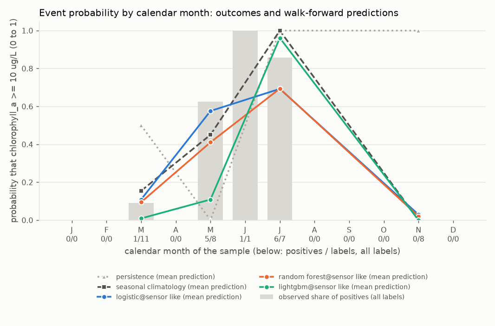
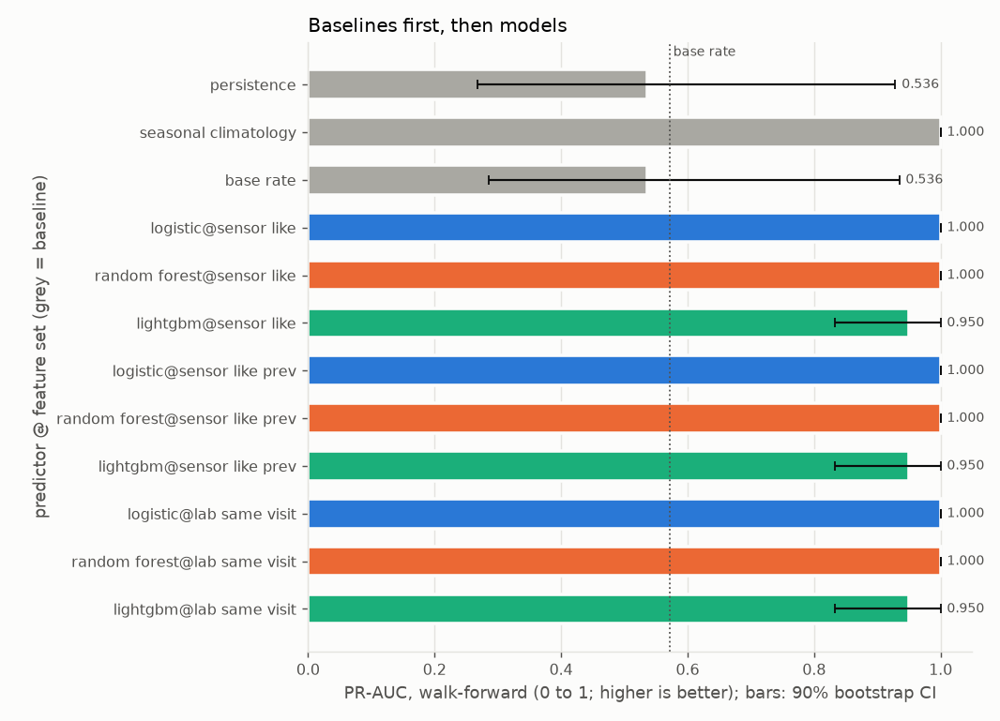
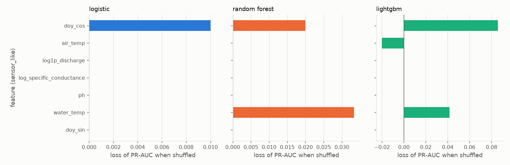
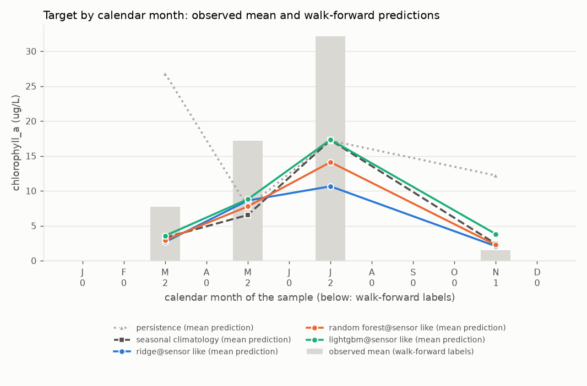
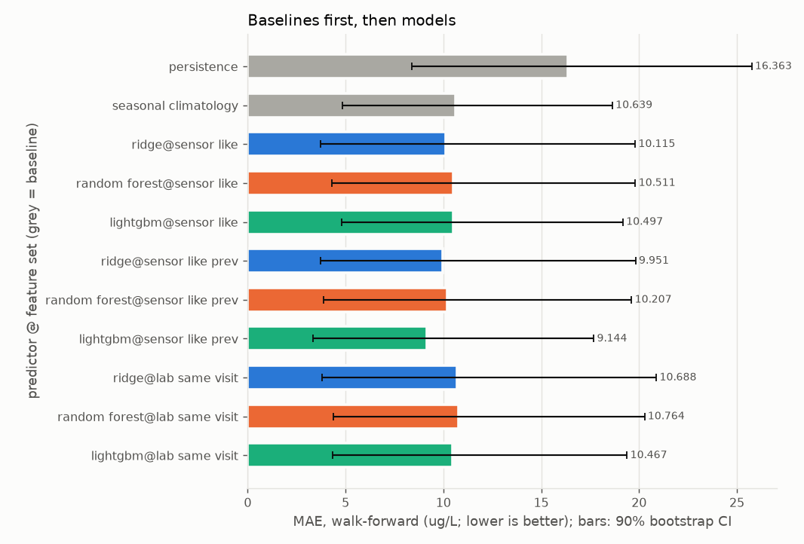
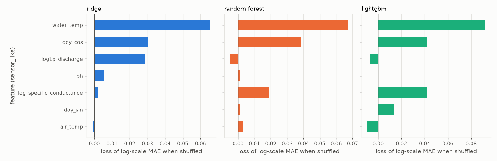

# Report: crp_chla_13202

Real grab-sample data, `source=CRP` only, labels from 2014-01-01; `quality='good'` rows only. Input `data/clean/crp_long.csv` (SHA-256 `eef7c00928bcd8ce...`). Stations: 13202.

Chlorophyll-a at CRP station 13202 only. Primary target: the event chlorophyll_a >= 10 ug/L on the sample date. Secondary: the concentration (log1p regression).

## First lines

### Primary target: event chlorophyll_a >= 10 ug/L

- Labels used: 35 on 35 distinct dates, 13 positives (13202: 35).
- Censored labels: 10 left-censored at or below the threshold counted as negatives; 0 left-censored above the threshold dropped (unknown); 0 right-censored dropped.
- Walk-forward: 3 folds (test years 2021 to 2023), n_train from 21 to 26 (training positives 7 to 10), n_test = 7 on 7 dates, 4 positives.
- Final hold-out (evaluated once, last 7 distinct dates, from 2024-03-27): n_train = 28, n_holdout = 7, 2 positives; training positives 11.
- **Persistence** means: the last sample at this station, carried forward (the previous label at the same station on a strictly earlier date; with no earlier label, the training base rate).
- **Seasonal climatology** means: the mean of the training targets within plus or minus 1 calendar month(s) of the test month, pooled over the task's stations (with fewer than 3 training labels in that window, the mean of all training targets).
- **Base rate** means: the share of positives among the training labels.
- Verdicts, walk-forward, headline feature set `sensor_like` (deployable):
  - seasonal climatology beats persistence (PR-AUC difference +0.464, 90% CI [+0.071, +0.732]); Brier difference -0.477 [-0.746, -0.214] (lower is better).
  - logistic on sensor_like (deployable) beats persistence (PR-AUC difference +0.464, 90% CI [+0.071, +0.732]); Brier difference -0.488 [-0.785, -0.189] (lower is better).
  - logistic on sensor_like (deployable) shows no demonstrable difference from seasonal climatology (PR-AUC difference +0.000, 90% CI [+0.000, +0.000]); Brier difference -0.010 [-0.077, +0.048] (lower is better).
  - random_forest on sensor_like (deployable) beats persistence (PR-AUC difference +0.464, 90% CI [+0.071, +0.732]); Brier difference -0.438 [-0.734, -0.148] (lower is better).
  - random_forest on sensor_like (deployable) shows no demonstrable difference from seasonal climatology (PR-AUC difference +0.000, 90% CI [+0.000, +0.000]); Brier difference +0.040 [-0.033, +0.113] (lower is better).
  - lightgbm on sensor_like (deployable) beats persistence (PR-AUC difference +0.414, 90% CI [+0.024, +0.670]); Brier difference -0.341 [-0.626, -0.056] (lower is better).
  - lightgbm on sensor_like (deployable) shows no demonstrable difference from seasonal climatology (PR-AUC difference -0.050, 90% CI [-0.167, +0.000]); Brier difference +0.137 [-0.009, +0.315] (lower is better).
- Verdicts, final hold-out, headline feature set `sensor_like`:
  - seasonal climatology beats persistence (PR-AUC difference +0.381, 90% CI [+0.114, +0.857]); Brier difference -0.369 [-0.631, -0.110] (lower is better).
  - logistic on sensor_like (deployable) beats persistence (PR-AUC difference +0.414, 90% CI [+0.048, +0.857]); Brier difference -0.437 [-0.733, -0.134] (lower is better).
  - logistic on sensor_like (deployable) shows no demonstrable difference from seasonal climatology (PR-AUC difference +0.033, 90% CI [-0.600, +0.667]); Brier difference -0.068 [-0.319, +0.145] (lower is better).
  - random_forest on sensor_like (deployable) beats persistence (PR-AUC difference +0.548, 90% CI [+0.190, +0.857]); Brier difference -0.452 [-0.733, -0.174] (lower is better).
  - random_forest on sensor_like (deployable) shows no demonstrable difference from seasonal climatology (PR-AUC difference +0.167, 90% CI [+0.000, +0.667]); Brier difference -0.082 [-0.267, +0.045] (lower is better).
  - lightgbm on sensor_like (deployable) beats persistence (PR-AUC difference +0.464, 90% CI [+0.107, +0.857]); Brier difference -0.357 [-0.746, +0.046] (lower is better).
  - lightgbm on sensor_like (deployable) shows no demonstrable difference from seasonal climatology (PR-AUC difference +0.083, 90% CI [-0.500, +0.667]); Brier difference +0.012 [-0.291, +0.318] (lower is better).

### Secondary target: regression of chlorophyll_a (ug/L), fitted on the log1p scale

- Labels used: 35 on 35 distinct dates, 10 left-censored (13202: 35).
- Censored labels: left-censored values enter at detection limit x 0.5; 0 right-censored dropped.
- Walk-forward: 3 folds (test years 2021 to 2023), n_train from 21 to 26, n_test = 7 on 7 dates.
- Final hold-out (evaluated once, last 7 distinct dates, from 2024-03-27): n_train = 28, n_holdout = 7.
- **Persistence** means: the last sample at this station, carried forward (the previous label at the same station on a strictly earlier date; with no earlier label, the training median).
- **Seasonal climatology** means: the mean of the training targets within plus or minus 1 calendar month(s) of the test month, pooled over the task's stations (with fewer than 3 training labels in that window, the mean of all training targets).
- Verdicts, walk-forward, headline feature set `sensor_like` (deployable):
  - seasonal climatology shows no demonstrable difference from persistence (MAE difference -5.724, 90% CI [-15.477, +1.819]).
  - ridge on sensor_like (deployable) shows no demonstrable difference from persistence (MAE difference -6.247, 90% CI [-15.463, +1.465]).
  - ridge on sensor_like (deployable) shows no demonstrable difference from seasonal climatology (MAE difference -0.524, 90% CI [-2.463, +1.284]).
  - random_forest on sensor_like (deployable) shows no demonstrable difference from persistence (MAE difference -5.852, 90% CI [-15.158, +1.658]).
  - random_forest on sensor_like (deployable) shows no demonstrable difference from seasonal climatology (MAE difference -0.128, 90% CI [-1.615, +1.267]).
  - lightgbm on sensor_like (deployable) shows no demonstrable difference from persistence (MAE difference -5.866, 90% CI [-14.865, +1.437]).
  - lightgbm on sensor_like (deployable) shows no demonstrable difference from seasonal climatology (MAE difference -0.142, 90% CI [-1.202, +0.905]).
- Verdicts, final hold-out, headline feature set `sensor_like`:
  - seasonal climatology beats persistence (MAE difference -3.477, 90% CI [-6.879, -0.517]).
  - ridge on sensor_like (deployable) beats persistence (MAE difference -4.924, 90% CI [-8.032, -1.967]).
  - ridge on sensor_like (deployable) shows no demonstrable difference from seasonal climatology (MAE difference -1.447, 90% CI [-4.122, +1.744]).
  - random_forest on sensor_like (deployable) beats persistence (MAE difference -5.687, 90% CI [-8.254, -3.984]).
  - random_forest on sensor_like (deployable) shows no demonstrable difference from seasonal climatology (MAE difference -2.211, 90% CI [-4.584, +0.088]).
  - lightgbm on sensor_like (deployable) beats persistence (MAE difference -5.896, 90% CI [-8.397, -3.582]).
  - lightgbm on sensor_like (deployable) shows no demonstrable difference from seasonal climatology (MAE difference -2.420, 90% CI [-4.748, +0.329]).

## Warnings

- WARNING [event, regression] fold 2018 skipped: 14 training labels, fewer than min_train_labels=20.
- WARNING [event, regression] fold 2019 skipped: 15 training labels, fewer than min_train_labels=20.
- WARNING [event, regression] fold 2020 skipped: 19 training labels, fewer than min_train_labels=20.
- WARNING [event, regression] n_train below 50 in: 2021 (21), 2022 (24), 2023 (26), holdout (28).
- WARNING [event] the hold-out has 2 positives, fewer than 10: hold-out event metrics are very uncertain.
- WARNING [event] walk-forward slices with zero positives (undefined: no positives): oct_mar.
- WARNING [event] holdout slices with zero positives (undefined: no positives): oct_mar.
- WARNING [event, regression] feature set sensor_like: only 20% of the 5 labels in 2025 and 2026 have every feature (below 50%); the rest are imputed.
- WARNING [event, regression] feature set sensor_like_prev: only 20% of the 5 labels in 2025 and 2026 have every feature (below 50%); the rest are imputed.
- WARNING [event, regression] feature set lab_same_visit: only 20% of the 5 labels in 2025 and 2026 have every feature (below 50%); the rest are imputed.
- WARNING [event, regression] 5 of 6 station-years in the test windows have fewer than 4 labels (minimum 1).
- WARNING [event] LEAKAGE SUSPECTED: shuffled-label skill for logistic@sensor_like, random_forest@sensor_like, lightgbm@sensor_like, logistic@sensor_like_prev, random_forest@sensor_like_prev, lightgbm@sensor_like_prev, logistic@lab_same_visit, random_forest@lab_same_visit, lightgbm@lab_same_visit.
- WARNING [regression] only 7 walk-forward residuals (fewer than 30): the conformal intervals are not meaningful.
- WARNING [regression] LEAKAGE SUSPECTED: shuffled-label skill for ridge@sensor_like, ridge@lab_same_visit.

## Metrics

### Event target: event chlorophyll_a >= 10 ug/L

Folds:

| fold | n_train | n_test | last train date | first test date | last test date | train positives | test positives |
|---|---|---|---|---|---|---|---|
| 2021 | 21 | 3 | 2020-11-30 | 2021-03-31 | 2021-07-26 | 7 | 2 |
| 2022 | 24 | 2 | 2021-07-26 | 2022-03-16 | 2022-05-18 | 9 | 1 |
| 2023 | 26 | 2 | 2022-05-18 | 2023-07-18 | 2023-11-29 | 10 | 1 |
| holdout | 28 | 7 | 2023-11-29 | 2024-03-27 | 2026-03-30 | 11 | 2 |

#### Walk-forward

n = 7 on 7 dates, 4 positives, base rate 0.571. Baselines first, then models. Brackets: 90% bootstrap CI over distinct dates.

| predictor | deployable | PR-AUC | ROC-AUC | Brier | Brier skill vs base rate |
|---|---|---|---|---|---|
| persistence | baseline | 0.536 [0.268, 0.929] | 0.417 [0.100, 0.750] | 0.571 [0.286, 0.857] | -0.944 [-2.384, 0.191] |
| seasonal_climatology | baseline | 1.000 [1.000, 1.000] | 1.000 [1.000, 1.000] | 0.094 [0.008, 0.182] | 0.680 [0.440, 0.967] |
| base_rate | baseline | 0.536 [0.286, 0.935] | 0.417 [0.083, 0.800] | 0.294 [0.210, 0.381] | 0.000 [0.000, 0.000] |
| logistic@sensor_like | yes | 1.000 [1.000, 1.000] | 1.000 [1.000, 1.000] | 0.084 [0.037, 0.133] | 0.715 [0.611, 0.832] |
| random_forest@sensor_like | yes | 1.000 [1.000, 1.000] | 1.000 [1.000, 1.000] | 0.134 [0.040, 0.243] | 0.545 [0.261, 0.830] |
| lightgbm@sensor_like | yes | 0.950 [0.833, 1.000] | 0.917 [0.667, 1.000] | 0.231 [0.001, 0.461] | 0.215 [-0.472, 0.997] |
| logistic@sensor_like_prev | yes | 1.000 [1.000, 1.000] | 1.000 [1.000, 1.000] | 0.098 [0.052, 0.151] | 0.668 [0.566, 0.777] |
| random_forest@sensor_like_prev | yes | 1.000 [1.000, 1.000] | 1.000 [1.000, 1.000] | 0.123 [0.055, 0.192] | 0.581 [0.457, 0.742] |
| lightgbm@sensor_like_prev | yes | 0.950 [0.833, 1.000] | 0.917 [0.667, 1.000] | 0.168 [0.001, 0.426] | 0.429 [-0.261, 0.998] |
| logistic@lab_same_visit | NO (diagnostic) | 1.000 [1.000, 1.000] | 1.000 [1.000, 1.000] | 0.097 [0.041, 0.152] | 0.671 [0.572, 0.808] |
| random_forest@lab_same_visit | NO (diagnostic) | 1.000 [1.000, 1.000] | 1.000 [1.000, 1.000] | 0.138 [0.048, 0.236] | 0.532 [0.306, 0.803] |
| lightgbm@lab_same_visit | NO (diagnostic) | 0.950 [0.833, 1.000] | 0.917 [0.667, 1.000] | 0.222 [0.005, 0.439] | 0.245 [-0.442, 0.976] |

At p = 0.5:

| predictor | precision | recall | F1 | TP | FP | FN | TN |
|---|---|---|---|---|---|---|---|
| persistence | 0.500 [0.000, 1.000] | 0.500 [0.000, 1.000] | 0.500 [0.000, 0.800] | 2 | 2 | 2 | 1 |
| seasonal_climatology | 1.000 [1.000, 1.000] | 0.750 [0.333, 1.000] | 0.857 [0.500, 1.000] | 3 | 0 | 1 | 3 |
| base_rate | undefined | 0.000 [0.000, 0.000] | 0.000 [0.000, 0.000] | 0 | 0 | 4 | 3 |
| logistic@sensor_like | 1.000 [1.000, 1.000] | 1.000 [1.000, 1.000] | 1.000 [1.000, 1.000] | 4 | 0 | 0 | 3 |
| random_forest@sensor_like | 1.000 [1.000, 1.000] | 0.750 [0.333, 1.000] | 0.857 [0.500, 1.000] | 3 | 0 | 1 | 3 |
| lightgbm@sensor_like | 1.000 [1.000, 1.000] | 0.500 [0.000, 1.000] | 0.667 [0.000, 1.000] | 2 | 0 | 2 | 3 |
| logistic@sensor_like_prev | 1.000 [1.000, 1.000] | 1.000 [1.000, 1.000] | 1.000 [1.000, 1.000] | 4 | 0 | 0 | 3 |
| random_forest@sensor_like_prev | 1.000 [1.000, 1.000] | 0.750 [0.333, 1.000] | 0.857 [0.500, 1.000] | 3 | 0 | 1 | 3 |
| lightgbm@sensor_like_prev | 1.000 [1.000, 1.000] | 0.750 [0.333, 1.000] | 0.857 [0.500, 1.000] | 3 | 0 | 1 | 3 |
| logistic@lab_same_visit | 1.000 [1.000, 1.000] | 1.000 [1.000, 1.000] | 1.000 [1.000, 1.000] | 4 | 0 | 0 | 3 |
| random_forest@lab_same_visit | 1.000 [1.000, 1.000] | 0.500 [0.000, 1.000] | 0.667 [0.000, 1.000] | 2 | 0 | 2 | 3 |
| lightgbm@lab_same_visit | 1.000 [1.000, 1.000] | 0.500 [0.000, 1.000] | 0.667 [0.000, 1.000] | 2 | 0 | 2 | 3 |

At p* = 0.10 (C_FP=1, C_FN=9, PLACEHOLDER):

| predictor | precision | recall | F1 | TP | FP | FN | TN |
|---|---|---|---|---|---|---|---|
| persistence | 0.500 [0.000, 1.000] | 0.500 [0.000, 1.000] | 0.500 [0.000, 0.800] | 2 | 2 | 2 | 1 |
| seasonal_climatology | 0.667 [0.333, 1.000] | 1.000 [1.000, 1.000] | 0.800 [0.500, 1.000] | 4 | 2 | 0 | 1 |
| base_rate | 0.571 [0.286, 0.857] | 1.000 [1.000, 1.000] | 0.727 [0.444, 0.923] | 4 | 3 | 0 | 0 |
| logistic@sensor_like | 0.800 [0.500, 1.000] | 1.000 [1.000, 1.000] | 0.889 [0.667, 1.000] | 4 | 1 | 0 | 2 |
| random_forest@sensor_like | 0.800 [0.500, 1.000] | 1.000 [1.000, 1.000] | 0.889 [0.667, 1.000] | 4 | 1 | 0 | 2 |
| lightgbm@sensor_like | 1.000 [1.000, 1.000] | 0.750 [0.333, 1.000] | 0.857 [0.500, 1.000] | 3 | 0 | 1 | 3 |
| logistic@sensor_like_prev | 0.667 [0.333, 1.000] | 1.000 [1.000, 1.000] | 0.800 [0.500, 1.000] | 4 | 2 | 0 | 1 |
| random_forest@sensor_like_prev | 0.800 [0.500, 1.000] | 1.000 [1.000, 1.000] | 0.889 [0.667, 1.000] | 4 | 1 | 0 | 2 |
| lightgbm@sensor_like_prev | 1.000 [1.000, 1.000] | 0.750 [0.333, 1.000] | 0.857 [0.500, 1.000] | 3 | 0 | 1 | 3 |
| logistic@lab_same_visit | 0.800 [0.500, 1.000] | 1.000 [1.000, 1.000] | 0.889 [0.667, 1.000] | 4 | 1 | 0 | 2 |
| random_forest@lab_same_visit | 0.800 [0.500, 1.000] | 1.000 [1.000, 1.000] | 0.889 [0.667, 1.000] | 4 | 1 | 0 | 2 |
| lightgbm@lab_same_visit | 1.000 [1.000, 1.000] | 0.750 [0.333, 1.000] | 0.857 [0.500, 1.000] | 3 | 0 | 1 | 3 |

Paired differences (higher PR-AUC and lower Brier are better):

| model | baseline | PR-AUC difference (model - baseline) | Brier difference | verdict (by PR-AUC) |
|---|---|---|---|---|
| persistence | seasonal_climatology | -0.464 [-0.732, -0.071] | +0.477 [+0.214, +0.746] | is worse than |
| persistence | base_rate | +0.000 [-0.191, +0.086] | +0.277 [-0.068, +0.596] | no demonstrable difference |
| seasonal_climatology | persistence | +0.464 [+0.071, +0.732] | -0.477 [-0.746, -0.214] | beats |
| seasonal_climatology | base_rate | +0.464 [+0.065, +0.714] | -0.200 [-0.295, -0.117] | beats |
| base_rate | persistence | +0.000 [-0.086, +0.191] | -0.277 [-0.596, +0.068] | no demonstrable difference |
| base_rate | seasonal_climatology | -0.464 [-0.714, -0.065] | +0.200 [+0.117, +0.295] | is worse than |
| logistic@sensor_like | persistence | +0.464 [+0.071, +0.732] | -0.488 [-0.785, -0.189] | beats |
| logistic@sensor_like | seasonal_climatology | +0.000 [+0.000, +0.000] | -0.010 [-0.077, +0.048] | no demonstrable difference |
| logistic@sensor_like | base_rate | +0.464 [+0.065, +0.714] | -0.210 [-0.266, -0.157] | beats |
| random_forest@sensor_like | persistence | +0.464 [+0.071, +0.732] | -0.438 [-0.734, -0.148] | beats |
| random_forest@sensor_like | seasonal_climatology | +0.000 [+0.000, +0.000] | +0.040 [-0.033, +0.113] | no demonstrable difference |
| random_forest@sensor_like | base_rate | +0.464 [+0.065, +0.714] | -0.160 [-0.241, -0.078] | beats |
| lightgbm@sensor_like | persistence | +0.414 [+0.024, +0.670] | -0.341 [-0.626, -0.056] | beats |
| lightgbm@sensor_like | seasonal_climatology | -0.050 [-0.167, +0.000] | +0.137 [-0.009, +0.315] | no demonstrable difference |
| lightgbm@sensor_like | base_rate | +0.414 [+0.000, +0.669] | -0.063 [-0.263, +0.148] | no demonstrable difference |
| logistic@sensor_like_prev | persistence | +0.464 [+0.071, +0.732] | -0.474 [-0.784, -0.147] | beats |
| logistic@sensor_like_prev | seasonal_climatology | +0.000 [+0.000, +0.000] | +0.004 [-0.080, +0.090] | no demonstrable difference |
| logistic@sensor_like_prev | base_rate | +0.464 [+0.065, +0.714] | -0.196 [-0.252, -0.148] | beats |
| random_forest@sensor_like_prev | persistence | +0.464 [+0.071, +0.732] | -0.448 [-0.749, -0.141] | beats |
| random_forest@sensor_like_prev | seasonal_climatology | +0.000 [+0.000, +0.000] | +0.029 [-0.034, +0.095] | no demonstrable difference |
| random_forest@sensor_like_prev | base_rate | +0.464 [+0.065, +0.714] | -0.171 [-0.218, -0.130] | beats |
| lightgbm@sensor_like_prev | persistence | +0.414 [+0.024, +0.670] | -0.404 [-0.689, -0.120] | beats |
| lightgbm@sensor_like_prev | seasonal_climatology | -0.050 [-0.167, +0.000] | +0.074 [-0.062, +0.286] | no demonstrable difference |
| lightgbm@sensor_like_prev | base_rate | +0.414 [+0.000, +0.669] | -0.126 [-0.300, +0.078] | no demonstrable difference |
| logistic@lab_same_visit | persistence | +0.464 [+0.071, +0.732] | -0.475 [-0.769, -0.169] | beats |
| logistic@lab_same_visit | seasonal_climatology | +0.000 [+0.000, +0.000] | +0.003 [-0.059, +0.066] | no demonstrable difference |
| logistic@lab_same_visit | base_rate | +0.464 [+0.065, +0.714] | -0.197 [-0.246, -0.152] | beats |
| random_forest@lab_same_visit | persistence | +0.464 [+0.071, +0.732] | -0.434 [-0.724, -0.142] | beats |
| random_forest@lab_same_visit | seasonal_climatology | +0.000 [+0.000, +0.000] | +0.044 [-0.010, +0.101] | no demonstrable difference |
| random_forest@lab_same_visit | base_rate | +0.464 [+0.065, +0.714] | -0.156 [-0.225, -0.091] | beats |
| lightgbm@lab_same_visit | persistence | +0.414 [+0.024, +0.670] | -0.350 [-0.635, -0.069] | beats |
| lightgbm@lab_same_visit | seasonal_climatology | -0.050 [-0.167, +0.000] | +0.128 [-0.002, +0.317] | no demonstrable difference |
| lightgbm@lab_same_visit | base_rate | +0.414 [+0.000, +0.669] | -0.072 [-0.259, +0.135] | no demonstrable difference |

#### Final hold-out (evaluated once)

n = 7 on 7 dates, 2 positives, base rate 0.286. Baselines first, then models. Brackets: 90% bootstrap CI over distinct dates.

| predictor | deployable | PR-AUC | ROC-AUC | Brier | Brier skill vs base rate |
|---|---|---|---|---|---|
| persistence | baseline | 0.286 [0.143, 0.571] | 0.300 [0.100, 0.500] | 0.571 [0.286, 0.857] | -1.651 [-2.976, -0.325] |
| seasonal_climatology | baseline | 0.667 [0.333, 1.000] | 0.800 [0.500, 1.000] | 0.202 [0.035, 0.457] | 0.063 [-1.242, 0.810] |
| base_rate | baseline | 0.286 [0.143, 0.571] | 0.500 [0.500, 0.500] | 0.216 [0.154, 0.277] | 0.000 [0.000, 0.000] |
| logistic@sensor_like | yes | 0.700 [0.200, 1.000] | 0.700 [0.200, 1.000] | 0.134 [0.034, 0.263] | 0.378 [-0.085, 0.834] |
| random_forest@sensor_like | yes | 0.833 [0.500, 1.000] | 0.900 [0.600, 1.000] | 0.120 [0.050, 0.190] | 0.445 [0.121, 0.743] |
| lightgbm@sensor_like | yes | 0.750 [0.250, 1.000] | 0.800 [0.400, 1.000] | 0.214 [0.014, 0.418] | 0.006 [-1.113, 0.923] |
| logistic@sensor_like_prev | yes | 0.700 [0.200, 1.000] | 0.700 [0.200, 1.000] | 0.148 [0.048, 0.267] | 0.313 [-0.131, 0.771] |
| random_forest@sensor_like_prev | yes | 0.833 [0.500, 1.000] | 0.900 [0.600, 1.000] | 0.129 [0.039, 0.221] | 0.400 [-0.014, 0.801] |
| lightgbm@sensor_like_prev | yes | 0.750 [0.250, 1.000] | 0.800 [0.400, 1.000] | 0.381 [0.120, 0.642] | -0.769 [-2.054, 0.447] |
| logistic@lab_same_visit | NO (diagnostic) | 0.700 [0.200, 1.000] | 0.700 [0.200, 1.000] | 0.135 [0.034, 0.263] | 0.374 [-0.094, 0.835] |
| random_forest@lab_same_visit | NO (diagnostic) | 0.833 [0.500, 1.000] | 0.900 [0.600, 1.000] | 0.124 [0.062, 0.189] | 0.424 [0.152, 0.677] |
| lightgbm@lab_same_visit | NO (diagnostic) | 0.750 [0.250, 1.000] | 0.850 [0.583, 1.000] | 0.203 [0.022, 0.407] | 0.059 [-1.079, 0.879] |

At p = 0.5:

| predictor | precision | recall | F1 | TP | FP | FN | TN |
|---|---|---|---|---|---|---|---|
| persistence | 0.000 [0.000, 0.000] | 0.000 [0.000, 0.000] | 0.000 [0.000, 0.000] | 0 | 2 | 2 | 3 |
| seasonal_climatology | 0.667 [0.000, 1.000] | 1.000 [1.000, 1.000] | 0.800 [0.000, 1.000] | 2 | 1 | 0 | 4 |
| base_rate | undefined | 0.000 [0.000, 0.000] | 0.000 [0.000, 0.000] | 0 | 0 | 2 | 5 |
| logistic@sensor_like | 1.000 [1.000, 1.000] | 0.500 [0.000, 1.000] | 0.667 [0.000, 1.000] | 1 | 0 | 1 | 5 |
| random_forest@sensor_like | 0.500 [0.000, 1.000] | 0.500 [0.000, 1.000] | 0.500 [0.000, 1.000] | 1 | 1 | 1 | 4 |
| lightgbm@sensor_like | 0.500 [0.000, 1.000] | 0.500 [0.000, 1.000] | 0.500 [0.000, 1.000] | 1 | 1 | 1 | 4 |
| logistic@sensor_like_prev | 1.000 [1.000, 1.000] | 0.500 [0.000, 1.000] | 0.667 [0.000, 1.000] | 1 | 0 | 1 | 5 |
| random_forest@sensor_like_prev | 0.500 [0.000, 1.000] | 0.500 [0.000, 1.000] | 0.500 [0.000, 1.000] | 1 | 1 | 1 | 4 |
| lightgbm@sensor_like_prev | 0.333 [0.000, 1.000] | 0.500 [0.000, 1.000] | 0.400 [0.000, 0.800] | 1 | 2 | 1 | 3 |
| logistic@lab_same_visit | 1.000 [1.000, 1.000] | 0.500 [0.000, 1.000] | 0.667 [0.000, 1.000] | 1 | 0 | 1 | 5 |
| random_forest@lab_same_visit | 0.500 [0.000, 1.000] | 0.500 [0.000, 1.000] | 0.500 [0.000, 1.000] | 1 | 1 | 1 | 4 |
| lightgbm@lab_same_visit | 0.500 [0.000, 1.000] | 0.500 [0.000, 1.000] | 0.500 [0.000, 1.000] | 1 | 1 | 1 | 4 |

At p* = 0.10 (C_FP=1, C_FN=9, PLACEHOLDER):

| predictor | precision | recall | F1 | TP | FP | FN | TN |
|---|---|---|---|---|---|---|---|
| persistence | 0.000 [0.000, 0.000] | 0.000 [0.000, 0.000] | 0.000 [0.000, 0.000] | 0 | 2 | 2 | 3 |
| seasonal_climatology | 0.333 [0.000, 0.667] | 1.000 [1.000, 1.000] | 0.500 [0.000, 0.800] | 2 | 4 | 0 | 1 |
| base_rate | 0.286 [0.000, 0.571] | 1.000 [1.000, 1.000] | 0.444 [0.000, 0.727] | 2 | 5 | 0 | 0 |
| logistic@sensor_like | 0.333 [0.000, 0.667] | 1.000 [1.000, 1.000] | 0.500 [0.000, 0.800] | 2 | 4 | 0 | 1 |
| random_forest@sensor_like | 0.286 [0.000, 0.571] | 1.000 [1.000, 1.000] | 0.444 [0.000, 0.727] | 2 | 5 | 0 | 0 |
| lightgbm@sensor_like | 0.500 [0.000, 1.000] | 1.000 [1.000, 1.000] | 0.667 [0.000, 1.000] | 2 | 2 | 0 | 3 |
| logistic@sensor_like_prev | 0.333 [0.000, 0.667] | 1.000 [1.000, 1.000] | 0.500 [0.000, 0.800] | 2 | 4 | 0 | 1 |
| random_forest@sensor_like_prev | 0.286 [0.000, 0.571] | 1.000 [1.000, 1.000] | 0.444 [0.000, 0.727] | 2 | 5 | 0 | 0 |
| lightgbm@sensor_like_prev | 0.333 [0.000, 1.000] | 0.500 [0.000, 1.000] | 0.400 [0.000, 0.800] | 1 | 2 | 1 | 3 |
| logistic@lab_same_visit | 0.333 [0.000, 0.667] | 1.000 [1.000, 1.000] | 0.500 [0.000, 0.800] | 2 | 4 | 0 | 1 |
| random_forest@lab_same_visit | 0.286 [0.000, 0.571] | 1.000 [1.000, 1.000] | 0.444 [0.000, 0.727] | 2 | 5 | 0 | 0 |
| lightgbm@lab_same_visit | 0.500 [0.000, 1.000] | 1.000 [1.000, 1.000] | 0.667 [0.000, 1.000] | 2 | 2 | 0 | 3 |

Paired differences (higher PR-AUC and lower Brier are better):

| model | baseline | PR-AUC difference (model - baseline) | Brier difference | verdict (by PR-AUC) |
|---|---|---|---|---|
| persistence | seasonal_climatology | -0.381 [-0.857, -0.114] | +0.369 [+0.110, +0.631] | is worse than |
| persistence | base_rate | +0.000 [+0.000, +0.000] | +0.356 [+0.070, +0.642] | no demonstrable difference |
| seasonal_climatology | persistence | +0.381 [+0.114, +0.857] | -0.369 [-0.631, -0.110] | beats |
| seasonal_climatology | base_rate | +0.381 [+0.114, +0.857] | -0.014 [-0.165, +0.268] | beats |
| base_rate | persistence | +0.000 [+0.000, +0.000] | -0.356 [-0.642, -0.070] | no demonstrable difference |
| base_rate | seasonal_climatology | -0.381 [-0.857, -0.114] | +0.014 [-0.268, +0.165] | is worse than |
| logistic@sensor_like | persistence | +0.414 [+0.048, +0.857] | -0.437 [-0.733, -0.134] | beats |
| logistic@sensor_like | seasonal_climatology | +0.033 [-0.600, +0.667] | -0.068 [-0.319, +0.145] | no demonstrable difference |
| logistic@sensor_like | base_rate | +0.414 [+0.048, +0.857] | -0.082 [-0.180, +0.018] | beats |
| random_forest@sensor_like | persistence | +0.548 [+0.190, +0.857] | -0.452 [-0.733, -0.174] | beats |
| random_forest@sensor_like | seasonal_climatology | +0.167 [+0.000, +0.667] | -0.082 [-0.267, +0.045] | no demonstrable difference |
| random_forest@sensor_like | base_rate | +0.548 [+0.190, +0.857] | -0.096 [-0.171, -0.025] | beats |
| lightgbm@sensor_like | persistence | +0.464 [+0.107, +0.857] | -0.357 [-0.746, +0.046] | beats |
| lightgbm@sensor_like | seasonal_climatology | +0.083 [-0.500, +0.667] | +0.012 [-0.291, +0.318] | no demonstrable difference |
| lightgbm@sensor_like | base_rate | +0.464 [+0.107, +0.857] | -0.001 [-0.179, +0.219] | beats |
| logistic@sensor_like_prev | persistence | +0.414 [+0.048, +0.857] | -0.423 [-0.708, -0.134] | beats |
| logistic@sensor_like_prev | seasonal_climatology | +0.033 [-0.600, +0.667] | -0.054 [-0.307, +0.154] | no demonstrable difference |
| logistic@sensor_like_prev | base_rate | +0.414 [+0.048, +0.857] | -0.067 [-0.169, +0.028] | beats |
| random_forest@sensor_like_prev | persistence | +0.548 [+0.190, +0.857] | -0.442 [-0.725, -0.161] | beats |
| random_forest@sensor_like_prev | seasonal_climatology | +0.167 [+0.000, +0.667] | -0.073 [-0.237, +0.057] | no demonstrable difference |
| random_forest@sensor_like_prev | base_rate | +0.548 [+0.190, +0.857] | -0.086 [-0.174, +0.003] | beats |
| lightgbm@sensor_like_prev | persistence | +0.464 [+0.107, +0.857] | -0.190 [-0.589, +0.214] | beats |
| lightgbm@sensor_like_prev | seasonal_climatology | +0.083 [-0.500, +0.667] | +0.179 [-0.076, +0.449] | no demonstrable difference |
| lightgbm@sensor_like_prev | base_rate | +0.464 [+0.107, +0.857] | +0.166 [-0.110, +0.437] | beats |
| logistic@lab_same_visit | persistence | +0.414 [+0.048, +0.857] | -0.436 [-0.733, -0.134] | beats |
| logistic@lab_same_visit | seasonal_climatology | +0.033 [-0.600, +0.667] | -0.067 [-0.319, +0.146] | no demonstrable difference |
| logistic@lab_same_visit | base_rate | +0.414 [+0.048, +0.857] | -0.081 [-0.180, +0.020] | beats |
| random_forest@lab_same_visit | persistence | +0.548 [+0.190, +0.857] | -0.447 [-0.733, -0.165] | beats |
| random_forest@lab_same_visit | seasonal_climatology | +0.167 [+0.000, +0.667] | -0.078 [-0.279, +0.063] | no demonstrable difference |
| random_forest@lab_same_visit | base_rate | +0.548 [+0.190, +0.857] | -0.091 [-0.163, -0.031] | beats |
| lightgbm@lab_same_visit | persistence | +0.464 [+0.107, +0.857] | -0.369 [-0.760, +0.030] | beats |
| lightgbm@lab_same_visit | seasonal_climatology | +0.083 [-0.500, +0.667] | +0.001 [-0.276, +0.284] | no demonstrable difference |
| lightgbm@lab_same_visit | base_rate | +0.464 [+0.107, +0.857] | -0.013 [-0.193, +0.213] | beats |

### Regression target: regression of chlorophyll_a (ug/L), fitted on the log1p scale

Folds:

| fold | n_train | n_test | last train date | first test date | last test date |
|---|---|---|---|---|---|
| 2021 | 21 | 3 | 2020-11-30 | 2021-03-31 | 2021-07-26 |
| 2022 | 24 | 2 | 2021-07-26 | 2022-03-16 | 2022-05-18 |
| 2023 | 26 | 2 | 2022-05-18 | 2023-07-18 | 2023-11-29 |
| holdout | 28 | 7 | 2023-11-29 | 2024-03-27 | 2026-03-30 |

#### Walk-forward

All labels: n = 7 on 7 dates (1 left-censored). MAE and RMSE in ug/L. Brackets: 90% bootstrap CI over distinct dates.

| predictor | deployable | MAE | RMSE | R2 | MAE (log scale) | skill vs persistence | skill vs climatology |
|---|---|---|---|---|---|---|---|
| persistence | baseline | 16.363 [8.388, 25.761] | 21.810 [8.859, 29.899] | -0.986 [-30.875, 0.171] | 1.025 [0.693, 1.323] | 0.000 [0.000, 0.000] | -0.538 [-2.361, 0.117] |
| seasonal_climatology | baseline | 10.639 [4.860, 18.638] | 15.441 [5.739, 24.347] | 0.004 [-2.566, 0.178] | 0.723 [0.544, 0.906] | 0.350 [-0.133, 0.702] | 0.000 [0.000, 0.000] |
| ridge@sensor_like | yes | 10.115 [3.715, 19.804] | 16.612 [4.480, 27.367] | -0.152 [-1.417, 0.263] | 0.690 [0.421, 0.966] | 0.382 [-0.092, 0.760] | 0.049 [-0.084, 0.352] |
| random_forest@sensor_like | yes | 10.511 [4.303, 19.816] | 16.332 [5.123, 26.666] | -0.114 [-1.789, 0.157] | 0.721 [0.490, 0.981] | 0.358 [-0.127, 0.728] | 0.012 [-0.091, 0.220] |
| lightgbm@sensor_like | yes | 10.497 [4.808, 19.177] | 15.631 [5.621, 25.149] | -0.020 [-2.119, 0.173] | 0.721 [0.509, 0.951] | 0.359 [-0.105, 0.699] | 0.013 [-0.104, 0.163] |
| ridge@sensor_like_prev | yes | 9.951 [3.721, 19.828] | 16.381 [4.216, 27.156] | -0.120 [-1.253, 0.329] | 0.666 [0.437, 0.919] | 0.392 [-0.081, 0.767] | 0.065 [-0.063, 0.329] |
| random_forest@sensor_like_prev | yes | 10.207 [3.887, 19.620] | 16.297 [4.648, 26.759] | -0.109 [-1.549, 0.250] | 0.706 [0.466, 0.967] | 0.376 [-0.095, 0.746] | 0.041 [-0.100, 0.319] |
| lightgbm@sensor_like_prev | yes | 9.144 [3.320, 17.687] | 14.858 [4.222, 24.389] | 0.078 [-1.338, 0.488] | 0.509 [0.330, 0.718] | 0.441 [-0.034, 0.790] | 0.141 [-0.026, 0.416] |
| ridge@lab_same_visit | NO (diagnostic) | 10.688 [3.820, 20.887] | 17.507 [4.675, 28.762] | -0.280 [-1.722, 0.140] | 0.764 [0.462, 1.088] | 0.347 [-0.153, 0.747] | -0.005 [-0.140, 0.325] |
| random_forest@lab_same_visit | NO (diagnostic) | 10.764 [4.379, 20.283] | 16.706 [5.156, 27.280] | -0.166 [-1.957, 0.115] | 0.745 [0.510, 1.005] | 0.342 [-0.155, 0.722] | -0.012 [-0.117, 0.192] |
| lightgbm@lab_same_visit | NO (diagnostic) | 10.467 [4.340, 19.388] | 16.053 [5.132, 25.996] | -0.076 [-1.940, 0.140] | 0.726 [0.496, 0.973] | 0.360 [-0.101, 0.716] | 0.016 [-0.064, 0.171] |

Numeric-only (uncensored) labels: n = 6 on 6 dates (0 left-censored). MAE and RMSE in ug/L. Brackets: 90% bootstrap CI over distinct dates.

| predictor | deployable | MAE | RMSE | R2 | MAE (log scale) | skill vs persistence | skill vs climatology |
|---|---|---|---|---|---|---|---|
| persistence | baseline | 17.307 [7.001, 28.047] | 23.149 [7.917, 31.947] | -1.275 [-49.712, 0.072] | 0.918 [0.597, 1.234] | 0.000 [0.000, 0.000] | -0.411 [-1.970, 0.188] |
| seasonal_climatology | baseline | 12.261 [6.192, 21.129] | 16.674 [6.458, 26.218] | -0.180 [-5.651, -0.002] | 0.792 [0.625, 0.982] | 0.292 [-0.232, 0.663] | 0.000 [0.000, 0.000] |
| ridge@sensor_like | yes | 11.706 [4.567, 22.682] | 17.941 [5.275, 29.505] | -0.367 [-2.937, -0.209] | 0.771 [0.487, 1.060] | 0.324 [-0.158, 0.718] | 0.045 [-0.089, 0.327] |
| random_forest@sensor_like | yes | 12.136 [5.547, 22.838] | 17.637 [6.016, 28.750] | -0.321 [-4.538, -0.161] | 0.797 [0.551, 1.045] | 0.299 [-0.206, 0.678] | 0.010 [-0.096, 0.221] |
| lightgbm@sensor_like | yes | 11.862 [5.443, 21.530] | 16.857 [6.106, 27.101] | -0.206 [-4.460, -0.041] | 0.732 [0.484, 0.987] | 0.315 [-0.190, 0.683] | 0.033 [-0.068, 0.188] |
| ridge@sensor_like_prev | yes | 11.452 [4.575, 22.568] | 17.689 [4.893, 29.285] | -0.328 [-2.423, -0.181] | 0.724 [0.477, 0.997] | 0.338 [-0.152, 0.734] | 0.066 [-0.064, 0.335] |
| random_forest@sensor_like_prev | yes | 11.719 [4.792, 22.481] | 17.597 [5.464, 28.838] | -0.315 [-4.195, -0.150] | 0.762 [0.491, 1.033] | 0.323 [-0.169, 0.707] | 0.044 [-0.100, 0.335] |
| lightgbm@sensor_like_prev | yes | 10.525 [4.026, 20.371] | 16.045 [4.650, 26.241] | -0.093 [-3.510, 0.075] | 0.545 [0.346, 0.775] | 0.392 [-0.154, 0.769] | 0.142 [-0.010, 0.433] |
| ridge@lab_same_visit | NO (diagnostic) | 12.372 [4.886, 23.828] | 18.908 [5.514, 31.002] | -0.518 [-3.365, -0.335] | 0.857 [0.527, 1.187] | 0.285 [-0.215, 0.712] | -0.009 [-0.150, 0.291] |
| random_forest@lab_same_visit | NO (diagnostic) | 12.439 [5.740, 23.341] | 18.043 [6.114, 29.385] | -0.382 [-4.673, -0.215] | 0.827 [0.583, 1.076] | 0.281 [-0.236, 0.675] | -0.015 [-0.126, 0.192] |
| lightgbm@lab_same_visit | NO (diagnostic) | 11.921 [5.272, 21.951] | 17.324 [5.794, 27.988] | -0.274 [-4.590, -0.101] | 0.759 [0.491, 1.031] | 0.311 [-0.160, 0.675] | 0.028 [-0.052, 0.199] |

Paired differences (lower MAE is better):

| model | baseline | MAE difference (model - baseline) | verdict (by MAE) |
|---|---|---|---|
| persistence | seasonal_climatology | +5.724 [-1.819, +15.477] | no demonstrable difference |
| seasonal_climatology | persistence | -5.724 [-15.477, +1.819] | no demonstrable difference |
| ridge@sensor_like | persistence | -6.247 [-15.463, +1.465] | no demonstrable difference |
| ridge@sensor_like | seasonal_climatology | -0.524 [-2.463, +1.284] | no demonstrable difference |
| random_forest@sensor_like | persistence | -5.852 [-15.158, +1.658] | no demonstrable difference |
| random_forest@sensor_like | seasonal_climatology | -0.128 [-1.615, +1.267] | no demonstrable difference |
| lightgbm@sensor_like | persistence | -5.866 [-14.865, +1.437] | no demonstrable difference |
| lightgbm@sensor_like | seasonal_climatology | -0.142 [-1.202, +0.905] | no demonstrable difference |
| ridge@sensor_like_prev | persistence | -6.412 [-15.899, +1.291] | no demonstrable difference |
| ridge@sensor_like_prev | seasonal_climatology | -0.688 [-2.415, +0.974] | no demonstrable difference |
| random_forest@sensor_like_prev | persistence | -6.156 [-15.406, +1.230] | no demonstrable difference |
| random_forest@sensor_like_prev | seasonal_climatology | -0.432 [-2.266, +1.291] | no demonstrable difference |
| lightgbm@sensor_like_prev | persistence | -7.219 [-16.508, +0.460] | no demonstrable difference |
| lightgbm@sensor_like_prev | seasonal_climatology | -1.496 [-3.145, +0.251] | no demonstrable difference |
| ridge@lab_same_visit | persistence | -5.675 [-15.041, +2.408] | no demonstrable difference |
| ridge@lab_same_visit | seasonal_climatology | +0.048 [-2.068, +2.211] | no demonstrable difference |
| random_forest@lab_same_visit | persistence | -5.598 [-15.085, +2.118] | no demonstrable difference |
| random_forest@lab_same_visit | seasonal_climatology | +0.125 [-1.394, +1.644] | no demonstrable difference |
| lightgbm@lab_same_visit | persistence | -5.896 [-15.118, +1.276] | no demonstrable difference |
| lightgbm@lab_same_visit | seasonal_climatology | -0.172 [-1.199, +0.827] | no demonstrable difference |

#### Final hold-out (evaluated once)

All labels: n = 7 on 7 dates (1 left-censored). MAE and RMSE in ug/L. Brackets: 90% bootstrap CI over distinct dates.

| predictor | deployable | MAE | RMSE | R2 | MAE (log scale) | skill vs persistence | skill vs climatology |
|---|---|---|---|---|---|---|---|
| persistence | baseline | 8.364 [6.292, 10.489] | 9.056 [6.781, 11.125] | -1.730 [-9.178, -0.461] | 1.042 [0.781, 1.286] | 0.000 [0.000, 0.000] | -0.711 [-2.676, -0.070] |
| seasonal_climatology | baseline | 4.888 [2.287, 7.159] | 6.183 [3.600, 7.871] | -0.273 [-3.055, 0.402] | 0.469 [0.296, 0.625] | 0.416 [0.066, 0.728] | 0.000 [0.000, 0.000] |
| ridge@sensor_like | yes | 3.440 [2.337, 4.622] | 3.907 [2.698, 4.834] | 0.492 [-1.530, 0.772] | 0.435 [0.249, 0.667] | 0.589 [0.302, 0.771] | 0.296 [-0.674, 0.619] |
| random_forest@sensor_like | yes | 2.677 [1.146, 4.161] | 3.588 [1.759, 4.936] | 0.571 [-0.158, 0.863] | 0.306 [0.166, 0.441] | 0.680 [0.517, 0.858] | 0.452 [-0.027, 0.735] |
| lightgbm@sensor_like | yes | 2.468 [1.868, 3.050] | 2.640 [2.049, 3.166] | 0.768 [0.178, 0.845] | 0.329 [0.204, 0.508] | 0.705 [0.551, 0.806] | 0.495 [-0.149, 0.680] |
| ridge@sensor_like_prev | yes | 3.974 [2.366, 5.573] | 4.722 [3.148, 5.996] | 0.257 [-2.814, 0.712] | 0.493 [0.279, 0.755] | 0.525 [0.183, 0.754] | 0.187 [-0.993, 0.600] |
| random_forest@sensor_like_prev | yes | 2.580 [0.944, 4.215] | 3.622 [1.482, 5.084] | 0.563 [-0.264, 0.901] | 0.301 [0.137, 0.457] | 0.692 [0.518, 0.882] | 0.472 [-0.069, 0.780] |
| lightgbm@sensor_like_prev | yes | 2.874 [1.658, 4.258] | 3.572 [1.861, 5.011] | 0.575 [-0.223, 0.873] | 0.367 [0.218, 0.510] | 0.656 [0.512, 0.800] | 0.412 [-0.148, 0.673] |
| ridge@lab_same_visit | NO (diagnostic) | 3.463 [2.349, 4.666] | 3.939 [2.724, 4.881] | 0.483 [-1.574, 0.770] | 0.437 [0.249, 0.671] | 0.586 [0.297, 0.770] | 0.292 [-0.685, 0.615] |
| random_forest@lab_same_visit | NO (diagnostic) | 2.384 [0.930, 3.838] | 3.283 [1.257, 4.476] | 0.641 [-0.051, 0.934] | 0.288 [0.142, 0.423] | 0.715 [0.557, 0.884] | 0.512 [0.022, 0.787] |
| lightgbm@lab_same_visit | NO (diagnostic) | 2.819 [1.963, 3.838] | 3.214 [2.130, 4.361] | 0.656 [0.083, 0.802] | 0.370 [0.254, 0.504] | 0.663 [0.453, 0.797] | 0.423 [-0.076, 0.621] |

Numeric-only (uncensored) labels: n = 6 on 6 dates (0 left-censored). MAE and RMSE in ug/L. Brackets: 90% bootstrap CI over distinct dates.

| predictor | deployable | MAE | RMSE | R2 | MAE (log scale) | skill vs persistence | skill vs climatology |
|---|---|---|---|---|---|---|---|
| persistence | baseline | 8.678 [6.258, 11.139] | 9.416 [6.676, 11.721] | -2.409 [-12.918, -0.906] | 1.020 [0.709, 1.301] | 0.000 [0.000, 0.000] | -0.538 [-1.921, 0.078] |
| seasonal_climatology | baseline | 5.643 [3.249, 7.978] | 6.676 [4.540, 8.359] | -0.714 [-6.329, 0.163] | 0.528 [0.363, 0.679] | 0.350 [-0.084, 0.658] | 0.000 [0.000, 0.000] |
| ridge@sensor_like | yes | 3.039 [1.916, 4.189] | 3.479 [2.280, 4.444] | 0.535 [-1.890, 0.846] | 0.324 [0.186, 0.450] | 0.650 [0.341, 0.822] | 0.461 [-0.108, 0.712] |
| random_forest@sensor_like | yes | 2.791 [1.022, 4.494] | 3.789 [1.764, 5.068] | 0.448 [-0.829, 0.846] | 0.271 [0.128, 0.408] | 0.678 [0.499, 0.866] | 0.505 [0.177, 0.778] |
| lightgbm@sensor_like | yes | 2.221 [1.685, 2.739] | 2.352 [1.843, 2.744] | 0.787 [0.184, 0.876] | 0.241 [0.175, 0.310] | 0.744 [0.593, 0.836] | 0.606 [0.318, 0.726] |
| ridge@sensor_like_prev | yes | 3.582 [1.925, 5.426] | 4.398 [2.523, 5.983] | 0.256 [-4.164, 0.781] | 0.383 [0.218, 0.565] | 0.587 [0.215, 0.812] | 0.365 [-0.331, 0.706] |
| random_forest@sensor_like_prev | yes | 2.633 [0.820, 4.375] | 3.802 [1.769, 5.331] | 0.444 [-0.971, 0.916] | 0.255 [0.085, 0.422] | 0.697 [0.507, 0.897] | 0.533 [0.164, 0.831] |
| lightgbm@sensor_like_prev | yes | 2.887 [1.415, 4.407] | 3.686 [1.655, 5.245] | 0.478 [-0.949, 0.902] | 0.316 [0.167, 0.450] | 0.667 [0.516, 0.815] | 0.488 [0.119, 0.734] |
| ridge@lab_same_visit | NO (diagnostic) | 3.058 [1.905, 4.227] | 3.510 [2.292, 4.491] | 0.526 [-1.947, 0.844] | 0.325 [0.187, 0.453] | 0.648 [0.335, 0.823] | 0.458 [-0.113, 0.712] |
| random_forest@lab_same_visit | NO (diagnostic) | 2.483 [0.904, 3.991] | 3.470 [1.433, 4.744] | 0.537 [-0.853, 0.940] | 0.256 [0.099, 0.413] | 0.714 [0.548, 0.884] | 0.560 [0.175, 0.831] |
| lightgbm@lab_same_visit | NO (diagnostic) | 2.785 [1.858, 4.059] | 3.245 [2.030, 4.606] | 0.595 [-0.270, 0.789] | 0.313 [0.213, 0.417] | 0.679 [0.421, 0.821] | 0.506 [0.213, 0.674] |

Paired differences (lower MAE is better):

| model | baseline | MAE difference (model - baseline) | verdict (by MAE) |
|---|---|---|---|
| persistence | seasonal_climatology | +3.477 [+0.517, +6.879] | is worse than |
| seasonal_climatology | persistence | -3.477 [-6.879, -0.517] | beats |
| ridge@sensor_like | persistence | -4.924 [-8.032, -1.967] | beats |
| ridge@sensor_like | seasonal_climatology | -1.447 [-4.122, +1.744] | no demonstrable difference |
| random_forest@sensor_like | persistence | -5.687 [-8.254, -3.984] | beats |
| random_forest@sensor_like | seasonal_climatology | -2.211 [-4.584, +0.088] | no demonstrable difference |
| lightgbm@sensor_like | persistence | -5.896 [-8.397, -3.582] | beats |
| lightgbm@sensor_like | seasonal_climatology | -2.420 [-4.748, +0.329] | no demonstrable difference |
| ridge@sensor_like_prev | persistence | -4.390 [-7.633, -1.198] | beats |
| ridge@sensor_like_prev | seasonal_climatology | -0.914 [-3.948, +2.462] | no demonstrable difference |
| random_forest@sensor_like_prev | persistence | -5.785 [-8.426, -4.014] | beats |
| random_forest@sensor_like_prev | seasonal_climatology | -2.308 [-4.913, +0.202] | no demonstrable difference |
| lightgbm@sensor_like_prev | persistence | -5.491 [-7.908, -3.885] | beats |
| lightgbm@sensor_like_prev | seasonal_climatology | -2.014 [-4.306, +0.471] | no demonstrable difference |
| ridge@lab_same_visit | persistence | -4.901 [-8.031, -1.934] | beats |
| ridge@lab_same_visit | seasonal_climatology | -1.425 [-4.106, +1.773] | no demonstrable difference |
| random_forest@lab_same_visit | persistence | -5.980 [-8.473, -4.264] | beats |
| random_forest@lab_same_visit | seasonal_climatology | -2.504 [-5.042, -0.054] | beats |
| lightgbm@lab_same_visit | persistence | -5.545 [-8.100, -2.914] | beats |
| lightgbm@lab_same_visit | seasonal_climatology | -2.069 [-4.068, +0.209] | no demonstrable difference |

Intervals: split-conformal on absolute walk-forward residuals (transformed scale), level 90%, from 7 residuals, applied to the hold-out predictions.
NOTE: fewer than 30 residuals; these intervals are not meaningful.

| model | half-width (transformed scale) | hold-out coverage | median width (ug/L) |
|---|---|---|---|
| ridge@sensor_like | infinite | undefined | undefined |
| random_forest@sensor_like | infinite | undefined | undefined |
| lightgbm@sensor_like | infinite | undefined | undefined |
| ridge@sensor_like_prev | infinite | undefined | undefined |
| random_forest@sensor_like_prev | infinite | undefined | undefined |
| lightgbm@sensor_like_prev | infinite | undefined | undefined |
| ridge@lab_same_visit | infinite | undefined | undefined |
| random_forest@lab_same_visit | infinite | undefined | undefined |
| lightgbm@lab_same_visit | infinite | undefined | undefined |

## Slices

### Event target, walk-forward

**apr_sep**: n = 4, positives = 4

| predictor | PR-AUC | ROC-AUC | Brier | recall at p* |
|---|---|---|---|---|
| persistence | 1.000 [1.000, 1.000] | undefined | 0.500 [0.000, 0.762] | 0.500 [0.237, 1.000] |
| seasonal_climatology | 1.000 [1.000, 1.000] | undefined | 0.152 [0.000, 0.270] | 1.000 [1.000, 1.000] |
| base_rate | 1.000 [1.000, 1.000] | undefined | 0.415 [0.388, 0.432] | 1.000 [1.000, 1.000] |
| logistic@sensor_like | 1.000 [1.000, 1.000] | undefined | 0.140 [0.097, 0.182] | 1.000 [1.000, 1.000] |
| random_forest@sensor_like | 1.000 [1.000, 1.000] | undefined | 0.229 [0.098, 0.360] | 1.000 [1.000, 1.000] |
| lightgbm@sensor_like | 1.000 [1.000, 1.000] | undefined | 0.404 [0.002, 0.749] | 0.750 [0.500, 1.000] |
| logistic@sensor_like_prev | 1.000 [1.000, 1.000] | undefined | 0.161 [0.135, 0.197] | 1.000 [1.000, 1.000] |
| random_forest@sensor_like_prev | 1.000 [1.000, 1.000] | undefined | 0.209 [0.159, 0.259] | 1.000 [1.000, 1.000] |
| lightgbm@sensor_like_prev | 1.000 [1.000, 1.000] | undefined | 0.294 [0.002, 0.586] | 0.750 [0.500, 1.000] |
| logistic@lab_same_visit | 1.000 [1.000, 1.000] | undefined | 0.164 [0.122, 0.204] | 1.000 [1.000, 1.000] |
| random_forest@lab_same_visit | 1.000 [1.000, 1.000] | undefined | 0.236 [0.118, 0.333] | 1.000 [1.000, 1.000] |
| lightgbm@lab_same_visit | 1.000 [1.000, 1.000] | undefined | 0.388 [0.017, 0.748] | 0.750 [0.500, 1.000] |

**oct_mar**: n = 3, positives = 0 (undefined: no positives)

| predictor | PR-AUC | ROC-AUC | Brier | recall at p* |
|---|---|---|---|---|
| persistence | undefined: no positives | undefined: no positives | 0.667 [0.333, 1.000] | undefined: no positives |
| seasonal_climatology | undefined: no positives | undefined: no positives | 0.016 [0.007, 0.025] | undefined: no positives |
| base_rate | undefined: no positives | undefined: no positives | 0.133 [0.121, 0.145] | undefined: no positives |
| logistic@sensor_like | undefined: no positives | undefined: no positives | 0.009 [0.002, 0.016] | undefined: no positives |
| random_forest@sensor_like | undefined: no positives | undefined: no positives | 0.007 [0.002, 0.012] | undefined: no positives |
| lightgbm@sensor_like | undefined: no positives | undefined: no positives | 0.000 [0.000, 0.000] | undefined: no positives |
| logistic@sensor_like_prev | undefined: no positives | undefined: no positives | 0.012 [0.006, 0.019] | undefined: no positives |
| random_forest@sensor_like_prev | undefined: no positives | undefined: no positives | 0.009 [0.005, 0.013] | undefined: no positives |
| lightgbm@sensor_like_prev | undefined: no positives | undefined: no positives | 0.000 [0.000, 0.000] | undefined: no positives |
| logistic@lab_same_visit | undefined: no positives | undefined: no positives | 0.007 [0.002, 0.011] | undefined: no positives |
| random_forest@lab_same_visit | undefined: no positives | undefined: no positives | 0.006 [0.002, 0.011] | undefined: no positives |
| lightgbm@lab_same_visit | undefined: no positives | undefined: no positives | 0.000 [0.000, 0.000] | undefined: no positives |

### Event target, final hold-out

**apr_sep**: n = 3, positives = 2

| predictor | PR-AUC | ROC-AUC | Brier | recall at p* |
|---|---|---|---|---|
| persistence | 0.667 [0.333, 1.000] | 0.000 [0.000, 0.000] | 1.000 [1.000, 1.000] | 0.000 [0.000, 0.000] |
| seasonal_climatology | 0.667 [0.333, 1.000] | 0.000 [0.000, 0.000] | 0.456 [0.184, 0.728] | 1.000 [1.000, 1.000] |
| base_rate | 0.667 [0.333, 1.000] | 0.500 [0.500, 0.500] | 0.297 [0.226, 0.369] | 1.000 [1.000, 1.000] |
| logistic@sensor_like | 0.833 [0.333, 1.000] | 0.500 [0.000, 1.000] | 0.210 [0.025, 0.396] | 1.000 [1.000, 1.000] |
| random_forest@sensor_like | 0.833 [0.333, 1.000] | 0.500 [0.000, 1.000] | 0.219 [0.140, 0.298] | 1.000 [1.000, 1.000] |
| lightgbm@sensor_like | 0.833 [0.333, 1.000] | 0.500 [0.000, 1.000] | 0.196 [0.032, 0.359] | 1.000 [1.000, 1.000] |
| logistic@sensor_like_prev | 0.833 [0.333, 1.000] | 0.500 [0.000, 1.000] | 0.217 [0.035, 0.398] | 1.000 [1.000, 1.000] |
| random_forest@sensor_like_prev | 0.833 [0.333, 1.000] | 0.500 [0.000, 1.000] | 0.252 [0.145, 0.359] | 1.000 [1.000, 1.000] |
| lightgbm@sensor_like_prev | 0.833 [0.333, 1.000] | 0.500 [0.000, 1.000] | 0.572 [0.280, 0.864] | 0.500 [0.000, 1.000] |
| logistic@lab_same_visit | 0.833 [0.333, 1.000] | 0.500 [0.000, 1.000] | 0.210 [0.024, 0.395] | 1.000 [1.000, 1.000] |
| random_forest@lab_same_visit | 0.833 [0.333, 1.000] | 0.500 [0.000, 1.000] | 0.206 [0.124, 0.288] | 1.000 [1.000, 1.000] |
| lightgbm@lab_same_visit | 0.833 [0.333, 1.000] | 0.750 [0.500, 1.000] | 0.174 [0.052, 0.296] | 1.000 [1.000, 1.000] |

**oct_mar**: n = 4, positives = 0 (undefined: no positives)

| predictor | PR-AUC | ROC-AUC | Brier | recall at p* |
|---|---|---|---|---|
| persistence | undefined: no positives | undefined: no positives | 0.250 [0.000, 0.750] | undefined: no positives |
| seasonal_climatology | undefined: no positives | undefined: no positives | 0.012 [0.008, 0.016] | undefined: no positives |
| base_rate | undefined: no positives | undefined: no positives | 0.154 [0.154, 0.154] | undefined: no positives |
| logistic@sensor_like | undefined: no positives | undefined: no positives | 0.077 [0.010, 0.147] | undefined: no positives |
| random_forest@sensor_like | undefined: no positives | undefined: no positives | 0.045 [0.027, 0.065] | undefined: no positives |
| lightgbm@sensor_like | undefined: no positives | undefined: no positives | 0.228 [0.000, 0.456] | undefined: no positives |
| logistic@sensor_like_prev | undefined: no positives | undefined: no positives | 0.097 [0.010, 0.155] | undefined: no positives |
| random_forest@sensor_like_prev | undefined: no positives | undefined: no positives | 0.037 [0.027, 0.048] | undefined: no positives |
| lightgbm@sensor_like_prev | undefined: no positives | undefined: no positives | 0.238 [0.000, 0.476] | undefined: no positives |
| logistic@lab_same_visit | undefined: no positives | undefined: no positives | 0.079 [0.010, 0.150] | undefined: no positives |
| random_forest@lab_same_visit | undefined: no positives | undefined: no positives | 0.062 [0.044, 0.082] | undefined: no positives |
| lightgbm@lab_same_visit | undefined: no positives | undefined: no positives | 0.224 [0.000, 0.449] | undefined: no positives |

### Regression target, walk-forward

**apr_sep**: n = 4 (0 left-censored)

| predictor | MAE | MAE (log scale) | skill vs persistence | skill vs climatology |
|---|---|---|---|---|
| persistence | 13.727 [5.335, 25.425] | 0.661 [0.390, 0.862] | 0.000 [0.000, 0.000] | 0.152 [0.098, 0.347] |
| seasonal_climatology | 16.190 [7.694, 29.167] | 0.836 [0.583, 1.048] | -0.179 [-0.532, -0.109] | 0.000 [0.000, 0.000] |
| ridge@sensor_like | 15.045 [4.109, 31.508] | 0.727 [0.328, 1.172] | -0.096 [-0.219, 0.221] | 0.071 [-0.082, 0.445] |
| random_forest@sensor_like | 15.833 [6.689, 31.246] | 0.797 [0.465, 1.134] | -0.153 [-0.380, 0.095] | 0.022 [-0.103, 0.290] |
| lightgbm@sensor_like | 15.728 [7.597, 29.833] | 0.741 [0.472, 1.045] | -0.146 [-0.443, -0.012] | 0.029 [-0.061, 0.177] |
| ridge@sensor_like_prev | 14.878 [4.347, 31.552] | 0.708 [0.346, 1.177] | -0.084 [-0.220, 0.200] | 0.081 [-0.082, 0.413] |
| random_forest@sensor_like_prev | 15.276 [5.626, 30.909] | 0.762 [0.374, 1.151] | -0.113 [-0.260, 0.262] | 0.056 [-0.110, 0.433] |
| lightgbm@sensor_like_prev | 14.307 [5.787, 28.378] | 0.609 [0.360, 0.938] | -0.042 [-0.299, 0.235] | 0.116 [-0.063, 0.424] |
| ridge@lab_same_visit | 15.908 [4.135, 33.091] | 0.814 [0.331, 1.323] | -0.159 [-0.284, 0.145] | 0.017 [-0.135, 0.442] |
| random_forest@lab_same_visit | 16.241 [6.898, 31.974] | 0.834 [0.484, 1.192] | -0.183 [-0.420, 0.064] | -0.003 [-0.129, 0.267] |
| lightgbm@lab_same_visit | 15.784 [6.635, 30.670] | 0.780 [0.456, 1.107] | -0.150 [-0.256, -0.004] | 0.025 [-0.051, 0.180] |

**oct_mar**: n = 3 (1 left-censored)

| predictor | MAE | MAE (log scale) | skill vs persistence | skill vs climatology |
|---|---|---|---|---|
| persistence | 19.877 [7.140, 32.613] | 1.509 [1.318, 1.700] | 0.000 [0.000, 0.000] | -5.138 [-8.482, -1.537] |
| seasonal_climatology | 3.238 [1.861, 4.616] | 0.572 [0.424, 0.719] | 0.837 [0.606, 0.895] | 0.000 [0.000, 0.000] |
| ridge@sensor_like | 3.543 [1.822, 5.264] | 0.642 [0.404, 0.880] | 0.822 [0.570, 0.894] | -0.094 [-0.143, 0.021] |
| random_forest@sensor_like | 3.414 [1.592, 5.236] | 0.620 [0.355, 0.884] | 0.828 [0.660, 0.881] | -0.054 [-0.202, 0.144] |
| lightgbm@sensor_like | 3.522 [1.845, 5.198] | 0.693 [0.371, 1.015] | 0.823 [0.742, 0.841] | -0.088 [-0.642, 0.344] |
| ridge@sensor_like_prev | 3.381 [2.034, 4.728] | 0.610 [0.461, 0.759] | 0.830 [0.563, 0.894] | -0.044 [-0.110, 0.006] |
| random_forest@sensor_like_prev | 3.448 [1.813, 5.083] | 0.632 [0.422, 0.842] | 0.827 [0.651, 0.872] | -0.065 [-0.212, 0.114] |
| lightgbm@sensor_like_prev | 2.259 [1.093, 3.426] | 0.376 [0.246, 0.506] | 0.886 [0.814, 0.907] | 0.302 [0.114, 0.528] |
| ridge@lab_same_visit | 3.727 [2.007, 5.447] | 0.698 [0.447, 0.950] | 0.812 [0.519, 0.894] | -0.151 [-0.229, -0.007] |
| random_forest@lab_same_visit | 3.462 [1.682, 5.242] | 0.626 [0.373, 0.878] | 0.826 [0.629, 0.885] | -0.069 [-0.168, 0.096] |
| lightgbm@lab_same_visit | 3.378 [1.771, 4.985] | 0.653 [0.353, 0.954] | 0.830 [0.748, 0.848] | -0.043 [-0.466, 0.360] |

### Regression target, final hold-out

**apr_sep**: n = 3 (0 left-censored)

| predictor | MAE | MAE (log scale) | skill vs persistence | skill vs climatology |
|---|---|---|---|---|
| persistence | 8.550 [6.807, 10.293] | 0.793 [0.522, 1.065] | 0.000 [0.000, 0.000] | 0.009 [-0.347, 0.291] |
| seasonal_climatology | 8.624 [7.524, 9.724] | 0.659 [0.595, 0.723] | -0.009 [-0.411, 0.258] | 0.000 [0.000, 0.000] |
| ridge@sensor_like | 2.587 [1.216, 3.959] | 0.197 [0.075, 0.320] | 0.697 [0.418, 0.882] | 0.700 [0.560, 0.841] |
| random_forest@sensor_like | 3.840 [1.565, 6.115] | 0.296 [0.103, 0.488] | 0.551 [0.406, 0.770] | 0.555 [0.200, 0.837] |
| lightgbm@sensor_like | 2.715 [2.529, 2.902] | 0.200 [0.174, 0.225] | 0.682 [0.628, 0.718] | 0.685 [0.620, 0.737] |
| ridge@sensor_like_prev | 3.072 [0.510, 5.634] | 0.227 [0.028, 0.426] | 0.641 [0.172, 0.950] | 0.644 [0.373, 0.933] |
| random_forest@sensor_like_prev | 3.545 [1.049, 6.042] | 0.280 [0.062, 0.499] | 0.585 [0.413, 0.846] | 0.589 [0.209, 0.891] |
| lightgbm@sensor_like_prev | 3.829 [1.994, 5.664] | 0.315 [0.147, 0.483] | 0.552 [0.433, 0.709] | 0.556 [0.259, 0.792] |
| ridge@lab_same_visit | 2.607 [1.204, 4.009] | 0.199 [0.074, 0.324] | 0.695 [0.411, 0.883] | 0.698 [0.556, 0.842] |
| random_forest@lab_same_visit | 3.024 [0.856, 5.193] | 0.230 [0.050, 0.410] | 0.646 [0.495, 0.874] | 0.649 [0.320, 0.911] |
| lightgbm@lab_same_visit | 3.304 [1.522, 5.087] | 0.240 [0.126, 0.354] | 0.614 [0.313, 0.843] | 0.617 [0.477, 0.798] |

**oct_mar**: n = 4 (1 left-censored)

| predictor | MAE | MAE (log scale) | skill vs persistence | skill vs climatology |
|---|---|---|---|---|
| persistence | 8.225 [4.880, 11.874] | 1.229 [0.963, 1.431] | 0.000 [0.000, 0.000] | -2.945 [-17.817, -0.736] |
| seasonal_climatology | 2.085 [0.577, 3.606] | 0.326 [0.143, 0.509] | 0.746 [0.424, 0.947] | 0.000 [0.000, 0.000] |
| ridge@sensor_like | 4.080 [2.634, 5.366] | 0.613 [0.408, 0.857] | 0.504 [-0.053, 0.784] | -0.957 [-5.907, 0.092] |
| random_forest@sensor_like | 1.804 [0.503, 3.106] | 0.315 [0.123, 0.447] | 0.781 [0.583, 0.944] | 0.135 [-1.475, 0.502] |
| lightgbm@sensor_like | 2.282 [1.489, 3.280] | 0.426 [0.237, 0.620] | 0.723 [0.353, 0.860] | -0.095 [-3.629, 0.612] |
| ridge@sensor_like_prev | 4.650 [3.831, 5.586] | 0.693 [0.505, 0.887] | 0.435 [-0.070, 0.676] | -1.230 [-7.588, -0.036] |
| random_forest@sensor_like_prev | 1.855 [0.328, 3.383] | 0.317 [0.079, 0.470] | 0.774 [0.546, 0.964] | 0.110 [-1.487, 0.675] |
| lightgbm@sensor_like_prev | 2.157 [0.871, 3.436] | 0.406 [0.238, 0.563] | 0.738 [0.559, 0.903] | -0.035 [-2.751, 0.394] |
| ridge@lab_same_visit | 4.105 [2.639, 5.412] | 0.616 [0.407, 0.861] | 0.501 [-0.062, 0.784] | -0.969 [-5.962, 0.085] |
| random_forest@lab_same_visit | 1.904 [0.550, 3.257] | 0.332 [0.139, 0.489] | 0.769 [0.562, 0.939] | 0.087 [-1.390, 0.455] |
| lightgbm@lab_same_visit | 2.455 [2.020, 2.840] | 0.467 [0.312, 0.628] | 0.702 [0.419, 0.830] | -0.177 [-3.244, 0.404] |

## Leakage checks

### Event target

(a) Truncation: features rebuilt with every later row removed.

- `sensor_like`: PASS; 35 issue dates, 35 rows compared.
- `sensor_like_prev`: PASS; 35 issue dates, 35 rows compared.
- `lab_same_visit`: PASS; 35 issue dates, 35 rows compared.

(b) Shuffled training labels, 5 repeats (seeds [11, 12, 13, 14, 15]), scored on the 7 real walk-forward labels. PR-AUC; reference = base rate of the out-of-sample labels = 0.571; suspected when the mean exceeds the base rate by more than 0.10 (PLACEHOLDER).

| model | mean | per seed | mean ROC-AUC (no skill = 0.5) | result |
|---|---|---|---|---|
| logistic@sensor_like | 0.822 | 0.950, 0.887, 0.679, 0.950, 0.643 | 0.733 | LEAKAGE SUSPECTED |
| random_forest@sensor_like | 0.781 | 0.893, 0.585, 0.854, 0.887, 0.685 | 0.633 | LEAKAGE SUSPECTED |
| lightgbm@sensor_like | 0.800 | 0.830, 0.451, 0.950, 0.950, 0.817 | 0.650 | LEAKAGE SUSPECTED |
| logistic@sensor_like_prev | 0.762 | 0.950, 0.646, 0.679, 0.917, 0.618 | 0.650 | LEAKAGE SUSPECTED |
| random_forest@sensor_like_prev | 0.765 | 0.950, 0.451, 0.917, 0.950, 0.560 | 0.617 | LEAKAGE SUSPECTED |
| lightgbm@sensor_like_prev | 0.730 | 0.771, 0.430, 0.950, 0.817, 0.685 | 0.533 | LEAKAGE SUSPECTED |
| logistic@lab_same_visit | 0.845 | 1.000, 0.854, 0.804, 0.950, 0.618 | 0.733 | LEAKAGE SUSPECTED |
| random_forest@lab_same_visit | 0.812 | 0.893, 0.451, 1.000, 0.950, 0.768 | 0.650 | LEAKAGE SUSPECTED |
| lightgbm@lab_same_visit | 0.835 | 0.893, 0.518, 1.000, 0.950, 0.817 | 0.717 | LEAKAGE SUSPECTED |

Context for reading a flag (not part of the rule): on these 7 labels a ranking that ignores the labels has an expected PR-AUC of 0.685 (base rate 0.571; PR-AUC is biased upward on small samples), and a shuffled-label model without leakage has a mean ROC-AUC near 0.5.

(c) Leaky-feature guard: assert_no_future_dependence (the truncation guard) raises on a feature built from the next sample's target; asserted by tests/ml/test_drills.py::test_leaky_feature_trips_the_guard.

(d) what a random split would have claimed; NOT a valid estimate. Random 5-fold over the 28 labels before the hold-out, PR-AUC:

| model | random split (NOT valid) | walk-forward (valid) |
|---|---|---|
| logistic@sensor_like | 0.867 | 1.000 |
| random_forest@sensor_like | 0.813 | 1.000 |
| lightgbm@sensor_like | 0.750 | 0.950 |

### Regression target

(a) Truncation: features rebuilt with every later row removed.

- `sensor_like`: PASS; 35 issue dates, 35 rows compared.
- `sensor_like_prev`: PASS; 35 issue dates, 35 rows compared.
- `lab_same_visit`: PASS; 35 issue dates, 35 rows compared.

(b) Shuffled training labels, 5 repeats (seeds [11, 12, 13, 14, 15]), scored on the 7 real walk-forward labels. MAE (transformed scale); reference = MAE of the training-mean predictor (transformed scale) = 0.944; suspected when the mean MAE skill against the training mean exceeds 0.10 (PLACEHOLDER).

| model | mean | per seed | result |
|---|---|---|---|
| ridge@sensor_like | 0.813 | 0.857, 0.861, 0.691, 0.692, 0.966 | LEAKAGE SUSPECTED |
| random_forest@sensor_like | 0.937 | 0.993, 0.886, 1.004, 0.921, 0.883 | ok |
| lightgbm@sensor_like | 1.061 | 1.226, 0.932, 1.153, 0.874, 1.118 | ok |
| ridge@sensor_like_prev | 0.906 | 0.813, 1.134, 0.799, 0.770, 1.012 | ok |
| random_forest@sensor_like_prev | 0.955 | 0.975, 0.926, 0.963, 0.959, 0.953 | ok |
| lightgbm@sensor_like_prev | 1.119 | 1.069, 1.055, 1.231, 1.103, 1.137 | ok |
| ridge@lab_same_visit | 0.714 | 0.833, 0.711, 0.527, 0.554, 0.944 | LEAKAGE SUSPECTED |
| random_forest@lab_same_visit | 0.918 | 1.062, 0.876, 0.891, 0.852, 0.909 | ok |
| lightgbm@lab_same_visit | 1.076 | 1.463, 1.081, 0.892, 0.919, 1.026 | ok |

(c) Leaky-feature guard: assert_no_future_dependence (the truncation guard) raises on a feature built from the next sample's target; asserted by tests/ml/test_drills.py::test_leaky_feature_trips_the_guard.

(d) what a random split would have claimed; NOT a valid estimate. Random 5-fold over the 28 labels before the hold-out, MAE (transformed scale):

| model | random split (NOT valid) | walk-forward (valid) |
|---|---|---|
| ridge@sensor_like | 0.492 | 0.690 |
| random_forest@sensor_like | 0.483 | 0.721 |
| lightgbm@sensor_like | 0.480 | 0.721 |

## Feature availability

### Event target

| feature set | deployable | columns | complete cases, all labels | complete cases, last two calendar years | most-missing features (share missing) |
|---|---|---|---|---|---|
| sensor_like | yes | 7 | 74% of 35 | 20% of 5 (2025 and 2026) | ph 20%, log_specific_conductance 14%, log1p_discharge 14%, water_temp 11% |
| sensor_like_prev | yes | 9 | 71% of 35 | 20% of 5 (2025 and 2026) | ph 20%, log_specific_conductance 14%, log1p_discharge 14%, water_temp 11% |
| lab_same_visit | NO (diagnostic) | 8 | 74% of 35 | 20% of 5 (2025 and 2026) | ph 20%, log_specific_conductance 14%, log1p_discharge 14%, water_temp 11% |

### Regression target

| feature set | deployable | columns | complete cases, all labels | complete cases, last two calendar years | most-missing features (share missing) |
|---|---|---|---|---|---|
| sensor_like | yes | 7 | 74% of 35 | 20% of 5 (2025 and 2026) | ph 20%, log_specific_conductance 14%, log1p_discharge 14%, water_temp 11% |
| sensor_like_prev | yes | 9 | 71% of 35 | 20% of 5 (2025 and 2026) | ph 20%, log_specific_conductance 14%, log1p_discharge 14%, water_temp 11% |
| lab_same_visit | NO (diagnostic) | 8 | 74% of 35 | 20% of 5 (2025 and 2026) | ph 20%, log_specific_conductance 14%, log1p_discharge 14%, water_temp 11% |

Missing values are imputed with the training-fold median inside each fold, with a missing-indicator column. Same-visit measurements are same-date readings (a nowcast).

## Permutation importance

### Event target (`sensor_like`)

permutation importance on the walk-forward test rows: mean drop in PR-AUC when one feature is shuffled within each fold's test rows. Positive = the model relies on the feature. Other feature sets are in metrics.json.

| feature | logistic@sensor_like | random_forest@sensor_like | lightgbm@sensor_like |
|---|---|---|---|
| doy_cos | +0.010 | +0.020 | +0.086 |
| doy_sin | +0.000 | +0.000 | +0.000 |
| water_temp | +0.000 | +0.033 | +0.042 |
| ph | +0.000 | +0.000 | +0.000 |
| log_specific_conductance | +0.000 | +0.000 | +0.000 |
| log1p_discharge | +0.000 | +0.000 | +0.000 |
| air_temp | +0.000 | +0.000 | -0.020 |

### Regression target (`sensor_like`)

permutation importance on the walk-forward test rows: mean drop in negative MAE (transformed scale) when one feature is shuffled within each fold's test rows. Positive = the model relies on the feature. Other feature sets are in metrics.json.

| feature | ridge@sensor_like | random_forest@sensor_like | lightgbm@sensor_like |
|---|---|---|---|
| water_temp | +0.065 | +0.067 | +0.092 |
| doy_cos | +0.031 | +0.038 | +0.042 |
| log1p_discharge | +0.028 | -0.005 | -0.007 |
| ph | +0.006 | +0.001 | +0.000 |
| log_specific_conductance | +0.002 | +0.019 | +0.042 |
| doy_sin | +0.001 | +0.001 | +0.014 |
| air_temp | -0.001 | +0.003 | -0.009 |

## Figures

## What this does and does not show

This shows how each predictor scored on 7 out-of-sample CRP labels (walk-forward, test years 2021 to 2023) when given readings from the same visit: a nowcast of the sample-date value, not a forecast for a later date. A model is said to beat a baseline only where the 90% interval of the paired difference excludes zero; the verdict lines at the top state the outcome for each baseline, and the same sentence form is used for every outcome. Seasonal climatology knows only the calendar month. A model that shows no demonstrable difference from it has not been shown to know more than the season. The final hold-out has 7 labels with 2 positives and was evaluated once; its intervals are wide and it cannot settle a close comparison. It does not show river performance of our own nodes: the inputs are CRP field and lab readings, not sensor data, and many recent rows have no field readings (see Feature availability). Feature sets marked NO (diagnostic) use a lab value from the same visit and say nothing about what a node could do. No hyperparameter was tuned, no result was used to choose a setting, and real and simulated data are not mixed.
