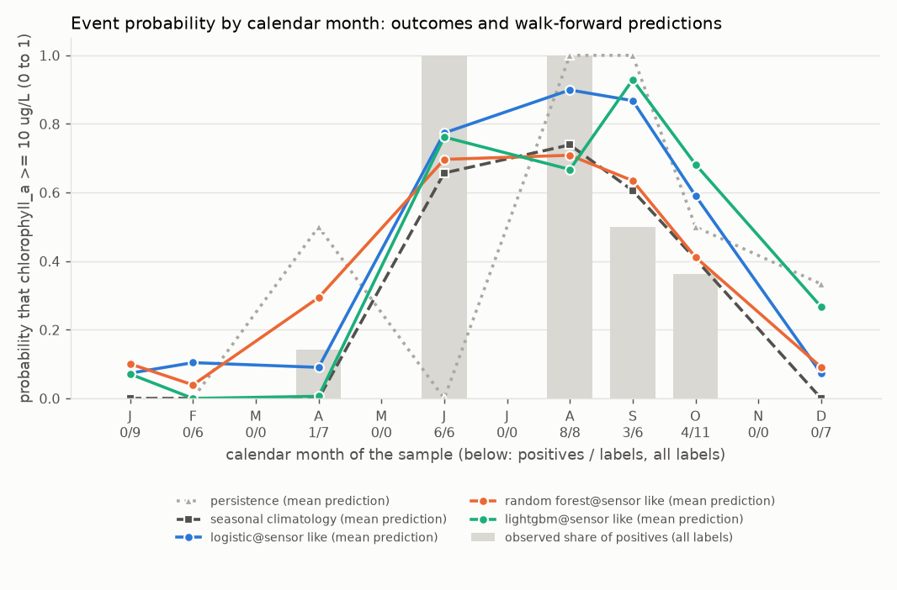
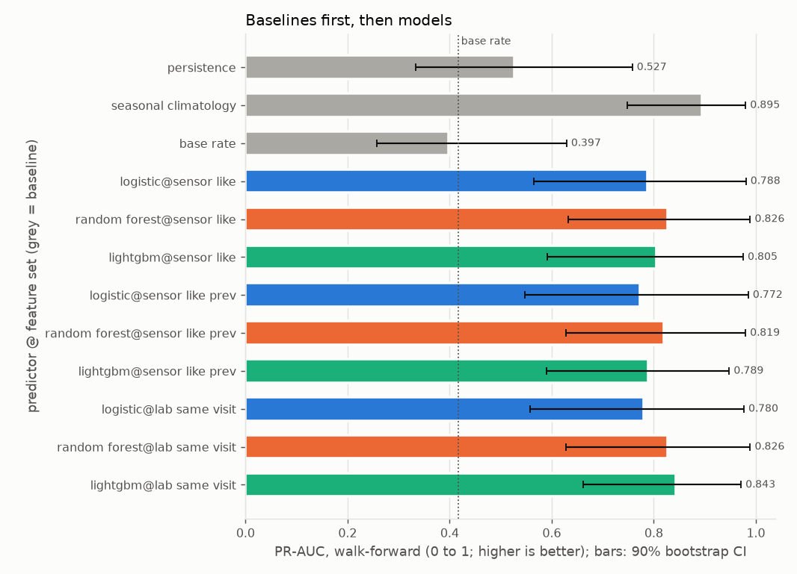
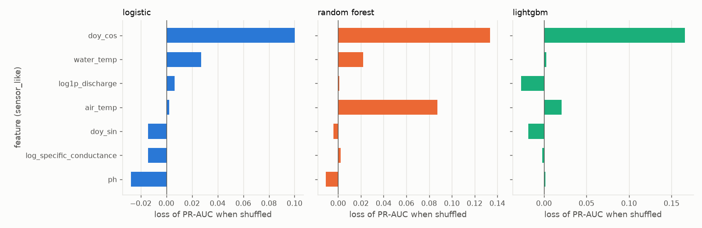
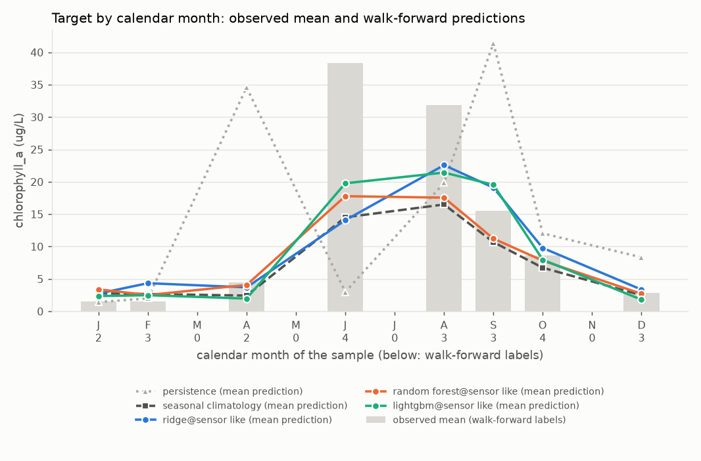
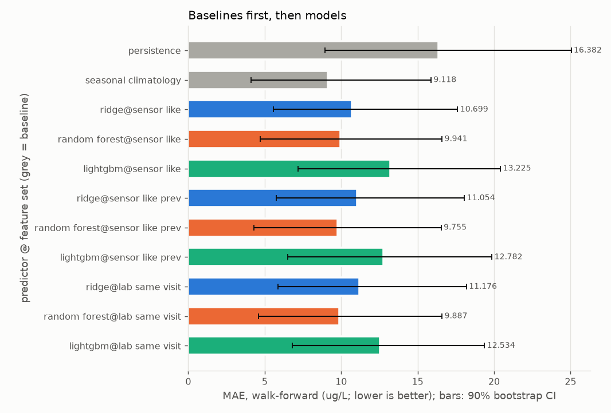
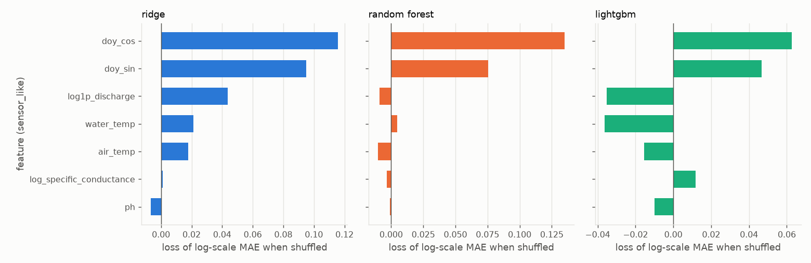

# Report: crp_chla_15816

Real grab-sample data, `source=CRP` only, labels from 2014-01-01; `quality='good'` rows only. Input `data/clean/crp_long.csv` (SHA-256 `eef7c00928bcd8ce...`). Stations: 15816.

Chlorophyll-a at CRP station 15816 only. Primary target: the event chlorophyll_a >= 10 ug/L on the sample date. Secondary: the concentration (log1p regression).

## First lines

### Primary target: event chlorophyll_a >= 10 ug/L

- Labels used: 60 on 60 distinct dates, 22 positives (15816: 60).
- Censored labels: 18 left-censored at or below the threshold counted as negatives; 0 left-censored above the threshold dropped (unknown); 0 right-censored dropped.
- Walk-forward: 5 folds (test years 2020 to 2024), n_train from 23 to 42 (training positives 8 to 16), n_test = 24 on 24 dates, 10 positives.
- Final hold-out (evaluated once, last 12 distinct dates, from 2024-12-18): n_train = 48, n_holdout = 12, 4 positives; training positives 18.
- **Persistence** means: the last sample at this station, carried forward (the previous label at the same station on a strictly earlier date; with no earlier label, the training base rate).
- **Seasonal climatology** means: the mean of the training targets within plus or minus 1 calendar month(s) of the test month, pooled over the task's stations (with fewer than 3 training labels in that window, the mean of all training targets).
- **Base rate** means: the share of positives among the training labels.
- Verdicts, walk-forward, headline feature set `sensor_like` (deployable):
  - seasonal climatology beats persistence (PR-AUC difference +0.368, 90% CI [+0.175, +0.536]); Brier difference -0.213 [-0.363, -0.068] (lower is better).
  - logistic on sensor_like (deployable) beats persistence (PR-AUC difference +0.261, 90% CI [+0.057, +0.488]); Brier difference -0.204 [-0.372, -0.044] (lower is better).
  - logistic on sensor_like (deployable) shows no demonstrable difference from seasonal climatology (PR-AUC difference -0.107, 90% CI [-0.255, +0.046]); Brier difference +0.008 [-0.051, +0.078] (lower is better).
  - random_forest on sensor_like (deployable) beats persistence (PR-AUC difference +0.300, 90% CI [+0.087, +0.509]); Brier difference -0.202 [-0.356, -0.051] (lower is better).
  - random_forest on sensor_like (deployable) shows no demonstrable difference from seasonal climatology (PR-AUC difference -0.068, 90% CI [-0.204, +0.064]); Brier difference +0.010 [-0.034, +0.052] (lower is better).
  - lightgbm on sensor_like (deployable) beats persistence (PR-AUC difference +0.278, 90% CI [+0.072, +0.490]); Brier difference -0.119 [-0.290, +0.038] (lower is better).
  - lightgbm on sensor_like (deployable) shows no demonstrable difference from seasonal climatology (PR-AUC difference -0.090, 90% CI [-0.260, +0.067]); Brier difference +0.094 [-0.023, +0.213] (lower is better).
- Verdicts, final hold-out, headline feature set `sensor_like`:
  - seasonal climatology shows no demonstrable difference from persistence (PR-AUC difference +0.188, 90% CI [+0.000, +0.500]); Brier difference -0.051 [-0.191, +0.033] (lower is better).
  - logistic on sensor_like (deployable) shows no demonstrable difference from persistence (PR-AUC difference +0.271, 90% CI [+0.000, +0.500]); Brier difference -0.039 [-0.166, +0.069] (lower is better).
  - logistic on sensor_like (deployable) shows no demonstrable difference from seasonal climatology (PR-AUC difference +0.083, 90% CI [+0.000, +0.250]); Brier difference +0.012 [-0.098, +0.106] (lower is better).
  - random_forest on sensor_like (deployable) shows no demonstrable difference from persistence (PR-AUC difference +0.354, 90% CI [+0.000, +0.750]); Brier difference -0.104 [-0.268, +0.040] (lower is better).
  - random_forest on sensor_like (deployable) shows no demonstrable difference from seasonal climatology (PR-AUC difference +0.167, 90% CI [+0.000, +0.500]); Brier difference -0.053 [-0.171, +0.017] (lower is better).
  - lightgbm on sensor_like (deployable) shows no demonstrable difference from persistence (PR-AUC difference +0.171, 90% CI [-0.108, +0.500]); Brier difference -0.002 [-0.169, +0.165] (lower is better).
  - lightgbm on sensor_like (deployable) shows no demonstrable difference from seasonal climatology (PR-AUC difference -0.017, 90% CI [-0.270, +0.250]); Brier difference +0.049 [-0.034, +0.187] (lower is better).

### Secondary target: regression of chlorophyll_a (ug/L), fitted on the log1p scale

- Labels used: 60 on 60 distinct dates, 18 left-censored (15816: 60).
- Censored labels: left-censored values enter at detection limit x 0.5; 0 right-censored dropped.
- Walk-forward: 5 folds (test years 2020 to 2024), n_train from 23 to 42, n_test = 24 on 24 dates.
- Final hold-out (evaluated once, last 12 distinct dates, from 2024-12-18): n_train = 48, n_holdout = 12.
- **Persistence** means: the last sample at this station, carried forward (the previous label at the same station on a strictly earlier date; with no earlier label, the training median).
- **Seasonal climatology** means: the mean of the training targets within plus or minus 1 calendar month(s) of the test month, pooled over the task's stations (with fewer than 3 training labels in that window, the mean of all training targets).
- Verdicts, walk-forward, headline feature set `sensor_like` (deployable):
  - seasonal climatology beats persistence (MAE difference -7.264, 90% CI [-13.830, -1.612]).
  - ridge on sensor_like (deployable) shows no demonstrable difference from persistence (MAE difference -5.682, 90% CI [-13.005, +0.272]).
  - ridge on sensor_like (deployable) shows no demonstrable difference from seasonal climatology (MAE difference +1.582, 90% CI [-0.472, +4.132]).
  - random_forest on sensor_like (deployable) beats persistence (MAE difference -6.440, 90% CI [-13.291, -0.456]).
  - random_forest on sensor_like (deployable) shows no demonstrable difference from seasonal climatology (MAE difference +0.824, 90% CI [-0.489, +2.164]).
  - lightgbm on sensor_like (deployable) shows no demonstrable difference from persistence (MAE difference -3.156, 90% CI [-10.629, +3.248]).
  - lightgbm on sensor_like (deployable) is worse than seasonal climatology (MAE difference +4.108, 90% CI [+1.667, +7.125]).
- Verdicts, final hold-out, headline feature set `sensor_like`:
  - seasonal climatology beats persistence (MAE difference -1.612, 90% CI [-2.972, -0.193]).
  - ridge on sensor_like (deployable) shows no demonstrable difference from persistence (MAE difference -0.859, 90% CI [-2.763, +1.157]).
  - ridge on sensor_like (deployable) shows no demonstrable difference from seasonal climatology (MAE difference +0.753, 90% CI [-1.104, +2.567]).
  - random_forest on sensor_like (deployable) shows no demonstrable difference from persistence (MAE difference -0.627, 90% CI [-2.681, +1.560]).
  - random_forest on sensor_like (deployable) shows no demonstrable difference from seasonal climatology (MAE difference +0.985, 90% CI [-0.487, +3.200]).
  - lightgbm on sensor_like (deployable) shows no demonstrable difference from persistence (MAE difference +0.436, 90% CI [-2.924, +4.857]).
  - lightgbm on sensor_like (deployable) shows no demonstrable difference from seasonal climatology (MAE difference +2.049, 90% CI [-0.807, +6.902]).

## Warnings

- WARNING [event, regression] fold 2018 skipped: 11 training labels, fewer than min_train_labels=20.
- WARNING [event, regression] fold 2019 skipped: 15 training labels, fewer than min_train_labels=20.
- WARNING [event, regression] n_train below 50 in: 2020 (23), 2021 (28), 2022 (35), 2023 (38), 2024 (42), holdout (48).
- WARNING [event] the hold-out has 4 positives, fewer than 10: hold-out event metrics are very uncertain.
- WARNING [event] walk-forward folds with zero positives: 2020.
- WARNING [event] holdout slices with zero positives (undefined: no positives): oct_mar.
- WARNING [event, regression] feature set sensor_like: only 45% of the 11 labels in 2025 and 2026 have every feature (below 50%); the rest are imputed.
- WARNING [event, regression] feature set sensor_like_prev: only 45% of the 11 labels in 2025 and 2026 have every feature (below 50%); the rest are imputed.
- WARNING [event, regression] feature set lab_same_visit: only 45% of the 11 labels in 2025 and 2026 have every feature (below 50%); the rest are imputed.
- WARNING [event, regression] 2 of 7 station-years in the test windows have fewer than 4 labels (minimum 3).
- WARNING [event] LEAKAGE SUSPECTED: shuffled-label skill for random_forest@sensor_like, lightgbm@sensor_like, lightgbm@sensor_like_prev, random_forest@lab_same_visit, lightgbm@lab_same_visit.
- WARNING [regression] only 24 walk-forward residuals (fewer than 30): the conformal intervals are not meaningful.

## Metrics

### Event target: event chlorophyll_a >= 10 ug/L

Folds:

| fold | n_train | n_test | last train date | first test date | last test date | train positives | test positives |
|---|---|---|---|---|---|---|---|
| 2020 | 23 | 4 | 2019-10-28 | 2020-01-28 | 2020-12-14 | 8 | 0 (undefined: no positives) |
| 2021 | 28 | 7 | 2020-12-14 | 2021-01-19 | 2021-12-14 | 8 | 4 |
| 2022 | 35 | 3 | 2021-12-14 | 2022-04-25 | 2022-08-30 | 12 | 2 |
| 2023 | 38 | 5 | 2022-08-30 | 2023-04-19 | 2023-12-19 | 14 | 2 |
| 2024 | 42 | 5 | 2023-10-24 | 2024-02-27 | 2024-10-22 | 16 | 2 |
| holdout | 48 | 12 | 2024-10-22 | 2024-12-18 | 2026-04-28 | 18 | 4 |

#### Walk-forward

n = 24 on 24 dates, 10 positives, base rate 0.417. Baselines first, then models. Brackets: 90% bootstrap CI over distinct dates.

| predictor | deployable | PR-AUC | ROC-AUC | Brier | Brier skill vs base rate |
|---|---|---|---|---|---|
| persistence | baseline | 0.527 [0.333, 0.758] | 0.657 [0.500, 0.812] | 0.333 [0.208, 0.500] | -0.299 [-0.973, 0.280] |
| seasonal_climatology | baseline | 0.895 [0.749, 0.980] | 0.907 [0.783, 0.984] | 0.121 [0.068, 0.176] | 0.530 [0.327, 0.714] |
| base_rate | baseline | 0.397 [0.257, 0.629] | 0.407 [0.206, 0.607] | 0.257 [0.208, 0.313] | 0.000 [0.000, 0.000] |
| logistic@sensor_like | yes | 0.788 [0.565, 0.981] | 0.879 [0.729, 0.984] | 0.129 [0.060, 0.223] | 0.497 [0.065, 0.770] |
| random_forest@sensor_like | yes | 0.826 [0.632, 0.989] | 0.893 [0.756, 0.992] | 0.131 [0.077, 0.195] | 0.489 [0.215, 0.696] |
| lightgbm@sensor_like | yes | 0.805 [0.591, 0.975] | 0.857 [0.708, 0.972] | 0.214 [0.086, 0.342] | 0.164 [-0.392, 0.670] |
| logistic@sensor_like_prev | yes | 0.772 [0.547, 0.985] | 0.871 [0.711, 0.986] | 0.143 [0.068, 0.240] | 0.444 [0.021, 0.736] |
| random_forest@sensor_like_prev | yes | 0.819 [0.628, 0.980] | 0.879 [0.734, 0.983] | 0.139 [0.091, 0.196] | 0.458 [0.235, 0.635] |
| lightgbm@sensor_like_prev | yes | 0.789 [0.590, 0.948] | 0.829 [0.660, 0.950] | 0.279 [0.126, 0.439] | -0.089 [-0.707, 0.465] |
| logistic@lab_same_visit | NO (diagnostic) | 0.780 [0.558, 0.977] | 0.871 [0.715, 0.979] | 0.133 [0.060, 0.231] | 0.480 [0.022, 0.771] |
| random_forest@lab_same_visit | NO (diagnostic) | 0.826 [0.627, 0.989] | 0.893 [0.759, 0.992] | 0.135 [0.082, 0.197] | 0.473 [0.193, 0.676] |
| lightgbm@lab_same_visit | NO (diagnostic) | 0.843 [0.662, 0.971] | 0.843 [0.664, 0.972] | 0.215 [0.084, 0.345] | 0.163 [-0.427, 0.683] |

At p = 0.5:

| predictor | precision | recall | F1 | TP | FP | FN | TN |
|---|---|---|---|---|---|---|---|
| persistence | 0.600 [0.357, 0.857] | 0.600 [0.333, 0.875] | 0.600 [0.353, 0.783] | 6 | 4 | 4 | 10 |
| seasonal_climatology | 0.875 [0.636, 1.000] | 0.700 [0.444, 0.909] | 0.778 [0.545, 0.933] | 7 | 1 | 3 | 13 |
| base_rate | undefined | 0.000 [0.000, 0.000] | 0.000 [0.000, 0.000] | 0 | 0 | 10 | 14 |
| logistic@sensor_like | 0.750 [0.538, 0.923] | 0.900 [0.700, 1.000] | 0.818 [0.636, 0.947] | 9 | 3 | 1 | 11 |
| random_forest@sensor_like | 0.778 [0.500, 1.000] | 0.700 [0.429, 0.923] | 0.737 [0.500, 0.904] | 7 | 2 | 3 | 12 |
| lightgbm@sensor_like | 0.667 [0.455, 0.889] | 0.800 [0.556, 1.000] | 0.727 [0.526, 0.889] | 8 | 4 | 2 | 10 |
| logistic@sensor_like_prev | 0.727 [0.500, 0.917] | 0.800 [0.571, 1.000] | 0.762 [0.556, 0.909] | 8 | 3 | 2 | 11 |
| random_forest@sensor_like_prev | 0.800 [0.556, 1.000] | 0.800 [0.571, 1.000] | 0.800 [0.588, 0.941] | 8 | 2 | 2 | 12 |
| lightgbm@sensor_like_prev | 0.667 [0.375, 0.909] | 0.600 [0.333, 0.857] | 0.632 [0.364, 0.833] | 6 | 3 | 4 | 11 |
| logistic@lab_same_visit | 0.750 [0.538, 0.923] | 0.900 [0.700, 1.000] | 0.818 [0.636, 0.947] | 9 | 3 | 1 | 11 |
| random_forest@lab_same_visit | 0.700 [0.444, 0.917] | 0.700 [0.429, 0.923] | 0.700 [0.471, 0.875] | 7 | 3 | 3 | 11 |
| lightgbm@lab_same_visit | 0.667 [0.444, 0.889] | 0.800 [0.556, 1.000] | 0.727 [0.500, 0.897] | 8 | 4 | 2 | 10 |

At p* = 0.10 (C_FP=1, C_FN=9, PLACEHOLDER):

| predictor | precision | recall | F1 | TP | FP | FN | TN |
|---|---|---|---|---|---|---|---|
| persistence | 0.600 [0.357, 0.857] | 0.600 [0.333, 0.875] | 0.600 [0.353, 0.783] | 6 | 4 | 4 | 10 |
| seasonal_climatology | 0.714 [0.500, 0.900] | 1.000 [1.000, 1.000] | 0.833 [0.667, 0.947] | 10 | 4 | 0 | 10 |
| base_rate | 0.417 [0.292, 0.583] | 1.000 [1.000, 1.000] | 0.588 [0.452, 0.737] | 10 | 14 | 0 | 0 |
| logistic@sensor_like | 0.625 [0.438, 0.812] | 1.000 [1.000, 1.000] | 0.769 [0.609, 0.897] | 10 | 6 | 0 | 8 |
| random_forest@sensor_like | 0.556 [0.381, 0.737] | 1.000 [1.000, 1.000] | 0.714 [0.552, 0.848] | 10 | 8 | 0 | 6 |
| lightgbm@sensor_like | 0.615 [0.400, 0.846] | 0.800 [0.556, 1.000] | 0.696 [0.476, 0.867] | 8 | 5 | 2 | 9 |
| logistic@sensor_like_prev | 0.588 [0.412, 0.778] | 1.000 [1.000, 1.000] | 0.741 [0.583, 0.875] | 10 | 7 | 0 | 7 |
| random_forest@sensor_like_prev | 0.476 [0.318, 0.652] | 1.000 [1.000, 1.000] | 0.645 [0.483, 0.789] | 10 | 11 | 0 | 3 |
| lightgbm@sensor_like_prev | 0.545 [0.286, 0.800] | 0.600 [0.333, 0.857] | 0.571 [0.316, 0.769] | 6 | 5 | 4 | 9 |
| logistic@lab_same_visit | 0.556 [0.375, 0.750] | 1.000 [1.000, 1.000] | 0.714 [0.545, 0.857] | 10 | 8 | 0 | 6 |
| random_forest@lab_same_visit | 0.476 [0.318, 0.652] | 1.000 [1.000, 1.000] | 0.645 [0.483, 0.789] | 10 | 11 | 0 | 3 |
| lightgbm@lab_same_visit | 0.571 [0.357, 0.800] | 0.800 [0.556, 1.000] | 0.667 [0.455, 0.839] | 8 | 6 | 2 | 8 |

Paired differences (higher PR-AUC and lower Brier are better):

| model | baseline | PR-AUC difference (model - baseline) | Brier difference | verdict (by PR-AUC) |
|---|---|---|---|---|
| persistence | seasonal_climatology | -0.368 [-0.536, -0.175] | +0.213 [+0.068, +0.363] | is worse than |
| persistence | base_rate | +0.129 [-0.072, +0.290] | +0.077 [-0.076, +0.234] | no demonstrable difference |
| seasonal_climatology | persistence | +0.368 [+0.175, +0.536] | -0.213 [-0.363, -0.068] | beats |
| seasonal_climatology | base_rate | +0.498 [+0.305, +0.610] | -0.136 [-0.193, -0.079] | beats |
| base_rate | persistence | -0.129 [-0.290, +0.072] | -0.077 [-0.234, +0.076] | no demonstrable difference |
| base_rate | seasonal_climatology | -0.498 [-0.610, -0.305] | +0.136 [+0.079, +0.193] | is worse than |
| logistic@sensor_like | persistence | +0.261 [+0.057, +0.488] | -0.204 [-0.372, -0.044] | beats |
| logistic@sensor_like | seasonal_climatology | -0.107 [-0.255, +0.046] | +0.008 [-0.051, +0.078] | no demonstrable difference |
| logistic@sensor_like | base_rate | +0.390 [+0.207, +0.570] | -0.128 [-0.218, -0.015] | beats |
| random_forest@sensor_like | persistence | +0.300 [+0.087, +0.509] | -0.202 [-0.356, -0.051] | beats |
| random_forest@sensor_like | seasonal_climatology | -0.068 [-0.204, +0.064] | +0.010 [-0.034, +0.052] | no demonstrable difference |
| random_forest@sensor_like | base_rate | +0.429 [+0.261, +0.567] | -0.125 [-0.190, -0.048] | beats |
| lightgbm@sensor_like | persistence | +0.278 [+0.072, +0.490] | -0.119 [-0.290, +0.038] | beats |
| lightgbm@sensor_like | seasonal_climatology | -0.090 [-0.260, +0.067] | +0.094 [-0.023, +0.213] | no demonstrable difference |
| lightgbm@sensor_like | base_rate | +0.408 [+0.217, +0.567] | -0.042 [-0.187, +0.092] | beats |
| logistic@sensor_like_prev | persistence | +0.246 [+0.045, +0.477] | -0.191 [-0.364, -0.022] | beats |
| logistic@sensor_like_prev | seasonal_climatology | -0.123 [-0.278, +0.039] | +0.022 [-0.038, +0.096] | no demonstrable difference |
| logistic@sensor_like_prev | base_rate | +0.375 [+0.187, +0.557] | -0.114 [-0.200, -0.005] | beats |
| random_forest@sensor_like_prev | persistence | +0.293 [+0.089, +0.501] | -0.194 [-0.349, -0.041] | beats |
| random_forest@sensor_like_prev | seasonal_climatology | -0.076 [-0.202, +0.053] | +0.018 [-0.023, +0.054] | no demonstrable difference |
| random_forest@sensor_like_prev | base_rate | +0.422 [+0.249, +0.568] | -0.118 [-0.176, -0.055] | beats |
| lightgbm@sensor_like_prev | persistence | +0.262 [+0.053, +0.465] | -0.054 [-0.259, +0.149] | beats |
| lightgbm@sensor_like_prev | seasonal_climatology | -0.106 [-0.232, +0.009] | +0.159 [+0.032, +0.288] | no demonstrable difference |
| lightgbm@sensor_like_prev | base_rate | +0.392 [+0.234, +0.508] | +0.023 [-0.122, +0.177] | beats |
| logistic@lab_same_visit | persistence | +0.253 [+0.044, +0.484] | -0.200 [-0.373, -0.037] | beats |
| logistic@lab_same_visit | seasonal_climatology | -0.115 [-0.271, +0.042] | +0.013 [-0.051, +0.088] | no demonstrable difference |
| logistic@lab_same_visit | base_rate | +0.383 [+0.203, +0.558] | -0.123 [-0.218, -0.005] | beats |
| random_forest@lab_same_visit | persistence | +0.300 [+0.084, +0.517] | -0.198 [-0.356, -0.044] | beats |
| random_forest@lab_same_visit | seasonal_climatology | -0.068 [-0.204, +0.068] | +0.014 [-0.031, +0.057] | no demonstrable difference |
| random_forest@lab_same_visit | base_rate | +0.429 [+0.262, +0.567] | -0.121 [-0.188, -0.043] | beats |
| lightgbm@lab_same_visit | persistence | +0.316 [+0.091, +0.525] | -0.118 [-0.301, +0.057] | beats |
| lightgbm@lab_same_visit | seasonal_climatology | -0.052 [-0.198, +0.081] | +0.094 [-0.027, +0.222] | no demonstrable difference |
| lightgbm@lab_same_visit | base_rate | +0.446 [+0.264, +0.576] | -0.042 [-0.191, +0.101] | beats |

#### Final hold-out (evaluated once)

n = 12 on 12 dates, 4 positives, base rate 0.333. Baselines first, then models. Brackets: 90% bootstrap CI over distinct dates.

| predictor | deployable | PR-AUC | ROC-AUC | Brier | Brier skill vs base rate |
|---|---|---|---|---|---|
| persistence | baseline | 0.646 [0.250, 1.000] | 0.812 [0.556, 1.000] | 0.167 [0.000, 0.333] | 0.256 [-0.641, 1.000] |
| seasonal_climatology | baseline | 0.833 [0.500, 1.000] | 0.859 [0.578, 1.000] | 0.116 [0.019, 0.277] | 0.483 [-0.117, 0.909] |
| base_rate | baseline | 0.333 [0.167, 0.583] | 0.500 [0.500, 0.500] | 0.224 [0.182, 0.286] | 0.000 [0.000, 0.000] |
| logistic@sensor_like | yes | 0.917 [0.667, 1.000] | 0.938 [0.778, 1.000] | 0.128 [0.058, 0.208] | 0.429 [-0.012, 0.753] |
| random_forest@sensor_like | yes | 1.000 [1.000, 1.000] | 1.000 [1.000, 1.000] | 0.063 [0.028, 0.107] | 0.719 [0.551, 0.860] |
| lightgbm@sensor_like | yes | 0.817 [0.500, 1.000] | 0.875 [0.667, 1.000] | 0.165 [0.000, 0.330] | 0.264 [-0.347, 1.000] |
| logistic@sensor_like_prev | yes | 0.917 [0.667, 1.000] | 0.938 [0.778, 1.000] | 0.122 [0.058, 0.191] | 0.456 [0.082, 0.750] |
| random_forest@sensor_like_prev | yes | 1.000 [1.000, 1.000] | 1.000 [1.000, 1.000] | 0.060 [0.021, 0.105] | 0.731 [0.581, 0.891] |
| lightgbm@sensor_like_prev | yes | 0.917 [0.667, 1.000] | 0.938 [0.778, 1.000] | 0.155 [0.000, 0.322] | 0.306 [-0.270, 1.000] |
| logistic@lab_same_visit | NO (diagnostic) | 0.917 [0.667, 1.000] | 0.938 [0.778, 1.000] | 0.134 [0.060, 0.216] | 0.400 [-0.080, 0.739] |
| random_forest@lab_same_visit | NO (diagnostic) | 1.000 [1.000, 1.000] | 1.000 [1.000, 1.000] | 0.073 [0.051, 0.097] | 0.673 [0.541, 0.782] |
| lightgbm@lab_same_visit | NO (diagnostic) | 0.761 [0.333, 1.000] | 0.781 [0.450, 1.000] | 0.164 [0.002, 0.330] | 0.270 [-0.326, 0.990] |

At p = 0.5:

| predictor | precision | recall | F1 | TP | FP | FN | TN |
|---|---|---|---|---|---|---|---|
| persistence | 0.750 [0.333, 1.000] | 0.750 [0.250, 1.000] | 0.750 [0.333, 1.000] | 3 | 1 | 1 | 7 |
| seasonal_climatology | 1.000 [1.000, 1.000] | 0.750 [0.250, 1.000] | 0.857 [0.400, 1.000] | 3 | 0 | 1 | 8 |
| base_rate | undefined | 0.000 [0.000, 0.000] | 0.000 [0.000, 0.000] | 0 | 0 | 4 | 8 |
| logistic@sensor_like | 0.600 [0.200, 1.000] | 0.750 [0.250, 1.000] | 0.667 [0.250, 0.909] | 3 | 2 | 1 | 6 |
| random_forest@sensor_like | 1.000 [1.000, 1.000] | 0.750 [0.250, 1.000] | 0.857 [0.400, 1.000] | 3 | 0 | 1 | 8 |
| lightgbm@sensor_like | 1.000 [1.000, 1.000] | 0.500 [0.000, 1.000] | 0.667 [0.000, 1.000] | 2 | 0 | 2 | 8 |
| logistic@sensor_like_prev | 0.600 [0.200, 1.000] | 0.750 [0.250, 1.000] | 0.667 [0.250, 0.909] | 3 | 2 | 1 | 6 |
| random_forest@sensor_like_prev | 1.000 [1.000, 1.000] | 0.750 [0.250, 1.000] | 0.857 [0.400, 1.000] | 3 | 0 | 1 | 8 |
| lightgbm@sensor_like_prev | 1.000 [1.000, 1.000] | 0.500 [0.000, 1.000] | 0.667 [0.000, 1.000] | 2 | 0 | 2 | 8 |
| logistic@lab_same_visit | 0.600 [0.200, 1.000] | 0.750 [0.250, 1.000] | 0.667 [0.250, 0.909] | 3 | 2 | 1 | 6 |
| random_forest@lab_same_visit | 1.000 [1.000, 1.000] | 1.000 [1.000, 1.000] | 1.000 [1.000, 1.000] | 4 | 0 | 0 | 8 |
| lightgbm@lab_same_visit | 1.000 [1.000, 1.000] | 0.500 [0.000, 1.000] | 0.667 [0.000, 1.000] | 2 | 0 | 2 | 8 |

At p* = 0.10 (C_FP=1, C_FN=9, PLACEHOLDER):

| predictor | precision | recall | F1 | TP | FP | FN | TN |
|---|---|---|---|---|---|---|---|
| persistence | 0.750 [0.333, 1.000] | 0.750 [0.250, 1.000] | 0.750 [0.333, 1.000] | 3 | 1 | 1 | 7 |
| seasonal_climatology | 0.750 [0.333, 1.000] | 0.750 [0.250, 1.000] | 0.750 [0.333, 1.000] | 3 | 1 | 1 | 7 |
| base_rate | 0.333 [0.167, 0.583] | 1.000 [1.000, 1.000] | 0.500 [0.286, 0.737] | 4 | 8 | 0 | 0 |
| logistic@sensor_like | 0.444 [0.182, 0.714] | 1.000 [1.000, 1.000] | 0.615 [0.308, 0.833] | 4 | 5 | 0 | 3 |
| random_forest@sensor_like | 0.400 [0.182, 0.667] | 1.000 [1.000, 1.000] | 0.571 [0.308, 0.800] | 4 | 6 | 0 | 2 |
| lightgbm@sensor_like | 1.000 [1.000, 1.000] | 0.500 [0.000, 1.000] | 0.667 [0.000, 1.000] | 2 | 0 | 2 | 8 |
| logistic@sensor_like_prev | 0.444 [0.182, 0.714] | 1.000 [1.000, 1.000] | 0.615 [0.308, 0.833] | 4 | 5 | 0 | 3 |
| random_forest@sensor_like_prev | 0.400 [0.182, 0.667] | 1.000 [1.000, 1.000] | 0.571 [0.308, 0.800] | 4 | 6 | 0 | 2 |
| lightgbm@sensor_like_prev | 1.000 [1.000, 1.000] | 0.500 [0.000, 1.000] | 0.667 [0.000, 1.000] | 2 | 0 | 2 | 8 |
| logistic@lab_same_visit | 0.444 [0.182, 0.714] | 1.000 [1.000, 1.000] | 0.615 [0.308, 0.833] | 4 | 5 | 0 | 3 |
| random_forest@lab_same_visit | 0.333 [0.167, 0.583] | 1.000 [1.000, 1.000] | 0.500 [0.286, 0.737] | 4 | 8 | 0 | 0 |
| lightgbm@lab_same_visit | 1.000 [1.000, 1.000] | 0.500 [0.000, 1.000] | 0.667 [0.000, 1.000] | 2 | 0 | 2 | 8 |

Paired differences (higher PR-AUC and lower Brier are better):

| model | baseline | PR-AUC difference (model - baseline) | Brier difference | verdict (by PR-AUC) |
|---|---|---|---|---|
| persistence | seasonal_climatology | -0.188 [-0.500, +0.000] | +0.051 [-0.033, +0.191] | no demonstrable difference |
| persistence | base_rate | +0.312 [+0.028, +0.667] | -0.057 [-0.224, +0.130] | beats |
| seasonal_climatology | persistence | +0.188 [+0.000, +0.500] | -0.051 [-0.191, +0.033] | no demonstrable difference |
| seasonal_climatology | base_rate | +0.500 [+0.167, +0.833] | -0.108 [-0.205, +0.031] | beats |
| base_rate | persistence | -0.312 [-0.667, -0.028] | +0.057 [-0.130, +0.224] | is worse than |
| base_rate | seasonal_climatology | -0.500 [-0.833, -0.167] | +0.108 [-0.031, +0.205] | is worse than |
| logistic@sensor_like | persistence | +0.271 [+0.000, +0.500] | -0.039 [-0.166, +0.069] | no demonstrable difference |
| logistic@sensor_like | seasonal_climatology | +0.083 [+0.000, +0.250] | +0.012 [-0.098, +0.106] | no demonstrable difference |
| logistic@sensor_like | base_rate | +0.583 [+0.333, +0.833] | -0.096 [-0.186, +0.003] | beats |
| random_forest@sensor_like | persistence | +0.354 [+0.000, +0.750] | -0.104 [-0.268, +0.040] | no demonstrable difference |
| random_forest@sensor_like | seasonal_climatology | +0.167 [+0.000, +0.500] | -0.053 [-0.171, +0.017] | no demonstrable difference |
| random_forest@sensor_like | base_rate | +0.667 [+0.417, +0.833] | -0.161 [-0.211, -0.113] | beats |
| lightgbm@sensor_like | persistence | +0.171 [-0.108, +0.500] | -0.002 [-0.169, +0.165] | no demonstrable difference |
| lightgbm@sensor_like | seasonal_climatology | -0.017 [-0.270, +0.250] | +0.049 [-0.034, +0.187] | no demonstrable difference |
| lightgbm@sensor_like | base_rate | +0.483 [+0.234, +0.833] | -0.059 [-0.203, +0.085] | beats |
| logistic@sensor_like_prev | persistence | +0.271 [+0.000, +0.500] | -0.045 [-0.179, +0.071] | no demonstrable difference |
| logistic@sensor_like_prev | seasonal_climatology | +0.083 [+0.000, +0.250] | +0.006 [-0.104, +0.093] | no demonstrable difference |
| logistic@sensor_like_prev | base_rate | +0.583 [+0.333, +0.833] | -0.102 [-0.181, -0.017] | beats |
| random_forest@sensor_like_prev | persistence | +0.354 [+0.000, +0.750] | -0.107 [-0.280, +0.039] | no demonstrable difference |
| random_forest@sensor_like_prev | seasonal_climatology | +0.167 [+0.000, +0.500] | -0.056 [-0.179, +0.018] | no demonstrable difference |
| random_forest@sensor_like_prev | base_rate | +0.667 [+0.417, +0.833] | -0.164 [-0.212, -0.119] | beats |
| lightgbm@sensor_like_prev | persistence | +0.271 [+0.000, +0.500] | -0.011 [-0.178, +0.145] | no demonstrable difference |
| lightgbm@sensor_like_prev | seasonal_climatology | +0.083 [+0.000, +0.250] | +0.040 [-0.032, +0.157] | no demonstrable difference |
| lightgbm@sensor_like_prev | base_rate | +0.583 [+0.333, +0.833] | -0.068 [-0.203, +0.067] | beats |
| logistic@lab_same_visit | persistence | +0.271 [+0.000, +0.500] | -0.032 [-0.174, +0.080] | no demonstrable difference |
| logistic@lab_same_visit | seasonal_climatology | +0.083 [+0.000, +0.250] | +0.018 [-0.108, +0.126] | no demonstrable difference |
| logistic@lab_same_visit | base_rate | +0.583 [+0.333, +0.833] | -0.090 [-0.185, +0.015] | beats |
| random_forest@lab_same_visit | persistence | +0.354 [+0.000, +0.750] | -0.094 [-0.252, +0.059] | no demonstrable difference |
| random_forest@lab_same_visit | seasonal_climatology | +0.167 [+0.000, +0.500] | -0.043 [-0.186, +0.040] | no demonstrable difference |
| random_forest@lab_same_visit | base_rate | +0.667 [+0.417, +0.833] | -0.151 [-0.208, -0.098] | beats |
| lightgbm@lab_same_visit | persistence | +0.115 [-0.133, +0.375] | -0.003 [-0.166, +0.159] | no demonstrable difference |
| lightgbm@lab_same_visit | seasonal_climatology | -0.072 [-0.300, +0.083] | +0.048 [-0.031, +0.178] | no demonstrable difference |
| lightgbm@lab_same_visit | base_rate | +0.428 [+0.125, +0.750] | -0.060 [-0.200, +0.081] | beats |

### Regression target: regression of chlorophyll_a (ug/L), fitted on the log1p scale

Folds:

| fold | n_train | n_test | last train date | first test date | last test date |
|---|---|---|---|---|---|
| 2020 | 23 | 4 | 2019-10-28 | 2020-01-28 | 2020-12-14 |
| 2021 | 28 | 7 | 2020-12-14 | 2021-01-19 | 2021-12-14 |
| 2022 | 35 | 3 | 2021-12-14 | 2022-04-25 | 2022-08-30 |
| 2023 | 38 | 5 | 2022-08-30 | 2023-04-19 | 2023-12-19 |
| 2024 | 42 | 5 | 2023-10-24 | 2024-02-27 | 2024-10-22 |
| holdout | 48 | 12 | 2024-10-22 | 2024-12-18 | 2026-04-28 |

#### Walk-forward

All labels: n = 24 on 24 dates (6 left-censored). MAE and RMSE in ug/L. Brackets: 90% bootstrap CI over distinct dates.

| predictor | deployable | MAE | RMSE | R2 | MAE (log scale) | skill vs persistence | skill vs climatology |
|---|---|---|---|---|---|---|---|
| persistence | baseline | 16.382 [8.949, 25.046] | 29.583 [16.410, 40.351] | -0.958 [-10.048, -0.072] | 0.882 [0.612, 1.164] | 0.000 [0.000, 0.000] | -0.797 [-2.247, -0.167] |
| seasonal_climatology | baseline | 9.118 [4.098, 15.875] | 19.430 [6.525, 28.931] | 0.155 [-0.044, 0.265] | 0.529 [0.396, 0.670] | 0.443 [0.143, 0.692] | 0.000 [0.000, 0.000] |
| ridge@sensor_like | yes | 10.699 [5.560, 17.616] | 20.942 [8.901, 30.826] | 0.019 [-0.838, 0.171] | 0.573 [0.422, 0.743] | 0.347 [-0.030, 0.623] | -0.173 [-0.668, 0.050] |
| random_forest@sensor_like | yes | 9.941 [4.691, 16.597] | 20.258 [6.494, 30.161] | 0.082 [-0.251, 0.270] | 0.574 [0.427, 0.740] | 0.393 [0.046, 0.653] | -0.090 [-0.318, 0.054] |
| lightgbm@sensor_like | yes | 13.225 [7.175, 20.423] | 23.801 [11.829, 33.447] | -0.268 [-2.209, -0.026] | 0.764 [0.579, 0.982] | 0.193 [-0.284, 0.508] | -0.450 [-1.128, -0.173] |
| ridge@sensor_like_prev | yes | 11.054 [5.767, 18.063] | 21.475 [8.981, 31.490] | -0.032 [-0.825, 0.101] | 0.598 [0.446, 0.768] | 0.325 [-0.061, 0.614] | -0.212 [-0.714, 0.026] |
| random_forest@sensor_like_prev | yes | 9.755 [4.309, 16.541] | 20.654 [6.271, 30.755] | 0.046 [-0.232, 0.243] | 0.557 [0.399, 0.734] | 0.405 [0.068, 0.674] | -0.070 [-0.247, 0.085] |
| lightgbm@sensor_like_prev | yes | 12.782 [6.494, 19.858] | 23.904 [12.839, 32.873] | -0.279 [-2.901, 0.058] | 0.681 [0.490, 0.897] | 0.220 [-0.298, 0.549] | -0.402 [-1.109, -0.087] |
| ridge@lab_same_visit | NO (diagnostic) | 11.176 [5.879, 18.193] | 21.461 [9.183, 31.360] | -0.030 [-1.041, 0.104] | 0.604 [0.448, 0.779] | 0.318 [-0.082, 0.602] | -0.226 [-0.755, 0.000] |
| random_forest@lab_same_visit | NO (diagnostic) | 9.887 [4.591, 16.597] | 20.301 [6.413, 30.272] | 0.078 [-0.258, 0.273] | 0.560 [0.411, 0.732] | 0.396 [0.053, 0.663] | -0.084 [-0.318, 0.064] |
| lightgbm@lab_same_visit | NO (diagnostic) | 12.534 [6.825, 19.378] | 22.863 [11.791, 31.807] | -0.170 [-2.110, 0.101] | 0.675 [0.495, 0.880] | 0.235 [-0.245, 0.544] | -0.375 [-1.066, -0.076] |

Numeric-only (uncensored) labels: n = 18 on 18 dates (0 left-censored). MAE and RMSE in ug/L. Brackets: 90% bootstrap CI over distinct dates.

| predictor | deployable | MAE | RMSE | R2 | MAE (log scale) | skill vs persistence | skill vs climatology |
|---|---|---|---|---|---|---|---|
| persistence | baseline | 21.533 [12.048, 32.116] | 34.145 [19.075, 45.481] | -1.253 [-17.243, -0.300] | 1.094 [0.775, 1.409] | 0.000 [0.000, 0.000] | -0.833 [-2.483, -0.233] |
| seasonal_climatology | baseline | 11.746 [4.814, 19.582] | 22.424 [7.081, 32.937] | 0.028 [-0.494, 0.140] | 0.572 [0.380, 0.757] | 0.455 [0.189, 0.713] | 0.000 [0.000, 0.000] |
| ridge@sensor_like | yes | 13.510 [6.460, 21.113] | 24.117 [10.135, 34.620] | -0.124 [-2.086, 0.037] | 0.573 [0.378, 0.766] | 0.373 [0.023, 0.665] | -0.150 [-0.653, 0.106] |
| random_forest@sensor_like | yes | 12.753 [5.758, 20.575] | 23.373 [7.443, 33.536] | -0.056 [-0.719, 0.145] | 0.612 [0.406, 0.822] | 0.408 [0.104, 0.688] | -0.086 [-0.330, 0.062] |
| lightgbm@sensor_like | yes | 17.280 [9.588, 25.836] | 27.474 [13.754, 37.567] | -0.459 [-5.179, -0.170] | 0.904 [0.682, 1.137] | 0.197 [-0.259, 0.536] | -0.471 [-1.250, -0.165] |
| ridge@sensor_like_prev | yes | 14.252 [7.061, 21.976] | 24.774 [10.298, 35.535] | -0.186 [-2.180, -0.047] | 0.656 [0.445, 0.849] | 0.338 [-0.032, 0.643] | -0.213 [-0.754, 0.046] |
| random_forest@sensor_like_prev | yes | 12.509 [5.225, 20.602] | 23.832 [7.112, 34.533] | -0.098 [-0.659, 0.097] | 0.590 [0.368, 0.814] | 0.419 [0.119, 0.708] | -0.065 [-0.237, 0.092] |
| lightgbm@sensor_like_prev | yes | 16.824 [9.081, 25.323] | 27.598 [14.605, 37.231] | -0.472 [-6.836, -0.071] | 0.832 [0.596, 1.071] | 0.219 [-0.244, 0.564] | -0.432 [-1.215, -0.093] |
| ridge@lab_same_visit | NO (diagnostic) | 14.141 [6.933, 21.987] | 24.714 [10.663, 35.184] | -0.180 [-2.431, -0.028] | 0.617 [0.415, 0.811] | 0.343 [-0.021, 0.644] | -0.204 [-0.736, 0.049] |
| random_forest@lab_same_visit | NO (diagnostic) | 12.731 [5.718, 20.583] | 23.426 [7.346, 33.638] | -0.061 [-0.700, 0.145] | 0.606 [0.397, 0.817] | 0.409 [0.102, 0.694] | -0.084 [-0.326, 0.070] |
| lightgbm@lab_same_visit | NO (diagnostic) | 16.558 [8.873, 24.652] | 26.398 [13.517, 35.842] | -0.347 [-5.071, -0.015] | 0.843 [0.640, 1.057] | 0.231 [-0.216, 0.562] | -0.410 [-1.214, -0.081] |

Paired differences (lower MAE is better):

| model | baseline | MAE difference (model - baseline) | verdict (by MAE) |
|---|---|---|---|
| persistence | seasonal_climatology | +7.264 [+1.612, +13.830] | is worse than |
| seasonal_climatology | persistence | -7.264 [-13.830, -1.612] | beats |
| ridge@sensor_like | persistence | -5.682 [-13.005, +0.272] | no demonstrable difference |
| ridge@sensor_like | seasonal_climatology | +1.582 [-0.472, +4.132] | no demonstrable difference |
| random_forest@sensor_like | persistence | -6.440 [-13.291, -0.456] | beats |
| random_forest@sensor_like | seasonal_climatology | +0.824 [-0.489, +2.164] | no demonstrable difference |
| lightgbm@sensor_like | persistence | -3.156 [-10.629, +3.248] | no demonstrable difference |
| lightgbm@sensor_like | seasonal_climatology | +4.108 [+1.667, +7.125] | is worse than |
| ridge@sensor_like_prev | persistence | -5.328 [-12.842, +0.701] | no demonstrable difference |
| ridge@sensor_like_prev | seasonal_climatology | +1.936 [-0.217, +4.465] | no demonstrable difference |
| random_forest@sensor_like_prev | persistence | -6.627 [-13.422, -0.748] | beats |
| random_forest@sensor_like_prev | seasonal_climatology | +0.637 [-0.619, +1.904] | no demonstrable difference |
| lightgbm@sensor_like_prev | persistence | -3.600 [-10.902, +3.212] | no demonstrable difference |
| lightgbm@sensor_like_prev | seasonal_climatology | +3.664 [+0.823, +7.230] | is worse than |
| ridge@lab_same_visit | persistence | -5.206 [-12.656, +0.797] | no demonstrable difference |
| ridge@lab_same_visit | seasonal_climatology | +2.058 [-0.001, +4.699] | no demonstrable difference |
| random_forest@lab_same_visit | persistence | -6.494 [-13.409, -0.513] | beats |
| random_forest@lab_same_visit | seasonal_climatology | +0.769 [-0.565, +2.178] | no demonstrable difference |
| lightgbm@lab_same_visit | persistence | -3.847 [-11.242, +2.715] | no demonstrable difference |
| lightgbm@lab_same_visit | seasonal_climatology | +3.416 [+0.685, +6.611] | is worse than |

#### Final hold-out (evaluated once)

All labels: n = 12 on 12 dates (6 left-censored). MAE and RMSE in ug/L. Brackets: 90% bootstrap CI over distinct dates.

| predictor | deployable | MAE | RMSE | R2 | MAE (log scale) | skill vs persistence | skill vs climatology |
|---|---|---|---|---|---|---|---|
| persistence | baseline | 5.588 [2.872, 8.766] | 8.275 [4.405, 12.108] | -0.117 [-1.010, 0.598] | 0.691 [0.346, 1.060] | 0.000 [0.000, 0.000] | -0.406 [-1.070, -0.038] |
| seasonal_climatology | baseline | 3.976 [1.967, 6.933] | 6.581 [2.529, 10.525] | 0.294 [-0.342, 0.855] | 0.499 [0.327, 0.739] | 0.289 [0.036, 0.517] | 0.000 [0.000, 0.000] |
| ridge@sensor_like | yes | 4.729 [2.719, 7.156] | 6.641 [3.207, 9.067] | 0.281 [-0.821, 0.767] | 0.561 [0.391, 0.733] | 0.154 [-0.313, 0.399] | -0.189 [-0.993, 0.215] |
| random_forest@sensor_like | yes | 4.961 [2.423, 8.186] | 7.868 [3.037, 11.051] | -0.009 [-1.656, 0.796] | 0.507 [0.386, 0.659] | 0.112 [-0.362, 0.431] | -0.248 [-0.959, 0.101] |
| lightgbm@sensor_like | yes | 6.025 [1.887, 11.752] | 11.991 [3.192, 18.499] | -1.344 [-7.037, 0.792] | 0.453 [0.200, 0.758] | -0.078 [-0.931, 0.552] | -0.515 [-1.816, 0.277] |
| ridge@sensor_like_prev | yes | 4.237 [2.121, 6.804] | 6.509 [2.601, 9.125] | 0.309 [-0.817, 0.849] | 0.532 [0.351, 0.718] | 0.242 [-0.190, 0.504] | -0.066 [-0.803, 0.344] |
| random_forest@sensor_like_prev | yes | 4.658 [2.218, 7.682] | 7.381 [2.631, 10.305] | 0.112 [-1.194, 0.847] | 0.498 [0.374, 0.649] | 0.167 [-0.232, 0.451] | -0.172 [-0.765, 0.105] |
| lightgbm@sensor_like_prev | yes | 5.772 [2.186, 10.274] | 9.935 [5.657, 13.883] | -0.609 [-2.023, 0.194] | 0.512 [0.269, 0.795] | -0.033 [-0.842, 0.477] | -0.452 [-1.355, 0.192] |
| ridge@lab_same_visit | NO (diagnostic) | 4.942 [3.073, 7.253] | 6.591 [3.584, 8.842] | 0.292 [-0.693, 0.731] | 0.586 [0.420, 0.756] | 0.116 [-0.347, 0.352] | -0.243 [-1.054, 0.149] |
| random_forest@lab_same_visit | NO (diagnostic) | 4.916 [2.376, 8.120] | 7.762 [2.758, 11.098] | 0.018 [-1.706, 0.834] | 0.529 [0.412, 0.670] | 0.120 [-0.378, 0.440] | -0.236 [-0.975, 0.121] |
| lightgbm@lab_same_visit | NO (diagnostic) | 5.906 [1.587, 11.321] | 11.532 [2.074, 17.780] | -1.168 [-6.399, 0.899] | 0.558 [0.326, 0.843] | -0.057 [-0.842, 0.547] | -0.485 [-1.717, 0.272] |

Numeric-only (uncensored) labels: n = 6 on 6 dates (0 left-censored). MAE and RMSE in ug/L. Brackets: 90% bootstrap CI over distinct dates.

| predictor | deployable | MAE | RMSE | R2 | MAE (log scale) | skill vs persistence | skill vs climatology |
|---|---|---|---|---|---|---|---|
| persistence | baseline | 8.969 [5.220, 13.572] | 11.023 [5.829, 15.997] | -2.026 [-6.558, -0.055] | 0.924 [0.410, 1.459] | 0.000 [0.000, 0.000] | -0.297 [-0.970, -0.018] |
| seasonal_climatology | baseline | 6.913 [3.533, 11.642] | 9.247 [3.793, 14.596] | -1.130 [-4.640, 0.506] | 0.621 [0.267, 1.043] | 0.229 [0.018, 0.492] | 0.000 [0.000, 0.000] |
| ridge@sensor_like | yes | 6.864 [2.934, 10.794] | 8.892 [3.285, 12.139] | -0.969 [-6.168, 0.622] | 0.432 [0.225, 0.641] | 0.235 [-0.150, 0.520] | 0.007 [-0.784, 0.420] |
| random_forest@sensor_like | yes | 8.733 [4.082, 13.480] | 11.059 [4.474, 15.058] | -2.046 [-10.096, 0.372] | 0.601 [0.350, 0.865] | 0.026 [-0.555, 0.417] | -0.263 [-1.154, 0.138] |
| lightgbm@sensor_like | yes | 11.768 [3.850, 20.125] | 16.954 [4.938, 24.863] | -6.158 [-29.452, 0.222] | 0.795 [0.325, 1.242] | -0.312 [-1.366, 0.429] | -0.702 [-2.370, 0.140] |
| ridge@sensor_like_prev | yes | 5.873 [1.444, 10.375] | 8.689 [1.910, 12.192] | -0.880 [-5.621, 0.903] | 0.373 [0.146, 0.617] | 0.345 [-0.022, 0.745] | 0.150 [-0.583, 0.614] |
| random_forest@sensor_like_prev | yes | 8.161 [3.699, 12.679] | 10.370 [3.834, 14.150] | -1.678 [-8.245, 0.552] | 0.592 [0.347, 0.857] | 0.090 [-0.348, 0.421] | -0.181 [-0.894, 0.122] |
| lightgbm@sensor_like_prev | yes | 10.995 [4.670, 16.733] | 14.035 [8.399, 17.949] | -3.906 [-15.727, -1.532] | 0.806 [0.360, 1.222] | -0.226 [-1.268, 0.393] | -0.591 [-1.867, 0.052] |
| ridge@lab_same_visit | NO (diagnostic) | 7.130 [3.638, 10.610] | 8.745 [3.946, 11.720] | -0.904 [-5.986, 0.494] | 0.456 [0.262, 0.643] | 0.205 [-0.174, 0.440] | -0.031 [-0.801, 0.331] |
| random_forest@lab_same_visit | NO (diagnostic) | 8.330 [3.525, 13.216] | 10.870 [3.764, 14.931] | -1.943 [-10.147, 0.547] | 0.557 [0.298, 0.814] | 0.071 [-0.488, 0.473] | -0.205 [-1.079, 0.189] |
| lightgbm@lab_same_visit | NO (diagnostic) | 10.842 [2.769, 19.255] | 16.275 [3.162, 23.708] | -5.597 [-26.643, 0.670] | 0.771 [0.305, 1.236] | -0.209 [-1.165, 0.520] | -0.568 [-2.112, 0.296] |

Paired differences (lower MAE is better):

| model | baseline | MAE difference (model - baseline) | verdict (by MAE) |
|---|---|---|---|
| persistence | seasonal_climatology | +1.612 [+0.193, +2.972] | is worse than |
| seasonal_climatology | persistence | -1.612 [-2.972, -0.193] | beats |
| ridge@sensor_like | persistence | -0.859 [-2.763, +1.157] | no demonstrable difference |
| ridge@sensor_like | seasonal_climatology | +0.753 [-1.104, +2.567] | no demonstrable difference |
| random_forest@sensor_like | persistence | -0.627 [-2.681, +1.560] | no demonstrable difference |
| random_forest@sensor_like | seasonal_climatology | +0.985 [-0.487, +3.200] | no demonstrable difference |
| lightgbm@sensor_like | persistence | +0.436 [-2.924, +4.857] | no demonstrable difference |
| lightgbm@sensor_like | seasonal_climatology | +2.049 [-0.807, +6.902] | no demonstrable difference |
| ridge@sensor_like_prev | persistence | -1.351 [-3.385, +0.767] | no demonstrable difference |
| ridge@sensor_like_prev | seasonal_climatology | +0.261 [-1.704, +2.245] | no demonstrable difference |
| random_forest@sensor_like_prev | persistence | -0.930 [-2.763, +0.922] | no demonstrable difference |
| random_forest@sensor_like_prev | seasonal_climatology | +0.682 [-0.577, +2.569] | no demonstrable difference |
| lightgbm@sensor_like_prev | persistence | +0.183 [-2.628, +3.566] | no demonstrable difference |
| lightgbm@sensor_like_prev | seasonal_climatology | +1.796 [-0.667, +4.561] | no demonstrable difference |
| ridge@lab_same_visit | persistence | -0.646 [-2.524, +1.200] | no demonstrable difference |
| ridge@lab_same_visit | seasonal_climatology | +0.966 [-0.871, +2.634] | no demonstrable difference |
| random_forest@lab_same_visit | persistence | -0.672 [-2.765, +1.566] | no demonstrable difference |
| random_forest@lab_same_visit | seasonal_climatology | +0.940 [-0.629, +3.220] | no demonstrable difference |
| lightgbm@lab_same_visit | persistence | +0.318 [-2.673, +4.362] | no demonstrable difference |
| lightgbm@lab_same_visit | seasonal_climatology | +1.930 [-0.830, +6.547] | no demonstrable difference |

Intervals: split-conformal on absolute walk-forward residuals (transformed scale), level 90%, from 24 residuals, applied to the hold-out predictions.
NOTE: fewer than 30 residuals; these intervals are not meaningful.

| model | half-width (transformed scale) | hold-out coverage | median width (ug/L) |
|---|---|---|---|
| ridge@sensor_like | 1.390 | 100% | 32.175 |
| random_forest@sensor_like | 1.460 | 100% | 18.213 |
| lightgbm@sensor_like | 1.814 | 100% | 17.292 |
| ridge@sensor_like_prev | 1.516 | 100% | 36.761 |
| random_forest@sensor_like_prev | 1.614 | 100% | 20.797 |
| lightgbm@sensor_like_prev | 1.654 | 92% | 15.372 |
| ridge@lab_same_visit | 1.497 | 100% | 37.357 |
| random_forest@lab_same_visit | 1.467 | 100% | 19.604 |
| lightgbm@lab_same_visit | 1.527 | 92% | 15.979 |

## Slices

### Event target, walk-forward

**apr_sep**: n = 12, positives = 9

| predictor | PR-AUC | ROC-AUC | Brier | recall at p* |
|---|---|---|---|---|
| persistence | 0.730 [0.517, 0.970] | 0.444 [0.200, 0.800] | 0.500 [0.250, 0.750] | 0.556 [0.286, 0.833] |
| seasonal_climatology | 0.963 [0.861, 1.000] | 0.889 [0.630, 1.000] | 0.158 [0.075, 0.251] | 1.000 [1.000, 1.000] |
| base_rate | 0.694 [0.484, 0.947] | 0.333 [0.091, 0.636] | 0.363 [0.300, 0.425] | 1.000 [1.000, 1.000] |
| logistic@sensor_like | 0.841 [0.635, 1.000] | 0.704 [0.111, 1.000] | 0.117 [0.026, 0.268] | 1.000 [1.000, 1.000] |
| random_forest@sensor_like | 0.878 [0.682, 1.000] | 0.741 [0.239, 1.000] | 0.171 [0.094, 0.264] | 1.000 [1.000, 1.000] |
| lightgbm@sensor_like | 0.869 [0.668, 1.000] | 0.704 [0.239, 1.000] | 0.245 [0.079, 0.474] | 0.778 [0.500, 1.000] |
| logistic@sensor_like_prev | 0.841 [0.636, 1.000] | 0.704 [0.111, 1.000] | 0.140 [0.041, 0.277] | 1.000 [1.000, 1.000] |
| random_forest@sensor_like_prev | 0.878 [0.679, 1.000] | 0.741 [0.239, 1.000] | 0.177 [0.115, 0.246] | 1.000 [1.000, 1.000] |
| lightgbm@sensor_like_prev | 0.876 [0.705, 1.000] | 0.667 [0.300, 1.000] | 0.325 [0.085, 0.566] | 0.667 [0.400, 0.900] |
| logistic@lab_same_visit | 0.841 [0.635, 1.000] | 0.704 [0.111, 1.000] | 0.110 [0.020, 0.262] | 1.000 [1.000, 1.000] |
| random_forest@lab_same_visit | 0.878 [0.682, 1.000] | 0.741 [0.239, 1.000] | 0.170 [0.093, 0.263] | 1.000 [1.000, 1.000] |
| lightgbm@lab_same_visit | 0.920 [0.796, 1.000] | 0.741 [0.471, 1.000] | 0.248 [0.082, 0.483] | 0.778 [0.500, 1.000] |

**oct_mar**: n = 12, positives = 1

| predictor | PR-AUC | ROC-AUC | Brier | recall at p* |
|---|---|---|---|---|
| persistence | 0.333 [0.200, 1.000] | 0.909 [0.818, 1.000] | 0.167 [0.000, 0.333] | 1.000 [1.000, 1.000] |
| seasonal_climatology | 0.250 [0.167, 0.750] | 0.727 [0.455, 0.909] | 0.084 [0.023, 0.148] | 1.000 [1.000, 1.000] |
| base_rate | 0.083 [0.083, 0.250] | 0.136 [0.045, 0.273] | 0.150 [0.110, 0.214] | 1.000 [1.000, 1.000] |
| logistic@sensor_like | 0.250 [0.167, 0.750] | 0.727 [0.455, 0.909] | 0.141 [0.050, 0.234] | 1.000 [1.000, 1.000] |
| random_forest@sensor_like | 0.333 [0.200, 1.000] | 0.818 [0.600, 1.000] | 0.092 [0.027, 0.163] | 1.000 [1.000, 1.000] |
| lightgbm@sensor_like | 1.000 [1.000, 1.000] | 1.000 [1.000, 1.000] | 0.184 [0.055, 0.322] | 1.000 [1.000, 1.000] |
| logistic@sensor_like_prev | 0.250 [0.167, 0.750] | 0.727 [0.455, 0.909] | 0.146 [0.045, 0.258] | 1.000 [1.000, 1.000] |
| random_forest@sensor_like_prev | 0.250 [0.167, 0.750] | 0.727 [0.455, 0.909] | 0.101 [0.034, 0.174] | 1.000 [1.000, 1.000] |
| lightgbm@sensor_like_prev | 0.250 [0.167, 0.750] | 0.727 [0.455, 0.909] | 0.234 [0.069, 0.447] | 0.000 [0.000, 0.000] |
| logistic@lab_same_visit | 0.250 [0.167, 0.750] | 0.727 [0.455, 0.909] | 0.157 [0.055, 0.257] | 1.000 [1.000, 1.000] |
| random_forest@lab_same_visit | 0.333 [0.200, 1.000] | 0.818 [0.600, 1.000] | 0.100 [0.040, 0.167] | 1.000 [1.000, 1.000] |
| lightgbm@lab_same_visit | 0.500 [0.333, 1.000] | 0.909 [0.727, 1.000] | 0.182 [0.039, 0.348] | 1.000 [1.000, 1.000] |

### Event target, final hold-out

**apr_sep**: n = 5, positives = 4

| predictor | PR-AUC | ROC-AUC | Brier | recall at p* |
|---|---|---|---|---|
| persistence | 0.950 [0.733, 1.000] | 0.875 [0.667, 1.000] | 0.200 [0.000, 0.600] | 0.750 [0.333, 1.000] |
| seasonal_climatology | 0.950 [0.733, 1.000] | 0.875 [0.667, 1.000] | 0.246 [0.025, 0.600] | 0.750 [0.333, 1.000] |
| base_rate | 0.800 [0.400, 1.000] | 0.500 [0.500, 0.500] | 0.341 [0.241, 0.391] | 1.000 [1.000, 1.000] |
| logistic@sensor_like | 0.950 [0.733, 1.000] | 0.750 [0.333, 1.000] | 0.175 [0.039, 0.312] | 1.000 [1.000, 1.000] |
| random_forest@sensor_like | 1.000 [1.000, 1.000] | 1.000 [1.000, 1.000] | 0.112 [0.035, 0.198] | 1.000 [1.000, 1.000] |
| lightgbm@sensor_like | 0.887 [0.700, 1.000] | 0.500 [0.000, 1.000] | 0.396 [0.000, 0.791] | 0.500 [0.000, 1.000] |
| logistic@sensor_like_prev | 0.950 [0.733, 1.000] | 0.750 [0.333, 1.000] | 0.180 [0.059, 0.307] | 1.000 [1.000, 1.000] |
| random_forest@sensor_like_prev | 1.000 [1.000, 1.000] | 1.000 [1.000, 1.000] | 0.117 [0.028, 0.206] | 1.000 [1.000, 1.000] |
| lightgbm@sensor_like_prev | 0.950 [0.733, 1.000] | 0.750 [0.333, 1.000] | 0.373 [0.000, 0.746] | 0.500 [0.000, 1.000] |
| logistic@lab_same_visit | 0.950 [0.733, 1.000] | 0.750 [0.333, 1.000] | 0.165 [0.033, 0.302] | 1.000 [1.000, 1.000] |
| random_forest@lab_same_visit | 1.000 [1.000, 1.000] | 1.000 [1.000, 1.000] | 0.092 [0.042, 0.136] | 1.000 [1.000, 1.000] |
| lightgbm@lab_same_visit | 0.887 [0.700, 1.000] | 0.500 [0.000, 1.000] | 0.391 [0.004, 0.777] | 0.500 [0.000, 1.000] |

**oct_mar**: n = 7, positives = 0 (undefined: no positives)

| predictor | PR-AUC | ROC-AUC | Brier | recall at p* |
|---|---|---|---|---|
| persistence | undefined: no positives | undefined: no positives | 0.143 [0.000, 0.429] | undefined: no positives |
| seasonal_climatology | undefined: no positives | undefined: no positives | 0.023 [0.000, 0.069] | undefined: no positives |
| base_rate | undefined: no positives | undefined: no positives | 0.141 [0.141, 0.141] | undefined: no positives |
| logistic@sensor_like | undefined: no positives | undefined: no positives | 0.094 [0.023, 0.203] | undefined: no positives |
| random_forest@sensor_like | undefined: no positives | undefined: no positives | 0.028 [0.013, 0.045] | undefined: no positives |
| lightgbm@sensor_like | undefined: no positives | undefined: no positives | 0.000 [0.000, 0.000] | undefined: no positives |
| logistic@sensor_like_prev | undefined: no positives | undefined: no positives | 0.080 [0.023, 0.163] | undefined: no positives |
| random_forest@sensor_like_prev | undefined: no positives | undefined: no positives | 0.019 [0.010, 0.029] | undefined: no positives |
| lightgbm@sensor_like_prev | undefined: no positives | undefined: no positives | 0.000 [0.000, 0.000] | undefined: no positives |
| logistic@lab_same_visit | undefined: no positives | undefined: no positives | 0.112 [0.030, 0.234] | undefined: no positives |
| random_forest@lab_same_visit | undefined: no positives | undefined: no positives | 0.060 [0.040, 0.083] | undefined: no positives |
| lightgbm@lab_same_visit | undefined: no positives | undefined: no positives | 0.001 [0.000, 0.004] | undefined: no positives |

### Regression target, walk-forward

**apr_sep**: n = 12 (0 left-censored)

| predictor | MAE | MAE (log scale) | skill vs persistence | skill vs climatology |
|---|---|---|---|---|
| persistence | 29.183 [14.810, 42.755] | 1.294 [0.841, 1.718] | 0.000 [0.000, 0.000] | -0.748 [-2.343, -0.090] |
| seasonal_climatology | 16.693 [7.349, 27.123] | 0.732 [0.504, 0.956] | 0.428 [0.083, 0.701] | 0.000 [0.000, 0.000] |
| ridge@sensor_like | 18.917 [9.322, 29.551] | 0.721 [0.485, 0.971] | 0.352 [-0.114, 0.650] | -0.133 [-0.592, 0.103] |
| random_forest@sensor_like | 17.948 [8.365, 28.281] | 0.757 [0.484, 1.050] | 0.385 [-0.027, 0.676] | -0.075 [-0.306, 0.080] |
| lightgbm@sensor_like | 24.451 [14.299, 34.675] | 1.131 [0.834, 1.438] | 0.162 [-0.488, 0.493] | -0.465 [-1.215, -0.163] |
| ridge@sensor_like_prev | 19.549 [9.519, 30.389] | 0.794 [0.537, 1.058] | 0.330 [-0.155, 0.640] | -0.171 [-0.639, 0.061] |
| random_forest@sensor_like_prev | 17.735 [7.785, 28.555] | 0.745 [0.454, 1.055] | 0.392 [-0.006, 0.687] | -0.062 [-0.237, 0.095] |
| lightgbm@sensor_like_prev | 23.223 [12.826, 33.998] | 0.969 [0.631, 1.297] | 0.204 [-0.428, 0.558] | -0.391 [-1.165, -0.064] |
| ridge@lab_same_visit | 19.697 [9.903, 30.241] | 0.769 [0.528, 1.028] | 0.325 [-0.167, 0.631] | -0.180 [-0.657, 0.053] |
| random_forest@lab_same_visit | 17.909 [8.131, 28.313] | 0.750 [0.470, 1.049] | 0.386 [-0.021, 0.682] | -0.073 [-0.305, 0.087] |
| lightgbm@lab_same_visit | 23.036 [13.187, 33.133] | 1.013 [0.741, 1.302] | 0.211 [-0.410, 0.538] | -0.380 [-1.149, -0.057] |

**oct_mar**: n = 12 (6 left-censored)

| predictor | MAE | MAE (log scale) | skill vs persistence | skill vs climatology |
|---|---|---|---|---|
| persistence | 3.581 [1.922, 5.276] | 0.470 [0.296, 0.668] | 0.000 [0.000, 0.000] | -1.321 [-3.383, -0.284] |
| seasonal_climatology | 1.543 [0.962, 2.341] | 0.325 [0.242, 0.404] | 0.569 [0.221, 0.772] | 0.000 [0.000, 0.000] |
| ridge@sensor_like | 2.482 [1.265, 3.950] | 0.424 [0.266, 0.606] | 0.307 [-0.545, 0.693] | -0.609 [-2.263, 0.168] |
| random_forest@sensor_like | 1.934 [1.398, 2.613] | 0.390 [0.313, 0.469] | 0.460 [0.097, 0.643] | -0.254 [-0.691, -0.033] |
| lightgbm@sensor_like | 2.000 [1.326, 2.654] | 0.397 [0.310, 0.477] | 0.442 [0.064, 0.632] | -0.296 [-0.948, 0.072] |
| ridge@sensor_like_prev | 2.558 [1.216, 4.181] | 0.401 [0.269, 0.556] | 0.286 [-0.472, 0.682] | -0.658 [-2.340, 0.099] |
| random_forest@sensor_like_prev | 1.775 [1.214, 2.511] | 0.369 [0.277, 0.456] | 0.504 [0.157, 0.697] | -0.151 [-0.455, 0.006] |
| lightgbm@sensor_like_prev | 2.340 [1.252, 3.500] | 0.392 [0.283, 0.513] | 0.347 [-0.135, 0.635] | -0.517 [-1.258, -0.025] |
| ridge@lab_same_visit | 2.655 [1.300, 4.291] | 0.438 [0.273, 0.633] | 0.259 [-0.620, 0.675] | -0.721 [-2.551, 0.147] |
| random_forest@lab_same_visit | 1.865 [1.318, 2.491] | 0.370 [0.295, 0.446] | 0.479 [0.105, 0.670] | -0.209 [-0.630, 0.013] |
| lightgbm@lab_same_visit | 2.032 [1.038, 3.075] | 0.336 [0.232, 0.429] | 0.432 [0.021, 0.669] | -0.317 [-1.090, 0.195] |

### Regression target, final hold-out

**apr_sep**: n = 5 (0 left-censored)

| predictor | MAE | MAE (log scale) | skill vs persistence | skill vs climatology |
|---|---|---|---|---|
| persistence | 8.911 [4.166, 14.555] | 0.941 [0.324, 1.583] | 0.000 [0.000, 0.000] | -0.124 [-0.367, 0.074] |
| seasonal_climatology | 7.928 [4.516, 13.815] | 0.699 [0.283, 1.188] | 0.110 [-0.080, 0.268] | 0.000 [0.000, 0.000] |
| ridge@sensor_like | 7.428 [2.732, 12.037] | 0.428 [0.162, 0.695] | 0.166 [-0.334, 0.507] | 0.063 [-0.702, 0.498] |
| random_forest@sensor_like | 10.101 [5.055, 15.294] | 0.658 [0.387, 0.927] | -0.133 [-0.846, 0.225] | -0.274 [-1.172, 0.154] |
| lightgbm@sensor_like | 14.030 [5.677, 23.423] | 0.941 [0.417, 1.401] | -0.574 [-1.829, 0.138] | -0.770 [-2.502, 0.070] |
| ridge@sensor_like_prev | 6.407 [0.818, 11.957] | 0.372 [0.060, 0.680] | 0.281 [-0.157, 0.816] | 0.192 [-0.407, 0.824] |
| random_forest@sensor_like_prev | 9.404 [4.362, 14.471] | 0.646 [0.354, 0.936] | -0.055 [-0.580, 0.213] | -0.186 [-0.916, 0.134] |
| lightgbm@sensor_like_prev | 13.118 [6.553, 19.251] | 0.956 [0.474, 1.407] | -0.472 [-1.762, 0.108] | -0.655 [-2.121, 0.001] |
| ridge@lab_same_visit | 7.569 [3.242, 11.758] | 0.441 [0.195, 0.685] | 0.151 [-0.354, 0.428] | 0.045 [-0.629, 0.398] |
| random_forest@lab_same_visit | 9.672 [4.344, 15.001] | 0.616 [0.352, 0.885] | -0.085 [-0.763, 0.265] | -0.220 [-1.107, 0.196] |
| lightgbm@lab_same_visit | 12.696 [3.209, 21.896] | 0.885 [0.351, 1.378] | -0.425 [-1.520, 0.276] | -0.601 [-2.160, 0.308] |

**oct_mar**: n = 7 (6 left-censored)

| predictor | MAE | MAE (log scale) | skill vs persistence | skill vs climatology |
|---|---|---|---|---|
| persistence | 3.215 [0.706, 5.630] | 0.511 [0.142, 0.879] | 0.000 [0.000, 0.000] | -1.789 [-3.390, 0.280] |
| seasonal_climatology | 1.153 [0.986, 1.357] | 0.355 [0.310, 0.398] | 0.641 [-0.389, 0.772] | 0.000 [0.000, 0.000] |
| ridge@sensor_like | 2.801 [1.792, 3.657] | 0.656 [0.428, 0.855] | 0.129 [-2.268, 0.500] | -1.430 [-2.385, -0.525] |
| random_forest@sensor_like | 1.290 [1.070, 1.513] | 0.399 [0.357, 0.442] | 0.599 [-0.604, 0.755] | -0.119 [-0.332, 0.058] |
| lightgbm@sensor_like | 0.307 [0.180, 0.433] | 0.105 [0.060, 0.153] | 0.905 [0.677, 0.944] | 0.734 [0.604, 0.838] |
| ridge@sensor_like_prev | 2.687 [1.702, 3.534] | 0.647 [0.422, 0.851] | 0.164 [-2.151, 0.512] | -1.331 [-2.371, -0.442] |
| random_forest@sensor_like_prev | 1.268 [1.031, 1.502] | 0.393 [0.343, 0.443] | 0.606 [-0.483, 0.741] | -0.100 [-0.277, 0.063] |
| lightgbm@sensor_like_prev | 0.524 [0.326, 0.733] | 0.195 [0.112, 0.281] | 0.837 [0.416, 0.919] | 0.545 [0.357, 0.719] |
| ridge@lab_same_visit | 3.066 [1.938, 4.082] | 0.690 [0.460, 0.895] | 0.046 [-2.482, 0.446] | -1.660 [-2.657, -0.675] |
| random_forest@lab_same_visit | 1.518 [1.349, 1.681] | 0.466 [0.401, 0.523] | 0.528 [-1.083, 0.729] | -0.317 [-0.645, -0.085] |
| lightgbm@lab_same_visit | 1.056 [0.791, 1.312] | 0.325 [0.254, 0.397] | 0.672 [-0.187, 0.812] | 0.084 [-0.157, 0.282] |

## Leakage checks

### Event target

(a) Truncation: features rebuilt with every later row removed.

- `sensor_like`: PASS; 60 issue dates, 60 rows compared.
- `sensor_like_prev`: PASS; 60 issue dates, 60 rows compared.
- `lab_same_visit`: PASS; 60 issue dates, 60 rows compared.

(b) Shuffled training labels, 5 repeats (seeds [11, 12, 13, 14, 15]), scored on the 24 real walk-forward labels. PR-AUC; reference = base rate of the out-of-sample labels = 0.417; suspected when the mean exceeds the base rate by more than 0.10 (PLACEHOLDER).

| model | mean | per seed | mean ROC-AUC (no skill = 0.5) | result |
|---|---|---|---|---|
| logistic@sensor_like | 0.480 | 0.630, 0.432, 0.449, 0.394, 0.495 | 0.477 | ok |
| random_forest@sensor_like | 0.534 | 0.580, 0.561, 0.569, 0.446, 0.513 | 0.591 | LEAKAGE SUSPECTED |
| lightgbm@sensor_like | 0.615 | 0.754, 0.597, 0.576, 0.565, 0.582 | 0.604 | LEAKAGE SUSPECTED |
| logistic@sensor_like_prev | 0.463 | 0.617, 0.414, 0.467, 0.363, 0.451 | 0.447 | ok |
| random_forest@sensor_like_prev | 0.469 | 0.463, 0.517, 0.499, 0.435, 0.430 | 0.513 | ok |
| lightgbm@sensor_like_prev | 0.541 | 0.609, 0.480, 0.534, 0.432, 0.652 | 0.534 | LEAKAGE SUSPECTED |
| logistic@lab_same_visit | 0.496 | 0.633, 0.445, 0.554, 0.392, 0.458 | 0.487 | ok |
| random_forest@lab_same_visit | 0.523 | 0.502, 0.472, 0.545, 0.527, 0.567 | 0.590 | LEAKAGE SUSPECTED |
| lightgbm@lab_same_visit | 0.594 | 0.665, 0.517, 0.612, 0.542, 0.635 | 0.597 | LEAKAGE SUSPECTED |

Context for reading a flag (not part of the rule): on these 24 labels a ranking that ignores the labels has an expected PR-AUC of 0.487 (base rate 0.417; PR-AUC is biased upward on small samples), and a shuffled-label model without leakage has a mean ROC-AUC near 0.5.

(c) Leaky-feature guard: assert_no_future_dependence (the truncation guard) raises on a feature built from the next sample's target; asserted by tests/ml/test_drills.py::test_leaky_feature_trips_the_guard.

(d) what a random split would have claimed; NOT a valid estimate. Random 5-fold over the 48 labels before the hold-out, PR-AUC:

| model | random split (NOT valid) | walk-forward (valid) |
|---|---|---|
| logistic@sensor_like | 0.822 | 0.788 |
| random_forest@sensor_like | 0.855 | 0.826 |
| lightgbm@sensor_like | 0.873 | 0.805 |

### Regression target

(a) Truncation: features rebuilt with every later row removed.

- `sensor_like`: PASS; 60 issue dates, 60 rows compared.
- `sensor_like_prev`: PASS; 60 issue dates, 60 rows compared.
- `lab_same_visit`: PASS; 60 issue dates, 60 rows compared.

(b) Shuffled training labels, 5 repeats (seeds [11, 12, 13, 14, 15]), scored on the 24 real walk-forward labels. MAE (transformed scale); reference = MAE of the training-mean predictor (transformed scale) = 0.874; suspected when the mean MAE skill against the training mean exceeds 0.10 (PLACEHOLDER).

| model | mean | per seed | result |
|---|---|---|---|
| ridge@sensor_like | 0.932 | 0.821, 0.998, 0.921, 0.988, 0.932 | ok |
| random_forest@sensor_like | 0.903 | 0.903, 0.861, 0.886, 0.905, 0.962 | ok |
| lightgbm@sensor_like | 0.918 | 0.858, 0.966, 0.900, 0.930, 0.937 | ok |
| ridge@sensor_like_prev | 0.960 | 0.804, 1.108, 0.875, 1.030, 0.985 | ok |
| random_forest@sensor_like_prev | 0.895 | 0.890, 0.845, 0.900, 0.919, 0.918 | ok |
| lightgbm@sensor_like_prev | 0.944 | 0.852, 1.023, 0.966, 0.992, 0.888 | ok |
| ridge@lab_same_visit | 0.939 | 0.850, 0.960, 0.930, 0.982, 0.973 | ok |
| random_forest@lab_same_visit | 0.889 | 0.905, 0.886, 0.839, 0.878, 0.938 | ok |
| lightgbm@lab_same_visit | 0.912 | 0.812, 1.059, 0.769, 0.955, 0.965 | ok |

(c) Leaky-feature guard: assert_no_future_dependence (the truncation guard) raises on a feature built from the next sample's target; asserted by tests/ml/test_drills.py::test_leaky_feature_trips_the_guard.

(d) what a random split would have claimed; NOT a valid estimate. Random 5-fold over the 48 labels before the hold-out, MAE (transformed scale):

| model | random split (NOT valid) | walk-forward (valid) |
|---|---|---|
| ridge@sensor_like | 0.522 | 0.573 |
| random_forest@sensor_like | 0.522 | 0.574 |
| lightgbm@sensor_like | 0.508 | 0.764 |

## Feature availability

### Event target

| feature set | deployable | columns | complete cases, all labels | complete cases, last two calendar years | most-missing features (share missing) |
|---|---|---|---|---|---|
| sensor_like | yes | 7 | 75% of 60 | 45% of 11 (2025 and 2026) | ph 20%, log_specific_conductance 15%, water_temp 13%, log1p_discharge 10% |
| sensor_like_prev | yes | 9 | 73% of 60 | 45% of 11 (2025 and 2026) | ph 20%, log_specific_conductance 15%, water_temp 13%, log1p_discharge 10% |
| lab_same_visit | NO (diagnostic) | 8 | 73% of 60 | 45% of 11 (2025 and 2026) | ph 20%, log_specific_conductance 15%, water_temp 13%, log1p_discharge 10% |

### Regression target

| feature set | deployable | columns | complete cases, all labels | complete cases, last two calendar years | most-missing features (share missing) |
|---|---|---|---|---|---|
| sensor_like | yes | 7 | 75% of 60 | 45% of 11 (2025 and 2026) | ph 20%, log_specific_conductance 15%, water_temp 13%, log1p_discharge 10% |
| sensor_like_prev | yes | 9 | 73% of 60 | 45% of 11 (2025 and 2026) | ph 20%, log_specific_conductance 15%, water_temp 13%, log1p_discharge 10% |
| lab_same_visit | NO (diagnostic) | 8 | 73% of 60 | 45% of 11 (2025 and 2026) | ph 20%, log_specific_conductance 15%, water_temp 13%, log1p_discharge 10% |

Missing values are imputed with the training-fold median inside each fold, with a missing-indicator column. Same-visit measurements are same-date readings (a nowcast).

## Permutation importance

### Event target (`sensor_like`)

permutation importance on the walk-forward test rows: mean drop in PR-AUC when one feature is shuffled within each fold's test rows. Positive = the model relies on the feature. Other feature sets are in metrics.json.

| feature | logistic@sensor_like | random_forest@sensor_like | lightgbm@sensor_like |
|---|---|---|---|
| doy_cos | +0.100 | +0.134 | +0.166 |
| water_temp | +0.027 | +0.022 | +0.003 |
| log1p_discharge | +0.006 | +0.001 | -0.027 |
| air_temp | +0.002 | +0.087 | +0.021 |
| doy_sin | -0.014 | -0.004 | -0.018 |
| log_specific_conductance | -0.014 | +0.002 | -0.002 |
| ph | -0.028 | -0.011 | +0.002 |

### Regression target (`sensor_like`)

permutation importance on the walk-forward test rows: mean drop in negative MAE (transformed scale) when one feature is shuffled within each fold's test rows. Positive = the model relies on the feature. Other feature sets are in metrics.json.

| feature | ridge@sensor_like | random_forest@sensor_like | lightgbm@sensor_like |
|---|---|---|---|
| doy_cos | +0.116 | +0.135 | +0.062 |
| doy_sin | +0.095 | +0.075 | +0.047 |
| log1p_discharge | +0.044 | -0.009 | -0.035 |
| water_temp | +0.021 | +0.005 | -0.036 |
| air_temp | +0.018 | -0.010 | -0.015 |
| log_specific_conductance | +0.001 | -0.004 | +0.012 |
| ph | -0.007 | -0.001 | -0.010 |

## Figures

## What this does and does not show

This shows how each predictor scored on 24 out-of-sample CRP labels (walk-forward, test years 2020 to 2024) when given readings from the same visit: a nowcast of the sample-date value, not a forecast for a later date. A model is said to beat a baseline only where the 90% interval of the paired difference excludes zero; the verdict lines at the top state the outcome for each baseline, and the same sentence form is used for every outcome. Seasonal climatology knows only the calendar month. A model that shows no demonstrable difference from it has not been shown to know more than the season. The final hold-out has 12 labels with 4 positives and was evaluated once; its intervals are wide and it cannot settle a close comparison. It does not show river performance of our own nodes: the inputs are CRP field and lab readings, not sensor data, and many recent rows have no field readings (see Feature availability). Feature sets marked NO (diagnostic) use a lab value from the same visit and say nothing about what a node could do. No hyperparameter was tuned, no result was used to choose a setting, and real and simulated data are not mixed.
