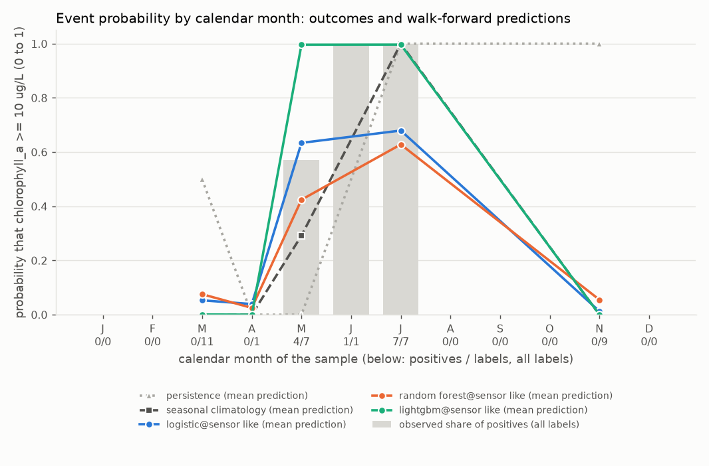
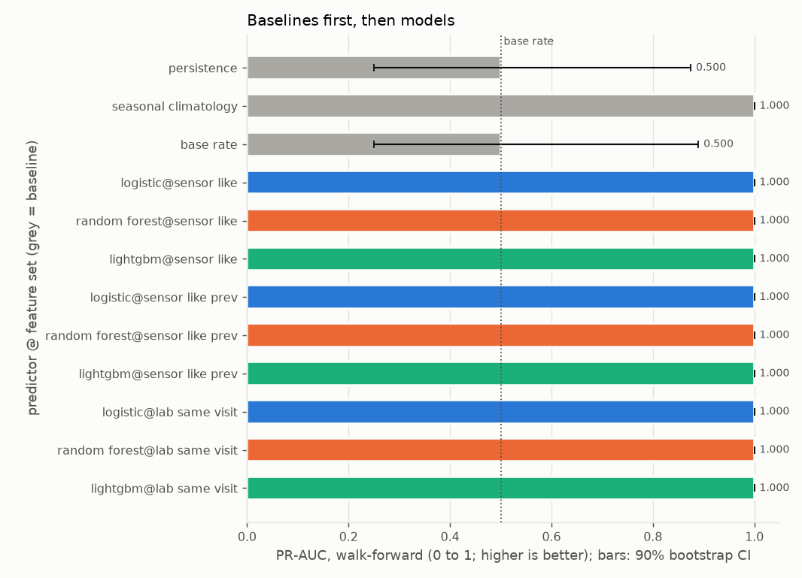
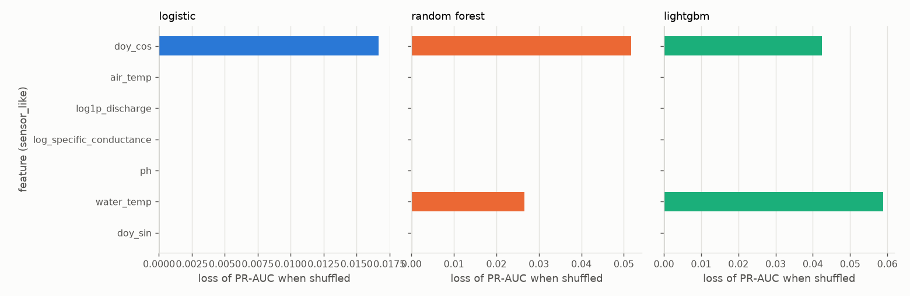
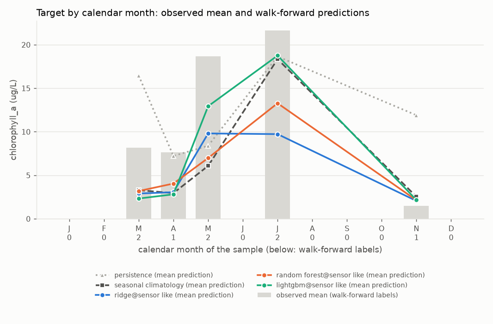
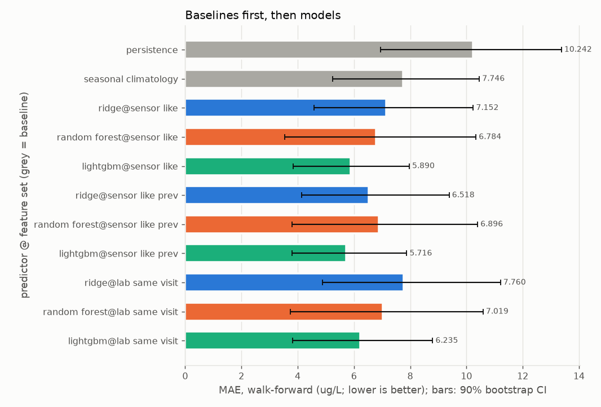
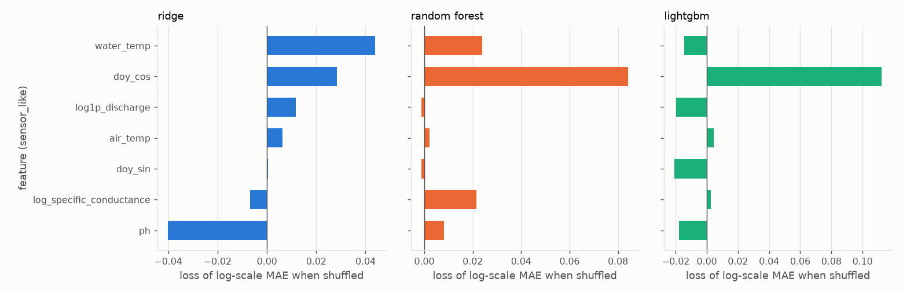

# Report: crp_chla_17410

Real grab-sample data, `source=CRP` only, labels from 2014-01-01; `quality='good'` rows only. Input `data/clean/crp_long.csv` (SHA-256 `eef7c00928bcd8ce...`). Stations: 17410.

Chlorophyll-a at CRP station 17410 only. Primary target: the event chlorophyll_a >= 10 ug/L on the sample date. Secondary: the concentration (log1p regression).

## First lines

### Primary target: event chlorophyll_a >= 10 ug/L

- Labels used: 36 on 36 distinct dates, 12 positives (17410: 36).
- Censored labels: 11 left-censored at or below the threshold counted as negatives; 0 left-censored above the threshold dropped (unknown); 0 right-censored dropped.
- Walk-forward: 3 folds (test years 2021 to 2023), n_train from 20 to 26 (training positives 5 to 8), n_test = 8 on 8 dates, 4 positives.
- Final hold-out (evaluated once, last 8 distinct dates, from 2024-03-27): n_train = 28, n_holdout = 8, 3 positives; training positives 9.
- **Persistence** means: the last sample at this station, carried forward (the previous label at the same station on a strictly earlier date; with no earlier label, the training base rate).
- **Seasonal climatology** means: the mean of the training targets within plus or minus 1 calendar month(s) of the test month, pooled over the task's stations (with fewer than 3 training labels in that window, the mean of all training targets).
- **Base rate** means: the share of positives among the training labels.
- Verdicts, walk-forward, headline feature set `sensor_like` (deployable):
  - seasonal climatology beats persistence (PR-AUC difference +0.500, 90% CI [+0.125, +0.750]); Brier difference -0.374 [-0.624, -0.139] (lower is better).
  - logistic on sensor_like (deployable) beats persistence (PR-AUC difference +0.500, 90% CI [+0.125, +0.750]); Brier difference -0.430 [-0.704, -0.148] (lower is better).
  - logistic on sensor_like (deployable) shows no demonstrable difference from seasonal climatology (PR-AUC difference +0.000, 90% CI [+0.000, +0.000]); Brier difference -0.056 [-0.180, +0.066] (lower is better).
  - random_forest on sensor_like (deployable) beats persistence (PR-AUC difference +0.500, 90% CI [+0.125, +0.750]); Brier difference -0.371 [-0.646, -0.099] (lower is better).
  - random_forest on sensor_like (deployable) shows no demonstrable difference from seasonal climatology (PR-AUC difference +0.000, 90% CI [+0.000, +0.000]); Brier difference +0.003 [-0.080, +0.085] (lower is better).
  - lightgbm on sensor_like (deployable) beats persistence (PR-AUC difference +0.500, 90% CI [+0.125, +0.750]); Brier difference -0.500 [-0.750, -0.250] (lower is better).
  - lightgbm on sensor_like (deployable) shows no demonstrable difference from seasonal climatology (PR-AUC difference +0.000, 90% CI [+0.000, +0.000]); Brier difference -0.126 [-0.266, +0.000] (lower is better).
- Verdicts, final hold-out, headline feature set `sensor_like`:
  - seasonal climatology beats persistence (PR-AUC difference +0.639, 90% CI [+0.250, +0.875]); Brier difference -0.418 [-0.668, -0.168] (lower is better).
  - logistic on sensor_like (deployable) beats persistence (PR-AUC difference +0.639, 90% CI [+0.250, +0.875]); Brier difference -0.327 [-0.609, -0.040] (lower is better).
  - logistic on sensor_like (deployable) shows no demonstrable difference from seasonal climatology (PR-AUC difference +0.000, 90% CI [+0.000, +0.000]); Brier difference +0.091 [-0.071, +0.262] (lower is better).
  - random_forest on sensor_like (deployable) beats persistence (PR-AUC difference +0.639, 90% CI [+0.250, +0.875]); Brier difference -0.476 [-0.722, -0.230] (lower is better).
  - random_forest on sensor_like (deployable) shows no demonstrable difference from seasonal climatology (PR-AUC difference +0.000, 90% CI [+0.000, +0.000]); Brier difference -0.058 [-0.135, +0.019] (lower is better).
  - lightgbm on sensor_like (deployable) beats persistence (PR-AUC difference +0.639, 90% CI [+0.250, +0.875]); Brier difference -0.500 [-0.750, -0.250] (lower is better).
  - lightgbm on sensor_like (deployable) shows no demonstrable difference from seasonal climatology (PR-AUC difference +0.000, 90% CI [+0.000, +0.000]); Brier difference -0.082 [-0.163, +0.000] (lower is better).

### Secondary target: regression of chlorophyll_a (ug/L), fitted on the log1p scale

- Labels used: 36 on 36 distinct dates, 11 left-censored (17410: 36).
- Censored labels: left-censored values enter at detection limit x 0.5; 0 right-censored dropped.
- Walk-forward: 3 folds (test years 2021 to 2023), n_train from 20 to 26, n_test = 8 on 8 dates.
- Final hold-out (evaluated once, last 8 distinct dates, from 2024-03-27): n_train = 28, n_holdout = 8.
- **Persistence** means: the last sample at this station, carried forward (the previous label at the same station on a strictly earlier date; with no earlier label, the training median).
- **Seasonal climatology** means: the mean of the training targets within plus or minus 1 calendar month(s) of the test month, pooled over the task's stations (with fewer than 3 training labels in that window, the mean of all training targets).
- Verdicts, walk-forward, headline feature set `sensor_like` (deployable):
  - seasonal climatology shows no demonstrable difference from persistence (MAE difference -2.497, 90% CI [-6.495, +1.124]).
  - ridge on sensor_like (deployable) shows no demonstrable difference from persistence (MAE difference -3.091, 90% CI [-6.778, +0.443]).
  - ridge on sensor_like (deployable) shows no demonstrable difference from seasonal climatology (MAE difference -0.594, 90% CI [-1.994, +0.598]).
  - random_forest on sensor_like (deployable) shows no demonstrable difference from persistence (MAE difference -3.458, 90% CI [-7.419, +0.268]).
  - random_forest on sensor_like (deployable) shows no demonstrable difference from seasonal climatology (MAE difference -0.962, 90% CI [-2.740, +0.770]).
  - lightgbm on sensor_like (deployable) beats persistence (MAE difference -4.353, 90% CI [-7.338, -1.212]).
  - lightgbm on sensor_like (deployable) beats seasonal climatology (MAE difference -1.856, 90% CI [-4.013, -0.107]).
- Verdicts, final hold-out, headline feature set `sensor_like`:
  - seasonal climatology shows no demonstrable difference from persistence (MAE difference -2.035, 90% CI [-4.464, +0.492]).
  - ridge on sensor_like (deployable) beats persistence (MAE difference -3.013, 90% CI [-4.937, -0.777]).
  - ridge on sensor_like (deployable) shows no demonstrable difference from seasonal climatology (MAE difference -0.978, 90% CI [-2.792, +0.831]).
  - random_forest on sensor_like (deployable) shows no demonstrable difference from persistence (MAE difference -2.766, 90% CI [-5.413, +0.035]).
  - random_forest on sensor_like (deployable) shows no demonstrable difference from seasonal climatology (MAE difference -0.731, 90% CI [-1.713, +0.201]).
  - lightgbm on sensor_like (deployable) shows no demonstrable difference from persistence (MAE difference -2.209, 90% CI [-5.507, +1.116]).
  - lightgbm on sensor_like (deployable) shows no demonstrable difference from seasonal climatology (MAE difference -0.174, 90% CI [-1.410, +1.028]).

## Warnings

- WARNING [event, regression] fold 2018 skipped: 13 training labels, fewer than min_train_labels=20.
- WARNING [event, regression] fold 2019 skipped: 14 training labels, fewer than min_train_labels=20.
- WARNING [event, regression] fold 2020 skipped: 18 training labels, fewer than min_train_labels=20.
- WARNING [event, regression] n_train below 50 in: 2021 (20), 2022 (24), 2023 (26), holdout (28).
- WARNING [event] the hold-out has 3 positives, fewer than 10: hold-out event metrics are very uncertain.
- WARNING [event] walk-forward slices with zero positives (undefined: no positives): oct_mar.
- WARNING [event] holdout slices with zero positives (undefined: no positives): oct_mar.
- WARNING [event, regression] 4 of 6 station-years in the test windows have fewer than 4 labels (minimum 1).
- WARNING [event] LEAKAGE SUSPECTED: shuffled-label skill for logistic@sensor_like, lightgbm@sensor_like, random_forest@sensor_like_prev, logistic@lab_same_visit, random_forest@lab_same_visit, lightgbm@lab_same_visit.
- WARNING [regression] only 8 walk-forward residuals (fewer than 30): the conformal intervals are not meaningful.

## Metrics

### Event target: event chlorophyll_a >= 10 ug/L

Folds:

| fold | n_train | n_test | last train date | first test date | last test date | train positives | test positives |
|---|---|---|---|---|---|---|---|
| 2021 | 20 | 4 | 2020-11-30 | 2021-03-31 | 2021-07-26 | 5 | 2 |
| 2022 | 24 | 2 | 2021-07-26 | 2022-03-16 | 2022-05-18 | 7 | 1 |
| 2023 | 26 | 2 | 2022-05-18 | 2023-07-18 | 2023-11-29 | 8 | 1 |
| holdout | 28 | 8 | 2023-11-29 | 2024-03-27 | 2026-03-30 | 9 | 3 |

#### Walk-forward

n = 8 on 8 dates, 4 positives, base rate 0.500. Baselines first, then models. Brackets: 90% bootstrap CI over distinct dates.

| predictor | deployable | PR-AUC | ROC-AUC | Brier | Brier skill vs base rate |
|---|---|---|---|---|---|
| persistence | baseline | 0.500 [0.250, 0.875] | 0.500 [0.200, 0.817] | 0.500 [0.250, 0.750] | -0.659 [-2.390, 0.310] |
| seasonal_climatology | baseline | 1.000 [1.000, 1.000] | 1.000 [1.000, 1.000] | 0.126 [0.000, 0.266] | 0.582 [0.247, 1.000] |
| base_rate | baseline | 0.500 [0.250, 0.890] | 0.500 [0.167, 0.833] | 0.301 [0.182, 0.430] | 0.000 [0.000, 0.000] |
| logistic@sensor_like | yes | 1.000 [1.000, 1.000] | 1.000 [1.000, 1.000] | 0.070 [0.021, 0.127] | 0.768 [0.632, 0.900] |
| random_forest@sensor_like | yes | 1.000 [1.000, 1.000] | 1.000 [1.000, 1.000] | 0.129 [0.045, 0.220] | 0.573 [0.400, 0.785] |
| lightgbm@sensor_like | yes | 1.000 [1.000, 1.000] | 1.000 [1.000, 1.000] | 0.000 [0.000, 0.000] | 1.000 [1.000, 1.000] |
| logistic@sensor_like_prev | yes | 1.000 [1.000, 1.000] | 1.000 [1.000, 1.000] | 0.093 [0.022, 0.184] | 0.693 [0.440, 0.897] |
| random_forest@sensor_like_prev | yes | 1.000 [1.000, 1.000] | 1.000 [1.000, 1.000] | 0.147 [0.060, 0.241] | 0.512 [0.338, 0.720] |
| lightgbm@sensor_like_prev | yes | 1.000 [1.000, 1.000] | 1.000 [1.000, 1.000] | 0.000 [0.000, 0.000] | 1.000 [1.000, 1.000] |
| logistic@lab_same_visit | NO (diagnostic) | 1.000 [1.000, 1.000] | 1.000 [1.000, 1.000] | 0.069 [0.021, 0.125] | 0.769 [0.638, 0.896] |
| random_forest@lab_same_visit | NO (diagnostic) | 1.000 [1.000, 1.000] | 1.000 [1.000, 1.000] | 0.151 [0.055, 0.250] | 0.500 [0.320, 0.733] |
| lightgbm@lab_same_visit | NO (diagnostic) | 1.000 [1.000, 1.000] | 1.000 [1.000, 1.000] | 0.000 [0.000, 0.000] | 1.000 [0.999, 1.000] |

At p = 0.5:

| predictor | precision | recall | F1 | TP | FP | FN | TN |
|---|---|---|---|---|---|---|---|
| persistence | 0.500 [0.000, 1.000] | 0.500 [0.000, 1.000] | 0.500 [0.000, 0.800] | 2 | 2 | 2 | 2 |
| seasonal_climatology | 1.000 [1.000, 1.000] | 0.500 [0.000, 1.000] | 0.667 [0.000, 1.000] | 2 | 0 | 2 | 4 |
| base_rate | undefined | 0.000 [0.000, 0.000] | 0.000 [0.000, 0.000] | 0 | 0 | 4 | 4 |
| logistic@sensor_like | 1.000 [1.000, 1.000] | 0.750 [0.333, 1.000] | 0.857 [0.500, 1.000] | 3 | 0 | 1 | 4 |
| random_forest@sensor_like | 1.000 [1.000, 1.000] | 0.250 [0.000, 0.600] | 0.400 [0.000, 0.750] | 1 | 0 | 3 | 4 |
| lightgbm@sensor_like | 1.000 [1.000, 1.000] | 1.000 [1.000, 1.000] | 1.000 [1.000, 1.000] | 4 | 0 | 0 | 4 |
| logistic@sensor_like_prev | 1.000 [1.000, 1.000] | 0.750 [0.333, 1.000] | 0.857 [0.500, 1.000] | 3 | 0 | 1 | 4 |
| random_forest@sensor_like_prev | 1.000 [1.000, 1.000] | 0.250 [0.000, 0.600] | 0.400 [0.000, 0.750] | 1 | 0 | 3 | 4 |
| lightgbm@sensor_like_prev | 1.000 [1.000, 1.000] | 1.000 [1.000, 1.000] | 1.000 [1.000, 1.000] | 4 | 0 | 0 | 4 |
| logistic@lab_same_visit | 1.000 [1.000, 1.000] | 0.750 [0.333, 1.000] | 0.857 [0.500, 1.000] | 3 | 0 | 1 | 4 |
| random_forest@lab_same_visit | 1.000 [1.000, 1.000] | 0.250 [0.000, 0.600] | 0.400 [0.000, 0.750] | 1 | 0 | 3 | 4 |
| lightgbm@lab_same_visit | 1.000 [1.000, 1.000] | 1.000 [1.000, 1.000] | 1.000 [1.000, 1.000] | 4 | 0 | 0 | 4 |

At p* = 0.10 (C_FP=1, C_FN=9, PLACEHOLDER):

| predictor | precision | recall | F1 | TP | FP | FN | TN |
|---|---|---|---|---|---|---|---|
| persistence | 0.500 [0.000, 1.000] | 0.500 [0.000, 1.000] | 0.500 [0.000, 0.800] | 2 | 2 | 2 | 2 |
| seasonal_climatology | 1.000 [1.000, 1.000] | 1.000 [1.000, 1.000] | 1.000 [1.000, 1.000] | 4 | 0 | 0 | 4 |
| base_rate | 0.500 [0.250, 0.750] | 1.000 [1.000, 1.000] | 0.667 [0.400, 0.857] | 4 | 4 | 0 | 0 |
| logistic@sensor_like | 1.000 [1.000, 1.000] | 1.000 [1.000, 1.000] | 1.000 [1.000, 1.000] | 4 | 0 | 0 | 4 |
| random_forest@sensor_like | 0.800 [0.500, 1.000] | 1.000 [1.000, 1.000] | 0.889 [0.667, 1.000] | 4 | 1 | 0 | 3 |
| lightgbm@sensor_like | 1.000 [1.000, 1.000] | 1.000 [1.000, 1.000] | 1.000 [1.000, 1.000] | 4 | 0 | 0 | 4 |
| logistic@sensor_like_prev | 1.000 [1.000, 1.000] | 1.000 [1.000, 1.000] | 1.000 [1.000, 1.000] | 4 | 0 | 0 | 4 |
| random_forest@sensor_like_prev | 0.667 [0.333, 1.000] | 1.000 [1.000, 1.000] | 0.800 [0.500, 1.000] | 4 | 2 | 0 | 2 |
| lightgbm@sensor_like_prev | 1.000 [1.000, 1.000] | 1.000 [1.000, 1.000] | 1.000 [1.000, 1.000] | 4 | 0 | 0 | 4 |
| logistic@lab_same_visit | 1.000 [1.000, 1.000] | 1.000 [1.000, 1.000] | 1.000 [1.000, 1.000] | 4 | 0 | 0 | 4 |
| random_forest@lab_same_visit | 0.800 [0.500, 1.000] | 1.000 [1.000, 1.000] | 0.889 [0.667, 1.000] | 4 | 1 | 0 | 3 |
| lightgbm@lab_same_visit | 1.000 [1.000, 1.000] | 1.000 [1.000, 1.000] | 1.000 [1.000, 1.000] | 4 | 0 | 0 | 4 |

Paired differences (higher PR-AUC and lower Brier are better):

| model | baseline | PR-AUC difference (model - baseline) | Brier difference | verdict (by PR-AUC) |
|---|---|---|---|---|
| persistence | seasonal_climatology | -0.500 [-0.750, -0.125] | +0.374 [+0.139, +0.624] | is worse than |
| persistence | base_rate | +0.000 [-0.201, +0.125] | +0.199 [-0.108, +0.502] | no demonstrable difference |
| seasonal_climatology | persistence | +0.500 [+0.125, +0.750] | -0.374 [-0.624, -0.139] | beats |
| seasonal_climatology | base_rate | +0.500 [+0.110, +0.750] | -0.175 [-0.301, -0.061] | beats |
| base_rate | persistence | +0.000 [-0.125, +0.201] | -0.199 [-0.502, +0.108] | no demonstrable difference |
| base_rate | seasonal_climatology | -0.500 [-0.750, -0.110] | +0.175 [+0.061, +0.301] | is worse than |
| logistic@sensor_like | persistence | +0.500 [+0.125, +0.750] | -0.430 [-0.704, -0.148] | beats |
| logistic@sensor_like | seasonal_climatology | +0.000 [+0.000, +0.000] | -0.056 [-0.180, +0.066] | no demonstrable difference |
| logistic@sensor_like | base_rate | +0.500 [+0.110, +0.750] | -0.231 [-0.345, -0.134] | beats |
| random_forest@sensor_like | persistence | +0.500 [+0.125, +0.750] | -0.371 [-0.646, -0.099] | beats |
| random_forest@sensor_like | seasonal_climatology | +0.000 [+0.000, +0.000] | +0.003 [-0.080, +0.085] | no demonstrable difference |
| random_forest@sensor_like | base_rate | +0.500 [+0.110, +0.750] | -0.173 [-0.274, -0.095] | beats |
| lightgbm@sensor_like | persistence | +0.500 [+0.125, +0.750] | -0.500 [-0.750, -0.250] | beats |
| lightgbm@sensor_like | seasonal_climatology | +0.000 [+0.000, +0.000] | -0.126 [-0.266, +0.000] | no demonstrable difference |
| lightgbm@sensor_like | base_rate | +0.500 [+0.110, +0.750] | -0.301 [-0.430, -0.182] | beats |
| logistic@sensor_like_prev | persistence | +0.500 [+0.125, +0.750] | -0.407 [-0.705, -0.101] | beats |
| logistic@sensor_like_prev | seasonal_climatology | +0.000 [+0.000, +0.000] | -0.033 [-0.167, +0.114] | no demonstrable difference |
| logistic@sensor_like_prev | base_rate | +0.500 [+0.110, +0.750] | -0.209 [-0.326, -0.108] | beats |
| random_forest@sensor_like_prev | persistence | +0.500 [+0.125, +0.750] | -0.353 [-0.635, -0.072] | beats |
| random_forest@sensor_like_prev | seasonal_climatology | +0.000 [+0.000, +0.000] | +0.021 [-0.065, +0.108] | no demonstrable difference |
| random_forest@sensor_like_prev | base_rate | +0.500 [+0.110, +0.750] | -0.154 [-0.253, -0.080] | beats |
| lightgbm@sensor_like_prev | persistence | +0.500 [+0.125, +0.750] | -0.500 [-0.750, -0.250] | beats |
| lightgbm@sensor_like_prev | seasonal_climatology | +0.000 [+0.000, +0.000] | -0.126 [-0.266, +0.000] | no demonstrable difference |
| lightgbm@sensor_like_prev | base_rate | +0.500 [+0.110, +0.750] | -0.301 [-0.430, -0.182] | beats |
| logistic@lab_same_visit | persistence | +0.500 [+0.125, +0.750] | -0.431 [-0.702, -0.149] | beats |
| logistic@lab_same_visit | seasonal_climatology | +0.000 [+0.000, +0.000] | -0.056 [-0.179, +0.063] | no demonstrable difference |
| logistic@lab_same_visit | base_rate | +0.500 [+0.110, +0.750] | -0.232 [-0.344, -0.135] | beats |
| random_forest@lab_same_visit | persistence | +0.500 [+0.125, +0.750] | -0.349 [-0.636, -0.076] | beats |
| random_forest@lab_same_visit | seasonal_climatology | +0.000 [+0.000, +0.000] | +0.025 [-0.059, +0.118] | no demonstrable difference |
| random_forest@lab_same_visit | base_rate | +0.500 [+0.110, +0.750] | -0.151 [-0.247, -0.081] | beats |
| lightgbm@lab_same_visit | persistence | +0.500 [+0.125, +0.750] | -0.500 [-0.750, -0.250] | beats |
| lightgbm@lab_same_visit | seasonal_climatology | +0.000 [+0.000, +0.000] | -0.126 [-0.266, +0.000] | no demonstrable difference |
| lightgbm@lab_same_visit | base_rate | +0.500 [+0.110, +0.750] | -0.301 [-0.430, -0.182] | beats |

#### Final hold-out (evaluated once)

n = 8 on 8 dates, 3 positives, base rate 0.375. Baselines first, then models. Brackets: 90% bootstrap CI over distinct dates.

| predictor | deployable | PR-AUC | ROC-AUC | Brier | Brier skill vs base rate |
|---|---|---|---|---|---|
| persistence | baseline | 0.361 [0.125, 0.750] | 0.467 [0.200, 0.786] | 0.500 [0.250, 0.750] | -1.108 [-2.894, -0.010] |
| seasonal_climatology | baseline | 1.000 [1.000, 1.000] | 1.000 [1.000, 1.000] | 0.082 [0.000, 0.163] | 0.656 [0.482, 1.000] |
| base_rate | baseline | 0.375 [0.125, 0.625] | 0.500 [0.500, 0.500] | 0.237 [0.148, 0.327] | 0.000 [0.000, 0.000] |
| logistic@sensor_like | yes | 1.000 [1.000, 1.000] | 1.000 [1.000, 1.000] | 0.173 [0.062, 0.302] | 0.271 [-0.877, 0.792] |
| random_forest@sensor_like | yes | 1.000 [1.000, 1.000] | 1.000 [1.000, 1.000] | 0.024 [0.017, 0.030] | 0.900 [0.842, 0.929] |
| lightgbm@sensor_like | yes | 1.000 [1.000, 1.000] | 1.000 [1.000, 1.000] | 0.000 [0.000, 0.000] | 1.000 [1.000, 1.000] |
| logistic@sensor_like_prev | yes | 1.000 [1.000, 1.000] | 1.000 [1.000, 1.000] | 0.195 [0.069, 0.338] | 0.179 [-1.138, 0.764] |
| random_forest@sensor_like_prev | yes | 1.000 [1.000, 1.000] | 1.000 [1.000, 1.000] | 0.015 [0.011, 0.021] | 0.935 [0.900, 0.955] |
| lightgbm@sensor_like_prev | yes | 1.000 [1.000, 1.000] | 1.000 [1.000, 1.000] | 0.000 [0.000, 0.000] | 1.000 [1.000, 1.000] |
| logistic@lab_same_visit | NO (diagnostic) | 1.000 [1.000, 1.000] | 1.000 [1.000, 1.000] | 0.182 [0.064, 0.316] | 0.234 [-0.994, 0.778] |
| random_forest@lab_same_visit | NO (diagnostic) | 1.000 [1.000, 1.000] | 1.000 [1.000, 1.000] | 0.026 [0.019, 0.033] | 0.890 [0.847, 0.913] |
| lightgbm@lab_same_visit | NO (diagnostic) | 1.000 [1.000, 1.000] | 1.000 [1.000, 1.000] | 0.000 [0.000, 0.000] | 1.000 [1.000, 1.000] |

At p = 0.5:

| predictor | precision | recall | F1 | TP | FP | FN | TN |
|---|---|---|---|---|---|---|---|
| persistence | 0.333 [0.000, 1.000] | 0.333 [0.000, 1.000] | 0.333 [0.000, 0.667] | 1 | 2 | 2 | 3 |
| seasonal_climatology | 1.000 [1.000, 1.000] | 0.333 [0.000, 1.000] | 0.500 [0.000, 1.000] | 1 | 0 | 2 | 5 |
| base_rate | undefined | 0.000 [0.000, 0.000] | 0.000 [0.000, 0.000] | 0 | 0 | 3 | 5 |
| logistic@sensor_like | 0.500 [0.167, 0.833] | 1.000 [1.000, 1.000] | 0.667 [0.286, 0.909] | 3 | 3 | 0 | 2 |
| random_forest@sensor_like | 1.000 [1.000, 1.000] | 1.000 [1.000, 1.000] | 1.000 [1.000, 1.000] | 3 | 0 | 0 | 5 |
| lightgbm@sensor_like | 1.000 [1.000, 1.000] | 1.000 [1.000, 1.000] | 1.000 [1.000, 1.000] | 3 | 0 | 0 | 5 |
| logistic@sensor_like_prev | 0.500 [0.167, 0.833] | 1.000 [1.000, 1.000] | 0.667 [0.286, 0.909] | 3 | 3 | 0 | 2 |
| random_forest@sensor_like_prev | 1.000 [1.000, 1.000] | 1.000 [1.000, 1.000] | 1.000 [1.000, 1.000] | 3 | 0 | 0 | 5 |
| lightgbm@sensor_like_prev | 1.000 [1.000, 1.000] | 1.000 [1.000, 1.000] | 1.000 [1.000, 1.000] | 3 | 0 | 0 | 5 |
| logistic@lab_same_visit | 0.500 [0.167, 0.833] | 1.000 [1.000, 1.000] | 0.667 [0.286, 0.909] | 3 | 3 | 0 | 2 |
| random_forest@lab_same_visit | 1.000 [1.000, 1.000] | 1.000 [1.000, 1.000] | 1.000 [1.000, 1.000] | 3 | 0 | 0 | 5 |
| lightgbm@lab_same_visit | 1.000 [1.000, 1.000] | 1.000 [1.000, 1.000] | 1.000 [1.000, 1.000] | 3 | 0 | 0 | 5 |

At p* = 0.10 (C_FP=1, C_FN=9, PLACEHOLDER):

| predictor | precision | recall | F1 | TP | FP | FN | TN |
|---|---|---|---|---|---|---|---|
| persistence | 0.333 [0.000, 1.000] | 0.333 [0.000, 1.000] | 0.333 [0.000, 0.667] | 1 | 2 | 2 | 3 |
| seasonal_climatology | 1.000 [1.000, 1.000] | 1.000 [1.000, 1.000] | 1.000 [1.000, 1.000] | 3 | 0 | 0 | 5 |
| base_rate | 0.375 [0.125, 0.625] | 1.000 [1.000, 1.000] | 0.545 [0.222, 0.769] | 3 | 5 | 0 | 0 |
| logistic@sensor_like | 0.429 [0.125, 0.716] | 1.000 [1.000, 1.000] | 0.600 [0.222, 0.835] | 3 | 4 | 0 | 1 |
| random_forest@sensor_like | 0.500 [0.167, 0.833] | 1.000 [1.000, 1.000] | 0.667 [0.286, 0.909] | 3 | 3 | 0 | 2 |
| lightgbm@sensor_like | 1.000 [1.000, 1.000] | 1.000 [1.000, 1.000] | 1.000 [1.000, 1.000] | 3 | 0 | 0 | 5 |
| logistic@sensor_like_prev | 0.429 [0.125, 0.716] | 1.000 [1.000, 1.000] | 0.600 [0.222, 0.835] | 3 | 4 | 0 | 1 |
| random_forest@sensor_like_prev | 0.600 [0.200, 1.000] | 1.000 [1.000, 1.000] | 0.750 [0.333, 1.000] | 3 | 2 | 0 | 3 |
| lightgbm@sensor_like_prev | 1.000 [1.000, 1.000] | 1.000 [1.000, 1.000] | 1.000 [1.000, 1.000] | 3 | 0 | 0 | 5 |
| logistic@lab_same_visit | 0.429 [0.125, 0.716] | 1.000 [1.000, 1.000] | 0.600 [0.222, 0.835] | 3 | 4 | 0 | 1 |
| random_forest@lab_same_visit | 0.375 [0.125, 0.625] | 1.000 [1.000, 1.000] | 0.545 [0.222, 0.769] | 3 | 5 | 0 | 0 |
| lightgbm@lab_same_visit | 1.000 [1.000, 1.000] | 1.000 [1.000, 1.000] | 1.000 [1.000, 1.000] | 3 | 0 | 0 | 5 |

Paired differences (higher PR-AUC and lower Brier are better):

| model | baseline | PR-AUC difference (model - baseline) | Brier difference | verdict (by PR-AUC) |
|---|---|---|---|---|
| persistence | seasonal_climatology | -0.639 [-0.875, -0.250] | +0.418 [+0.168, +0.668] | is worse than |
| persistence | base_rate | -0.014 [-0.058, +0.208] | +0.263 [+0.004, +0.522] | no demonstrable difference |
| seasonal_climatology | persistence | +0.639 [+0.250, +0.875] | -0.418 [-0.668, -0.168] | beats |
| seasonal_climatology | base_rate | +0.625 [+0.375, +0.875] | -0.156 [-0.241, -0.107] | beats |
| base_rate | persistence | +0.014 [-0.208, +0.058] | -0.263 [-0.522, -0.004] | no demonstrable difference |
| base_rate | seasonal_climatology | -0.625 [-0.875, -0.375] | +0.156 [+0.107, +0.241] | is worse than |
| logistic@sensor_like | persistence | +0.639 [+0.250, +0.875] | -0.327 [-0.609, -0.040] | beats |
| logistic@sensor_like | seasonal_climatology | +0.000 [+0.000, +0.000] | +0.091 [-0.071, +0.262] | no demonstrable difference |
| logistic@sensor_like | base_rate | +0.625 [+0.375, +0.875] | -0.064 [-0.258, +0.127] | beats |
| random_forest@sensor_like | persistence | +0.639 [+0.250, +0.875] | -0.476 [-0.722, -0.230] | beats |
| random_forest@sensor_like | seasonal_climatology | +0.000 [+0.000, +0.000] | -0.058 [-0.135, +0.019] | no demonstrable difference |
| random_forest@sensor_like | base_rate | +0.625 [+0.375, +0.875] | -0.214 [-0.302, -0.124] | beats |
| lightgbm@sensor_like | persistence | +0.639 [+0.250, +0.875] | -0.500 [-0.750, -0.250] | beats |
| lightgbm@sensor_like | seasonal_climatology | +0.000 [+0.000, +0.000] | -0.082 [-0.163, +0.000] | no demonstrable difference |
| lightgbm@sensor_like | base_rate | +0.625 [+0.375, +0.875] | -0.237 [-0.327, -0.148] | beats |
| logistic@sensor_like_prev | persistence | +0.639 [+0.250, +0.875] | -0.305 [-0.586, -0.019] | beats |
| logistic@sensor_like_prev | seasonal_climatology | +0.000 [+0.000, +0.000] | +0.113 [-0.066, +0.300] | no demonstrable difference |
| logistic@sensor_like_prev | base_rate | +0.625 [+0.375, +0.875] | -0.042 [-0.248, +0.168] | beats |
| random_forest@sensor_like_prev | persistence | +0.639 [+0.250, +0.875] | -0.485 [-0.732, -0.237] | beats |
| random_forest@sensor_like_prev | seasonal_climatology | +0.000 [+0.000, +0.000] | -0.066 [-0.144, +0.012] | no demonstrable difference |
| random_forest@sensor_like_prev | base_rate | +0.625 [+0.375, +0.875] | -0.222 [-0.311, -0.133] | beats |
| lightgbm@sensor_like_prev | persistence | +0.639 [+0.250, +0.875] | -0.500 [-0.750, -0.250] | beats |
| lightgbm@sensor_like_prev | seasonal_climatology | +0.000 [+0.000, +0.000] | -0.082 [-0.163, +0.000] | no demonstrable difference |
| lightgbm@sensor_like_prev | base_rate | +0.625 [+0.375, +0.875] | -0.237 [-0.327, -0.148] | beats |
| logistic@lab_same_visit | persistence | +0.639 [+0.250, +0.875] | -0.318 [-0.598, -0.034] | beats |
| logistic@lab_same_visit | seasonal_climatology | +0.000 [+0.000, +0.000] | +0.100 [-0.069, +0.277] | no demonstrable difference |
| logistic@lab_same_visit | base_rate | +0.625 [+0.375, +0.875] | -0.055 [-0.253, +0.147] | beats |
| random_forest@lab_same_visit | persistence | +0.639 [+0.250, +0.875] | -0.474 [-0.723, -0.226] | beats |
| random_forest@lab_same_visit | seasonal_climatology | +0.000 [+0.000, +0.000] | -0.056 [-0.133, +0.020] | no demonstrable difference |
| random_forest@lab_same_visit | base_rate | +0.625 [+0.375, +0.875] | -0.211 [-0.298, -0.125] | beats |
| lightgbm@lab_same_visit | persistence | +0.639 [+0.250, +0.875] | -0.500 [-0.750, -0.250] | beats |
| lightgbm@lab_same_visit | seasonal_climatology | +0.000 [+0.000, +0.000] | -0.082 [-0.163, +0.000] | no demonstrable difference |
| lightgbm@lab_same_visit | base_rate | +0.625 [+0.375, +0.875] | -0.237 [-0.327, -0.148] | beats |

### Regression target: regression of chlorophyll_a (ug/L), fitted on the log1p scale

Folds:

| fold | n_train | n_test | last train date | first test date | last test date |
|---|---|---|---|---|---|
| 2021 | 20 | 4 | 2020-11-30 | 2021-03-31 | 2021-07-26 |
| 2022 | 24 | 2 | 2021-07-26 | 2022-03-16 | 2022-05-18 |
| 2023 | 26 | 2 | 2022-05-18 | 2023-07-18 | 2023-11-29 |
| holdout | 28 | 8 | 2023-11-29 | 2024-03-27 | 2026-03-30 |

#### Walk-forward

All labels: n = 8 on 8 dates (1 left-censored). MAE and RMSE in ug/L. Brackets: 90% bootstrap CI over distinct dates.

| predictor | deployable | MAE | RMSE | R2 | MAE (log scale) | skill vs persistence | skill vs climatology |
|---|---|---|---|---|---|---|---|
| persistence | baseline | 10.242 [6.947, 13.376] | 11.844 [8.240, 14.945] | -0.818 [-7.557, 0.095] | 0.825 [0.550, 1.080] | 0.000 [0.000, 0.000] | -0.322 [-1.066, 0.115] |
| seasonal_climatology | baseline | 7.746 [5.247, 10.458] | 8.928 [6.282, 11.243] | -0.033 [-2.302, 0.384] | 0.714 [0.585, 0.844] | 0.244 [-0.130, 0.516] | 0.000 [0.000, 0.000] |
| ridge@sensor_like | yes | 7.152 [4.584, 10.241] | 8.533 [5.313, 11.602] | 0.056 [-1.319, 0.323] | 0.666 [0.531, 0.784] | 0.302 [-0.057, 0.554] | 0.077 [-0.079, 0.242] |
| random_forest@sensor_like | yes | 6.784 [3.534, 10.337] | 8.961 [5.007, 12.081] | -0.041 [-1.781, 0.367] | 0.620 [0.387, 0.841] | 0.338 [-0.030, 0.636] | 0.124 [-0.087, 0.395] |
| lightgbm@sensor_like | yes | 5.890 [3.841, 7.967] | 6.850 [4.677, 8.714] | 0.392 [-0.865, 0.625] | 0.601 [0.372, 0.852] | 0.425 [0.150, 0.612] | 0.240 [0.019, 0.459] |
| ridge@sensor_like_prev | yes | 6.518 [4.137, 9.385] | 7.824 [4.638, 10.796] | 0.206 [-0.888, 0.448] | 0.594 [0.497, 0.679] | 0.364 [0.031, 0.595] | 0.159 [-0.009, 0.331] |
| random_forest@sensor_like_prev | yes | 6.896 [3.793, 10.397] | 8.939 [4.906, 12.071] | -0.036 [-1.732, 0.373] | 0.632 [0.425, 0.836] | 0.327 [-0.039, 0.613] | 0.110 [-0.090, 0.353] |
| lightgbm@sensor_like_prev | yes | 5.716 [3.806, 7.876] | 6.657 [4.243, 8.721] | 0.426 [-0.943, 0.664] | 0.592 [0.390, 0.795] | 0.442 [0.150, 0.624] | 0.262 [-0.064, 0.519] |
| ridge@lab_same_visit | NO (diagnostic) | 7.760 [4.885, 11.209] | 9.392 [5.721, 13.154] | -0.144 [-1.574, 0.184] | 0.742 [0.594, 0.863] | 0.242 [-0.159, 0.527] | -0.002 [-0.194, 0.184] |
| random_forest@lab_same_visit | NO (diagnostic) | 7.019 [3.747, 10.591] | 9.164 [5.161, 12.314] | -0.089 [-1.915, 0.332] | 0.650 [0.421, 0.873] | 0.315 [-0.064, 0.618] | 0.094 [-0.112, 0.359] |
| lightgbm@lab_same_visit | NO (diagnostic) | 6.235 [3.829, 8.799] | 7.470 [4.700, 9.820] | 0.277 [-1.006, 0.536] | 0.639 [0.390, 0.896] | 0.391 [0.099, 0.603] | 0.195 [-0.015, 0.403] |

Numeric-only (uncensored) labels: n = 7 on 7 dates (0 left-censored). MAE and RMSE in ug/L. Brackets: 90% bootstrap CI over distinct dates.

| predictor | deployable | MAE | RMSE | R2 | MAE (log scale) | skill vs persistence | skill vs climatology |
|---|---|---|---|---|---|---|---|
| persistence | baseline | 10.220 [6.207, 14.201] | 12.036 [7.769, 15.733] | -1.209 [-13.526, 0.022] | 0.709 [0.471, 0.910] | 0.000 [0.000, 0.000] | -0.174 [-0.768, 0.211] |
| seasonal_climatology | baseline | 8.704 [6.188, 11.247] | 9.537 [6.855, 11.683] | -0.387 [-4.941, 0.140] | 0.767 [0.648, 0.899] | 0.148 [-0.267, 0.434] | 0.000 [0.000, 0.000] |
| ridge@sensor_like | yes | 8.094 [5.632, 10.832] | 9.120 [5.804, 12.141] | -0.268 [-2.641, -0.018] | 0.733 [0.655, 0.807] | 0.208 [-0.174, 0.464] | 0.070 [-0.089, 0.231] |
| random_forest@sensor_like | yes | 7.664 [4.175, 11.448] | 9.577 [5.209, 12.651] | -0.399 [-3.313, 0.106] | 0.677 [0.438, 0.935] | 0.250 [-0.159, 0.567] | 0.120 [-0.091, 0.409] |
| lightgbm@sensor_like | yes | 6.637 [4.812, 8.690] | 7.319 [5.271, 9.183] | 0.183 [-1.987, 0.401] | 0.654 [0.417, 0.924] | 0.351 [0.035, 0.527] | 0.238 [0.014, 0.440] |
| ridge@sensor_like_prev | yes | 7.314 [4.996, 9.928] | 8.357 [5.051, 11.273] | -0.065 [-1.875, 0.124] | 0.633 [0.553, 0.697] | 0.284 [-0.066, 0.531] | 0.160 [-0.012, 0.326] |
| random_forest@sensor_like_prev | yes | 7.731 [4.346, 11.431] | 9.548 [5.134, 12.678] | -0.390 [-3.266, 0.108] | 0.672 [0.451, 0.921] | 0.244 [-0.161, 0.558] | 0.112 [-0.091, 0.387] |
| lightgbm@sensor_like_prev | yes | 6.213 [4.253, 8.346] | 7.066 [4.696, 9.051] | 0.239 [-2.590, 0.447] | 0.586 [0.343, 0.839] | 0.392 [0.021, 0.603] | 0.286 [-0.040, 0.555] |
| ridge@lab_same_visit | NO (diagnostic) | 8.776 [6.093, 12.122] | 10.038 [6.222, 13.825] | -0.537 [-3.174, -0.287] | 0.816 [0.726, 0.900] | 0.141 [-0.299, 0.432] | -0.008 [-0.207, 0.178] |
| random_forest@lab_same_visit | NO (diagnostic) | 7.935 [4.442, 11.712] | 9.794 [5.445, 12.891] | -0.463 [-3.479, 0.069] | 0.712 [0.479, 0.972] | 0.224 [-0.209, 0.546] | 0.088 [-0.118, 0.371] |
| lightgbm@lab_same_visit | NO (diagnostic) | 7.086 [4.908, 9.589] | 7.985 [5.124, 10.329] | 0.028 [-2.039, 0.277] | 0.716 [0.470, 0.989] | 0.307 [-0.025, 0.512] | 0.186 [-0.026, 0.380] |

Paired differences (lower MAE is better):

| model | baseline | MAE difference (model - baseline) | verdict (by MAE) |
|---|---|---|---|
| persistence | seasonal_climatology | +2.497 [-1.124, +6.495] | no demonstrable difference |
| seasonal_climatology | persistence | -2.497 [-6.495, +1.124] | no demonstrable difference |
| ridge@sensor_like | persistence | -3.091 [-6.778, +0.443] | no demonstrable difference |
| ridge@sensor_like | seasonal_climatology | -0.594 [-1.994, +0.598] | no demonstrable difference |
| random_forest@sensor_like | persistence | -3.458 [-7.419, +0.268] | no demonstrable difference |
| random_forest@sensor_like | seasonal_climatology | -0.962 [-2.740, +0.770] | no demonstrable difference |
| lightgbm@sensor_like | persistence | -4.353 [-7.338, -1.212] | beats |
| lightgbm@sensor_like | seasonal_climatology | -1.856 [-4.013, -0.107] | beats |
| ridge@sensor_like_prev | persistence | -3.724 [-7.402, -0.242] | beats |
| ridge@sensor_like_prev | seasonal_climatology | -1.228 [-2.794, +0.052] | no demonstrable difference |
| random_forest@sensor_like_prev | persistence | -3.346 [-7.260, +0.326] | no demonstrable difference |
| random_forest@sensor_like_prev | seasonal_climatology | -0.850 [-2.486, +0.763] | no demonstrable difference |
| lightgbm@sensor_like_prev | persistence | -4.526 [-7.568, -1.134] | beats |
| lightgbm@sensor_like_prev | seasonal_climatology | -2.030 [-4.797, +0.436] | no demonstrable difference |
| ridge@lab_same_visit | persistence | -2.482 [-6.342, +1.238] | no demonstrable difference |
| ridge@lab_same_visit | seasonal_climatology | +0.015 [-1.483, +1.553] | no demonstrable difference |
| random_forest@lab_same_visit | persistence | -3.224 [-7.255, +0.540] | no demonstrable difference |
| random_forest@lab_same_visit | seasonal_climatology | -0.727 [-2.466, +0.961] | no demonstrable difference |
| lightgbm@lab_same_visit | persistence | -4.008 [-7.370, -0.843] | beats |
| lightgbm@lab_same_visit | seasonal_climatology | -1.511 [-3.400, +0.098] | no demonstrable difference |

#### Final hold-out (evaluated once)

All labels: n = 8 on 8 dates (2 left-censored). MAE and RMSE in ug/L. Brackets: 90% bootstrap CI over distinct dates.

| predictor | deployable | MAE | RMSE | R2 | MAE (log scale) | skill vs persistence | skill vs climatology |
|---|---|---|---|---|---|---|---|
| persistence | baseline | 6.161 [4.261, 7.957] | 6.920 [4.913, 8.513] | -1.223 [-3.232, -0.456] | 0.915 [0.588, 1.230] | 0.000 [0.000, 0.000] | -0.493 [-1.501, 0.106] |
| seasonal_climatology | baseline | 4.126 [2.686, 5.568] | 4.842 [3.451, 6.006] | -0.088 [-1.966, 0.481] | 0.520 [0.365, 0.704] | 0.330 [-0.119, 0.600] | 0.000 [0.000, 0.000] |
| ridge@sensor_like | yes | 3.148 [2.397, 3.914] | 3.439 [2.776, 4.033] | 0.451 [-0.134, 0.595] | 0.430 [0.266, 0.613] | 0.489 [0.185, 0.649] | 0.237 [-0.304, 0.518] |
| random_forest@sensor_like | yes | 3.395 [2.031, 4.872] | 4.189 [2.215, 5.606] | 0.185 [-1.585, 0.794] | 0.421 [0.285, 0.596] | 0.449 [-0.007, 0.713] | 0.177 [-0.057, 0.388] |
| lightgbm@sensor_like | yes | 3.952 [2.143, 5.928] | 5.125 [3.136, 6.650] | -0.219 [-2.524, 0.558] | 0.443 [0.258, 0.668] | 0.359 [-0.243, 0.719] | 0.042 [-0.262, 0.368] |
| ridge@sensor_like_prev | yes | 3.692 [2.563, 4.977] | 4.255 [2.999, 5.372] | 0.160 [-0.776, 0.497] | 0.470 [0.305, 0.678] | 0.401 [0.014, 0.625] | 0.105 [-0.437, 0.430] |
| random_forest@sensor_like_prev | yes | 3.346 [1.959, 4.842] | 4.176 [2.191, 5.631] | 0.191 [-1.582, 0.800] | 0.414 [0.278, 0.577] | 0.457 [0.005, 0.724] | 0.189 [-0.035, 0.408] |
| lightgbm@sensor_like_prev | yes | 4.350 [1.997, 6.910] | 6.048 [3.047, 8.164] | -0.698 [-3.701, 0.451] | 0.446 [0.249, 0.666] | 0.294 [-0.374, 0.717] | -0.054 [-0.472, 0.390] |
| ridge@lab_same_visit | NO (diagnostic) | 3.279 [2.449, 4.123] | 3.613 [2.901, 4.245] | 0.394 [-0.230, 0.542] | 0.446 [0.268, 0.647] | 0.468 [0.153, 0.634] | 0.205 [-0.386, 0.508] |
| random_forest@lab_same_visit | NO (diagnostic) | 3.373 [1.968, 4.853] | 4.202 [2.270, 5.588] | 0.180 [-1.650, 0.784] | 0.416 [0.279, 0.591] | 0.452 [0.001, 0.720] | 0.182 [-0.028, 0.398] |
| lightgbm@lab_same_visit | NO (diagnostic) | 3.547 [1.856, 5.437] | 4.687 [2.449, 6.268] | -0.020 [-1.854, 0.665] | 0.450 [0.226, 0.704] | 0.424 [-0.036, 0.724] | 0.140 [-0.289, 0.494] |

Numeric-only (uncensored) labels: n = 6 on 6 dates (0 left-censored). MAE and RMSE in ug/L. Brackets: 90% bootstrap CI over distinct dates.

| predictor | deployable | MAE | RMSE | R2 | MAE (log scale) | skill vs persistence | skill vs climatology |
|---|---|---|---|---|---|---|---|
| persistence | baseline | 5.421 [3.334, 7.678] | 6.356 [3.716, 8.519] | -2.166 [-17.786, -0.062] | 0.747 [0.389, 1.094] | 0.000 [0.000, 0.000] | -0.089 [-0.687, 0.358] |
| seasonal_climatology | baseline | 4.978 [3.406, 6.479] | 5.484 [4.077, 6.622] | -1.357 [-15.700, 0.128] | 0.546 [0.376, 0.720] | 0.082 [-0.559, 0.407] | 0.000 [0.000, 0.000] |
| ridge@sensor_like | yes | 2.958 [1.948, 4.019] | 3.337 [2.315, 4.192] | 0.127 [-3.337, 0.389] | 0.283 [0.157, 0.460] | 0.454 [-0.096, 0.702] | 0.406 [-0.045, 0.640] |
| random_forest@sensor_like | yes | 4.065 [2.443, 5.824] | 4.761 [2.665, 6.340] | -0.777 [-12.922, 0.640] | 0.427 [0.252, 0.626] | 0.250 [-0.473, 0.608] | 0.183 [-0.028, 0.420] |
| lightgbm@sensor_like | yes | 4.947 [2.820, 7.119] | 5.867 [3.739, 7.521] | -1.697 [-18.989, 0.146] | 0.503 [0.297, 0.740] | 0.087 [-0.814, 0.564] | 0.006 [-0.314, 0.295] |
| ridge@sensor_like_prev | yes | 3.468 [2.017, 5.181] | 4.203 [2.359, 5.628] | -0.384 [-8.247, 0.551] | 0.304 [0.184, 0.432] | 0.360 [-0.317, 0.688] | 0.303 [-0.128, 0.605] |
| random_forest@sensor_like_prev | yes | 3.994 [2.242, 5.823] | 4.741 [2.490, 6.330] | -0.762 [-12.620, 0.666] | 0.416 [0.238, 0.605] | 0.263 [-0.476, 0.625] | 0.198 [-0.011, 0.447] |
| lightgbm@sensor_like_prev | yes | 5.327 [2.532, 8.513] | 6.900 [4.076, 9.240] | -2.732 [-27.698, -0.093] | 0.472 [0.234, 0.738] | 0.017 [-0.986, 0.597] | -0.070 [-0.514, 0.358] |
| ridge@lab_same_visit | NO (diagnostic) | 3.000 [1.906, 4.139] | 3.421 [2.413, 4.298] | 0.083 [-3.342, 0.327] | 0.285 [0.153, 0.472] | 0.447 [-0.112, 0.704] | 0.397 [-0.082, 0.644] |
| random_forest@lab_same_visit | NO (diagnostic) | 4.076 [2.329, 5.832] | 4.789 [2.673, 6.286] | -0.798 [-12.824, 0.620] | 0.430 [0.246, 0.629] | 0.248 [-0.468, 0.604] | 0.181 [-0.008, 0.427] |
| lightgbm@lab_same_visit | NO (diagnostic) | 4.074 [2.060, 6.390] | 5.176 [2.517, 7.062] | -1.100 [-13.316, 0.414] | 0.453 [0.221, 0.759] | 0.248 [-0.405, 0.673] | 0.182 [-0.235, 0.523] |

Paired differences (lower MAE is better):

| model | baseline | MAE difference (model - baseline) | verdict (by MAE) |
|---|---|---|---|
| persistence | seasonal_climatology | +2.035 [-0.492, +4.464] | no demonstrable difference |
| seasonal_climatology | persistence | -2.035 [-4.464, +0.492] | no demonstrable difference |
| ridge@sensor_like | persistence | -3.013 [-4.937, -0.777] | beats |
| ridge@sensor_like | seasonal_climatology | -0.978 [-2.792, +0.831] | no demonstrable difference |
| random_forest@sensor_like | persistence | -2.766 [-5.413, +0.035] | no demonstrable difference |
| random_forest@sensor_like | seasonal_climatology | -0.731 [-1.713, +0.201] | no demonstrable difference |
| lightgbm@sensor_like | persistence | -2.209 [-5.507, +1.116] | no demonstrable difference |
| lightgbm@sensor_like | seasonal_climatology | -0.174 [-1.410, +1.028] | no demonstrable difference |
| ridge@sensor_like_prev | persistence | -2.469 [-4.809, -0.060] | beats |
| ridge@sensor_like_prev | seasonal_climatology | -0.434 [-2.144, +1.342] | no demonstrable difference |
| random_forest@sensor_like_prev | persistence | -2.815 [-5.448, -0.022] | beats |
| random_forest@sensor_like_prev | seasonal_climatology | -0.780 [-1.802, +0.114] | no demonstrable difference |
| lightgbm@sensor_like_prev | persistence | -1.811 [-5.275, +1.810] | no demonstrable difference |
| lightgbm@sensor_like_prev | seasonal_climatology | +0.224 [-1.356, +1.992] | no demonstrable difference |
| ridge@lab_same_visit | persistence | -2.883 [-4.779, -0.657] | beats |
| ridge@lab_same_visit | seasonal_climatology | -0.847 [-2.761, +1.081] | no demonstrable difference |
| random_forest@lab_same_visit | persistence | -2.788 [-5.437, -0.005] | beats |
| random_forest@lab_same_visit | seasonal_climatology | -0.753 [-1.715, +0.098] | no demonstrable difference |
| lightgbm@lab_same_visit | persistence | -2.614 [-5.433, +0.205] | no demonstrable difference |
| lightgbm@lab_same_visit | seasonal_climatology | -0.579 [-2.117, +1.052] | no demonstrable difference |

Intervals: split-conformal on absolute walk-forward residuals (transformed scale), level 90%, from 8 residuals, applied to the hold-out predictions.
NOTE: fewer than 30 residuals; these intervals are not meaningful.

| model | half-width (transformed scale) | hold-out coverage | median width (ug/L) |
|---|---|---|---|
| ridge@sensor_like | infinite | undefined | undefined |
| random_forest@sensor_like | infinite | undefined | undefined |
| lightgbm@sensor_like | infinite | undefined | undefined |
| ridge@sensor_like_prev | infinite | undefined | undefined |
| random_forest@sensor_like_prev | infinite | undefined | undefined |
| lightgbm@sensor_like_prev | infinite | undefined | undefined |
| ridge@lab_same_visit | infinite | undefined | undefined |
| random_forest@lab_same_visit | infinite | undefined | undefined |
| lightgbm@lab_same_visit | infinite | undefined | undefined |

## Slices

### Event target, walk-forward

**apr_sep**: n = 5, positives = 4

| predictor | PR-AUC | ROC-AUC | Brier | recall at p* |
|---|---|---|---|---|
| persistence | 0.900 [0.700, 1.000] | 0.750 [0.500, 1.000] | 0.400 [0.000, 0.800] | 0.500 [0.000, 1.000] |
| seasonal_climatology | 1.000 [1.000, 1.000] | 1.000 [1.000, 1.000] | 0.201 [0.000, 0.403] | 1.000 [1.000, 1.000] |
| base_rate | 0.900 [0.700, 1.000] | 0.750 [0.500, 1.000] | 0.434 [0.263, 0.546] | 1.000 [1.000, 1.000] |
| logistic@sensor_like | 1.000 [1.000, 1.000] | 1.000 [1.000, 1.000] | 0.110 [0.040, 0.186] | 1.000 [1.000, 1.000] |
| random_forest@sensor_like | 1.000 [1.000, 1.000] | 1.000 [1.000, 1.000] | 0.202 [0.083, 0.312] | 1.000 [1.000, 1.000] |
| lightgbm@sensor_like | 1.000 [1.000, 1.000] | 1.000 [1.000, 1.000] | 0.000 [0.000, 0.000] | 1.000 [1.000, 1.000] |
| logistic@sensor_like_prev | 1.000 [1.000, 1.000] | 1.000 [1.000, 1.000] | 0.147 [0.043, 0.274] | 1.000 [1.000, 1.000] |
| random_forest@sensor_like_prev | 1.000 [1.000, 1.000] | 1.000 [1.000, 1.000] | 0.228 [0.113, 0.343] | 1.000 [1.000, 1.000] |
| lightgbm@sensor_like_prev | 1.000 [1.000, 1.000] | 1.000 [1.000, 1.000] | 0.000 [0.000, 0.000] | 1.000 [1.000, 1.000] |
| logistic@lab_same_visit | 1.000 [1.000, 1.000] | 1.000 [1.000, 1.000] | 0.110 [0.040, 0.184] | 1.000 [1.000, 1.000] |
| random_forest@lab_same_visit | 1.000 [1.000, 1.000] | 1.000 [1.000, 1.000] | 0.238 [0.101, 0.375] | 1.000 [1.000, 1.000] |
| lightgbm@lab_same_visit | 1.000 [1.000, 1.000] | 1.000 [1.000, 1.000] | 0.000 [0.000, 0.001] | 1.000 [1.000, 1.000] |

**oct_mar**: n = 3, positives = 0 (undefined: no positives)

| predictor | PR-AUC | ROC-AUC | Brier | recall at p* |
|---|---|---|---|---|
| persistence | undefined: no positives | undefined: no positives | 0.667 [0.333, 1.000] | undefined: no positives |
| seasonal_climatology | undefined: no positives | undefined: no positives | 0.000 [0.000, 0.000] | undefined: no positives |
| base_rate | undefined: no positives | undefined: no positives | 0.081 [0.070, 0.091] | undefined: no positives |
| logistic@sensor_like | undefined: no positives | undefined: no positives | 0.002 [0.000, 0.004] | undefined: no positives |
| random_forest@sensor_like | undefined: no positives | undefined: no positives | 0.007 [0.001, 0.012] | undefined: no positives |
| lightgbm@sensor_like | undefined: no positives | undefined: no positives | 0.000 [0.000, 0.000] | undefined: no positives |
| logistic@sensor_like_prev | undefined: no positives | undefined: no positives | 0.002 [0.000, 0.005] | undefined: no positives |
| random_forest@sensor_like_prev | undefined: no positives | undefined: no positives | 0.012 [0.002, 0.022] | undefined: no positives |
| lightgbm@sensor_like_prev | undefined: no positives | undefined: no positives | 0.000 [0.000, 0.000] | undefined: no positives |
| logistic@lab_same_visit | undefined: no positives | undefined: no positives | 0.002 [0.000, 0.004] | undefined: no positives |
| random_forest@lab_same_visit | undefined: no positives | undefined: no positives | 0.006 [0.002, 0.009] | undefined: no positives |
| lightgbm@lab_same_visit | undefined: no positives | undefined: no positives | 0.000 [0.000, 0.000] | undefined: no positives |

### Event target, final hold-out

**apr_sep**: n = 3, positives = 3

| predictor | PR-AUC | ROC-AUC | Brier | recall at p* |
|---|---|---|---|---|
| persistence | 1.000 [1.000, 1.000] | undefined | 0.667 [0.333, 1.000] | 0.333 [0.000, 0.667] |
| seasonal_climatology | 1.000 [1.000, 1.000] | undefined | 0.218 [0.109, 0.327] | 1.000 [1.000, 1.000] |
| base_rate | 1.000 [1.000, 1.000] | undefined | 0.460 [0.460, 0.460] | 1.000 [1.000, 1.000] |
| logistic@sensor_like | 1.000 [1.000, 1.000] | undefined | 0.020 [0.011, 0.029] | 1.000 [1.000, 1.000] |
| random_forest@sensor_like | 1.000 [1.000, 1.000] | undefined | 0.032 [0.025, 0.040] | 1.000 [1.000, 1.000] |
| lightgbm@sensor_like | 1.000 [1.000, 1.000] | undefined | 0.000 [0.000, 0.000] | 1.000 [1.000, 1.000] |
| logistic@sensor_like_prev | 1.000 [1.000, 1.000] | undefined | 0.020 [0.009, 0.030] | 1.000 [1.000, 1.000] |
| random_forest@sensor_like_prev | 1.000 [1.000, 1.000] | undefined | 0.022 [0.014, 0.030] | 1.000 [1.000, 1.000] |
| lightgbm@sensor_like_prev | 1.000 [1.000, 1.000] | undefined | 0.000 [0.000, 0.000] | 1.000 [1.000, 1.000] |
| logistic@lab_same_visit | 1.000 [1.000, 1.000] | undefined | 0.019 [0.011, 0.027] | 1.000 [1.000, 1.000] |
| random_forest@lab_same_visit | 1.000 [1.000, 1.000] | undefined | 0.038 [0.033, 0.044] | 1.000 [1.000, 1.000] |
| lightgbm@lab_same_visit | 1.000 [1.000, 1.000] | undefined | 0.000 [0.000, 0.000] | 1.000 [1.000, 1.000] |

**oct_mar**: n = 5, positives = 0 (undefined: no positives)

| predictor | PR-AUC | ROC-AUC | Brier | recall at p* |
|---|---|---|---|---|
| persistence | undefined: no positives | undefined: no positives | 0.400 [0.000, 0.800] | undefined: no positives |
| seasonal_climatology | undefined: no positives | undefined: no positives | 0.000 [0.000, 0.000] | undefined: no positives |
| base_rate | undefined: no positives | undefined: no positives | 0.103 [0.103, 0.103] | undefined: no positives |
| logistic@sensor_like | undefined: no positives | undefined: no positives | 0.265 [0.098, 0.431] | undefined: no positives |
| random_forest@sensor_like | undefined: no positives | undefined: no positives | 0.019 [0.011, 0.026] | undefined: no positives |
| lightgbm@sensor_like | undefined: no positives | undefined: no positives | 0.000 [0.000, 0.000] | undefined: no positives |
| logistic@sensor_like_prev | undefined: no positives | undefined: no positives | 0.300 [0.114, 0.486] | undefined: no positives |
| random_forest@sensor_like_prev | undefined: no positives | undefined: no positives | 0.012 [0.007, 0.016] | undefined: no positives |
| lightgbm@sensor_like_prev | undefined: no positives | undefined: no positives | 0.000 [0.000, 0.000] | undefined: no positives |
| logistic@lab_same_visit | undefined: no positives | undefined: no positives | 0.280 [0.108, 0.452] | undefined: no positives |
| random_forest@lab_same_visit | undefined: no positives | undefined: no positives | 0.019 [0.014, 0.025] | undefined: no positives |
| lightgbm@lab_same_visit | undefined: no positives | undefined: no positives | 0.000 [0.000, 0.000] | undefined: no positives |

### Regression target, walk-forward

**apr_sep**: n = 5 (0 left-censored)

| predictor | MAE | MAE (log scale) | skill vs persistence | skill vs climatology |
|---|---|---|---|---|
| persistence | 8.710 [5.332, 11.714] | 0.521 [0.326, 0.690] | 0.000 [0.000, 0.000] | 0.149 [0.007, 0.335] |
| seasonal_climatology | 10.232 [7.483, 12.850] | 0.769 [0.604, 0.933] | -0.175 [-0.504, -0.007] | 0.000 [0.000, 0.000] |
| ridge@sensor_like | 9.224 [6.251, 12.555] | 0.686 [0.584, 0.747] | -0.059 [-0.435, 0.148] | 0.099 [-0.087, 0.272] |
| random_forest@sensor_like | 8.736 [3.866, 13.040] | 0.621 [0.344, 0.881] | -0.003 [-0.400, 0.425] | 0.146 [-0.078, 0.521] |
| lightgbm@sensor_like | 6.953 [4.545, 9.361] | 0.477 [0.302, 0.631] | 0.202 [-0.168, 0.462] | 0.320 [0.117, 0.542] |
| ridge@sensor_like_prev | 8.342 [5.351, 11.645] | 0.596 [0.474, 0.671] | 0.042 [-0.268, 0.263] | 0.185 [-0.013, 0.375] |
| random_forest@sensor_like_prev | 8.895 [4.281, 13.203] | 0.633 [0.368, 0.887] | -0.021 [-0.396, 0.384] | 0.131 [-0.077, 0.467] |
| lightgbm@sensor_like_prev | 6.682 [4.070, 9.373] | 0.485 [0.250, 0.731] | 0.233 [-0.244, 0.551] | 0.347 [0.009, 0.624] |
| ridge@lab_same_visit | 10.090 [6.665, 13.843] | 0.779 [0.680, 0.896] | -0.158 [-0.593, 0.116] | 0.014 [-0.212, 0.227] |
| random_forest@lab_same_visit | 9.059 [4.208, 13.374] | 0.662 [0.389, 0.922] | -0.040 [-0.452, 0.377] | 0.115 [-0.105, 0.481] |
| lightgbm@lab_same_visit | 7.411 [4.164, 10.460] | 0.521 [0.336, 0.696] | 0.149 [-0.206, 0.440] | 0.276 [0.088, 0.504] |

**oct_mar**: n = 3 (1 left-censored)

| predictor | MAE | MAE (log scale) | skill vs persistence | skill vs climatology |
|---|---|---|---|---|
| persistence | 12.797 [7.280, 18.313] | 1.331 [1.172, 1.491] | 0.000 [0.000, 0.000] | -2.552 [-4.745, -1.245] |
| seasonal_climatology | 3.603 [2.139, 5.066] | 0.622 [0.482, 0.762] | 0.718 [0.555, 0.826] | 0.000 [0.000, 0.000] |
| ridge@sensor_like | 3.699 [1.780, 5.618] | 0.633 [0.375, 0.891] | 0.711 [0.562, 0.828] | -0.027 [-0.109, 0.168] |
| random_forest@sensor_like | 3.532 [1.388, 5.676] | 0.618 [0.295, 0.941] | 0.724 [0.618, 0.843] | 0.020 [-0.241, 0.351] |
| lightgbm@sensor_like | 4.118 [1.626, 6.610] | 0.809 [0.345, 1.273] | 0.678 [0.548, 0.816] | -0.143 [-0.425, 0.240] |
| ridge@sensor_like_prev | 3.478 [1.977, 4.980] | 0.590 [0.439, 0.740] | 0.728 [0.587, 0.830] | 0.034 [0.004, 0.076] |
| random_forest@sensor_like_prev | 3.565 [1.643, 5.487] | 0.630 [0.375, 0.886] | 0.721 [0.630, 0.814] | 0.010 [-0.236, 0.312] |
| lightgbm@sensor_like_prev | 4.106 [2.448, 5.765] | 0.771 [0.499, 1.044] | 0.679 [0.616, 0.728] | -0.140 [-0.561, 0.181] |
| ridge@lab_same_visit | 3.878 [1.987, 5.768] | 0.682 [0.433, 0.931] | 0.697 [0.536, 0.823] | -0.076 [-0.139, 0.071] |
| random_forest@lab_same_visit | 3.619 [1.492, 5.747] | 0.631 [0.314, 0.949] | 0.717 [0.599, 0.831] | -0.005 [-0.227, 0.302] |
| lightgbm@lab_same_visit | 4.274 [1.636, 6.912] | 0.837 [0.321, 1.353] | 0.666 [0.498, 0.815] | -0.186 [-0.401, 0.235] |

### Regression target, final hold-out

**apr_sep**: n = 3 (0 left-censored)

| predictor | MAE | MAE (log scale) | skill vs persistence | skill vs climatology |
|---|---|---|---|---|
| persistence | 6.973 [3.973, 9.973] | 0.840 [0.331, 1.348] | 0.000 [0.000, 0.000] | -0.136 [-0.853, 0.424] |
| seasonal_climatology | 6.140 [5.381, 6.899] | 0.481 [0.465, 0.497] | 0.119 [-0.736, 0.460] | 0.000 [0.000, 0.000] |
| ridge@sensor_like | 3.630 [2.930, 4.330] | 0.239 [0.193, 0.286] | 0.479 [-0.043, 0.687] | 0.409 [0.312, 0.509] |
| random_forest@sensor_like | 4.485 [2.332, 6.638] | 0.290 [0.147, 0.433] | 0.357 [-0.466, 0.714] | 0.270 [0.014, 0.580] |
| lightgbm@sensor_like | 5.856 [3.332, 8.381] | 0.351 [0.187, 0.515] | 0.160 [-1.109, 0.666] | 0.046 [-0.319, 0.432] |
| ridge@sensor_like_prev | 4.788 [2.759, 6.817] | 0.298 [0.190, 0.405] | 0.313 [-0.584, 0.686] | 0.220 [-0.081, 0.538] |
| random_forest@sensor_like_prev | 4.409 [2.129, 6.689] | 0.285 [0.134, 0.435] | 0.368 [-0.469, 0.739] | 0.282 [0.007, 0.616] |
| lightgbm@sensor_like_prev | 7.391 [3.853, 10.929] | 0.419 [0.239, 0.598] | -0.060 [-1.588, 0.562] | -0.204 [-0.733, 0.355] |
| ridge@lab_same_visit | 3.702 [3.124, 4.280] | 0.244 [0.203, 0.284] | 0.469 [-0.036, 0.670] | 0.397 [0.303, 0.477] |
| random_forest@lab_same_visit | 4.478 [2.306, 6.650] | 0.289 [0.145, 0.434] | 0.358 [-0.439, 0.717] | 0.271 [0.012, 0.584] |
| lightgbm@lab_same_visit | 4.265 [1.476, 7.054] | 0.255 [0.110, 0.400] | 0.388 [-0.371, 0.832] | 0.305 [-0.119, 0.753] |

**oct_mar**: n = 5 (2 left-censored)

| predictor | MAE | MAE (log scale) | skill vs persistence | skill vs climatology |
|---|---|---|---|---|
| persistence | 5.674 [3.629, 7.544] | 0.961 [0.561, 1.336] | 0.000 [0.000, 0.000] | -0.945 [-3.905, 0.067] |
| seasonal_climatology | 2.918 [1.217, 4.976] | 0.543 [0.283, 0.827] | 0.486 [-0.072, 0.796] | 0.000 [0.000, 0.000] |
| ridge@sensor_like | 2.859 [1.706, 4.036] | 0.544 [0.265, 0.820] | 0.496 [-0.008, 0.697] | 0.020 [-2.014, 0.623] |
| random_forest@sensor_like | 2.741 [1.478, 4.601] | 0.500 [0.334, 0.737] | 0.517 [-0.039, 0.778] | 0.060 [-0.531, 0.317] |
| lightgbm@sensor_like | 2.809 [1.258, 4.918] | 0.498 [0.241, 0.811] | 0.505 [-0.149, 0.825] | 0.037 [-0.594, 0.443] |
| ridge@sensor_like_prev | 3.034 [1.999, 4.055] | 0.573 [0.302, 0.845] | 0.465 [0.153, 0.633] | -0.040 [-1.955, 0.553] |
| random_forest@sensor_like_prev | 2.708 [1.409, 4.501] | 0.491 [0.329, 0.705] | 0.523 [-0.021, 0.789] | 0.072 [-0.433, 0.297] |
| lightgbm@sensor_like_prev | 2.526 [0.934, 4.769] | 0.463 [0.168, 0.781] | 0.555 [-0.045, 0.849] | 0.134 [-0.390, 0.576] |
| ridge@lab_same_visit | 3.025 [1.637, 4.412] | 0.568 [0.260, 0.866] | 0.467 [-0.071, 0.699] | -0.037 [-2.248, 0.625] |
| random_forest@lab_same_visit | 2.711 [1.321, 4.590] | 0.493 [0.324, 0.732] | 0.522 [-0.041, 0.792] | 0.071 [-0.377, 0.329] |
| lightgbm@lab_same_visit | 3.116 [1.206, 5.269] | 0.567 [0.248, 0.927] | 0.451 [-0.186, 0.783] | -0.068 [-1.070, 0.435] |

## Leakage checks

### Event target

(a) Truncation: features rebuilt with every later row removed.

- `sensor_like`: PASS; 36 issue dates, 36 rows compared.
- `sensor_like_prev`: PASS; 36 issue dates, 36 rows compared.
- `lab_same_visit`: PASS; 36 issue dates, 36 rows compared.

(b) Shuffled training labels, 5 repeats (seeds [11, 12, 13, 14, 15]), scored on the 8 real walk-forward labels. PR-AUC; reference = base rate of the out-of-sample labels = 0.500; suspected when the mean exceeds the base rate by more than 0.10 (PLACEHOLDER).

| model | mean | per seed | mean ROC-AUC (no skill = 0.5) | result |
|---|---|---|---|---|
| logistic@sensor_like | 0.603 | 0.457, 0.692, 0.817, 0.565, 0.483 | 0.450 | LEAKAGE SUSPECTED |
| random_forest@sensor_like | 0.582 | 0.524, 0.646, 0.733, 0.524, 0.483 | 0.500 | ok |
| lightgbm@sensor_like | 0.605 | 0.667, 0.646, 0.646, 0.607, 0.458 | 0.512 | LEAKAGE SUSPECTED |
| logistic@sensor_like_prev | 0.569 | 0.399, 0.692, 0.567, 0.582, 0.604 | 0.438 | ok |
| random_forest@sensor_like_prev | 0.632 | 0.524, 0.646, 0.733, 0.649, 0.608 | 0.562 | LEAKAGE SUSPECTED |
| lightgbm@sensor_like_prev | 0.567 | 0.565, 0.646, 0.567, 0.565, 0.493 | 0.425 | ok |
| logistic@lab_same_visit | 0.620 | 0.457, 0.692, 0.817, 0.565, 0.567 | 0.475 | LEAKAGE SUSPECTED |
| random_forest@lab_same_visit | 0.615 | 0.482, 0.854, 0.733, 0.524, 0.483 | 0.512 | LEAKAGE SUSPECTED |
| lightgbm@lab_same_visit | 0.625 | 0.607, 0.679, 0.525, 0.667, 0.649 | 0.512 | LEAKAGE SUSPECTED |

Context for reading a flag (not part of the rule): on these 8 labels a ranking that ignores the labels has an expected PR-AUC of 0.623 (base rate 0.500; PR-AUC is biased upward on small samples), and a shuffled-label model without leakage has a mean ROC-AUC near 0.5.

(c) Leaky-feature guard: assert_no_future_dependence (the truncation guard) raises on a feature built from the next sample's target; asserted by tests/ml/test_drills.py::test_leaky_feature_trips_the_guard.

(d) what a random split would have claimed; NOT a valid estimate. Random 5-fold over the 28 labels before the hold-out, PR-AUC:

| model | random split (NOT valid) | walk-forward (valid) |
|---|---|---|
| logistic@sensor_like | 1.000 | 1.000 |
| random_forest@sensor_like | 0.947 | 1.000 |
| lightgbm@sensor_like | 0.967 | 1.000 |

### Regression target

(a) Truncation: features rebuilt with every later row removed.

- `sensor_like`: PASS; 36 issue dates, 36 rows compared.
- `sensor_like_prev`: PASS; 36 issue dates, 36 rows compared.
- `lab_same_visit`: PASS; 36 issue dates, 36 rows compared.

(b) Shuffled training labels, 5 repeats (seeds [11, 12, 13, 14, 15]), scored on the 8 real walk-forward labels. MAE (transformed scale); reference = MAE of the training-mean predictor (transformed scale) = 0.873; suspected when the mean MAE skill against the training mean exceeds 0.10 (PLACEHOLDER).

| model | mean | per seed | result |
|---|---|---|---|
| ridge@sensor_like | 0.852 | 0.892, 0.812, 0.784, 0.900, 0.873 | ok |
| random_forest@sensor_like | 0.900 | 0.952, 0.832, 0.881, 0.923, 0.913 | ok |
| lightgbm@sensor_like | 0.920 | 0.977, 0.786, 0.971, 0.892, 0.974 | ok |
| ridge@sensor_like_prev | 0.883 | 0.846, 0.810, 0.771, 0.969, 1.017 | ok |
| random_forest@sensor_like_prev | 0.897 | 0.894, 0.864, 0.910, 0.952, 0.868 | ok |
| lightgbm@sensor_like_prev | 0.906 | 0.498, 0.890, 1.002, 0.969, 1.173 | ok |
| ridge@lab_same_visit | 0.843 | 0.832, 0.763, 0.822, 0.912, 0.884 | ok |
| random_forest@lab_same_visit | 0.887 | 0.940, 0.779, 0.857, 0.950, 0.910 | ok |
| lightgbm@lab_same_visit | 0.939 | 0.998, 0.670, 1.045, 1.000, 0.980 | ok |

(c) Leaky-feature guard: assert_no_future_dependence (the truncation guard) raises on a feature built from the next sample's target; asserted by tests/ml/test_drills.py::test_leaky_feature_trips_the_guard.

(d) what a random split would have claimed; NOT a valid estimate. Random 5-fold over the 28 labels before the hold-out, MAE (transformed scale):

| model | random split (NOT valid) | walk-forward (valid) |
|---|---|---|
| ridge@sensor_like | 0.502 | 0.666 |
| random_forest@sensor_like | 0.555 | 0.620 |
| lightgbm@sensor_like | 0.599 | 0.601 |

## Feature availability

### Event target

| feature set | deployable | columns | complete cases, all labels | complete cases, last two calendar years | most-missing features (share missing) |
|---|---|---|---|---|---|
| sensor_like | yes | 7 | 78% of 36 | 60% of 5 (2025 and 2026) | ph 17%, water_temp 11%, log_specific_conductance 11%, log1p_discharge 11% |
| sensor_like_prev | yes | 9 | 75% of 36 | 60% of 5 (2025 and 2026) | ph 17%, water_temp 11%, log_specific_conductance 11%, log1p_discharge 11% |
| lab_same_visit | NO (diagnostic) | 8 | 75% of 36 | 60% of 5 (2025 and 2026) | ph 17%, water_temp 11%, log_specific_conductance 11%, log1p_discharge 11% |

### Regression target

| feature set | deployable | columns | complete cases, all labels | complete cases, last two calendar years | most-missing features (share missing) |
|---|---|---|---|---|---|
| sensor_like | yes | 7 | 78% of 36 | 60% of 5 (2025 and 2026) | ph 17%, water_temp 11%, log_specific_conductance 11%, log1p_discharge 11% |
| sensor_like_prev | yes | 9 | 75% of 36 | 60% of 5 (2025 and 2026) | ph 17%, water_temp 11%, log_specific_conductance 11%, log1p_discharge 11% |
| lab_same_visit | NO (diagnostic) | 8 | 75% of 36 | 60% of 5 (2025 and 2026) | ph 17%, water_temp 11%, log_specific_conductance 11%, log1p_discharge 11% |

Missing values are imputed with the training-fold median inside each fold, with a missing-indicator column. Same-visit measurements are same-date readings (a nowcast).

## Permutation importance

### Event target (`sensor_like`)

permutation importance on the walk-forward test rows: mean drop in PR-AUC when one feature is shuffled within each fold's test rows. Positive = the model relies on the feature. Other feature sets are in metrics.json.

| feature | logistic@sensor_like | random_forest@sensor_like | lightgbm@sensor_like |
|---|---|---|---|
| doy_cos | +0.017 | +0.052 | +0.043 |
| doy_sin | +0.000 | +0.000 | +0.000 |
| water_temp | +0.000 | +0.027 | +0.059 |
| ph | +0.000 | +0.000 | +0.000 |
| log_specific_conductance | +0.000 | +0.000 | +0.000 |
| log1p_discharge | +0.000 | +0.000 | +0.000 |
| air_temp | +0.000 | +0.000 | +0.000 |

### Regression target (`sensor_like`)

permutation importance on the walk-forward test rows: mean drop in negative MAE (transformed scale) when one feature is shuffled within each fold's test rows. Positive = the model relies on the feature. Other feature sets are in metrics.json.

| feature | ridge@sensor_like | random_forest@sensor_like | lightgbm@sensor_like |
|---|---|---|---|
| water_temp | +0.044 | +0.024 | -0.015 |
| doy_cos | +0.028 | +0.084 | +0.112 |
| log1p_discharge | +0.012 | -0.001 | -0.020 |
| air_temp | +0.006 | +0.002 | +0.004 |
| doy_sin | +0.000 | -0.001 | -0.021 |
| log_specific_conductance | -0.007 | +0.021 | +0.003 |
| ph | -0.040 | +0.008 | -0.018 |

## Figures

## What this does and does not show

This shows how each predictor scored on 8 out-of-sample CRP labels (walk-forward, test years 2021 to 2023) when given readings from the same visit: a nowcast of the sample-date value, not a forecast for a later date. A model is said to beat a baseline only where the 90% interval of the paired difference excludes zero; the verdict lines at the top state the outcome for each baseline, and the same sentence form is used for every outcome. Seasonal climatology knows only the calendar month. A model that shows no demonstrable difference from it has not been shown to know more than the season. The final hold-out has 8 labels with 3 positives and was evaluated once; its intervals are wide and it cannot settle a close comparison. It does not show river performance of our own nodes: the inputs are CRP field and lab readings, not sensor data, and many recent rows have no field readings (see Feature availability). Feature sets marked NO (diagnostic) use a lab value from the same visit and say nothing about what a node could do. No hyperparameter was tuned, no result was used to choose a setting, and real and simulated data are not mixed.
