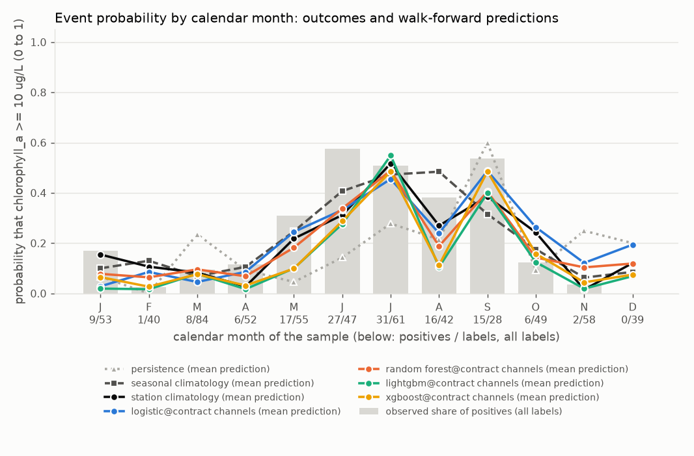
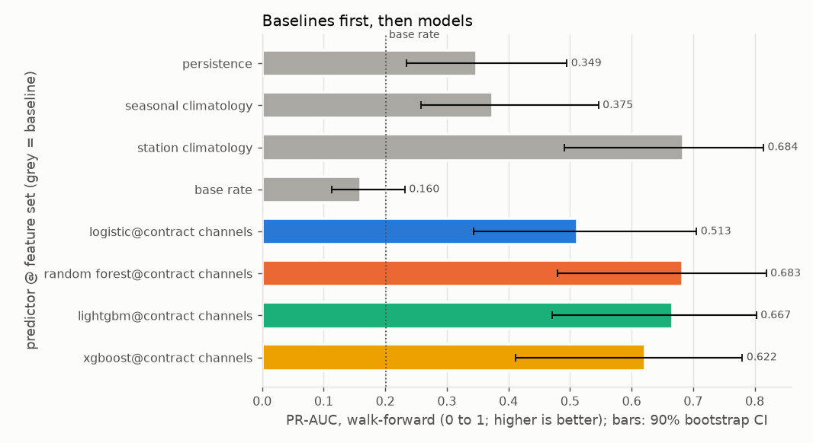
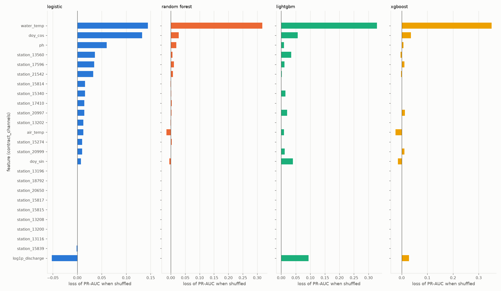
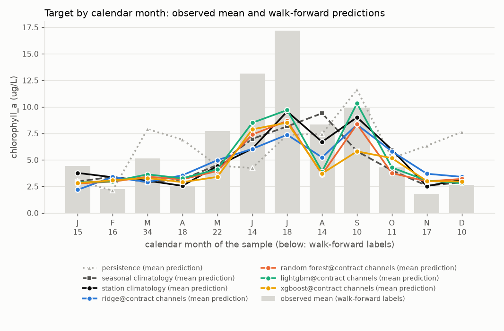
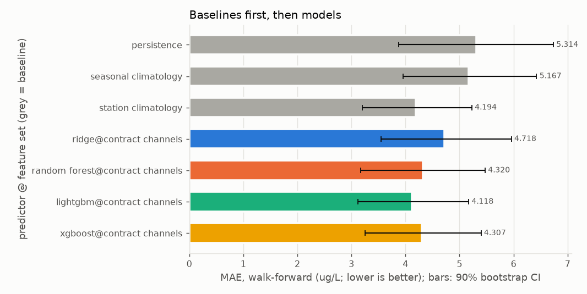
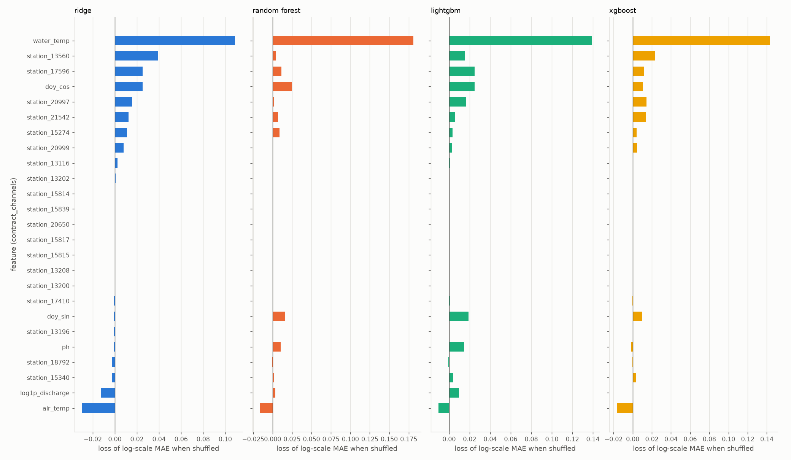

# Report: crp_chla_demo

Real grab-sample data, `source=CRP` only, labels from 2014-01-01; `quality='good'` rows only. Input `data/clean/crp_long.csv` (SHA-256 `967f08554c419770...`). Stations: 13116, 13196, 13200, 13202, 13208, 13560, 15274, 15340, 15814, 15815, 15817, 15839, 17410, 17596, 18792, 20650, 20997, 20999, 21542.

Chlorophyll-a at 19 CRP stations of segment 2304 (as given by the owner), pooled, with features limited to channels of the data contract (water temperature, pH, discharge, air temperature, season, station). This is the task behind the real-data demo loop. Primary target: the event chlorophyll_a >= 10 ug/L on the sample date (a nowcast).

> Note: The stations differ: some have no label at or above 10 ug/L since 2014. A model that sees the station one-hot can score those easy negatives, so station_climatology (season and station, nothing else) is the baseline to beat, and the per-station slices matter.

> Note: More stations add labels, not independent evidence about one site: stations sampled on the same day share the weather and the season, which is why the bootstrap resamples dates.

## First lines

### Primary target: event chlorophyll_a >= 10 ug/L

- Labels used: 608 on 280 distinct dates, 138 positives (13116: 17, 13196: 26, 13200: 11, 13202: 35, 13208: 23, 13560: 66, 15274: 24, 15340: 21, 15814: 34, 15815: 10, 15817: 42, 15839: 21, 17410: 36, 17596: 15, 18792: 10, 20650: 13, 20997: 45, 20999: 99, 21542: 60).
- Censored labels: 210 left-censored at or below the threshold counted as negatives; 0 left-censored above the threshold dropped (unknown); 0 right-censored dropped.
- Walk-forward: 6 folds (test years 2018 to 2023), n_train from 257 to 450 (training positives 60 to 100), n_test = 199 on 92 dates, 40 positives.
- Final hold-out (evaluated once, last 56 distinct dates, from 2023-06-13): n_train = 458, n_holdout = 150, 38 positives; training positives 100.
- **Persistence** means: the last sample at this station, carried forward (the previous label at the same station on a strictly earlier date; with no earlier label, the training base rate).
- **Seasonal climatology** means: the mean of the training targets within plus or minus 1 calendar month(s) of the test month, pooled over the task's stations (with fewer than 3 training labels in that window, the mean of all training targets).
- **Station climatology** means: the mean of the training targets at the same station within plus or minus 1 calendar month(s) of the test month (with fewer than 3 such labels, the pooled seasonal climatology value).
- **Base rate** means: the share of positives among the training labels.
- Verdicts, walk-forward, headline feature set `contract_channels` (deployable):
  - seasonal climatology shows no demonstrable difference from persistence (PR-AUC difference +0.026, 90% CI [-0.119, +0.222]); Brier difference -0.054 [-0.115, -0.000] (lower is better).
  - station climatology beats seasonal climatology (PR-AUC difference +0.309, 90% CI [+0.128, +0.405]); Brier difference -0.033 [-0.052, -0.015] (lower is better).
  - logistic on contract_channels (deployable) shows no demonstrable difference from persistence (PR-AUC difference +0.164, 90% CI [-0.004, +0.349]); Brier difference -0.068 [-0.132, -0.009] (lower is better).
  - logistic on contract_channels (deployable) shows no demonstrable difference from seasonal climatology (PR-AUC difference +0.138, 90% CI [-0.014, +0.278]); Brier difference -0.014 [-0.039, +0.012] (lower is better).
  - logistic on contract_channels (deployable) is worse than station climatology (PR-AUC difference -0.171, 90% CI [-0.278, -0.012]); Brier difference +0.019 [-0.001, +0.040] (lower is better).
  - random_forest on contract_channels (deployable) beats persistence (PR-AUC difference +0.335, 90% CI [+0.115, +0.480]); Brier difference -0.082 [-0.143, -0.026] (lower is better).
  - random_forest on contract_channels (deployable) beats seasonal climatology (PR-AUC difference +0.309, 90% CI [+0.116, +0.408]); Brier difference -0.028 [-0.047, -0.008] (lower is better).
  - random_forest on contract_channels (deployable) shows no demonstrable difference from station climatology (PR-AUC difference -0.000, 90% CI [-0.110, +0.095]); Brier difference +0.005 [-0.010, +0.022] (lower is better).
  - lightgbm on contract_channels (deployable) beats persistence (PR-AUC difference +0.318, 90% CI [+0.123, +0.462]); Brier difference -0.076 [-0.137, -0.015] (lower is better).
  - lightgbm on contract_channels (deployable) beats seasonal climatology (PR-AUC difference +0.292, 90% CI [+0.105, +0.401]); Brier difference -0.022 [-0.051, +0.008] (lower is better).
  - lightgbm on contract_channels (deployable) shows no demonstrable difference from station climatology (PR-AUC difference -0.017, 90% CI [-0.147, +0.109]); Brier difference +0.011 [-0.014, +0.040] (lower is better).
  - xgboost on contract_channels (deployable) beats persistence (PR-AUC difference +0.274, 90% CI [+0.073, +0.427]); Brier difference -0.075 [-0.133, -0.019] (lower is better).
  - xgboost on contract_channels (deployable) beats seasonal climatology (PR-AUC difference +0.248, 90% CI [+0.045, +0.373]); Brier difference -0.021 [-0.048, +0.007] (lower is better).
  - xgboost on contract_channels (deployable) shows no demonstrable difference from station climatology (PR-AUC difference -0.061, 90% CI [-0.200, +0.079]); Brier difference +0.012 [-0.011, +0.038] (lower is better).
- Verdicts, final hold-out, headline feature set `contract_channels`:
  - seasonal climatology shows no demonstrable difference from persistence (PR-AUC difference +0.101, 90% CI [-0.018, +0.245]); Brier difference -0.131 [-0.208, -0.053] (lower is better).
  - station climatology beats seasonal climatology (PR-AUC difference +0.333, 90% CI [+0.175, +0.461]); Brier difference -0.053 [-0.078, -0.031] (lower is better).
  - logistic on contract_channels (deployable) beats persistence (PR-AUC difference +0.336, 90% CI [+0.214, +0.487]); Brier difference -0.164 [-0.241, -0.087] (lower is better).
  - logistic on contract_channels (deployable) beats seasonal climatology (PR-AUC difference +0.235, 90% CI [+0.101, +0.368]); Brier difference -0.033 [-0.058, -0.009] (lower is better).
  - logistic on contract_channels (deployable) is worse than station climatology (PR-AUC difference -0.097, 90% CI [-0.165, -0.024]); Brier difference +0.020 [+0.002, +0.041] (lower is better).
  - random_forest on contract_channels (deployable) beats persistence (PR-AUC difference +0.440, 90% CI [+0.285, +0.584]); Brier difference -0.177 [-0.256, -0.096] (lower is better).
  - random_forest on contract_channels (deployable) beats seasonal climatology (PR-AUC difference +0.339, 90% CI [+0.185, +0.467]); Brier difference -0.046 [-0.069, -0.023] (lower is better).
  - random_forest on contract_channels (deployable) shows no demonstrable difference from station climatology (PR-AUC difference +0.007, 90% CI [-0.071, +0.076]); Brier difference +0.008 [-0.010, +0.026] (lower is better).
  - lightgbm on contract_channels (deployable) beats persistence (PR-AUC difference +0.476, 90% CI [+0.342, +0.596]); Brier difference -0.190 [-0.269, -0.113] (lower is better).
  - lightgbm on contract_channels (deployable) beats seasonal climatology (PR-AUC difference +0.375, 90% CI [+0.214, +0.485]); Brier difference -0.059 [-0.092, -0.029] (lower is better).
  - lightgbm on contract_channels (deployable) shows no demonstrable difference from station climatology (PR-AUC difference +0.043, 90% CI [-0.038, +0.113]); Brier difference -0.005 [-0.024, +0.012] (lower is better).
  - xgboost on contract_channels (deployable) beats persistence (PR-AUC difference +0.468, 90% CI [+0.330, +0.601]); Brier difference -0.192 [-0.270, -0.114] (lower is better).
  - xgboost on contract_channels (deployable) beats seasonal climatology (PR-AUC difference +0.367, 90% CI [+0.203, +0.489]); Brier difference -0.061 [-0.090, -0.032] (lower is better).
  - xgboost on contract_channels (deployable) shows no demonstrable difference from station climatology (PR-AUC difference +0.035, 90% CI [-0.053, +0.121]); Brier difference -0.008 [-0.027, +0.011] (lower is better).

### Secondary target: regression of chlorophyll_a (ug/L), fitted on the log1p scale

- Labels used: 608 on 280 distinct dates, 210 left-censored (13116: 17, 13196: 26, 13200: 11, 13202: 35, 13208: 23, 13560: 66, 15274: 24, 15340: 21, 15814: 34, 15815: 10, 15817: 42, 15839: 21, 17410: 36, 17596: 15, 18792: 10, 20650: 13, 20997: 45, 20999: 99, 21542: 60).
- Censored labels: left-censored values enter at detection limit x 0.5; 0 right-censored dropped.
- Walk-forward: 6 folds (test years 2018 to 2023), n_train from 257 to 450, n_test = 199 on 92 dates.
- Final hold-out (evaluated once, last 56 distinct dates, from 2023-06-13): n_train = 458, n_holdout = 150.
- **Persistence** means: the last sample at this station, carried forward (the previous label at the same station on a strictly earlier date; with no earlier label, the training median).
- **Seasonal climatology** means: the mean of the training targets within plus or minus 1 calendar month(s) of the test month, pooled over the task's stations (with fewer than 3 training labels in that window, the mean of all training targets).
- **Station climatology** means: the mean of the training targets at the same station within plus or minus 1 calendar month(s) of the test month (with fewer than 3 such labels, the pooled seasonal climatology value).
- Verdicts, walk-forward, headline feature set `contract_channels` (deployable):
  - seasonal climatology shows no demonstrable difference from persistence (MAE difference -0.147, 90% CI [-1.466, +1.069]).
  - station climatology beats seasonal climatology (MAE difference -0.973, 90% CI [-1.347, -0.627]).
  - ridge on contract_channels (deployable) shows no demonstrable difference from persistence (MAE difference -0.596, 90% CI [-1.889, +0.571]).
  - ridge on contract_channels (deployable) beats seasonal climatology (MAE difference -0.448, 90% CI [-0.782, -0.146]).
  - ridge on contract_channels (deployable) is worse than station climatology (MAE difference +0.524, 90% CI [+0.203, +0.827]).
  - random_forest on contract_channels (deployable) shows no demonstrable difference from persistence (MAE difference -0.994, 90% CI [-2.273, +0.176]).
  - random_forest on contract_channels (deployable) beats seasonal climatology (MAE difference -0.846, 90% CI [-1.276, -0.439]).
  - random_forest on contract_channels (deployable) shows no demonstrable difference from station climatology (MAE difference +0.126, 90% CI [-0.195, +0.479]).
  - lightgbm on contract_channels (deployable) beats persistence (MAE difference -1.196, 90% CI [-2.430, -0.063]).
  - lightgbm on contract_channels (deployable) beats seasonal climatology (MAE difference -1.049, 90% CI [-1.600, -0.552]).
  - lightgbm on contract_channels (deployable) shows no demonstrable difference from station climatology (MAE difference -0.076, 90% CI [-0.416, +0.270]).
  - xgboost on contract_channels (deployable) shows no demonstrable difference from persistence (MAE difference -1.007, 90% CI [-2.265, +0.131]).
  - xgboost on contract_channels (deployable) beats seasonal climatology (MAE difference -0.860, 90% CI [-1.336, -0.446]).
  - xgboost on contract_channels (deployable) shows no demonstrable difference from station climatology (MAE difference +0.113, 90% CI [-0.206, +0.448]).
- Verdicts, final hold-out, headline feature set `contract_channels`:
  - seasonal climatology beats persistence (MAE difference -2.293, 90% CI [-4.635, -0.412]).
  - station climatology beats seasonal climatology (MAE difference -1.464, 90% CI [-2.124, -0.901]).
  - ridge on contract_channels (deployable) beats persistence (MAE difference -3.095, 90% CI [-5.529, -1.188]).
  - ridge on contract_channels (deployable) beats seasonal climatology (MAE difference -0.803, 90% CI [-1.193, -0.430]).
  - ridge on contract_channels (deployable) is worse than station climatology (MAE difference +0.661, 90% CI [+0.219, +1.145]).
  - random_forest on contract_channels (deployable) beats persistence (MAE difference -2.988, 90% CI [-5.501, -0.912]).
  - random_forest on contract_channels (deployable) beats seasonal climatology (MAE difference -0.695, 90% CI [-1.373, -0.086]).
  - random_forest on contract_channels (deployable) is worse than station climatology (MAE difference +0.769, 90% CI [+0.240, +1.386]).
  - lightgbm on contract_channels (deployable) beats persistence (MAE difference -3.020, 90% CI [-5.635, -0.948]).
  - lightgbm on contract_channels (deployable) beats seasonal climatology (MAE difference -0.728, 90% CI [-1.395, -0.073]).
  - lightgbm on contract_channels (deployable) is worse than station climatology (MAE difference +0.736, 90% CI [+0.222, +1.396]).
  - xgboost on contract_channels (deployable) beats persistence (MAE difference -3.684, 90% CI [-6.268, -1.604]).
  - xgboost on contract_channels (deployable) beats seasonal climatology (MAE difference -1.392, 90% CI [-2.183, -0.698]).
  - xgboost on contract_channels (deployable) shows no demonstrable difference from station climatology (MAE difference +0.072, 90% CI [-0.430, +0.612]).

## Warnings

- WARNING [event] walk-forward folds with zero positives: 2020, 2023.
- WARNING [event] walk-forward slices with zero positives (undefined: no positives): station 13116, station 13200, station 13560, station 15340, station 15815, station 18792, station 20650, station 20997.
- WARNING [event] holdout slices with zero positives (undefined: no positives): station 13208, station 13560, station 20999.
- WARNING [event, regression] 67 of 109 station-years in the test windows have fewer than 4 labels (minimum 1).

## Metrics

### Event target: event chlorophyll_a >= 10 ug/L

Folds:

| fold | n_train | n_test | last train date | first test date | last test date | train positives | test positives |
|---|---|---|---|---|---|---|---|
| 2018 | 257 | 33 | 2017-12-04 | 2018-01-23 | 2018-12-18 | 60 | 1 |
| 2019 | 290 | 56 | 2018-11-27 | 2019-01-14 | 2019-12-18 | 61 | 13 |
| 2020 | 346 | 30 | 2019-11-05 | 2020-01-28 | 2020-12-14 | 74 | 0 (undefined: no positives) |
| 2021 | 378 | 41 | 2020-12-14 | 2021-01-19 | 2021-12-14 | 74 | 15 |
| 2022 | 419 | 31 | 2021-12-14 | 2022-01-24 | 2022-08-30 | 89 | 11 |
| 2023 | 450 | 8 | 2022-08-30 | 2023-04-10 | 2023-05-08 | 100 | 0 (undefined: no positives) |
| holdout | 458 | 150 | 2023-05-08 | 2023-06-13 | 2026-05-18 | 100 | 38 |

#### Walk-forward

n = 199 on 92 dates, 40 positives, base rate 0.201. Baselines first, then models. Brackets: 90% bootstrap CI over distinct dates.

| predictor | deployable | PR-AUC | ROC-AUC | Brier | Brier skill vs base rate |
|---|---|---|---|---|---|
| persistence | baseline | 0.349 [0.234, 0.495] | 0.668 [0.583, 0.762] | 0.192 [0.128, 0.263] | -0.174 [-0.521, 0.149] |
| seasonal_climatology | baseline | 0.375 [0.258, 0.546] | 0.745 [0.647, 0.815] | 0.138 [0.108, 0.172] | 0.157 [0.029, 0.254] |
| station_climatology | baseline | 0.684 [0.491, 0.814] | 0.860 [0.777, 0.918] | 0.105 [0.080, 0.137] | 0.359 [0.217, 0.466] |
| base_rate | baseline | 0.160 [0.113, 0.232] | 0.287 [0.204, 0.388] | 0.163 [0.126, 0.205] | 0.000 [0.000, 0.000] |
| logistic@contract_channels | yes | 0.513 [0.344, 0.706] | 0.792 [0.689, 0.864] | 0.124 [0.094, 0.155] | 0.241 [0.038, 0.390] |
| random_forest@contract_channels | yes | 0.683 [0.480, 0.819] | 0.820 [0.720, 0.889] | 0.110 [0.081, 0.146] | 0.328 [0.175, 0.456] |
| lightgbm@contract_channels | yes | 0.667 [0.471, 0.803] | 0.809 [0.710, 0.880] | 0.116 [0.079, 0.160] | 0.293 [0.076, 0.480] |
| xgboost@contract_channels | yes | 0.622 [0.411, 0.780] | 0.765 [0.642, 0.849] | 0.117 [0.081, 0.158] | 0.286 [0.085, 0.471] |

At p = 0.5:

| predictor | precision | recall | F1 | TP | FP | FN | TN |
|---|---|---|---|---|---|---|---|
| persistence | 0.529 [0.356, 0.727] | 0.450 [0.286, 0.632] | 0.486 [0.333, 0.629] | 18 | 16 | 22 | 143 |
| seasonal_climatology | 0.333 [0.000, 1.000] | 0.025 [0.000, 0.074] | 0.047 [0.000, 0.133] | 1 | 2 | 39 | 157 |
| station_climatology | 0.684 [0.428, 0.870] | 0.325 [0.158, 0.467] | 0.441 [0.245, 0.571] | 13 | 6 | 27 | 153 |
| base_rate | undefined | 0.000 [0.000, 0.000] | 0.000 [0.000, 0.000] | 0 | 0 | 40 | 159 |
| logistic@contract_channels | 0.571 [0.333, 0.778] | 0.400 [0.226, 0.543] | 0.471 [0.269, 0.612] | 16 | 12 | 24 | 147 |
| random_forest@contract_channels | 0.800 [0.500, 0.958] | 0.300 [0.094, 0.479] | 0.436 [0.166, 0.620] | 12 | 3 | 28 | 156 |
| lightgbm@contract_channels | 0.720 [0.476, 0.882] | 0.450 [0.250, 0.623] | 0.554 [0.333, 0.705] | 18 | 7 | 22 | 152 |
| xgboost@contract_channels | 0.800 [0.545, 1.000] | 0.400 [0.206, 0.562] | 0.533 [0.300, 0.684] | 16 | 4 | 24 | 155 |

At p* = 0.10 (C_FP=1, C_FN=9, PLACEHOLDER):

| predictor | precision | recall | F1 | TP | FP | FN | TN |
|---|---|---|---|---|---|---|---|
| persistence | 0.474 [0.300, 0.667] | 0.450 [0.286, 0.632] | 0.462 [0.309, 0.607] | 18 | 20 | 22 | 139 |
| seasonal_climatology | 0.281 [0.177, 0.390] | 0.850 [0.720, 0.933] | 0.422 [0.290, 0.542] | 34 | 87 | 6 | 72 |
| station_climatology | 0.319 [0.215, 0.426] | 0.900 [0.796, 0.971] | 0.471 [0.341, 0.583] | 36 | 77 | 4 | 82 |
| base_rate | 0.201 [0.136, 0.273] | 1.000 [1.000, 1.000] | 0.335 [0.240, 0.429] | 40 | 159 | 0 | 0 |
| logistic@contract_channels | 0.344 [0.226, 0.459] | 0.825 [0.687, 0.915] | 0.485 [0.346, 0.600] | 33 | 63 | 7 | 96 |
| random_forest@contract_channels | 0.337 [0.220, 0.452] | 0.875 [0.759, 0.951] | 0.486 [0.349, 0.602] | 35 | 69 | 5 | 90 |
| lightgbm@contract_channels | 0.500 [0.300, 0.683] | 0.575 [0.364, 0.729] | 0.535 [0.341, 0.679] | 23 | 23 | 17 | 136 |
| xgboost@contract_channels | 0.444 [0.292, 0.596] | 0.700 [0.528, 0.822] | 0.544 [0.385, 0.660] | 28 | 35 | 12 | 124 |

Paired differences (higher PR-AUC and lower Brier are better):

| model | baseline | PR-AUC difference (model - baseline) | Brier difference | verdict (by PR-AUC) |
|---|---|---|---|---|
| persistence | seasonal_climatology | -0.026 [-0.222, +0.119] | +0.054 [+0.000, +0.115] | no demonstrable difference |
| persistence | station_climatology | -0.335 [-0.473, -0.133] | +0.087 [+0.031, +0.148] | is worse than |
| persistence | base_rate | +0.189 [+0.085, +0.316] | +0.028 [-0.027, +0.085] | beats |
| seasonal_climatology | persistence | +0.026 [-0.119, +0.222] | -0.054 [-0.115, -0.000] | no demonstrable difference |
| seasonal_climatology | station_climatology | -0.309 [-0.405, -0.128] | +0.033 [+0.015, +0.052] | is worse than |
| seasonal_climatology | base_rate | +0.215 [+0.127, +0.359] | -0.026 [-0.047, -0.004] | beats |
| station_climatology | persistence | +0.335 [+0.133, +0.473] | -0.087 [-0.148, -0.031] | beats |
| station_climatology | seasonal_climatology | +0.309 [+0.128, +0.405] | -0.033 [-0.052, -0.015] | beats |
| station_climatology | base_rate | +0.524 [+0.349, +0.630] | -0.059 [-0.088, -0.031] | beats |
| base_rate | persistence | -0.189 [-0.316, -0.085] | -0.028 [-0.085, +0.027] | is worse than |
| base_rate | seasonal_climatology | -0.215 [-0.359, -0.127] | +0.026 [+0.004, +0.047] | is worse than |
| base_rate | station_climatology | -0.524 [-0.630, -0.349] | +0.059 [+0.031, +0.088] | is worse than |
| logistic@contract_channels | persistence | +0.164 [-0.004, +0.349] | -0.068 [-0.132, -0.009] | no demonstrable difference |
| logistic@contract_channels | seasonal_climatology | +0.138 [-0.014, +0.278] | -0.014 [-0.039, +0.012] | no demonstrable difference |
| logistic@contract_channels | station_climatology | -0.171 [-0.278, -0.012] | +0.019 [-0.001, +0.040] | is worse than |
| logistic@contract_channels | base_rate | +0.353 [+0.208, +0.517] | -0.039 [-0.072, -0.006] | beats |
| random_forest@contract_channels | persistence | +0.335 [+0.115, +0.480] | -0.082 [-0.143, -0.026] | beats |
| random_forest@contract_channels | seasonal_climatology | +0.309 [+0.116, +0.408] | -0.028 [-0.047, -0.008] | beats |
| random_forest@contract_channels | station_climatology | -0.000 [-0.110, +0.095] | +0.005 [-0.010, +0.022] | no demonstrable difference |
| random_forest@contract_channels | base_rate | +0.523 [+0.329, +0.639] | -0.054 [-0.084, -0.025] | beats |
| lightgbm@contract_channels | persistence | +0.318 [+0.123, +0.462] | -0.076 [-0.137, -0.015] | beats |
| lightgbm@contract_channels | seasonal_climatology | +0.292 [+0.105, +0.401] | -0.022 [-0.051, +0.008] | beats |
| lightgbm@contract_channels | station_climatology | -0.017 [-0.147, +0.109] | +0.011 [-0.014, +0.040] | no demonstrable difference |
| lightgbm@contract_channels | base_rate | +0.507 [+0.330, +0.619] | -0.048 [-0.085, -0.012] | beats |
| xgboost@contract_channels | persistence | +0.274 [+0.073, +0.427] | -0.075 [-0.133, -0.019] | beats |
| xgboost@contract_channels | seasonal_climatology | +0.248 [+0.045, +0.373] | -0.021 [-0.048, +0.007] | beats |
| xgboost@contract_channels | station_climatology | -0.061 [-0.200, +0.079] | +0.012 [-0.011, +0.038] | no demonstrable difference |
| xgboost@contract_channels | base_rate | +0.463 [+0.267, +0.602] | -0.047 [-0.080, -0.014] | beats |

#### Final hold-out (evaluated once)

n = 150 on 56 dates, 38 positives, base rate 0.253. Baselines first, then models. Brackets: 90% bootstrap CI over distinct dates.

| predictor | deployable | PR-AUC | ROC-AUC | Brier | Brier skill vs base rate |
|---|---|---|---|---|---|
| persistence | baseline | 0.348 [0.221, 0.492] | 0.643 [0.546, 0.740] | 0.287 [0.201, 0.367] | -0.506 [-1.072, -0.079] |
| seasonal_climatology | baseline | 0.448 [0.317, 0.629] | 0.777 [0.680, 0.859] | 0.156 [0.111, 0.201] | 0.182 [0.048, 0.300] |
| station_climatology | baseline | 0.781 [0.658, 0.897] | 0.877 [0.791, 0.955] | 0.102 [0.061, 0.146] | 0.462 [0.279, 0.635] |
| base_rate | baseline | 0.253 [0.164, 0.340] | 0.500 [0.500, 0.500] | 0.190 [0.140, 0.239] | 0.000 [0.000, 0.000] |
| logistic@contract_channels | yes | 0.684 [0.565, 0.826] | 0.809 [0.699, 0.902] | 0.123 [0.079, 0.167] | 0.357 [0.179, 0.525] |
| random_forest@contract_channels | yes | 0.787 [0.651, 0.895] | 0.863 [0.749, 0.949] | 0.110 [0.072, 0.151] | 0.422 [0.242, 0.580] |
| lightgbm@contract_channels | yes | 0.824 [0.701, 0.914] | 0.901 [0.842, 0.951] | 0.097 [0.060, 0.134] | 0.491 [0.316, 0.657] |
| xgboost@contract_channels | yes | 0.816 [0.685, 0.916] | 0.899 [0.833, 0.955] | 0.095 [0.056, 0.135] | 0.503 [0.314, 0.682] |

At p = 0.5:

| predictor | precision | recall | F1 | TP | FP | FN | TN |
|---|---|---|---|---|---|---|---|
| persistence | 0.442 [0.264, 0.615] | 0.500 [0.310, 0.667] | 0.469 [0.298, 0.605] | 19 | 24 | 19 | 88 |
| seasonal_climatology | undefined | 0.000 [0.000, 0.000] | 0.000 [0.000, 0.000] | 0 | 0 | 38 | 112 |
| station_climatology | 0.913 [0.828, 1.000] | 0.553 [0.375, 0.719] | 0.689 [0.531, 0.807] | 21 | 2 | 17 | 110 |
| base_rate | undefined | 0.000 [0.000, 0.000] | 0.000 [0.000, 0.000] | 0 | 0 | 38 | 112 |
| logistic@contract_channels | 0.821 [0.688, 0.929] | 0.605 [0.438, 0.771] | 0.697 [0.552, 0.810] | 23 | 5 | 15 | 107 |
| random_forest@contract_channels | 0.765 [0.630, 0.868] | 0.684 [0.490, 0.854] | 0.722 [0.575, 0.828] | 26 | 8 | 12 | 104 |
| lightgbm@contract_channels | 0.788 [0.652, 0.897] | 0.684 [0.500, 0.853] | 0.732 [0.593, 0.840] | 26 | 7 | 12 | 105 |
| xgboost@contract_channels | 0.812 [0.700, 0.912] | 0.684 [0.500, 0.853] | 0.743 [0.612, 0.848] | 26 | 6 | 12 | 106 |

At p* = 0.10 (C_FP=1, C_FN=9, PLACEHOLDER):

| predictor | precision | recall | F1 | TP | FP | FN | TN |
|---|---|---|---|---|---|---|---|
| persistence | 0.442 [0.264, 0.615] | 0.500 [0.310, 0.667] | 0.469 [0.298, 0.605] | 19 | 24 | 19 | 88 |
| seasonal_climatology | 0.361 [0.244, 0.471] | 0.921 [0.833, 0.979] | 0.519 [0.383, 0.630] | 35 | 62 | 3 | 50 |
| station_climatology | 0.425 [0.301, 0.553] | 0.895 [0.808, 0.970] | 0.576 [0.447, 0.688] | 34 | 46 | 4 | 66 |
| base_rate | 0.253 [0.164, 0.340] | 1.000 [1.000, 1.000] | 0.404 [0.282, 0.507] | 38 | 112 | 0 | 0 |
| logistic@contract_channels | 0.435 [0.303, 0.559] | 0.789 [0.625, 0.929] | 0.561 [0.423, 0.673] | 30 | 39 | 8 | 73 |
| random_forest@contract_channels | 0.390 [0.270, 0.512] | 0.842 [0.653, 0.978] | 0.533 [0.396, 0.653] | 32 | 50 | 6 | 62 |
| lightgbm@contract_channels | 0.524 [0.377, 0.667] | 0.868 [0.769, 0.950] | 0.653 [0.522, 0.764] | 33 | 30 | 5 | 82 |
| xgboost@contract_channels | 0.492 [0.354, 0.636] | 0.842 [0.735, 0.950] | 0.621 [0.491, 0.732] | 32 | 33 | 6 | 79 |

Paired differences (higher PR-AUC and lower Brier are better):

| model | baseline | PR-AUC difference (model - baseline) | Brier difference | verdict (by PR-AUC) |
|---|---|---|---|---|
| persistence | seasonal_climatology | -0.101 [-0.245, +0.018] | +0.131 [+0.053, +0.208] | no demonstrable difference |
| persistence | station_climatology | -0.433 [-0.572, -0.296] | +0.184 [+0.112, +0.258] | is worse than |
| persistence | base_rate | +0.094 [+0.020, +0.203] | +0.096 [+0.017, +0.176] | beats |
| seasonal_climatology | persistence | +0.101 [-0.018, +0.245] | -0.131 [-0.208, -0.053] | no demonstrable difference |
| seasonal_climatology | station_climatology | -0.333 [-0.461, -0.175] | +0.053 [+0.031, +0.078] | is worse than |
| seasonal_climatology | base_rate | +0.195 [+0.109, +0.340] | -0.035 [-0.062, -0.008] | beats |
| station_climatology | persistence | +0.433 [+0.296, +0.572] | -0.184 [-0.258, -0.112] | beats |
| station_climatology | seasonal_climatology | +0.333 [+0.175, +0.461] | -0.053 [-0.078, -0.031] | beats |
| station_climatology | base_rate | +0.528 [+0.398, +0.667] | -0.088 [-0.130, -0.052] | beats |
| base_rate | persistence | -0.094 [-0.203, -0.020] | -0.096 [-0.176, -0.017] | is worse than |
| base_rate | seasonal_climatology | -0.195 [-0.340, -0.109] | +0.035 [+0.008, +0.062] | is worse than |
| base_rate | station_climatology | -0.528 [-0.667, -0.398] | +0.088 [+0.052, +0.130] | is worse than |
| logistic@contract_channels | persistence | +0.336 [+0.214, +0.487] | -0.164 [-0.241, -0.087] | beats |
| logistic@contract_channels | seasonal_climatology | +0.235 [+0.101, +0.368] | -0.033 [-0.058, -0.009] | beats |
| logistic@contract_channels | station_climatology | -0.097 [-0.165, -0.024] | +0.020 [+0.002, +0.041] | is worse than |
| logistic@contract_channels | base_rate | +0.430 [+0.322, +0.576] | -0.068 [-0.107, -0.032] | beats |
| random_forest@contract_channels | persistence | +0.440 [+0.285, +0.584] | -0.177 [-0.256, -0.096] | beats |
| random_forest@contract_channels | seasonal_climatology | +0.339 [+0.185, +0.467] | -0.046 [-0.069, -0.023] | beats |
| random_forest@contract_channels | station_climatology | +0.007 [-0.071, +0.076] | +0.008 [-0.010, +0.026] | no demonstrable difference |
| random_forest@contract_channels | base_rate | +0.534 [+0.400, +0.664] | -0.080 [-0.120, -0.042] | beats |
| lightgbm@contract_channels | persistence | +0.476 [+0.342, +0.596] | -0.190 [-0.269, -0.113] | beats |
| lightgbm@contract_channels | seasonal_climatology | +0.375 [+0.214, +0.485] | -0.059 [-0.092, -0.029] | beats |
| lightgbm@contract_channels | station_climatology | +0.043 [-0.038, +0.113] | -0.005 [-0.024, +0.012] | no demonstrable difference |
| lightgbm@contract_channels | base_rate | +0.570 [+0.469, +0.674] | -0.093 [-0.137, -0.054] | beats |
| xgboost@contract_channels | persistence | +0.468 [+0.330, +0.601] | -0.192 [-0.270, -0.114] | beats |
| xgboost@contract_channels | seasonal_climatology | +0.367 [+0.203, +0.489] | -0.061 [-0.090, -0.032] | beats |
| xgboost@contract_channels | station_climatology | +0.035 [-0.053, +0.121] | -0.008 [-0.027, +0.011] | no demonstrable difference |
| xgboost@contract_channels | base_rate | +0.562 [+0.449, +0.681] | -0.096 [-0.140, -0.055] | beats |

### Regression target: regression of chlorophyll_a (ug/L), fitted on the log1p scale

Folds:

| fold | n_train | n_test | last train date | first test date | last test date |
|---|---|---|---|---|---|
| 2018 | 257 | 33 | 2017-12-04 | 2018-01-23 | 2018-12-18 |
| 2019 | 290 | 56 | 2018-11-27 | 2019-01-14 | 2019-12-18 |
| 2020 | 346 | 30 | 2019-11-05 | 2020-01-28 | 2020-12-14 |
| 2021 | 378 | 41 | 2020-12-14 | 2021-01-19 | 2021-12-14 |
| 2022 | 419 | 31 | 2021-12-14 | 2022-01-24 | 2022-08-30 |
| 2023 | 450 | 8 | 2022-08-30 | 2023-04-10 | 2023-05-08 |
| holdout | 458 | 150 | 2023-05-08 | 2023-06-13 | 2026-05-18 |

#### Walk-forward

All labels: n = 199 on 92 dates (96 left-censored). MAE and RMSE in ug/L. Brackets: 90% bootstrap CI over distinct dates.

| predictor | deployable | MAE | RMSE | R2 | MAE (log scale) | skill vs persistence | skill vs climatology |
|---|---|---|---|---|---|---|---|
| persistence | baseline | 5.314 [3.871, 6.738] | 10.577 [7.676, 13.172] | -0.259 [-1.871, 0.281] | 0.573 [0.473, 0.673] | 0.000 [0.000, 0.000] | -0.029 [-0.307, 0.196] |
| seasonal_climatology | baseline | 5.167 [3.957, 6.427] | 9.092 [5.863, 11.717] | 0.070 [-0.015, 0.122] | 0.696 [0.629, 0.766] | 0.028 [-0.244, 0.235] | 0.000 [0.000, 0.000] |
| station_climatology | baseline | 4.194 [3.205, 5.229] | 7.796 [5.080, 9.936] | 0.316 [0.221, 0.362] | 0.547 [0.499, 0.598] | 0.211 [0.011, 0.381] | 0.188 [0.136, 0.239] |
| ridge@contract_channels | yes | 4.718 [3.554, 5.961] | 8.946 [5.466, 11.575] | 0.100 [0.014, 0.207] | 0.638 [0.569, 0.703] | 0.112 [-0.132, 0.314] | 0.087 [0.030, 0.151] |
| random_forest@contract_channels | yes | 4.320 [3.175, 5.475] | 8.635 [5.140, 11.236] | 0.161 [0.030, 0.300] | 0.581 [0.513, 0.654] | 0.187 [-0.039, 0.379] | 0.164 [0.090, 0.245] |
| lightgbm@contract_channels | yes | 4.118 [3.122, 5.170] | 8.183 [4.923, 10.611] | 0.247 [0.103, 0.386] | 0.555 [0.491, 0.621] | 0.225 [0.014, 0.398] | 0.203 [0.116, 0.287] |
| xgboost@contract_channels | yes | 4.307 [3.249, 5.400] | 8.467 [5.269, 10.848] | 0.193 [0.057, 0.312] | 0.578 [0.511, 0.648] | 0.189 [-0.034, 0.375] | 0.166 [0.091, 0.243] |

Numeric-only (uncensored) labels: n = 103 on 54 dates (0 left-censored). MAE and RMSE in ug/L. Brackets: 90% bootstrap CI over distinct dates.

| predictor | deployable | MAE | RMSE | R2 | MAE (log scale) | skill vs persistence | skill vs climatology |
|---|---|---|---|---|---|---|---|
| persistence | baseline | 8.411 [6.114, 10.746] | 13.992 [9.643, 17.570] | -0.559 [-3.146, 0.214] | 0.773 [0.668, 0.874] | 0.000 [0.000, 0.000] | -0.130 [-0.512, 0.131] |
| seasonal_climatology | baseline | 7.440 [5.508, 9.755] | 12.170 [7.724, 15.919] | -0.179 [-0.454, -0.066] | 0.721 [0.625, 0.821] | 0.115 [-0.151, 0.339] | 0.000 [0.000, 0.000] |
| station_climatology | baseline | 6.446 [4.828, 8.402] | 10.598 [6.933, 13.658] | 0.106 [-0.165, 0.201] | 0.604 [0.524, 0.680] | 0.234 [0.009, 0.421] | 0.134 [0.081, 0.185] |
| ridge@contract_channels | yes | 6.978 [5.024, 9.261] | 12.107 [7.296, 16.039] | -0.167 [-0.366, -0.039] | 0.683 [0.579, 0.789] | 0.170 [-0.087, 0.387] | 0.062 [0.005, 0.125] |
| random_forest@contract_channels | yes | 6.607 [4.779, 8.714] | 11.783 [7.125, 15.463] | -0.106 [-0.344, 0.061] | 0.647 [0.538, 0.750] | 0.214 [-0.022, 0.421] | 0.112 [0.044, 0.180] |
| lightgbm@contract_channels | yes | 6.293 [4.566, 8.262] | 11.156 [6.668, 14.678] | 0.009 [-0.236, 0.177] | 0.614 [0.507, 0.716] | 0.252 [0.026, 0.443] | 0.154 [0.061, 0.238] |
| xgboost@contract_channels | yes | 6.741 [4.940, 8.763] | 11.591 [7.311, 15.006] | -0.070 [-0.374, 0.086] | 0.671 [0.559, 0.783] | 0.198 [-0.041, 0.400] | 0.094 [0.010, 0.163] |

Paired differences (lower MAE is better):

| model | baseline | MAE difference (model - baseline) | verdict (by MAE) |
|---|---|---|---|
| persistence | seasonal_climatology | +0.147 [-1.069, +1.466] | no demonstrable difference |
| persistence | station_climatology | +1.120 [+0.056, +2.365] | is worse than |
| seasonal_climatology | persistence | -0.147 [-1.466, +1.069] | no demonstrable difference |
| seasonal_climatology | station_climatology | +0.973 [+0.627, +1.347] | is worse than |
| station_climatology | persistence | -1.120 [-2.365, -0.056] | beats |
| station_climatology | seasonal_climatology | -0.973 [-1.347, -0.627] | beats |
| ridge@contract_channels | persistence | -0.596 [-1.889, +0.571] | no demonstrable difference |
| ridge@contract_channels | seasonal_climatology | -0.448 [-0.782, -0.146] | beats |
| ridge@contract_channels | station_climatology | +0.524 [+0.203, +0.827] | is worse than |
| random_forest@contract_channels | persistence | -0.994 [-2.273, +0.176] | no demonstrable difference |
| random_forest@contract_channels | seasonal_climatology | -0.846 [-1.276, -0.439] | beats |
| random_forest@contract_channels | station_climatology | +0.126 [-0.195, +0.479] | no demonstrable difference |
| lightgbm@contract_channels | persistence | -1.196 [-2.430, -0.063] | beats |
| lightgbm@contract_channels | seasonal_climatology | -1.049 [-1.600, -0.552] | beats |
| lightgbm@contract_channels | station_climatology | -0.076 [-0.416, +0.270] | no demonstrable difference |
| xgboost@contract_channels | persistence | -1.007 [-2.265, +0.131] | no demonstrable difference |
| xgboost@contract_channels | seasonal_climatology | -0.860 [-1.336, -0.446] | beats |
| xgboost@contract_channels | station_climatology | +0.113 [-0.206, +0.448] | no demonstrable difference |

#### Final hold-out (evaluated once)

All labels: n = 150 on 56 dates (60 left-censored). MAE and RMSE in ug/L. Brackets: 90% bootstrap CI over distinct dates.

| predictor | deployable | MAE | RMSE | R2 | MAE (log scale) | skill vs persistence | skill vs climatology |
|---|---|---|---|---|---|---|---|
| persistence | baseline | 8.653 [5.453, 12.527] | 21.120 [8.813, 30.327] | -0.621 [-5.887, -0.008] | 0.733 [0.609, 0.868] | 0.000 [0.000, 0.000] | -0.360 [-0.860, -0.062] |
| seasonal_climatology | baseline | 6.360 [3.847, 9.509] | 16.624 [6.065, 26.425] | -0.004 [-0.101, 0.105] | 0.665 [0.567, 0.766] | 0.265 [0.058, 0.462] | 0.000 [0.000, 0.000] |
| station_climatology | baseline | 4.896 [2.657, 7.684] | 14.711 [4.414, 23.462] | 0.214 [0.108, 0.537] | 0.454 [0.373, 0.538] | 0.434 [0.252, 0.621] | 0.230 [0.154, 0.356] |
| ridge@contract_channels | yes | 5.558 [3.274, 8.538] | 15.652 [4.846, 25.133] | 0.110 [0.048, 0.428] | 0.597 [0.511, 0.688] | 0.358 [0.166, 0.546] | 0.126 [0.074, 0.200] |
| random_forest@contract_channels | yes | 5.665 [3.412, 8.511] | 15.195 [5.182, 23.946] | 0.161 [-0.026, 0.357] | 0.565 [0.476, 0.668] | 0.345 [0.132, 0.541] | 0.109 [0.017, 0.208] |
| lightgbm@contract_channels | yes | 5.633 [3.521, 8.260] | 14.465 [5.503, 22.417] | 0.240 [-0.055, 0.308] | 0.531 [0.444, 0.633] | 0.349 [0.145, 0.535] | 0.114 [0.018, 0.191] |
| xgboost@contract_channels | yes | 4.969 [2.877, 7.604] | 13.898 [4.232, 21.944] | 0.298 [0.117, 0.572] | 0.495 [0.409, 0.592] | 0.426 [0.228, 0.613] | 0.219 [0.134, 0.319] |

Numeric-only (uncensored) labels: n = 90 on 39 dates (0 left-censored). MAE and RMSE in ug/L. Brackets: 90% bootstrap CI over distinct dates.

| predictor | deployable | MAE | RMSE | R2 | MAE (log scale) | skill vs persistence | skill vs climatology |
|---|---|---|---|---|---|---|---|
| persistence | baseline | 12.275 [7.184, 18.209] | 26.805 [10.398, 38.110] | -0.780 [-9.748, -0.079] | 0.846 [0.687, 1.008] | 0.000 [0.000, 0.000] | -0.356 [-0.919, -0.054] |
| seasonal_climatology | baseline | 9.049 [5.149, 14.004] | 21.323 [7.478, 33.404] | -0.126 [-0.527, -0.072] | 0.691 [0.548, 0.844] | 0.263 [0.052, 0.479] | 0.000 [0.000, 0.000] |
| station_climatology | baseline | 7.398 [3.832, 12.053] | 18.957 [5.802, 29.890] | 0.110 [-0.252, 0.277] | 0.512 [0.386, 0.657] | 0.397 [0.192, 0.607] | 0.182 [0.097, 0.292] |
| ridge@contract_channels | yes | 8.045 [4.348, 12.907] | 20.113 [6.023, 31.782] | -0.002 [-0.221, 0.156] | 0.642 [0.509, 0.777] | 0.345 [0.143, 0.560] | 0.111 [0.053, 0.193] |
| random_forest@contract_channels | yes | 8.224 [4.720, 12.891] | 19.437 [6.305, 30.475] | 0.064 [-0.360, 0.149] | 0.623 [0.493, 0.768] | 0.330 [0.099, 0.555] | 0.091 [-0.027, 0.202] |
| lightgbm@contract_channels | yes | 8.173 [4.850, 12.473] | 18.464 [6.580, 28.560] | 0.155 [-0.400, 0.223] | 0.586 [0.475, 0.716] | 0.334 [0.113, 0.550] | 0.097 [-0.024, 0.181] |
| xgboost@contract_channels | yes | 7.318 [4.048, 11.791] | 17.832 [5.285, 27.905] | 0.212 [-0.238, 0.391] | 0.561 [0.441, 0.698] | 0.404 [0.195, 0.626] | 0.191 [0.087, 0.304] |

Paired differences (lower MAE is better):

| model | baseline | MAE difference (model - baseline) | verdict (by MAE) |
|---|---|---|---|
| persistence | seasonal_climatology | +2.293 [+0.412, +4.635] | is worse than |
| persistence | station_climatology | +3.757 [+1.843, +6.163] | is worse than |
| seasonal_climatology | persistence | -2.293 [-4.635, -0.412] | beats |
| seasonal_climatology | station_climatology | +1.464 [+0.901, +2.124] | is worse than |
| station_climatology | persistence | -3.757 [-6.163, -1.843] | beats |
| station_climatology | seasonal_climatology | -1.464 [-2.124, -0.901] | beats |
| ridge@contract_channels | persistence | -3.095 [-5.529, -1.188] | beats |
| ridge@contract_channels | seasonal_climatology | -0.803 [-1.193, -0.430] | beats |
| ridge@contract_channels | station_climatology | +0.661 [+0.219, +1.145] | is worse than |
| random_forest@contract_channels | persistence | -2.988 [-5.501, -0.912] | beats |
| random_forest@contract_channels | seasonal_climatology | -0.695 [-1.373, -0.086] | beats |
| random_forest@contract_channels | station_climatology | +0.769 [+0.240, +1.386] | is worse than |
| lightgbm@contract_channels | persistence | -3.020 [-5.635, -0.948] | beats |
| lightgbm@contract_channels | seasonal_climatology | -0.728 [-1.395, -0.073] | beats |
| lightgbm@contract_channels | station_climatology | +0.736 [+0.222, +1.396] | is worse than |
| xgboost@contract_channels | persistence | -3.684 [-6.268, -1.604] | beats |
| xgboost@contract_channels | seasonal_climatology | -1.392 [-2.183, -0.698] | beats |
| xgboost@contract_channels | station_climatology | +0.072 [-0.430, +0.612] | no demonstrable difference |

Intervals: split-conformal on absolute walk-forward residuals (transformed scale), level 90%, from 199 residuals, applied to the hold-out predictions.

| model | half-width (transformed scale) | hold-out coverage | median width (ug/L) |
|---|---|---|---|
| ridge@contract_channels | 1.245 | 90% | 15.083 |
| random_forest@contract_channels | 1.185 | 88% | 12.343 |
| lightgbm@contract_channels | 1.183 | 89% | 12.310 |
| xgboost@contract_channels | 1.187 | 91% | 11.703 |

## Slices

### Event target, walk-forward

**apr_sep**: n = 96, positives = 32

| predictor | PR-AUC | ROC-AUC | Brier | recall at p* |
|---|---|---|---|---|
| persistence | 0.491 [0.318, 0.656] | 0.650 [0.549, 0.771] | 0.252 [0.145, 0.358] | 0.406 [0.214, 0.621] |
| seasonal_climatology | 0.400 [0.273, 0.605] | 0.626 [0.484, 0.783] | 0.207 [0.160, 0.251] | 1.000 [1.000, 1.000] |
| station_climatology | 0.791 [0.601, 0.924] | 0.903 [0.836, 0.960] | 0.132 [0.089, 0.175] | 1.000 [1.000, 1.000] |
| base_rate | 0.271 [0.174, 0.403] | 0.280 [0.173, 0.415] | 0.241 [0.164, 0.309] | 1.000 [1.000, 1.000] |
| logistic@contract_channels | 0.650 [0.451, 0.863] | 0.828 [0.729, 0.912] | 0.162 [0.116, 0.206] | 0.969 [0.892, 1.000] |
| random_forest@contract_channels | 0.794 [0.580, 0.924] | 0.877 [0.784, 0.950] | 0.145 [0.097, 0.200] | 1.000 [1.000, 1.000] |
| lightgbm@contract_channels | 0.796 [0.596, 0.919] | 0.870 [0.766, 0.939] | 0.160 [0.094, 0.235] | 0.656 [0.423, 0.844] |
| xgboost@contract_channels | 0.756 [0.533, 0.904] | 0.847 [0.738, 0.930] | 0.162 [0.095, 0.237] | 0.812 [0.657, 0.943] |

**oct_mar**: n = 103, positives = 8

| predictor | PR-AUC | ROC-AUC | Brier | recall at p* |
|---|---|---|---|---|
| persistence | 0.224 [0.090, 0.473] | 0.753 [0.604, 0.918] | 0.136 [0.057, 0.227] | 0.625 [0.333, 1.000] |
| seasonal_climatology | 0.110 [0.050, 0.294] | 0.474 [0.278, 0.674] | 0.074 [0.042, 0.110] | 0.250 [0.000, 0.556] |
| station_climatology | 0.156 [0.055, 0.428] | 0.531 [0.314, 0.746] | 0.079 [0.048, 0.115] | 0.500 [0.200, 0.800] |
| base_rate | 0.064 [0.036, 0.107] | 0.299 [0.178, 0.425] | 0.091 [0.069, 0.117] | 1.000 [1.000, 1.000] |
| logistic@contract_channels | 0.146 [0.043, 0.434] | 0.449 [0.249, 0.667] | 0.089 [0.054, 0.127] | 0.250 [0.000, 0.556] |
| random_forest@contract_channels | 0.145 [0.041, 0.423] | 0.411 [0.182, 0.653] | 0.077 [0.044, 0.113] | 0.375 [0.083, 0.668] |
| lightgbm@contract_channels | 0.214 [0.048, 0.482] | 0.489 [0.277, 0.718] | 0.074 [0.041, 0.113] | 0.250 [0.000, 0.556] |
| xgboost@contract_channels | 0.193 [0.038, 0.516] | 0.364 [0.126, 0.619] | 0.074 [0.041, 0.112] | 0.250 [0.000, 0.556] |

**station 13116**: n = 2, positives = 0 (undefined: no positives)

| predictor | PR-AUC | ROC-AUC | Brier | recall at p* |
|---|---|---|---|---|
| persistence | undefined: no positives | undefined: no positives | 0.000 [0.000, 0.000] | undefined: no positives |
| seasonal_climatology | undefined: no positives | undefined: no positives | 0.004 [0.004, 0.005] | undefined: no positives |
| station_climatology | undefined: no positives | undefined: no positives | 0.031 [0.000, 0.062] | undefined: no positives |
| base_rate | undefined: no positives | undefined: no positives | 0.044 [0.044, 0.044] | undefined: no positives |
| logistic@contract_channels | undefined: no positives | undefined: no positives | 0.002 [0.001, 0.002] | undefined: no positives |
| random_forest@contract_channels | undefined: no positives | undefined: no positives | 0.006 [0.005, 0.007] | undefined: no positives |
| lightgbm@contract_channels | undefined: no positives | undefined: no positives | 0.000 [0.000, 0.001] | undefined: no positives |
| xgboost@contract_channels | undefined: no positives | undefined: no positives | 0.001 [0.001, 0.001] | undefined: no positives |

**station 13196**: n = 14, positives = 4

| predictor | PR-AUC | ROC-AUC | Brier | recall at p* |
|---|---|---|---|---|
| persistence | 0.298 [0.143, 0.619] | 0.525 [0.333, 0.788] | 0.357 [0.143, 0.571] | 0.250 [0.000, 0.667] |
| seasonal_climatology | 0.917 [0.700, 1.000] | 0.950 [0.822, 1.000] | 0.137 [0.065, 0.222] | 1.000 [1.000, 1.000] |
| station_climatology | 0.950 [0.750, 1.000] | 0.975 [0.900, 1.000] | 0.128 [0.062, 0.203] | 1.000 [1.000, 1.000] |
| base_rate | 0.235 [0.117, 0.472] | 0.263 [0.067, 0.521] | 0.214 [0.090, 0.340] | 1.000 [1.000, 1.000] |
| logistic@contract_channels | 0.374 [0.198, 0.740] | 0.600 [0.333, 0.848] | 0.305 [0.157, 0.465] | 1.000 [1.000, 1.000] |
| random_forest@contract_channels | 0.733 [0.367, 1.000] | 0.875 [0.692, 1.000] | 0.140 [0.064, 0.228] | 1.000 [1.000, 1.000] |
| lightgbm@contract_channels | 0.830 [0.500, 1.000] | 0.900 [0.710, 1.000] | 0.135 [0.034, 0.255] | 0.750 [0.333, 1.000] |
| xgboost@contract_channels | 0.562 [0.275, 1.000] | 0.725 [0.394, 1.000] | 0.154 [0.042, 0.284] | 0.750 [0.333, 1.000] |

**station 13200**: n = 1, positives = 0 (undefined: no positives)

| predictor | PR-AUC | ROC-AUC | Brier | recall at p* |
|---|---|---|---|---|
| persistence | undefined: no positives | undefined: no positives | 0.049 [0.049, 0.049] | undefined: no positives |
| seasonal_climatology | undefined: no positives | undefined: no positives | 0.018 [0.018, 0.018] | undefined: no positives |
| station_climatology | undefined: no positives | undefined: no positives | 0.018 [0.018, 0.018] | undefined: no positives |
| base_rate | undefined: no positives | undefined: no positives | 0.049 [0.049, 0.049] | undefined: no positives |
| logistic@contract_channels | undefined: no positives | undefined: no positives | 0.004 [0.004, 0.004] | undefined: no positives |
| random_forest@contract_channels | undefined: no positives | undefined: no positives | 0.002 [0.002, 0.002] | undefined: no positives |
| lightgbm@contract_channels | undefined: no positives | undefined: no positives | 0.000 [0.000, 0.000] | undefined: no positives |
| xgboost@contract_channels | undefined: no positives | undefined: no positives | 0.002 [0.002, 0.002] | undefined: no positives |

**station 13202**: n = 12, positives = 4

| predictor | PR-AUC | ROC-AUC | Brier | recall at p* |
|---|---|---|---|---|
| persistence | 0.333 [0.167, 0.650] | 0.500 [0.278, 0.750] | 0.417 [0.167, 0.667] | 0.250 [0.000, 0.667] |
| seasonal_climatology | 0.950 [0.750, 1.000] | 0.969 [0.875, 1.000] | 0.149 [0.058, 0.246] | 1.000 [1.000, 1.000] |
| station_climatology | 0.887 [0.662, 1.000] | 0.953 [0.832, 1.000] | 0.084 [0.032, 0.144] | 1.000 [1.000, 1.000] |
| base_rate | 0.272 [0.142, 0.534] | 0.250 [0.045, 0.547] | 0.242 [0.140, 0.385] | 1.000 [1.000, 1.000] |
| logistic@contract_channels | 0.950 [0.816, 1.000] | 0.969 [0.875, 1.000] | 0.096 [0.051, 0.147] | 1.000 [1.000, 1.000] |
| random_forest@contract_channels | 0.854 [0.600, 1.000] | 0.906 [0.714, 1.000] | 0.127 [0.059, 0.208] | 1.000 [1.000, 1.000] |
| lightgbm@contract_channels | 0.875 [0.619, 1.000] | 0.875 [0.625, 1.000] | 0.122 [0.012, 0.265] | 0.750 [0.333, 1.000] |
| xgboost@contract_channels | 0.917 [0.700, 1.000] | 0.938 [0.800, 1.000] | 0.132 [0.029, 0.253] | 1.000 [1.000, 1.000] |

**station 13560**: n = 22, positives = 0 (undefined: no positives)

| predictor | PR-AUC | ROC-AUC | Brier | recall at p* |
|---|---|---|---|---|
| persistence | undefined: no positives | undefined: no positives | 0.000 [0.000, 0.000] | undefined: no positives |
| seasonal_climatology | undefined: no positives | undefined: no positives | 0.068 [0.040, 0.100] | undefined: no positives |
| station_climatology | undefined: no positives | undefined: no positives | 0.000 [0.000, 0.000] | undefined: no positives |
| base_rate | undefined: no positives | undefined: no positives | 0.046 [0.044, 0.047] | undefined: no positives |
| logistic@contract_channels | undefined: no positives | undefined: no positives | 0.000 [0.000, 0.001] | undefined: no positives |
| random_forest@contract_channels | undefined: no positives | undefined: no positives | 0.004 [0.003, 0.007] | undefined: no positives |
| lightgbm@contract_channels | undefined: no positives | undefined: no positives | 0.000 [0.000, 0.000] | undefined: no positives |
| xgboost@contract_channels | undefined: no positives | undefined: no positives | 0.000 [0.000, 0.001] | undefined: no positives |

**station 15274**: n = 8, positives = 5

| predictor | PR-AUC | ROC-AUC | Brier | recall at p* |
|---|---|---|---|---|
| persistence | 0.925 [0.750, 1.000] | 0.900 [0.750, 1.000] | 0.125 [0.000, 0.375] | 0.800 [0.500, 1.000] |
| seasonal_climatology | 0.693 [0.392, 0.962] | 0.400 [0.062, 0.777] | 0.428 [0.224, 0.633] | 0.400 [0.000, 0.800] |
| station_climatology | 0.633 [0.392, 0.982] | 0.567 [0.091, 0.900] | 0.444 [0.219, 0.663] | 0.600 [0.250, 1.000] |
| base_rate | 0.535 [0.306, 0.832] | 0.000 [0.000, 0.000] | 0.409 [0.267, 0.552] | 1.000 [1.000, 1.000] |
| logistic@contract_channels | 0.739 [0.510, 1.000] | 0.400 [0.000, 0.800] | 0.439 [0.185, 0.681] | 0.400 [0.000, 0.800] |
| random_forest@contract_channels | 0.789 [0.554, 1.000] | 0.533 [0.167, 0.938] | 0.428 [0.189, 0.655] | 0.600 [0.250, 1.000] |
| lightgbm@contract_channels | 0.693 [0.391, 0.959] | 0.400 [0.000, 0.800] | 0.502 [0.243, 0.751] | 0.200 [0.000, 0.500] |
| xgboost@contract_channels | 0.693 [0.391, 0.959] | 0.400 [0.000, 0.800] | 0.463 [0.215, 0.718] | 0.400 [0.000, 0.800] |

**station 15340**: n = 6, positives = 0 (undefined: no positives)

| predictor | PR-AUC | ROC-AUC | Brier | recall at p* |
|---|---|---|---|---|
| persistence | undefined: no positives | undefined: no positives | 0.000 [0.000, 0.000] | undefined: no positives |
| seasonal_climatology | undefined: no positives | undefined: no positives | 0.059 [0.005, 0.114] | undefined: no positives |
| station_climatology | undefined: no positives | undefined: no positives | 0.000 [0.000, 0.000] | undefined: no positives |
| base_rate | undefined: no positives | undefined: no positives | 0.047 [0.043, 0.051] | undefined: no positives |
| logistic@contract_channels | undefined: no positives | undefined: no positives | 0.000 [0.000, 0.001] | undefined: no positives |
| random_forest@contract_channels | undefined: no positives | undefined: no positives | 0.005 [0.002, 0.008] | undefined: no positives |
| lightgbm@contract_channels | undefined: no positives | undefined: no positives | 0.001 [0.000, 0.001] | undefined: no positives |
| xgboost@contract_channels | undefined: no positives | undefined: no positives | 0.003 [0.000, 0.008] | undefined: no positives |

**station 15814**: n = 11, positives = 4

| predictor | PR-AUC | ROC-AUC | Brier | recall at p* |
|---|---|---|---|---|
| persistence | 0.356 [0.182, 0.682] | 0.482 [0.250, 0.750] | 0.455 [0.182, 0.727] | 0.250 [0.000, 0.696] |
| seasonal_climatology | 0.950 [0.832, 1.000] | 0.964 [0.867, 1.000] | 0.162 [0.060, 0.265] | 1.000 [1.000, 1.000] |
| station_climatology | 0.887 [0.658, 1.000] | 0.946 [0.833, 1.000] | 0.092 [0.037, 0.153] | 1.000 [1.000, 1.000] |
| base_rate | 0.307 [0.146, 0.610] | 0.286 [0.040, 0.600] | 0.259 [0.148, 0.414] | 1.000 [1.000, 1.000] |
| logistic@contract_channels | 0.887 [0.637, 1.000] | 0.929 [0.778, 1.000] | 0.102 [0.051, 0.156] | 1.000 [1.000, 1.000] |
| random_forest@contract_channels | 0.887 [0.637, 1.000] | 0.929 [0.778, 1.000] | 0.151 [0.059, 0.253] | 1.000 [1.000, 1.000] |
| lightgbm@contract_channels | 0.718 [0.297, 1.000] | 0.679 [0.333, 1.000] | 0.182 [0.016, 0.353] | 0.500 [0.000, 1.000] |
| xgboost@contract_channels | 0.750 [0.366, 1.000] | 0.750 [0.453, 1.000] | 0.169 [0.021, 0.322] | 0.750 [0.333, 1.000] |

**station 15815**: n = 1, positives = 0 (undefined: no positives)

| predictor | PR-AUC | ROC-AUC | Brier | recall at p* |
|---|---|---|---|---|
| persistence | undefined: no positives | undefined: no positives | 0.049 [0.049, 0.049] | undefined: no positives |
| seasonal_climatology | undefined: no positives | undefined: no positives | 0.018 [0.018, 0.018] | undefined: no positives |
| station_climatology | undefined: no positives | undefined: no positives | 0.018 [0.018, 0.018] | undefined: no positives |
| base_rate | undefined: no positives | undefined: no positives | 0.049 [0.049, 0.049] | undefined: no positives |
| logistic@contract_channels | undefined: no positives | undefined: no positives | 0.003 [0.003, 0.003] | undefined: no positives |
| random_forest@contract_channels | undefined: no positives | undefined: no positives | 0.001 [0.001, 0.001] | undefined: no positives |
| lightgbm@contract_channels | undefined: no positives | undefined: no positives | 0.000 [0.000, 0.000] | undefined: no positives |
| xgboost@contract_channels | undefined: no positives | undefined: no positives | 0.002 [0.002, 0.002] | undefined: no positives |

**station 15839**: n = 12, positives = 5

| predictor | PR-AUC | ROC-AUC | Brier | recall at p* |
|---|---|---|---|---|
| persistence | 0.617 [0.312, 0.917] | 0.700 [0.428, 0.938] | 0.255 [0.083, 0.500] | 0.600 [0.200, 1.000] |
| seasonal_climatology | 0.851 [0.591, 1.000] | 0.800 [0.500, 1.000] | 0.222 [0.101, 0.367] | 0.800 [0.500, 1.000] |
| station_climatology | 0.843 [0.583, 1.000] | 0.771 [0.438, 1.000] | 0.232 [0.101, 0.390] | 0.800 [0.500, 1.000] |
| base_rate | 0.393 [0.204, 0.720] | 0.329 [0.083, 0.653] | 0.290 [0.145, 0.435] | 1.000 [1.000, 1.000] |
| logistic@contract_channels | 0.925 [0.773, 1.000] | 0.914 [0.750, 1.000] | 0.216 [0.090, 0.378] | 0.800 [0.500, 1.000] |
| random_forest@contract_channels | 0.817 [0.547, 1.000] | 0.743 [0.406, 1.000] | 0.188 [0.054, 0.347] | 0.800 [0.500, 1.000] |
| lightgbm@contract_channels | 0.825 [0.575, 1.000] | 0.800 [0.556, 1.000] | 0.175 [0.026, 0.336] | 0.600 [0.250, 1.000] |
| xgboost@contract_channels | 0.824 [0.557, 1.000] | 0.771 [0.481, 1.000] | 0.210 [0.065, 0.388] | 0.600 [0.250, 1.000] |

**station 17410**: n = 13, positives = 4

| predictor | PR-AUC | ROC-AUC | Brier | recall at p* |
|---|---|---|---|---|
| persistence | 0.314 [0.154, 0.631] | 0.514 [0.312, 0.755] | 0.385 [0.154, 0.615] | 0.250 [0.000, 0.667] |
| seasonal_climatology | 0.950 [0.750, 1.000] | 0.972 [0.875, 1.000] | 0.138 [0.051, 0.232] | 1.000 [1.000, 1.000] |
| station_climatology | 0.887 [0.640, 1.000] | 0.958 [0.857, 1.000] | 0.086 [0.009, 0.173] | 1.000 [1.000, 1.000] |
| base_rate | 0.259 [0.132, 0.527] | 0.306 [0.083, 0.586] | 0.226 [0.094, 0.361] | 1.000 [1.000, 1.000] |
| logistic@contract_channels | 1.000 [1.000, 1.000] | 1.000 [1.000, 1.000] | 0.094 [0.037, 0.159] | 1.000 [1.000, 1.000] |
| random_forest@contract_channels | 0.950 [0.800, 1.000] | 0.972 [0.900, 1.000] | 0.095 [0.023, 0.182] | 1.000 [1.000, 1.000] |
| lightgbm@contract_channels | 0.917 [0.700, 1.000] | 0.944 [0.815, 1.000] | 0.110 [0.020, 0.215] | 0.750 [0.333, 1.000] |
| xgboost@contract_channels | 0.893 [0.643, 1.000] | 0.917 [0.733, 1.000] | 0.118 [0.028, 0.231] | 0.750 [0.333, 1.000] |

**station 17596**: n = 8, positives = 5

| predictor | PR-AUC | ROC-AUC | Brier | recall at p* |
|---|---|---|---|---|
| persistence | 0.700 [0.417, 0.982] | 0.633 [0.286, 0.917] | 0.375 [0.125, 0.625] | 0.600 [0.200, 1.000] |
| seasonal_climatology | 0.742 [0.446, 1.000] | 0.533 [0.133, 0.917] | 0.426 [0.238, 0.621] | 0.600 [0.250, 1.000] |
| station_climatology | 0.808 [0.569, 1.000] | 0.633 [0.250, 0.967] | 0.353 [0.193, 0.542] | 0.800 [0.500, 1.000] |
| base_rate | 0.582 [0.315, 0.875] | 0.000 [0.000, 0.000] | 0.412 [0.266, 0.558] | 1.000 [1.000, 1.000] |
| logistic@contract_channels | 0.839 [0.583, 1.000] | 0.600 [0.250, 1.000] | 0.355 [0.158, 0.593] | 0.600 [0.250, 1.000] |
| random_forest@contract_channels | 0.778 [0.508, 1.000] | 0.533 [0.143, 0.867] | 0.398 [0.211, 0.607] | 0.600 [0.250, 1.000] |
| lightgbm@contract_channels | 0.796 [0.517, 1.000] | 0.600 [0.167, 1.000] | 0.394 [0.153, 0.648] | 0.400 [0.000, 0.800] |
| xgboost@contract_channels | 0.789 [0.554, 1.000] | 0.533 [0.143, 0.917] | 0.443 [0.225, 0.687] | 0.600 [0.250, 1.000] |

**station 18792**: n = 1, positives = 0 (undefined: no positives)

| predictor | PR-AUC | ROC-AUC | Brier | recall at p* |
|---|---|---|---|---|
| persistence | undefined: no positives | undefined: no positives | 0.000 [0.000, 0.000] | undefined: no positives |
| seasonal_climatology | undefined: no positives | undefined: no positives | 0.007 [0.007, 0.007] | undefined: no positives |
| station_climatology | undefined: no positives | undefined: no positives | 0.007 [0.007, 0.007] | undefined: no positives |
| base_rate | undefined: no positives | undefined: no positives | 0.038 [0.038, 0.038] | undefined: no positives |
| logistic@contract_channels | undefined: no positives | undefined: no positives | 0.000 [0.000, 0.000] | undefined: no positives |
| random_forest@contract_channels | undefined: no positives | undefined: no positives | 0.004 [0.004, 0.004] | undefined: no positives |
| lightgbm@contract_channels | undefined: no positives | undefined: no positives | 0.000 [0.000, 0.000] | undefined: no positives |
| xgboost@contract_channels | undefined: no positives | undefined: no positives | 0.002 [0.002, 0.002] | undefined: no positives |

**station 20650**: n = 1, positives = 0 (undefined: no positives)

| predictor | PR-AUC | ROC-AUC | Brier | recall at p* |
|---|---|---|---|---|
| persistence | undefined: no positives | undefined: no positives | 0.049 [0.049, 0.049] | undefined: no positives |
| seasonal_climatology | undefined: no positives | undefined: no positives | 0.018 [0.018, 0.018] | undefined: no positives |
| station_climatology | undefined: no positives | undefined: no positives | 0.018 [0.018, 0.018] | undefined: no positives |
| base_rate | undefined: no positives | undefined: no positives | 0.049 [0.049, 0.049] | undefined: no positives |
| logistic@contract_channels | undefined: no positives | undefined: no positives | 0.004 [0.004, 0.004] | undefined: no positives |
| random_forest@contract_channels | undefined: no positives | undefined: no positives | 0.002 [0.002, 0.002] | undefined: no positives |
| lightgbm@contract_channels | undefined: no positives | undefined: no positives | 0.000 [0.000, 0.000] | undefined: no positives |
| xgboost@contract_channels | undefined: no positives | undefined: no positives | 0.002 [0.002, 0.002] | undefined: no positives |

**station 20997**: n = 19, positives = 0 (undefined: no positives)

| predictor | PR-AUC | ROC-AUC | Brier | recall at p* |
|---|---|---|---|---|
| persistence | undefined: no positives | undefined: no positives | 0.000 [0.000, 0.000] | undefined: no positives |
| seasonal_climatology | undefined: no positives | undefined: no positives | 0.101 [0.061, 0.144] | undefined: no positives |
| station_climatology | undefined: no positives | undefined: no positives | 0.025 [0.017, 0.033] | undefined: no positives |
| base_rate | undefined: no positives | undefined: no positives | 0.046 [0.044, 0.047] | undefined: no positives |
| logistic@contract_channels | undefined: no positives | undefined: no positives | 0.059 [0.025, 0.094] | undefined: no positives |
| random_forest@contract_channels | undefined: no positives | undefined: no positives | 0.041 [0.019, 0.068] | undefined: no positives |
| lightgbm@contract_channels | undefined: no positives | undefined: no positives | 0.028 [0.002, 0.062] | undefined: no positives |
| xgboost@contract_channels | undefined: no positives | undefined: no positives | 0.020 [0.008, 0.036] | undefined: no positives |

**station 20999**: n = 40, positives = 1

| predictor | PR-AUC | ROC-AUC | Brier | recall at p* |
|---|---|---|---|---|
| persistence | 0.025 [0.025, 0.075] | 0.487 [0.462, 0.500] | 0.050 [0.000, 0.100] | 0.000 [0.000, 0.000] |
| seasonal_climatology | 0.250 [0.167, 0.787] | 0.936 [0.868, 0.987] | 0.080 [0.055, 0.105] | 1.000 [1.000, 1.000] |
| station_climatology | 0.077 [0.059, 0.250] | 0.718 [0.603, 0.829] | 0.050 [0.028, 0.080] | 1.000 [1.000, 1.000] |
| base_rate | 0.040 [0.034, 0.130] | 0.474 [0.368, 0.603] | 0.060 [0.045, 0.089] | 1.000 [1.000, 1.000] |
| logistic@contract_channels | 0.250 [0.167, 0.950] | 0.923 [0.846, 0.994] | 0.057 [0.031, 0.087] | 1.000 [1.000, 1.000] |
| random_forest@contract_channels | 0.500 [0.271, 1.000] | 0.974 [0.922, 1.000] | 0.030 [0.016, 0.048] | 1.000 [1.000, 1.000] |
| lightgbm@contract_channels | 0.500 [0.271, 1.000] | 0.974 [0.922, 1.000] | 0.031 [0.007, 0.068] | 1.000 [1.000, 1.000] |
| xgboost@contract_channels | 0.333 [0.200, 1.000] | 0.949 [0.872, 1.000] | 0.039 [0.013, 0.073] | 1.000 [1.000, 1.000] |

**station 21542**: n = 28, positives = 8

| predictor | PR-AUC | ROC-AUC | Brier | recall at p* |
|---|---|---|---|---|
| persistence | 0.365 [0.180, 0.605] | 0.625 [0.456, 0.794] | 0.321 [0.179, 0.464] | 0.500 [0.200, 0.800] |
| seasonal_climatology | 0.924 [0.800, 1.000] | 0.956 [0.886, 1.000] | 0.129 [0.073, 0.191] | 1.000 [1.000, 1.000] |
| station_climatology | 0.659 [0.432, 0.920] | 0.844 [0.700, 0.965] | 0.149 [0.103, 0.198] | 1.000 [1.000, 1.000] |
| base_rate | 0.251 [0.151, 0.434] | 0.338 [0.149, 0.537] | 0.213 [0.130, 0.296] | 1.000 [1.000, 1.000] |
| logistic@contract_channels | 0.683 [0.417, 0.899] | 0.725 [0.476, 0.932] | 0.162 [0.095, 0.244] | 0.875 [0.636, 1.000] |
| random_forest@contract_channels | 0.694 [0.450, 0.909] | 0.825 [0.667, 0.950] | 0.160 [0.095, 0.237] | 1.000 [1.000, 1.000] |
| lightgbm@contract_channels | 0.650 [0.411, 0.885] | 0.750 [0.526, 0.932] | 0.185 [0.094, 0.286] | 0.625 [0.300, 0.900] |
| xgboost@contract_channels | 0.635 [0.371, 0.900] | 0.694 [0.425, 0.932] | 0.155 [0.070, 0.248] | 0.750 [0.461, 1.000] |

### Event target, final hold-out

**apr_sep**: n = 71, positives = 35

| predictor | PR-AUC | ROC-AUC | Brier | recall at p* |
|---|---|---|---|---|
| persistence | 0.680 [0.545, 0.801] | 0.715 [0.626, 0.809] | 0.282 [0.176, 0.388] | 0.514 [0.325, 0.705] |
| seasonal_climatology | 0.475 [0.337, 0.665] | 0.508 [0.318, 0.686] | 0.280 [0.220, 0.344] | 1.000 [1.000, 1.000] |
| station_climatology | 0.849 [0.744, 0.951] | 0.871 [0.768, 0.958] | 0.163 [0.094, 0.248] | 0.943 [0.880, 1.000] |
| base_rate | 0.493 [0.348, 0.622] | 0.500 [0.500, 0.500] | 0.325 [0.244, 0.398] | 1.000 [1.000, 1.000] |
| logistic@contract_channels | 0.767 [0.662, 0.894] | 0.771 [0.627, 0.884] | 0.203 [0.137, 0.281] | 0.829 [0.654, 0.972] |
| random_forest@contract_channels | 0.864 [0.760, 0.944] | 0.832 [0.694, 0.935] | 0.180 [0.119, 0.258] | 0.886 [0.692, 1.000] |
| lightgbm@contract_channels | 0.926 [0.863, 0.971] | 0.918 [0.860, 0.968] | 0.135 [0.072, 0.204] | 0.943 [0.879, 1.000] |
| xgboost@contract_channels | 0.908 [0.831, 0.968] | 0.887 [0.787, 0.964] | 0.143 [0.076, 0.221] | 0.914 [0.821, 1.000] |

**oct_mar**: n = 79, positives = 3

| predictor | PR-AUC | ROC-AUC | Brier | recall at p* |
|---|---|---|---|---|
| persistence | 0.040 [0.013, 0.109] | 0.529 [0.329, 0.842] | 0.291 [0.188, 0.410] | 0.333 [0.000, 1.000] |
| seasonal_climatology | 0.043 [0.015, 0.100] | 0.404 [0.129, 0.622] | 0.044 [0.014, 0.074] | 0.000 [0.000, 0.000] |
| station_climatology | 0.046 [0.016, 0.154] | 0.491 [0.217, 0.817] | 0.048 [0.018, 0.079] | 0.333 [0.000, 1.000] |
| base_rate | 0.038 [0.012, 0.077] | 0.500 [0.500, 0.500] | 0.069 [0.048, 0.090] | 1.000 [1.000, 1.000] |
| logistic@contract_channels | 0.052 [0.015, 0.167] | 0.377 [0.027, 0.831] | 0.050 [0.019, 0.084] | 0.333 [0.000, 1.000] |
| random_forest@contract_channels | 0.086 [0.026, 0.336] | 0.575 [0.185, 0.933] | 0.047 [0.020, 0.079] | 0.333 [0.000, 1.000] |
| lightgbm@contract_channels | 0.049 [0.019, 0.125] | 0.504 [0.263, 0.705] | 0.063 [0.028, 0.101] | 0.000 [0.000, 0.000] |
| xgboost@contract_channels | 0.057 [0.021, 0.167] | 0.566 [0.305, 0.785] | 0.051 [0.019, 0.088] | 0.000 [0.000, 0.000] |

**station 13196**: n = 10, positives = 4

| predictor | PR-AUC | ROC-AUC | Brier | recall at p* |
|---|---|---|---|---|
| persistence | 0.400 [0.183, 0.721] | 0.500 [0.208, 0.786] | 0.500 [0.300, 0.800] | 0.500 [0.000, 1.000] |
| seasonal_climatology | 1.000 [1.000, 1.000] | 1.000 [1.000, 1.000] | 0.147 [0.068, 0.236] | 1.000 [1.000, 1.000] |
| station_climatology | 1.000 [1.000, 1.000] | 1.000 [1.000, 1.000] | 0.025 [0.000, 0.075] | 1.000 [1.000, 1.000] |
| base_rate | 0.400 [0.200, 0.600] | 0.500 [0.500, 0.500] | 0.273 [0.160, 0.386] | 1.000 [1.000, 1.000] |
| logistic@contract_channels | 1.000 [1.000, 1.000] | 1.000 [1.000, 1.000] | 0.019 [0.012, 0.026] | 1.000 [1.000, 1.000] |
| random_forest@contract_channels | 1.000 [1.000, 1.000] | 1.000 [1.000, 1.000] | 0.029 [0.009, 0.054] | 1.000 [1.000, 1.000] |
| lightgbm@contract_channels | 1.000 [1.000, 1.000] | 1.000 [1.000, 1.000] | 0.002 [0.001, 0.003] | 1.000 [1.000, 1.000] |
| xgboost@contract_channels | 1.000 [1.000, 1.000] | 1.000 [1.000, 1.000] | 0.006 [0.003, 0.008] | 1.000 [1.000, 1.000] |

**station 13200**: n = 10, positives = 4

| predictor | PR-AUC | ROC-AUC | Brier | recall at p* |
|---|---|---|---|---|
| persistence | 0.362 [0.183, 0.650] | 0.375 [0.143, 0.667] | 0.600 [0.300, 0.800] | 0.250 [0.000, 0.667] |
| seasonal_climatology | 0.786 [0.400, 1.000] | 0.792 [0.500, 1.000] | 0.219 [0.071, 0.370] | 1.000 [1.000, 1.000] |
| station_climatology | 0.786 [0.400, 1.000] | 0.792 [0.500, 1.000] | 0.219 [0.071, 0.370] | 1.000 [1.000, 1.000] |
| base_rate | 0.400 [0.200, 0.600] | 0.500 [0.500, 0.500] | 0.273 [0.160, 0.386] | 1.000 [1.000, 1.000] |
| logistic@contract_channels | 0.950 [0.750, 1.000] | 0.958 [0.812, 1.000] | 0.339 [0.138, 0.542] | 0.250 [0.000, 0.667] |
| random_forest@contract_channels | 0.917 [0.667, 1.000] | 0.917 [0.680, 1.000] | 0.178 [0.034, 0.337] | 0.750 [0.333, 1.000] |
| lightgbm@contract_channels | 0.893 [0.643, 1.000] | 0.875 [0.619, 1.000] | 0.163 [0.010, 0.322] | 0.750 [0.333, 1.000] |
| xgboost@contract_channels | 1.000 [1.000, 1.000] | 1.000 [1.000, 1.000] | 0.156 [0.008, 0.311] | 1.000 [1.000, 1.000] |

**station 13202**: n = 9, positives = 3

| predictor | PR-AUC | ROC-AUC | Brier | recall at p* |
|---|---|---|---|---|
| persistence | 0.306 [0.111, 0.635] | 0.417 [0.143, 0.750] | 0.556 [0.333, 0.778] | 0.333 [0.000, 1.000] |
| seasonal_climatology | 0.667 [0.333, 1.000] | 0.861 [0.600, 1.000] | 0.176 [0.062, 0.296] | 1.000 [1.000, 1.000] |
| station_climatology | 0.667 [0.333, 1.000] | 0.861 [0.600, 1.000] | 0.157 [0.026, 0.357] | 1.000 [1.000, 1.000] |
| base_rate | 0.333 [0.111, 0.556] | 0.500 [0.500, 0.500] | 0.235 [0.110, 0.361] | 1.000 [1.000, 1.000] |
| logistic@contract_channels | 0.917 [0.667, 1.000] | 0.944 [0.778, 1.000] | 0.104 [0.034, 0.193] | 1.000 [1.000, 1.000] |
| random_forest@contract_channels | 0.917 [0.667, 1.000] | 0.944 [0.778, 1.000] | 0.100 [0.016, 0.248] | 1.000 [1.000, 1.000] |
| lightgbm@contract_channels | 0.867 [0.500, 1.000] | 0.889 [0.625, 1.000] | 0.098 [0.010, 0.247] | 1.000 [1.000, 1.000] |
| xgboost@contract_channels | 0.867 [0.500, 1.000] | 0.889 [0.625, 1.000] | 0.098 [0.006, 0.273] | 1.000 [1.000, 1.000] |

**station 13208**: n = 6, positives = 0 (undefined: no positives)

| predictor | PR-AUC | ROC-AUC | Brier | recall at p* |
|---|---|---|---|---|
| persistence | undefined: no positives | undefined: no positives | 0.000 [0.000, 0.000] | undefined: no positives |
| seasonal_climatology | undefined: no positives | undefined: no positives | 0.122 [0.045, 0.199] | undefined: no positives |
| station_climatology | undefined: no positives | undefined: no positives | 0.000 [0.000, 0.000] | undefined: no positives |
| base_rate | undefined: no positives | undefined: no positives | 0.048 [0.048, 0.048] | undefined: no positives |
| logistic@contract_channels | undefined: no positives | undefined: no positives | 0.002 [0.000, 0.003] | undefined: no positives |
| random_forest@contract_channels | undefined: no positives | undefined: no positives | 0.050 [0.020, 0.098] | undefined: no positives |
| lightgbm@contract_channels | undefined: no positives | undefined: no positives | 0.007 [0.001, 0.019] | undefined: no positives |
| xgboost@contract_channels | undefined: no positives | undefined: no positives | 0.029 [0.003, 0.071] | undefined: no positives |

**station 13560**: n = 12, positives = 0 (undefined: no positives)

| predictor | PR-AUC | ROC-AUC | Brier | recall at p* |
|---|---|---|---|---|
| persistence | undefined: no positives | undefined: no positives | 0.000 [0.000, 0.000] | undefined: no positives |
| seasonal_climatology | undefined: no positives | undefined: no positives | 0.078 [0.039, 0.124] | undefined: no positives |
| station_climatology | undefined: no positives | undefined: no positives | 0.000 [0.000, 0.000] | undefined: no positives |
| base_rate | undefined: no positives | undefined: no positives | 0.048 [0.048, 0.048] | undefined: no positives |
| logistic@contract_channels | undefined: no positives | undefined: no positives | 0.001 [0.000, 0.002] | undefined: no positives |
| random_forest@contract_channels | undefined: no positives | undefined: no positives | 0.016 [0.003, 0.037] | undefined: no positives |
| lightgbm@contract_channels | undefined: no positives | undefined: no positives | 0.000 [0.000, 0.000] | undefined: no positives |
| xgboost@contract_channels | undefined: no positives | undefined: no positives | 0.002 [0.000, 0.006] | undefined: no positives |

**station 15814**: n = 10, positives = 5

| predictor | PR-AUC | ROC-AUC | Brier | recall at p* |
|---|---|---|---|---|
| persistence | 0.500 [0.256, 0.800] | 0.500 [0.208, 0.792] | 0.500 [0.200, 0.800] | 0.600 [0.200, 1.000] |
| seasonal_climatology | 0.900 [0.700, 1.000] | 0.840 [0.571, 1.000] | 0.249 [0.108, 0.406] | 0.800 [0.500, 1.000] |
| station_climatology | 0.900 [0.700, 1.000] | 0.840 [0.571, 1.000] | 0.141 [0.023, 0.321] | 0.800 [0.500, 1.000] |
| base_rate | 0.500 [0.300, 0.700] | 0.500 [0.500, 0.500] | 0.329 [0.217, 0.442] | 1.000 [1.000, 1.000] |
| logistic@contract_channels | 0.943 [0.810, 1.000] | 0.920 [0.750, 1.000] | 0.105 [0.027, 0.229] | 1.000 [1.000, 1.000] |
| random_forest@contract_channels | 0.911 [0.722, 1.000] | 0.840 [0.571, 1.000] | 0.124 [0.023, 0.299] | 0.800 [0.500, 1.000] |
| lightgbm@contract_channels | 0.925 [0.775, 1.000] | 0.900 [0.667, 1.000] | 0.124 [0.019, 0.281] | 0.800 [0.500, 1.000] |
| xgboost@contract_channels | 0.925 [0.775, 1.000] | 0.900 [0.667, 1.000] | 0.111 [0.009, 0.273] | 0.800 [0.500, 1.000] |

**station 15815**: n = 9, positives = 3

| predictor | PR-AUC | ROC-AUC | Brier | recall at p* |
|---|---|---|---|---|
| persistence | 0.333 [0.111, 0.717] | 0.500 [0.250, 0.805] | 0.444 [0.222, 0.667] | 0.333 [0.000, 1.000] |
| seasonal_climatology | 0.810 [0.250, 1.000] | 0.833 [0.500, 1.000] | 0.160 [0.047, 0.297] | 1.000 [1.000, 1.000] |
| station_climatology | 0.810 [0.250, 1.000] | 0.833 [0.500, 1.000] | 0.160 [0.047, 0.297] | 1.000 [1.000, 1.000] |
| base_rate | 0.333 [0.111, 0.556] | 0.500 [0.500, 0.500] | 0.235 [0.110, 0.361] | 1.000 [1.000, 1.000] |
| logistic@contract_channels | 0.867 [0.500, 1.000] | 0.889 [0.625, 1.000] | 0.274 [0.080, 0.477] | 0.667 [0.000, 1.000] |
| random_forest@contract_channels | 0.867 [0.500, 1.000] | 0.889 [0.625, 1.000] | 0.147 [0.030, 0.321] | 0.667 [0.000, 1.000] |
| lightgbm@contract_channels | 1.000 [1.000, 1.000] | 1.000 [1.000, 1.000] | 0.094 [0.005, 0.236] | 1.000 [1.000, 1.000] |
| xgboost@contract_channels | 0.867 [0.500, 1.000] | 0.889 [0.625, 1.000] | 0.106 [0.012, 0.279] | 0.667 [0.000, 1.000] |

**station 15839**: n = 9, positives = 1

| predictor | PR-AUC | ROC-AUC | Brier | recall at p* |
|---|---|---|---|---|
| persistence | 0.500 [0.333, 1.000] | 0.938 [0.812, 1.000] | 0.111 [0.000, 0.333] | 1.000 [1.000, 1.000] |
| seasonal_climatology | 0.500 [0.333, 1.000] | 0.938 [0.812, 1.000] | 0.067 [0.012, 0.121] | 1.000 [1.000, 1.000] |
| station_climatology | 0.333 [0.200, 1.000] | 0.812 [0.625, 1.000] | 0.126 [0.054, 0.199] | 1.000 [1.000, 1.000] |
| base_rate | 0.111 [0.111, 0.333] | 0.500 [0.500, 0.500] | 0.110 [0.048, 0.235] | 1.000 [1.000, 1.000] |
| logistic@contract_channels | 0.500 [0.333, 1.000] | 0.875 [0.625, 1.000] | 0.201 [0.039, 0.372] | 1.000 [1.000, 1.000] |
| random_forest@contract_channels | 1.000 [1.000, 1.000] | 1.000 [1.000, 1.000] | 0.074 [0.017, 0.158] | 1.000 [1.000, 1.000] |
| lightgbm@contract_channels | 1.000 [1.000, 1.000] | 1.000 [1.000, 1.000] | 0.121 [0.036, 0.212] | 1.000 [1.000, 1.000] |
| xgboost@contract_channels | 1.000 [1.000, 1.000] | 1.000 [1.000, 1.000] | 0.027 [0.008, 0.054] | 1.000 [1.000, 1.000] |

**station 17410**: n = 10, positives = 4

| predictor | PR-AUC | ROC-AUC | Brier | recall at p* |
|---|---|---|---|---|
| persistence | 0.400 [0.200, 0.735] | 0.500 [0.208, 0.792] | 0.500 [0.200, 0.800] | 0.500 [0.000, 1.000] |
| seasonal_climatology | 1.000 [1.000, 1.000] | 1.000 [1.000, 1.000] | 0.162 [0.056, 0.267] | 1.000 [1.000, 1.000] |
| station_climatology | 1.000 [1.000, 1.000] | 1.000 [1.000, 1.000] | 0.065 [0.000, 0.131] | 1.000 [1.000, 1.000] |
| base_rate | 0.400 [0.200, 0.700] | 0.500 [0.500, 0.500] | 0.273 [0.160, 0.442] | 1.000 [1.000, 1.000] |
| logistic@contract_channels | 1.000 [1.000, 1.000] | 1.000 [1.000, 1.000] | 0.091 [0.032, 0.157] | 1.000 [1.000, 1.000] |
| random_forest@contract_channels | 1.000 [1.000, 1.000] | 1.000 [1.000, 1.000] | 0.111 [0.023, 0.239] | 1.000 [1.000, 1.000] |
| lightgbm@contract_channels | 0.893 [0.643, 1.000] | 0.875 [0.625, 1.000] | 0.144 [0.018, 0.285] | 0.750 [0.333, 1.000] |
| xgboost@contract_channels | 0.893 [0.667, 1.000] | 0.875 [0.625, 1.000] | 0.126 [0.009, 0.263] | 0.750 [0.333, 1.000] |

**station 20650**: n = 12, positives = 3

| predictor | PR-AUC | ROC-AUC | Brier | recall at p* |
|---|---|---|---|---|
| persistence | 0.278 [0.083, 0.667] | 0.556 [0.318, 0.875] | 0.333 [0.167, 0.583] | 0.333 [0.000, 1.000] |
| seasonal_climatology | 0.269 [0.100, 0.652] | 0.444 [0.091, 0.864] | 0.206 [0.081, 0.353] | 0.667 [0.000, 1.000] |
| station_climatology | 0.269 [0.100, 0.652] | 0.444 [0.091, 0.864] | 0.206 [0.081, 0.353] | 0.667 [0.000, 1.000] |
| base_rate | 0.250 [0.083, 0.417] | 0.500 [0.500, 0.500] | 0.189 [0.095, 0.282] | 1.000 [1.000, 1.000] |
| logistic@contract_channels | 0.306 [0.143, 0.722] | 0.444 [0.000, 0.818] | 0.237 [0.074, 0.415] | 0.000 [0.000, 0.000] |
| random_forest@contract_channels | 0.333 [0.153, 0.748] | 0.556 [0.222, 0.850] | 0.226 [0.090, 0.392] | 0.333 [0.000, 1.000] |
| lightgbm@contract_channels | 0.444 [0.200, 0.925] | 0.667 [0.300, 0.963] | 0.245 [0.102, 0.423] | 0.667 [0.000, 1.000] |
| xgboost@contract_channels | 0.533 [0.292, 1.000] | 0.815 [0.556, 1.000] | 0.222 [0.075, 0.400] | 0.667 [0.000, 1.000] |

**station 20997**: n = 11, positives = 1

| predictor | PR-AUC | ROC-AUC | Brier | recall at p* |
|---|---|---|---|---|
| persistence | 0.091 [0.091, 0.273] | 0.450 [0.350, 0.500] | 0.182 [0.000, 0.364] | 0.000 [0.000, 0.000] |
| seasonal_climatology | 0.091 [0.091, 0.273] | 0.100 [0.000, 0.222] | 0.153 [0.056, 0.285] | 0.000 [0.000, 0.000] |
| station_climatology | 0.200 [0.143, 0.625] | 0.800 [0.667, 0.944] | 0.076 [0.008, 0.207] | 1.000 [1.000, 1.000] |
| base_rate | 0.091 [0.091, 0.273] | 0.500 [0.500, 0.500] | 0.099 [0.048, 0.201] | 1.000 [1.000, 1.000] |
| logistic@contract_channels | 0.091 [0.091, 0.273] | 0.000 [0.000, 0.000] | 0.148 [0.038, 0.306] | 0.000 [0.000, 0.000] |
| random_forest@contract_channels | 0.167 [0.125, 0.500] | 0.500 [0.200, 0.800] | 0.150 [0.063, 0.261] | 1.000 [1.000, 1.000] |
| lightgbm@contract_channels | 0.143 [0.111, 0.429] | 0.450 [0.200, 0.700] | 0.098 [0.004, 0.274] | 0.000 [0.000, 0.000] |
| xgboost@contract_channels | 0.200 [0.143, 0.625] | 0.600 [0.300, 0.889] | 0.114 [0.016, 0.273] | 0.000 [0.000, 0.000] |

**station 20999**: n = 21, positives = 0 (undefined: no positives)

| predictor | PR-AUC | ROC-AUC | Brier | recall at p* |
|---|---|---|---|---|
| persistence | undefined: no positives | undefined: no positives | 0.000 [0.000, 0.000] | undefined: no positives |
| seasonal_climatology | undefined: no positives | undefined: no positives | 0.071 [0.041, 0.104] | undefined: no positives |
| station_climatology | undefined: no positives | undefined: no positives | 0.020 [0.011, 0.029] | undefined: no positives |
| base_rate | undefined: no positives | undefined: no positives | 0.048 [0.048, 0.048] | undefined: no positives |
| logistic@contract_channels | undefined: no positives | undefined: no positives | 0.066 [0.034, 0.102] | undefined: no positives |
| random_forest@contract_channels | undefined: no positives | undefined: no positives | 0.081 [0.048, 0.122] | undefined: no positives |
| lightgbm@contract_channels | undefined: no positives | undefined: no positives | 0.042 [0.011, 0.081] | undefined: no positives |
| xgboost@contract_channels | undefined: no positives | undefined: no positives | 0.069 [0.026, 0.122] | undefined: no positives |

**station 21542**: n = 21, positives = 10

| predictor | PR-AUC | ROC-AUC | Brier | recall at p* |
|---|---|---|---|---|
| persistence | 0.633 [0.403, 0.858] | 0.714 [0.543, 0.861] | 0.286 [0.143, 0.429] | 0.700 [0.429, 0.917] |
| seasonal_climatology | 0.943 [0.848, 1.000] | 0.936 [0.833, 1.000] | 0.222 [0.140, 0.319] | 1.000 [1.000, 1.000] |
| station_climatology | 0.895 [0.761, 1.000] | 0.809 [0.583, 1.000] | 0.150 [0.063, 0.257] | 0.800 [0.556, 1.000] |
| base_rate | 0.476 [0.286, 0.667] | 0.500 [0.500, 0.500] | 0.316 [0.209, 0.423] | 1.000 [1.000, 1.000] |
| logistic@contract_channels | 0.970 [0.911, 1.000] | 0.973 [0.917, 1.000] | 0.083 [0.048, 0.120] | 1.000 [1.000, 1.000] |
| random_forest@contract_channels | 0.891 [0.735, 1.000] | 0.882 [0.737, 1.000] | 0.126 [0.066, 0.198] | 0.900 [0.714, 1.000] |
| lightgbm@contract_channels | 0.884 [0.730, 1.000] | 0.909 [0.787, 1.000] | 0.117 [0.037, 0.213] | 1.000 [1.000, 1.000] |
| xgboost@contract_channels | 0.879 [0.720, 1.000] | 0.900 [0.773, 1.000] | 0.122 [0.040, 0.218] | 0.900 [0.714, 1.000] |

### Regression target, walk-forward

**apr_sep**: n = 96 (42 left-censored)

| predictor | MAE | MAE (log scale) | skill vs persistence | skill vs climatology |
|---|---|---|---|---|
| persistence | 6.793 [4.960, 8.510] | 0.638 [0.514, 0.765] | 0.000 [0.000, 0.000] | 0.151 [-0.065, 0.317] |
| seasonal_climatology | 8.004 [5.936, 10.184] | 0.873 [0.773, 0.976] | -0.178 [-0.465, 0.061] | 0.000 [0.000, 0.000] |
| station_climatology | 6.008 [4.142, 7.895] | 0.577 [0.493, 0.654] | 0.116 [-0.096, 0.312] | 0.249 [0.191, 0.323] |
| ridge@contract_channels | 6.759 [4.540, 8.999] | 0.680 [0.580, 0.775] | 0.005 [-0.238, 0.224] | 0.156 [0.095, 0.235] |
| random_forest@contract_channels | 5.963 [3.843, 8.089] | 0.573 [0.463, 0.679] | 0.122 [-0.099, 0.350] | 0.255 [0.174, 0.371] |
| lightgbm@contract_channels | 5.611 [3.725, 7.611] | 0.539 [0.443, 0.637] | 0.174 [-0.033, 0.379] | 0.299 [0.204, 0.408] |
| xgboost@contract_channels | 5.983 [3.953, 8.068] | 0.580 [0.467, 0.689] | 0.119 [-0.096, 0.336] | 0.253 [0.164, 0.358] |

**oct_mar**: n = 103 (54 left-censored)

| predictor | MAE | MAE (log scale) | skill vs persistence | skill vs climatology |
|---|---|---|---|---|
| persistence | 3.935 [2.060, 6.268] | 0.512 [0.370, 0.649] | 0.000 [0.000, 0.000] | -0.560 [-1.273, 0.127] |
| seasonal_climatology | 2.522 [2.025, 3.083] | 0.531 [0.477, 0.590] | 0.359 [-0.145, 0.560] | 0.000 [0.000, 0.000] |
| station_climatology | 2.503 [2.043, 2.987] | 0.519 [0.462, 0.574] | 0.364 [-0.129, 0.562] | 0.008 [-0.077, 0.077] |
| ridge@contract_channels | 2.816 [2.318, 3.357] | 0.598 [0.522, 0.679] | 0.284 [-0.278, 0.506] | -0.116 [-0.271, 0.021] |
| random_forest@contract_channels | 2.789 [2.229, 3.377] | 0.589 [0.507, 0.667] | 0.291 [-0.255, 0.518] | -0.106 [-0.245, 0.016] |
| lightgbm@contract_channels | 2.726 [2.186, 3.287] | 0.569 [0.486, 0.648] | 0.307 [-0.222, 0.525] | -0.081 [-0.230, 0.057] |
| xgboost@contract_channels | 2.746 [2.213, 3.315] | 0.576 [0.499, 0.656] | 0.302 [-0.238, 0.521] | -0.088 [-0.207, 0.020] |

**station 13116**: n = 2 (2 left-censored)

| predictor | MAE | MAE (log scale) | skill vs persistence | skill vs climatology |
|---|---|---|---|---|
| persistence | 0.000 [0.000, 0.000] | 0.000 [0.000, 0.000] | undefined | 1.000 [1.000, 1.000] |
| seasonal_climatology | 1.256 [1.079, 1.434] | 0.406 [0.359, 0.453] | undefined | 0.000 [0.000, 0.000] |
| station_climatology | 1.935 [1.137, 2.733] | 0.557 [0.375, 0.739] | undefined | -0.541 [-0.907, -0.054] |
| ridge@contract_channels | 1.006 [0.527, 1.484] | 0.329 [0.191, 0.466] | undefined | 0.199 [-0.376, 0.632] |
| random_forest@contract_channels | 0.990 [0.500, 1.479] | 0.324 [0.182, 0.465] | undefined | 0.212 [-0.372, 0.651] |
| lightgbm@contract_channels | 1.081 [0.785, 1.377] | 0.356 [0.273, 0.439] | undefined | 0.139 [-0.277, 0.452] |
| xgboost@contract_channels | 1.732 [1.601, 1.862] | 0.526 [0.495, 0.557] | undefined | -0.379 [-0.485, -0.299] |

**station 13196**: n = 14 (6 left-censored)

| predictor | MAE | MAE (log scale) | skill vs persistence | skill vs climatology |
|---|---|---|---|---|
| persistence | 8.151 [5.069, 11.734] | 0.881 [0.563, 1.189] | 0.000 [0.000, 0.000] | -0.365 [-1.542, 0.202] |
| seasonal_climatology | 5.971 [3.128, 9.291] | 0.645 [0.487, 0.817] | 0.268 [-0.254, 0.607] | 0.000 [0.000, 0.000] |
| station_climatology | 5.752 [3.085, 8.799] | 0.626 [0.492, 0.756] | 0.294 [-0.140, 0.594] | 0.037 [-0.039, 0.092] |
| ridge@contract_channels | 5.997 [3.136, 9.203] | 0.667 [0.487, 0.851] | 0.264 [-0.235, 0.596] | -0.004 [-0.120, 0.086] |
| random_forest@contract_channels | 5.753 [3.014, 9.117] | 0.660 [0.483, 0.867] | 0.294 [-0.243, 0.631] | 0.036 [-0.169, 0.217] |
| lightgbm@contract_channels | 5.736 [3.179, 8.572] | 0.581 [0.442, 0.741] | 0.296 [-0.156, 0.599] | 0.039 [-0.329, 0.228] |
| xgboost@contract_channels | 5.607 [2.925, 8.882] | 0.614 [0.448, 0.805] | 0.312 [-0.197, 0.638] | 0.061 [-0.097, 0.209] |

**station 13200**: n = 1 (0 left-censored)

| predictor | MAE | MAE (log scale) | skill vs persistence | skill vs climatology |
|---|---|---|---|---|
| persistence | 1.090 [1.090, 1.090] | 0.241 [0.241, 0.241] | 0.000 [0.000, 0.000] | -0.671 [-0.671, -0.671] |
| seasonal_climatology | 0.652 [0.652, 0.652] | 0.137 [0.137, 0.137] | 0.402 [0.402, 0.402] | 0.000 [0.000, 0.000] |
| station_climatology | 0.652 [0.652, 0.652] | 0.137 [0.137, 0.137] | 0.402 [0.402, 0.402] | 0.000 [0.000, 0.000] |
| ridge@contract_channels | 0.230 [0.230, 0.230] | 0.046 [0.046, 0.046] | 0.789 [0.789, 0.789] | 0.648 [0.648, 0.648] |
| random_forest@contract_channels | 0.011 [0.011, 0.011] | 0.002 [0.002, 0.002] | 0.990 [0.990, 0.990] | 0.983 [0.983, 0.983] |
| lightgbm@contract_channels | 0.765 [0.765, 0.765] | 0.140 [0.140, 0.140] | 0.298 [0.298, 0.298] | -0.173 [-0.173, -0.173] |
| xgboost@contract_channels | 0.865 [0.865, 0.865] | 0.186 [0.186, 0.186] | 0.206 [0.206, 0.206] | -0.327 [-0.327, -0.327] |

**station 13202**: n = 12 (5 left-censored)

| predictor | MAE | MAE (log scale) | skill vs persistence | skill vs climatology |
|---|---|---|---|---|
| persistence | 11.578 [5.898, 18.550] | 0.849 [0.541, 1.182] | 0.000 [0.000, 0.000] | -0.405 [-1.878, 0.187] |
| seasonal_climatology | 8.242 [3.725, 13.997] | 0.745 [0.557, 0.947] | 0.288 [-0.230, 0.652] | 0.000 [0.000, 0.000] |
| station_climatology | 6.848 [3.143, 11.675] | 0.630 [0.498, 0.764] | 0.409 [-0.009, 0.708] | 0.169 [0.064, 0.275] |
| ridge@contract_channels | 8.025 [3.843, 14.021] | 0.760 [0.595, 0.945] | 0.307 [-0.182, 0.646] | 0.026 [-0.112, 0.132] |
| random_forest@contract_channels | 8.021 [3.992, 13.602] | 0.753 [0.586, 0.923] | 0.307 [-0.180, 0.633] | 0.027 [-0.133, 0.113] |
| lightgbm@contract_channels | 7.446 [3.686, 12.608] | 0.712 [0.515, 0.892] | 0.357 [-0.119, 0.664] | 0.097 [-0.127, 0.232] |
| xgboost@contract_channels | 8.205 [4.242, 13.302] | 0.796 [0.638, 0.960] | 0.291 [-0.202, 0.613] | 0.005 [-0.193, 0.074] |

**station 13560**: n = 22 (16 left-censored)

| predictor | MAE | MAE (log scale) | skill vs persistence | skill vs climatology |
|---|---|---|---|---|
| persistence | 0.990 [0.290, 1.780] | 0.258 [0.129, 0.414] | 0.000 [0.000, 0.000] | 0.711 [0.459, 0.914] |
| seasonal_climatology | 3.432 [2.587, 4.438] | 0.802 [0.661, 0.975] | -2.465 [-10.614, -0.850] | 0.000 [0.000, 0.000] |
| station_climatology | 0.750 [0.349, 1.380] | 0.222 [0.134, 0.338] | 0.243 [-0.550, 0.641] | 0.781 [0.624, 0.896] |
| ridge@contract_channels | 1.241 [0.755, 1.918] | 0.395 [0.272, 0.538] | -0.253 [-2.458, 0.335] | 0.638 [0.446, 0.785] |
| random_forest@contract_channels | 1.148 [0.726, 1.743] | 0.348 [0.258, 0.452] | -0.159 [-2.055, 0.366] | 0.666 [0.498, 0.797] |
| lightgbm@contract_channels | 1.060 [0.595, 1.658] | 0.317 [0.218, 0.431] | -0.070 [-1.782, 0.426] | 0.691 [0.512, 0.833] |
| xgboost@contract_channels | 1.084 [0.591, 1.717] | 0.316 [0.215, 0.442] | -0.094 [-1.830, 0.419] | 0.684 [0.499, 0.835] |

**station 15274**: n = 8 (0 left-censored)

| predictor | MAE | MAE (log scale) | skill vs persistence | skill vs climatology |
|---|---|---|---|---|
| persistence | 2.929 [1.722, 4.260] | 0.368 [0.174, 0.593] | 0.000 [0.000, 0.000] | 0.559 [0.305, 0.734] |
| seasonal_climatology | 6.648 [4.120, 9.430] | 0.745 [0.491, 1.005] | -1.270 [-2.766, -0.439] | 0.000 [0.000, 0.000] |
| station_climatology | 6.143 [4.166, 8.216] | 0.665 [0.468, 0.873] | -1.097 [-2.595, -0.301] | 0.076 [-0.229, 0.242] |
| ridge@contract_channels | 6.241 [4.130, 8.499] | 0.703 [0.451, 0.957] | -1.131 [-2.601, -0.368] | 0.061 [-0.050, 0.143] |
| random_forest@contract_channels | 5.287 [3.124, 7.727] | 0.698 [0.397, 1.013] | -0.805 [-2.586, 0.034] | 0.205 [-0.084, 0.466] |
| lightgbm@contract_channels | 5.816 [3.611, 8.158] | 0.757 [0.437, 1.090] | -0.986 [-2.841, -0.132] | 0.125 [-0.175, 0.379] |
| xgboost@contract_channels | 6.098 [3.922, 8.409] | 0.755 [0.465, 1.043] | -1.082 [-3.107, -0.145] | 0.083 [-0.324, 0.368] |

**station 15340**: n = 6 (0 left-censored)

| predictor | MAE | MAE (log scale) | skill vs persistence | skill vs climatology |
|---|---|---|---|---|
| persistence | 1.657 [0.753, 2.608] | 0.407 [0.204, 0.636] | 0.000 [0.000, 0.000] | 0.370 [-0.624, 0.796] |
| seasonal_climatology | 2.631 [1.378, 3.978] | 0.604 [0.341, 0.886] | -0.588 [-3.900, 0.384] | 0.000 [0.000, 0.000] |
| station_climatology | 1.949 [0.777, 3.047] | 0.611 [0.353, 0.858] | -0.176 [-1.155, 0.393] | 0.259 [-0.455, 0.745] |
| ridge@contract_channels | 2.078 [1.144, 3.082] | 0.683 [0.493, 0.874] | -0.254 [-1.501, 0.228] | 0.210 [-0.535, 0.643] |
| random_forest@contract_channels | 1.404 [0.244, 2.512] | 0.356 [0.093, 0.607] | 0.152 [-0.757, 0.772] | 0.466 [-0.056, 0.908] |
| lightgbm@contract_channels | 1.450 [0.255, 2.627] | 0.387 [0.108, 0.664] | 0.125 [-0.970, 0.784] | 0.449 [-0.081, 0.900] |
| xgboost@contract_channels | 1.443 [0.218, 2.644] | 0.378 [0.085, 0.658] | 0.129 [-0.918, 0.813] | 0.452 [-0.091, 0.914] |

**station 15814**: n = 11 (4 left-censored)

| predictor | MAE | MAE (log scale) | skill vs persistence | skill vs climatology |
|---|---|---|---|---|
| persistence | 14.507 [6.186, 24.942] | 0.985 [0.662, 1.332] | 0.000 [0.000, 0.000] | -0.595 [-3.408, 0.078] |
| seasonal_climatology | 9.096 [3.179, 18.113] | 0.722 [0.508, 0.978] | 0.373 [-0.085, 0.773] | 0.000 [0.000, 0.000] |
| station_climatology | 7.044 [2.007, 15.187] | 0.522 [0.359, 0.717] | 0.514 [0.138, 0.837] | 0.226 [0.130, 0.475] |
| ridge@contract_channels | 8.797 [3.254, 17.818] | 0.724 [0.512, 0.984] | 0.394 [-0.045, 0.765] | 0.033 [-0.131, 0.176] |
| random_forest@contract_channels | 8.519 [3.132, 17.182] | 0.705 [0.487, 0.962] | 0.413 [-0.028, 0.768] | 0.064 [-0.143, 0.214] |
| lightgbm@contract_channels | 8.419 [3.178, 16.667] | 0.715 [0.508, 0.934] | 0.420 [-0.006, 0.764] | 0.074 [-0.183, 0.235] |
| xgboost@contract_channels | 8.562 [3.151, 16.661] | 0.730 [0.504, 0.946] | 0.410 [-0.032, 0.763] | 0.059 [-0.182, 0.197] |

**station 15815**: n = 1 (1 left-censored)

| predictor | MAE | MAE (log scale) | skill vs persistence | skill vs climatology |
|---|---|---|---|---|
| persistence | 1.500 [1.500, 1.500] | 0.470 [0.470, 0.470] | 0.000 [0.000, 0.000] | 0.226 [0.226, 0.226] |
| seasonal_climatology | 1.938 [1.938, 1.938] | 0.574 [0.574, 0.574] | -0.292 [-0.292, -0.292] | 0.000 [0.000, 0.000] |
| station_climatology | 1.938 [1.938, 1.938] | 0.574 [0.574, 0.574] | -0.292 [-0.292, -0.292] | 0.000 [0.000, 0.000] |
| ridge@contract_channels | 2.345 [2.345, 2.345] | 0.662 [0.662, 0.662] | -0.563 [-0.563, -0.563] | -0.210 [-0.210, -0.210] |
| random_forest@contract_channels | 3.507 [3.507, 3.507] | 0.877 [0.877, 0.877] | -1.338 [-1.338, -1.338] | -0.810 [-0.810, -0.810] |
| lightgbm@contract_channels | 3.368 [3.368, 3.368] | 0.853 [0.853, 0.853] | -1.246 [-1.246, -1.246] | -0.738 [-0.738, -0.738] |
| xgboost@contract_channels | 1.867 [1.867, 1.867] | 0.558 [0.558, 0.558] | -0.245 [-0.245, -0.245] | 0.036 [0.036, 0.036] |

**station 15839**: n = 12 (6 left-censored)

| predictor | MAE | MAE (log scale) | skill vs persistence | skill vs climatology |
|---|---|---|---|---|
| persistence | 6.217 [2.708, 10.504] | 0.660 [0.293, 1.117] | 0.000 [0.000, 0.000] | 0.028 [-0.780, 0.524] |
| seasonal_climatology | 6.395 [3.925, 9.178] | 0.759 [0.590, 0.953] | -0.029 [-1.099, 0.438] | 0.000 [0.000, 0.000] |
| station_climatology | 6.394 [3.925, 9.174] | 0.759 [0.590, 0.951] | -0.028 [-1.098, 0.438] | 0.000 [0.000, 0.001] |
| ridge@contract_channels | 6.605 [3.830, 9.723] | 0.778 [0.562, 1.035] | -0.062 [-1.107, 0.421] | -0.033 [-0.108, 0.066] |
| random_forest@contract_channels | 6.124 [3.886, 8.787] | 0.790 [0.609, 0.989] | 0.015 [-1.046, 0.473] | 0.042 [-0.169, 0.214] |
| lightgbm@contract_channels | 5.565 [3.657, 7.805] | 0.748 [0.579, 0.929] | 0.105 [-0.929, 0.515] | 0.130 [-0.132, 0.313] |
| xgboost@contract_channels | 6.121 [3.734, 8.996] | 0.796 [0.610, 1.004] | 0.015 [-0.984, 0.461] | 0.043 [-0.153, 0.233] |

**station 17410**: n = 13 (6 left-censored)

| predictor | MAE | MAE (log scale) | skill vs persistence | skill vs climatology |
|---|---|---|---|---|
| persistence | 7.611 [4.632, 11.132] | 0.727 [0.438, 1.051] | 0.000 [0.000, 0.000] | -0.161 [-0.940, 0.251] |
| seasonal_climatology | 6.555 [3.827, 9.726] | 0.756 [0.611, 0.905] | 0.139 [-0.334, 0.485] | 0.000 [0.000, 0.000] |
| station_climatology | 5.350 [3.473, 7.326] | 0.690 [0.540, 0.811] | 0.297 [-0.149, 0.594] | 0.184 [-0.058, 0.362] |
| ridge@contract_channels | 6.416 [4.190, 9.228] | 0.780 [0.669, 0.885] | 0.157 [-0.328, 0.459] | 0.021 [-0.157, 0.125] |
| random_forest@contract_channels | 6.115 [3.949, 8.525] | 0.727 [0.591, 0.874] | 0.197 [-0.267, 0.491] | 0.067 [-0.119, 0.172] |
| lightgbm@contract_channels | 5.491 [3.733, 7.561] | 0.705 [0.539, 0.879] | 0.279 [-0.132, 0.537] | 0.162 [-0.118, 0.317] |
| xgboost@contract_channels | 6.188 [4.107, 8.389] | 0.780 [0.644, 0.932] | 0.187 [-0.252, 0.466] | 0.056 [-0.166, 0.187] |

**station 17596**: n = 8 (1 left-censored)

| predictor | MAE | MAE (log scale) | skill vs persistence | skill vs climatology |
|---|---|---|---|---|
| persistence | 4.090 [2.327, 5.776] | 0.382 [0.225, 0.545] | 0.000 [0.000, 0.000] | 0.439 [0.250, 0.629] |
| seasonal_climatology | 7.290 [5.119, 9.190] | 0.886 [0.715, 1.036] | -0.782 [-1.698, -0.333] | 0.000 [0.000, 0.000] |
| station_climatology | 6.084 [4.059, 8.125] | 0.647 [0.462, 0.831] | -0.487 [-1.304, -0.020] | 0.165 [0.058, 0.292] |
| ridge@contract_channels | 7.352 [5.785, 8.795] | 0.859 [0.622, 1.095] | -0.797 [-2.199, -0.232] | -0.009 [-0.470, 0.275] |
| random_forest@contract_channels | 5.626 [3.798, 7.483] | 0.771 [0.516, 1.049] | -0.376 [-1.500, 0.182] | 0.228 [0.000, 0.431] |
| lightgbm@contract_channels | 4.985 [3.484, 6.545] | 0.611 [0.374, 0.883] | -0.219 [-1.322, 0.234] | 0.316 [0.064, 0.507] |
| xgboost@contract_channels | 7.178 [5.070, 9.292] | 0.907 [0.662, 1.185] | -0.755 [-1.705, -0.316] | 0.015 [-0.123, 0.161] |

**station 18792**: n = 1 (0 left-censored)

| predictor | MAE | MAE (log scale) | skill vs persistence | skill vs climatology |
|---|---|---|---|---|
| persistence | 3.670 [3.670, 3.670] | 0.973 [0.973, 0.973] | 0.000 [0.000, 0.000] | -1.406 [-1.406, -1.406] |
| seasonal_climatology | 1.525 [1.525, 1.525] | 0.521 [0.521, 0.521] | 0.584 [0.584, 0.584] | 0.000 [0.000, 0.000] |
| station_climatology | 1.525 [1.525, 1.525] | 0.521 [0.521, 0.521] | 0.584 [0.584, 0.584] | 0.000 [0.000, 0.000] |
| ridge@contract_channels | 1.703 [1.703, 1.703] | 0.567 [0.567, 0.567] | 0.536 [0.536, 0.536] | -0.116 [-0.116, -0.116] |
| random_forest@contract_channels | 1.428 [1.428, 1.428] | 0.495 [0.495, 0.495] | 0.611 [0.611, 0.611] | 0.064 [0.064, 0.064] |
| lightgbm@contract_channels | 1.491 [1.491, 1.491] | 0.512 [0.512, 0.512] | 0.594 [0.594, 0.594] | 0.022 [0.022, 0.022] |
| xgboost@contract_channels | 0.726 [0.726, 0.726] | 0.282 [0.282, 0.282] | 0.802 [0.802, 0.802] | 0.524 [0.524, 0.524] |

**station 20650**: n = 1 (1 left-censored)

| predictor | MAE | MAE (log scale) | skill vs persistence | skill vs climatology |
|---|---|---|---|---|
| persistence | 1.500 [1.500, 1.500] | 0.470 [0.470, 0.470] | 0.000 [0.000, 0.000] | 0.226 [0.226, 0.226] |
| seasonal_climatology | 1.938 [1.938, 1.938] | 0.574 [0.574, 0.574] | -0.292 [-0.292, -0.292] | 0.000 [0.000, 0.000] |
| station_climatology | 1.938 [1.938, 1.938] | 0.574 [0.574, 0.574] | -0.292 [-0.292, -0.292] | 0.000 [0.000, 0.000] |
| ridge@contract_channels | 2.346 [2.346, 2.346] | 0.662 [0.662, 0.662] | -0.564 [-0.564, -0.564] | -0.211 [-0.211, -0.211] |
| random_forest@contract_channels | 2.574 [2.574, 2.574] | 0.708 [0.708, 0.708] | -0.716 [-0.716, -0.716] | -0.328 [-0.328, -0.328] |
| lightgbm@contract_channels | 3.355 [3.355, 3.355] | 0.851 [0.851, 0.851] | -1.237 [-1.237, -1.237] | -0.731 [-0.731, -0.731] |
| xgboost@contract_channels | 1.725 [1.725, 1.725] | 0.525 [0.525, 0.525] | -0.150 [-0.150, -0.150] | 0.110 [0.110, 0.110] |

**station 20997**: n = 19 (16 left-censored)

| predictor | MAE | MAE (log scale) | skill vs persistence | skill vs climatology |
|---|---|---|---|---|
| persistence | 1.048 [0.393, 1.779] | 0.251 [0.098, 0.407] | 0.000 [0.000, 0.000] | 0.740 [0.526, 0.909] |
| seasonal_climatology | 4.039 [3.012, 5.094] | 0.841 [0.680, 1.009] | -2.853 [-9.815, -1.109] | 0.000 [0.000, 0.000] |
| station_climatology | 1.799 [1.381, 2.211] | 0.480 [0.386, 0.579] | -0.716 [-3.706, 0.041] | 0.555 [0.421, 0.643] |
| ridge@contract_channels | 2.703 [1.890, 3.537] | 0.638 [0.478, 0.801] | -1.578 [-5.991, -0.400] | 0.331 [0.193, 0.465] |
| random_forest@contract_channels | 2.049 [1.383, 2.824] | 0.510 [0.379, 0.661] | -0.954 [-4.432, -0.025] | 0.493 [0.300, 0.650] |
| lightgbm@contract_channels | 1.539 [1.108, 2.041] | 0.421 [0.325, 0.523] | -0.467 [-2.779, 0.141] | 0.619 [0.463, 0.725] |
| xgboost@contract_channels | 1.418 [0.960, 1.978] | 0.383 [0.282, 0.501] | -0.353 [-2.520, 0.249] | 0.649 [0.478, 0.764] |

**station 20999**: n = 40 (25 left-censored)

| predictor | MAE | MAE (log scale) | skill vs persistence | skill vs climatology |
|---|---|---|---|---|
| persistence | 2.828 [1.931, 3.892] | 0.545 [0.400, 0.705] | 0.000 [0.000, 0.000] | 0.064 [-0.251, 0.323] |
| seasonal_climatology | 3.022 [2.372, 3.740] | 0.620 [0.520, 0.725] | -0.069 [-0.478, 0.201] | 0.000 [0.000, 0.000] |
| station_climatology | 2.499 [1.863, 3.268] | 0.518 [0.422, 0.618] | 0.116 [-0.221, 0.355] | 0.173 [0.073, 0.269] |
| ridge@contract_channels | 2.674 [2.060, 3.392] | 0.580 [0.483, 0.677] | 0.054 [-0.320, 0.325] | 0.115 [-0.040, 0.254] |
| random_forest@contract_channels | 2.069 [1.627, 2.541] | 0.472 [0.389, 0.555] | 0.268 [-0.020, 0.480] | 0.315 [0.132, 0.456] |
| lightgbm@contract_channels | 2.191 [1.729, 2.671] | 0.500 [0.417, 0.587] | 0.225 [-0.090, 0.443] | 0.275 [0.124, 0.402] |
| xgboost@contract_channels | 2.218 [1.778, 2.673] | 0.518 [0.433, 0.600] | 0.216 [-0.129, 0.442] | 0.266 [0.096, 0.409] |

**station 21542**: n = 28 (7 left-censored)

| predictor | MAE | MAE (log scale) | skill vs persistence | skill vs climatology |
|---|---|---|---|---|
| persistence | 8.665 [5.079, 13.012] | 0.729 [0.539, 0.949] | 0.000 [0.000, 0.000] | -0.389 [-1.554, 0.118] |
| seasonal_climatology | 6.237 [3.335, 10.084] | 0.567 [0.441, 0.696] | 0.280 [-0.134, 0.609] | 0.000 [0.000, 0.000] |
| station_climatology | 6.359 [3.730, 9.735] | 0.605 [0.514, 0.706] | 0.266 [-0.110, 0.557] | -0.020 [-0.195, 0.071] |
| ridge@contract_channels | 6.563 [3.442, 10.871] | 0.635 [0.479, 0.805] | 0.243 [-0.194, 0.584] | -0.052 [-0.226, 0.110] |
| random_forest@contract_channels | 6.574 [3.246, 10.865] | 0.639 [0.467, 0.827] | 0.241 [-0.202, 0.585] | -0.054 [-0.179, 0.104] |
| lightgbm@contract_channels | 6.163 [2.977, 10.440] | 0.586 [0.432, 0.758] | 0.289 [-0.134, 0.621] | 0.012 [-0.161, 0.228] |
| xgboost@contract_channels | 6.038 [2.937, 10.117] | 0.573 [0.422, 0.741] | 0.303 [-0.131, 0.637] | 0.032 [-0.117, 0.213] |

### Regression target, final hold-out

**apr_sep**: n = 71 (17 left-censored)

| predictor | MAE | MAE (log scale) | skill vs persistence | skill vs climatology |
|---|---|---|---|---|
| persistence | 12.821 [6.501, 20.990] | 0.777 [0.569, 0.986] | 0.000 [0.000, 0.000] | -0.144 [-0.648, 0.165] |
| seasonal_climatology | 11.211 [6.469, 17.532] | 0.907 [0.744, 1.092] | 0.126 [-0.198, 0.393] | 0.000 [0.000, 0.000] |
| station_climatology | 8.416 [3.846, 14.263] | 0.525 [0.380, 0.688] | 0.344 [0.089, 0.594] | 0.249 [0.156, 0.424] |
| ridge@contract_channels | 9.458 [4.981, 15.503] | 0.729 [0.590, 0.878] | 0.262 [-0.010, 0.519] | 0.156 [0.099, 0.261] |
| random_forest@contract_channels | 9.762 [5.475, 15.558] | 0.723 [0.569, 0.890] | 0.239 [-0.097, 0.511] | 0.129 [0.016, 0.252] |
| lightgbm@contract_channels | 9.659 [5.526, 15.141] | 0.666 [0.518, 0.840] | 0.247 [-0.093, 0.506] | 0.138 [0.038, 0.226] |
| xgboost@contract_channels | 8.420 [4.304, 13.820] | 0.610 [0.450, 0.797] | 0.343 [0.050, 0.603] | 0.249 [0.156, 0.385] |

**oct_mar**: n = 79 (43 left-censored)

| predictor | MAE | MAE (log scale) | skill vs persistence | skill vs climatology |
|---|---|---|---|---|
| persistence | 4.907 [3.625, 6.226] | 0.694 [0.526, 0.860] | 0.000 [0.000, 0.000] | -1.453 [-2.561, -0.738] |
| seasonal_climatology | 2.001 [1.522, 2.535] | 0.448 [0.388, 0.515] | 0.592 [0.425, 0.719] | 0.000 [0.000, 0.000] |
| station_climatology | 1.733 [1.288, 2.246] | 0.391 [0.324, 0.464] | 0.647 [0.490, 0.758] | 0.134 [0.034, 0.226] |
| ridge@contract_channels | 2.053 [1.515, 2.621] | 0.478 [0.385, 0.578] | 0.582 [0.412, 0.708] | -0.026 [-0.171, 0.113] |
| random_forest@contract_channels | 1.984 [1.396, 2.515] | 0.422 [0.343, 0.501] | 0.596 [0.421, 0.727] | 0.009 [-0.130, 0.135] |
| lightgbm@contract_channels | 2.014 [1.421, 2.592] | 0.409 [0.333, 0.485] | 0.590 [0.413, 0.723] | -0.007 [-0.210, 0.151] |
| xgboost@contract_channels | 1.867 [1.285, 2.443] | 0.391 [0.312, 0.474] | 0.619 [0.450, 0.751] | 0.067 [-0.052, 0.191] |

**station 13196**: n = 10 (5 left-censored)

| predictor | MAE | MAE (log scale) | skill vs persistence | skill vs climatology |
|---|---|---|---|---|
| persistence | 29.090 [13.805, 45.751] | 1.454 [0.975, 1.912] | 0.000 [0.000, 0.000] | -0.736 [-3.507, -0.112] |
| seasonal_climatology | 16.753 [3.985, 33.965] | 0.892 [0.558, 1.247] | 0.424 [0.101, 0.778] | 0.000 [0.000, 0.000] |
| station_climatology | 12.815 [2.162, 29.558] | 0.472 [0.286, 0.705] | 0.559 [0.262, 0.867] | 0.235 [0.151, 0.498] |
| ridge@contract_channels | 14.760 [2.817, 32.146] | 0.677 [0.408, 0.977] | 0.493 [0.174, 0.841] | 0.119 [0.055, 0.323] |
| random_forest@contract_channels | 12.113 [1.726, 28.924] | 0.476 [0.272, 0.711] | 0.584 [0.274, 0.907] | 0.277 [0.165, 0.613] |
| lightgbm@contract_channels | 13.510 [2.736, 29.467] | 0.535 [0.355, 0.742] | 0.536 [0.199, 0.876] | 0.194 [-0.084, 0.536] |
| xgboost@contract_channels | 12.638 [2.356, 29.507] | 0.495 [0.299, 0.721] | 0.566 [0.235, 0.898] | 0.246 [0.074, 0.610] |

**station 13200**: n = 10 (2 left-censored)

| predictor | MAE | MAE (log scale) | skill vs persistence | skill vs climatology |
|---|---|---|---|---|
| persistence | 7.123 [5.004, 8.984] | 0.865 [0.637, 1.076] | 0.000 [0.000, 0.000] | -0.687 [-1.751, -0.214] |
| seasonal_climatology | 4.222 [2.334, 6.200] | 0.553 [0.372, 0.756] | 0.407 [0.176, 0.637] | 0.000 [0.000, 0.000] |
| station_climatology | 4.222 [2.334, 6.200] | 0.553 [0.372, 0.756] | 0.407 [0.176, 0.637] | 0.000 [0.000, 0.000] |
| ridge@contract_channels | 3.020 [1.448, 4.624] | 0.360 [0.209, 0.517] | 0.576 [0.404, 0.759] | 0.285 [0.144, 0.442] |
| random_forest@contract_channels | 3.836 [1.904, 5.874] | 0.539 [0.310, 0.794] | 0.461 [0.116, 0.731] | 0.092 [-0.244, 0.413] |
| lightgbm@contract_channels | 3.811 [2.029, 5.792] | 0.558 [0.341, 0.794] | 0.465 [0.174, 0.694] | 0.097 [-0.118, 0.300] |
| xgboost@contract_channels | 3.711 [1.972, 5.674] | 0.538 [0.325, 0.784] | 0.479 [0.176, 0.706] | 0.121 [-0.134, 0.340] |

**station 13202**: n = 9 (2 left-censored)

| predictor | MAE | MAE (log scale) | skill vs persistence | skill vs climatology |
|---|---|---|---|---|
| persistence | 8.028 [6.210, 9.940] | 1.018 [0.747, 1.287] | 0.000 [0.000, 0.000] | -0.891 [-3.245, -0.095] |
| seasonal_climatology | 4.246 [1.923, 6.874] | 0.516 [0.292, 0.763] | 0.471 [0.087, 0.764] | 0.000 [0.000, 0.000] |
| station_climatology | 4.807 [2.705, 6.857] | 0.457 [0.323, 0.595] | 0.401 [0.046, 0.679] | -0.132 [-1.206, 0.248] |
| ridge@contract_channels | 3.844 [2.063, 5.914] | 0.492 [0.324, 0.672] | 0.521 [0.270, 0.743] | 0.095 [-0.355, 0.320] |
| random_forest@contract_channels | 3.634 [1.821, 5.689] | 0.489 [0.248, 0.749] | 0.547 [0.270, 0.783] | 0.144 [-0.527, 0.567] |
| lightgbm@contract_channels | 5.137 [2.477, 8.196] | 0.516 [0.316, 0.739] | 0.360 [-0.050, 0.696] | -0.210 [-0.642, 0.044] |
| xgboost@contract_channels | 4.315 [2.401, 6.447] | 0.534 [0.301, 0.781] | 0.462 [0.186, 0.708] | -0.016 [-0.603, 0.283] |

**station 13208**: n = 6 (4 left-censored)

| predictor | MAE | MAE (log scale) | skill vs persistence | skill vs climatology |
|---|---|---|---|---|
| persistence | 0.807 [0.293, 1.340] | 0.289 [0.106, 0.489] | 0.000 [0.000, 0.000] | 0.787 [0.652, 0.907] |
| seasonal_climatology | 3.789 [1.894, 5.788] | 0.778 [0.434, 1.121] | -3.697 [-9.783, -1.876] | 0.000 [0.000, 0.000] |
| station_climatology | 0.717 [0.304, 1.188] | 0.237 [0.105, 0.390] | 0.111 [-1.904, 0.657] | 0.811 [0.579, 0.917] |
| ridge@contract_channels | 2.176 [1.146, 3.202] | 0.594 [0.348, 0.841] | -1.697 [-5.453, -0.546] | 0.426 [0.109, 0.576] |
| random_forest@contract_channels | 1.996 [1.240, 2.697] | 0.543 [0.336, 0.739] | -1.475 [-5.352, -0.378] | 0.473 [0.186, 0.602] |
| lightgbm@contract_channels | 2.704 [0.765, 4.724] | 0.582 [0.213, 0.971] | -2.352 [-7.241, -0.167] | 0.286 [0.093, 0.622] |
| xgboost@contract_channels | 2.592 [0.923, 4.365] | 0.588 [0.268, 0.943] | -2.213 [-6.508, -0.463] | 0.316 [0.058, 0.580] |

**station 13560**: n = 12 (10 left-censored)

| predictor | MAE | MAE (log scale) | skill vs persistence | skill vs climatology |
|---|---|---|---|---|
| persistence | 0.601 [0.282, 0.996] | 0.197 [0.097, 0.323] | 0.000 [0.000, 0.000] | 0.809 [0.578, 0.925] |
| seasonal_climatology | 3.138 [1.922, 4.472] | 0.721 [0.489, 0.966] | -4.223 [-12.320, -1.371] | 0.000 [0.000, 0.000] |
| station_climatology | 0.382 [0.250, 0.535] | 0.133 [0.093, 0.175] | 0.365 [-0.242, 0.635] | 0.878 [0.763, 0.933] |
| ridge@contract_channels | 1.800 [1.255, 2.401] | 0.530 [0.397, 0.670] | -1.996 [-5.787, -0.682] | 0.426 [0.212, 0.528] |
| random_forest@contract_channels | 1.246 [0.534, 2.378] | 0.320 [0.180, 0.517] | -1.074 [-5.177, 0.337] | 0.603 [0.328, 0.815] |
| lightgbm@contract_channels | 1.109 [0.403, 2.248] | 0.282 [0.141, 0.484] | -0.846 [-4.777, 0.465] | 0.646 [0.366, 0.857] |
| xgboost@contract_channels | 1.077 [0.419, 1.938] | 0.288 [0.141, 0.479] | -0.793 [-4.194, 0.422] | 0.657 [0.424, 0.845] |

**station 15814**: n = 10 (1 left-censored)

| predictor | MAE | MAE (log scale) | skill vs persistence | skill vs climatology |
|---|---|---|---|---|
| persistence | 8.270 [5.864, 10.590] | 0.927 [0.666, 1.198] | 0.000 [0.000, 0.000] | -0.396 [-1.514, 0.099] |
| seasonal_climatology | 5.923 [3.368, 8.849] | 0.663 [0.445, 0.906] | 0.284 [-0.110, 0.602] | 0.000 [0.000, 0.000] |
| station_climatology | 4.760 [2.932, 6.906] | 0.491 [0.331, 0.700] | 0.424 [0.112, 0.679] | 0.196 [0.048, 0.301] |
| ridge@contract_channels | 3.816 [1.898, 6.055] | 0.447 [0.259, 0.670] | 0.539 [0.309, 0.757] | 0.356 [0.168, 0.551] |
| random_forest@contract_channels | 3.757 [2.196, 5.504] | 0.376 [0.209, 0.605] | 0.546 [0.281, 0.748] | 0.366 [0.139, 0.511] |
| lightgbm@contract_channels | 3.120 [1.689, 4.683] | 0.334 [0.165, 0.565] | 0.623 [0.331, 0.822] | 0.473 [0.123, 0.710] |
| xgboost@contract_channels | 3.216 [1.834, 4.828] | 0.365 [0.181, 0.608] | 0.611 [0.328, 0.810] | 0.457 [0.121, 0.678] |

**station 15815**: n = 9 (2 left-censored)

| predictor | MAE | MAE (log scale) | skill vs persistence | skill vs climatology |
|---|---|---|---|---|
| persistence | 5.051 [3.619, 6.484] | 0.854 [0.543, 1.160] | 0.000 [0.000, 0.000] | -0.483 [-1.060, -0.158] |
| seasonal_climatology | 3.407 [2.275, 4.583] | 0.525 [0.378, 0.667] | 0.326 [0.137, 0.515] | 0.000 [0.000, 0.000] |
| station_climatology | 3.407 [2.275, 4.583] | 0.525 [0.378, 0.667] | 0.326 [0.137, 0.515] | 0.000 [0.000, 0.000] |
| ridge@contract_channels | 5.064 [3.493, 6.460] | 0.913 [0.659, 1.146] | -0.003 [-0.494, 0.334] | -0.486 [-0.893, -0.217] |
| random_forest@contract_channels | 4.609 [2.991, 6.073] | 0.678 [0.422, 0.900] | 0.088 [-0.412, 0.427] | -0.353 [-0.745, -0.073] |
| lightgbm@contract_channels | 4.299 [2.868, 5.695] | 0.628 [0.419, 0.822] | 0.149 [-0.294, 0.435] | -0.262 [-0.633, -0.025] |
| xgboost@contract_channels | 3.878 [2.340, 5.306] | 0.579 [0.335, 0.810] | 0.232 [-0.138, 0.523] | -0.138 [-0.387, 0.085] |

**station 15839**: n = 9 (3 left-censored)

| predictor | MAE | MAE (log scale) | skill vs persistence | skill vs climatology |
|---|---|---|---|---|
| persistence | 4.191 [2.509, 6.159] | 0.808 [0.511, 1.093] | 0.000 [0.000, 0.000] | -0.789 [-2.326, 0.046] |
| seasonal_climatology | 2.343 [1.647, 3.147] | 0.415 [0.356, 0.477] | 0.441 [-0.049, 0.699] | 0.000 [0.000, 0.000] |
| station_climatology | 1.806 [0.860, 2.836] | 0.318 [0.141, 0.498] | 0.569 [0.009, 0.850] | 0.229 [-0.070, 0.559] |
| ridge@contract_channels | 2.338 [1.394, 3.308] | 0.415 [0.277, 0.546] | 0.442 [-0.166, 0.739] | 0.002 [-0.482, 0.330] |
| random_forest@contract_channels | 2.498 [1.225, 4.093] | 0.379 [0.243, 0.529] | 0.404 [-0.369, 0.754] | -0.066 [-0.785, 0.440] |
| lightgbm@contract_channels | 1.957 [1.020, 3.252] | 0.317 [0.202, 0.445] | 0.533 [-0.073, 0.800] | 0.165 [-0.446, 0.557] |
| xgboost@contract_channels | 1.865 [1.103, 2.736] | 0.308 [0.213, 0.409] | 0.555 [0.058, 0.788] | 0.204 [-0.214, 0.486] |

**station 17410**: n = 10 (3 left-censored)

| predictor | MAE | MAE (log scale) | skill vs persistence | skill vs climatology |
|---|---|---|---|---|
| persistence | 6.799 [5.159, 8.412] | 0.946 [0.662, 1.238] | 0.000 [0.000, 0.000] | -0.758 [-2.008, -0.148] |
| seasonal_climatology | 3.868 [2.263, 5.615] | 0.540 [0.373, 0.733] | 0.431 [0.129, 0.668] | 0.000 [0.000, 0.000] |
| station_climatology | 4.267 [2.813, 5.667] | 0.502 [0.379, 0.634] | 0.372 [0.027, 0.628] | -0.103 [-0.690, 0.219] |
| ridge@contract_channels | 3.137 [1.824, 4.440] | 0.474 [0.302, 0.656] | 0.539 [0.294, 0.724] | 0.189 [-0.166, 0.450] |
| random_forest@contract_channels | 3.104 [1.733, 4.607] | 0.460 [0.252, 0.689] | 0.543 [0.222, 0.767] | 0.197 [-0.351, 0.537] |
| lightgbm@contract_channels | 3.293 [2.013, 4.668] | 0.424 [0.274, 0.609] | 0.516 [0.208, 0.732] | 0.149 [-0.271, 0.423] |
| xgboost@contract_channels | 3.062 [1.502, 4.776] | 0.424 [0.215, 0.655] | 0.550 [0.201, 0.799] | 0.208 [-0.259, 0.576] |

**station 20650**: n = 12 (2 left-censored)

| predictor | MAE | MAE (log scale) | skill vs persistence | skill vs climatology |
|---|---|---|---|---|
| persistence | 11.124 [4.913, 18.688] | 0.896 [0.637, 1.189] | 0.000 [0.000, 0.000] | -0.641 [-3.417, 0.050] |
| seasonal_climatology | 6.778 [2.304, 13.965] | 0.610 [0.349, 0.957] | 0.391 [-0.053, 0.774] | 0.000 [0.000, 0.000] |
| station_climatology | 6.778 [2.304, 13.965] | 0.610 [0.349, 0.957] | 0.391 [-0.053, 0.774] | 0.000 [0.000, 0.000] |
| ridge@contract_channels | 7.949 [3.019, 15.120] | 0.980 [0.627, 1.367] | 0.285 [-0.179, 0.674] | -0.173 [-0.531, -0.047] |
| random_forest@contract_channels | 8.237 [3.496, 15.556] | 0.807 [0.509, 1.200] | 0.260 [-0.258, 0.653] | -0.215 [-1.085, 0.051] |
| lightgbm@contract_channels | 7.626 [3.166, 14.937] | 0.732 [0.460, 1.102] | 0.314 [-0.159, 0.680] | -0.125 [-0.690, 0.070] |
| xgboost@contract_channels | 7.327 [2.817, 14.759] | 0.687 [0.404, 1.082] | 0.341 [-0.125, 0.714] | -0.081 [-0.583, 0.144] |

**station 20997**: n = 11 (8 left-censored)

| predictor | MAE | MAE (log scale) | skill vs persistence | skill vs climatology |
|---|---|---|---|---|
| persistence | 2.110 [0.303, 4.204] | 0.369 [0.115, 0.691] | 0.000 [0.000, 0.000] | 0.448 [-0.152, 0.910] |
| seasonal_climatology | 3.823 [2.535, 5.290] | 0.814 [0.634, 1.007] | -0.812 [-10.070, 0.132] | 0.000 [0.000, 0.000] |
| station_climatology | 1.889 [1.029, 3.081] | 0.449 [0.318, 0.602] | 0.105 [-3.124, 0.613] | 0.506 [0.248, 0.722] |
| ridge@contract_channels | 3.497 [2.020, 5.302] | 0.761 [0.503, 1.052] | -0.657 [-8.007, 0.238] | 0.085 [-0.041, 0.247] |
| random_forest@contract_channels | 4.883 [2.488, 8.000] | 0.822 [0.539, 1.158] | -1.314 [-14.779, 0.184] | -0.277 [-0.730, 0.112] |
| lightgbm@contract_channels | 4.238 [1.881, 7.313] | 0.681 [0.365, 1.058] | -1.008 [-13.055, 0.383] | -0.108 [-0.578, 0.359] |
| xgboost@contract_channels | 3.092 [1.513, 5.175] | 0.581 [0.338, 0.894] | -0.465 [-8.105, 0.489] | 0.191 [-0.072, 0.481] |

**station 20999**: n = 21 (12 left-censored)

| predictor | MAE | MAE (log scale) | skill vs persistence | skill vs climatology |
|---|---|---|---|---|
| persistence | 1.000 [0.570, 1.490] | 0.265 [0.157, 0.393] | 0.000 [0.000, 0.000] | 0.585 [0.362, 0.752] |
| seasonal_climatology | 2.411 [1.915, 2.979] | 0.553 [0.469, 0.638] | -1.412 [-3.037, -0.567] | 0.000 [0.000, 0.000] |
| station_climatology | 1.681 [1.359, 2.002] | 0.445 [0.380, 0.509] | -0.682 [-1.709, -0.228] | 0.303 [0.130, 0.423] |
| ridge@contract_channels | 2.287 [1.601, 3.000] | 0.484 [0.353, 0.609] | -1.288 [-2.910, -0.430] | 0.051 [-0.088, 0.206] |
| random_forest@contract_channels | 3.540 [2.240, 5.036] | 0.591 [0.458, 0.731] | -2.541 [-4.720, -1.386] | -0.468 [-0.837, -0.093] |
| lightgbm@contract_channels | 3.108 [1.870, 4.661] | 0.535 [0.407, 0.688] | -2.110 [-3.917, -0.905] | -0.289 [-0.667, 0.090] |
| xgboost@contract_channels | 2.273 [1.502, 3.199] | 0.456 [0.361, 0.562] | -1.274 [-2.536, -0.491] | 0.057 [-0.123, 0.258] |

**station 21542**: n = 21 (6 left-censored)

| predictor | MAE | MAE (log scale) | skill vs persistence | skill vs climatology |
|---|---|---|---|---|
| persistence | 20.951 [8.609, 35.885] | 0.926 [0.631, 1.237] | 0.000 [0.000, 0.000] | -0.366 [-1.309, 0.062] |
| seasonal_climatology | 15.334 [6.690, 26.701] | 0.906 [0.675, 1.148] | 0.268 [-0.067, 0.567] | 0.000 [0.000, 0.000] |
| station_climatology | 11.303 [3.160, 22.031] | 0.555 [0.330, 0.786] | 0.461 [0.191, 0.769] | 0.263 [0.154, 0.548] |
| ridge@contract_channels | 12.789 [4.735, 23.872] | 0.633 [0.457, 0.822] | 0.390 [0.107, 0.690] | 0.166 [0.092, 0.329] |
| random_forest@contract_channels | 12.914 [5.102, 23.834] | 0.669 [0.486, 0.872] | 0.384 [0.104, 0.677] | 0.158 [0.066, 0.331] |
| lightgbm@contract_channels | 12.956 [5.687, 22.532] | 0.645 [0.482, 0.823] | 0.382 [0.075, 0.649] | 0.155 [-0.016, 0.303] |
| xgboost@contract_channels | 10.970 [4.010, 20.322] | 0.571 [0.401, 0.766] | 0.476 [0.223, 0.744] | 0.285 [0.173, 0.487] |

## Leakage checks

### Event target

(a) Truncation: features rebuilt with every later row removed.

- `contract_channels`: PASS; 280 issue dates, 712 rows compared.

(b) Shuffled training labels, 5 repeats (seeds [11, 12, 13, 14, 15]), scored on the 199 real walk-forward labels. PR-AUC; reference = base rate of the out-of-sample labels = 0.201; suspected when the mean exceeds the base rate by more than 0.10 (PLACEHOLDER).

| model | mean | per seed | mean ROC-AUC (no skill = 0.5) | result |
|---|---|---|---|---|
| logistic@contract_channels | 0.226 | 0.138, 0.249, 0.241, 0.227, 0.275 | 0.472 | ok |
| random_forest@contract_channels | 0.205 | 0.171, 0.172, 0.253, 0.264, 0.164 | 0.446 | ok |
| lightgbm@contract_channels | 0.189 | 0.188, 0.143, 0.211, 0.239, 0.167 | 0.402 | ok |
| xgboost@contract_channels | 0.196 | 0.188, 0.156, 0.219, 0.226, 0.190 | 0.430 | ok |

Context for reading a flag (not part of the rule): on these 199 labels a ranking that ignores the labels has an expected PR-AUC of 0.219 (base rate 0.201; PR-AUC is biased upward on small samples), and a shuffled-label model without leakage has a mean ROC-AUC near 0.5.

(c) Leaky-feature guard: assert_no_future_dependence (the truncation guard) raises on a feature built from the next sample's target; asserted by tests/ml/test_drills.py::test_leaky_feature_trips_the_guard.

(d) what a random split would have claimed; NOT a valid estimate. Random 5-fold over the 458 labels before the hold-out, PR-AUC:

| model | random split (NOT valid) | walk-forward (valid) |
|---|---|---|
| logistic@contract_channels | 0.694 | 0.513 |
| random_forest@contract_channels | 0.777 | 0.683 |
| lightgbm@contract_channels | 0.811 | 0.667 |
| xgboost@contract_channels | 0.776 | 0.622 |

### Regression target

(a) Truncation: features rebuilt with every later row removed.

- `contract_channels`: PASS; 280 issue dates, 712 rows compared.

(b) Shuffled training labels, 5 repeats (seeds [11, 12, 13, 14, 15]), scored on the 199 real walk-forward labels. MAE (transformed scale); reference = MAE of the training-mean predictor (transformed scale) = 0.762; suspected when the mean MAE skill against the training mean exceeds 0.10 (PLACEHOLDER).

| model | mean | per seed | result |
|---|---|---|---|
| ridge@contract_channels | 0.782 | 0.842, 0.792, 0.747, 0.796, 0.735 | ok |
| random_forest@contract_channels | 0.794 | 0.793, 0.813, 0.759, 0.808, 0.800 | ok |
| lightgbm@contract_channels | 0.823 | 0.767, 0.854, 0.815, 0.834, 0.846 | ok |
| xgboost@contract_channels | 0.807 | 0.790, 0.805, 0.773, 0.823, 0.844 | ok |

(c) Leaky-feature guard: assert_no_future_dependence (the truncation guard) raises on a feature built from the next sample's target; asserted by tests/ml/test_drills.py::test_leaky_feature_trips_the_guard.

(d) what a random split would have claimed; NOT a valid estimate. Random 5-fold over the 458 labels before the hold-out, MAE (transformed scale):

| model | random split (NOT valid) | walk-forward (valid) |
|---|---|---|
| ridge@contract_channels | 0.601 | 0.638 |
| random_forest@contract_channels | 0.479 | 0.581 |
| lightgbm@contract_channels | 0.470 | 0.555 |
| xgboost@contract_channels | 0.485 | 0.578 |

## Feature availability

### Event target

| feature set | deployable | columns | complete cases, all labels | complete cases, last two calendar years | most-missing features (share missing) |
|---|---|---|---|---|---|
| contract_channels | yes | 25 | 60% of 608 | 65% of 77 (2025 and 2026) | air_temp 24%, ph 19%, water_temp 12%, log1p_discharge 11% |

### Regression target

| feature set | deployable | columns | complete cases, all labels | complete cases, last two calendar years | most-missing features (share missing) |
|---|---|---|---|---|---|
| contract_channels | yes | 25 | 60% of 608 | 65% of 77 (2025 and 2026) | air_temp 24%, ph 19%, water_temp 12%, log1p_discharge 11% |

Missing values are imputed with the training-fold median inside each fold, with a missing-indicator column. Same-visit measurements are same-date readings (a nowcast).

## Permutation importance

### Event target (`contract_channels`)

permutation importance on the walk-forward test rows: mean drop in PR-AUC when one feature is shuffled within each fold's test rows. Positive = the model relies on the feature. Other feature sets are in metrics.json.

| feature | logistic@contract_channels | random_forest@contract_channels | lightgbm@contract_channels | xgboost@contract_channels |
|---|---|---|---|---|
| water_temp | +0.144 | +0.318 | +0.329 | +0.350 |
| doy_cos | +0.133 | +0.028 | +0.057 | +0.036 |
| ph | +0.060 | +0.019 | +0.010 | +0.007 |
| station_13560 | +0.036 | +0.006 | +0.035 | -0.004 |
| station_17596 | +0.035 | +0.011 | +0.012 | +0.010 |
| station_21542 | +0.033 | +0.008 | +0.003 | -0.003 |
| station_15814 | +0.016 | -0.000 | +0.000 | +0.000 |
| station_15340 | +0.016 | +0.002 | +0.015 | +0.001 |
| station_17410 | +0.015 | +0.003 | +0.000 | +0.000 |
| station_20997 | +0.014 | +0.003 | +0.021 | +0.012 |
| station_13202 | +0.013 | -0.001 | -0.001 | +0.000 |
| air_temp | +0.012 | -0.015 | +0.010 | -0.024 |
| station_15274 | +0.010 | +0.003 | +0.000 | +0.001 |
| station_20999 | +0.010 | +0.001 | +0.013 | +0.011 |
| doy_sin | +0.008 | -0.005 | +0.041 | -0.015 |
| station_13196 | +0.001 | +0.001 | +0.000 | +0.000 |
| station_18792 | +0.000 | +0.000 | +0.000 | +0.000 |
| station_13116 | +0.000 | +0.001 | -0.000 | +0.000 |
| station_13200 | +0.000 | +0.000 | +0.000 | +0.000 |
| station_13208 | +0.000 | +0.000 | +0.000 | +0.000 |
| station_15815 | +0.000 | +0.000 | +0.000 | +0.000 |
| station_15817 | +0.000 | +0.000 | +0.000 | +0.000 |
| station_20650 | +0.000 | +0.000 | +0.000 | +0.000 |
| station_15839 | -0.002 | +0.001 | +0.000 | +0.000 |
| log1p_discharge | -0.052 | +0.001 | +0.094 | +0.029 |

### Regression target (`contract_channels`)

permutation importance on the walk-forward test rows: mean drop in negative MAE (transformed scale) when one feature is shuffled within each fold's test rows. Positive = the model relies on the feature. Other feature sets are in metrics.json.

| feature | ridge@contract_channels | random_forest@contract_channels | lightgbm@contract_channels | xgboost@contract_channels |
|---|---|---|---|---|
| water_temp | +0.109 | +0.181 | +0.139 | +0.143 |
| station_13560 | +0.039 | +0.004 | +0.016 | +0.024 |
| station_17596 | +0.025 | +0.011 | +0.025 | +0.012 |
| doy_cos | +0.025 | +0.025 | +0.025 | +0.010 |
| station_20997 | +0.015 | +0.002 | +0.017 | +0.014 |
| station_21542 | +0.012 | +0.007 | +0.006 | +0.014 |
| station_15274 | +0.011 | +0.009 | +0.004 | +0.004 |
| station_20999 | +0.008 | +0.000 | +0.003 | +0.005 |
| station_13116 | +0.003 | +0.000 | +0.001 | +0.000 |
| station_13202 | +0.001 | +0.000 | +0.000 | +0.000 |
| station_15814 | +0.000 | +0.000 | +0.000 | +0.000 |
| station_15839 | +0.000 | +0.000 | -0.000 | +0.000 |
| station_13200 | +0.000 | +0.000 | +0.000 | +0.000 |
| station_13208 | +0.000 | +0.000 | +0.000 | +0.000 |
| station_15815 | +0.000 | +0.000 | +0.000 | +0.000 |
| station_15817 | +0.000 | +0.000 | +0.000 | +0.000 |
| station_20650 | +0.000 | +0.000 | +0.000 | +0.000 |
| station_17410 | -0.001 | +0.000 | +0.001 | -0.000 |
| doy_sin | -0.001 | +0.016 | +0.019 | +0.010 |
| station_13196 | -0.001 | -0.000 | +0.000 | +0.000 |
| ph | -0.001 | +0.010 | +0.015 | -0.002 |
| station_18792 | -0.002 | -0.001 | -0.001 | -0.000 |
| station_15340 | -0.003 | +0.002 | +0.004 | +0.003 |
| log1p_discharge | -0.013 | +0.003 | +0.010 | +0.000 |
| air_temp | -0.030 | -0.016 | -0.010 | -0.017 |

## Figures

## What this does and does not show

This shows how each predictor scored on 199 out-of-sample CRP labels (walk-forward, test years 2018 to 2023) when given readings from the same visit: a nowcast of the sample-date value, not a forecast for a later date. A model is said to beat a baseline only where the 90% interval of the paired difference excludes zero; the verdict lines at the top state the outcome for each baseline, and the same sentence form is used for every outcome. Seasonal climatology knows only the calendar month. A model that shows no demonstrable difference from it has not been shown to know more than the season. The final hold-out has 150 labels with 38 positives and was evaluated once; its intervals are wide and it cannot settle a close comparison. It does not show river performance of our own nodes: the inputs are CRP field and lab readings, not sensor data, and many recent rows have no field readings (see Feature availability). Feature sets marked NO (diagnostic) use a lab value from the same visit and say nothing about what a node could do. No hyperparameter was tuned, no result was used to choose a setting, and real and simulated data are not mixed.
