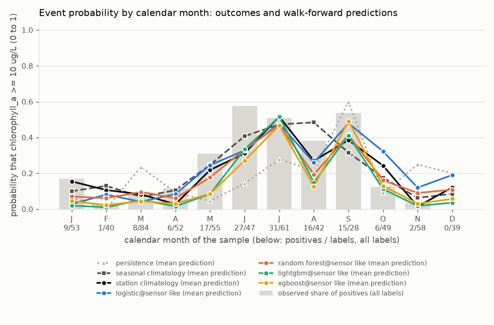
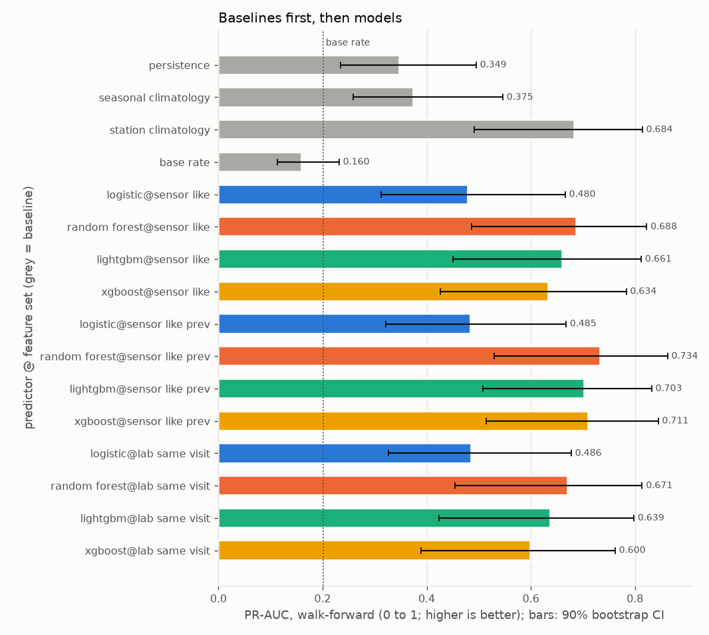
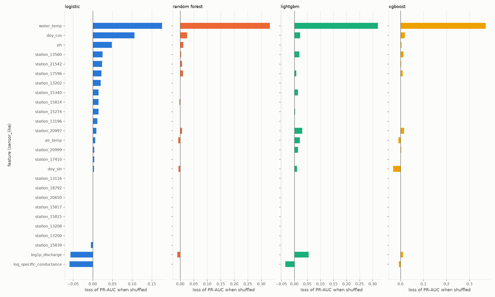
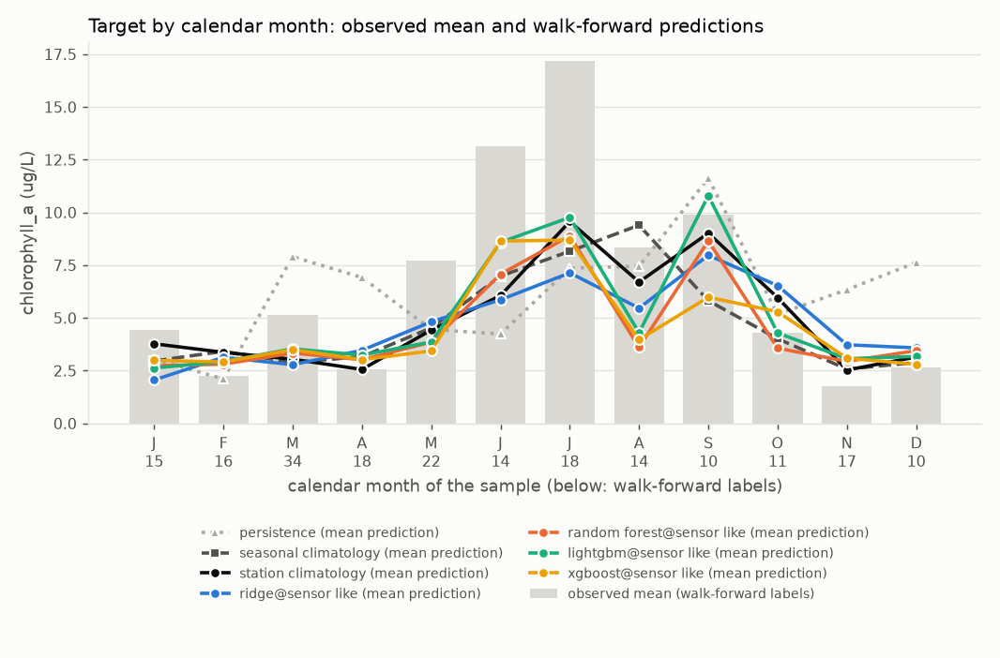
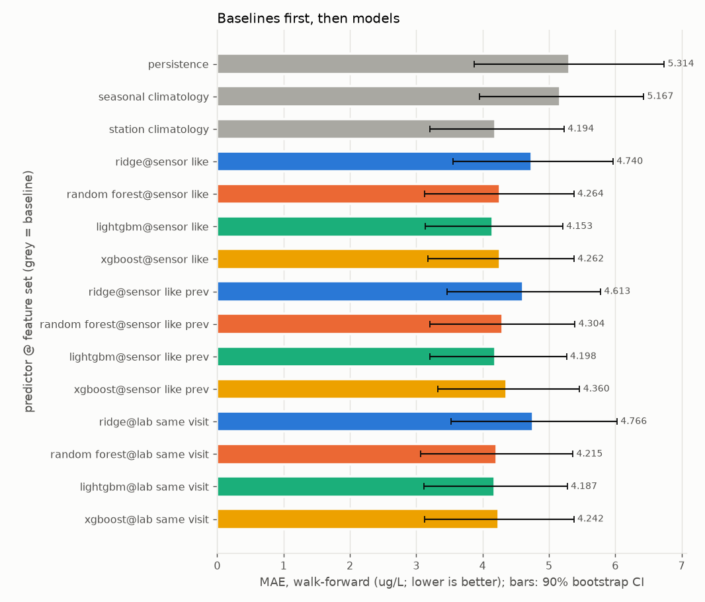
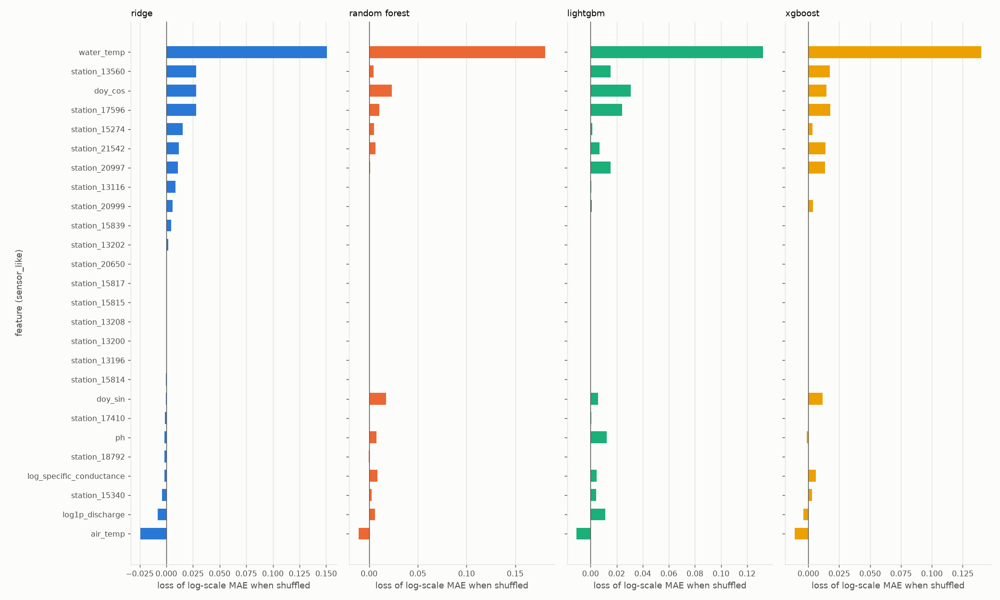

# Report: crp_chla_pooled

Real grab-sample data, `source=CRP` only, labels from 2014-01-01; `quality='good'` rows only. Input `data/clean/crp_long.csv` (SHA-256 `967f08554c419770...`). Stations: 13116, 13196, 13200, 13202, 13208, 13560, 15274, 15340, 15814, 15815, 15817, 15839, 17410, 17596, 18792, 20650, 20997, 20999, 21542.

Chlorophyll-a at 19 CRP stations of segment 2304 (as given by the owner), pooled. Primary target: the event chlorophyll_a >= 10 ug/L on the sample date. Secondary: the concentration (log1p regression). Features are same-visit readings (a nowcast), not a multi-day forecast.

> Note: The stations differ: some have no label at or above 10 ug/L since 2014. A model that sees the station one-hot can score those easy negatives, so station_climatology (season and station, nothing else) is the baseline to beat, and the per-station slices matter.

> Note: More stations add labels, not independent evidence about one site: stations sampled on the same day share the weather and the season, which is why the bootstrap resamples dates.

## First lines

### Primary target: event chlorophyll_a >= 10 ug/L

- Labels used: 608 on 280 distinct dates, 138 positives (13116: 17, 13196: 26, 13200: 11, 13202: 35, 13208: 23, 13560: 66, 15274: 24, 15340: 21, 15814: 34, 15815: 10, 15817: 42, 15839: 21, 17410: 36, 17596: 15, 18792: 10, 20650: 13, 20997: 45, 20999: 99, 21542: 60).
- Censored labels: 210 left-censored at or below the threshold counted as negatives; 0 left-censored above the threshold dropped (unknown); 0 right-censored dropped.
- Walk-forward: 6 folds (test years 2018 to 2023), n_train from 257 to 450 (training positives 60 to 100), n_test = 199 on 92 dates, 40 positives.
- Final hold-out (evaluated once, last 56 distinct dates, from 2023-06-13): n_train = 458, n_holdout = 150, 38 positives; training positives 100.
- **Persistence** means: the last sample at this station, carried forward (the previous label at the same station on a strictly earlier date; with no earlier label, the training base rate).
- **Seasonal climatology** means: the mean of the training targets within plus or minus 1 calendar month(s) of the test month, pooled over the task's stations (with fewer than 3 training labels in that window, the mean of all training targets).
- **Station climatology** means: the mean of the training targets at the same station within plus or minus 1 calendar month(s) of the test month (with fewer than 3 such labels, the pooled seasonal climatology value).
- **Base rate** means: the share of positives among the training labels.
- Verdicts, walk-forward, headline feature set `sensor_like` (deployable):
  - seasonal climatology shows no demonstrable difference from persistence (PR-AUC difference +0.026, 90% CI [-0.119, +0.222]); Brier difference -0.054 [-0.115, -0.000] (lower is better).
  - station climatology beats seasonal climatology (PR-AUC difference +0.309, 90% CI [+0.128, +0.405]); Brier difference -0.033 [-0.052, -0.015] (lower is better).
  - logistic on sensor_like (deployable) shows no demonstrable difference from persistence (PR-AUC difference +0.131, 90% CI [-0.033, +0.304]); Brier difference -0.063 [-0.128, -0.002] (lower is better).
  - logistic on sensor_like (deployable) shows no demonstrable difference from seasonal climatology (PR-AUC difference +0.105, 90% CI [-0.038, +0.229]); Brier difference -0.009 [-0.035, +0.019] (lower is better).
  - logistic on sensor_like (deployable) is worse than station climatology (PR-AUC difference -0.204, 90% CI [-0.296, -0.058]); Brier difference +0.024 [+0.003, +0.046] (lower is better).
  - random_forest on sensor_like (deployable) beats persistence (PR-AUC difference +0.339, 90% CI [+0.123, +0.486]); Brier difference -0.082 [-0.142, -0.027] (lower is better).
  - random_forest on sensor_like (deployable) beats seasonal climatology (PR-AUC difference +0.313, 90% CI [+0.124, +0.410]); Brier difference -0.028 [-0.046, -0.008] (lower is better).
  - random_forest on sensor_like (deployable) shows no demonstrable difference from station climatology (PR-AUC difference +0.004, 90% CI [-0.106, +0.095]); Brier difference +0.005 [-0.009, +0.021] (lower is better).
  - lightgbm on sensor_like (deployable) beats persistence (PR-AUC difference +0.313, 90% CI [+0.118, +0.462]); Brier difference -0.077 [-0.138, -0.017] (lower is better).
  - lightgbm on sensor_like (deployable) beats seasonal climatology (PR-AUC difference +0.287, 90% CI [+0.104, +0.398]); Brier difference -0.023 [-0.049, +0.004] (lower is better).
  - lightgbm on sensor_like (deployable) shows no demonstrable difference from station climatology (PR-AUC difference -0.022, 90% CI [-0.143, +0.104]); Brier difference +0.010 [-0.013, +0.037] (lower is better).
  - xgboost on sensor_like (deployable) beats persistence (PR-AUC difference +0.285, 90% CI [+0.102, +0.422]); Brier difference -0.073 [-0.127, -0.020] (lower is better).
  - xgboost on sensor_like (deployable) beats seasonal climatology (PR-AUC difference +0.259, 90% CI [+0.058, +0.382]); Brier difference -0.019 [-0.044, +0.007] (lower is better).
  - xgboost on sensor_like (deployable) shows no demonstrable difference from station climatology (PR-AUC difference -0.050, 90% CI [-0.176, +0.074]); Brier difference +0.014 [-0.008, +0.039] (lower is better).
- Verdicts, final hold-out, headline feature set `sensor_like`:
  - seasonal climatology shows no demonstrable difference from persistence (PR-AUC difference +0.101, 90% CI [-0.018, +0.245]); Brier difference -0.131 [-0.208, -0.053] (lower is better).
  - station climatology beats seasonal climatology (PR-AUC difference +0.333, 90% CI [+0.175, +0.461]); Brier difference -0.053 [-0.078, -0.031] (lower is better).
  - logistic on sensor_like (deployable) beats persistence (PR-AUC difference +0.322, 90% CI [+0.203, +0.470]); Brier difference -0.161 [-0.239, -0.084] (lower is better).
  - logistic on sensor_like (deployable) beats seasonal climatology (PR-AUC difference +0.221, 90% CI [+0.083, +0.362]); Brier difference -0.030 [-0.055, -0.006] (lower is better).
  - logistic on sensor_like (deployable) is worse than station climatology (PR-AUC difference -0.111, 90% CI [-0.184, -0.032]); Brier difference +0.023 [+0.005, +0.045] (lower is better).
  - random_forest on sensor_like (deployable) beats persistence (PR-AUC difference +0.439, 90% CI [+0.279, +0.588]); Brier difference -0.175 [-0.253, -0.093] (lower is better).
  - random_forest on sensor_like (deployable) beats seasonal climatology (PR-AUC difference +0.339, 90% CI [+0.181, +0.465]); Brier difference -0.043 [-0.068, -0.020] (lower is better).
  - random_forest on sensor_like (deployable) shows no demonstrable difference from station climatology (PR-AUC difference +0.006, 90% CI [-0.079, +0.080]); Brier difference +0.010 [-0.008, +0.028] (lower is better).
  - lightgbm on sensor_like (deployable) beats persistence (PR-AUC difference +0.492, 90% CI [+0.356, +0.612]); Brier difference -0.194 [-0.275, -0.119] (lower is better).
  - lightgbm on sensor_like (deployable) beats seasonal climatology (PR-AUC difference +0.391, 90% CI [+0.235, +0.505]); Brier difference -0.063 [-0.093, -0.033] (lower is better).
  - lightgbm on sensor_like (deployable) shows no demonstrable difference from station climatology (PR-AUC difference +0.058, 90% CI [-0.025, +0.136]); Brier difference -0.010 [-0.028, +0.008] (lower is better).
  - xgboost on sensor_like (deployable) beats persistence (PR-AUC difference +0.499, 90% CI [+0.359, +0.626]); Brier difference -0.198 [-0.277, -0.121] (lower is better).
  - xgboost on sensor_like (deployable) beats seasonal climatology (PR-AUC difference +0.398, 90% CI [+0.241, +0.510]); Brier difference -0.067 [-0.096, -0.038] (lower is better).
  - xgboost on sensor_like (deployable) shows no demonstrable difference from station climatology (PR-AUC difference +0.065, 90% CI [-0.014, +0.143]); Brier difference -0.013 [-0.034, +0.007] (lower is better).

### Secondary target: regression of chlorophyll_a (ug/L), fitted on the log1p scale

- Labels used: 608 on 280 distinct dates, 210 left-censored (13116: 17, 13196: 26, 13200: 11, 13202: 35, 13208: 23, 13560: 66, 15274: 24, 15340: 21, 15814: 34, 15815: 10, 15817: 42, 15839: 21, 17410: 36, 17596: 15, 18792: 10, 20650: 13, 20997: 45, 20999: 99, 21542: 60).
- Censored labels: left-censored values enter at detection limit x 0.5; 0 right-censored dropped.
- Walk-forward: 6 folds (test years 2018 to 2023), n_train from 257 to 450, n_test = 199 on 92 dates.
- Final hold-out (evaluated once, last 56 distinct dates, from 2023-06-13): n_train = 458, n_holdout = 150.
- **Persistence** means: the last sample at this station, carried forward (the previous label at the same station on a strictly earlier date; with no earlier label, the training median).
- **Seasonal climatology** means: the mean of the training targets within plus or minus 1 calendar month(s) of the test month, pooled over the task's stations (with fewer than 3 training labels in that window, the mean of all training targets).
- **Station climatology** means: the mean of the training targets at the same station within plus or minus 1 calendar month(s) of the test month (with fewer than 3 such labels, the pooled seasonal climatology value).
- Verdicts, walk-forward, headline feature set `sensor_like` (deployable):
  - seasonal climatology shows no demonstrable difference from persistence (MAE difference -0.147, 90% CI [-1.466, +1.069]).
  - station climatology beats seasonal climatology (MAE difference -0.973, 90% CI [-1.347, -0.627]).
  - ridge on sensor_like (deployable) shows no demonstrable difference from persistence (MAE difference -0.574, 90% CI [-1.859, +0.573]).
  - ridge on sensor_like (deployable) beats seasonal climatology (MAE difference -0.426, 90% CI [-0.751, -0.115]).
  - ridge on sensor_like (deployable) is worse than station climatology (MAE difference +0.546, 90% CI [+0.219, +0.860]).
  - random_forest on sensor_like (deployable) shows no demonstrable difference from persistence (MAE difference -1.050, 90% CI [-2.293, +0.065]).
  - random_forest on sensor_like (deployable) beats seasonal climatology (MAE difference -0.902, 90% CI [-1.334, -0.490]).
  - random_forest on sensor_like (deployable) shows no demonstrable difference from station climatology (MAE difference +0.071, 90% CI [-0.241, +0.410]).
  - lightgbm on sensor_like (deployable) beats persistence (MAE difference -1.161, 90% CI [-2.394, -0.040]).
  - lightgbm on sensor_like (deployable) beats seasonal climatology (MAE difference -1.013, 90% CI [-1.536, -0.521]).
  - lightgbm on sensor_like (deployable) shows no demonstrable difference from station climatology (MAE difference -0.041, 90% CI [-0.384, +0.299]).
  - xgboost on sensor_like (deployable) shows no demonstrable difference from persistence (MAE difference -1.052, 90% CI [-2.341, +0.124]).
  - xgboost on sensor_like (deployable) beats seasonal climatology (MAE difference -0.904, 90% CI [-1.367, -0.478]).
  - xgboost on sensor_like (deployable) shows no demonstrable difference from station climatology (MAE difference +0.068, 90% CI [-0.250, +0.387]).
- Verdicts, final hold-out, headline feature set `sensor_like`:
  - seasonal climatology beats persistence (MAE difference -2.293, 90% CI [-4.635, -0.412]).
  - station climatology beats seasonal climatology (MAE difference -1.464, 90% CI [-2.124, -0.901]).
  - ridge on sensor_like (deployable) beats persistence (MAE difference -3.088, 90% CI [-5.531, -1.207]).
  - ridge on sensor_like (deployable) beats seasonal climatology (MAE difference -0.795, 90% CI [-1.155, -0.448]).
  - ridge on sensor_like (deployable) is worse than station climatology (MAE difference +0.669, 90% CI [+0.245, +1.113]).
  - random_forest on sensor_like (deployable) beats persistence (MAE difference -2.969, 90% CI [-5.579, -0.837]).
  - random_forest on sensor_like (deployable) beats seasonal climatology (MAE difference -0.676, 90% CI [-1.399, -0.020]).
  - random_forest on sensor_like (deployable) is worse than station climatology (MAE difference +0.788, 90% CI [+0.193, +1.472]).
  - lightgbm on sensor_like (deployable) beats persistence (MAE difference -3.117, 90% CI [-5.777, -1.087]).
  - lightgbm on sensor_like (deployable) beats seasonal climatology (MAE difference -0.824, 90% CI [-1.435, -0.206]).
  - lightgbm on sensor_like (deployable) is worse than station climatology (MAE difference +0.640, 90% CI [+0.107, +1.276]).
  - xgboost on sensor_like (deployable) beats persistence (MAE difference -3.687, 90% CI [-6.349, -1.585]).
  - xgboost on sensor_like (deployable) beats seasonal climatology (MAE difference -1.394, 90% CI [-2.133, -0.727]).
  - xgboost on sensor_like (deployable) shows no demonstrable difference from station climatology (MAE difference +0.070, 90% CI [-0.438, +0.595]).

## Warnings

- WARNING [event] walk-forward folds with zero positives: 2020, 2023.
- WARNING [event] walk-forward slices with zero positives (undefined: no positives): station 13116, station 13200, station 13560, station 15340, station 15815, station 18792, station 20650, station 20997.
- WARNING [event] holdout slices with zero positives (undefined: no positives): station 13208, station 13560, station 20999.
- WARNING [event, regression] 67 of 109 station-years in the test windows have fewer than 4 labels (minimum 1).

## Metrics

### Event target: event chlorophyll_a >= 10 ug/L

Folds:

| fold | n_train | n_test | last train date | first test date | last test date | train positives | test positives |
|---|---|---|---|---|---|---|---|
| 2018 | 257 | 33 | 2017-12-04 | 2018-01-23 | 2018-12-18 | 60 | 1 |
| 2019 | 290 | 56 | 2018-11-27 | 2019-01-14 | 2019-12-18 | 61 | 13 |
| 2020 | 346 | 30 | 2019-11-05 | 2020-01-28 | 2020-12-14 | 74 | 0 (undefined: no positives) |
| 2021 | 378 | 41 | 2020-12-14 | 2021-01-19 | 2021-12-14 | 74 | 15 |
| 2022 | 419 | 31 | 2021-12-14 | 2022-01-24 | 2022-08-30 | 89 | 11 |
| 2023 | 450 | 8 | 2022-08-30 | 2023-04-10 | 2023-05-08 | 100 | 0 (undefined: no positives) |
| holdout | 458 | 150 | 2023-05-08 | 2023-06-13 | 2026-05-18 | 100 | 38 |

#### Walk-forward

n = 199 on 92 dates, 40 positives, base rate 0.201. Baselines first, then models. Brackets: 90% bootstrap CI over distinct dates.

| predictor | deployable | PR-AUC | ROC-AUC | Brier | Brier skill vs base rate |
|---|---|---|---|---|---|
| persistence | baseline | 0.349 [0.234, 0.495] | 0.668 [0.583, 0.762] | 0.192 [0.128, 0.263] | -0.174 [-0.521, 0.149] |
| seasonal_climatology | baseline | 0.375 [0.258, 0.546] | 0.745 [0.647, 0.815] | 0.138 [0.108, 0.172] | 0.157 [0.029, 0.254] |
| station_climatology | baseline | 0.684 [0.491, 0.814] | 0.860 [0.777, 0.918] | 0.105 [0.080, 0.137] | 0.359 [0.217, 0.466] |
| base_rate | baseline | 0.160 [0.113, 0.232] | 0.287 [0.204, 0.388] | 0.163 [0.126, 0.205] | 0.000 [0.000, 0.000] |
| logistic@sensor_like | yes | 0.480 [0.313, 0.666] | 0.796 [0.701, 0.863] | 0.129 [0.098, 0.161] | 0.213 [-0.013, 0.367] |
| random_forest@sensor_like | yes | 0.688 [0.487, 0.823] | 0.822 [0.720, 0.890] | 0.110 [0.081, 0.145] | 0.327 [0.183, 0.447] |
| lightgbm@sensor_like | yes | 0.661 [0.450, 0.812] | 0.827 [0.731, 0.895] | 0.115 [0.079, 0.157] | 0.295 [0.081, 0.482] |
| xgboost@sensor_like | yes | 0.634 [0.426, 0.783] | 0.783 [0.663, 0.864] | 0.119 [0.082, 0.163] | 0.271 [0.086, 0.444] |
| logistic@sensor_like_prev | yes | 0.485 [0.321, 0.668] | 0.810 [0.717, 0.876] | 0.126 [0.096, 0.158] | 0.230 [-0.015, 0.400] |
| random_forest@sensor_like_prev | yes | 0.734 [0.529, 0.863] | 0.862 [0.766, 0.922] | 0.104 [0.079, 0.134] | 0.366 [0.233, 0.466] |
| lightgbm@sensor_like_prev | yes | 0.703 [0.508, 0.832] | 0.855 [0.770, 0.911] | 0.105 [0.073, 0.145] | 0.356 [0.172, 0.518] |
| xgboost@sensor_like_prev | yes | 0.711 [0.515, 0.845] | 0.859 [0.764, 0.917] | 0.107 [0.074, 0.147] | 0.348 [0.184, 0.492] |
| logistic@lab_same_visit | NO (diagnostic) | 0.486 [0.326, 0.678] | 0.803 [0.709, 0.868] | 0.129 [0.098, 0.163] | 0.209 [0.019, 0.343] |
| random_forest@lab_same_visit | NO (diagnostic) | 0.671 [0.454, 0.814] | 0.824 [0.724, 0.890] | 0.112 [0.084, 0.145] | 0.317 [0.178, 0.434] |
| lightgbm@lab_same_visit | NO (diagnostic) | 0.639 [0.423, 0.798] | 0.826 [0.735, 0.891] | 0.119 [0.082, 0.162] | 0.273 [0.059, 0.457] |
| xgboost@lab_same_visit | NO (diagnostic) | 0.600 [0.389, 0.762] | 0.777 [0.660, 0.856] | 0.123 [0.086, 0.168] | 0.247 [0.059, 0.416] |

At p = 0.5:

| predictor | precision | recall | F1 | TP | FP | FN | TN |
|---|---|---|---|---|---|---|---|
| persistence | 0.529 [0.356, 0.727] | 0.450 [0.286, 0.632] | 0.486 [0.333, 0.629] | 18 | 16 | 22 | 143 |
| seasonal_climatology | 0.333 [0.000, 1.000] | 0.025 [0.000, 0.074] | 0.047 [0.000, 0.133] | 1 | 2 | 39 | 157 |
| station_climatology | 0.684 [0.428, 0.870] | 0.325 [0.158, 0.467] | 0.441 [0.245, 0.571] | 13 | 6 | 27 | 153 |
| base_rate | undefined | 0.000 [0.000, 0.000] | 0.000 [0.000, 0.000] | 0 | 0 | 40 | 159 |
| logistic@sensor_like | 0.571 [0.350, 0.769] | 0.400 [0.226, 0.543] | 0.471 [0.276, 0.606] | 16 | 12 | 24 | 147 |
| random_forest@sensor_like | 0.857 [0.571, 1.000] | 0.300 [0.094, 0.479] | 0.444 [0.163, 0.629] | 12 | 2 | 28 | 157 |
| lightgbm@sensor_like | 0.783 [0.538, 0.938] | 0.450 [0.242, 0.619] | 0.571 [0.349, 0.719] | 18 | 5 | 22 | 154 |
| xgboost@sensor_like | 0.800 [0.562, 1.000] | 0.400 [0.190, 0.588] | 0.533 [0.302, 0.706] | 16 | 4 | 24 | 155 |
| logistic@sensor_like_prev | 0.567 [0.342, 0.767] | 0.425 [0.258, 0.553] | 0.486 [0.308, 0.609] | 17 | 13 | 23 | 146 |
| random_forest@sensor_like_prev | 0.923 [0.714, 1.000] | 0.300 [0.094, 0.479] | 0.453 [0.171, 0.633] | 12 | 1 | 28 | 158 |
| lightgbm@sensor_like_prev | 0.818 [0.619, 0.945] | 0.450 [0.241, 0.630] | 0.581 [0.356, 0.730] | 18 | 4 | 22 | 155 |
| xgboost@sensor_like_prev | 0.833 [0.583, 1.000] | 0.375 [0.167, 0.567] | 0.517 [0.267, 0.691] | 15 | 3 | 25 | 156 |
| logistic@lab_same_visit | 0.476 [0.235, 0.708] | 0.250 [0.114, 0.381] | 0.328 [0.157, 0.472] | 10 | 11 | 30 | 148 |
| random_forest@lab_same_visit | 0.733 [0.333, 0.952] | 0.275 [0.061, 0.449] | 0.400 [0.102, 0.587] | 11 | 4 | 29 | 155 |
| lightgbm@lab_same_visit | 0.773 [0.545, 0.913] | 0.425 [0.229, 0.600] | 0.548 [0.333, 0.698] | 17 | 5 | 23 | 154 |
| xgboost@lab_same_visit | 0.722 [0.400, 0.923] | 0.325 [0.120, 0.500] | 0.448 [0.189, 0.632] | 13 | 5 | 27 | 154 |

At p* = 0.10 (C_FP=1, C_FN=9, PLACEHOLDER):

| predictor | precision | recall | F1 | TP | FP | FN | TN |
|---|---|---|---|---|---|---|---|
| persistence | 0.474 [0.300, 0.667] | 0.450 [0.286, 0.632] | 0.462 [0.309, 0.607] | 18 | 20 | 22 | 139 |
| seasonal_climatology | 0.281 [0.177, 0.390] | 0.850 [0.720, 0.933] | 0.422 [0.290, 0.542] | 34 | 87 | 6 | 72 |
| station_climatology | 0.319 [0.215, 0.426] | 0.900 [0.796, 0.971] | 0.471 [0.341, 0.583] | 36 | 77 | 4 | 82 |
| base_rate | 0.201 [0.136, 0.273] | 1.000 [1.000, 1.000] | 0.335 [0.240, 0.429] | 40 | 159 | 0 | 0 |
| logistic@sensor_like | 0.358 [0.238, 0.474] | 0.850 [0.720, 0.933] | 0.504 [0.364, 0.617] | 34 | 61 | 6 | 98 |
| random_forest@sensor_like | 0.337 [0.220, 0.452] | 0.850 [0.720, 0.933] | 0.482 [0.345, 0.599] | 34 | 67 | 6 | 92 |
| lightgbm@sensor_like | 0.543 [0.350, 0.722] | 0.625 [0.447, 0.762] | 0.581 [0.400, 0.703] | 25 | 21 | 15 | 138 |
| xgboost@sensor_like | 0.519 [0.345, 0.677] | 0.675 [0.500, 0.800] | 0.587 [0.427, 0.702] | 27 | 25 | 13 | 134 |
| logistic@sensor_like_prev | 0.370 [0.253, 0.482] | 0.850 [0.732, 0.932] | 0.515 [0.381, 0.624] | 34 | 58 | 6 | 101 |
| random_forest@sensor_like_prev | 0.310 [0.204, 0.419] | 0.900 [0.795, 0.972] | 0.462 [0.331, 0.576] | 36 | 80 | 4 | 79 |
| lightgbm@sensor_like_prev | 0.547 [0.370, 0.706] | 0.725 [0.568, 0.846] | 0.624 [0.461, 0.743] | 29 | 24 | 11 | 135 |
| xgboost@sensor_like_prev | 0.542 [0.389, 0.677] | 0.800 [0.654, 0.906] | 0.646 [0.500, 0.754] | 32 | 27 | 8 | 132 |
| logistic@lab_same_visit | 0.415 [0.286, 0.540] | 0.850 [0.720, 0.933] | 0.557 [0.416, 0.671] | 34 | 48 | 6 | 111 |
| random_forest@lab_same_visit | 0.318 [0.210, 0.430] | 0.875 [0.759, 0.951] | 0.467 [0.331, 0.583] | 35 | 75 | 5 | 84 |
| lightgbm@lab_same_visit | 0.556 [0.354, 0.730] | 0.625 [0.448, 0.745] | 0.588 [0.407, 0.711] | 25 | 20 | 15 | 139 |
| xgboost@lab_same_visit | 0.509 [0.333, 0.674] | 0.700 [0.528, 0.822] | 0.589 [0.423, 0.706] | 28 | 27 | 12 | 132 |

Paired differences (higher PR-AUC and lower Brier are better):

| model | baseline | PR-AUC difference (model - baseline) | Brier difference | verdict (by PR-AUC) |
|---|---|---|---|---|
| persistence | seasonal_climatology | -0.026 [-0.222, +0.119] | +0.054 [+0.000, +0.115] | no demonstrable difference |
| persistence | station_climatology | -0.335 [-0.473, -0.133] | +0.087 [+0.031, +0.148] | is worse than |
| persistence | base_rate | +0.189 [+0.085, +0.316] | +0.028 [-0.027, +0.085] | beats |
| seasonal_climatology | persistence | +0.026 [-0.119, +0.222] | -0.054 [-0.115, -0.000] | no demonstrable difference |
| seasonal_climatology | station_climatology | -0.309 [-0.405, -0.128] | +0.033 [+0.015, +0.052] | is worse than |
| seasonal_climatology | base_rate | +0.215 [+0.127, +0.359] | -0.026 [-0.047, -0.004] | beats |
| station_climatology | persistence | +0.335 [+0.133, +0.473] | -0.087 [-0.148, -0.031] | beats |
| station_climatology | seasonal_climatology | +0.309 [+0.128, +0.405] | -0.033 [-0.052, -0.015] | beats |
| station_climatology | base_rate | +0.524 [+0.349, +0.630] | -0.059 [-0.088, -0.031] | beats |
| base_rate | persistence | -0.189 [-0.316, -0.085] | -0.028 [-0.085, +0.027] | is worse than |
| base_rate | seasonal_climatology | -0.215 [-0.359, -0.127] | +0.026 [+0.004, +0.047] | is worse than |
| base_rate | station_climatology | -0.524 [-0.630, -0.349] | +0.059 [+0.031, +0.088] | is worse than |
| logistic@sensor_like | persistence | +0.131 [-0.033, +0.304] | -0.063 [-0.128, -0.002] | no demonstrable difference |
| logistic@sensor_like | seasonal_climatology | +0.105 [-0.038, +0.229] | -0.009 [-0.035, +0.019] | no demonstrable difference |
| logistic@sensor_like | station_climatology | -0.204 [-0.296, -0.058] | +0.024 [+0.003, +0.046] | is worse than |
| logistic@sensor_like | base_rate | +0.320 [+0.181, +0.470] | -0.035 [-0.069, +0.002] | beats |
| random_forest@sensor_like | persistence | +0.339 [+0.123, +0.486] | -0.082 [-0.142, -0.027] | beats |
| random_forest@sensor_like | seasonal_climatology | +0.313 [+0.124, +0.410] | -0.028 [-0.046, -0.008] | beats |
| random_forest@sensor_like | station_climatology | +0.004 [-0.106, +0.095] | +0.005 [-0.009, +0.021] | no demonstrable difference |
| random_forest@sensor_like | base_rate | +0.528 [+0.334, +0.639] | -0.053 [-0.082, -0.026] | beats |
| lightgbm@sensor_like | persistence | +0.313 [+0.118, +0.462] | -0.077 [-0.138, -0.017] | beats |
| lightgbm@sensor_like | seasonal_climatology | +0.287 [+0.104, +0.398] | -0.023 [-0.049, +0.004] | beats |
| lightgbm@sensor_like | station_climatology | -0.022 [-0.143, +0.104] | +0.010 [-0.013, +0.037] | no demonstrable difference |
| lightgbm@sensor_like | base_rate | +0.502 [+0.321, +0.627] | -0.048 [-0.084, -0.013] | beats |
| xgboost@sensor_like | persistence | +0.285 [+0.102, +0.422] | -0.073 [-0.127, -0.020] | beats |
| xgboost@sensor_like | seasonal_climatology | +0.259 [+0.058, +0.382] | -0.019 [-0.044, +0.007] | beats |
| xgboost@sensor_like | station_climatology | -0.050 [-0.176, +0.074] | +0.014 [-0.008, +0.039] | no demonstrable difference |
| xgboost@sensor_like | base_rate | +0.474 [+0.284, +0.605] | -0.044 [-0.075, -0.013] | beats |
| logistic@sensor_like_prev | persistence | +0.136 [-0.031, +0.289] | -0.066 [-0.131, -0.005] | no demonstrable difference |
| logistic@sensor_like_prev | seasonal_climatology | +0.110 [-0.057, +0.254] | -0.012 [-0.043, +0.021] | no demonstrable difference |
| logistic@sensor_like_prev | station_climatology | -0.199 [-0.315, -0.031] | +0.021 [-0.005, +0.051] | is worse than |
| logistic@sensor_like_prev | base_rate | +0.325 [+0.191, +0.469] | -0.038 [-0.076, +0.002] | beats |
| random_forest@sensor_like_prev | persistence | +0.385 [+0.176, +0.521] | -0.088 [-0.148, -0.034] | beats |
| random_forest@sensor_like_prev | seasonal_climatology | +0.359 [+0.170, +0.453] | -0.034 [-0.052, -0.015] | beats |
| random_forest@sensor_like_prev | station_climatology | +0.050 [-0.053, +0.140] | -0.001 [-0.013, +0.011] | no demonstrable difference |
| random_forest@sensor_like_prev | base_rate | +0.574 [+0.383, +0.670] | -0.060 [-0.088, -0.033] | beats |
| lightgbm@sensor_like_prev | persistence | +0.354 [+0.159, +0.498] | -0.087 [-0.148, -0.029] | beats |
| lightgbm@sensor_like_prev | seasonal_climatology | +0.328 [+0.153, +0.422] | -0.032 [-0.057, -0.007] | beats |
| lightgbm@sensor_like_prev | station_climatology | +0.020 [-0.099, +0.140] | +0.001 [-0.020, +0.024] | no demonstrable difference |
| lightgbm@sensor_like_prev | base_rate | +0.543 [+0.366, +0.646] | -0.058 [-0.092, -0.025] | beats |
| xgboost@sensor_like_prev | persistence | +0.362 [+0.173, +0.496] | -0.085 [-0.142, -0.032] | beats |
| xgboost@sensor_like_prev | seasonal_climatology | +0.336 [+0.140, +0.441] | -0.031 [-0.054, -0.008] | beats |
| xgboost@sensor_like_prev | station_climatology | +0.027 [-0.092, +0.138] | +0.002 [-0.017, +0.023] | no demonstrable difference |
| xgboost@sensor_like_prev | base_rate | +0.551 [+0.375, +0.656] | -0.057 [-0.088, -0.028] | beats |
| logistic@lab_same_visit | persistence | +0.137 [-0.029, +0.316] | -0.063 [-0.126, -0.003] | no demonstrable difference |
| logistic@lab_same_visit | seasonal_climatology | +0.111 [-0.030, +0.236] | -0.009 [-0.031, +0.016] | no demonstrable difference |
| logistic@lab_same_visit | station_climatology | -0.198 [-0.288, -0.055] | +0.024 [+0.006, +0.044] | is worse than |
| logistic@lab_same_visit | base_rate | +0.326 [+0.189, +0.474] | -0.034 [-0.065, -0.003] | beats |
| random_forest@lab_same_visit | persistence | +0.323 [+0.097, +0.473] | -0.080 [-0.139, -0.025] | beats |
| random_forest@lab_same_visit | seasonal_climatology | +0.297 [+0.103, +0.394] | -0.026 [-0.044, -0.008] | beats |
| random_forest@lab_same_visit | station_climatology | -0.012 [-0.118, +0.078] | +0.007 [-0.006, +0.020] | no demonstrable difference |
| random_forest@lab_same_visit | base_rate | +0.511 [+0.308, +0.631] | -0.052 [-0.080, -0.025] | beats |
| lightgbm@lab_same_visit | persistence | +0.290 [+0.091, +0.446] | -0.073 [-0.133, -0.014] | beats |
| lightgbm@lab_same_visit | seasonal_climatology | +0.264 [+0.081, +0.375] | -0.019 [-0.044, +0.009] | beats |
| lightgbm@lab_same_visit | station_climatology | -0.045 [-0.177, +0.082] | +0.014 [-0.010, +0.043] | no demonstrable difference |
| lightgbm@lab_same_visit | base_rate | +0.479 [+0.290, +0.608] | -0.045 [-0.079, -0.009] | beats |
| xgboost@lab_same_visit | persistence | +0.251 [+0.060, +0.403] | -0.069 [-0.125, -0.015] | beats |
| xgboost@lab_same_visit | seasonal_climatology | +0.225 [+0.036, +0.351] | -0.015 [-0.040, +0.011] | beats |
| xgboost@lab_same_visit | station_climatology | -0.084 [-0.211, +0.054] | +0.018 [-0.005, +0.044] | no demonstrable difference |
| xgboost@lab_same_visit | base_rate | +0.440 [+0.252, +0.584] | -0.040 [-0.070, -0.009] | beats |

#### Final hold-out (evaluated once)

n = 150 on 56 dates, 38 positives, base rate 0.253. Baselines first, then models. Brackets: 90% bootstrap CI over distinct dates.

| predictor | deployable | PR-AUC | ROC-AUC | Brier | Brier skill vs base rate |
|---|---|---|---|---|---|
| persistence | baseline | 0.348 [0.221, 0.492] | 0.643 [0.546, 0.740] | 0.287 [0.201, 0.367] | -0.506 [-1.072, -0.079] |
| seasonal_climatology | baseline | 0.448 [0.317, 0.629] | 0.777 [0.680, 0.859] | 0.156 [0.111, 0.201] | 0.182 [0.048, 0.300] |
| station_climatology | baseline | 0.781 [0.658, 0.897] | 0.877 [0.791, 0.955] | 0.102 [0.061, 0.146] | 0.462 [0.279, 0.635] |
| base_rate | baseline | 0.253 [0.164, 0.340] | 0.500 [0.500, 0.500] | 0.190 [0.140, 0.239] | 0.000 [0.000, 0.000] |
| logistic@sensor_like | yes | 0.669 [0.551, 0.807] | 0.803 [0.691, 0.896] | 0.126 [0.083, 0.170] | 0.339 [0.158, 0.512] |
| random_forest@sensor_like | yes | 0.787 [0.641, 0.900] | 0.846 [0.707, 0.949] | 0.112 [0.074, 0.154] | 0.411 [0.220, 0.579] |
| lightgbm@sensor_like | yes | 0.839 [0.720, 0.930] | 0.906 [0.842, 0.961] | 0.093 [0.056, 0.132] | 0.512 [0.337, 0.679] |
| xgboost@sensor_like | yes | 0.846 [0.743, 0.931] | 0.905 [0.843, 0.959] | 0.089 [0.052, 0.131] | 0.532 [0.349, 0.707] |
| logistic@sensor_like_prev | yes | 0.707 [0.568, 0.839] | 0.792 [0.673, 0.891] | 0.125 [0.080, 0.173] | 0.343 [0.139, 0.537] |
| random_forest@sensor_like_prev | yes | 0.788 [0.657, 0.892] | 0.873 [0.779, 0.946] | 0.108 [0.072, 0.147] | 0.431 [0.262, 0.587] |
| lightgbm@sensor_like_prev | yes | 0.861 [0.741, 0.951] | 0.909 [0.839, 0.967] | 0.082 [0.046, 0.122] | 0.568 [0.374, 0.747] |
| xgboost@sensor_like_prev | yes | 0.843 [0.715, 0.940] | 0.906 [0.828, 0.970] | 0.090 [0.053, 0.131] | 0.525 [0.322, 0.703] |
| logistic@lab_same_visit | NO (diagnostic) | 0.658 [0.530, 0.804] | 0.807 [0.698, 0.898] | 0.126 [0.082, 0.171] | 0.341 [0.158, 0.518] |
| random_forest@lab_same_visit | NO (diagnostic) | 0.779 [0.645, 0.889] | 0.845 [0.713, 0.945] | 0.112 [0.075, 0.154] | 0.409 [0.232, 0.568] |
| lightgbm@lab_same_visit | NO (diagnostic) | 0.842 [0.732, 0.927] | 0.910 [0.850, 0.960] | 0.093 [0.056, 0.130] | 0.513 [0.343, 0.679] |
| xgboost@lab_same_visit | NO (diagnostic) | 0.836 [0.724, 0.924] | 0.902 [0.841, 0.955] | 0.094 [0.055, 0.134] | 0.508 [0.322, 0.685] |

At p = 0.5:

| predictor | precision | recall | F1 | TP | FP | FN | TN |
|---|---|---|---|---|---|---|---|
| persistence | 0.442 [0.264, 0.615] | 0.500 [0.310, 0.667] | 0.469 [0.298, 0.605] | 19 | 24 | 19 | 88 |
| seasonal_climatology | undefined | 0.000 [0.000, 0.000] | 0.000 [0.000, 0.000] | 0 | 0 | 38 | 112 |
| station_climatology | 0.913 [0.828, 1.000] | 0.553 [0.375, 0.719] | 0.689 [0.531, 0.807] | 21 | 2 | 17 | 110 |
| base_rate | undefined | 0.000 [0.000, 0.000] | 0.000 [0.000, 0.000] | 0 | 0 | 38 | 112 |
| logistic@sensor_like | 0.742 [0.583, 0.871] | 0.605 [0.438, 0.771] | 0.667 [0.521, 0.776] | 23 | 8 | 15 | 104 |
| random_forest@sensor_like | 0.711 [0.571, 0.828] | 0.711 [0.529, 0.886] | 0.711 [0.571, 0.817] | 27 | 11 | 11 | 101 |
| lightgbm@sensor_like | 0.794 [0.687, 0.889] | 0.711 [0.529, 0.886] | 0.750 [0.615, 0.851] | 27 | 7 | 11 | 105 |
| xgboost@sensor_like | 0.844 [0.735, 0.939] | 0.711 [0.529, 0.886] | 0.771 [0.630, 0.875] | 27 | 5 | 11 | 107 |
| logistic@sensor_like_prev | 0.767 [0.609, 0.903] | 0.605 [0.417, 0.783] | 0.676 [0.513, 0.800] | 23 | 7 | 15 | 105 |
| random_forest@sensor_like_prev | 0.800 [0.690, 0.900] | 0.632 [0.435, 0.818] | 0.706 [0.548, 0.827] | 24 | 6 | 14 | 106 |
| lightgbm@sensor_like_prev | 0.824 [0.727, 0.913] | 0.737 [0.543, 0.909] | 0.778 [0.641, 0.881] | 28 | 6 | 10 | 106 |
| xgboost@sensor_like_prev | 0.818 [0.706, 0.914] | 0.711 [0.529, 0.886] | 0.761 [0.623, 0.864] | 27 | 6 | 11 | 106 |
| logistic@lab_same_visit | 0.742 [0.583, 0.882] | 0.605 [0.438, 0.771] | 0.667 [0.521, 0.780] | 23 | 8 | 15 | 104 |
| random_forest@lab_same_visit | 0.711 [0.571, 0.828] | 0.711 [0.529, 0.886] | 0.711 [0.571, 0.817] | 27 | 11 | 11 | 101 |
| lightgbm@lab_same_visit | 0.765 [0.643, 0.867] | 0.684 [0.510, 0.850] | 0.722 [0.588, 0.821] | 26 | 8 | 12 | 104 |
| xgboost@lab_same_visit | 0.844 [0.735, 0.939] | 0.711 [0.529, 0.886] | 0.771 [0.630, 0.875] | 27 | 5 | 11 | 107 |

At p* = 0.10 (C_FP=1, C_FN=9, PLACEHOLDER):

| predictor | precision | recall | F1 | TP | FP | FN | TN |
|---|---|---|---|---|---|---|---|
| persistence | 0.442 [0.264, 0.615] | 0.500 [0.310, 0.667] | 0.469 [0.298, 0.605] | 19 | 24 | 19 | 88 |
| seasonal_climatology | 0.361 [0.244, 0.471] | 0.921 [0.833, 0.979] | 0.519 [0.383, 0.630] | 35 | 62 | 3 | 50 |
| station_climatology | 0.425 [0.301, 0.553] | 0.895 [0.808, 0.970] | 0.576 [0.447, 0.688] | 34 | 46 | 4 | 66 |
| base_rate | 0.253 [0.164, 0.340] | 1.000 [1.000, 1.000] | 0.404 [0.282, 0.507] | 38 | 112 | 0 | 0 |
| logistic@sensor_like | 0.429 [0.300, 0.549] | 0.789 [0.640, 0.918] | 0.556 [0.423, 0.667] | 30 | 40 | 8 | 72 |
| random_forest@sensor_like | 0.386 [0.263, 0.517] | 0.842 [0.653, 0.978] | 0.529 [0.390, 0.652] | 32 | 51 | 6 | 61 |
| lightgbm@sensor_like | 0.547 [0.405, 0.688] | 0.921 [0.833, 0.979] | 0.686 [0.553, 0.797] | 35 | 29 | 3 | 83 |
| xgboost@sensor_like | 0.517 [0.372, 0.648] | 0.789 [0.617, 0.943] | 0.625 [0.483, 0.738] | 30 | 28 | 8 | 84 |
| logistic@sensor_like_prev | 0.400 [0.266, 0.533] | 0.737 [0.575, 0.882] | 0.519 [0.377, 0.637] | 28 | 42 | 10 | 70 |
| random_forest@sensor_like_prev | 0.386 [0.268, 0.506] | 0.895 [0.789, 0.981] | 0.540 [0.406, 0.651] | 34 | 54 | 4 | 58 |
| lightgbm@sensor_like_prev | 0.500 [0.352, 0.643] | 0.868 [0.763, 0.968] | 0.635 [0.494, 0.748] | 33 | 33 | 5 | 79 |
| xgboost@sensor_like_prev | 0.515 [0.380, 0.639] | 0.895 [0.757, 1.000] | 0.654 [0.523, 0.759] | 34 | 32 | 4 | 80 |
| logistic@lab_same_visit | 0.453 [0.317, 0.580] | 0.763 [0.600, 0.909] | 0.569 [0.427, 0.685] | 29 | 35 | 9 | 77 |
| random_forest@lab_same_visit | 0.371 [0.256, 0.494] | 0.868 [0.722, 0.978] | 0.520 [0.389, 0.636] | 33 | 56 | 5 | 56 |
| lightgbm@lab_same_visit | 0.557 [0.414, 0.695] | 0.895 [0.806, 0.969] | 0.687 [0.556, 0.792] | 34 | 27 | 4 | 85 |
| xgboost@lab_same_visit | 0.542 [0.407, 0.672] | 0.842 [0.745, 0.943] | 0.660 [0.537, 0.754] | 32 | 27 | 6 | 85 |

Paired differences (higher PR-AUC and lower Brier are better):

| model | baseline | PR-AUC difference (model - baseline) | Brier difference | verdict (by PR-AUC) |
|---|---|---|---|---|
| persistence | seasonal_climatology | -0.101 [-0.245, +0.018] | +0.131 [+0.053, +0.208] | no demonstrable difference |
| persistence | station_climatology | -0.433 [-0.572, -0.296] | +0.184 [+0.112, +0.258] | is worse than |
| persistence | base_rate | +0.094 [+0.020, +0.203] | +0.096 [+0.017, +0.176] | beats |
| seasonal_climatology | persistence | +0.101 [-0.018, +0.245] | -0.131 [-0.208, -0.053] | no demonstrable difference |
| seasonal_climatology | station_climatology | -0.333 [-0.461, -0.175] | +0.053 [+0.031, +0.078] | is worse than |
| seasonal_climatology | base_rate | +0.195 [+0.109, +0.340] | -0.035 [-0.062, -0.008] | beats |
| station_climatology | persistence | +0.433 [+0.296, +0.572] | -0.184 [-0.258, -0.112] | beats |
| station_climatology | seasonal_climatology | +0.333 [+0.175, +0.461] | -0.053 [-0.078, -0.031] | beats |
| station_climatology | base_rate | +0.528 [+0.398, +0.667] | -0.088 [-0.130, -0.052] | beats |
| base_rate | persistence | -0.094 [-0.203, -0.020] | -0.096 [-0.176, -0.017] | is worse than |
| base_rate | seasonal_climatology | -0.195 [-0.340, -0.109] | +0.035 [+0.008, +0.062] | is worse than |
| base_rate | station_climatology | -0.528 [-0.667, -0.398] | +0.088 [+0.052, +0.130] | is worse than |
| logistic@sensor_like | persistence | +0.322 [+0.203, +0.470] | -0.161 [-0.239, -0.084] | beats |
| logistic@sensor_like | seasonal_climatology | +0.221 [+0.083, +0.362] | -0.030 [-0.055, -0.006] | beats |
| logistic@sensor_like | station_climatology | -0.111 [-0.184, -0.032] | +0.023 [+0.005, +0.045] | is worse than |
| logistic@sensor_like | base_rate | +0.416 [+0.306, +0.560] | -0.065 [-0.104, -0.027] | beats |
| random_forest@sensor_like | persistence | +0.439 [+0.279, +0.588] | -0.175 [-0.253, -0.093] | beats |
| random_forest@sensor_like | seasonal_climatology | +0.339 [+0.181, +0.465] | -0.043 [-0.068, -0.020] | beats |
| random_forest@sensor_like | station_climatology | +0.006 [-0.079, +0.080] | +0.010 [-0.008, +0.028] | no demonstrable difference |
| random_forest@sensor_like | base_rate | +0.533 [+0.388, +0.668] | -0.078 [-0.119, -0.038] | beats |
| lightgbm@sensor_like | persistence | +0.492 [+0.356, +0.612] | -0.194 [-0.275, -0.119] | beats |
| lightgbm@sensor_like | seasonal_climatology | +0.391 [+0.235, +0.505] | -0.063 [-0.093, -0.033] | beats |
| lightgbm@sensor_like | station_climatology | +0.058 [-0.025, +0.136] | -0.010 [-0.028, +0.008] | no demonstrable difference |
| lightgbm@sensor_like | base_rate | +0.586 [+0.479, +0.696] | -0.097 [-0.140, -0.057] | beats |
| xgboost@sensor_like | persistence | +0.499 [+0.359, +0.626] | -0.198 [-0.277, -0.121] | beats |
| xgboost@sensor_like | seasonal_climatology | +0.398 [+0.241, +0.510] | -0.067 [-0.096, -0.038] | beats |
| xgboost@sensor_like | station_climatology | +0.065 [-0.014, +0.143] | -0.013 [-0.034, +0.007] | no demonstrable difference |
| xgboost@sensor_like | base_rate | +0.593 [+0.485, +0.704] | -0.101 [-0.145, -0.060] | beats |
| logistic@sensor_like_prev | persistence | +0.360 [+0.234, +0.498] | -0.162 [-0.238, -0.086] | beats |
| logistic@sensor_like_prev | seasonal_climatology | +0.259 [+0.117, +0.387] | -0.031 [-0.059, -0.003] | beats |
| logistic@sensor_like_prev | station_climatology | -0.073 [-0.151, -0.001] | +0.023 [+0.002, +0.047] | is worse than |
| logistic@sensor_like_prev | base_rate | +0.454 [+0.332, +0.589] | -0.065 [-0.109, -0.024] | beats |
| random_forest@sensor_like_prev | persistence | +0.440 [+0.309, +0.569] | -0.178 [-0.255, -0.102] | beats |
| random_forest@sensor_like_prev | seasonal_climatology | +0.339 [+0.196, +0.445] | -0.047 [-0.070, -0.026] | beats |
| random_forest@sensor_like_prev | station_climatology | +0.007 [-0.062, +0.072] | +0.006 [-0.009, +0.021] | no demonstrable difference |
| random_forest@sensor_like_prev | base_rate | +0.534 [+0.413, +0.660] | -0.082 [-0.123, -0.045] | beats |
| lightgbm@sensor_like_prev | persistence | +0.513 [+0.387, +0.625] | -0.204 [-0.278, -0.132] | beats |
| lightgbm@sensor_like_prev | seasonal_climatology | +0.412 [+0.256, +0.523] | -0.073 [-0.105, -0.043] | beats |
| lightgbm@sensor_like_prev | station_climatology | +0.080 [+0.008, +0.156] | -0.020 [-0.037, -0.003] | beats |
| lightgbm@sensor_like_prev | base_rate | +0.607 [+0.496, +0.718] | -0.108 [-0.156, -0.064] | beats |
| xgboost@sensor_like_prev | persistence | +0.496 [+0.362, +0.626] | -0.196 [-0.270, -0.120] | beats |
| xgboost@sensor_like_prev | seasonal_climatology | +0.395 [+0.241, +0.516] | -0.065 [-0.094, -0.037] | beats |
| xgboost@sensor_like_prev | station_climatology | +0.063 [-0.015, +0.144] | -0.012 [-0.030, +0.007] | no demonstrable difference |
| xgboost@sensor_like_prev | base_rate | +0.590 [+0.470, +0.710] | -0.100 [-0.145, -0.055] | beats |
| logistic@lab_same_visit | persistence | +0.310 [+0.183, +0.462] | -0.161 [-0.239, -0.084] | beats |
| logistic@lab_same_visit | seasonal_climatology | +0.210 [+0.074, +0.340] | -0.030 [-0.055, -0.006] | beats |
| logistic@lab_same_visit | station_climatology | -0.123 [-0.186, -0.045] | +0.023 [+0.004, +0.044] | is worse than |
| logistic@lab_same_visit | base_rate | +0.404 [+0.293, +0.556] | -0.065 [-0.105, -0.027] | beats |
| random_forest@lab_same_visit | persistence | +0.431 [+0.276, +0.575] | -0.174 [-0.254, -0.092] | beats |
| random_forest@lab_same_visit | seasonal_climatology | +0.330 [+0.179, +0.460] | -0.043 [-0.067, -0.021] | beats |
| random_forest@lab_same_visit | station_climatology | -0.002 [-0.082, +0.066] | +0.010 [-0.009, +0.029] | no demonstrable difference |
| random_forest@lab_same_visit | base_rate | +0.525 [+0.385, +0.656] | -0.078 [-0.118, -0.039] | beats |
| lightgbm@lab_same_visit | persistence | +0.494 [+0.362, +0.612] | -0.194 [-0.273, -0.119] | beats |
| lightgbm@lab_same_visit | seasonal_climatology | +0.394 [+0.239, +0.504] | -0.063 [-0.095, -0.034] | beats |
| lightgbm@lab_same_visit | station_climatology | +0.061 [-0.016, +0.131] | -0.010 [-0.028, +0.008] | no demonstrable difference |
| lightgbm@lab_same_visit | base_rate | +0.589 [+0.489, +0.695] | -0.098 [-0.140, -0.057] | beats |
| xgboost@lab_same_visit | persistence | +0.488 [+0.348, +0.615] | -0.193 [-0.272, -0.116] | beats |
| xgboost@lab_same_visit | seasonal_climatology | +0.388 [+0.235, +0.502] | -0.062 [-0.091, -0.034] | beats |
| xgboost@lab_same_visit | station_climatology | +0.055 [-0.021, +0.128] | -0.009 [-0.028, +0.010] | no demonstrable difference |
| xgboost@lab_same_visit | base_rate | +0.582 [+0.477, +0.693] | -0.097 [-0.140, -0.055] | beats |

### Regression target: regression of chlorophyll_a (ug/L), fitted on the log1p scale

Folds:

| fold | n_train | n_test | last train date | first test date | last test date |
|---|---|---|---|---|---|
| 2018 | 257 | 33 | 2017-12-04 | 2018-01-23 | 2018-12-18 |
| 2019 | 290 | 56 | 2018-11-27 | 2019-01-14 | 2019-12-18 |
| 2020 | 346 | 30 | 2019-11-05 | 2020-01-28 | 2020-12-14 |
| 2021 | 378 | 41 | 2020-12-14 | 2021-01-19 | 2021-12-14 |
| 2022 | 419 | 31 | 2021-12-14 | 2022-01-24 | 2022-08-30 |
| 2023 | 450 | 8 | 2022-08-30 | 2023-04-10 | 2023-05-08 |
| holdout | 458 | 150 | 2023-05-08 | 2023-06-13 | 2026-05-18 |

#### Walk-forward

All labels: n = 199 on 92 dates (96 left-censored). MAE and RMSE in ug/L. Brackets: 90% bootstrap CI over distinct dates.

| predictor | deployable | MAE | RMSE | R2 | MAE (log scale) | skill vs persistence | skill vs climatology |
|---|---|---|---|---|---|---|---|
| persistence | baseline | 5.314 [3.871, 6.738] | 10.577 [7.676, 13.172] | -0.259 [-1.871, 0.281] | 0.573 [0.473, 0.673] | 0.000 [0.000, 0.000] | -0.029 [-0.307, 0.196] |
| seasonal_climatology | baseline | 5.167 [3.957, 6.427] | 9.092 [5.863, 11.717] | 0.070 [-0.015, 0.122] | 0.696 [0.629, 0.766] | 0.028 [-0.244, 0.235] | 0.000 [0.000, 0.000] |
| station_climatology | baseline | 4.194 [3.205, 5.229] | 7.796 [5.080, 9.936] | 0.316 [0.221, 0.362] | 0.547 [0.499, 0.598] | 0.211 [0.011, 0.381] | 0.188 [0.136, 0.239] |
| ridge@sensor_like | yes | 4.740 [3.555, 5.967] | 8.911 [5.480, 11.501] | 0.107 [0.014, 0.208] | 0.644 [0.577, 0.711] | 0.108 [-0.134, 0.306] | 0.083 [0.023, 0.148] |
| random_forest@sensor_like | yes | 4.264 [3.125, 5.375] | 8.567 [5.162, 11.076] | 0.174 [0.030, 0.306] | 0.567 [0.499, 0.640] | 0.198 [-0.019, 0.378] | 0.175 [0.101, 0.253] |
| lightgbm@sensor_like | yes | 4.153 [3.133, 5.209] | 8.192 [4.947, 10.548] | 0.245 [0.094, 0.381] | 0.559 [0.493, 0.627] | 0.218 [0.007, 0.393] | 0.196 [0.111, 0.281] |
| xgboost@sensor_like | yes | 4.262 [3.173, 5.378] | 8.406 [5.126, 10.791] | 0.205 [0.087, 0.321] | 0.573 [0.504, 0.643] | 0.198 [-0.027, 0.384] | 0.175 [0.100, 0.253] |
| ridge@sensor_like_prev | yes | 4.613 [3.468, 5.778] | 8.677 [5.354, 11.156] | 0.153 [0.061, 0.240] | 0.621 [0.556, 0.682] | 0.132 [-0.093, 0.322] | 0.107 [0.040, 0.175] |
| random_forest@sensor_like_prev | yes | 4.304 [3.210, 5.392] | 8.505 [5.104, 11.034] | 0.186 [0.050, 0.319] | 0.565 [0.502, 0.630] | 0.190 [-0.030, 0.366] | 0.167 [0.090, 0.242] |
| lightgbm@sensor_like_prev | yes | 4.198 [3.205, 5.265] | 8.265 [5.014, 10.723] | 0.231 [0.077, 0.372] | 0.547 [0.486, 0.612] | 0.210 [-0.002, 0.386] | 0.188 [0.099, 0.267] |
| xgboost@sensor_like_prev | yes | 4.360 [3.331, 5.464] | 8.510 [5.255, 10.915] | 0.185 [0.026, 0.313] | 0.577 [0.515, 0.642] | 0.179 [-0.047, 0.364] | 0.156 [0.068, 0.235] |
| ridge@lab_same_visit | NO (diagnostic) | 4.766 [3.527, 6.027] | 9.099 [5.590, 11.782] | 0.068 [-0.008, 0.168] | 0.645 [0.569, 0.717] | 0.103 [-0.143, 0.307] | 0.078 [0.023, 0.144] |
| random_forest@lab_same_visit | NO (diagnostic) | 4.215 [3.068, 5.360] | 8.569 [5.044, 11.120] | 0.174 [0.044, 0.319] | 0.553 [0.489, 0.621] | 0.207 [-0.006, 0.391] | 0.184 [0.117, 0.260] |
| lightgbm@lab_same_visit | NO (diagnostic) | 4.187 [3.119, 5.277] | 8.352 [5.066, 10.804] | 0.215 [0.076, 0.341] | 0.557 [0.492, 0.630] | 0.212 [-0.002, 0.394] | 0.190 [0.113, 0.270] |
| xgboost@lab_same_visit | NO (diagnostic) | 4.242 [3.129, 5.376] | 8.467 [5.158, 10.896] | 0.193 [0.074, 0.317] | 0.563 [0.495, 0.636] | 0.202 [-0.016, 0.392] | 0.179 [0.105, 0.259] |

Numeric-only (uncensored) labels: n = 103 on 54 dates (0 left-censored). MAE and RMSE in ug/L. Brackets: 90% bootstrap CI over distinct dates.

| predictor | deployable | MAE | RMSE | R2 | MAE (log scale) | skill vs persistence | skill vs climatology |
|---|---|---|---|---|---|---|---|
| persistence | baseline | 8.411 [6.114, 10.746] | 13.992 [9.643, 17.570] | -0.559 [-3.146, 0.214] | 0.773 [0.668, 0.874] | 0.000 [0.000, 0.000] | -0.130 [-0.512, 0.131] |
| seasonal_climatology | baseline | 7.440 [5.508, 9.755] | 12.170 [7.724, 15.919] | -0.179 [-0.454, -0.066] | 0.721 [0.625, 0.821] | 0.115 [-0.151, 0.339] | 0.000 [0.000, 0.000] |
| station_climatology | baseline | 6.446 [4.828, 8.402] | 10.598 [6.933, 13.658] | 0.106 [-0.165, 0.201] | 0.604 [0.524, 0.680] | 0.234 [0.009, 0.421] | 0.134 [0.081, 0.185] |
| ridge@sensor_like | yes | 7.065 [5.117, 9.341] | 12.074 [7.314, 15.901] | -0.161 [-0.384, -0.033] | 0.702 [0.597, 0.811] | 0.160 [-0.091, 0.373] | 0.050 [-0.010, 0.115] |
| random_forest@sensor_like | yes | 6.612 [4.803, 8.667] | 11.707 [7.207, 15.301] | -0.091 [-0.366, 0.082] | 0.646 [0.542, 0.746] | 0.214 [-0.020, 0.414] | 0.111 [0.041, 0.177] |
| lightgbm@sensor_like | yes | 6.357 [4.656, 8.292] | 11.161 [6.734, 14.659] | 0.008 [-0.256, 0.183] | 0.626 [0.517, 0.730] | 0.244 [0.015, 0.437] | 0.146 [0.050, 0.233] |
| xgboost@sensor_like | yes | 6.614 [4.802, 8.663] | 11.491 [7.237, 14.970] | -0.051 [-0.331, 0.093] | 0.656 [0.545, 0.772] | 0.214 [-0.023, 0.415] | 0.111 [0.032, 0.184] |
| ridge@sensor_like_prev | yes | 6.819 [4.941, 8.995] | 11.721 [7.099, 15.450] | -0.094 [-0.311, 0.029] | 0.662 [0.564, 0.759] | 0.189 [-0.050, 0.394] | 0.084 [0.023, 0.150] |
| random_forest@sensor_like_prev | yes | 6.509 [4.763, 8.579] | 11.532 [6.859, 15.162] | -0.059 [-0.297, 0.102] | 0.617 [0.527, 0.705] | 0.226 [-0.004, 0.421] | 0.125 [0.060, 0.188] |
| lightgbm@sensor_like_prev | yes | 6.468 [4.829, 8.361] | 11.248 [6.763, 14.769] | -0.007 [-0.267, 0.163] | 0.615 [0.522, 0.707] | 0.231 [0.010, 0.415] | 0.131 [0.029, 0.211] |
| xgboost@sensor_like_prev | yes | 6.691 [4.945, 8.689] | 11.583 [7.247, 15.098] | -0.068 [-0.361, 0.104] | 0.648 [0.548, 0.747] | 0.204 [-0.036, 0.402] | 0.101 [0.022, 0.166] |
| ridge@lab_same_visit | NO (diagnostic) | 7.396 [5.365, 9.735] | 12.410 [7.601, 16.335] | -0.226 [-0.445, -0.112] | 0.760 [0.651, 0.874] | 0.121 [-0.141, 0.343] | 0.006 [-0.048, 0.063] |
| random_forest@lab_same_visit | NO (diagnostic) | 6.560 [4.716, 8.624] | 11.728 [7.118, 15.372] | -0.095 [-0.338, 0.074] | 0.623 [0.520, 0.724] | 0.220 [-0.012, 0.424] | 0.118 [0.055, 0.181] |
| lightgbm@lab_same_visit | NO (diagnostic) | 6.504 [4.723, 8.501] | 11.386 [6.943, 14.883] | -0.032 [-0.308, 0.127] | 0.648 [0.537, 0.756] | 0.227 [-0.011, 0.422] | 0.126 [0.040, 0.207] |
| xgboost@lab_same_visit | NO (diagnostic) | 6.690 [4.836, 8.785] | 11.602 [7.186, 15.114] | -0.072 [-0.351, 0.070] | 0.661 [0.549, 0.778] | 0.205 [-0.038, 0.408] | 0.101 [0.022, 0.173] |

Paired differences (lower MAE is better):

| model | baseline | MAE difference (model - baseline) | verdict (by MAE) |
|---|---|---|---|
| persistence | seasonal_climatology | +0.147 [-1.069, +1.466] | no demonstrable difference |
| persistence | station_climatology | +1.120 [+0.056, +2.365] | is worse than |
| seasonal_climatology | persistence | -0.147 [-1.466, +1.069] | no demonstrable difference |
| seasonal_climatology | station_climatology | +0.973 [+0.627, +1.347] | is worse than |
| station_climatology | persistence | -1.120 [-2.365, -0.056] | beats |
| station_climatology | seasonal_climatology | -0.973 [-1.347, -0.627] | beats |
| ridge@sensor_like | persistence | -0.574 [-1.859, +0.573] | no demonstrable difference |
| ridge@sensor_like | seasonal_climatology | -0.426 [-0.751, -0.115] | beats |
| ridge@sensor_like | station_climatology | +0.546 [+0.219, +0.860] | is worse than |
| random_forest@sensor_like | persistence | -1.050 [-2.293, +0.065] | no demonstrable difference |
| random_forest@sensor_like | seasonal_climatology | -0.902 [-1.334, -0.490] | beats |
| random_forest@sensor_like | station_climatology | +0.071 [-0.241, +0.410] | no demonstrable difference |
| lightgbm@sensor_like | persistence | -1.161 [-2.394, -0.040] | beats |
| lightgbm@sensor_like | seasonal_climatology | -1.013 [-1.536, -0.521] | beats |
| lightgbm@sensor_like | station_climatology | -0.041 [-0.384, +0.299] | no demonstrable difference |
| xgboost@sensor_like | persistence | -1.052 [-2.341, +0.124] | no demonstrable difference |
| xgboost@sensor_like | seasonal_climatology | -0.904 [-1.367, -0.478] | beats |
| xgboost@sensor_like | station_climatology | +0.068 [-0.250, +0.387] | no demonstrable difference |
| ridge@sensor_like_prev | persistence | -0.701 [-1.951, +0.413] | no demonstrable difference |
| ridge@sensor_like_prev | seasonal_climatology | -0.554 [-0.919, -0.187] | beats |
| ridge@sensor_like_prev | station_climatology | +0.419 [+0.076, +0.742] | is worse than |
| random_forest@sensor_like_prev | persistence | -1.010 [-2.223, +0.118] | no demonstrable difference |
| random_forest@sensor_like_prev | seasonal_climatology | -0.862 [-1.339, -0.420] | beats |
| random_forest@sensor_like_prev | station_climatology | +0.110 [-0.189, +0.416] | no demonstrable difference |
| lightgbm@sensor_like_prev | persistence | -1.116 [-2.382, +0.007] | no demonstrable difference |
| lightgbm@sensor_like_prev | seasonal_climatology | -0.969 [-1.477, -0.469] | beats |
| lightgbm@sensor_like_prev | station_climatology | +0.004 [-0.323, +0.333] | no demonstrable difference |
| xgboost@sensor_like_prev | persistence | -0.954 [-2.171, +0.208] | no demonstrable difference |
| xgboost@sensor_like_prev | seasonal_climatology | -0.806 [-1.299, -0.329] | beats |
| xgboost@sensor_like_prev | station_climatology | +0.166 [-0.128, +0.478] | no demonstrable difference |
| ridge@lab_same_visit | persistence | -0.548 [-1.866, +0.628] | no demonstrable difference |
| ridge@lab_same_visit | seasonal_climatology | -0.401 [-0.708, -0.113] | beats |
| ridge@lab_same_visit | station_climatology | +0.572 [+0.222, +0.919] | is worse than |
| random_forest@lab_same_visit | persistence | -1.099 [-2.372, +0.023] | no demonstrable difference |
| random_forest@lab_same_visit | seasonal_climatology | -0.951 [-1.356, -0.587] | beats |
| random_forest@lab_same_visit | station_climatology | +0.021 [-0.281, +0.334] | no demonstrable difference |
| lightgbm@lab_same_visit | persistence | -1.127 [-2.369, +0.007] | no demonstrable difference |
| lightgbm@lab_same_visit | seasonal_climatology | -0.980 [-1.461, -0.539] | beats |
| lightgbm@lab_same_visit | station_climatology | -0.007 [-0.308, +0.295] | no demonstrable difference |
| xgboost@lab_same_visit | persistence | -1.072 [-2.362, +0.068] | no demonstrable difference |
| xgboost@lab_same_visit | seasonal_climatology | -0.925 [-1.376, -0.528] | beats |
| xgboost@lab_same_visit | station_climatology | +0.048 [-0.271, +0.372] | no demonstrable difference |

#### Final hold-out (evaluated once)

All labels: n = 150 on 56 dates (60 left-censored). MAE and RMSE in ug/L. Brackets: 90% bootstrap CI over distinct dates.

| predictor | deployable | MAE | RMSE | R2 | MAE (log scale) | skill vs persistence | skill vs climatology |
|---|---|---|---|---|---|---|---|
| persistence | baseline | 8.653 [5.453, 12.527] | 21.120 [8.813, 30.327] | -0.621 [-5.887, -0.008] | 0.733 [0.609, 0.868] | 0.000 [0.000, 0.000] | -0.360 [-0.860, -0.062] |
| seasonal_climatology | baseline | 6.360 [3.847, 9.509] | 16.624 [6.065, 26.425] | -0.004 [-0.101, 0.105] | 0.665 [0.567, 0.766] | 0.265 [0.058, 0.462] | 0.000 [0.000, 0.000] |
| station_climatology | baseline | 4.896 [2.657, 7.684] | 14.711 [4.414, 23.462] | 0.214 [0.108, 0.537] | 0.454 [0.373, 0.538] | 0.434 [0.252, 0.621] | 0.230 [0.154, 0.356] |
| ridge@sensor_like | yes | 5.566 [3.256, 8.565] | 15.781 [4.946, 25.349] | 0.095 [0.033, 0.407] | 0.595 [0.506, 0.687] | 0.357 [0.167, 0.547] | 0.125 [0.073, 0.200] |
| random_forest@sensor_like | yes | 5.684 [3.464, 8.485] | 15.204 [5.288, 23.927] | 0.160 [-0.032, 0.340] | 0.558 [0.471, 0.662] | 0.343 [0.120, 0.546] | 0.106 [0.004, 0.209] |
| lightgbm@sensor_like | yes | 5.536 [3.375, 8.241] | 14.661 [5.341, 22.875] | 0.219 [-0.021, 0.341] | 0.514 [0.430, 0.608] | 0.360 [0.151, 0.553] | 0.130 [0.040, 0.212] |
| xgboost@sensor_like | yes | 4.966 [2.800, 7.763] | 14.525 [4.171, 23.200] | 0.233 [0.113, 0.589] | 0.494 [0.407, 0.591] | 0.426 [0.225, 0.624] | 0.219 [0.133, 0.343] |
| ridge@sensor_like_prev | yes | 5.402 [3.135, 8.363] | 15.581 [4.659, 25.014] | 0.118 [0.048, 0.472] | 0.601 [0.512, 0.697] | 0.376 [0.178, 0.577] | 0.151 [0.083, 0.252] |
| random_forest@sensor_like_prev | yes | 5.438 [3.247, 8.179] | 14.835 [5.016, 23.389] | 0.200 [0.027, 0.385] | 0.547 [0.462, 0.643] | 0.372 [0.160, 0.567] | 0.145 [0.048, 0.252] |
| lightgbm@sensor_like_prev | yes | 5.761 [3.693, 8.314] | 14.170 [6.015, 21.564] | 0.270 [-0.152, 0.334] | 0.540 [0.464, 0.635] | 0.334 [0.118, 0.527] | 0.094 [-0.043, 0.193] |
| xgboost@sensor_like_prev | yes | 5.248 [3.236, 7.749] | 13.830 [4.810, 21.626] | 0.305 [0.078, 0.441] | 0.515 [0.444, 0.600] | 0.394 [0.201, 0.570] | 0.175 [0.081, 0.260] |
| ridge@lab_same_visit | NO (diagnostic) | 5.529 [3.224, 8.540] | 15.764 [4.924, 25.321] | 0.097 [0.035, 0.409] | 0.588 [0.501, 0.681] | 0.361 [0.172, 0.551] | 0.131 [0.079, 0.207] |
| random_forest@lab_same_visit | NO (diagnostic) | 5.615 [3.402, 8.418] | 14.974 [5.175, 23.580] | 0.185 [-0.005, 0.368] | 0.553 [0.473, 0.647] | 0.351 [0.134, 0.549] | 0.117 [0.018, 0.222] |
| lightgbm@lab_same_visit | NO (diagnostic) | 5.359 [3.247, 8.010] | 14.418 [5.017, 22.674] | 0.245 [0.079, 0.415] | 0.503 [0.430, 0.588] | 0.381 [0.174, 0.568] | 0.157 [0.064, 0.246] |
| xgboost@lab_same_visit | NO (diagnostic) | 5.030 [2.935, 7.755] | 14.307 [4.308, 22.795] | 0.256 [0.149, 0.561] | 0.496 [0.419, 0.584] | 0.419 [0.215, 0.605] | 0.209 [0.124, 0.311] |

Numeric-only (uncensored) labels: n = 90 on 39 dates (0 left-censored). MAE and RMSE in ug/L. Brackets: 90% bootstrap CI over distinct dates.

| predictor | deployable | MAE | RMSE | R2 | MAE (log scale) | skill vs persistence | skill vs climatology |
|---|---|---|---|---|---|---|---|
| persistence | baseline | 12.275 [7.184, 18.209] | 26.805 [10.398, 38.110] | -0.780 [-9.748, -0.079] | 0.846 [0.687, 1.008] | 0.000 [0.000, 0.000] | -0.356 [-0.919, -0.054] |
| seasonal_climatology | baseline | 9.049 [5.149, 14.004] | 21.323 [7.478, 33.404] | -0.126 [-0.527, -0.072] | 0.691 [0.548, 0.844] | 0.263 [0.052, 0.479] | 0.000 [0.000, 0.000] |
| station_climatology | baseline | 7.398 [3.832, 12.053] | 18.957 [5.802, 29.890] | 0.110 [-0.252, 0.277] | 0.512 [0.386, 0.657] | 0.397 [0.192, 0.607] | 0.182 [0.097, 0.292] |
| ridge@sensor_like | yes | 8.179 [4.445, 13.064] | 20.301 [6.203, 32.056] | -0.021 [-0.246, 0.108] | 0.661 [0.520, 0.797] | 0.334 [0.134, 0.551] | 0.096 [0.043, 0.173] |
| random_forest@sensor_like | yes | 8.273 [4.842, 12.904] | 19.436 [6.399, 30.460] | 0.064 [-0.375, 0.143] | 0.619 [0.496, 0.762] | 0.326 [0.087, 0.559] | 0.086 [-0.042, 0.204] |
| lightgbm@sensor_like | yes | 8.282 [4.869, 12.657] | 18.813 [6.591, 29.179] | 0.123 [-0.421, 0.191] | 0.598 [0.483, 0.727] | 0.325 [0.105, 0.547] | 0.085 [-0.039, 0.175] |
| xgboost@sensor_like | yes | 7.353 [3.922, 11.953] | 18.661 [5.141, 29.407] | 0.137 [-0.228, 0.430] | 0.564 [0.443, 0.705] | 0.401 [0.187, 0.629] | 0.187 [0.088, 0.319] |
| ridge@sensor_like_prev | yes | 7.943 [4.225, 12.851] | 20.050 [5.835, 31.695] | 0.004 [-0.247, 0.237] | 0.675 [0.527, 0.815] | 0.353 [0.141, 0.584] | 0.122 [0.048, 0.230] |
| random_forest@sensor_like_prev | yes | 7.837 [4.400, 12.305] | 18.999 [6.179, 29.798] | 0.106 [-0.308, 0.197] | 0.579 [0.452, 0.721] | 0.362 [0.134, 0.587] | 0.134 [0.010, 0.256] |
| lightgbm@sensor_like_prev | yes | 8.436 [5.098, 12.440] | 18.163 [7.414, 27.556] | 0.183 [-0.625, 0.265] | 0.586 [0.478, 0.712] | 0.313 [0.075, 0.542] | 0.068 [-0.119, 0.183] |
| xgboost@sensor_like_prev | yes | 7.622 [4.410, 11.720] | 17.756 [6.108, 27.449] | 0.219 [-0.303, 0.288] | 0.538 [0.434, 0.662] | 0.379 [0.172, 0.581] | 0.158 [0.035, 0.257] |
| ridge@lab_same_visit | NO (diagnostic) | 8.158 [4.420, 13.046] | 20.284 [6.189, 32.029] | -0.019 [-0.245, 0.108] | 0.658 [0.517, 0.793] | 0.335 [0.136, 0.554] | 0.098 [0.044, 0.176] |
| random_forest@lab_same_visit | NO (diagnostic) | 8.125 [4.737, 12.640] | 19.165 [6.340, 30.018] | 0.090 [-0.351, 0.167] | 0.593 [0.478, 0.725] | 0.338 [0.103, 0.567] | 0.102 [-0.029, 0.222] |
| lightgbm@lab_same_visit | NO (diagnostic) | 7.939 [4.598, 12.283] | 18.502 [6.184, 28.882] | 0.152 [-0.284, 0.220] | 0.565 [0.467, 0.675] | 0.353 [0.128, 0.574] | 0.123 [-0.004, 0.225] |
| xgboost@lab_same_visit | NO (diagnostic) | 7.325 [3.960, 11.821] | 18.361 [5.214, 28.949] | 0.165 [-0.159, 0.404] | 0.536 [0.430, 0.660] | 0.403 [0.191, 0.623] | 0.191 [0.093, 0.316] |

Paired differences (lower MAE is better):

| model | baseline | MAE difference (model - baseline) | verdict (by MAE) |
|---|---|---|---|
| persistence | seasonal_climatology | +2.293 [+0.412, +4.635] | is worse than |
| persistence | station_climatology | +3.757 [+1.843, +6.163] | is worse than |
| seasonal_climatology | persistence | -2.293 [-4.635, -0.412] | beats |
| seasonal_climatology | station_climatology | +1.464 [+0.901, +2.124] | is worse than |
| station_climatology | persistence | -3.757 [-6.163, -1.843] | beats |
| station_climatology | seasonal_climatology | -1.464 [-2.124, -0.901] | beats |
| ridge@sensor_like | persistence | -3.088 [-5.531, -1.207] | beats |
| ridge@sensor_like | seasonal_climatology | -0.795 [-1.155, -0.448] | beats |
| ridge@sensor_like | station_climatology | +0.669 [+0.245, +1.113] | is worse than |
| random_forest@sensor_like | persistence | -2.969 [-5.579, -0.837] | beats |
| random_forest@sensor_like | seasonal_climatology | -0.676 [-1.399, -0.020] | beats |
| random_forest@sensor_like | station_climatology | +0.788 [+0.193, +1.472] | is worse than |
| lightgbm@sensor_like | persistence | -3.117 [-5.777, -1.087] | beats |
| lightgbm@sensor_like | seasonal_climatology | -0.824 [-1.435, -0.206] | beats |
| lightgbm@sensor_like | station_climatology | +0.640 [+0.107, +1.276] | is worse than |
| xgboost@sensor_like | persistence | -3.687 [-6.349, -1.585] | beats |
| xgboost@sensor_like | seasonal_climatology | -1.394 [-2.133, -0.727] | beats |
| xgboost@sensor_like | station_climatology | +0.070 [-0.438, +0.595] | no demonstrable difference |
| ridge@sensor_like_prev | persistence | -3.251 [-5.915, -1.290] | beats |
| ridge@sensor_like_prev | seasonal_climatology | -0.958 [-1.493, -0.487] | beats |
| ridge@sensor_like_prev | station_climatology | +0.506 [+0.019, +0.966] | is worse than |
| random_forest@sensor_like_prev | persistence | -3.215 [-5.804, -1.125] | beats |
| random_forest@sensor_like_prev | seasonal_climatology | -0.922 [-1.676, -0.246] | beats |
| random_forest@sensor_like_prev | station_climatology | +0.542 [-0.027, +1.131] | no demonstrable difference |
| lightgbm@sensor_like_prev | persistence | -2.893 [-5.614, -0.802] | beats |
| lightgbm@sensor_like_prev | seasonal_climatology | -0.600 [-1.509, +0.185] | no demonstrable difference |
| lightgbm@sensor_like_prev | station_climatology | +0.864 [+0.131, +1.713] | is worse than |
| xgboost@sensor_like_prev | persistence | -3.405 [-5.935, -1.384] | beats |
| xgboost@sensor_like_prev | seasonal_climatology | -1.113 [-1.943, -0.393] | beats |
| xgboost@sensor_like_prev | station_climatology | +0.351 [-0.224, +0.948] | no demonstrable difference |
| ridge@lab_same_visit | persistence | -3.124 [-5.569, -1.245] | beats |
| ridge@lab_same_visit | seasonal_climatology | -0.831 [-1.197, -0.488] | beats |
| ridge@lab_same_visit | station_climatology | +0.633 [+0.206, +1.080] | is worse than |
| random_forest@lab_same_visit | persistence | -3.038 [-5.625, -0.932] | beats |
| random_forest@lab_same_visit | seasonal_climatology | -0.745 [-1.466, -0.089] | beats |
| random_forest@lab_same_visit | station_climatology | +0.718 [+0.132, +1.404] | is worse than |
| lightgbm@lab_same_visit | persistence | -3.294 [-5.896, -1.288] | beats |
| lightgbm@lab_same_visit | seasonal_climatology | -1.002 [-1.692, -0.329] | beats |
| lightgbm@lab_same_visit | station_climatology | +0.462 [-0.120, +1.198] | no demonstrable difference |
| xgboost@lab_same_visit | persistence | -3.623 [-6.218, -1.528] | beats |
| xgboost@lab_same_visit | seasonal_climatology | -1.330 [-2.069, -0.645] | beats |
| xgboost@lab_same_visit | station_climatology | +0.134 [-0.382, +0.636] | no demonstrable difference |

Intervals: split-conformal on absolute walk-forward residuals (transformed scale), level 90%, from 199 residuals, applied to the hold-out predictions.

| model | half-width (transformed scale) | hold-out coverage | median width (ug/L) |
|---|---|---|---|
| ridge@sensor_like | 1.259 | 91% | 14.910 |
| random_forest@sensor_like | 1.162 | 89% | 12.000 |
| lightgbm@sensor_like | 1.093 | 89% | 10.667 |
| xgboost@sensor_like | 1.210 | 92% | 12.183 |
| ridge@sensor_like_prev | 1.256 | 91% | 14.347 |
| random_forest@sensor_like_prev | 1.130 | 89% | 12.038 |
| lightgbm@sensor_like_prev | 1.135 | 88% | 12.217 |
| xgboost@sensor_like_prev | 1.216 | 93% | 13.378 |
| ridge@lab_same_visit | 1.274 | 91% | 14.719 |
| random_forest@lab_same_visit | 1.112 | 87% | 11.569 |
| lightgbm@lab_same_visit | 1.195 | 91% | 12.604 |
| xgboost@lab_same_visit | 1.173 | 90% | 12.309 |

## Slices

### Event target, walk-forward

**apr_sep**: n = 96, positives = 32

| predictor | PR-AUC | ROC-AUC | Brier | recall at p* |
|---|---|---|---|---|
| persistence | 0.491 [0.318, 0.656] | 0.650 [0.549, 0.771] | 0.252 [0.145, 0.358] | 0.406 [0.214, 0.621] |
| seasonal_climatology | 0.400 [0.273, 0.605] | 0.626 [0.484, 0.783] | 0.207 [0.160, 0.251] | 1.000 [1.000, 1.000] |
| station_climatology | 0.791 [0.601, 0.924] | 0.903 [0.836, 0.960] | 0.132 [0.089, 0.175] | 1.000 [1.000, 1.000] |
| base_rate | 0.271 [0.174, 0.403] | 0.280 [0.173, 0.415] | 0.241 [0.164, 0.309] | 1.000 [1.000, 1.000] |
| logistic@sensor_like | 0.627 [0.433, 0.859] | 0.833 [0.744, 0.919] | 0.162 [0.116, 0.205] | 1.000 [1.000, 1.000] |
| random_forest@sensor_like | 0.795 [0.579, 0.928] | 0.882 [0.786, 0.952] | 0.146 [0.098, 0.198] | 1.000 [1.000, 1.000] |
| lightgbm@sensor_like | 0.766 [0.550, 0.906] | 0.879 [0.786, 0.943] | 0.167 [0.101, 0.237] | 0.719 [0.533, 0.875] |
| xgboost@sensor_like | 0.742 [0.522, 0.891] | 0.841 [0.735, 0.923] | 0.172 [0.103, 0.242] | 0.781 [0.613, 0.917] |
| logistic@sensor_like_prev | 0.661 [0.458, 0.860] | 0.850 [0.770, 0.927] | 0.150 [0.108, 0.191] | 0.969 [0.909, 1.000] |
| random_forest@sensor_like_prev | 0.821 [0.616, 0.941] | 0.904 [0.823, 0.963] | 0.137 [0.094, 0.180] | 1.000 [1.000, 1.000] |
| lightgbm@sensor_like_prev | 0.799 [0.596, 0.918] | 0.891 [0.810, 0.948] | 0.151 [0.091, 0.215] | 0.781 [0.600, 0.900] |
| xgboost@sensor_like_prev | 0.790 [0.583, 0.918] | 0.883 [0.797, 0.950] | 0.153 [0.091, 0.213] | 0.875 [0.727, 0.972] |
| logistic@lab_same_visit | 0.631 [0.434, 0.860] | 0.836 [0.744, 0.924] | 0.169 [0.120, 0.212] | 1.000 [1.000, 1.000] |
| random_forest@lab_same_visit | 0.765 [0.513, 0.914] | 0.866 [0.767, 0.943] | 0.150 [0.104, 0.198] | 1.000 [1.000, 1.000] |
| lightgbm@lab_same_visit | 0.735 [0.514, 0.888] | 0.855 [0.756, 0.929] | 0.175 [0.108, 0.248] | 0.719 [0.542, 0.853] |
| xgboost@lab_same_visit | 0.707 [0.489, 0.875] | 0.829 [0.717, 0.912] | 0.178 [0.108, 0.250] | 0.812 [0.657, 0.943] |

**oct_mar**: n = 103, positives = 8

| predictor | PR-AUC | ROC-AUC | Brier | recall at p* |
|---|---|---|---|---|
| persistence | 0.224 [0.090, 0.473] | 0.753 [0.604, 0.918] | 0.136 [0.057, 0.227] | 0.625 [0.333, 1.000] |
| seasonal_climatology | 0.110 [0.050, 0.294] | 0.474 [0.278, 0.674] | 0.074 [0.042, 0.110] | 0.250 [0.000, 0.556] |
| station_climatology | 0.156 [0.055, 0.428] | 0.531 [0.314, 0.746] | 0.079 [0.048, 0.115] | 0.500 [0.200, 0.800] |
| base_rate | 0.064 [0.036, 0.107] | 0.299 [0.178, 0.425] | 0.091 [0.069, 0.117] | 1.000 [1.000, 1.000] |
| logistic@sensor_like | 0.117 [0.043, 0.336] | 0.445 [0.250, 0.656] | 0.097 [0.062, 0.138] | 0.250 [0.000, 0.556] |
| random_forest@sensor_like | 0.204 [0.039, 0.468] | 0.370 [0.144, 0.611] | 0.077 [0.044, 0.113] | 0.250 [0.000, 0.556] |
| lightgbm@sensor_like | 0.277 [0.051, 0.589] | 0.484 [0.246, 0.737] | 0.067 [0.034, 0.107] | 0.250 [0.000, 0.556] |
| xgboost@sensor_like | 0.218 [0.041, 0.496] | 0.409 [0.182, 0.652] | 0.069 [0.035, 0.108] | 0.250 [0.000, 0.556] |
| logistic@sensor_like_prev | 0.126 [0.050, 0.359] | 0.516 [0.311, 0.730] | 0.104 [0.063, 0.152] | 0.375 [0.091, 0.700] |
| random_forest@sensor_like_prev | 0.348 [0.068, 0.647] | 0.543 [0.306, 0.782] | 0.073 [0.043, 0.107] | 0.500 [0.200, 0.800] |
| lightgbm@sensor_like_prev | 0.350 [0.133, 0.646] | 0.614 [0.395, 0.833] | 0.063 [0.032, 0.100] | 0.500 [0.200, 0.800] |
| xgboost@sensor_like_prev | 0.452 [0.149, 0.763] | 0.622 [0.382, 0.847] | 0.064 [0.033, 0.100] | 0.500 [0.200, 0.800] |
| logistic@lab_same_visit | 0.122 [0.044, 0.344] | 0.455 [0.261, 0.672] | 0.093 [0.057, 0.134] | 0.250 [0.000, 0.556] |
| random_forest@lab_same_visit | 0.155 [0.040, 0.453] | 0.397 [0.171, 0.647] | 0.076 [0.044, 0.112] | 0.375 [0.083, 0.668] |
| lightgbm@lab_same_visit | 0.282 [0.056, 0.592] | 0.546 [0.331, 0.774] | 0.067 [0.033, 0.106] | 0.250 [0.000, 0.556] |
| xgboost@lab_same_visit | 0.218 [0.041, 0.497] | 0.408 [0.189, 0.652] | 0.072 [0.037, 0.111] | 0.250 [0.000, 0.556] |

**station 13116**: n = 2, positives = 0 (undefined: no positives)

| predictor | PR-AUC | ROC-AUC | Brier | recall at p* |
|---|---|---|---|---|
| persistence | undefined: no positives | undefined: no positives | 0.000 [0.000, 0.000] | undefined: no positives |
| seasonal_climatology | undefined: no positives | undefined: no positives | 0.004 [0.004, 0.005] | undefined: no positives |
| station_climatology | undefined: no positives | undefined: no positives | 0.031 [0.000, 0.062] | undefined: no positives |
| base_rate | undefined: no positives | undefined: no positives | 0.044 [0.044, 0.044] | undefined: no positives |
| logistic@sensor_like | undefined: no positives | undefined: no positives | 0.000 [0.000, 0.000] | undefined: no positives |
| random_forest@sensor_like | undefined: no positives | undefined: no positives | 0.004 [0.004, 0.005] | undefined: no positives |
| lightgbm@sensor_like | undefined: no positives | undefined: no positives | 0.000 [0.000, 0.000] | undefined: no positives |
| xgboost@sensor_like | undefined: no positives | undefined: no positives | 0.000 [0.000, 0.000] | undefined: no positives |
| logistic@sensor_like_prev | undefined: no positives | undefined: no positives | 0.001 [0.000, 0.002] | undefined: no positives |
| random_forest@sensor_like_prev | undefined: no positives | undefined: no positives | 0.045 [0.044, 0.045] | undefined: no positives |
| lightgbm@sensor_like_prev | undefined: no positives | undefined: no positives | 0.000 [0.000, 0.000] | undefined: no positives |
| xgboost@sensor_like_prev | undefined: no positives | undefined: no positives | 0.000 [0.000, 0.000] | undefined: no positives |
| logistic@lab_same_visit | undefined: no positives | undefined: no positives | 0.000 [0.000, 0.000] | undefined: no positives |
| random_forest@lab_same_visit | undefined: no positives | undefined: no positives | 0.008 [0.007, 0.008] | undefined: no positives |
| lightgbm@lab_same_visit | undefined: no positives | undefined: no positives | 0.000 [0.000, 0.000] | undefined: no positives |
| xgboost@lab_same_visit | undefined: no positives | undefined: no positives | 0.000 [0.000, 0.000] | undefined: no positives |

**station 13196**: n = 14, positives = 4

| predictor | PR-AUC | ROC-AUC | Brier | recall at p* |
|---|---|---|---|---|
| persistence | 0.298 [0.143, 0.619] | 0.525 [0.333, 0.788] | 0.357 [0.143, 0.571] | 0.250 [0.000, 0.667] |
| seasonal_climatology | 0.917 [0.700, 1.000] | 0.950 [0.822, 1.000] | 0.137 [0.065, 0.222] | 1.000 [1.000, 1.000] |
| station_climatology | 0.950 [0.750, 1.000] | 0.975 [0.900, 1.000] | 0.128 [0.062, 0.203] | 1.000 [1.000, 1.000] |
| base_rate | 0.235 [0.117, 0.472] | 0.263 [0.067, 0.521] | 0.214 [0.090, 0.340] | 1.000 [1.000, 1.000] |
| logistic@sensor_like | 0.385 [0.200, 0.765] | 0.625 [0.361, 0.867] | 0.307 [0.159, 0.462] | 1.000 [1.000, 1.000] |
| random_forest@sensor_like | 0.692 [0.333, 1.000] | 0.850 [0.636, 1.000] | 0.146 [0.066, 0.241] | 1.000 [1.000, 1.000] |
| lightgbm@sensor_like | 0.854 [0.573, 1.000] | 0.925 [0.774, 1.000] | 0.118 [0.029, 0.227] | 0.750 [0.333, 1.000] |
| xgboost@sensor_like | 0.533 [0.258, 1.000] | 0.725 [0.424, 1.000] | 0.177 [0.064, 0.304] | 0.750 [0.333, 1.000] |
| logistic@sensor_like_prev | 0.433 [0.239, 0.833] | 0.700 [0.450, 0.923] | 0.271 [0.131, 0.426] | 1.000 [1.000, 1.000] |
| random_forest@sensor_like_prev | 0.817 [0.497, 1.000] | 0.900 [0.727, 1.000] | 0.140 [0.069, 0.224] | 1.000 [1.000, 1.000] |
| lightgbm@sensor_like_prev | 0.917 [0.681, 1.000] | 0.950 [0.818, 1.000] | 0.100 [0.010, 0.214] | 0.750 [0.333, 1.000] |
| xgboost@sensor_like_prev | 0.793 [0.424, 1.000] | 0.875 [0.667, 1.000] | 0.146 [0.049, 0.260] | 0.750 [0.333, 1.000] |
| logistic@lab_same_visit | 0.399 [0.213, 0.787] | 0.650 [0.377, 0.889] | 0.306 [0.162, 0.464] | 1.000 [1.000, 1.000] |
| random_forest@lab_same_visit | 0.692 [0.333, 1.000] | 0.850 [0.636, 1.000] | 0.148 [0.071, 0.236] | 1.000 [1.000, 1.000] |
| lightgbm@lab_same_visit | 0.830 [0.500, 1.000] | 0.900 [0.710, 1.000] | 0.114 [0.024, 0.227] | 0.750 [0.333, 1.000] |
| xgboost@lab_same_visit | 0.590 [0.315, 1.000] | 0.800 [0.542, 1.000] | 0.176 [0.062, 0.304] | 0.750 [0.333, 1.000] |

**station 13200**: n = 1, positives = 0 (undefined: no positives)

| predictor | PR-AUC | ROC-AUC | Brier | recall at p* |
|---|---|---|---|---|
| persistence | undefined: no positives | undefined: no positives | 0.049 [0.049, 0.049] | undefined: no positives |
| seasonal_climatology | undefined: no positives | undefined: no positives | 0.018 [0.018, 0.018] | undefined: no positives |
| station_climatology | undefined: no positives | undefined: no positives | 0.018 [0.018, 0.018] | undefined: no positives |
| base_rate | undefined: no positives | undefined: no positives | 0.049 [0.049, 0.049] | undefined: no positives |
| logistic@sensor_like | undefined: no positives | undefined: no positives | 0.004 [0.004, 0.004] | undefined: no positives |
| random_forest@sensor_like | undefined: no positives | undefined: no positives | 0.001 [0.001, 0.001] | undefined: no positives |
| lightgbm@sensor_like | undefined: no positives | undefined: no positives | 0.000 [0.000, 0.000] | undefined: no positives |
| xgboost@sensor_like | undefined: no positives | undefined: no positives | 0.001 [0.001, 0.001] | undefined: no positives |
| logistic@sensor_like_prev | undefined: no positives | undefined: no positives | 0.022 [0.022, 0.022] | undefined: no positives |
| random_forest@sensor_like_prev | undefined: no positives | undefined: no positives | 0.002 [0.002, 0.002] | undefined: no positives |
| lightgbm@sensor_like_prev | undefined: no positives | undefined: no positives | 0.001 [0.001, 0.001] | undefined: no positives |
| xgboost@sensor_like_prev | undefined: no positives | undefined: no positives | 0.002 [0.002, 0.002] | undefined: no positives |
| logistic@lab_same_visit | undefined: no positives | undefined: no positives | 0.002 [0.002, 0.002] | undefined: no positives |
| random_forest@lab_same_visit | undefined: no positives | undefined: no positives | 0.003 [0.003, 0.003] | undefined: no positives |
| lightgbm@lab_same_visit | undefined: no positives | undefined: no positives | 0.001 [0.001, 0.001] | undefined: no positives |
| xgboost@lab_same_visit | undefined: no positives | undefined: no positives | 0.002 [0.002, 0.002] | undefined: no positives |

**station 13202**: n = 12, positives = 4

| predictor | PR-AUC | ROC-AUC | Brier | recall at p* |
|---|---|---|---|---|
| persistence | 0.333 [0.167, 0.650] | 0.500 [0.278, 0.750] | 0.417 [0.167, 0.667] | 0.250 [0.000, 0.667] |
| seasonal_climatology | 0.950 [0.750, 1.000] | 0.969 [0.875, 1.000] | 0.149 [0.058, 0.246] | 1.000 [1.000, 1.000] |
| station_climatology | 0.887 [0.662, 1.000] | 0.953 [0.832, 1.000] | 0.084 [0.032, 0.144] | 1.000 [1.000, 1.000] |
| base_rate | 0.272 [0.142, 0.534] | 0.250 [0.045, 0.547] | 0.242 [0.140, 0.385] | 1.000 [1.000, 1.000] |
| logistic@sensor_like | 0.950 [0.816, 1.000] | 0.969 [0.875, 1.000] | 0.086 [0.039, 0.137] | 1.000 [1.000, 1.000] |
| random_forest@sensor_like | 0.950 [0.816, 1.000] | 0.969 [0.875, 1.000] | 0.123 [0.054, 0.201] | 1.000 [1.000, 1.000] |
| lightgbm@sensor_like | 0.917 [0.700, 1.000] | 0.938 [0.800, 1.000] | 0.134 [0.018, 0.276] | 0.750 [0.333, 1.000] |
| xgboost@sensor_like | 1.000 [1.000, 1.000] | 1.000 [1.000, 1.000] | 0.138 [0.028, 0.256] | 1.000 [1.000, 1.000] |
| logistic@sensor_like_prev | 0.679 [0.417, 1.000] | 0.875 [0.667, 1.000] | 0.142 [0.050, 0.267] | 1.000 [1.000, 1.000] |
| random_forest@sensor_like_prev | 0.950 [0.816, 1.000] | 0.969 [0.875, 1.000] | 0.114 [0.060, 0.174] | 1.000 [1.000, 1.000] |
| lightgbm@sensor_like_prev | 0.830 [0.508, 1.000] | 0.875 [0.656, 1.000] | 0.117 [0.025, 0.227] | 1.000 [1.000, 1.000] |
| xgboost@sensor_like_prev | 1.000 [1.000, 1.000] | 1.000 [1.000, 1.000] | 0.104 [0.010, 0.200] | 1.000 [1.000, 1.000] |
| logistic@lab_same_visit | 0.887 [0.662, 1.000] | 0.938 [0.793, 1.000] | 0.096 [0.040, 0.159] | 1.000 [1.000, 1.000] |
| random_forest@lab_same_visit | 0.887 [0.662, 1.000] | 0.938 [0.793, 1.000] | 0.119 [0.053, 0.195] | 1.000 [1.000, 1.000] |
| lightgbm@lab_same_visit | 0.875 [0.619, 1.000] | 0.875 [0.625, 1.000] | 0.136 [0.017, 0.285] | 0.750 [0.333, 1.000] |
| xgboost@lab_same_visit | 1.000 [1.000, 1.000] | 1.000 [1.000, 1.000] | 0.140 [0.038, 0.255] | 1.000 [1.000, 1.000] |

**station 13560**: n = 22, positives = 0 (undefined: no positives)

| predictor | PR-AUC | ROC-AUC | Brier | recall at p* |
|---|---|---|---|---|
| persistence | undefined: no positives | undefined: no positives | 0.000 [0.000, 0.000] | undefined: no positives |
| seasonal_climatology | undefined: no positives | undefined: no positives | 0.068 [0.040, 0.100] | undefined: no positives |
| station_climatology | undefined: no positives | undefined: no positives | 0.000 [0.000, 0.000] | undefined: no positives |
| base_rate | undefined: no positives | undefined: no positives | 0.046 [0.044, 0.047] | undefined: no positives |
| logistic@sensor_like | undefined: no positives | undefined: no positives | 0.000 [0.000, 0.001] | undefined: no positives |
| random_forest@sensor_like | undefined: no positives | undefined: no positives | 0.005 [0.003, 0.008] | undefined: no positives |
| lightgbm@sensor_like | undefined: no positives | undefined: no positives | 0.000 [0.000, 0.000] | undefined: no positives |
| xgboost@sensor_like | undefined: no positives | undefined: no positives | 0.000 [0.000, 0.001] | undefined: no positives |
| logistic@sensor_like_prev | undefined: no positives | undefined: no positives | 0.000 [0.000, 0.001] | undefined: no positives |
| random_forest@sensor_like_prev | undefined: no positives | undefined: no positives | 0.005 [0.003, 0.006] | undefined: no positives |
| lightgbm@sensor_like_prev | undefined: no positives | undefined: no positives | 0.000 [0.000, 0.000] | undefined: no positives |
| xgboost@sensor_like_prev | undefined: no positives | undefined: no positives | 0.000 [0.000, 0.000] | undefined: no positives |
| logistic@lab_same_visit | undefined: no positives | undefined: no positives | 0.002 [0.000, 0.004] | undefined: no positives |
| random_forest@lab_same_visit | undefined: no positives | undefined: no positives | 0.007 [0.004, 0.011] | undefined: no positives |
| lightgbm@lab_same_visit | undefined: no positives | undefined: no positives | 0.000 [0.000, 0.000] | undefined: no positives |
| xgboost@lab_same_visit | undefined: no positives | undefined: no positives | 0.000 [0.000, 0.001] | undefined: no positives |

**station 15274**: n = 8, positives = 5

| predictor | PR-AUC | ROC-AUC | Brier | recall at p* |
|---|---|---|---|---|
| persistence | 0.925 [0.750, 1.000] | 0.900 [0.750, 1.000] | 0.125 [0.000, 0.375] | 0.800 [0.500, 1.000] |
| seasonal_climatology | 0.693 [0.392, 0.962] | 0.400 [0.062, 0.777] | 0.428 [0.224, 0.633] | 0.400 [0.000, 0.800] |
| station_climatology | 0.633 [0.392, 0.982] | 0.567 [0.091, 0.900] | 0.444 [0.219, 0.663] | 0.600 [0.250, 1.000] |
| base_rate | 0.535 [0.306, 0.832] | 0.000 [0.000, 0.000] | 0.409 [0.267, 0.552] | 1.000 [1.000, 1.000] |
| logistic@sensor_like | 0.739 [0.510, 1.000] | 0.400 [0.000, 0.800] | 0.437 [0.182, 0.679] | 0.400 [0.000, 0.800] |
| random_forest@sensor_like | 0.759 [0.535, 1.000] | 0.467 [0.129, 0.857] | 0.440 [0.204, 0.672] | 0.400 [0.000, 0.800] |
| lightgbm@sensor_like | 0.693 [0.391, 0.959] | 0.400 [0.000, 0.800] | 0.570 [0.321, 0.817] | 0.200 [0.000, 0.500] |
| xgboost@sensor_like | 0.693 [0.391, 0.959] | 0.400 [0.000, 0.800] | 0.483 [0.236, 0.731] | 0.400 [0.000, 0.800] |
| logistic@sensor_like_prev | 0.759 [0.534, 1.000] | 0.467 [0.129, 0.857] | 0.401 [0.147, 0.643] | 0.400 [0.000, 0.800] |
| random_forest@sensor_like_prev | 0.808 [0.583, 1.000] | 0.600 [0.250, 1.000] | 0.391 [0.172, 0.603] | 0.600 [0.250, 1.000] |
| lightgbm@sensor_like_prev | 0.723 [0.417, 1.000] | 0.467 [0.125, 0.857] | 0.494 [0.246, 0.742] | 0.400 [0.000, 0.800] |
| xgboost@sensor_like_prev | 0.760 [0.450, 1.000] | 0.600 [0.143, 1.000] | 0.454 [0.219, 0.694] | 0.600 [0.250, 1.000] |
| logistic@lab_same_visit | 0.739 [0.510, 1.000] | 0.400 [0.000, 0.800] | 0.442 [0.188, 0.685] | 0.400 [0.000, 0.800] |
| random_forest@lab_same_visit | 0.759 [0.535, 1.000] | 0.467 [0.129, 0.857] | 0.425 [0.195, 0.644] | 0.600 [0.250, 1.000] |
| lightgbm@lab_same_visit | 0.693 [0.391, 0.959] | 0.400 [0.000, 0.800] | 0.574 [0.325, 0.822] | 0.200 [0.000, 0.500] |
| xgboost@lab_same_visit | 0.693 [0.391, 0.959] | 0.400 [0.000, 0.800] | 0.489 [0.242, 0.736] | 0.400 [0.000, 0.800] |

**station 15340**: n = 6, positives = 0 (undefined: no positives)

| predictor | PR-AUC | ROC-AUC | Brier | recall at p* |
|---|---|---|---|---|
| persistence | undefined: no positives | undefined: no positives | 0.000 [0.000, 0.000] | undefined: no positives |
| seasonal_climatology | undefined: no positives | undefined: no positives | 0.059 [0.005, 0.114] | undefined: no positives |
| station_climatology | undefined: no positives | undefined: no positives | 0.000 [0.000, 0.000] | undefined: no positives |
| base_rate | undefined: no positives | undefined: no positives | 0.047 [0.043, 0.051] | undefined: no positives |
| logistic@sensor_like | undefined: no positives | undefined: no positives | 0.000 [0.000, 0.001] | undefined: no positives |
| random_forest@sensor_like | undefined: no positives | undefined: no positives | 0.007 [0.003, 0.011] | undefined: no positives |
| lightgbm@sensor_like | undefined: no positives | undefined: no positives | 0.003 [0.000, 0.009] | undefined: no positives |
| xgboost@sensor_like | undefined: no positives | undefined: no positives | 0.003 [0.000, 0.007] | undefined: no positives |
| logistic@sensor_like_prev | undefined: no positives | undefined: no positives | 0.001 [0.000, 0.001] | undefined: no positives |
| random_forest@sensor_like_prev | undefined: no positives | undefined: no positives | 0.014 [0.008, 0.021] | undefined: no positives |
| lightgbm@sensor_like_prev | undefined: no positives | undefined: no positives | 0.002 [0.000, 0.004] | undefined: no positives |
| xgboost@sensor_like_prev | undefined: no positives | undefined: no positives | 0.007 [0.002, 0.012] | undefined: no positives |
| logistic@lab_same_visit | undefined: no positives | undefined: no positives | 0.000 [0.000, 0.001] | undefined: no positives |
| random_forest@lab_same_visit | undefined: no positives | undefined: no positives | 0.005 [0.002, 0.007] | undefined: no positives |
| lightgbm@lab_same_visit | undefined: no positives | undefined: no positives | 0.001 [0.000, 0.004] | undefined: no positives |
| xgboost@lab_same_visit | undefined: no positives | undefined: no positives | 0.002 [0.000, 0.005] | undefined: no positives |

**station 15814**: n = 11, positives = 4

| predictor | PR-AUC | ROC-AUC | Brier | recall at p* |
|---|---|---|---|---|
| persistence | 0.356 [0.182, 0.682] | 0.482 [0.250, 0.750] | 0.455 [0.182, 0.727] | 0.250 [0.000, 0.696] |
| seasonal_climatology | 0.950 [0.832, 1.000] | 0.964 [0.867, 1.000] | 0.162 [0.060, 0.265] | 1.000 [1.000, 1.000] |
| station_climatology | 0.887 [0.658, 1.000] | 0.946 [0.833, 1.000] | 0.092 [0.037, 0.153] | 1.000 [1.000, 1.000] |
| base_rate | 0.307 [0.146, 0.610] | 0.286 [0.040, 0.600] | 0.259 [0.148, 0.414] | 1.000 [1.000, 1.000] |
| logistic@sensor_like | 0.887 [0.637, 1.000] | 0.929 [0.778, 1.000] | 0.098 [0.049, 0.151] | 1.000 [1.000, 1.000] |
| random_forest@sensor_like | 0.887 [0.637, 1.000] | 0.929 [0.778, 1.000] | 0.148 [0.057, 0.250] | 1.000 [1.000, 1.000] |
| lightgbm@sensor_like | 0.768 [0.375, 1.000] | 0.786 [0.467, 1.000] | 0.176 [0.013, 0.342] | 0.500 [0.000, 1.000] |
| xgboost@sensor_like | 0.812 [0.505, 1.000] | 0.821 [0.567, 1.000] | 0.157 [0.017, 0.314] | 0.750 [0.333, 1.000] |
| logistic@sensor_like_prev | 1.000 [1.000, 1.000] | 1.000 [1.000, 1.000] | 0.099 [0.055, 0.142] | 1.000 [1.000, 1.000] |
| random_forest@sensor_like_prev | 0.887 [0.658, 1.000] | 0.929 [0.778, 1.000] | 0.146 [0.071, 0.227] | 1.000 [1.000, 1.000] |
| lightgbm@sensor_like_prev | 0.787 [0.500, 1.000] | 0.750 [0.400, 1.000] | 0.163 [0.015, 0.323] | 0.750 [0.333, 1.000] |
| xgboost@sensor_like_prev | 0.893 [0.667, 1.000] | 0.893 [0.674, 1.000] | 0.138 [0.011, 0.286] | 0.750 [0.333, 1.000] |
| logistic@lab_same_visit | 0.887 [0.658, 1.000] | 0.929 [0.778, 1.000] | 0.122 [0.053, 0.192] | 1.000 [1.000, 1.000] |
| random_forest@lab_same_visit | 0.887 [0.658, 1.000] | 0.929 [0.778, 1.000] | 0.139 [0.059, 0.226] | 1.000 [1.000, 1.000] |
| lightgbm@lab_same_visit | 0.705 [0.250, 1.000] | 0.643 [0.250, 1.000] | 0.182 [0.011, 0.354] | 0.500 [0.000, 1.000] |
| xgboost@lab_same_visit | 0.799 [0.500, 1.000] | 0.786 [0.500, 1.000] | 0.177 [0.026, 0.329] | 0.750 [0.333, 1.000] |

**station 15815**: n = 1, positives = 0 (undefined: no positives)

| predictor | PR-AUC | ROC-AUC | Brier | recall at p* |
|---|---|---|---|---|
| persistence | undefined: no positives | undefined: no positives | 0.049 [0.049, 0.049] | undefined: no positives |
| seasonal_climatology | undefined: no positives | undefined: no positives | 0.018 [0.018, 0.018] | undefined: no positives |
| station_climatology | undefined: no positives | undefined: no positives | 0.018 [0.018, 0.018] | undefined: no positives |
| base_rate | undefined: no positives | undefined: no positives | 0.049 [0.049, 0.049] | undefined: no positives |
| logistic@sensor_like | undefined: no positives | undefined: no positives | 0.004 [0.004, 0.004] | undefined: no positives |
| random_forest@sensor_like | undefined: no positives | undefined: no positives | 0.003 [0.003, 0.003] | undefined: no positives |
| lightgbm@sensor_like | undefined: no positives | undefined: no positives | 0.001 [0.001, 0.001] | undefined: no positives |
| xgboost@sensor_like | undefined: no positives | undefined: no positives | 0.004 [0.004, 0.004] | undefined: no positives |
| logistic@sensor_like_prev | undefined: no positives | undefined: no positives | 0.020 [0.020, 0.020] | undefined: no positives |
| random_forest@sensor_like_prev | undefined: no positives | undefined: no positives | 0.003 [0.003, 0.003] | undefined: no positives |
| lightgbm@sensor_like_prev | undefined: no positives | undefined: no positives | 0.001 [0.001, 0.001] | undefined: no positives |
| xgboost@sensor_like_prev | undefined: no positives | undefined: no positives | 0.005 [0.005, 0.005] | undefined: no positives |
| logistic@lab_same_visit | undefined: no positives | undefined: no positives | 0.002 [0.002, 0.002] | undefined: no positives |
| random_forest@lab_same_visit | undefined: no positives | undefined: no positives | 0.005 [0.005, 0.005] | undefined: no positives |
| lightgbm@lab_same_visit | undefined: no positives | undefined: no positives | 0.005 [0.005, 0.005] | undefined: no positives |
| xgboost@lab_same_visit | undefined: no positives | undefined: no positives | 0.004 [0.004, 0.004] | undefined: no positives |

**station 15839**: n = 12, positives = 5

| predictor | PR-AUC | ROC-AUC | Brier | recall at p* |
|---|---|---|---|---|
| persistence | 0.617 [0.312, 0.917] | 0.700 [0.428, 0.938] | 0.255 [0.083, 0.500] | 0.600 [0.200, 1.000] |
| seasonal_climatology | 0.851 [0.591, 1.000] | 0.800 [0.500, 1.000] | 0.222 [0.101, 0.367] | 0.800 [0.500, 1.000] |
| station_climatology | 0.843 [0.583, 1.000] | 0.771 [0.438, 1.000] | 0.232 [0.101, 0.390] | 0.800 [0.500, 1.000] |
| base_rate | 0.393 [0.204, 0.720] | 0.329 [0.083, 0.653] | 0.290 [0.145, 0.435] | 1.000 [1.000, 1.000] |
| logistic@sensor_like | 0.925 [0.773, 1.000] | 0.914 [0.750, 1.000] | 0.213 [0.088, 0.378] | 0.800 [0.500, 1.000] |
| random_forest@sensor_like | 0.851 [0.598, 1.000] | 0.800 [0.500, 1.000] | 0.190 [0.064, 0.346] | 0.800 [0.500, 1.000] |
| lightgbm@sensor_like | 0.844 [0.600, 1.000] | 0.829 [0.583, 1.000] | 0.180 [0.036, 0.341] | 0.600 [0.250, 1.000] |
| xgboost@sensor_like | 0.860 [0.611, 1.000] | 0.829 [0.556, 1.000] | 0.220 [0.073, 0.395] | 0.600 [0.250, 1.000] |
| logistic@sensor_like_prev | 0.927 [0.750, 1.000] | 0.943 [0.812, 1.000] | 0.180 [0.049, 0.355] | 0.800 [0.429, 1.000] |
| random_forest@sensor_like_prev | 0.967 [0.848, 1.000] | 0.971 [0.886, 1.000] | 0.157 [0.059, 0.277] | 1.000 [1.000, 1.000] |
| lightgbm@sensor_like_prev | 1.000 [1.000, 1.000] | 1.000 [1.000, 1.000] | 0.119 [0.025, 0.226] | 1.000 [1.000, 1.000] |
| xgboost@sensor_like_prev | 1.000 [1.000, 1.000] | 1.000 [1.000, 1.000] | 0.188 [0.065, 0.338] | 1.000 [1.000, 1.000] |
| logistic@lab_same_visit | 0.925 [0.773, 1.000] | 0.914 [0.750, 1.000] | 0.221 [0.092, 0.388] | 0.800 [0.500, 1.000] |
| random_forest@lab_same_visit | 0.883 [0.667, 1.000] | 0.800 [0.500, 1.000] | 0.185 [0.061, 0.338] | 0.800 [0.500, 1.000] |
| lightgbm@lab_same_visit | 0.903 [0.722, 1.000] | 0.914 [0.750, 1.000] | 0.178 [0.038, 0.338] | 0.800 [0.500, 1.000] |
| xgboost@lab_same_visit | 0.833 [0.583, 1.000] | 0.800 [0.543, 1.000] | 0.217 [0.070, 0.394] | 0.600 [0.250, 1.000] |

**station 17410**: n = 13, positives = 4

| predictor | PR-AUC | ROC-AUC | Brier | recall at p* |
|---|---|---|---|---|
| persistence | 0.314 [0.154, 0.631] | 0.514 [0.312, 0.755] | 0.385 [0.154, 0.615] | 0.250 [0.000, 0.667] |
| seasonal_climatology | 0.950 [0.750, 1.000] | 0.972 [0.875, 1.000] | 0.138 [0.051, 0.232] | 1.000 [1.000, 1.000] |
| station_climatology | 0.887 [0.640, 1.000] | 0.958 [0.857, 1.000] | 0.086 [0.009, 0.173] | 1.000 [1.000, 1.000] |
| base_rate | 0.259 [0.132, 0.527] | 0.306 [0.083, 0.586] | 0.226 [0.094, 0.361] | 1.000 [1.000, 1.000] |
| logistic@sensor_like | 1.000 [1.000, 1.000] | 1.000 [1.000, 1.000] | 0.097 [0.037, 0.166] | 1.000 [1.000, 1.000] |
| random_forest@sensor_like | 1.000 [1.000, 1.000] | 1.000 [1.000, 1.000] | 0.097 [0.025, 0.180] | 1.000 [1.000, 1.000] |
| lightgbm@sensor_like | 0.917 [0.700, 1.000] | 0.944 [0.815, 1.000] | 0.098 [0.019, 0.203] | 1.000 [1.000, 1.000] |
| xgboost@sensor_like | 0.950 [0.800, 1.000] | 0.972 [0.900, 1.000] | 0.119 [0.020, 0.229] | 0.750 [0.333, 1.000] |
| logistic@sensor_like_prev | 0.679 [0.417, 1.000] | 0.889 [0.700, 1.000] | 0.152 [0.055, 0.271] | 1.000 [1.000, 1.000] |
| random_forest@sensor_like_prev | 1.000 [1.000, 1.000] | 1.000 [1.000, 1.000] | 0.093 [0.034, 0.160] | 1.000 [1.000, 1.000] |
| lightgbm@sensor_like_prev | 0.917 [0.700, 1.000] | 0.944 [0.800, 1.000] | 0.092 [0.026, 0.166] | 1.000 [1.000, 1.000] |
| xgboost@sensor_like_prev | 0.950 [0.800, 1.000] | 0.972 [0.900, 1.000] | 0.105 [0.021, 0.202] | 1.000 [1.000, 1.000] |
| logistic@lab_same_visit | 1.000 [1.000, 1.000] | 1.000 [1.000, 1.000] | 0.123 [0.042, 0.208] | 1.000 [1.000, 1.000] |
| random_forest@lab_same_visit | 1.000 [1.000, 1.000] | 1.000 [1.000, 1.000] | 0.097 [0.025, 0.176] | 1.000 [1.000, 1.000] |
| lightgbm@lab_same_visit | 0.917 [0.700, 1.000] | 0.944 [0.815, 1.000] | 0.113 [0.020, 0.220] | 1.000 [1.000, 1.000] |
| xgboost@lab_same_visit | 0.854 [0.580, 1.000] | 0.917 [0.750, 1.000] | 0.136 [0.028, 0.262] | 0.750 [0.333, 1.000] |

**station 17596**: n = 8, positives = 5

| predictor | PR-AUC | ROC-AUC | Brier | recall at p* |
|---|---|---|---|---|
| persistence | 0.700 [0.417, 0.982] | 0.633 [0.286, 0.917] | 0.375 [0.125, 0.625] | 0.600 [0.200, 1.000] |
| seasonal_climatology | 0.742 [0.446, 1.000] | 0.533 [0.133, 0.917] | 0.426 [0.238, 0.621] | 0.600 [0.250, 1.000] |
| station_climatology | 0.808 [0.569, 1.000] | 0.633 [0.250, 0.967] | 0.353 [0.193, 0.542] | 0.800 [0.500, 1.000] |
| base_rate | 0.582 [0.315, 0.875] | 0.000 [0.000, 0.000] | 0.412 [0.266, 0.558] | 1.000 [1.000, 1.000] |
| logistic@sensor_like | 0.839 [0.583, 1.000] | 0.600 [0.250, 1.000] | 0.355 [0.157, 0.593] | 0.600 [0.250, 1.000] |
| random_forest@sensor_like | 0.759 [0.446, 0.965] | 0.467 [0.067, 0.800] | 0.410 [0.219, 0.622] | 0.600 [0.250, 1.000] |
| lightgbm@sensor_like | 0.808 [0.566, 1.000] | 0.600 [0.188, 1.000] | 0.429 [0.188, 0.708] | 0.400 [0.000, 0.800] |
| xgboost@sensor_like | 0.789 [0.482, 1.000] | 0.533 [0.143, 0.875] | 0.474 [0.258, 0.718] | 0.600 [0.250, 1.000] |
| logistic@sensor_like_prev | 0.839 [0.583, 1.000] | 0.600 [0.250, 1.000] | 0.358 [0.156, 0.602] | 0.600 [0.250, 1.000] |
| random_forest@sensor_like_prev | 0.826 [0.566, 1.000] | 0.667 [0.250, 1.000] | 0.390 [0.207, 0.589] | 0.600 [0.250, 1.000] |
| lightgbm@sensor_like_prev | 0.796 [0.517, 1.000] | 0.600 [0.167, 1.000] | 0.399 [0.165, 0.655] | 0.400 [0.000, 0.800] |
| xgboost@sensor_like_prev | 0.858 [0.600, 1.000] | 0.667 [0.286, 1.000] | 0.412 [0.202, 0.634] | 0.600 [0.250, 1.000] |
| logistic@lab_same_visit | 0.839 [0.583, 1.000] | 0.600 [0.250, 1.000] | 0.359 [0.162, 0.601] | 0.600 [0.250, 1.000] |
| random_forest@lab_same_visit | 0.789 [0.548, 1.000] | 0.533 [0.167, 0.867] | 0.404 [0.220, 0.605] | 0.600 [0.250, 1.000] |
| lightgbm@lab_same_visit | 0.808 [0.566, 1.000] | 0.600 [0.188, 1.000] | 0.442 [0.205, 0.718] | 0.400 [0.000, 0.800] |
| xgboost@lab_same_visit | 0.789 [0.482, 1.000] | 0.533 [0.143, 0.875] | 0.448 [0.230, 0.684] | 0.600 [0.250, 1.000] |

**station 18792**: n = 1, positives = 0 (undefined: no positives)

| predictor | PR-AUC | ROC-AUC | Brier | recall at p* |
|---|---|---|---|---|
| persistence | undefined: no positives | undefined: no positives | 0.000 [0.000, 0.000] | undefined: no positives |
| seasonal_climatology | undefined: no positives | undefined: no positives | 0.007 [0.007, 0.007] | undefined: no positives |
| station_climatology | undefined: no positives | undefined: no positives | 0.007 [0.007, 0.007] | undefined: no positives |
| base_rate | undefined: no positives | undefined: no positives | 0.038 [0.038, 0.038] | undefined: no positives |
| logistic@sensor_like | undefined: no positives | undefined: no positives | 0.000 [0.000, 0.000] | undefined: no positives |
| random_forest@sensor_like | undefined: no positives | undefined: no positives | 0.005 [0.005, 0.005] | undefined: no positives |
| lightgbm@sensor_like | undefined: no positives | undefined: no positives | 0.000 [0.000, 0.000] | undefined: no positives |
| xgboost@sensor_like | undefined: no positives | undefined: no positives | 0.001 [0.001, 0.001] | undefined: no positives |
| logistic@sensor_like_prev | undefined: no positives | undefined: no positives | 0.002 [0.002, 0.002] | undefined: no positives |
| random_forest@sensor_like_prev | undefined: no positives | undefined: no positives | 0.024 [0.024, 0.024] | undefined: no positives |
| lightgbm@sensor_like_prev | undefined: no positives | undefined: no positives | 0.001 [0.001, 0.001] | undefined: no positives |
| xgboost@sensor_like_prev | undefined: no positives | undefined: no positives | 0.017 [0.017, 0.017] | undefined: no positives |
| logistic@lab_same_visit | undefined: no positives | undefined: no positives | 0.000 [0.000, 0.000] | undefined: no positives |
| random_forest@lab_same_visit | undefined: no positives | undefined: no positives | 0.005 [0.005, 0.005] | undefined: no positives |
| lightgbm@lab_same_visit | undefined: no positives | undefined: no positives | 0.000 [0.000, 0.000] | undefined: no positives |
| xgboost@lab_same_visit | undefined: no positives | undefined: no positives | 0.001 [0.001, 0.001] | undefined: no positives |

**station 20650**: n = 1, positives = 0 (undefined: no positives)

| predictor | PR-AUC | ROC-AUC | Brier | recall at p* |
|---|---|---|---|---|
| persistence | undefined: no positives | undefined: no positives | 0.049 [0.049, 0.049] | undefined: no positives |
| seasonal_climatology | undefined: no positives | undefined: no positives | 0.018 [0.018, 0.018] | undefined: no positives |
| station_climatology | undefined: no positives | undefined: no positives | 0.018 [0.018, 0.018] | undefined: no positives |
| base_rate | undefined: no positives | undefined: no positives | 0.049 [0.049, 0.049] | undefined: no positives |
| logistic@sensor_like | undefined: no positives | undefined: no positives | 0.004 [0.004, 0.004] | undefined: no positives |
| random_forest@sensor_like | undefined: no positives | undefined: no positives | 0.003 [0.003, 0.003] | undefined: no positives |
| lightgbm@sensor_like | undefined: no positives | undefined: no positives | 0.001 [0.001, 0.001] | undefined: no positives |
| xgboost@sensor_like | undefined: no positives | undefined: no positives | 0.004 [0.004, 0.004] | undefined: no positives |
| logistic@sensor_like_prev | undefined: no positives | undefined: no positives | 0.027 [0.027, 0.027] | undefined: no positives |
| random_forest@sensor_like_prev | undefined: no positives | undefined: no positives | 0.002 [0.002, 0.002] | undefined: no positives |
| lightgbm@sensor_like_prev | undefined: no positives | undefined: no positives | 0.001 [0.001, 0.001] | undefined: no positives |
| xgboost@sensor_like_prev | undefined: no positives | undefined: no positives | 0.005 [0.005, 0.005] | undefined: no positives |
| logistic@lab_same_visit | undefined: no positives | undefined: no positives | 0.003 [0.003, 0.003] | undefined: no positives |
| random_forest@lab_same_visit | undefined: no positives | undefined: no positives | 0.005 [0.005, 0.005] | undefined: no positives |
| lightgbm@lab_same_visit | undefined: no positives | undefined: no positives | 0.002 [0.002, 0.002] | undefined: no positives |
| xgboost@lab_same_visit | undefined: no positives | undefined: no positives | 0.002 [0.002, 0.002] | undefined: no positives |

**station 20997**: n = 19, positives = 0 (undefined: no positives)

| predictor | PR-AUC | ROC-AUC | Brier | recall at p* |
|---|---|---|---|---|
| persistence | undefined: no positives | undefined: no positives | 0.000 [0.000, 0.000] | undefined: no positives |
| seasonal_climatology | undefined: no positives | undefined: no positives | 0.101 [0.061, 0.144] | undefined: no positives |
| station_climatology | undefined: no positives | undefined: no positives | 0.025 [0.017, 0.033] | undefined: no positives |
| base_rate | undefined: no positives | undefined: no positives | 0.046 [0.044, 0.047] | undefined: no positives |
| logistic@sensor_like | undefined: no positives | undefined: no positives | 0.070 [0.029, 0.112] | undefined: no positives |
| random_forest@sensor_like | undefined: no positives | undefined: no positives | 0.037 [0.018, 0.062] | undefined: no positives |
| lightgbm@sensor_like | undefined: no positives | undefined: no positives | 0.030 [0.005, 0.067] | undefined: no positives |
| xgboost@sensor_like | undefined: no positives | undefined: no positives | 0.020 [0.007, 0.039] | undefined: no positives |
| logistic@sensor_like_prev | undefined: no positives | undefined: no positives | 0.062 [0.019, 0.114] | undefined: no positives |
| random_forest@sensor_like_prev | undefined: no positives | undefined: no positives | 0.033 [0.016, 0.055] | undefined: no positives |
| lightgbm@sensor_like_prev | undefined: no positives | undefined: no positives | 0.046 [0.002, 0.127] | undefined: no positives |
| xgboost@sensor_like_prev | undefined: no positives | undefined: no positives | 0.009 [0.003, 0.017] | undefined: no positives |
| logistic@lab_same_visit | undefined: no positives | undefined: no positives | 0.053 [0.019, 0.089] | undefined: no positives |
| random_forest@lab_same_visit | undefined: no positives | undefined: no positives | 0.046 [0.023, 0.076] | undefined: no positives |
| lightgbm@lab_same_visit | undefined: no positives | undefined: no positives | 0.026 [0.005, 0.054] | undefined: no positives |
| xgboost@lab_same_visit | undefined: no positives | undefined: no positives | 0.028 [0.010, 0.053] | undefined: no positives |

**station 20999**: n = 40, positives = 1

| predictor | PR-AUC | ROC-AUC | Brier | recall at p* |
|---|---|---|---|---|
| persistence | 0.025 [0.025, 0.075] | 0.487 [0.462, 0.500] | 0.050 [0.000, 0.100] | 0.000 [0.000, 0.000] |
| seasonal_climatology | 0.250 [0.167, 0.787] | 0.936 [0.868, 0.987] | 0.080 [0.055, 0.105] | 1.000 [1.000, 1.000] |
| station_climatology | 0.077 [0.059, 0.250] | 0.718 [0.603, 0.829] | 0.050 [0.028, 0.080] | 1.000 [1.000, 1.000] |
| base_rate | 0.040 [0.034, 0.130] | 0.474 [0.368, 0.603] | 0.060 [0.045, 0.089] | 1.000 [1.000, 1.000] |
| logistic@sensor_like | 0.200 [0.125, 0.600] | 0.897 [0.816, 0.974] | 0.065 [0.035, 0.100] | 1.000 [1.000, 1.000] |
| random_forest@sensor_like | 0.500 [0.271, 1.000] | 0.974 [0.922, 1.000] | 0.031 [0.016, 0.049] | 1.000 [1.000, 1.000] |
| lightgbm@sensor_like | 0.500 [0.271, 1.000] | 0.974 [0.922, 1.000] | 0.039 [0.012, 0.075] | 1.000 [1.000, 1.000] |
| xgboost@sensor_like | 0.333 [0.200, 1.000] | 0.949 [0.872, 1.000] | 0.033 [0.010, 0.062] | 1.000 [1.000, 1.000] |
| logistic@sensor_like_prev | 0.250 [0.167, 0.950] | 0.923 [0.846, 0.994] | 0.054 [0.028, 0.086] | 1.000 [1.000, 1.000] |
| random_forest@sensor_like_prev | 0.500 [0.271, 1.000] | 0.974 [0.922, 1.000] | 0.032 [0.016, 0.053] | 1.000 [1.000, 1.000] |
| lightgbm@sensor_like_prev | 0.500 [0.271, 1.000] | 0.974 [0.922, 1.000] | 0.029 [0.009, 0.057] | 1.000 [1.000, 1.000] |
| xgboost@sensor_like_prev | 0.500 [0.271, 1.000] | 0.974 [0.922, 1.000] | 0.027 [0.007, 0.058] | 1.000 [1.000, 1.000] |
| logistic@lab_same_visit | 0.250 [0.167, 1.000] | 0.923 [0.842, 1.000] | 0.053 [0.027, 0.083] | 1.000 [1.000, 1.000] |
| random_forest@lab_same_visit | 1.000 [1.000, 1.000] | 1.000 [1.000, 1.000] | 0.036 [0.021, 0.054] | 1.000 [1.000, 1.000] |
| lightgbm@lab_same_visit | 1.000 [1.000, 1.000] | 1.000 [1.000, 1.000] | 0.041 [0.014, 0.075] | 1.000 [1.000, 1.000] |
| xgboost@lab_same_visit | 0.500 [0.333, 1.000] | 0.974 [0.923, 1.000] | 0.032 [0.012, 0.058] | 1.000 [1.000, 1.000] |

**station 21542**: n = 28, positives = 8

| predictor | PR-AUC | ROC-AUC | Brier | recall at p* |
|---|---|---|---|---|
| persistence | 0.365 [0.180, 0.605] | 0.625 [0.456, 0.794] | 0.321 [0.179, 0.464] | 0.500 [0.200, 0.800] |
| seasonal_climatology | 0.924 [0.800, 1.000] | 0.956 [0.886, 1.000] | 0.129 [0.073, 0.191] | 1.000 [1.000, 1.000] |
| station_climatology | 0.659 [0.432, 0.920] | 0.844 [0.700, 0.965] | 0.149 [0.103, 0.198] | 1.000 [1.000, 1.000] |
| base_rate | 0.251 [0.151, 0.434] | 0.338 [0.149, 0.537] | 0.213 [0.130, 0.296] | 1.000 [1.000, 1.000] |
| logistic@sensor_like | 0.565 [0.346, 0.874] | 0.800 [0.639, 0.934] | 0.182 [0.109, 0.271] | 1.000 [1.000, 1.000] |
| random_forest@sensor_like | 0.746 [0.505, 0.948] | 0.875 [0.749, 0.975] | 0.153 [0.089, 0.227] | 1.000 [1.000, 1.000] |
| lightgbm@sensor_like | 0.775 [0.542, 0.952] | 0.838 [0.636, 0.981] | 0.149 [0.068, 0.242] | 0.750 [0.461, 1.000] |
| xgboost@sensor_like | 0.645 [0.380, 0.908] | 0.706 [0.433, 0.950] | 0.152 [0.067, 0.249] | 0.625 [0.300, 0.900] |
| logistic@sensor_like_prev | 0.519 [0.337, 0.850] | 0.806 [0.662, 0.933] | 0.171 [0.103, 0.246] | 1.000 [1.000, 1.000] |
| random_forest@sensor_like_prev | 0.728 [0.488, 1.000] | 0.887 [0.762, 1.000] | 0.147 [0.087, 0.215] | 1.000 [1.000, 1.000] |
| lightgbm@sensor_like_prev | 0.706 [0.457, 0.921] | 0.812 [0.632, 0.956] | 0.162 [0.076, 0.259] | 0.625 [0.300, 0.900] |
| xgboost@sensor_like_prev | 0.663 [0.404, 0.914] | 0.800 [0.611, 0.956] | 0.160 [0.082, 0.250] | 0.750 [0.461, 1.000] |
| logistic@lab_same_visit | 0.530 [0.337, 0.854] | 0.812 [0.661, 0.933] | 0.183 [0.110, 0.271] | 1.000 [1.000, 1.000] |
| random_forest@lab_same_visit | 0.631 [0.408, 0.937] | 0.856 [0.722, 0.967] | 0.162 [0.096, 0.235] | 1.000 [1.000, 1.000] |
| lightgbm@lab_same_visit | 0.748 [0.516, 0.952] | 0.838 [0.653, 0.977] | 0.162 [0.075, 0.258] | 0.625 [0.300, 0.900] |
| xgboost@lab_same_visit | 0.661 [0.402, 0.917] | 0.750 [0.520, 0.956] | 0.168 [0.083, 0.261] | 0.750 [0.461, 1.000] |

### Event target, final hold-out

**apr_sep**: n = 71, positives = 35

| predictor | PR-AUC | ROC-AUC | Brier | recall at p* |
|---|---|---|---|---|
| persistence | 0.680 [0.545, 0.801] | 0.715 [0.626, 0.809] | 0.282 [0.176, 0.388] | 0.514 [0.325, 0.705] |
| seasonal_climatology | 0.475 [0.337, 0.665] | 0.508 [0.318, 0.686] | 0.280 [0.220, 0.344] | 1.000 [1.000, 1.000] |
| station_climatology | 0.849 [0.744, 0.951] | 0.871 [0.768, 0.958] | 0.163 [0.094, 0.248] | 0.943 [0.880, 1.000] |
| base_rate | 0.493 [0.348, 0.622] | 0.500 [0.500, 0.500] | 0.325 [0.244, 0.398] | 1.000 [1.000, 1.000] |
| logistic@sensor_like | 0.755 [0.652, 0.888] | 0.767 [0.624, 0.881] | 0.207 [0.141, 0.284] | 0.857 [0.700, 0.975] |
| random_forest@sensor_like | 0.862 [0.744, 0.944] | 0.813 [0.648, 0.936] | 0.183 [0.120, 0.265] | 0.886 [0.692, 1.000] |
| lightgbm@sensor_like | 0.936 [0.873, 0.980] | 0.929 [0.861, 0.978] | 0.132 [0.071, 0.202] | 1.000 [1.000, 1.000] |
| xgboost@sensor_like | 0.915 [0.839, 0.973] | 0.892 [0.791, 0.969] | 0.134 [0.071, 0.212] | 0.829 [0.643, 0.972] |
| logistic@sensor_like_prev | 0.796 [0.674, 0.912] | 0.756 [0.597, 0.880] | 0.206 [0.131, 0.294] | 0.800 [0.615, 0.946] |
| random_forest@sensor_like_prev | 0.856 [0.752, 0.935] | 0.835 [0.712, 0.931] | 0.174 [0.115, 0.244] | 0.943 [0.846, 1.000] |
| lightgbm@sensor_like_prev | 0.953 [0.898, 0.993] | 0.944 [0.883, 0.992] | 0.111 [0.050, 0.184] | 0.914 [0.808, 1.000] |
| xgboost@sensor_like_prev | 0.923 [0.848, 0.982] | 0.902 [0.797, 0.979] | 0.136 [0.071, 0.216] | 0.914 [0.769, 1.000] |
| logistic@lab_same_visit | 0.740 [0.626, 0.887] | 0.768 [0.625, 0.882] | 0.208 [0.141, 0.287] | 0.829 [0.654, 0.972] |
| random_forest@lab_same_visit | 0.854 [0.744, 0.937] | 0.816 [0.669, 0.930] | 0.183 [0.123, 0.260] | 0.914 [0.769, 1.000] |
| lightgbm@lab_same_visit | 0.933 [0.871, 0.978] | 0.928 [0.864, 0.977] | 0.130 [0.068, 0.197] | 0.971 [0.923, 1.000] |
| xgboost@lab_same_visit | 0.912 [0.836, 0.970] | 0.891 [0.803, 0.964] | 0.144 [0.078, 0.221] | 0.886 [0.793, 0.972] |

**oct_mar**: n = 79, positives = 3

| predictor | PR-AUC | ROC-AUC | Brier | recall at p* |
|---|---|---|---|---|
| persistence | 0.040 [0.013, 0.109] | 0.529 [0.329, 0.842] | 0.291 [0.188, 0.410] | 0.333 [0.000, 1.000] |
| seasonal_climatology | 0.043 [0.015, 0.100] | 0.404 [0.129, 0.622] | 0.044 [0.014, 0.074] | 0.000 [0.000, 0.000] |
| station_climatology | 0.046 [0.016, 0.154] | 0.491 [0.217, 0.817] | 0.048 [0.018, 0.079] | 0.333 [0.000, 1.000] |
| base_rate | 0.038 [0.012, 0.077] | 0.500 [0.500, 0.500] | 0.069 [0.048, 0.090] | 1.000 [1.000, 1.000] |
| logistic@sensor_like | 0.034 [0.015, 0.086] | 0.276 [0.027, 0.543] | 0.053 [0.021, 0.087] | 0.000 [0.000, 0.000] |
| random_forest@sensor_like | 0.058 [0.023, 0.170] | 0.566 [0.363, 0.818] | 0.048 [0.020, 0.080] | 0.333 [0.000, 1.000] |
| lightgbm@sensor_like | 0.047 [0.014, 0.126] | 0.447 [0.074, 0.725] | 0.058 [0.024, 0.096] | 0.000 [0.000, 0.000] |
| xgboost@sensor_like | 0.070 [0.016, 0.267] | 0.553 [0.157, 0.870] | 0.049 [0.017, 0.084] | 0.333 [0.000, 1.000] |
| logistic@sensor_like_prev | 0.039 [0.015, 0.119] | 0.333 [0.023, 0.696] | 0.053 [0.022, 0.087] | 0.000 [0.000, 0.000] |
| random_forest@sensor_like_prev | 0.057 [0.025, 0.151] | 0.583 [0.405, 0.741] | 0.049 [0.022, 0.080] | 0.333 [0.000, 1.000] |
| lightgbm@sensor_like_prev | 0.048 [0.014, 0.127] | 0.452 [0.049, 0.733] | 0.057 [0.024, 0.093] | 0.333 [0.000, 1.000] |
| xgboost@sensor_like_prev | 0.098 [0.018, 0.264] | 0.649 [0.228, 0.894] | 0.049 [0.019, 0.082] | 0.667 [0.000, 1.000] |
| logistic@lab_same_visit | 0.034 [0.015, 0.087] | 0.281 [0.000, 0.545] | 0.051 [0.020, 0.086] | 0.000 [0.000, 0.000] |
| random_forest@lab_same_visit | 0.048 [0.020, 0.140] | 0.478 [0.279, 0.771] | 0.049 [0.020, 0.081] | 0.333 [0.000, 1.000] |
| lightgbm@lab_same_visit | 0.049 [0.016, 0.132] | 0.474 [0.133, 0.746] | 0.059 [0.025, 0.097] | 0.000 [0.000, 0.000] |
| xgboost@lab_same_visit | 0.075 [0.018, 0.255] | 0.601 [0.206, 0.878] | 0.049 [0.018, 0.083] | 0.333 [0.000, 1.000] |

**station 13196**: n = 10, positives = 4

| predictor | PR-AUC | ROC-AUC | Brier | recall at p* |
|---|---|---|---|---|
| persistence | 0.400 [0.183, 0.721] | 0.500 [0.208, 0.786] | 0.500 [0.300, 0.800] | 0.500 [0.000, 1.000] |
| seasonal_climatology | 1.000 [1.000, 1.000] | 1.000 [1.000, 1.000] | 0.147 [0.068, 0.236] | 1.000 [1.000, 1.000] |
| station_climatology | 1.000 [1.000, 1.000] | 1.000 [1.000, 1.000] | 0.025 [0.000, 0.075] | 1.000 [1.000, 1.000] |
| base_rate | 0.400 [0.200, 0.600] | 0.500 [0.500, 0.500] | 0.273 [0.160, 0.386] | 1.000 [1.000, 1.000] |
| logistic@sensor_like | 1.000 [1.000, 1.000] | 1.000 [1.000, 1.000] | 0.023 [0.014, 0.033] | 1.000 [1.000, 1.000] |
| random_forest@sensor_like | 1.000 [1.000, 1.000] | 1.000 [1.000, 1.000] | 0.027 [0.008, 0.051] | 1.000 [1.000, 1.000] |
| lightgbm@sensor_like | 1.000 [1.000, 1.000] | 1.000 [1.000, 1.000] | 0.002 [0.001, 0.002] | 1.000 [1.000, 1.000] |
| xgboost@sensor_like | 1.000 [1.000, 1.000] | 1.000 [1.000, 1.000] | 0.004 [0.002, 0.006] | 1.000 [1.000, 1.000] |
| logistic@sensor_like_prev | 1.000 [1.000, 1.000] | 1.000 [1.000, 1.000] | 0.022 [0.011, 0.033] | 1.000 [1.000, 1.000] |
| random_forest@sensor_like_prev | 1.000 [1.000, 1.000] | 1.000 [1.000, 1.000] | 0.051 [0.025, 0.081] | 1.000 [1.000, 1.000] |
| lightgbm@sensor_like_prev | 1.000 [1.000, 1.000] | 1.000 [1.000, 1.000] | 0.003 [0.002, 0.006] | 1.000 [1.000, 1.000] |
| xgboost@sensor_like_prev | 1.000 [1.000, 1.000] | 1.000 [1.000, 1.000] | 0.013 [0.003, 0.025] | 1.000 [1.000, 1.000] |
| logistic@lab_same_visit | 1.000 [1.000, 1.000] | 1.000 [1.000, 1.000] | 0.019 [0.012, 0.025] | 1.000 [1.000, 1.000] |
| random_forest@lab_same_visit | 1.000 [1.000, 1.000] | 1.000 [1.000, 1.000] | 0.027 [0.012, 0.046] | 1.000 [1.000, 1.000] |
| lightgbm@lab_same_visit | 1.000 [1.000, 1.000] | 1.000 [1.000, 1.000] | 0.001 [0.001, 0.002] | 1.000 [1.000, 1.000] |
| xgboost@lab_same_visit | 1.000 [1.000, 1.000] | 1.000 [1.000, 1.000] | 0.004 [0.002, 0.005] | 1.000 [1.000, 1.000] |

**station 13200**: n = 10, positives = 4

| predictor | PR-AUC | ROC-AUC | Brier | recall at p* |
|---|---|---|---|---|
| persistence | 0.362 [0.183, 0.650] | 0.375 [0.143, 0.667] | 0.600 [0.300, 0.800] | 0.250 [0.000, 0.667] |
| seasonal_climatology | 0.786 [0.400, 1.000] | 0.792 [0.500, 1.000] | 0.219 [0.071, 0.370] | 1.000 [1.000, 1.000] |
| station_climatology | 0.786 [0.400, 1.000] | 0.792 [0.500, 1.000] | 0.219 [0.071, 0.370] | 1.000 [1.000, 1.000] |
| base_rate | 0.400 [0.200, 0.600] | 0.500 [0.500, 0.500] | 0.273 [0.160, 0.386] | 1.000 [1.000, 1.000] |
| logistic@sensor_like | 0.950 [0.750, 1.000] | 0.958 [0.812, 1.000] | 0.338 [0.141, 0.543] | 0.250 [0.000, 0.667] |
| random_forest@sensor_like | 0.875 [0.583, 1.000] | 0.833 [0.500, 1.000] | 0.185 [0.029, 0.353] | 0.750 [0.333, 1.000] |
| lightgbm@sensor_like | 1.000 [1.000, 1.000] | 1.000 [1.000, 1.000] | 0.147 [0.003, 0.292] | 1.000 [1.000, 1.000] |
| xgboost@sensor_like | 1.000 [1.000, 1.000] | 1.000 [1.000, 1.000] | 0.156 [0.004, 0.316] | 0.750 [0.333, 1.000] |
| logistic@sensor_like_prev | 0.887 [0.667, 1.000] | 0.917 [0.714, 1.000] | 0.356 [0.145, 0.568] | 0.250 [0.000, 0.667] |
| random_forest@sensor_like_prev | 0.854 [0.535, 1.000] | 0.875 [0.625, 1.000] | 0.194 [0.048, 0.341] | 1.000 [1.000, 1.000] |
| lightgbm@sensor_like_prev | 0.917 [0.667, 1.000] | 0.917 [0.750, 1.000] | 0.172 [0.015, 0.335] | 0.750 [0.333, 1.000] |
| xgboost@sensor_like_prev | 0.917 [0.667, 1.000] | 0.917 [0.714, 1.000] | 0.172 [0.017, 0.330] | 0.750 [0.333, 1.000] |
| logistic@lab_same_visit | 0.950 [0.750, 1.000] | 0.958 [0.812, 1.000] | 0.340 [0.146, 0.544] | 0.250 [0.000, 0.667] |
| random_forest@lab_same_visit | 0.917 [0.667, 1.000] | 0.917 [0.714, 1.000] | 0.182 [0.034, 0.337] | 0.750 [0.333, 1.000] |
| lightgbm@lab_same_visit | 1.000 [1.000, 1.000] | 1.000 [1.000, 1.000] | 0.174 [0.034, 0.315] | 1.000 [1.000, 1.000] |
| xgboost@lab_same_visit | 1.000 [1.000, 1.000] | 1.000 [1.000, 1.000] | 0.159 [0.007, 0.311] | 1.000 [1.000, 1.000] |

**station 13202**: n = 9, positives = 3

| predictor | PR-AUC | ROC-AUC | Brier | recall at p* |
|---|---|---|---|---|
| persistence | 0.306 [0.111, 0.635] | 0.417 [0.143, 0.750] | 0.556 [0.333, 0.778] | 0.333 [0.000, 1.000] |
| seasonal_climatology | 0.667 [0.333, 1.000] | 0.861 [0.600, 1.000] | 0.176 [0.062, 0.296] | 1.000 [1.000, 1.000] |
| station_climatology | 0.667 [0.333, 1.000] | 0.861 [0.600, 1.000] | 0.157 [0.026, 0.357] | 1.000 [1.000, 1.000] |
| base_rate | 0.333 [0.111, 0.556] | 0.500 [0.500, 0.500] | 0.235 [0.110, 0.361] | 1.000 [1.000, 1.000] |
| logistic@sensor_like | 0.917 [0.667, 1.000] | 0.944 [0.778, 1.000] | 0.101 [0.032, 0.191] | 1.000 [1.000, 1.000] |
| random_forest@sensor_like | 1.000 [1.000, 1.000] | 1.000 [1.000, 1.000] | 0.094 [0.016, 0.236] | 1.000 [1.000, 1.000] |
| lightgbm@sensor_like | 0.867 [0.500, 1.000] | 0.889 [0.625, 1.000] | 0.092 [0.005, 0.255] | 1.000 [1.000, 1.000] |
| xgboost@sensor_like | 0.917 [0.667, 1.000] | 0.944 [0.778, 1.000] | 0.098 [0.003, 0.285] | 0.667 [0.000, 1.000] |
| logistic@sensor_like_prev | 0.867 [0.500, 1.000] | 0.889 [0.625, 1.000] | 0.113 [0.028, 0.213] | 1.000 [1.000, 1.000] |
| random_forest@sensor_like_prev | 0.867 [0.500, 1.000] | 0.889 [0.625, 1.000] | 0.119 [0.025, 0.273] | 1.000 [1.000, 1.000] |
| lightgbm@sensor_like_prev | 0.867 [0.500, 1.000] | 0.889 [0.625, 1.000] | 0.090 [0.009, 0.218] | 1.000 [1.000, 1.000] |
| xgboost@sensor_like_prev | 0.867 [0.500, 1.000] | 0.889 [0.625, 1.000] | 0.089 [0.006, 0.242] | 1.000 [1.000, 1.000] |
| logistic@lab_same_visit | 0.917 [0.667, 1.000] | 0.944 [0.778, 1.000] | 0.100 [0.027, 0.192] | 1.000 [1.000, 1.000] |
| random_forest@lab_same_visit | 1.000 [1.000, 1.000] | 1.000 [1.000, 1.000] | 0.092 [0.019, 0.218] | 1.000 [1.000, 1.000] |
| lightgbm@lab_same_visit | 0.833 [0.333, 1.000] | 0.833 [0.500, 1.000] | 0.096 [0.007, 0.261] | 1.000 [1.000, 1.000] |
| xgboost@lab_same_visit | 0.917 [0.667, 1.000] | 0.944 [0.778, 1.000] | 0.101 [0.004, 0.287] | 0.667 [0.000, 1.000] |

**station 13208**: n = 6, positives = 0 (undefined: no positives)

| predictor | PR-AUC | ROC-AUC | Brier | recall at p* |
|---|---|---|---|---|
| persistence | undefined: no positives | undefined: no positives | 0.000 [0.000, 0.000] | undefined: no positives |
| seasonal_climatology | undefined: no positives | undefined: no positives | 0.122 [0.045, 0.199] | undefined: no positives |
| station_climatology | undefined: no positives | undefined: no positives | 0.000 [0.000, 0.000] | undefined: no positives |
| base_rate | undefined: no positives | undefined: no positives | 0.048 [0.048, 0.048] | undefined: no positives |
| logistic@sensor_like | undefined: no positives | undefined: no positives | 0.003 [0.001, 0.005] | undefined: no positives |
| random_forest@sensor_like | undefined: no positives | undefined: no positives | 0.051 [0.022, 0.090] | undefined: no positives |
| lightgbm@sensor_like | undefined: no positives | undefined: no positives | 0.006 [0.000, 0.018] | undefined: no positives |
| xgboost@sensor_like | undefined: no positives | undefined: no positives | 0.025 [0.002, 0.064] | undefined: no positives |
| logistic@sensor_like_prev | undefined: no positives | undefined: no positives | 0.059 [0.001, 0.169] | undefined: no positives |
| random_forest@sensor_like_prev | undefined: no positives | undefined: no positives | 0.038 [0.014, 0.070] | undefined: no positives |
| lightgbm@sensor_like_prev | undefined: no positives | undefined: no positives | 0.007 [0.000, 0.019] | undefined: no positives |
| xgboost@sensor_like_prev | undefined: no positives | undefined: no positives | 0.032 [0.003, 0.083] | undefined: no positives |
| logistic@lab_same_visit | undefined: no positives | undefined: no positives | 0.003 [0.001, 0.006] | undefined: no positives |
| random_forest@lab_same_visit | undefined: no positives | undefined: no positives | 0.048 [0.016, 0.086] | undefined: no positives |
| lightgbm@lab_same_visit | undefined: no positives | undefined: no positives | 0.002 [0.000, 0.005] | undefined: no positives |
| xgboost@lab_same_visit | undefined: no positives | undefined: no positives | 0.011 [0.002, 0.027] | undefined: no positives |

**station 13560**: n = 12, positives = 0 (undefined: no positives)

| predictor | PR-AUC | ROC-AUC | Brier | recall at p* |
|---|---|---|---|---|
| persistence | undefined: no positives | undefined: no positives | 0.000 [0.000, 0.000] | undefined: no positives |
| seasonal_climatology | undefined: no positives | undefined: no positives | 0.078 [0.039, 0.124] | undefined: no positives |
| station_climatology | undefined: no positives | undefined: no positives | 0.000 [0.000, 0.000] | undefined: no positives |
| base_rate | undefined: no positives | undefined: no positives | 0.048 [0.048, 0.048] | undefined: no positives |
| logistic@sensor_like | undefined: no positives | undefined: no positives | 0.002 [0.001, 0.003] | undefined: no positives |
| random_forest@sensor_like | undefined: no positives | undefined: no positives | 0.019 [0.005, 0.043] | undefined: no positives |
| lightgbm@sensor_like | undefined: no positives | undefined: no positives | 0.000 [0.000, 0.000] | undefined: no positives |
| xgboost@sensor_like | undefined: no positives | undefined: no positives | 0.001 [0.000, 0.003] | undefined: no positives |
| logistic@sensor_like_prev | undefined: no positives | undefined: no positives | 0.001 [0.001, 0.002] | undefined: no positives |
| random_forest@sensor_like_prev | undefined: no positives | undefined: no positives | 0.012 [0.003, 0.026] | undefined: no positives |
| lightgbm@sensor_like_prev | undefined: no positives | undefined: no positives | 0.000 [0.000, 0.000] | undefined: no positives |
| xgboost@sensor_like_prev | undefined: no positives | undefined: no positives | 0.001 [0.000, 0.002] | undefined: no positives |
| logistic@lab_same_visit | undefined: no positives | undefined: no positives | 0.001 [0.001, 0.002] | undefined: no positives |
| random_forest@lab_same_visit | undefined: no positives | undefined: no positives | 0.024 [0.006, 0.051] | undefined: no positives |
| lightgbm@lab_same_visit | undefined: no positives | undefined: no positives | 0.000 [0.000, 0.000] | undefined: no positives |
| xgboost@lab_same_visit | undefined: no positives | undefined: no positives | 0.001 [0.000, 0.003] | undefined: no positives |

**station 15814**: n = 10, positives = 5

| predictor | PR-AUC | ROC-AUC | Brier | recall at p* |
|---|---|---|---|---|
| persistence | 0.500 [0.256, 0.800] | 0.500 [0.208, 0.792] | 0.500 [0.200, 0.800] | 0.600 [0.200, 1.000] |
| seasonal_climatology | 0.900 [0.700, 1.000] | 0.840 [0.571, 1.000] | 0.249 [0.108, 0.406] | 0.800 [0.500, 1.000] |
| station_climatology | 0.900 [0.700, 1.000] | 0.840 [0.571, 1.000] | 0.141 [0.023, 0.321] | 0.800 [0.500, 1.000] |
| base_rate | 0.500 [0.300, 0.700] | 0.500 [0.500, 0.500] | 0.329 [0.217, 0.442] | 1.000 [1.000, 1.000] |
| logistic@sensor_like | 0.900 [0.700, 1.000] | 0.800 [0.500, 1.000] | 0.119 [0.026, 0.278] | 0.800 [0.500, 1.000] |
| random_forest@sensor_like | 0.925 [0.774, 1.000] | 0.880 [0.639, 1.000] | 0.122 [0.024, 0.288] | 0.800 [0.500, 1.000] |
| lightgbm@sensor_like | 0.943 [0.810, 1.000] | 0.920 [0.714, 1.000] | 0.113 [0.009, 0.273] | 0.800 [0.500, 1.000] |
| xgboost@sensor_like | 0.943 [0.810, 1.000] | 0.920 [0.714, 1.000] | 0.110 [0.005, 0.272] | 0.800 [0.500, 1.000] |
| logistic@sensor_like_prev | 0.925 [0.774, 1.000] | 0.880 [0.625, 1.000] | 0.114 [0.023, 0.266] | 0.800 [0.500, 1.000] |
| random_forest@sensor_like_prev | 0.967 [0.867, 1.000] | 0.960 [0.840, 1.000] | 0.117 [0.026, 0.257] | 1.000 [1.000, 1.000] |
| lightgbm@sensor_like_prev | 0.943 [0.809, 1.000] | 0.920 [0.714, 1.000] | 0.108 [0.015, 0.258] | 1.000 [1.000, 1.000] |
| xgboost@sensor_like_prev | 1.000 [1.000, 1.000] | 1.000 [1.000, 1.000] | 0.089 [0.007, 0.230] | 1.000 [1.000, 1.000] |
| logistic@lab_same_visit | 0.900 [0.700, 1.000] | 0.800 [0.500, 1.000] | 0.117 [0.022, 0.277] | 0.800 [0.500, 1.000] |
| random_forest@lab_same_visit | 0.911 [0.722, 1.000] | 0.840 [0.571, 1.000] | 0.120 [0.027, 0.280] | 0.800 [0.500, 1.000] |
| lightgbm@lab_same_visit | 0.943 [0.810, 1.000] | 0.920 [0.714, 1.000] | 0.118 [0.015, 0.271] | 0.800 [0.500, 1.000] |
| xgboost@lab_same_visit | 0.943 [0.810, 1.000] | 0.920 [0.714, 1.000] | 0.117 [0.008, 0.267] | 0.800 [0.500, 1.000] |

**station 15815**: n = 9, positives = 3

| predictor | PR-AUC | ROC-AUC | Brier | recall at p* |
|---|---|---|---|---|
| persistence | 0.333 [0.111, 0.717] | 0.500 [0.250, 0.805] | 0.444 [0.222, 0.667] | 0.333 [0.000, 1.000] |
| seasonal_climatology | 0.810 [0.250, 1.000] | 0.833 [0.500, 1.000] | 0.160 [0.047, 0.297] | 1.000 [1.000, 1.000] |
| station_climatology | 0.810 [0.250, 1.000] | 0.833 [0.500, 1.000] | 0.160 [0.047, 0.297] | 1.000 [1.000, 1.000] |
| base_rate | 0.333 [0.111, 0.556] | 0.500 [0.500, 0.500] | 0.235 [0.110, 0.361] | 1.000 [1.000, 1.000] |
| logistic@sensor_like | 0.867 [0.500, 1.000] | 0.889 [0.625, 1.000] | 0.274 [0.078, 0.475] | 0.667 [0.000, 1.000] |
| random_forest@sensor_like | 0.810 [0.250, 1.000] | 0.778 [0.375, 1.000] | 0.147 [0.027, 0.332] | 0.667 [0.000, 1.000] |
| lightgbm@sensor_like | 1.000 [1.000, 1.000] | 1.000 [1.000, 1.000] | 0.089 [0.003, 0.258] | 1.000 [1.000, 1.000] |
| xgboost@sensor_like | 0.917 [0.640, 1.000] | 0.944 [0.778, 1.000] | 0.110 [0.012, 0.282] | 0.667 [0.000, 1.000] |
| logistic@sensor_like_prev | 0.867 [0.500, 1.000] | 0.889 [0.625, 1.000] | 0.288 [0.086, 0.496] | 0.333 [0.000, 1.000] |
| random_forest@sensor_like_prev | 0.792 [0.213, 1.000] | 0.722 [0.143, 1.000] | 0.136 [0.032, 0.302] | 0.667 [0.000, 1.000] |
| lightgbm@sensor_like_prev | 0.833 [0.314, 1.000] | 0.833 [0.500, 1.000] | 0.128 [0.017, 0.313] | 0.667 [0.000, 1.000] |
| xgboost@sensor_like_prev | 0.792 [0.213, 1.000] | 0.722 [0.143, 1.000] | 0.129 [0.017, 0.320] | 0.667 [0.000, 1.000] |
| logistic@lab_same_visit | 0.867 [0.500, 1.000] | 0.889 [0.625, 1.000] | 0.272 [0.076, 0.472] | 0.667 [0.000, 1.000] |
| random_forest@lab_same_visit | 0.792 [0.213, 1.000] | 0.722 [0.250, 1.000] | 0.146 [0.034, 0.318] | 0.667 [0.000, 1.000] |
| lightgbm@lab_same_visit | 1.000 [1.000, 1.000] | 1.000 [1.000, 1.000] | 0.088 [0.004, 0.253] | 1.000 [1.000, 1.000] |
| xgboost@lab_same_visit | 0.917 [0.640, 1.000] | 0.944 [0.778, 1.000] | 0.109 [0.011, 0.284] | 0.667 [0.000, 1.000] |

**station 15839**: n = 9, positives = 1

| predictor | PR-AUC | ROC-AUC | Brier | recall at p* |
|---|---|---|---|---|
| persistence | 0.500 [0.333, 1.000] | 0.938 [0.812, 1.000] | 0.111 [0.000, 0.333] | 1.000 [1.000, 1.000] |
| seasonal_climatology | 0.500 [0.333, 1.000] | 0.938 [0.812, 1.000] | 0.067 [0.012, 0.121] | 1.000 [1.000, 1.000] |
| station_climatology | 0.333 [0.200, 1.000] | 0.812 [0.625, 1.000] | 0.126 [0.054, 0.199] | 1.000 [1.000, 1.000] |
| base_rate | 0.111 [0.111, 0.333] | 0.500 [0.500, 0.500] | 0.110 [0.048, 0.235] | 1.000 [1.000, 1.000] |
| logistic@sensor_like | 0.500 [0.333, 1.000] | 0.875 [0.625, 1.000] | 0.205 [0.030, 0.385] | 1.000 [1.000, 1.000] |
| random_forest@sensor_like | 1.000 [1.000, 1.000] | 1.000 [1.000, 1.000] | 0.062 [0.014, 0.139] | 1.000 [1.000, 1.000] |
| lightgbm@sensor_like | 1.000 [1.000, 1.000] | 1.000 [1.000, 1.000] | 0.113 [0.037, 0.200] | 1.000 [1.000, 1.000] |
| xgboost@sensor_like | 1.000 [1.000, 1.000] | 1.000 [1.000, 1.000] | 0.017 [0.004, 0.038] | 1.000 [1.000, 1.000] |
| logistic@sensor_like_prev | 0.500 [0.333, 1.000] | 0.875 [0.625, 1.000] | 0.183 [0.020, 0.349] | 1.000 [1.000, 1.000] |
| random_forest@sensor_like_prev | 1.000 [1.000, 1.000] | 1.000 [1.000, 1.000] | 0.076 [0.011, 0.187] | 1.000 [1.000, 1.000] |
| lightgbm@sensor_like_prev | 1.000 [1.000, 1.000] | 1.000 [1.000, 1.000] | 0.041 [0.006, 0.101] | 1.000 [1.000, 1.000] |
| xgboost@sensor_like_prev | 1.000 [1.000, 1.000] | 1.000 [1.000, 1.000] | 0.033 [0.004, 0.085] | 1.000 [1.000, 1.000] |
| logistic@lab_same_visit | 0.500 [0.333, 1.000] | 0.875 [0.625, 1.000] | 0.206 [0.028, 0.392] | 1.000 [1.000, 1.000] |
| random_forest@lab_same_visit | 1.000 [1.000, 1.000] | 1.000 [1.000, 1.000] | 0.080 [0.019, 0.172] | 1.000 [1.000, 1.000] |
| lightgbm@lab_same_visit | 1.000 [1.000, 1.000] | 1.000 [1.000, 1.000] | 0.106 [0.029, 0.190] | 1.000 [1.000, 1.000] |
| xgboost@lab_same_visit | 1.000 [1.000, 1.000] | 1.000 [1.000, 1.000] | 0.020 [0.006, 0.040] | 1.000 [1.000, 1.000] |

**station 17410**: n = 10, positives = 4

| predictor | PR-AUC | ROC-AUC | Brier | recall at p* |
|---|---|---|---|---|
| persistence | 0.400 [0.200, 0.735] | 0.500 [0.208, 0.792] | 0.500 [0.200, 0.800] | 0.500 [0.000, 1.000] |
| seasonal_climatology | 1.000 [1.000, 1.000] | 1.000 [1.000, 1.000] | 0.162 [0.056, 0.267] | 1.000 [1.000, 1.000] |
| station_climatology | 1.000 [1.000, 1.000] | 1.000 [1.000, 1.000] | 0.065 [0.000, 0.131] | 1.000 [1.000, 1.000] |
| base_rate | 0.400 [0.200, 0.700] | 0.500 [0.500, 0.500] | 0.273 [0.160, 0.442] | 1.000 [1.000, 1.000] |
| logistic@sensor_like | 1.000 [1.000, 1.000] | 1.000 [1.000, 1.000] | 0.086 [0.027, 0.157] | 1.000 [1.000, 1.000] |
| random_forest@sensor_like | 1.000 [1.000, 1.000] | 1.000 [1.000, 1.000] | 0.116 [0.030, 0.226] | 1.000 [1.000, 1.000] |
| lightgbm@sensor_like | 0.917 [0.695, 1.000] | 0.917 [0.714, 1.000] | 0.099 [0.011, 0.237] | 1.000 [1.000, 1.000] |
| xgboost@sensor_like | 0.893 [0.643, 1.000] | 0.875 [0.619, 1.000] | 0.121 [0.009, 0.279] | 0.750 [0.333, 1.000] |
| logistic@sensor_like_prev | 1.000 [1.000, 1.000] | 1.000 [1.000, 1.000] | 0.060 [0.021, 0.104] | 1.000 [1.000, 1.000] |
| random_forest@sensor_like_prev | 1.000 [1.000, 1.000] | 1.000 [1.000, 1.000] | 0.100 [0.025, 0.183] | 1.000 [1.000, 1.000] |
| lightgbm@sensor_like_prev | 1.000 [1.000, 1.000] | 1.000 [1.000, 1.000] | 0.015 [0.007, 0.023] | 1.000 [1.000, 1.000] |
| xgboost@sensor_like_prev | 1.000 [1.000, 1.000] | 1.000 [1.000, 1.000] | 0.058 [0.014, 0.108] | 1.000 [1.000, 1.000] |
| logistic@lab_same_visit | 1.000 [1.000, 1.000] | 1.000 [1.000, 1.000] | 0.081 [0.025, 0.145] | 1.000 [1.000, 1.000] |
| random_forest@lab_same_visit | 1.000 [1.000, 1.000] | 1.000 [1.000, 1.000] | 0.115 [0.027, 0.238] | 1.000 [1.000, 1.000] |
| lightgbm@lab_same_visit | 0.917 [0.695, 1.000] | 0.917 [0.714, 1.000] | 0.097 [0.014, 0.227] | 1.000 [1.000, 1.000] |
| xgboost@lab_same_visit | 0.875 [0.625, 1.000] | 0.833 [0.500, 1.000] | 0.121 [0.010, 0.276] | 0.750 [0.333, 1.000] |

**station 20650**: n = 12, positives = 3

| predictor | PR-AUC | ROC-AUC | Brier | recall at p* |
|---|---|---|---|---|
| persistence | 0.278 [0.083, 0.667] | 0.556 [0.318, 0.875] | 0.333 [0.167, 0.583] | 0.333 [0.000, 1.000] |
| seasonal_climatology | 0.269 [0.100, 0.652] | 0.444 [0.091, 0.864] | 0.206 [0.081, 0.353] | 0.667 [0.000, 1.000] |
| station_climatology | 0.269 [0.100, 0.652] | 0.444 [0.091, 0.864] | 0.206 [0.081, 0.353] | 0.667 [0.000, 1.000] |
| base_rate | 0.250 [0.083, 0.417] | 0.500 [0.500, 0.500] | 0.189 [0.095, 0.282] | 1.000 [1.000, 1.000] |
| logistic@sensor_like | 0.306 [0.143, 0.722] | 0.444 [0.000, 0.818] | 0.235 [0.072, 0.416] | 0.333 [0.000, 1.000] |
| random_forest@sensor_like | 0.362 [0.143, 0.810] | 0.519 [0.156, 0.889] | 0.229 [0.090, 0.408] | 0.333 [0.000, 1.000] |
| lightgbm@sensor_like | 0.611 [0.200, 1.000] | 0.704 [0.300, 1.000] | 0.251 [0.096, 0.434] | 0.667 [0.000, 1.000] |
| xgboost@sensor_like | 0.700 [0.325, 1.000] | 0.852 [0.625, 1.000] | 0.205 [0.070, 0.383] | 0.667 [0.000, 1.000] |
| logistic@sensor_like_prev | 0.361 [0.167, 0.833] | 0.519 [0.000, 0.900] | 0.246 [0.081, 0.420] | 0.000 [0.000, 0.000] |
| random_forest@sensor_like_prev | 0.421 [0.208, 0.917] | 0.704 [0.407, 0.938] | 0.221 [0.100, 0.366] | 0.667 [0.000, 1.000] |
| lightgbm@sensor_like_prev | 0.592 [0.196, 1.000] | 0.704 [0.350, 1.000] | 0.201 [0.082, 0.351] | 0.667 [0.000, 1.000] |
| xgboost@sensor_like_prev | 0.467 [0.226, 0.933] | 0.741 [0.444, 0.963] | 0.210 [0.084, 0.360] | 1.000 [1.000, 1.000] |
| logistic@lab_same_visit | 0.306 [0.143, 0.722] | 0.444 [0.000, 0.818] | 0.237 [0.074, 0.416] | 0.000 [0.000, 0.000] |
| random_forest@lab_same_visit | 0.278 [0.111, 0.667] | 0.370 [0.000, 0.778] | 0.236 [0.094, 0.410] | 0.333 [0.000, 1.000] |
| lightgbm@lab_same_visit | 0.444 [0.200, 0.925] | 0.667 [0.300, 0.963] | 0.249 [0.101, 0.431] | 0.667 [0.000, 1.000] |
| xgboost@lab_same_visit | 0.700 [0.325, 1.000] | 0.852 [0.625, 1.000] | 0.207 [0.071, 0.380] | 1.000 [1.000, 1.000] |

**station 20997**: n = 11, positives = 1

| predictor | PR-AUC | ROC-AUC | Brier | recall at p* |
|---|---|---|---|---|
| persistence | 0.091 [0.091, 0.273] | 0.450 [0.350, 0.500] | 0.182 [0.000, 0.364] | 0.000 [0.000, 0.000] |
| seasonal_climatology | 0.091 [0.091, 0.273] | 0.100 [0.000, 0.222] | 0.153 [0.056, 0.285] | 0.000 [0.000, 0.000] |
| station_climatology | 0.200 [0.143, 0.625] | 0.800 [0.667, 0.944] | 0.076 [0.008, 0.207] | 1.000 [1.000, 1.000] |
| base_rate | 0.091 [0.091, 0.273] | 0.500 [0.500, 0.500] | 0.099 [0.048, 0.201] | 1.000 [1.000, 1.000] |
| logistic@sensor_like | 0.091 [0.091, 0.273] | 0.000 [0.000, 0.000] | 0.160 [0.048, 0.315] | 0.000 [0.000, 0.000] |
| random_forest@sensor_like | 0.143 [0.111, 0.444] | 0.400 [0.111, 0.700] | 0.175 [0.073, 0.301] | 1.000 [1.000, 1.000] |
| lightgbm@sensor_like | 0.091 [0.091, 0.273] | 0.000 [0.000, 0.000] | 0.110 [0.010, 0.282] | 0.000 [0.000, 0.000] |
| xgboost@sensor_like | 0.125 [0.100, 0.400] | 0.300 [0.100, 0.556] | 0.123 [0.018, 0.283] | 0.000 [0.000, 0.000] |
| logistic@sensor_like_prev | 0.091 [0.091, 0.273] | 0.000 [0.000, 0.000] | 0.143 [0.039, 0.304] | 0.000 [0.000, 0.000] |
| random_forest@sensor_like_prev | 0.111 [0.091, 0.333] | 0.200 [0.000, 0.400] | 0.147 [0.051, 0.276] | 0.000 [0.000, 0.000] |
| lightgbm@sensor_like_prev | 0.091 [0.091, 0.273] | 0.000 [0.000, 0.000] | 0.095 [0.003, 0.275] | 0.000 [0.000, 0.000] |
| xgboost@sensor_like_prev | 0.125 [0.100, 0.400] | 0.300 [0.100, 0.556] | 0.125 [0.021, 0.283] | 0.000 [0.000, 0.000] |
| logistic@lab_same_visit | 0.100 [0.091, 0.300] | 0.100 [0.000, 0.300] | 0.168 [0.051, 0.323] | 0.000 [0.000, 0.000] |
| random_forest@lab_same_visit | 0.143 [0.111, 0.444] | 0.400 [0.111, 0.700] | 0.168 [0.064, 0.297] | 1.000 [1.000, 1.000] |
| lightgbm@lab_same_visit | 0.100 [0.091, 0.300] | 0.100 [0.000, 0.300] | 0.101 [0.006, 0.278] | 0.000 [0.000, 0.000] |
| xgboost@lab_same_visit | 0.143 [0.111, 0.429] | 0.400 [0.111, 0.667] | 0.125 [0.023, 0.286] | 0.000 [0.000, 0.000] |

**station 20999**: n = 21, positives = 0 (undefined: no positives)

| predictor | PR-AUC | ROC-AUC | Brier | recall at p* |
|---|---|---|---|---|
| persistence | undefined: no positives | undefined: no positives | 0.000 [0.000, 0.000] | undefined: no positives |
| seasonal_climatology | undefined: no positives | undefined: no positives | 0.071 [0.041, 0.104] | undefined: no positives |
| station_climatology | undefined: no positives | undefined: no positives | 0.020 [0.011, 0.029] | undefined: no positives |
| base_rate | undefined: no positives | undefined: no positives | 0.048 [0.048, 0.048] | undefined: no positives |
| logistic@sensor_like | undefined: no positives | undefined: no positives | 0.078 [0.041, 0.119] | undefined: no positives |
| random_forest@sensor_like | undefined: no positives | undefined: no positives | 0.084 [0.049, 0.127] | undefined: no positives |
| lightgbm@sensor_like | undefined: no positives | undefined: no positives | 0.056 [0.015, 0.109] | undefined: no positives |
| xgboost@sensor_like | undefined: no positives | undefined: no positives | 0.059 [0.022, 0.103] | undefined: no positives |
| logistic@sensor_like_prev | undefined: no positives | undefined: no positives | 0.069 [0.033, 0.107] | undefined: no positives |
| random_forest@sensor_like_prev | undefined: no positives | undefined: no positives | 0.067 [0.037, 0.104] | undefined: no positives |
| lightgbm@sensor_like_prev | undefined: no positives | undefined: no positives | 0.047 [0.015, 0.088] | undefined: no positives |
| xgboost@sensor_like_prev | undefined: no positives | undefined: no positives | 0.062 [0.028, 0.105] | undefined: no positives |
| logistic@lab_same_visit | undefined: no positives | undefined: no positives | 0.074 [0.038, 0.114] | undefined: no positives |
| random_forest@lab_same_visit | undefined: no positives | undefined: no positives | 0.085 [0.049, 0.129] | undefined: no positives |
| lightgbm@lab_same_visit | undefined: no positives | undefined: no positives | 0.048 [0.015, 0.093] | undefined: no positives |
| xgboost@lab_same_visit | undefined: no positives | undefined: no positives | 0.077 [0.029, 0.136] | undefined: no positives |

**station 21542**: n = 21, positives = 10

| predictor | PR-AUC | ROC-AUC | Brier | recall at p* |
|---|---|---|---|---|
| persistence | 0.633 [0.403, 0.858] | 0.714 [0.543, 0.861] | 0.286 [0.143, 0.429] | 0.700 [0.429, 0.917] |
| seasonal_climatology | 0.943 [0.848, 1.000] | 0.936 [0.833, 1.000] | 0.222 [0.140, 0.319] | 1.000 [1.000, 1.000] |
| station_climatology | 0.895 [0.761, 1.000] | 0.809 [0.583, 1.000] | 0.150 [0.063, 0.257] | 0.800 [0.556, 1.000] |
| base_rate | 0.476 [0.286, 0.667] | 0.500 [0.500, 0.500] | 0.316 [0.209, 0.423] | 1.000 [1.000, 1.000] |
| logistic@sensor_like | 0.970 [0.911, 1.000] | 0.973 [0.917, 1.000] | 0.083 [0.047, 0.121] | 1.000 [1.000, 1.000] |
| random_forest@sensor_like | 0.908 [0.783, 1.000] | 0.891 [0.756, 1.000] | 0.125 [0.064, 0.199] | 0.900 [0.714, 1.000] |
| lightgbm@sensor_like | 0.907 [0.772, 1.000] | 0.918 [0.806, 1.000] | 0.106 [0.022, 0.198] | 1.000 [1.000, 1.000] |
| xgboost@sensor_like | 0.938 [0.836, 1.000] | 0.936 [0.845, 1.000] | 0.105 [0.027, 0.194] | 0.900 [0.714, 1.000] |
| logistic@sensor_like_prev | 0.973 [0.921, 1.000] | 0.973 [0.918, 1.000] | 0.079 [0.034, 0.128] | 1.000 [1.000, 1.000] |
| random_forest@sensor_like_prev | 0.938 [0.845, 1.000] | 0.918 [0.796, 1.000] | 0.124 [0.058, 0.203] | 0.900 [0.714, 1.000] |
| lightgbm@sensor_like_prev | 0.925 [0.819, 1.000] | 0.918 [0.809, 1.000] | 0.122 [0.034, 0.221] | 0.900 [0.714, 1.000] |
| xgboost@sensor_like_prev | 0.917 [0.808, 1.000] | 0.900 [0.769, 1.000] | 0.122 [0.038, 0.220] | 0.900 [0.714, 1.000] |
| logistic@lab_same_visit | 0.970 [0.911, 1.000] | 0.973 [0.917, 1.000] | 0.085 [0.048, 0.124] | 1.000 [1.000, 1.000] |
| random_forest@lab_same_visit | 0.925 [0.817, 1.000] | 0.909 [0.782, 1.000] | 0.119 [0.063, 0.189] | 1.000 [1.000, 1.000] |
| lightgbm@lab_same_visit | 0.924 [0.809, 1.000] | 0.927 [0.822, 1.000] | 0.107 [0.023, 0.201] | 0.900 [0.714, 1.000] |
| xgboost@lab_same_visit | 0.938 [0.836, 1.000] | 0.936 [0.845, 1.000] | 0.116 [0.037, 0.209] | 0.900 [0.714, 1.000] |

### Regression target, walk-forward

**apr_sep**: n = 96 (42 left-censored)

| predictor | MAE | MAE (log scale) | skill vs persistence | skill vs climatology |
|---|---|---|---|---|
| persistence | 6.793 [4.960, 8.510] | 0.638 [0.514, 0.765] | 0.000 [0.000, 0.000] | 0.151 [-0.065, 0.317] |
| seasonal_climatology | 8.004 [5.936, 10.184] | 0.873 [0.773, 0.976] | -0.178 [-0.465, 0.061] | 0.000 [0.000, 0.000] |
| station_climatology | 6.008 [4.142, 7.895] | 0.577 [0.493, 0.654] | 0.116 [-0.096, 0.312] | 0.249 [0.191, 0.323] |
| ridge@sensor_like | 6.711 [4.496, 8.944] | 0.671 [0.573, 0.766] | 0.012 [-0.218, 0.228] | 0.161 [0.099, 0.244] |
| random_forest@sensor_like | 5.958 [3.862, 8.056] | 0.572 [0.459, 0.678] | 0.123 [-0.094, 0.343] | 0.256 [0.173, 0.363] |
| lightgbm@sensor_like | 5.696 [3.770, 7.659] | 0.548 [0.446, 0.651] | 0.162 [-0.046, 0.366] | 0.288 [0.189, 0.397] |
| xgboost@sensor_like | 5.923 [3.886, 8.027] | 0.577 [0.474, 0.681] | 0.128 [-0.088, 0.349] | 0.260 [0.175, 0.368] |
| ridge@sensor_like_prev | 6.589 [4.482, 8.753] | 0.660 [0.572, 0.746] | 0.030 [-0.182, 0.223] | 0.177 [0.111, 0.261] |
| random_forest@sensor_like_prev | 5.971 [3.901, 8.028] | 0.563 [0.467, 0.660] | 0.121 [-0.085, 0.322] | 0.254 [0.173, 0.353] |
| lightgbm@sensor_like_prev | 5.928 [4.085, 7.882] | 0.554 [0.457, 0.651] | 0.127 [-0.070, 0.319] | 0.259 [0.164, 0.358] |
| xgboost@sensor_like_prev | 6.004 [4.085, 8.042] | 0.580 [0.485, 0.679] | 0.116 [-0.087, 0.319] | 0.250 [0.162, 0.353] |
| ridge@lab_same_visit | 6.873 [4.549, 9.167] | 0.686 [0.582, 0.789] | -0.012 [-0.240, 0.211] | 0.141 [0.076, 0.234] |
| random_forest@lab_same_visit | 6.004 [3.865, 8.119] | 0.574 [0.468, 0.678] | 0.116 [-0.101, 0.342] | 0.250 [0.170, 0.353] |
| lightgbm@lab_same_visit | 5.851 [3.856, 7.815] | 0.566 [0.458, 0.673] | 0.139 [-0.075, 0.350] | 0.269 [0.177, 0.377] |
| xgboost@lab_same_visit | 6.030 [3.954, 8.152] | 0.587 [0.478, 0.702] | 0.112 [-0.107, 0.338] | 0.247 [0.158, 0.361] |

**oct_mar**: n = 103 (54 left-censored)

| predictor | MAE | MAE (log scale) | skill vs persistence | skill vs climatology |
|---|---|---|---|---|
| persistence | 3.935 [2.060, 6.268] | 0.512 [0.370, 0.649] | 0.000 [0.000, 0.000] | -0.560 [-1.273, 0.127] |
| seasonal_climatology | 2.522 [2.025, 3.083] | 0.531 [0.477, 0.590] | 0.359 [-0.145, 0.560] | 0.000 [0.000, 0.000] |
| station_climatology | 2.503 [2.043, 2.987] | 0.519 [0.462, 0.574] | 0.364 [-0.129, 0.562] | 0.008 [-0.077, 0.077] |
| ridge@sensor_like | 2.903 [2.383, 3.454] | 0.619 [0.538, 0.705] | 0.262 [-0.336, 0.497] | -0.151 [-0.333, -0.004] |
| random_forest@sensor_like | 2.686 [2.150, 3.254] | 0.563 [0.486, 0.637] | 0.318 [-0.189, 0.528] | -0.065 [-0.185, 0.044] |
| lightgbm@sensor_like | 2.715 [2.192, 3.237] | 0.569 [0.487, 0.648] | 0.310 [-0.203, 0.519] | -0.076 [-0.208, 0.051] |
| xgboost@sensor_like | 2.714 [2.178, 3.283] | 0.569 [0.488, 0.651] | 0.310 [-0.216, 0.526] | -0.076 [-0.219, 0.050] |
| ridge@sensor_like_prev | 2.770 [2.262, 3.277] | 0.584 [0.504, 0.668] | 0.296 [-0.266, 0.527] | -0.098 [-0.296, 0.063] |
| random_forest@sensor_like_prev | 2.751 [2.236, 3.271] | 0.567 [0.494, 0.639] | 0.301 [-0.239, 0.533] | -0.090 [-0.263, 0.053] |
| lightgbm@sensor_like_prev | 2.585 [2.102, 3.084] | 0.540 [0.467, 0.610] | 0.343 [-0.152, 0.553] | -0.025 [-0.155, 0.097] |
| xgboost@sensor_like_prev | 2.828 [2.297, 3.386] | 0.574 [0.493, 0.655] | 0.281 [-0.284, 0.517] | -0.121 [-0.301, 0.020] |
| ridge@lab_same_visit | 2.802 [2.257, 3.386] | 0.607 [0.519, 0.697] | 0.288 [-0.292, 0.512] | -0.111 [-0.250, 0.013] |
| random_forest@lab_same_visit | 2.548 [2.038, 3.095] | 0.533 [0.463, 0.604] | 0.353 [-0.115, 0.548] | -0.010 [-0.114, 0.087] |
| lightgbm@lab_same_visit | 2.636 [2.109, 3.183] | 0.549 [0.470, 0.630] | 0.330 [-0.167, 0.535] | -0.045 [-0.168, 0.071] |
| xgboost@lab_same_visit | 2.575 [2.055, 3.137] | 0.540 [0.465, 0.619] | 0.346 [-0.139, 0.544] | -0.021 [-0.137, 0.085] |

**station 13116**: n = 2 (2 left-censored)

| predictor | MAE | MAE (log scale) | skill vs persistence | skill vs climatology |
|---|---|---|---|---|
| persistence | 0.000 [0.000, 0.000] | 0.000 [0.000, 0.000] | undefined | 1.000 [1.000, 1.000] |
| seasonal_climatology | 1.256 [1.079, 1.434] | 0.406 [0.359, 0.453] | undefined | 0.000 [0.000, 0.000] |
| station_climatology | 1.935 [1.137, 2.733] | 0.557 [0.375, 0.739] | undefined | -0.541 [-0.907, -0.054] |
| ridge@sensor_like | 1.640 [1.407, 1.873] | 0.503 [0.446, 0.559] | undefined | -0.306 [-0.737, 0.019] |
| random_forest@sensor_like | 1.216 [0.943, 1.488] | 0.394 [0.320, 0.467] | undefined | 0.032 [-0.380, 0.342] |
| lightgbm@sensor_like | 1.609 [1.116, 2.103] | 0.490 [0.369, 0.610] | undefined | -0.281 [-0.950, 0.222] |
| xgboost@sensor_like | 1.660 [1.533, 1.786] | 0.509 [0.478, 0.539] | undefined | -0.321 [-0.656, -0.070] |
| ridge@sensor_like_prev | 1.540 [1.463, 1.617] | 0.480 [0.461, 0.499] | undefined | -0.226 [-0.357, -0.128] |
| random_forest@sensor_like_prev | 4.191 [4.045, 4.337] | 0.984 [0.962, 1.006] | undefined | -2.337 [-3.021, -1.822] |
| lightgbm@sensor_like_prev | 2.471 [1.311, 3.631] | 0.659 [0.422, 0.897] | undefined | -0.967 [-2.366, 0.086] |
| xgboost@sensor_like_prev | 5.772 [4.940, 6.604] | 1.191 [1.091, 1.292] | undefined | -3.595 [-5.123, -2.446] |
| ridge@lab_same_visit | 1.302 [0.970, 1.634] | 0.415 [0.328, 0.503] | undefined | -0.036 [-0.515, 0.324] |
| random_forest@lab_same_visit | 1.143 [0.946, 1.340] | 0.375 [0.321, 0.429] | undefined | 0.090 [-0.242, 0.340] |
| lightgbm@lab_same_visit | 1.159 [0.885, 1.433] | 0.378 [0.303, 0.453] | undefined | 0.077 [-0.328, 0.383] |
| xgboost@lab_same_visit | 1.052 [0.559, 1.544] | 0.341 [0.202, 0.481] | undefined | 0.163 [-0.432, 0.610] |

**station 13196**: n = 14 (6 left-censored)

| predictor | MAE | MAE (log scale) | skill vs persistence | skill vs climatology |
|---|---|---|---|---|
| persistence | 8.151 [5.069, 11.734] | 0.881 [0.563, 1.189] | 0.000 [0.000, 0.000] | -0.365 [-1.542, 0.202] |
| seasonal_climatology | 5.971 [3.128, 9.291] | 0.645 [0.487, 0.817] | 0.268 [-0.254, 0.607] | 0.000 [0.000, 0.000] |
| station_climatology | 5.752 [3.085, 8.799] | 0.626 [0.492, 0.756] | 0.294 [-0.140, 0.594] | 0.037 [-0.039, 0.092] |
| ridge@sensor_like | 5.903 [3.147, 9.028] | 0.665 [0.493, 0.839] | 0.276 [-0.213, 0.604] | 0.011 [-0.131, 0.118] |
| random_forest@sensor_like | 5.884 [3.096, 9.196] | 0.660 [0.480, 0.858] | 0.278 [-0.230, 0.613] | 0.014 [-0.181, 0.174] |
| lightgbm@sensor_like | 5.693 [3.229, 8.444] | 0.589 [0.454, 0.747] | 0.302 [-0.144, 0.591] | 0.047 [-0.294, 0.240] |
| xgboost@sensor_like | 5.638 [2.947, 8.858] | 0.627 [0.451, 0.823] | 0.308 [-0.194, 0.638] | 0.056 [-0.160, 0.244] |
| ridge@sensor_like_prev | 5.639 [2.893, 8.713] | 0.608 [0.435, 0.791] | 0.308 [-0.142, 0.628] | 0.056 [-0.073, 0.175] |
| random_forest@sensor_like_prev | 5.662 [2.888, 8.899] | 0.617 [0.432, 0.813] | 0.305 [-0.180, 0.628] | 0.052 [-0.106, 0.195] |
| lightgbm@sensor_like_prev | 5.742 [3.199, 8.502] | 0.563 [0.435, 0.701] | 0.296 [-0.188, 0.595] | 0.038 [-0.337, 0.268] |
| xgboost@sensor_like_prev | 5.631 [2.868, 8.879] | 0.628 [0.447, 0.827] | 0.309 [-0.204, 0.645] | 0.057 [-0.154, 0.259] |
| ridge@lab_same_visit | 6.138 [3.236, 9.540] | 0.667 [0.475, 0.875] | 0.247 [-0.267, 0.584] | -0.028 [-0.152, 0.068] |
| random_forest@lab_same_visit | 5.847 [3.107, 9.149] | 0.633 [0.467, 0.824] | 0.283 [-0.214, 0.617] | 0.021 [-0.149, 0.160] |
| lightgbm@lab_same_visit | 5.435 [2.891, 8.304] | 0.534 [0.389, 0.694] | 0.333 [-0.061, 0.624] | 0.090 [-0.173, 0.250] |
| xgboost@lab_same_visit | 5.568 [2.869, 8.703] | 0.593 [0.429, 0.778] | 0.317 [-0.206, 0.640] | 0.068 [-0.155, 0.269] |

**station 13200**: n = 1 (0 left-censored)

| predictor | MAE | MAE (log scale) | skill vs persistence | skill vs climatology |
|---|---|---|---|---|
| persistence | 1.090 [1.090, 1.090] | 0.241 [0.241, 0.241] | 0.000 [0.000, 0.000] | -0.671 [-0.671, -0.671] |
| seasonal_climatology | 0.652 [0.652, 0.652] | 0.137 [0.137, 0.137] | 0.402 [0.402, 0.402] | 0.000 [0.000, 0.000] |
| station_climatology | 0.652 [0.652, 0.652] | 0.137 [0.137, 0.137] | 0.402 [0.402, 0.402] | 0.000 [0.000, 0.000] |
| ridge@sensor_like | 0.307 [0.307, 0.307] | 0.062 [0.062, 0.062] | 0.719 [0.719, 0.719] | 0.530 [0.530, 0.530] |
| random_forest@sensor_like | 0.559 [0.559, 0.559] | 0.116 [0.116, 0.116] | 0.487 [0.487, 0.487] | 0.142 [0.142, 0.142] |
| lightgbm@sensor_like | 0.182 [0.182, 0.182] | 0.035 [0.035, 0.035] | 0.833 [0.833, 0.833] | 0.722 [0.722, 0.722] |
| xgboost@sensor_like | 0.960 [0.960, 0.960] | 0.209 [0.209, 0.209] | 0.119 [0.119, 0.119] | -0.473 [-0.473, -0.473] |
| ridge@sensor_like_prev | 0.546 [0.546, 0.546] | 0.102 [0.102, 0.102] | 0.499 [0.499, 0.499] | 0.162 [0.162, 0.162] |
| random_forest@sensor_like_prev | 1.069 [1.069, 1.069] | 0.236 [0.236, 0.236] | 0.020 [0.020, 0.020] | -0.638 [-0.638, -0.638] |
| lightgbm@sensor_like_prev | 0.432 [0.432, 0.432] | 0.089 [0.089, 0.089] | 0.604 [0.604, 0.604] | 0.338 [0.338, 0.338] |
| xgboost@sensor_like_prev | 1.256 [1.256, 1.256] | 0.283 [0.283, 0.283] | -0.153 [-0.153, -0.153] | -0.927 [-0.927, -0.927] |
| ridge@lab_same_visit | 0.483 [0.483, 0.483] | 0.100 [0.100, 0.100] | 0.557 [0.557, 0.557] | 0.260 [0.260, 0.260] |
| random_forest@lab_same_visit | 0.561 [0.561, 0.561] | 0.117 [0.117, 0.117] | 0.485 [0.485, 0.485] | 0.139 [0.139, 0.139] |
| lightgbm@lab_same_visit | 0.307 [0.307, 0.307] | 0.062 [0.062, 0.062] | 0.718 [0.718, 0.718] | 0.529 [0.529, 0.529] |
| xgboost@lab_same_visit | 1.243 [1.243, 1.243] | 0.280 [0.280, 0.280] | -0.141 [-0.141, -0.141] | -0.906 [-0.906, -0.906] |

**station 13202**: n = 12 (5 left-censored)

| predictor | MAE | MAE (log scale) | skill vs persistence | skill vs climatology |
|---|---|---|---|---|
| persistence | 11.578 [5.898, 18.550] | 0.849 [0.541, 1.182] | 0.000 [0.000, 0.000] | -0.405 [-1.878, 0.187] |
| seasonal_climatology | 8.242 [3.725, 13.997] | 0.745 [0.557, 0.947] | 0.288 [-0.230, 0.652] | 0.000 [0.000, 0.000] |
| station_climatology | 6.848 [3.143, 11.675] | 0.630 [0.498, 0.764] | 0.409 [-0.009, 0.708] | 0.169 [0.064, 0.275] |
| ridge@sensor_like | 7.811 [3.950, 13.098] | 0.736 [0.589, 0.885] | 0.325 [-0.130, 0.639] | 0.052 [-0.109, 0.126] |
| random_forest@sensor_like | 7.949 [3.927, 13.358] | 0.743 [0.584, 0.912] | 0.313 [-0.170, 0.634] | 0.036 [-0.115, 0.106] |
| lightgbm@sensor_like | 7.600 [3.741, 13.006] | 0.727 [0.536, 0.905] | 0.344 [-0.141, 0.667] | 0.078 [-0.121, 0.218] |
| xgboost@sensor_like | 8.213 [4.030, 13.713] | 0.784 [0.596, 0.974] | 0.291 [-0.218, 0.632] | 0.004 [-0.170, 0.097] |
| ridge@sensor_like_prev | 7.793 [3.893, 12.772] | 0.731 [0.564, 0.904] | 0.327 [-0.144, 0.649] | 0.054 [-0.193, 0.180] |
| random_forest@sensor_like_prev | 8.423 [4.428, 13.646] | 0.814 [0.655, 0.983] | 0.273 [-0.254, 0.624] | -0.022 [-0.321, 0.098] |
| lightgbm@sensor_like_prev | 7.473 [3.570, 12.953] | 0.710 [0.554, 0.865] | 0.355 [-0.131, 0.681] | 0.093 [-0.072, 0.230] |
| xgboost@sensor_like_prev | 8.059 [4.128, 13.229] | 0.785 [0.625, 0.948] | 0.304 [-0.208, 0.644] | 0.022 [-0.207, 0.133] |
| ridge@lab_same_visit | 8.094 [3.886, 13.905] | 0.755 [0.596, 0.928] | 0.301 [-0.182, 0.631] | 0.018 [-0.093, 0.083] |
| random_forest@lab_same_visit | 7.929 [3.840, 13.439] | 0.743 [0.575, 0.917] | 0.315 [-0.166, 0.639] | 0.038 [-0.088, 0.111] |
| lightgbm@lab_same_visit | 7.908 [3.674, 13.441] | 0.743 [0.544, 0.955] | 0.317 [-0.189, 0.657] | 0.041 [-0.112, 0.164] |
| xgboost@lab_same_visit | 8.329 [4.021, 13.792] | 0.807 [0.614, 1.007] | 0.281 [-0.240, 0.619] | -0.011 [-0.181, 0.072] |

**station 13560**: n = 22 (16 left-censored)

| predictor | MAE | MAE (log scale) | skill vs persistence | skill vs climatology |
|---|---|---|---|---|
| persistence | 0.990 [0.290, 1.780] | 0.258 [0.129, 0.414] | 0.000 [0.000, 0.000] | 0.711 [0.459, 0.914] |
| seasonal_climatology | 3.432 [2.587, 4.438] | 0.802 [0.661, 0.975] | -2.465 [-10.614, -0.850] | 0.000 [0.000, 0.000] |
| station_climatology | 0.750 [0.349, 1.380] | 0.222 [0.134, 0.338] | 0.243 [-0.550, 0.641] | 0.781 [0.624, 0.896] |
| ridge@sensor_like | 1.188 [0.699, 1.886] | 0.389 [0.263, 0.538] | -0.199 [-2.215, 0.370] | 0.654 [0.457, 0.801] |
| random_forest@sensor_like | 1.119 [0.722, 1.656] | 0.337 [0.253, 0.431] | -0.129 [-2.083, 0.389] | 0.674 [0.519, 0.798] |
| lightgbm@sensor_like | 1.082 [0.619, 1.679] | 0.318 [0.222, 0.429] | -0.092 [-1.912, 0.417] | 0.685 [0.505, 0.831] |
| xgboost@sensor_like | 1.097 [0.597, 1.741] | 0.321 [0.212, 0.447] | -0.107 [-1.836, 0.417] | 0.680 [0.495, 0.833] |
| ridge@sensor_like_prev | 1.222 [0.747, 1.909] | 0.398 [0.273, 0.541] | -0.234 [-2.157, 0.289] | 0.644 [0.450, 0.787] |
| random_forest@sensor_like_prev | 1.159 [0.725, 1.766] | 0.347 [0.255, 0.457] | -0.170 [-1.980, 0.323] | 0.662 [0.486, 0.796] |
| lightgbm@sensor_like_prev | 1.063 [0.597, 1.654] | 0.311 [0.209, 0.427] | -0.073 [-1.809, 0.420] | 0.690 [0.503, 0.831] |
| xgboost@sensor_like_prev | 1.153 [0.685, 1.776] | 0.343 [0.239, 0.470] | -0.164 [-1.899, 0.360] | 0.664 [0.478, 0.806] |
| ridge@lab_same_visit | 1.221 [0.710, 1.951] | 0.416 [0.282, 0.575] | -0.233 [-2.182, 0.356] | 0.644 [0.451, 0.794] |
| random_forest@lab_same_visit | 1.080 [0.675, 1.660] | 0.325 [0.239, 0.424] | -0.091 [-1.852, 0.407] | 0.685 [0.523, 0.813] |
| lightgbm@lab_same_visit | 1.101 [0.640, 1.702] | 0.326 [0.229, 0.443] | -0.112 [-1.936, 0.402] | 0.679 [0.489, 0.828] |
| xgboost@lab_same_visit | 1.078 [0.591, 1.684] | 0.316 [0.211, 0.434] | -0.089 [-1.757, 0.430] | 0.686 [0.495, 0.837] |

**station 15274**: n = 8 (0 left-censored)

| predictor | MAE | MAE (log scale) | skill vs persistence | skill vs climatology |
|---|---|---|---|---|
| persistence | 2.929 [1.722, 4.260] | 0.368 [0.174, 0.593] | 0.000 [0.000, 0.000] | 0.559 [0.305, 0.734] |
| seasonal_climatology | 6.648 [4.120, 9.430] | 0.745 [0.491, 1.005] | -1.270 [-2.766, -0.439] | 0.000 [0.000, 0.000] |
| station_climatology | 6.143 [4.166, 8.216] | 0.665 [0.468, 0.873] | -1.097 [-2.595, -0.301] | 0.076 [-0.229, 0.242] |
| ridge@sensor_like | 6.333 [4.032, 8.678] | 0.730 [0.441, 1.029] | -1.162 [-2.711, -0.369] | 0.047 [-0.066, 0.149] |
| random_forest@sensor_like | 5.066 [3.053, 7.310] | 0.643 [0.381, 0.915] | -0.730 [-2.437, 0.067] | 0.238 [-0.038, 0.486] |
| lightgbm@sensor_like | 5.873 [3.796, 8.039] | 0.777 [0.445, 1.111] | -1.005 [-2.719, -0.217] | 0.116 [-0.142, 0.326] |
| xgboost@sensor_like | 5.672 [3.395, 7.962] | 0.746 [0.422, 1.077] | -0.937 [-2.799, -0.062] | 0.147 [-0.200, 0.429] |
| ridge@sensor_like_prev | 5.853 [3.806, 7.983] | 0.668 [0.400, 0.941] | -0.998 [-2.438, -0.277] | 0.120 [-0.028, 0.247] |
| random_forest@sensor_like_prev | 5.161 [3.523, 6.948] | 0.609 [0.419, 0.802] | -0.762 [-2.264, -0.091] | 0.224 [0.002, 0.393] |
| lightgbm@sensor_like_prev | 5.485 [3.326, 7.644] | 0.689 [0.379, 0.998] | -0.873 [-2.534, -0.082] | 0.175 [-0.117, 0.425] |
| xgboost@sensor_like_prev | 6.119 [3.794, 8.421] | 0.766 [0.459, 1.073] | -1.089 [-2.872, -0.235] | 0.079 [-0.194, 0.322] |
| ridge@lab_same_visit | 6.565 [4.357, 8.879] | 0.775 [0.481, 1.071] | -1.242 [-2.845, -0.443] | 0.012 [-0.127, 0.120] |
| random_forest@lab_same_visit | 4.871 [2.973, 7.041] | 0.562 [0.315, 0.826] | -0.663 [-2.194, 0.070] | 0.267 [0.034, 0.478] |
| lightgbm@lab_same_visit | 5.794 [3.581, 8.069] | 0.729 [0.407, 1.053] | -0.978 [-2.697, -0.149] | 0.128 [-0.189, 0.381] |
| xgboost@lab_same_visit | 5.803 [3.717, 7.895] | 0.703 [0.413, 0.987] | -0.982 [-2.743, -0.165] | 0.127 [-0.193, 0.361] |

**station 15340**: n = 6 (0 left-censored)

| predictor | MAE | MAE (log scale) | skill vs persistence | skill vs climatology |
|---|---|---|---|---|
| persistence | 1.657 [0.753, 2.608] | 0.407 [0.204, 0.636] | 0.000 [0.000, 0.000] | 0.370 [-0.624, 0.796] |
| seasonal_climatology | 2.631 [1.378, 3.978] | 0.604 [0.341, 0.886] | -0.588 [-3.900, 0.384] | 0.000 [0.000, 0.000] |
| station_climatology | 1.949 [0.777, 3.047] | 0.611 [0.353, 0.858] | -0.176 [-1.155, 0.393] | 0.259 [-0.455, 0.745] |
| ridge@sensor_like | 2.175 [1.208, 3.213] | 0.747 [0.538, 0.951] | -0.313 [-1.606, 0.175] | 0.173 [-0.615, 0.631] |
| random_forest@sensor_like | 1.424 [0.354, 2.510] | 0.371 [0.145, 0.603] | 0.140 [-0.829, 0.748] | 0.459 [-0.017, 0.864] |
| lightgbm@sensor_like | 1.397 [0.218, 2.587] | 0.363 [0.094, 0.640] | 0.157 [-0.867, 0.783] | 0.469 [-0.040, 0.917] |
| xgboost@sensor_like | 1.474 [0.277, 2.671] | 0.366 [0.087, 0.643] | 0.110 [-0.819, 0.715] | 0.440 [-0.127, 0.888] |
| ridge@sensor_like_prev | 1.942 [0.963, 3.028] | 0.608 [0.392, 0.825] | -0.172 [-1.312, 0.312] | 0.262 [-0.481, 0.695] |
| random_forest@sensor_like_prev | 1.016 [0.441, 1.574] | 0.249 [0.161, 0.333] | 0.386 [-0.242, 0.705] | 0.614 [0.315, 0.851] |
| lightgbm@sensor_like_prev | 1.262 [0.336, 2.230] | 0.313 [0.116, 0.508] | 0.238 [-0.644, 0.754] | 0.520 [0.107, 0.878] |
| xgboost@sensor_like_prev | 0.788 [0.128, 1.936] | 0.180 [0.042, 0.398] | 0.524 [-0.383, 0.935] | 0.700 [0.313, 0.950] |
| ridge@lab_same_visit | 2.089 [1.103, 3.122] | 0.710 [0.487, 0.927] | -0.261 [-1.418, 0.207] | 0.206 [-0.596, 0.668] |
| random_forest@lab_same_visit | 1.806 [0.816, 2.827] | 0.509 [0.293, 0.718] | -0.090 [-1.129, 0.460] | 0.313 [-0.193, 0.697] |
| lightgbm@lab_same_visit | 1.849 [0.690, 3.034] | 0.547 [0.270, 0.821] | -0.116 [-1.351, 0.597] | 0.297 [-0.236, 0.759] |
| xgboost@lab_same_visit | 1.674 [0.524, 2.856] | 0.461 [0.194, 0.737] | -0.010 [-1.184, 0.636] | 0.364 [-0.140, 0.807] |

**station 15814**: n = 11 (4 left-censored)

| predictor | MAE | MAE (log scale) | skill vs persistence | skill vs climatology |
|---|---|---|---|---|
| persistence | 14.507 [6.186, 24.942] | 0.985 [0.662, 1.332] | 0.000 [0.000, 0.000] | -0.595 [-3.408, 0.078] |
| seasonal_climatology | 9.096 [3.179, 18.113] | 0.722 [0.508, 0.978] | 0.373 [-0.085, 0.773] | 0.000 [0.000, 0.000] |
| station_climatology | 7.044 [2.007, 15.187] | 0.522 [0.359, 0.717] | 0.514 [0.138, 0.837] | 0.226 [0.130, 0.475] |
| ridge@sensor_like | 9.006 [3.362, 17.975] | 0.744 [0.536, 1.009] | 0.379 [-0.067, 0.760] | 0.010 [-0.155, 0.120] |
| random_forest@sensor_like | 8.306 [3.099, 16.580] | 0.686 [0.487, 0.920] | 0.427 [0.000, 0.771] | 0.087 [-0.107, 0.217] |
| lightgbm@sensor_like | 8.101 [3.161, 15.728] | 0.682 [0.485, 0.881] | 0.442 [0.038, 0.767] | 0.109 [-0.147, 0.221] |
| xgboost@sensor_like | 8.184 [2.683, 16.290] | 0.692 [0.453, 0.934] | 0.436 [-0.000, 0.791] | 0.100 [-0.141, 0.321] |
| ridge@sensor_like_prev | 8.685 [3.144, 17.495] | 0.694 [0.485, 0.936] | 0.401 [-0.037, 0.785] | 0.045 [-0.117, 0.184] |
| random_forest@sensor_like_prev | 8.341 [3.144, 16.809] | 0.699 [0.496, 0.914] | 0.425 [-0.010, 0.782] | 0.083 [-0.160, 0.250] |
| lightgbm@sensor_like_prev | 8.212 [3.132, 16.028] | 0.670 [0.459, 0.886] | 0.434 [0.021, 0.779] | 0.097 [-0.214, 0.235] |
| xgboost@sensor_like_prev | 8.581 [3.348, 16.583] | 0.710 [0.472, 0.957] | 0.409 [-0.021, 0.766] | 0.057 [-0.365, 0.226] |
| ridge@lab_same_visit | 9.240 [3.373, 18.443] | 0.766 [0.548, 1.040] | 0.363 [-0.097, 0.753] | -0.016 [-0.137, 0.063] |
| random_forest@lab_same_visit | 8.332 [3.012, 16.816] | 0.690 [0.489, 0.924] | 0.426 [0.005, 0.774] | 0.084 [-0.085, 0.223] |
| lightgbm@lab_same_visit | 8.175 [2.824, 16.028] | 0.686 [0.459, 0.913] | 0.436 [0.008, 0.780] | 0.101 [-0.118, 0.273] |
| xgboost@lab_same_visit | 8.429 [2.816, 16.753] | 0.725 [0.488, 0.964] | 0.419 [-0.029, 0.780] | 0.073 [-0.171, 0.279] |

**station 15815**: n = 1 (1 left-censored)

| predictor | MAE | MAE (log scale) | skill vs persistence | skill vs climatology |
|---|---|---|---|---|
| persistence | 1.500 [1.500, 1.500] | 0.470 [0.470, 0.470] | 0.000 [0.000, 0.000] | 0.226 [0.226, 0.226] |
| seasonal_climatology | 1.938 [1.938, 1.938] | 0.574 [0.574, 0.574] | -0.292 [-0.292, -0.292] | 0.000 [0.000, 0.000] |
| station_climatology | 1.938 [1.938, 1.938] | 0.574 [0.574, 0.574] | -0.292 [-0.292, -0.292] | 0.000 [0.000, 0.000] |
| ridge@sensor_like | 2.104 [2.104, 2.104] | 0.611 [0.611, 0.611] | -0.402 [-0.402, -0.402] | -0.086 [-0.086, -0.086] |
| random_forest@sensor_like | 3.521 [3.521, 3.521] | 0.879 [0.879, 0.879] | -1.348 [-1.348, -1.348] | -0.817 [-0.817, -0.817] |
| lightgbm@sensor_like | 4.216 [4.216, 4.216] | 0.988 [0.988, 0.988] | -1.811 [-1.811, -1.811] | -1.176 [-1.176, -1.176] |
| xgboost@sensor_like | 2.655 [2.655, 2.655] | 0.724 [0.724, 0.724] | -0.770 [-0.770, -0.770] | -0.370 [-0.370, -0.370] |
| ridge@sensor_like_prev | 2.940 [2.940, 2.940] | 0.777 [0.777, 0.777] | -0.960 [-0.960, -0.960] | -0.517 [-0.517, -0.517] |
| random_forest@sensor_like_prev | 2.619 [2.619, 2.619] | 0.717 [0.717, 0.717] | -0.746 [-0.746, -0.746] | -0.351 [-0.351, -0.351] |
| lightgbm@sensor_like_prev | 3.347 [3.347, 3.347] | 0.850 [0.850, 0.850] | -1.232 [-1.232, -1.232] | -0.727 [-0.727, -0.727] |
| xgboost@sensor_like_prev | 2.043 [2.043, 2.043] | 0.597 [0.597, 0.597] | -0.362 [-0.362, -0.362] | -0.054 [-0.054, -0.054] |
| ridge@lab_same_visit | 1.943 [1.943, 1.943] | 0.575 [0.575, 0.575] | -0.295 [-0.295, -0.295] | -0.003 [-0.003, -0.003] |
| random_forest@lab_same_visit | 3.131 [3.131, 3.131] | 0.812 [0.812, 0.812] | -1.088 [-1.088, -1.088] | -0.616 [-0.616, -0.616] |
| lightgbm@lab_same_visit | 4.717 [4.717, 4.717] | 1.060 [1.060, 1.060] | -2.145 [-2.145, -2.145] | -1.434 [-1.434, -1.434] |
| xgboost@lab_same_visit | 2.308 [2.308, 2.308] | 0.654 [0.654, 0.654] | -0.538 [-0.538, -0.538] | -0.191 [-0.191, -0.191] |

**station 15839**: n = 12 (6 left-censored)

| predictor | MAE | MAE (log scale) | skill vs persistence | skill vs climatology |
|---|---|---|---|---|
| persistence | 6.217 [2.708, 10.504] | 0.660 [0.293, 1.117] | 0.000 [0.000, 0.000] | 0.028 [-0.780, 0.524] |
| seasonal_climatology | 6.395 [3.925, 9.178] | 0.759 [0.590, 0.953] | -0.029 [-1.099, 0.438] | 0.000 [0.000, 0.000] |
| station_climatology | 6.394 [3.925, 9.174] | 0.759 [0.590, 0.951] | -0.028 [-1.098, 0.438] | 0.000 [0.000, 0.001] |
| ridge@sensor_like | 6.714 [3.916, 9.883] | 0.800 [0.600, 1.050] | -0.080 [-1.142, 0.405] | -0.050 [-0.123, 0.039] |
| random_forest@sensor_like | 6.018 [3.629, 8.889] | 0.790 [0.589, 1.013] | 0.032 [-0.971, 0.477] | 0.059 [-0.146, 0.270] |
| lightgbm@sensor_like | 5.555 [3.509, 8.020] | 0.750 [0.569, 0.951] | 0.106 [-0.872, 0.513] | 0.131 [-0.108, 0.333] |
| xgboost@sensor_like | 6.167 [3.859, 8.964] | 0.808 [0.619, 1.018] | 0.008 [-1.025, 0.448] | 0.036 [-0.160, 0.217] |
| ridge@sensor_like_prev | 6.372 [3.665, 9.666] | 0.730 [0.527, 0.971] | -0.025 [-0.965, 0.438] | 0.004 [-0.111, 0.137] |
| random_forest@sensor_like_prev | 5.579 [3.306, 8.279] | 0.707 [0.536, 0.888] | 0.102 [-0.751, 0.491] | 0.128 [-0.057, 0.329] |
| lightgbm@sensor_like_prev | 5.299 [3.297, 7.719] | 0.674 [0.523, 0.834] | 0.148 [-0.761, 0.525] | 0.171 [-0.019, 0.334] |
| xgboost@sensor_like_prev | 5.553 [3.370, 8.160] | 0.713 [0.553, 0.883] | 0.107 [-0.757, 0.492] | 0.132 [-0.048, 0.308] |
| ridge@lab_same_visit | 6.787 [3.961, 10.032] | 0.815 [0.599, 1.070] | -0.092 [-1.166, 0.406] | -0.061 [-0.144, 0.036] |
| random_forest@lab_same_visit | 6.062 [3.747, 8.874] | 0.783 [0.591, 0.992] | 0.025 [-0.985, 0.469] | 0.052 [-0.121, 0.226] |
| lightgbm@lab_same_visit | 5.651 [3.458, 8.303] | 0.747 [0.564, 0.956] | 0.091 [-0.929, 0.508] | 0.116 [-0.101, 0.314] |
| xgboost@lab_same_visit | 6.256 [3.872, 9.103] | 0.809 [0.614, 1.030] | -0.006 [-1.048, 0.443] | 0.022 [-0.150, 0.187] |

**station 17410**: n = 13 (6 left-censored)

| predictor | MAE | MAE (log scale) | skill vs persistence | skill vs climatology |
|---|---|---|---|---|
| persistence | 7.611 [4.632, 11.132] | 0.727 [0.438, 1.051] | 0.000 [0.000, 0.000] | -0.161 [-0.940, 0.251] |
| seasonal_climatology | 6.555 [3.827, 9.726] | 0.756 [0.611, 0.905] | 0.139 [-0.334, 0.485] | 0.000 [0.000, 0.000] |
| station_climatology | 5.350 [3.473, 7.326] | 0.690 [0.540, 0.811] | 0.297 [-0.149, 0.594] | 0.184 [-0.058, 0.362] |
| ridge@sensor_like | 6.598 [4.254, 9.505] | 0.793 [0.686, 0.898] | 0.133 [-0.348, 0.445] | -0.007 [-0.159, 0.082] |
| random_forest@sensor_like | 6.104 [3.971, 8.385] | 0.737 [0.605, 0.882] | 0.198 [-0.252, 0.484] | 0.069 [-0.125, 0.180] |
| lightgbm@sensor_like | 5.673 [3.804, 7.822] | 0.733 [0.564, 0.914] | 0.255 [-0.197, 0.539] | 0.135 [-0.121, 0.300] |
| xgboost@sensor_like | 6.050 [3.950, 8.258] | 0.759 [0.604, 0.919] | 0.205 [-0.257, 0.491] | 0.077 [-0.144, 0.212] |
| ridge@sensor_like_prev | 6.719 [4.443, 9.511] | 0.792 [0.677, 0.924] | 0.117 [-0.355, 0.421] | -0.025 [-0.281, 0.118] |
| random_forest@sensor_like_prev | 6.431 [4.436, 8.525] | 0.777 [0.662, 0.909] | 0.155 [-0.307, 0.433] | 0.019 [-0.264, 0.169] |
| lightgbm@sensor_like_prev | 5.606 [3.779, 7.595] | 0.712 [0.596, 0.835] | 0.263 [-0.162, 0.529] | 0.145 [-0.066, 0.281] |
| xgboost@sensor_like_prev | 5.968 [4.014, 7.936] | 0.754 [0.617, 0.880] | 0.216 [-0.232, 0.487] | 0.090 [-0.155, 0.248] |
| ridge@lab_same_visit | 6.816 [4.286, 9.958] | 0.820 [0.719, 0.941] | 0.104 [-0.394, 0.440] | -0.040 [-0.149, 0.033] |
| random_forest@lab_same_visit | 6.126 [3.911, 8.483] | 0.734 [0.609, 0.875] | 0.195 [-0.241, 0.480] | 0.065 [-0.094, 0.161] |
| lightgbm@lab_same_visit | 5.748 [3.696, 7.907] | 0.741 [0.578, 0.913] | 0.245 [-0.211, 0.533] | 0.123 [-0.114, 0.293] |
| xgboost@lab_same_visit | 6.222 [3.946, 8.589] | 0.777 [0.618, 0.957] | 0.182 [-0.294, 0.486] | 0.051 [-0.135, 0.179] |

**station 17596**: n = 8 (1 left-censored)

| predictor | MAE | MAE (log scale) | skill vs persistence | skill vs climatology |
|---|---|---|---|---|
| persistence | 4.090 [2.327, 5.776] | 0.382 [0.225, 0.545] | 0.000 [0.000, 0.000] | 0.439 [0.250, 0.629] |
| seasonal_climatology | 7.290 [5.119, 9.190] | 0.886 [0.715, 1.036] | -0.782 [-1.698, -0.333] | 0.000 [0.000, 0.000] |
| station_climatology | 6.084 [4.059, 8.125] | 0.647 [0.462, 0.831] | -0.487 [-1.304, -0.020] | 0.165 [0.058, 0.292] |
| ridge@sensor_like | 6.566 [4.703, 8.240] | 0.790 [0.548, 1.037] | -0.605 [-1.785, -0.060] | 0.099 [-0.260, 0.345] |
| random_forest@sensor_like | 5.656 [3.837, 7.478] | 0.754 [0.518, 1.009] | -0.383 [-1.474, 0.168] | 0.224 [0.011, 0.420] |
| lightgbm@sensor_like | 5.137 [3.564, 6.746] | 0.645 [0.391, 0.923] | -0.256 [-1.561, 0.263] | 0.295 [-0.022, 0.513] |
| xgboost@sensor_like | 6.724 [5.079, 8.375] | 0.817 [0.632, 1.045] | -0.644 [-1.638, -0.219] | 0.078 [-0.043, 0.176] |
| ridge@sensor_like_prev | 6.180 [4.464, 7.831] | 0.751 [0.531, 0.976] | -0.511 [-1.496, -0.027] | 0.152 [-0.099, 0.345] |
| random_forest@sensor_like_prev | 4.917 [2.860, 6.977] | 0.578 [0.334, 0.856] | -0.202 [-1.047, 0.271] | 0.325 [0.160, 0.511] |
| lightgbm@sensor_like_prev | 5.772 [4.216, 7.273] | 0.684 [0.478, 0.898] | -0.411 [-1.339, -0.008] | 0.208 [-0.004, 0.381] |
| xgboost@sensor_like_prev | 6.693 [4.719, 8.662] | 0.789 [0.584, 1.013] | -0.636 [-1.682, -0.116] | 0.082 [-0.124, 0.268] |
| ridge@lab_same_visit | 6.667 [4.952, 8.305] | 0.821 [0.581, 1.059] | -0.630 [-1.757, -0.101] | 0.085 [-0.213, 0.298] |
| random_forest@lab_same_visit | 5.222 [3.365, 7.079] | 0.644 [0.416, 0.891] | -0.277 [-1.260, 0.257] | 0.284 [0.087, 0.479] |
| lightgbm@lab_same_visit | 6.363 [5.150, 7.528] | 0.782 [0.570, 1.017] | -0.556 [-1.960, -0.017] | 0.127 [-0.232, 0.333] |
| xgboost@lab_same_visit | 6.405 [4.615, 8.271] | 0.776 [0.559, 1.022] | -0.566 [-1.422, -0.183] | 0.121 [-0.027, 0.254] |

**station 18792**: n = 1 (0 left-censored)

| predictor | MAE | MAE (log scale) | skill vs persistence | skill vs climatology |
|---|---|---|---|---|
| persistence | 3.670 [3.670, 3.670] | 0.973 [0.973, 0.973] | 0.000 [0.000, 0.000] | -1.406 [-1.406, -1.406] |
| seasonal_climatology | 1.525 [1.525, 1.525] | 0.521 [0.521, 0.521] | 0.584 [0.584, 0.584] | 0.000 [0.000, 0.000] |
| station_climatology | 1.525 [1.525, 1.525] | 0.521 [0.521, 0.521] | 0.584 [0.584, 0.584] | 0.000 [0.000, 0.000] |
| ridge@sensor_like | 1.805 [1.805, 1.805] | 0.593 [0.593, 0.593] | 0.508 [0.508, 0.508] | -0.184 [-0.184, -0.184] |
| random_forest@sensor_like | 2.051 [2.051, 2.051] | 0.652 [0.652, 0.652] | 0.441 [0.441, 0.441] | -0.345 [-0.345, -0.345] |
| lightgbm@sensor_like | 1.863 [1.863, 1.863] | 0.607 [0.607, 0.607] | 0.492 [0.492, 0.492] | -0.221 [-0.221, -0.221] |
| xgboost@sensor_like | 1.208 [1.208, 1.208] | 0.433 [0.433, 0.433] | 0.671 [0.671, 0.671] | 0.208 [0.208, 0.208] |
| ridge@sensor_like_prev | 1.067 [1.067, 1.067] | 0.391 [0.391, 0.391] | 0.709 [0.709, 0.709] | 0.301 [0.301, 0.301] |
| random_forest@sensor_like_prev | 2.789 [2.789, 2.789] | 0.811 [0.811, 0.811] | 0.240 [0.240, 0.240] | -0.829 [-0.829, -0.829] |
| lightgbm@sensor_like_prev | 1.690 [1.690, 1.690] | 0.564 [0.564, 0.564] | 0.539 [0.539, 0.539] | -0.108 [-0.108, -0.108] |
| xgboost@sensor_like_prev | 0.706 [0.706, 0.706] | 0.275 [0.275, 0.275] | 0.808 [0.808, 0.808] | 0.537 [0.537, 0.537] |
| ridge@lab_same_visit | 1.588 [1.588, 1.588] | 0.538 [0.538, 0.538] | 0.567 [0.567, 0.567] | -0.041 [-0.041, -0.041] |
| random_forest@lab_same_visit | 2.005 [2.005, 2.005] | 0.641 [0.641, 0.641] | 0.454 [0.454, 0.454] | -0.315 [-0.315, -0.315] |
| lightgbm@lab_same_visit | 1.857 [1.857, 1.857] | 0.606 [0.606, 0.606] | 0.494 [0.494, 0.494] | -0.218 [-0.218, -0.218] |
| xgboost@lab_same_visit | 1.433 [1.433, 1.433] | 0.496 [0.496, 0.496] | 0.610 [0.610, 0.610] | 0.061 [0.061, 0.061] |

**station 20650**: n = 1 (1 left-censored)

| predictor | MAE | MAE (log scale) | skill vs persistence | skill vs climatology |
|---|---|---|---|---|
| persistence | 1.500 [1.500, 1.500] | 0.470 [0.470, 0.470] | 0.000 [0.000, 0.000] | 0.226 [0.226, 0.226] |
| seasonal_climatology | 1.938 [1.938, 1.938] | 0.574 [0.574, 0.574] | -0.292 [-0.292, -0.292] | 0.000 [0.000, 0.000] |
| station_climatology | 1.938 [1.938, 1.938] | 0.574 [0.574, 0.574] | -0.292 [-0.292, -0.292] | 0.000 [0.000, 0.000] |
| ridge@sensor_like | 2.096 [2.096, 2.096] | 0.609 [0.609, 0.609] | -0.397 [-0.397, -0.397] | -0.082 [-0.082, -0.082] |
| random_forest@sensor_like | 2.433 [2.433, 2.433] | 0.680 [0.680, 0.680] | -0.622 [-0.622, -0.622] | -0.256 [-0.256, -0.256] |
| lightgbm@sensor_like | 3.521 [3.521, 3.521] | 0.879 [0.879, 0.879] | -1.348 [-1.348, -1.348] | -0.817 [-0.817, -0.817] |
| xgboost@sensor_like | 2.105 [2.105, 2.105] | 0.611 [0.611, 0.611] | -0.403 [-0.403, -0.403] | -0.086 [-0.086, -0.086] |
| ridge@sensor_like_prev | 2.937 [2.937, 2.937] | 0.777 [0.777, 0.777] | -0.958 [-0.958, -0.958] | -0.516 [-0.516, -0.516] |
| random_forest@sensor_like_prev | 1.815 [1.815, 1.815] | 0.546 [0.546, 0.546] | -0.210 [-0.210, -0.210] | 0.063 [0.063, 0.063] |
| lightgbm@sensor_like_prev | 2.312 [2.312, 2.312] | 0.655 [0.655, 0.655] | -0.542 [-0.542, -0.542] | -0.193 [-0.193, -0.193] |
| xgboost@sensor_like_prev | 1.589 [1.589, 1.589] | 0.492 [0.492, 0.492] | -0.060 [-0.060, -0.060] | 0.180 [0.180, 0.180] |
| ridge@lab_same_visit | 1.898 [1.898, 1.898] | 0.565 [0.565, 0.565] | -0.265 [-0.265, -0.265] | 0.021 [0.021, 0.021] |
| random_forest@lab_same_visit | 2.500 [2.500, 2.500] | 0.693 [0.693, 0.693] | -0.667 [-0.667, -0.667] | -0.290 [-0.290, -0.290] |
| lightgbm@lab_same_visit | 3.790 [3.790, 3.790] | 0.923 [0.923, 0.923] | -1.527 [-1.527, -1.527] | -0.956 [-0.956, -0.956] |
| xgboost@lab_same_visit | 1.687 [1.687, 1.687] | 0.516 [0.516, 0.516] | -0.124 [-0.124, -0.124] | 0.130 [0.130, 0.130] |

**station 20997**: n = 19 (16 left-censored)

| predictor | MAE | MAE (log scale) | skill vs persistence | skill vs climatology |
|---|---|---|---|---|
| persistence | 1.048 [0.393, 1.779] | 0.251 [0.098, 0.407] | 0.000 [0.000, 0.000] | 0.740 [0.526, 0.909] |
| seasonal_climatology | 4.039 [3.012, 5.094] | 0.841 [0.680, 1.009] | -2.853 [-9.815, -1.109] | 0.000 [0.000, 0.000] |
| station_climatology | 1.799 [1.381, 2.211] | 0.480 [0.386, 0.579] | -0.716 [-3.706, 0.041] | 0.555 [0.421, 0.643] |
| ridge@sensor_like | 2.685 [1.873, 3.536] | 0.635 [0.480, 0.795] | -1.561 [-5.959, -0.391] | 0.335 [0.198, 0.469] |
| random_forest@sensor_like | 1.999 [1.303, 2.795] | 0.497 [0.360, 0.651] | -0.907 [-4.196, 0.010] | 0.505 [0.304, 0.667] |
| lightgbm@sensor_like | 1.585 [1.060, 2.174] | 0.423 [0.311, 0.544] | -0.512 [-2.716, 0.113] | 0.607 [0.455, 0.719] |
| xgboost@sensor_like | 1.562 [1.100, 2.132] | 0.417 [0.312, 0.536] | -0.490 [-2.954, 0.158] | 0.613 [0.444, 0.730] |
| ridge@sensor_like_prev | 2.534 [1.681, 3.412] | 0.606 [0.449, 0.766] | -1.417 [-5.153, -0.366] | 0.373 [0.220, 0.516] |
| random_forest@sensor_like_prev | 2.180 [1.361, 3.202] | 0.515 [0.371, 0.681] | -1.079 [-4.427, -0.096] | 0.460 [0.265, 0.636] |
| lightgbm@sensor_like_prev | 1.734 [1.002, 2.708] | 0.417 [0.290, 0.573] | -0.653 [-3.259, 0.129] | 0.571 [0.389, 0.726] |
| xgboost@sensor_like_prev | 1.268 [0.846, 1.780] | 0.348 [0.255, 0.457] | -0.209 [-2.037, 0.297] | 0.686 [0.547, 0.788] |
| ridge@lab_same_visit | 2.406 [1.623, 3.237] | 0.585 [0.430, 0.744] | -1.295 [-5.081, -0.279] | 0.404 [0.269, 0.529] |
| random_forest@lab_same_visit | 2.019 [1.324, 2.833] | 0.501 [0.366, 0.652] | -0.926 [-4.210, -0.013] | 0.500 [0.309, 0.652] |
| lightgbm@lab_same_visit | 1.657 [1.091, 2.286] | 0.432 [0.314, 0.562] | -0.580 [-2.926, 0.126] | 0.590 [0.427, 0.710] |
| xgboost@lab_same_visit | 1.454 [1.004, 2.024] | 0.393 [0.297, 0.508] | -0.387 [-2.630, 0.215] | 0.640 [0.477, 0.754] |

**station 20999**: n = 40 (25 left-censored)

| predictor | MAE | MAE (log scale) | skill vs persistence | skill vs climatology |
|---|---|---|---|---|
| persistence | 2.828 [1.931, 3.892] | 0.545 [0.400, 0.705] | 0.000 [0.000, 0.000] | 0.064 [-0.251, 0.323] |
| seasonal_climatology | 3.022 [2.372, 3.740] | 0.620 [0.520, 0.725] | -0.069 [-0.478, 0.201] | 0.000 [0.000, 0.000] |
| station_climatology | 2.499 [1.863, 3.268] | 0.518 [0.422, 0.618] | 0.116 [-0.221, 0.355] | 0.173 [0.073, 0.269] |
| ridge@sensor_like | 2.693 [2.073, 3.410] | 0.589 [0.487, 0.691] | 0.048 [-0.335, 0.321] | 0.109 [-0.050, 0.249] |
| random_forest@sensor_like | 1.906 [1.473, 2.381] | 0.430 [0.352, 0.513] | 0.326 [0.056, 0.521] | 0.370 [0.199, 0.504] |
| lightgbm@sensor_like | 2.156 [1.658, 2.671] | 0.489 [0.399, 0.580] | 0.238 [-0.080, 0.461] | 0.287 [0.145, 0.414] |
| xgboost@sensor_like | 2.256 [1.796, 2.732] | 0.518 [0.430, 0.607] | 0.202 [-0.134, 0.433] | 0.253 [0.072, 0.399] |
| ridge@sensor_like_prev | 2.666 [2.057, 3.377] | 0.588 [0.488, 0.697] | 0.057 [-0.297, 0.307] | 0.118 [-0.029, 0.250] |
| random_forest@sensor_like_prev | 2.028 [1.603, 2.518] | 0.456 [0.383, 0.539] | 0.283 [0.022, 0.466] | 0.329 [0.137, 0.470] |
| lightgbm@sensor_like_prev | 2.164 [1.614, 2.791] | 0.475 [0.390, 0.569] | 0.235 [-0.057, 0.456] | 0.284 [0.126, 0.426] |
| xgboost@sensor_like_prev | 2.322 [1.778, 2.931] | 0.514 [0.432, 0.597] | 0.179 [-0.118, 0.397] | 0.232 [0.046, 0.381] |
| ridge@lab_same_visit | 2.568 [1.935, 3.304] | 0.572 [0.467, 0.682] | 0.092 [-0.267, 0.359] | 0.150 [-0.013, 0.294] |
| random_forest@lab_same_visit | 1.757 [1.403, 2.152] | 0.398 [0.336, 0.468] | 0.379 [0.125, 0.549] | 0.419 [0.286, 0.525] |
| lightgbm@lab_same_visit | 1.980 [1.527, 2.458] | 0.453 [0.369, 0.544] | 0.300 [-0.007, 0.511] | 0.345 [0.196, 0.479] |
| xgboost@lab_same_visit | 2.022 [1.649, 2.435] | 0.468 [0.392, 0.544] | 0.285 [-0.039, 0.499] | 0.331 [0.177, 0.462] |

**station 21542**: n = 28 (7 left-censored)

| predictor | MAE | MAE (log scale) | skill vs persistence | skill vs climatology |
|---|---|---|---|---|
| persistence | 8.665 [5.079, 13.012] | 0.729 [0.539, 0.949] | 0.000 [0.000, 0.000] | -0.389 [-1.554, 0.118] |
| seasonal_climatology | 6.237 [3.335, 10.084] | 0.567 [0.441, 0.696] | 0.280 [-0.134, 0.609] | 0.000 [0.000, 0.000] |
| station_climatology | 6.359 [3.730, 9.735] | 0.605 [0.514, 0.706] | 0.266 [-0.110, 0.557] | -0.020 [-0.195, 0.071] |
| ridge@sensor_like | 6.815 [3.714, 10.952] | 0.652 [0.494, 0.823] | 0.214 [-0.233, 0.553] | -0.093 [-0.307, 0.071] |
| random_forest@sensor_like | 6.564 [3.249, 10.854] | 0.627 [0.451, 0.825] | 0.243 [-0.203, 0.589] | -0.052 [-0.169, 0.098] |
| lightgbm@sensor_like | 6.301 [3.168, 10.617] | 0.591 [0.438, 0.776] | 0.273 [-0.143, 0.603] | -0.010 [-0.199, 0.205] |
| xgboost@sensor_like | 5.918 [2.807, 10.035] | 0.547 [0.403, 0.711] | 0.317 [-0.105, 0.649] | 0.051 [-0.091, 0.226] |
| ridge@sensor_like_prev | 6.639 [3.556, 10.631] | 0.632 [0.490, 0.787] | 0.234 [-0.168, 0.551] | -0.064 [-0.275, 0.107] |
| random_forest@sensor_like_prev | 6.516 [3.241, 10.715] | 0.602 [0.437, 0.791] | 0.248 [-0.172, 0.571] | -0.045 [-0.154, 0.094] |
| lightgbm@sensor_like_prev | 6.615 [3.288, 10.684] | 0.630 [0.453, 0.809] | 0.237 [-0.152, 0.536] | -0.060 [-0.276, 0.159] |
| xgboost@sensor_like_prev | 6.674 [3.314, 10.867] | 0.650 [0.465, 0.850] | 0.230 [-0.189, 0.559] | -0.070 [-0.242, 0.089] |
| ridge@lab_same_visit | 6.838 [3.730, 10.979] | 0.654 [0.505, 0.821] | 0.211 [-0.234, 0.550] | -0.096 [-0.305, 0.054] |
| random_forest@lab_same_visit | 6.546 [3.264, 10.879] | 0.620 [0.451, 0.809] | 0.245 [-0.202, 0.592] | -0.049 [-0.154, 0.078] |
| lightgbm@lab_same_visit | 6.197 [3.035, 10.456] | 0.575 [0.426, 0.746] | 0.285 [-0.137, 0.607] | 0.006 [-0.146, 0.192] |
| xgboost@lab_same_visit | 6.029 [2.949, 10.117] | 0.568 [0.424, 0.740] | 0.304 [-0.123, 0.634] | 0.033 [-0.119, 0.209] |

### Regression target, final hold-out

**apr_sep**: n = 71 (17 left-censored)

| predictor | MAE | MAE (log scale) | skill vs persistence | skill vs climatology |
|---|---|---|---|---|
| persistence | 12.821 [6.501, 20.990] | 0.777 [0.569, 0.986] | 0.000 [0.000, 0.000] | -0.144 [-0.648, 0.165] |
| seasonal_climatology | 11.211 [6.469, 17.532] | 0.907 [0.744, 1.092] | 0.126 [-0.198, 0.393] | 0.000 [0.000, 0.000] |
| station_climatology | 8.416 [3.846, 14.263] | 0.525 [0.380, 0.688] | 0.344 [0.089, 0.594] | 0.249 [0.156, 0.424] |
| ridge@sensor_like | 9.441 [4.878, 15.563] | 0.708 [0.570, 0.856] | 0.264 [-0.004, 0.520] | 0.158 [0.099, 0.267] |
| random_forest@sensor_like | 9.857 [5.602, 15.639] | 0.726 [0.575, 0.887] | 0.231 [-0.120, 0.512] | 0.121 [-0.002, 0.250] |
| lightgbm@sensor_like | 9.551 [5.381, 15.217] | 0.652 [0.505, 0.811] | 0.255 [-0.062, 0.522] | 0.148 [0.059, 0.247] |
| xgboost@sensor_like | 8.398 [4.084, 14.161] | 0.602 [0.440, 0.789] | 0.345 [0.063, 0.616] | 0.251 [0.154, 0.412] |
| ridge@sensor_like_prev | 8.969 [4.446, 14.966] | 0.694 [0.538, 0.855] | 0.300 [0.028, 0.586] | 0.200 [0.122, 0.358] |
| random_forest@sensor_like_prev | 9.355 [5.135, 14.965] | 0.704 [0.546, 0.876] | 0.270 [-0.055, 0.546] | 0.166 [0.058, 0.302] |
| lightgbm@sensor_like_prev | 9.810 [5.836, 15.114] | 0.665 [0.525, 0.827] | 0.235 [-0.128, 0.502] | 0.125 [-0.034, 0.236] |
| xgboost@sensor_like_prev | 8.922 [4.894, 14.125] | 0.632 [0.500, 0.788] | 0.304 [0.001, 0.546] | 0.204 [0.102, 0.315] |
| ridge@lab_same_visit | 9.390 [4.824, 15.494] | 0.697 [0.559, 0.847] | 0.268 [0.001, 0.523] | 0.162 [0.103, 0.276] |
| random_forest@lab_same_visit | 9.614 [5.367, 15.308] | 0.694 [0.553, 0.845] | 0.250 [-0.089, 0.525] | 0.142 [0.025, 0.272] |
| lightgbm@lab_same_visit | 9.111 [4.969, 14.674] | 0.615 [0.491, 0.749] | 0.289 [-0.026, 0.549] | 0.187 [0.089, 0.303] |
| xgboost@lab_same_visit | 8.376 [4.189, 14.083] | 0.591 [0.454, 0.741] | 0.347 [0.058, 0.612] | 0.253 [0.163, 0.399] |

**oct_mar**: n = 79 (43 left-censored)

| predictor | MAE | MAE (log scale) | skill vs persistence | skill vs climatology |
|---|---|---|---|---|
| persistence | 4.907 [3.625, 6.226] | 0.694 [0.526, 0.860] | 0.000 [0.000, 0.000] | -1.453 [-2.561, -0.738] |
| seasonal_climatology | 2.001 [1.522, 2.535] | 0.448 [0.388, 0.515] | 0.592 [0.425, 0.719] | 0.000 [0.000, 0.000] |
| station_climatology | 1.733 [1.288, 2.246] | 0.391 [0.324, 0.464] | 0.647 [0.490, 0.758] | 0.134 [0.034, 0.226] |
| ridge@sensor_like | 2.083 [1.512, 2.661] | 0.494 [0.396, 0.601] | 0.576 [0.398, 0.702] | -0.041 [-0.182, 0.102] |
| random_forest@sensor_like | 1.935 [1.379, 2.469] | 0.407 [0.331, 0.487] | 0.606 [0.433, 0.736] | 0.033 [-0.123, 0.167] |
| lightgbm@sensor_like | 1.928 [1.349, 2.507] | 0.391 [0.312, 0.471] | 0.607 [0.435, 0.740] | 0.036 [-0.142, 0.191] |
| xgboost@sensor_like | 1.882 [1.311, 2.442] | 0.396 [0.316, 0.478] | 0.616 [0.447, 0.748] | 0.059 [-0.067, 0.178] |
| ridge@sensor_like_prev | 2.197 [1.635, 2.778] | 0.518 [0.422, 0.616] | 0.552 [0.394, 0.672] | -0.098 [-0.255, 0.044] |
| random_forest@sensor_like_prev | 1.918 [1.481, 2.364] | 0.405 [0.343, 0.467] | 0.609 [0.470, 0.718] | 0.041 [-0.106, 0.158] |
| lightgbm@sensor_like_prev | 2.121 [1.565, 2.713] | 0.428 [0.357, 0.498] | 0.568 [0.399, 0.697] | -0.060 [-0.304, 0.115] |
| xgboost@sensor_like_prev | 1.946 [1.463, 2.418] | 0.409 [0.348, 0.473] | 0.603 [0.473, 0.708] | 0.027 [-0.134, 0.158] |
| ridge@lab_same_visit | 2.060 [1.485, 2.665] | 0.491 [0.394, 0.598] | 0.580 [0.402, 0.710] | -0.030 [-0.165, 0.108] |
| random_forest@lab_same_visit | 2.021 [1.480, 2.555] | 0.426 [0.352, 0.501] | 0.588 [0.413, 0.716] | -0.010 [-0.157, 0.108] |
| lightgbm@lab_same_visit | 1.986 [1.400, 2.601] | 0.402 [0.322, 0.481] | 0.595 [0.410, 0.734] | 0.007 [-0.219, 0.180] |
| xgboost@lab_same_visit | 2.023 [1.411, 2.623] | 0.410 [0.335, 0.489] | 0.588 [0.399, 0.729] | -0.011 [-0.230, 0.150] |

**station 13196**: n = 10 (5 left-censored)

| predictor | MAE | MAE (log scale) | skill vs persistence | skill vs climatology |
|---|---|---|---|---|
| persistence | 29.090 [13.805, 45.751] | 1.454 [0.975, 1.912] | 0.000 [0.000, 0.000] | -0.736 [-3.507, -0.112] |
| seasonal_climatology | 16.753 [3.985, 33.965] | 0.892 [0.558, 1.247] | 0.424 [0.101, 0.778] | 0.000 [0.000, 0.000] |
| station_climatology | 12.815 [2.162, 29.558] | 0.472 [0.286, 0.705] | 0.559 [0.262, 0.867] | 0.235 [0.151, 0.498] |
| ridge@sensor_like | 15.201 [3.130, 32.734] | 0.730 [0.439, 1.033] | 0.477 [0.156, 0.825] | 0.093 [0.030, 0.273] |
| random_forest@sensor_like | 11.670 [1.291, 28.693] | 0.434 [0.233, 0.676] | 0.599 [0.278, 0.929] | 0.303 [0.173, 0.701] |
| lightgbm@sensor_like | 13.287 [2.438, 30.261] | 0.527 [0.316, 0.775] | 0.543 [0.189, 0.899] | 0.207 [-0.025, 0.618] |
| xgboost@sensor_like | 12.365 [2.098, 30.099] | 0.497 [0.291, 0.748] | 0.575 [0.229, 0.910] | 0.262 [0.083, 0.659] |
| ridge@sensor_like_prev | 14.615 [3.027, 31.880] | 0.738 [0.484, 1.017] | 0.498 [0.164, 0.858] | 0.128 [-0.017, 0.399] |
| random_forest@sensor_like_prev | 11.125 [1.521, 27.040] | 0.460 [0.255, 0.676] | 0.618 [0.318, 0.923] | 0.336 [0.203, 0.710] |
| lightgbm@sensor_like_prev | 11.363 [2.397, 26.374] | 0.500 [0.336, 0.670] | 0.609 [0.324, 0.892] | 0.322 [0.197, 0.588] |
| xgboost@sensor_like_prev | 11.316 [2.902, 25.130] | 0.542 [0.377, 0.704] | 0.611 [0.360, 0.857] | 0.325 [0.189, 0.511] |
| ridge@lab_same_visit | 15.112 [3.033, 32.592] | 0.715 [0.425, 1.020] | 0.481 [0.157, 0.829] | 0.098 [0.039, 0.284] |
| random_forest@lab_same_visit | 11.867 [1.981, 28.613] | 0.524 [0.326, 0.746] | 0.592 [0.281, 0.903] | 0.292 [0.162, 0.623] |
| lightgbm@lab_same_visit | 13.500 [3.075, 30.688] | 0.616 [0.389, 0.859] | 0.536 [0.203, 0.867] | 0.194 [0.039, 0.488] |
| xgboost@lab_same_visit | 12.910 [2.770, 30.572] | 0.616 [0.376, 0.870] | 0.556 [0.223, 0.882] | 0.229 [0.069, 0.559] |

**station 13200**: n = 10 (2 left-censored)

| predictor | MAE | MAE (log scale) | skill vs persistence | skill vs climatology |
|---|---|---|---|---|
| persistence | 7.123 [5.004, 8.984] | 0.865 [0.637, 1.076] | 0.000 [0.000, 0.000] | -0.687 [-1.751, -0.214] |
| seasonal_climatology | 4.222 [2.334, 6.200] | 0.553 [0.372, 0.756] | 0.407 [0.176, 0.637] | 0.000 [0.000, 0.000] |
| station_climatology | 4.222 [2.334, 6.200] | 0.553 [0.372, 0.756] | 0.407 [0.176, 0.637] | 0.000 [0.000, 0.000] |
| ridge@sensor_like | 3.064 [1.441, 4.720] | 0.369 [0.217, 0.527] | 0.570 [0.407, 0.758] | 0.274 [0.120, 0.443] |
| random_forest@sensor_like | 4.094 [2.204, 6.047] | 0.545 [0.332, 0.785] | 0.425 [0.108, 0.684] | 0.030 [-0.261, 0.283] |
| lightgbm@sensor_like | 3.912 [2.035, 5.969] | 0.564 [0.346, 0.810] | 0.451 [0.159, 0.696] | 0.073 [-0.152, 0.312] |
| xgboost@sensor_like | 3.645 [1.885, 5.631] | 0.538 [0.325, 0.785] | 0.488 [0.181, 0.725] | 0.137 [-0.147, 0.395] |
| ridge@sensor_like_prev | 3.558 [1.624, 5.533] | 0.446 [0.250, 0.616] | 0.500 [0.305, 0.732] | 0.157 [-0.033, 0.380] |
| random_forest@sensor_like_prev | 3.655 [1.523, 5.896] | 0.502 [0.238, 0.784] | 0.487 [0.139, 0.779] | 0.134 [-0.143, 0.475] |
| lightgbm@sensor_like_prev | 3.919 [1.977, 5.896] | 0.540 [0.312, 0.775] | 0.450 [0.138, 0.708] | 0.072 [-0.152, 0.308] |
| xgboost@sensor_like_prev | 3.374 [1.423, 5.438] | 0.481 [0.252, 0.731] | 0.526 [0.234, 0.778] | 0.201 [-0.016, 0.487] |
| ridge@lab_same_visit | 3.045 [1.468, 4.651] | 0.366 [0.221, 0.517] | 0.572 [0.414, 0.754] | 0.279 [0.128, 0.442] |
| random_forest@lab_same_visit | 4.103 [2.227, 6.030] | 0.527 [0.320, 0.755] | 0.424 [0.104, 0.675] | 0.028 [-0.262, 0.260] |
| lightgbm@lab_same_visit | 3.977 [2.059, 6.021] | 0.570 [0.361, 0.802] | 0.442 [0.106, 0.710] | 0.058 [-0.293, 0.384] |
| xgboost@lab_same_visit | 3.918 [1.933, 6.044] | 0.510 [0.313, 0.733] | 0.450 [0.211, 0.682] | 0.072 [-0.073, 0.256] |

**station 13202**: n = 9 (2 left-censored)

| predictor | MAE | MAE (log scale) | skill vs persistence | skill vs climatology |
|---|---|---|---|---|
| persistence | 8.028 [6.210, 9.940] | 1.018 [0.747, 1.287] | 0.000 [0.000, 0.000] | -0.891 [-3.245, -0.095] |
| seasonal_climatology | 4.246 [1.923, 6.874] | 0.516 [0.292, 0.763] | 0.471 [0.087, 0.764] | 0.000 [0.000, 0.000] |
| station_climatology | 4.807 [2.705, 6.857] | 0.457 [0.323, 0.595] | 0.401 [0.046, 0.679] | -0.132 [-1.206, 0.248] |
| ridge@sensor_like | 4.013 [2.173, 6.093] | 0.504 [0.340, 0.682] | 0.500 [0.228, 0.727] | 0.055 [-0.345, 0.248] |
| random_forest@sensor_like | 3.727 [1.811, 5.693] | 0.496 [0.247, 0.753] | 0.536 [0.242, 0.780] | 0.122 [-0.598, 0.578] |
| lightgbm@sensor_like | 4.349 [2.345, 6.603] | 0.501 [0.289, 0.730] | 0.458 [0.166, 0.712] | -0.024 [-0.563, 0.222] |
| xgboost@sensor_like | 4.169 [2.334, 6.117] | 0.524 [0.295, 0.770] | 0.481 [0.201, 0.723] | 0.018 [-0.619, 0.377] |
| ridge@sensor_like_prev | 3.982 [2.230, 6.032] | 0.538 [0.359, 0.731] | 0.504 [0.267, 0.717] | 0.062 [-0.421, 0.298] |
| random_forest@sensor_like_prev | 3.930 [2.122, 5.901] | 0.544 [0.323, 0.794] | 0.510 [0.255, 0.732] | 0.074 [-0.765, 0.542] |
| lightgbm@sensor_like_prev | 3.852 [2.031, 5.791] | 0.485 [0.290, 0.697] | 0.520 [0.222, 0.756] | 0.093 [-0.669, 0.529] |
| xgboost@sensor_like_prev | 4.201 [2.253, 6.228] | 0.542 [0.350, 0.758] | 0.477 [0.147, 0.734] | 0.011 [-0.948, 0.530] |
| ridge@lab_same_visit | 3.959 [2.085, 6.088] | 0.496 [0.326, 0.681] | 0.507 [0.228, 0.735] | 0.068 [-0.314, 0.267] |
| random_forest@lab_same_visit | 3.462 [1.716, 5.345] | 0.448 [0.235, 0.677] | 0.569 [0.298, 0.799] | 0.185 [-0.468, 0.597] |
| lightgbm@lab_same_visit | 3.572 [1.805, 5.544] | 0.448 [0.230, 0.688] | 0.555 [0.289, 0.779] | 0.159 [-0.440, 0.534] |
| xgboost@lab_same_visit | 3.917 [2.100, 5.891] | 0.497 [0.265, 0.741] | 0.512 [0.231, 0.750] | 0.077 [-0.570, 0.466] |

**station 13208**: n = 6 (4 left-censored)

| predictor | MAE | MAE (log scale) | skill vs persistence | skill vs climatology |
|---|---|---|---|---|
| persistence | 0.807 [0.293, 1.340] | 0.289 [0.106, 0.489] | 0.000 [0.000, 0.000] | 0.787 [0.652, 0.907] |
| seasonal_climatology | 3.789 [1.894, 5.788] | 0.778 [0.434, 1.121] | -3.697 [-9.783, -1.876] | 0.000 [0.000, 0.000] |
| station_climatology | 0.717 [0.304, 1.188] | 0.237 [0.105, 0.390] | 0.111 [-1.904, 0.657] | 0.811 [0.579, 0.917] |
| ridge@sensor_like | 1.840 [1.128, 2.582] | 0.577 [0.391, 0.770] | -1.280 [-5.037, -0.262] | 0.515 [0.141, 0.671] |
| random_forest@sensor_like | 1.767 [1.057, 2.431] | 0.497 [0.281, 0.679] | -1.190 [-4.587, -0.152] | 0.534 [0.253, 0.673] |
| lightgbm@sensor_like | 1.317 [0.472, 2.194] | 0.367 [0.144, 0.604] | -0.633 [-3.147, 0.304] | 0.652 [0.535, 0.781] |
| xgboost@sensor_like | 2.096 [0.742, 3.550] | 0.515 [0.233, 0.833] | -1.598 [-5.677, 0.000] | 0.447 [0.191, 0.687] |
| ridge@sensor_like_prev | 1.689 [0.966, 2.471] | 0.545 [0.360, 0.745] | -1.094 [-4.650, -0.018] | 0.554 [0.157, 0.736] |
| random_forest@sensor_like_prev | 1.638 [0.907, 2.280] | 0.473 [0.260, 0.664] | -1.031 [-4.833, 0.094] | 0.568 [0.151, 0.748] |
| lightgbm@sensor_like_prev | 2.849 [1.333, 4.419] | 0.661 [0.378, 0.975] | -2.531 [-7.927, -0.740] | 0.248 [-0.025, 0.459] |
| xgboost@sensor_like_prev | 1.829 [0.717, 3.004] | 0.480 [0.218, 0.756] | -1.267 [-4.936, 0.023] | 0.517 [0.305, 0.701] |
| ridge@lab_same_visit | 1.859 [1.177, 2.570] | 0.599 [0.429, 0.788] | -1.305 [-5.237, -0.245] | 0.509 [0.102, 0.669] |
| random_forest@lab_same_visit | 1.464 [0.819, 2.033] | 0.434 [0.240, 0.605] | -0.815 [-3.971, 0.166] | 0.614 [0.294, 0.769] |
| lightgbm@lab_same_visit | 1.440 [0.530, 2.367] | 0.400 [0.167, 0.642] | -0.785 [-3.723, 0.270] | 0.620 [0.490, 0.765] |
| xgboost@lab_same_visit | 2.562 [0.950, 4.369] | 0.597 [0.278, 0.939] | -2.176 [-7.250, -0.224] | 0.324 [0.024, 0.613] |

**station 13560**: n = 12 (10 left-censored)

| predictor | MAE | MAE (log scale) | skill vs persistence | skill vs climatology |
|---|---|---|---|---|
| persistence | 0.601 [0.282, 0.996] | 0.197 [0.097, 0.323] | 0.000 [0.000, 0.000] | 0.809 [0.578, 0.925] |
| seasonal_climatology | 3.138 [1.922, 4.472] | 0.721 [0.489, 0.966] | -4.223 [-12.320, -1.371] | 0.000 [0.000, 0.000] |
| station_climatology | 0.382 [0.250, 0.535] | 0.133 [0.093, 0.175] | 0.365 [-0.242, 0.635] | 0.878 [0.763, 0.933] |
| ridge@sensor_like | 1.527 [1.065, 2.007] | 0.485 [0.352, 0.615] | -1.542 [-4.452, -0.503] | 0.513 [0.285, 0.617] |
| random_forest@sensor_like | 1.239 [0.578, 2.366] | 0.327 [0.200, 0.511] | -1.063 [-5.056, 0.290] | 0.605 [0.320, 0.807] |
| lightgbm@sensor_like | 0.748 [0.338, 1.390] | 0.222 [0.125, 0.362] | -0.245 [-2.457, 0.497] | 0.762 [0.584, 0.886] |
| xgboost@sensor_like | 0.975 [0.445, 1.711] | 0.279 [0.156, 0.446] | -0.622 [-3.553, 0.408] | 0.689 [0.483, 0.852] |
| ridge@sensor_like_prev | 1.436 [1.000, 1.848] | 0.468 [0.335, 0.592] | -1.389 [-3.708, -0.532] | 0.543 [0.305, 0.657] |
| random_forest@sensor_like_prev | 1.084 [0.519, 2.042] | 0.300 [0.181, 0.475] | -0.804 [-4.416, 0.394] | 0.655 [0.421, 0.824] |
| lightgbm@sensor_like_prev | 0.872 [0.364, 1.585] | 0.251 [0.128, 0.408] | -0.452 [-2.960, 0.422] | 0.722 [0.524, 0.874] |
| xgboost@sensor_like_prev | 1.151 [0.478, 2.040] | 0.310 [0.156, 0.501] | -0.915 [-4.391, 0.316] | 0.633 [0.393, 0.829] |
| ridge@lab_same_visit | 1.505 [1.052, 1.972] | 0.488 [0.356, 0.616] | -1.504 [-4.370, -0.478] | 0.520 [0.281, 0.628] |
| random_forest@lab_same_visit | 1.206 [0.557, 2.287] | 0.320 [0.190, 0.503] | -1.007 [-4.924, 0.318] | 0.616 [0.339, 0.816] |
| lightgbm@lab_same_visit | 0.806 [0.347, 1.450] | 0.238 [0.127, 0.386] | -0.342 [-2.698, 0.471] | 0.743 [0.544, 0.883] |
| xgboost@lab_same_visit | 1.075 [0.455, 1.921] | 0.293 [0.147, 0.480] | -0.788 [-4.086, 0.368] | 0.658 [0.432, 0.840] |

**station 15814**: n = 10 (1 left-censored)

| predictor | MAE | MAE (log scale) | skill vs persistence | skill vs climatology |
|---|---|---|---|---|
| persistence | 8.270 [5.864, 10.590] | 0.927 [0.666, 1.198] | 0.000 [0.000, 0.000] | -0.396 [-1.514, 0.099] |
| seasonal_climatology | 5.923 [3.368, 8.849] | 0.663 [0.445, 0.906] | 0.284 [-0.110, 0.602] | 0.000 [0.000, 0.000] |
| station_climatology | 4.760 [2.932, 6.906] | 0.491 [0.331, 0.700] | 0.424 [0.112, 0.679] | 0.196 [0.048, 0.301] |
| ridge@sensor_like | 4.355 [2.436, 6.631] | 0.517 [0.310, 0.769] | 0.473 [0.215, 0.708] | 0.265 [0.092, 0.426] |
| random_forest@sensor_like | 3.894 [2.320, 5.583] | 0.363 [0.214, 0.565] | 0.529 [0.235, 0.744] | 0.343 [0.110, 0.496] |
| lightgbm@sensor_like | 3.455 [2.065, 5.066] | 0.356 [0.185, 0.586] | 0.582 [0.317, 0.773] | 0.417 [0.163, 0.587] |
| xgboost@sensor_like | 2.933 [1.474, 4.602] | 0.335 [0.143, 0.581] | 0.645 [0.376, 0.829] | 0.505 [0.209, 0.734] |
| ridge@sensor_like_prev | 4.410 [2.595, 6.454] | 0.540 [0.359, 0.754] | 0.467 [0.251, 0.669] | 0.255 [0.045, 0.407] |
| random_forest@sensor_like_prev | 3.442 [2.292, 4.751] | 0.345 [0.235, 0.492] | 0.584 [0.347, 0.750] | 0.419 [0.194, 0.551] |
| lightgbm@sensor_like_prev | 3.479 [1.994, 5.091] | 0.347 [0.196, 0.544] | 0.579 [0.295, 0.774] | 0.413 [0.146, 0.595] |
| xgboost@sensor_like_prev | 3.710 [2.062, 5.471] | 0.359 [0.215, 0.531] | 0.551 [0.277, 0.757] | 0.374 [0.143, 0.547] |
| ridge@lab_same_visit | 4.371 [2.418, 6.696] | 0.517 [0.305, 0.778] | 0.471 [0.210, 0.716] | 0.262 [0.101, 0.419] |
| random_forest@lab_same_visit | 3.747 [2.223, 5.504] | 0.361 [0.204, 0.573] | 0.547 [0.274, 0.747] | 0.367 [0.123, 0.528] |
| lightgbm@lab_same_visit | 3.616 [2.050, 5.348] | 0.363 [0.186, 0.602] | 0.563 [0.323, 0.760] | 0.390 [0.211, 0.527] |
| xgboost@lab_same_visit | 3.241 [1.776, 4.869] | 0.342 [0.167, 0.581] | 0.608 [0.347, 0.802] | 0.453 [0.194, 0.652] |

**station 15815**: n = 9 (2 left-censored)

| predictor | MAE | MAE (log scale) | skill vs persistence | skill vs climatology |
|---|---|---|---|---|
| persistence | 5.051 [3.619, 6.484] | 0.854 [0.543, 1.160] | 0.000 [0.000, 0.000] | -0.483 [-1.060, -0.158] |
| seasonal_climatology | 3.407 [2.275, 4.583] | 0.525 [0.378, 0.667] | 0.326 [0.137, 0.515] | 0.000 [0.000, 0.000] |
| station_climatology | 3.407 [2.275, 4.583] | 0.525 [0.378, 0.667] | 0.326 [0.137, 0.515] | 0.000 [0.000, 0.000] |
| ridge@sensor_like | 5.068 [3.513, 6.465] | 0.904 [0.660, 1.122] | -0.003 [-0.480, 0.332] | -0.488 [-0.886, -0.222] |
| random_forest@sensor_like | 4.819 [3.182, 6.312] | 0.694 [0.447, 0.917] | 0.046 [-0.468, 0.404] | -0.415 [-0.850, -0.113] |
| lightgbm@sensor_like | 4.490 [2.818, 6.032] | 0.643 [0.417, 0.851] | 0.111 [-0.410, 0.451] | -0.318 [-0.770, -0.021] |
| xgboost@sensor_like | 3.886 [2.338, 5.370] | 0.581 [0.327, 0.820] | 0.231 [-0.134, 0.529] | -0.141 [-0.383, 0.091] |
| ridge@sensor_like_prev | 5.452 [3.796, 6.937] | 1.026 [0.760, 1.265] | -0.079 [-0.560, 0.274] | -0.600 [-1.001, -0.327] |
| random_forest@sensor_like_prev | 4.672 [3.074, 6.156] | 0.685 [0.432, 0.903] | 0.075 [-0.406, 0.417] | -0.371 [-0.761, -0.097] |
| lightgbm@sensor_like_prev | 4.822 [3.317, 6.360] | 0.680 [0.481, 0.859] | 0.045 [-0.494, 0.358] | -0.415 [-0.962, -0.135] |
| xgboost@sensor_like_prev | 3.759 [2.499, 5.079] | 0.585 [0.381, 0.776] | 0.256 [0.011, 0.472] | -0.103 [-0.229, 0.010] |
| ridge@lab_same_visit | 5.043 [3.492, 6.432] | 0.898 [0.655, 1.117] | 0.002 [-0.471, 0.333] | -0.480 [-0.871, -0.219] |
| random_forest@lab_same_visit | 4.907 [3.101, 6.583] | 0.619 [0.418, 0.784] | 0.028 [-0.597, 0.436] | -0.440 [-1.082, -0.009] |
| lightgbm@lab_same_visit | 4.049 [2.917, 5.140] | 0.557 [0.415, 0.692] | 0.198 [-0.197, 0.441] | -0.188 [-0.564, 0.025] |
| xgboost@lab_same_visit | 3.625 [2.526, 4.843] | 0.517 [0.357, 0.682] | 0.282 [0.057, 0.477] | -0.064 [-0.330, 0.103] |

**station 15839**: n = 9 (3 left-censored)

| predictor | MAE | MAE (log scale) | skill vs persistence | skill vs climatology |
|---|---|---|---|---|
| persistence | 4.191 [2.509, 6.159] | 0.808 [0.511, 1.093] | 0.000 [0.000, 0.000] | -0.789 [-2.326, 0.046] |
| seasonal_climatology | 2.343 [1.647, 3.147] | 0.415 [0.356, 0.477] | 0.441 [-0.049, 0.699] | 0.000 [0.000, 0.000] |
| station_climatology | 1.806 [0.860, 2.836] | 0.318 [0.141, 0.498] | 0.569 [0.009, 0.850] | 0.229 [-0.070, 0.559] |
| ridge@sensor_like | 2.252 [1.336, 3.151] | 0.438 [0.286, 0.585] | 0.463 [-0.149, 0.754] | 0.039 [-0.375, 0.366] |
| random_forest@sensor_like | 2.571 [1.243, 4.074] | 0.368 [0.225, 0.518] | 0.387 [-0.354, 0.743] | -0.097 [-0.753, 0.370] |
| lightgbm@sensor_like | 2.029 [1.254, 2.846] | 0.358 [0.236, 0.469] | 0.516 [0.044, 0.751] | 0.134 [-0.276, 0.460] |
| xgboost@sensor_like | 1.846 [1.194, 2.495] | 0.307 [0.225, 0.386] | 0.560 [0.123, 0.774] | 0.212 [-0.015, 0.393] |
| ridge@sensor_like_prev | 2.466 [1.761, 3.214] | 0.489 [0.355, 0.634] | 0.412 [-0.149, 0.665] | -0.053 [-0.514, 0.242] |
| random_forest@sensor_like_prev | 2.687 [1.387, 4.195] | 0.405 [0.263, 0.548] | 0.359 [-0.352, 0.709] | -0.147 [-0.860, 0.361] |
| lightgbm@sensor_like_prev | 2.593 [1.611, 3.657] | 0.397 [0.310, 0.494] | 0.381 [-0.215, 0.678] | -0.107 [-0.532, 0.186] |
| xgboost@sensor_like_prev | 2.561 [1.434, 3.818] | 0.372 [0.293, 0.460] | 0.389 [-0.254, 0.710] | -0.093 [-0.420, 0.221] |
| ridge@lab_same_visit | 2.185 [1.280, 3.112] | 0.426 [0.275, 0.578] | 0.479 [-0.145, 0.765] | 0.067 [-0.408, 0.406] |
| random_forest@lab_same_visit | 2.245 [1.122, 3.782] | 0.344 [0.199, 0.499] | 0.464 [-0.243, 0.785] | 0.042 [-0.654, 0.499] |
| lightgbm@lab_same_visit | 1.477 [0.795, 2.285] | 0.268 [0.154, 0.388] | 0.648 [0.211, 0.848] | 0.370 [-0.048, 0.652] |
| xgboost@lab_same_visit | 1.717 [1.020, 2.480] | 0.298 [0.191, 0.407] | 0.590 [0.128, 0.810] | 0.267 [-0.082, 0.519] |

**station 17410**: n = 10 (3 left-censored)

| predictor | MAE | MAE (log scale) | skill vs persistence | skill vs climatology |
|---|---|---|---|---|
| persistence | 6.799 [5.159, 8.412] | 0.946 [0.662, 1.238] | 0.000 [0.000, 0.000] | -0.758 [-2.008, -0.148] |
| seasonal_climatology | 3.868 [2.263, 5.615] | 0.540 [0.373, 0.733] | 0.431 [0.129, 0.668] | 0.000 [0.000, 0.000] |
| station_climatology | 4.267 [2.813, 5.667] | 0.502 [0.379, 0.634] | 0.372 [0.027, 0.628] | -0.103 [-0.690, 0.219] |
| ridge@sensor_like | 3.484 [2.126, 4.826] | 0.532 [0.343, 0.756] | 0.488 [0.224, 0.680] | 0.099 [-0.229, 0.340] |
| random_forest@sensor_like | 2.939 [1.523, 4.481] | 0.425 [0.217, 0.645] | 0.568 [0.272, 0.788] | 0.240 [-0.257, 0.567] |
| lightgbm@sensor_like | 3.183 [1.938, 4.522] | 0.412 [0.255, 0.592] | 0.532 [0.259, 0.732] | 0.177 [-0.212, 0.431] |
| xgboost@sensor_like | 3.020 [1.586, 4.615] | 0.429 [0.225, 0.649] | 0.556 [0.243, 0.781] | 0.219 [-0.258, 0.551] |
| ridge@sensor_like_prev | 3.531 [2.226, 4.866] | 0.551 [0.374, 0.744] | 0.481 [0.248, 0.653] | 0.087 [-0.214, 0.309] |
| random_forest@sensor_like_prev | 2.732 [1.867, 3.619] | 0.390 [0.286, 0.497] | 0.598 [0.410, 0.732] | 0.294 [-0.003, 0.483] |
| lightgbm@sensor_like_prev | 2.714 [1.812, 3.700] | 0.389 [0.272, 0.520] | 0.601 [0.367, 0.756] | 0.298 [-0.183, 0.562] |
| xgboost@sensor_like_prev | 2.400 [1.381, 3.556] | 0.389 [0.256, 0.519] | 0.647 [0.438, 0.798] | 0.379 [-0.120, 0.683] |
| ridge@lab_same_visit | 3.457 [2.117, 4.821] | 0.524 [0.336, 0.748] | 0.492 [0.224, 0.686] | 0.106 [-0.208, 0.339] |
| random_forest@lab_same_visit | 2.906 [1.450, 4.460] | 0.435 [0.218, 0.666] | 0.573 [0.276, 0.791] | 0.249 [-0.253, 0.595] |
| lightgbm@lab_same_visit | 3.180 [1.795, 4.649] | 0.445 [0.258, 0.649] | 0.532 [0.246, 0.749] | 0.178 [-0.300, 0.495] |
| xgboost@lab_same_visit | 3.004 [1.518, 4.659] | 0.439 [0.220, 0.669] | 0.558 [0.249, 0.785] | 0.223 [-0.275, 0.559] |

**station 20650**: n = 12 (2 left-censored)

| predictor | MAE | MAE (log scale) | skill vs persistence | skill vs climatology |
|---|---|---|---|---|
| persistence | 11.124 [4.913, 18.688] | 0.896 [0.637, 1.189] | 0.000 [0.000, 0.000] | -0.641 [-3.417, 0.050] |
| seasonal_climatology | 6.778 [2.304, 13.965] | 0.610 [0.349, 0.957] | 0.391 [-0.053, 0.774] | 0.000 [0.000, 0.000] |
| station_climatology | 6.778 [2.304, 13.965] | 0.610 [0.349, 0.957] | 0.391 [-0.053, 0.774] | 0.000 [0.000, 0.000] |
| ridge@sensor_like | 8.061 [3.126, 15.286] | 0.996 [0.646, 1.390] | 0.275 [-0.189, 0.666] | -0.189 [-0.558, -0.060] |
| random_forest@sensor_like | 8.149 [3.253, 15.441] | 0.789 [0.487, 1.188] | 0.267 [-0.251, 0.665] | -0.202 [-1.144, 0.125] |
| lightgbm@sensor_like | 7.573 [3.066, 14.890] | 0.731 [0.443, 1.116] | 0.319 [-0.163, 0.691] | -0.117 [-0.624, 0.067] |
| xgboost@sensor_like | 6.933 [2.457, 14.472] | 0.653 [0.368, 1.041] | 0.377 [-0.104, 0.756] | -0.023 [-0.401, 0.229] |
| ridge@sensor_like_prev | 8.303 [3.309, 15.561] | 1.097 [0.732, 1.480] | 0.254 [-0.234, 0.655] | -0.225 [-0.649, -0.077] |
| random_forest@sensor_like_prev | 8.229 [3.573, 15.307] | 0.737 [0.490, 1.056] | 0.260 [-0.203, 0.607] | -0.214 [-1.212, 0.069] |
| lightgbm@sensor_like_prev | 7.562 [2.908, 14.869] | 0.692 [0.419, 1.057] | 0.320 [-0.103, 0.650] | -0.116 [-0.814, 0.130] |
| xgboost@sensor_like_prev | 7.625 [3.073, 14.918] | 0.680 [0.422, 1.027] | 0.315 [-0.121, 0.659] | -0.125 [-0.804, 0.101] |
| ridge@lab_same_visit | 7.989 [3.032, 15.205] | 0.974 [0.617, 1.371] | 0.282 [-0.183, 0.675] | -0.179 [-0.539, -0.051] |
| random_forest@lab_same_visit | 8.274 [3.301, 15.533] | 0.798 [0.497, 1.202] | 0.256 [-0.271, 0.657] | -0.221 [-1.218, 0.122] |
| lightgbm@lab_same_visit | 7.620 [2.956, 14.855] | 0.733 [0.451, 1.095] | 0.315 [-0.201, 0.701] | -0.124 [-0.792, 0.140] |
| xgboost@lab_same_visit | 7.225 [2.775, 14.545] | 0.651 [0.383, 1.019] | 0.351 [-0.119, 0.724] | -0.066 [-0.468, 0.113] |

**station 20997**: n = 11 (8 left-censored)

| predictor | MAE | MAE (log scale) | skill vs persistence | skill vs climatology |
|---|---|---|---|---|
| persistence | 2.110 [0.303, 4.204] | 0.369 [0.115, 0.691] | 0.000 [0.000, 0.000] | 0.448 [-0.152, 0.910] |
| seasonal_climatology | 3.823 [2.535, 5.290] | 0.814 [0.634, 1.007] | -0.812 [-10.070, 0.132] | 0.000 [0.000, 0.000] |
| station_climatology | 1.889 [1.029, 3.081] | 0.449 [0.318, 0.602] | 0.105 [-3.124, 0.613] | 0.506 [0.248, 0.722] |
| ridge@sensor_like | 3.171 [1.794, 4.910] | 0.721 [0.484, 1.005] | -0.502 [-6.872, 0.298] | 0.171 [0.020, 0.337] |
| random_forest@sensor_like | 5.150 [2.563, 8.442] | 0.843 [0.544, 1.189] | -1.440 [-15.869, 0.142] | -0.347 [-0.825, 0.089] |
| lightgbm@sensor_like | 3.544 [1.695, 5.942] | 0.638 [0.375, 0.969] | -0.679 [-9.733, 0.406] | 0.073 [-0.247, 0.413] |
| xgboost@sensor_like | 2.993 [1.476, 4.914] | 0.577 [0.338, 0.872] | -0.418 [-7.585, 0.497] | 0.217 [-0.017, 0.495] |
| ridge@sensor_like_prev | 2.912 [1.655, 4.502] | 0.699 [0.484, 0.950] | -0.380 [-5.395, 0.264] | 0.238 [0.039, 0.428] |
| random_forest@sensor_like_prev | 4.902 [2.791, 7.457] | 0.871 [0.603, 1.168] | -1.323 [-14.499, 0.053] | -0.282 [-0.592, 0.030] |
| lightgbm@sensor_like_prev | 3.815 [2.060, 5.815] | 0.725 [0.474, 1.014] | -0.808 [-10.259, 0.309] | 0.002 [-0.230, 0.259] |
| xgboost@sensor_like_prev | 3.233 [1.803, 4.888] | 0.669 [0.470, 0.904] | -0.532 [-7.850, 0.333] | 0.154 [0.026, 0.308] |
| ridge@lab_same_visit | 3.189 [1.814, 4.938] | 0.727 [0.495, 1.004] | -0.511 [-6.925, 0.302] | 0.166 [0.019, 0.325] |
| random_forest@lab_same_visit | 4.742 [2.507, 7.538] | 0.820 [0.544, 1.135] | -1.247 [-14.339, 0.173] | -0.240 [-0.613, 0.108] |
| lightgbm@lab_same_visit | 3.291 [1.499, 5.493] | 0.593 [0.328, 0.921] | -0.559 [-9.024, 0.457] | 0.139 [-0.133, 0.458] |
| xgboost@lab_same_visit | 3.101 [1.555, 4.962] | 0.608 [0.369, 0.884] | -0.469 [-7.682, 0.443] | 0.189 [-0.027, 0.443] |

**station 20999**: n = 21 (12 left-censored)

| predictor | MAE | MAE (log scale) | skill vs persistence | skill vs climatology |
|---|---|---|---|---|
| persistence | 1.000 [0.570, 1.490] | 0.265 [0.157, 0.393] | 0.000 [0.000, 0.000] | 0.585 [0.362, 0.752] |
| seasonal_climatology | 2.411 [1.915, 2.979] | 0.553 [0.469, 0.638] | -1.412 [-3.037, -0.567] | 0.000 [0.000, 0.000] |
| station_climatology | 1.681 [1.359, 2.002] | 0.445 [0.380, 0.509] | -0.682 [-1.709, -0.228] | 0.303 [0.130, 0.423] |
| ridge@sensor_like | 1.838 [1.230, 2.460] | 0.403 [0.279, 0.530] | -0.839 [-2.202, -0.117] | 0.238 [0.097, 0.395] |
| random_forest@sensor_like | 3.638 [2.331, 5.243] | 0.601 [0.472, 0.750] | -2.640 [-4.840, -1.366] | -0.509 [-0.877, -0.123] |
| lightgbm@sensor_like | 2.878 [1.758, 4.246] | 0.508 [0.392, 0.646] | -1.880 [-3.633, -0.750] | -0.194 [-0.513, 0.130] |
| xgboost@sensor_like | 2.393 [1.549, 3.412] | 0.465 [0.365, 0.581] | -1.395 [-2.739, -0.560] | 0.007 [-0.216, 0.248] |
| ridge@sensor_like_prev | 1.600 [1.053, 2.183] | 0.356 [0.241, 0.476] | -0.600 [-1.747, 0.042] | 0.337 [0.207, 0.489] |
| random_forest@sensor_like_prev | 3.667 [2.359, 5.255] | 0.602 [0.475, 0.739] | -2.669 [-4.803, -1.437] | -0.521 [-0.893, -0.129] |
| lightgbm@sensor_like_prev | 2.813 [1.805, 4.088] | 0.519 [0.411, 0.646] | -1.815 [-3.313, -0.822] | -0.167 [-0.454, 0.125] |
| xgboost@sensor_like_prev | 2.466 [1.661, 3.398] | 0.493 [0.401, 0.591] | -1.467 [-2.845, -0.619] | -0.023 [-0.209, 0.175] |
| ridge@lab_same_visit | 1.759 [1.164, 2.377] | 0.385 [0.260, 0.507] | -0.759 [-2.099, -0.051] | 0.271 [0.134, 0.433] |
| random_forest@lab_same_visit | 3.861 [2.462, 5.553] | 0.633 [0.496, 0.782] | -2.862 [-5.208, -1.535] | -0.601 [-0.977, -0.210] |
| lightgbm@lab_same_visit | 2.792 [1.755, 4.032] | 0.511 [0.387, 0.642] | -1.794 [-3.679, -0.668] | -0.158 [-0.453, 0.143] |
| xgboost@lab_same_visit | 2.309 [1.393, 3.453] | 0.463 [0.360, 0.582] | -1.310 [-2.834, -0.340] | 0.043 [-0.259, 0.318] |

**station 21542**: n = 21 (6 left-censored)

| predictor | MAE | MAE (log scale) | skill vs persistence | skill vs climatology |
|---|---|---|---|---|
| persistence | 20.951 [8.609, 35.885] | 0.926 [0.631, 1.237] | 0.000 [0.000, 0.000] | -0.366 [-1.309, 0.062] |
| seasonal_climatology | 15.334 [6.690, 26.701] | 0.906 [0.675, 1.148] | 0.268 [-0.067, 0.567] | 0.000 [0.000, 0.000] |
| station_climatology | 11.303 [3.160, 22.031] | 0.555 [0.330, 0.786] | 0.461 [0.191, 0.769] | 0.263 [0.154, 0.548] |
| ridge@sensor_like | 12.963 [4.810, 24.052] | 0.645 [0.465, 0.837] | 0.381 [0.100, 0.683] | 0.155 [0.085, 0.313] |
| random_forest@sensor_like | 12.871 [5.096, 23.706] | 0.657 [0.478, 0.856] | 0.386 [0.093, 0.684] | 0.161 [0.065, 0.341] |
| lightgbm@sensor_like | 13.670 [6.180, 23.262] | 0.654 [0.487, 0.837] | 0.348 [0.016, 0.628] | 0.109 [-0.112, 0.246] |
| xgboost@sensor_like | 11.694 [4.242, 21.776] | 0.617 [0.437, 0.815] | 0.442 [0.165, 0.733] | 0.237 [0.128, 0.447] |
| ridge@sensor_like_prev | 11.881 [3.880, 23.403] | 0.560 [0.371, 0.762] | 0.433 [0.135, 0.756] | 0.225 [0.112, 0.485] |
| random_forest@sensor_like_prev | 12.003 [4.035, 22.819] | 0.610 [0.402, 0.841] | 0.427 [0.144, 0.733] | 0.217 [0.089, 0.476] |
| lightgbm@sensor_like_prev | 15.648 [7.967, 24.650] | 0.716 [0.552, 0.895] | 0.253 [-0.287, 0.569] | -0.020 [-0.424, 0.142] |
| xgboost@sensor_like_prev | 13.373 [5.737, 22.927] | 0.644 [0.477, 0.826] | 0.362 [0.059, 0.633] | 0.128 [-0.014, 0.266] |
| ridge@lab_same_visit | 12.942 [4.767, 23.999] | 0.639 [0.459, 0.835] | 0.382 [0.100, 0.684] | 0.156 [0.086, 0.312] |
| random_forest@lab_same_visit | 12.604 [4.956, 23.282] | 0.641 [0.475, 0.826] | 0.398 [0.112, 0.694] | 0.178 [0.074, 0.365] |
| lightgbm@lab_same_visit | 13.076 [5.859, 22.563] | 0.606 [0.468, 0.751] | 0.376 [0.039, 0.654] | 0.147 [-0.043, 0.300] |
| xgboost@lab_same_visit | 11.566 [4.489, 21.418] | 0.579 [0.423, 0.740] | 0.448 [0.179, 0.727] | 0.246 [0.134, 0.450] |

## Leakage checks

### Event target

(a) Truncation: features rebuilt with every later row removed.

- `sensor_like`: PASS; 280 issue dates, 712 rows compared.
- `sensor_like_prev`: PASS; 280 issue dates, 712 rows compared.
- `lab_same_visit`: PASS; 280 issue dates, 712 rows compared.

(b) Shuffled training labels, 5 repeats (seeds [11, 12, 13, 14, 15]), scored on the 199 real walk-forward labels. PR-AUC; reference = base rate of the out-of-sample labels = 0.201; suspected when the mean exceeds the base rate by more than 0.10 (PLACEHOLDER).

| model | mean | per seed | mean ROC-AUC (no skill = 0.5) | result |
|---|---|---|---|---|
| logistic@sensor_like | 0.229 | 0.136, 0.252, 0.234, 0.237, 0.283 | 0.480 | ok |
| random_forest@sensor_like | 0.218 | 0.161, 0.200, 0.278, 0.291, 0.159 | 0.464 | ok |
| lightgbm@sensor_like | 0.207 | 0.166, 0.159, 0.224, 0.330, 0.155 | 0.414 | ok |
| xgboost@sensor_like | 0.213 | 0.183, 0.168, 0.243, 0.300, 0.173 | 0.449 | ok |
| logistic@sensor_like_prev | 0.222 | 0.140, 0.228, 0.265, 0.196, 0.282 | 0.487 | ok |
| random_forest@sensor_like_prev | 0.210 | 0.147, 0.197, 0.255, 0.289, 0.161 | 0.466 | ok |
| lightgbm@sensor_like_prev | 0.192 | 0.150, 0.154, 0.219, 0.268, 0.170 | 0.425 | ok |
| xgboost@sensor_like_prev | 0.210 | 0.157, 0.184, 0.252, 0.290, 0.167 | 0.450 | ok |
| logistic@lab_same_visit | 0.229 | 0.137, 0.248, 0.235, 0.238, 0.286 | 0.481 | ok |
| random_forest@lab_same_visit | 0.211 | 0.147, 0.234, 0.215, 0.284, 0.174 | 0.466 | ok |
| lightgbm@lab_same_visit | 0.188 | 0.157, 0.184, 0.207, 0.229, 0.162 | 0.428 | ok |
| xgboost@lab_same_visit | 0.209 | 0.165, 0.226, 0.215, 0.260, 0.179 | 0.430 | ok |

Context for reading a flag (not part of the rule): on these 199 labels a ranking that ignores the labels has an expected PR-AUC of 0.219 (base rate 0.201; PR-AUC is biased upward on small samples), and a shuffled-label model without leakage has a mean ROC-AUC near 0.5.

(c) Leaky-feature guard: assert_no_future_dependence (the truncation guard) raises on a feature built from the next sample's target; asserted by tests/ml/test_drills.py::test_leaky_feature_trips_the_guard.

(d) what a random split would have claimed; NOT a valid estimate. Random 5-fold over the 458 labels before the hold-out, PR-AUC:

| model | random split (NOT valid) | walk-forward (valid) |
|---|---|---|
| logistic@sensor_like | 0.680 | 0.480 |
| random_forest@sensor_like | 0.778 | 0.688 |
| lightgbm@sensor_like | 0.810 | 0.661 |
| xgboost@sensor_like | 0.761 | 0.634 |

### Regression target

(a) Truncation: features rebuilt with every later row removed.

- `sensor_like`: PASS; 280 issue dates, 712 rows compared.
- `sensor_like_prev`: PASS; 280 issue dates, 712 rows compared.
- `lab_same_visit`: PASS; 280 issue dates, 712 rows compared.

(b) Shuffled training labels, 5 repeats (seeds [11, 12, 13, 14, 15]), scored on the 199 real walk-forward labels. MAE (transformed scale); reference = MAE of the training-mean predictor (transformed scale) = 0.762; suspected when the mean MAE skill against the training mean exceeds 0.10 (PLACEHOLDER).

| model | mean | per seed | result |
|---|---|---|---|
| ridge@sensor_like | 0.781 | 0.846, 0.795, 0.744, 0.794, 0.725 | ok |
| random_forest@sensor_like | 0.784 | 0.785, 0.783, 0.770, 0.788, 0.793 | ok |
| lightgbm@sensor_like | 0.805 | 0.755, 0.796, 0.808, 0.818, 0.848 | ok |
| xgboost@sensor_like | 0.796 | 0.775, 0.796, 0.778, 0.781, 0.851 | ok |
| ridge@sensor_like_prev | 0.787 | 0.848, 0.817, 0.741, 0.793, 0.738 | ok |
| random_forest@sensor_like_prev | 0.780 | 0.784, 0.804, 0.753, 0.775, 0.785 | ok |
| lightgbm@sensor_like_prev | 0.799 | 0.766, 0.803, 0.813, 0.790, 0.823 | ok |
| xgboost@sensor_like_prev | 0.792 | 0.784, 0.790, 0.796, 0.773, 0.819 | ok |
| ridge@lab_same_visit | 0.778 | 0.840, 0.792, 0.749, 0.791, 0.720 | ok |
| random_forest@lab_same_visit | 0.784 | 0.777, 0.774, 0.783, 0.802, 0.785 | ok |
| lightgbm@lab_same_visit | 0.813 | 0.767, 0.796, 0.827, 0.829, 0.845 | ok |
| xgboost@lab_same_visit | 0.803 | 0.768, 0.777, 0.802, 0.844, 0.822 | ok |

(c) Leaky-feature guard: assert_no_future_dependence (the truncation guard) raises on a feature built from the next sample's target; asserted by tests/ml/test_drills.py::test_leaky_feature_trips_the_guard.

(d) what a random split would have claimed; NOT a valid estimate. Random 5-fold over the 458 labels before the hold-out, MAE (transformed scale):

| model | random split (NOT valid) | walk-forward (valid) |
|---|---|---|
| ridge@sensor_like | 0.599 | 0.644 |
| random_forest@sensor_like | 0.477 | 0.567 |
| lightgbm@sensor_like | 0.470 | 0.559 |
| xgboost@sensor_like | 0.486 | 0.573 |

## Feature availability

### Event target

| feature set | deployable | columns | complete cases, all labels | complete cases, last two calendar years | most-missing features (share missing) |
|---|---|---|---|---|---|
| sensor_like | yes | 26 | 59% of 608 | 64% of 77 (2025 and 2026) | air_temp 24%, ph 19%, log_specific_conductance 13%, water_temp 12% |
| sensor_like_prev | yes | 28 | 57% of 608 | 64% of 77 (2025 and 2026) | air_temp 24%, ph 19%, log_specific_conductance 13%, water_temp 12% |
| lab_same_visit | NO (diagnostic) | 27 | 58% of 608 | 64% of 77 (2025 and 2026) | air_temp 24%, ph 19%, log_specific_conductance 13%, water_temp 12% |

### Regression target

| feature set | deployable | columns | complete cases, all labels | complete cases, last two calendar years | most-missing features (share missing) |
|---|---|---|---|---|---|
| sensor_like | yes | 26 | 59% of 608 | 64% of 77 (2025 and 2026) | air_temp 24%, ph 19%, log_specific_conductance 13%, water_temp 12% |
| sensor_like_prev | yes | 28 | 57% of 608 | 64% of 77 (2025 and 2026) | air_temp 24%, ph 19%, log_specific_conductance 13%, water_temp 12% |
| lab_same_visit | NO (diagnostic) | 27 | 58% of 608 | 64% of 77 (2025 and 2026) | air_temp 24%, ph 19%, log_specific_conductance 13%, water_temp 12% |

Missing values are imputed with the training-fold median inside each fold, with a missing-indicator column. Same-visit measurements are same-date readings (a nowcast).

## Permutation importance

### Event target (`sensor_like`)

permutation importance on the walk-forward test rows: mean drop in PR-AUC when one feature is shuffled within each fold's test rows. Positive = the model relies on the feature. Other feature sets are in metrics.json.

| feature | logistic@sensor_like | random_forest@sensor_like | lightgbm@sensor_like | xgboost@sensor_like |
|---|---|---|---|---|
| water_temp | +0.176 | +0.332 | +0.320 | +0.371 |
| doy_cos | +0.106 | +0.025 | +0.023 | +0.019 |
| ph | +0.048 | +0.011 | +0.000 | +0.004 |
| station_13560 | +0.025 | +0.004 | +0.020 | +0.013 |
| station_21542 | +0.024 | +0.007 | +0.000 | +0.003 |
| station_17596 | +0.022 | +0.010 | +0.008 | +0.009 |
| station_13202 | +0.020 | +0.000 | +0.000 | +0.000 |
| station_15340 | +0.015 | +0.001 | +0.014 | +0.001 |
| station_15814 | +0.015 | -0.003 | +0.000 | +0.000 |
| station_15274 | +0.015 | +0.001 | +0.003 | +0.001 |
| station_13196 | +0.012 | +0.001 | +0.000 | +0.000 |
| station_20997 | +0.009 | +0.007 | +0.031 | +0.015 |
| air_temp | +0.006 | -0.008 | +0.022 | -0.009 |
| station_20999 | +0.004 | +0.000 | +0.014 | +0.003 |
| station_17410 | +0.004 | -0.000 | -0.000 | +0.000 |
| doy_sin | +0.003 | -0.006 | +0.010 | -0.031 |
| station_13116 | +0.001 | +0.000 | +0.000 | +0.000 |
| station_18792 | +0.000 | +0.000 | +0.000 | +0.000 |
| station_13200 | +0.000 | +0.000 | +0.000 | +0.000 |
| station_13208 | +0.000 | +0.000 | +0.000 | +0.000 |
| station_15815 | +0.000 | +0.000 | +0.000 | +0.000 |
| station_15817 | +0.000 | +0.000 | +0.000 | +0.000 |
| station_20650 | +0.000 | +0.000 | +0.000 | +0.000 |
| station_15839 | -0.004 | +0.000 | +0.000 | +0.000 |
| log1p_discharge | -0.056 | -0.010 | +0.055 | +0.011 |
| log_specific_conductance | -0.059 | -0.000 | -0.034 | -0.007 |

### Regression target (`sensor_like`)

permutation importance on the walk-forward test rows: mean drop in negative MAE (transformed scale) when one feature is shuffled within each fold's test rows. Positive = the model relies on the feature. Other feature sets are in metrics.json.

| feature | ridge@sensor_like | random_forest@sensor_like | lightgbm@sensor_like | xgboost@sensor_like |
|---|---|---|---|---|
| water_temp | +0.151 | +0.181 | +0.132 | +0.140 |
| station_13560 | +0.028 | +0.005 | +0.015 | +0.018 |
| doy_cos | +0.028 | +0.024 | +0.031 | +0.015 |
| station_17596 | +0.028 | +0.010 | +0.024 | +0.018 |
| station_15274 | +0.015 | +0.005 | +0.001 | +0.003 |
| station_21542 | +0.012 | +0.006 | +0.007 | +0.014 |
| station_20997 | +0.011 | +0.001 | +0.016 | +0.013 |
| station_13116 | +0.009 | +0.000 | +0.001 | +0.000 |
| station_20999 | +0.006 | -0.000 | +0.001 | +0.004 |
| station_15839 | +0.004 | +0.000 | +0.000 | +0.000 |
| station_13202 | +0.002 | +0.000 | -0.000 | +0.000 |
| station_13200 | +0.000 | +0.000 | +0.000 | +0.000 |
| station_13208 | +0.000 | +0.000 | +0.000 | +0.000 |
| station_15815 | +0.000 | +0.000 | +0.000 | +0.000 |
| station_15817 | +0.000 | +0.000 | +0.000 | +0.000 |
| station_20650 | +0.000 | +0.000 | +0.000 | +0.000 |
| station_13196 | -0.000 | -0.000 | +0.000 | +0.000 |
| station_15814 | -0.000 | +0.000 | +0.000 | +0.000 |
| doy_sin | -0.001 | +0.018 | +0.006 | +0.012 |
| station_17410 | -0.001 | +0.000 | +0.001 | -0.000 |
| ph | -0.002 | +0.008 | +0.012 | -0.001 |
| station_18792 | -0.002 | -0.000 | -0.000 | +0.000 |
| log_specific_conductance | -0.002 | +0.009 | +0.005 | +0.006 |
| station_15340 | -0.004 | +0.003 | +0.004 | +0.003 |
| log1p_discharge | -0.008 | +0.006 | +0.011 | -0.004 |
| air_temp | -0.024 | -0.011 | -0.011 | -0.011 |

## Figures

## What this does and does not show

This shows how each predictor scored on 199 out-of-sample CRP labels (walk-forward, test years 2018 to 2023) when given readings from the same visit: a nowcast of the sample-date value, not a forecast for a later date. A model is said to beat a baseline only where the 90% interval of the paired difference excludes zero; the verdict lines at the top state the outcome for each baseline, and the same sentence form is used for every outcome. Seasonal climatology knows only the calendar month. A model that shows no demonstrable difference from it has not been shown to know more than the season. The final hold-out has 150 labels with 38 positives and was evaluated once; its intervals are wide and it cannot settle a close comparison. It does not show river performance of our own nodes: the inputs are CRP field and lab readings, not sensor data, and many recent rows have no field readings (see Feature availability). Feature sets marked NO (diagnostic) use a lab value from the same visit and say nothing about what a node could do. No hyperparameter was tuned, no result was used to choose a setting, and real and simulated data are not mixed.
