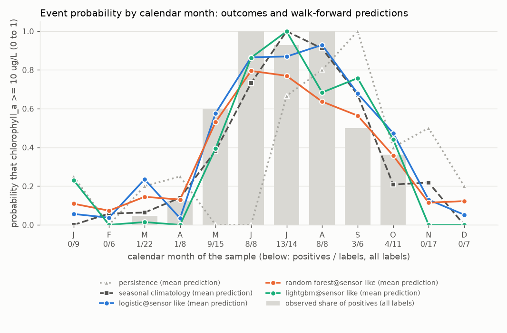
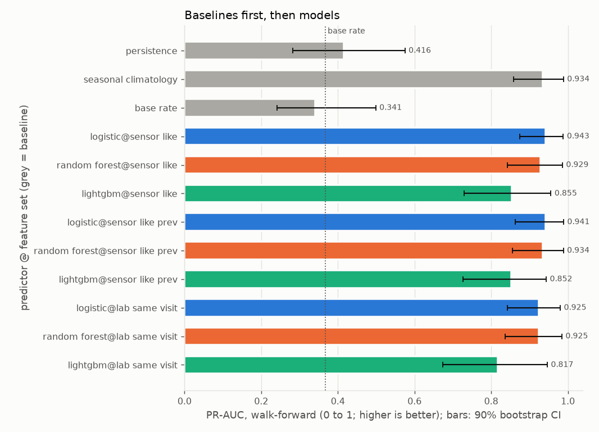
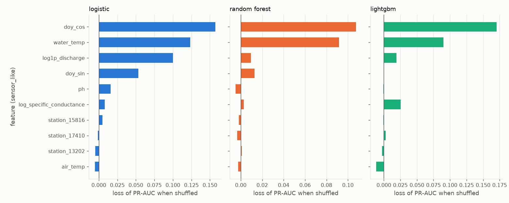
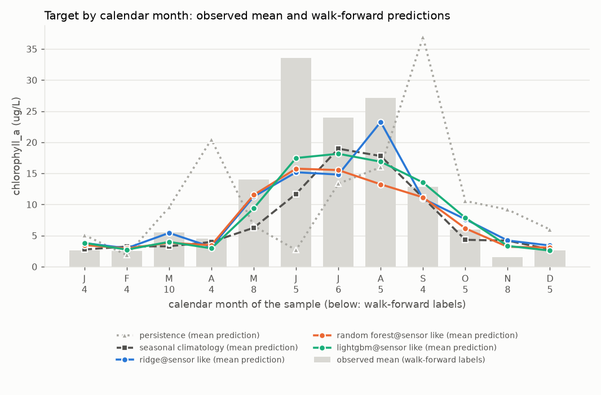
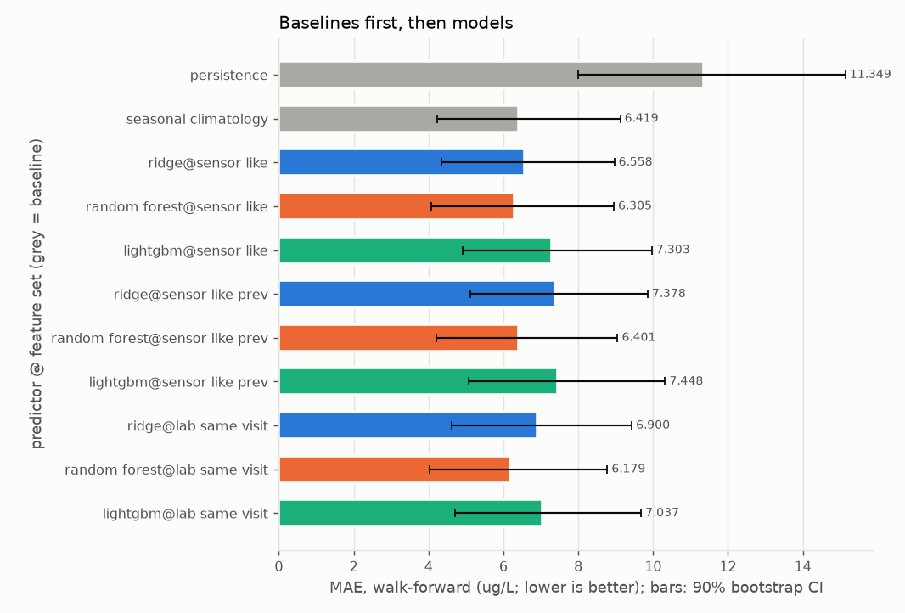
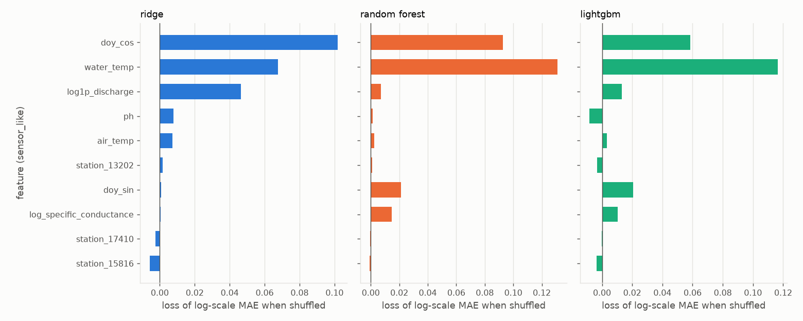

# Report: crp_chla_pooled

Real grab-sample data, `source=CRP` only, labels from 2014-01-01; `quality='good'` rows only. Input `data/clean/crp_long.csv` (SHA-256 `eef7c00928bcd8ce...`). Stations: 13202, 15816, 17410.

Chlorophyll-a at CRP stations 13202, 15816 and 17410, pooled. Primary target: the event chlorophyll_a >= 10 ug/L on the sample date. Secondary: the concentration (log1p regression). Features are same-visit readings (a nowcast), not a multi-day forecast.

## First lines

### Primary target: event chlorophyll_a >= 10 ug/L

- Labels used: 131 on 99 distinct dates, 47 positives (13202: 35, 15816: 60, 17410: 36).
- Censored labels: 39 left-censored at or below the threshold counted as negatives; 0 left-censored above the threshold dropped (unknown); 0 right-censored dropped.
- Walk-forward: 7 folds (test years 2018 to 2024), n_train from 38 to 98 (training positives 15 to 36), n_test = 68 on 53 dates, 25 positives.
- Final hold-out (evaluated once, last 20 distinct dates, from 2024-09-24): n_train = 106, n_holdout = 25, 7 positives; training positives 40.
- **Persistence** means: the last sample at this station, carried forward (the previous label at the same station on a strictly earlier date; with no earlier label, the training base rate).
- **Seasonal climatology** means: the mean of the training targets within plus or minus 1 calendar month(s) of the test month, pooled over the task's stations (with fewer than 3 training labels in that window, the mean of all training targets).
- **Base rate** means: the share of positives among the training labels.
- Verdicts, walk-forward, headline feature set `sensor_like` (deployable):
  - seasonal climatology beats persistence (PR-AUC difference +0.518, 90% CI [+0.375, +0.643]); Brier difference -0.297 [-0.400, -0.196] (lower is better).
  - logistic on sensor_like (deployable) beats persistence (PR-AUC difference +0.526, 90% CI [+0.381, +0.648]); Brier difference -0.300 [-0.415, -0.185] (lower is better).
  - logistic on sensor_like (deployable) shows no demonstrable difference from seasonal climatology (PR-AUC difference +0.008, 90% CI [-0.052, +0.083]); Brier difference -0.003 [-0.043, +0.041] (lower is better).
  - random_forest on sensor_like (deployable) beats persistence (PR-AUC difference +0.512, 90% CI [+0.356, +0.632]); Brier difference -0.291 [-0.403, -0.179] (lower is better).
  - random_forest on sensor_like (deployable) shows no demonstrable difference from seasonal climatology (PR-AUC difference -0.005, 90% CI [-0.073, +0.057]); Brier difference +0.006 [-0.022, +0.035] (lower is better).
  - lightgbm on sensor_like (deployable) beats persistence (PR-AUC difference +0.438, 90% CI [+0.294, +0.575]); Brier difference -0.220 [-0.337, -0.106] (lower is better).
  - lightgbm on sensor_like (deployable) is worse than seasonal climatology (PR-AUC difference -0.080, 90% CI [-0.171, -0.003]); Brier difference +0.077 [+0.017, +0.139] (lower is better).
- Verdicts, final hold-out, headline feature set `sensor_like`:
  - seasonal climatology beats persistence (PR-AUC difference +0.318, 90% CI [+0.137, +0.638]); Brier difference -0.246 [-0.379, -0.118] (lower is better).
  - logistic on sensor_like (deployable) beats persistence (PR-AUC difference +0.371, 90% CI [+0.158, +0.626]); Brier difference -0.099 [-0.276, +0.068] (lower is better).
  - logistic on sensor_like (deployable) shows no demonstrable difference from seasonal climatology (PR-AUC difference +0.052, 90% CI [-0.112, +0.168]); Brier difference +0.147 [+0.044, +0.260] (lower is better).
  - random_forest on sensor_like (deployable) beats persistence (PR-AUC difference +0.560, 90% CI [+0.375, +0.733]); Brier difference -0.260 [-0.401, -0.122] (lower is better).
  - random_forest on sensor_like (deployable) shows no demonstrable difference from seasonal climatology (PR-AUC difference +0.242, 90% CI [+0.000, +0.387]); Brier difference -0.014 [-0.066, +0.033] (lower is better).
  - lightgbm on sensor_like (deployable) beats persistence (PR-AUC difference +0.473, 90% CI [+0.306, +0.681]); Brier difference -0.210 [-0.371, -0.056] (lower is better).
  - lightgbm on sensor_like (deployable) shows no demonstrable difference from seasonal climatology (PR-AUC difference +0.154, 90% CI [-0.040, +0.334]); Brier difference +0.036 [-0.023, +0.117] (lower is better).

### Secondary target: regression of chlorophyll_a (ug/L), fitted on the log1p scale

- Labels used: 131 on 99 distinct dates, 39 left-censored (13202: 35, 15816: 60, 17410: 36).
- Censored labels: left-censored values enter at detection limit x 0.5; 0 right-censored dropped.
- Walk-forward: 7 folds (test years 2018 to 2024), n_train from 38 to 98, n_test = 68 on 53 dates.
- Final hold-out (evaluated once, last 20 distinct dates, from 2024-09-24): n_train = 106, n_holdout = 25.
- **Persistence** means: the last sample at this station, carried forward (the previous label at the same station on a strictly earlier date; with no earlier label, the training median).
- **Seasonal climatology** means: the mean of the training targets within plus or minus 1 calendar month(s) of the test month, pooled over the task's stations (with fewer than 3 training labels in that window, the mean of all training targets).
- Verdicts, walk-forward, headline feature set `sensor_like` (deployable):
  - seasonal climatology beats persistence (MAE difference -4.929, 90% CI [-7.768, -2.458]).
  - ridge on sensor_like (deployable) beats persistence (MAE difference -4.790, 90% CI [-7.816, -2.221]).
  - ridge on sensor_like (deployable) shows no demonstrable difference from seasonal climatology (MAE difference +0.139, 90% CI [-0.944, +1.346]).
  - random_forest on sensor_like (deployable) beats persistence (MAE difference -5.044, 90% CI [-7.768, -2.611]).
  - random_forest on sensor_like (deployable) shows no demonstrable difference from seasonal climatology (MAE difference -0.115, 90% CI [-0.826, +0.651]).
  - lightgbm on sensor_like (deployable) beats persistence (MAE difference -4.045, 90% CI [-6.804, -1.428]).
  - lightgbm on sensor_like (deployable) shows no demonstrable difference from seasonal climatology (MAE difference +0.884, 90% CI [-0.066, +1.939]).
- Verdicts, final hold-out, headline feature set `sensor_like`:
  - seasonal climatology beats persistence (MAE difference -2.095, 90% CI [-4.034, -0.064]).
  - ridge on sensor_like (deployable) shows no demonstrable difference from persistence (MAE difference -1.397, 90% CI [-3.925, +1.602]).
  - ridge on sensor_like (deployable) shows no demonstrable difference from seasonal climatology (MAE difference +0.699, 90% CI [-1.394, +3.272]).
  - random_forest on sensor_like (deployable) beats persistence (MAE difference -2.968, 90% CI [-4.625, -1.175]).
  - random_forest on sensor_like (deployable) shows no demonstrable difference from seasonal climatology (MAE difference -0.873, 90% CI [-1.997, +0.260]).
  - lightgbm on sensor_like (deployable) shows no demonstrable difference from persistence (MAE difference -1.783, 90% CI [-3.824, +0.773]).
  - lightgbm on sensor_like (deployable) shows no demonstrable difference from seasonal climatology (MAE difference +0.312, 90% CI [-1.409, +2.590]).

## Warnings

- WARNING [event, regression] n_train below 50 in: 2018 (38), 2019 (44).
- WARNING [event] the hold-out has 7 positives, fewer than 10: hold-out event metrics are very uncertain.
- WARNING [event] walk-forward folds with zero positives: 2020.
- WARNING [event] holdout slices with zero positives (undefined: no positives): oct_mar.
- WARNING [event, regression] feature set sensor_like: only 43% of the 21 labels in 2025 and 2026 have every feature (below 50%); the rest are imputed.
- WARNING [event, regression] feature set sensor_like_prev: only 43% of the 21 labels in 2025 and 2026 have every feature (below 50%); the rest are imputed.
- WARNING [event, regression] feature set lab_same_visit: only 43% of the 21 labels in 2025 and 2026 have every feature (below 50%); the rest are imputed.
- WARNING [event, regression] 15 of 27 station-years in the test windows have fewer than 4 labels (minimum 1).
- WARNING [event] LEAKAGE SUSPECTED: shuffled-label skill for logistic@sensor_like_prev.

## Metrics

### Event target: event chlorophyll_a >= 10 ug/L

Folds:

| fold | n_train | n_test | last train date | first test date | last test date | train positives | test positives |
|---|---|---|---|---|---|---|---|
| 2018 | 38 | 7 | 2017-10-18 | 2018-01-25 | 2018-12-18 | 15 | 1 |
| 2019 | 44 | 16 | 2018-11-20 | 2019-01-29 | 2019-12-18 | 16 | 4 |
| 2020 | 60 | 8 | 2019-11-05 | 2020-01-28 | 2020-12-14 | 20 | 0 (undefined: no positives) |
| 2021 | 69 | 14 | 2020-12-14 | 2021-01-19 | 2021-12-14 | 20 | 8 |
| 2022 | 83 | 7 | 2021-12-14 | 2022-03-16 | 2022-08-30 | 28 | 4 |
| 2023 | 90 | 9 | 2022-08-30 | 2023-04-19 | 2023-12-19 | 32 | 4 |
| 2024 | 98 | 7 | 2023-11-29 | 2024-02-27 | 2024-08-28 | 36 | 4 |
| holdout | 106 | 25 | 2024-08-28 | 2024-09-24 | 2026-04-28 | 40 | 7 |

#### Walk-forward

n = 68 on 53 dates, 25 positives, base rate 0.368. Baselines first, then models. Brackets: 90% bootstrap CI over distinct dates.

| predictor | deployable | PR-AUC | ROC-AUC | Brier | Brier skill vs base rate |
|---|---|---|---|---|---|
| persistence | baseline | 0.416 [0.283, 0.575] | 0.580 [0.466, 0.699] | 0.382 [0.269, 0.494] | -0.592 [-1.094, -0.140] |
| seasonal_climatology | baseline | 0.934 [0.859, 0.989] | 0.960 [0.918, 0.994] | 0.085 [0.050, 0.121] | 0.644 [0.509, 0.784] |
| base_rate | baseline | 0.341 [0.241, 0.499] | 0.426 [0.288, 0.571] | 0.240 [0.203, 0.279] | 0.000 [0.000, 0.000] |
| logistic@sensor_like | yes | 0.943 [0.874, 0.988] | 0.964 [0.924, 0.993] | 0.083 [0.047, 0.120] | 0.656 [0.478, 0.805] |
| random_forest@sensor_like | yes | 0.929 [0.842, 0.986] | 0.962 [0.924, 0.991] | 0.091 [0.064, 0.122] | 0.619 [0.502, 0.722] |
| lightgbm@sensor_like | yes | 0.855 [0.730, 0.956] | 0.915 [0.847, 0.973] | 0.162 [0.089, 0.240] | 0.326 [0.030, 0.619] |
| logistic@sensor_like_prev | yes | 0.941 [0.863, 0.989] | 0.964 [0.920, 0.993] | 0.080 [0.045, 0.118] | 0.667 [0.486, 0.816] |
| random_forest@sensor_like_prev | yes | 0.934 [0.856, 0.988] | 0.966 [0.930, 0.993] | 0.091 [0.064, 0.119] | 0.622 [0.507, 0.719] |
| lightgbm@sensor_like_prev | yes | 0.852 [0.727, 0.944] | 0.889 [0.803, 0.959] | 0.162 [0.090, 0.242] | 0.325 [0.029, 0.609] |
| logistic@lab_same_visit | NO (diagnostic) | 0.925 [0.843, 0.980] | 0.953 [0.905, 0.989] | 0.091 [0.053, 0.132] | 0.621 [0.418, 0.784] |
| random_forest@lab_same_visit | NO (diagnostic) | 0.925 [0.836, 0.985] | 0.960 [0.923, 0.990] | 0.092 [0.063, 0.122] | 0.617 [0.492, 0.724] |
| lightgbm@lab_same_visit | NO (diagnostic) | 0.817 [0.673, 0.946] | 0.886 [0.796, 0.963] | 0.157 [0.085, 0.238] | 0.344 [0.047, 0.634] |

At p = 0.5:

| predictor | precision | recall | F1 | TP | FP | FN | TN |
|---|---|---|---|---|---|---|---|
| persistence | 0.478 [0.280, 0.700] | 0.440 [0.241, 0.640] | 0.458 [0.263, 0.619] | 11 | 12 | 14 | 31 |
| seasonal_climatology | 0.900 [0.769, 1.000] | 0.720 [0.520, 0.905] | 0.800 [0.647, 0.918] | 18 | 2 | 7 | 41 |
| base_rate | undefined | 0.000 [0.000, 0.000] | 0.000 [0.000, 0.000] | 0 | 0 | 25 | 43 |
| logistic@sensor_like | 0.778 [0.619, 0.920] | 0.840 [0.682, 1.000] | 0.808 [0.676, 0.913] | 21 | 6 | 4 | 37 |
| random_forest@sensor_like | 0.857 [0.714, 0.964] | 0.720 [0.520, 0.905] | 0.783 [0.627, 0.895] | 18 | 3 | 7 | 40 |
| lightgbm@sensor_like | 0.773 [0.600, 0.913] | 0.680 [0.467, 0.862] | 0.723 [0.550, 0.847] | 17 | 5 | 8 | 38 |
| logistic@sensor_like_prev | 0.786 [0.629, 0.926] | 0.880 [0.773, 1.000] | 0.830 [0.719, 0.918] | 22 | 6 | 3 | 37 |
| random_forest@sensor_like_prev | 0.870 [0.737, 0.966] | 0.800 [0.619, 0.948] | 0.833 [0.696, 0.926] | 20 | 3 | 5 | 40 |
| lightgbm@sensor_like_prev | 0.810 [0.643, 0.944] | 0.680 [0.500, 0.846] | 0.739 [0.585, 0.857] | 17 | 4 | 8 | 39 |
| logistic@lab_same_visit | 0.759 [0.593, 0.906] | 0.880 [0.773, 1.000] | 0.815 [0.700, 0.909] | 22 | 7 | 3 | 36 |
| random_forest@lab_same_visit | 0.870 [0.737, 0.966] | 0.800 [0.619, 0.948] | 0.833 [0.696, 0.926] | 20 | 3 | 5 | 40 |
| lightgbm@lab_same_visit | 0.810 [0.647, 0.950] | 0.680 [0.467, 0.862] | 0.739 [0.571, 0.857] | 17 | 4 | 8 | 39 |

At p* = 0.10 (C_FP=1, C_FN=9, PLACEHOLDER):

| predictor | precision | recall | F1 | TP | FP | FN | TN |
|---|---|---|---|---|---|---|---|
| persistence | 0.478 [0.280, 0.700] | 0.440 [0.241, 0.640] | 0.458 [0.263, 0.619] | 11 | 12 | 14 | 31 |
| seasonal_climatology | 0.543 [0.392, 0.692] | 1.000 [1.000, 1.000] | 0.704 [0.563, 0.818] | 25 | 21 | 0 | 22 |
| base_rate | 0.368 [0.253, 0.485] | 1.000 [1.000, 1.000] | 0.538 [0.404, 0.653] | 25 | 43 | 0 | 0 |
| logistic@sensor_like | 0.595 [0.439, 0.750] | 1.000 [1.000, 1.000] | 0.746 [0.610, 0.857] | 25 | 17 | 0 | 26 |
| random_forest@sensor_like | 0.500 [0.364, 0.631] | 1.000 [1.000, 1.000] | 0.667 [0.533, 0.774] | 25 | 25 | 0 | 18 |
| lightgbm@sensor_like | 0.769 [0.615, 0.905] | 0.800 [0.609, 0.966] | 0.784 [0.632, 0.893] | 20 | 6 | 5 | 37 |
| logistic@sensor_like_prev | 0.568 [0.412, 0.718] | 1.000 [1.000, 1.000] | 0.725 [0.583, 0.836] | 25 | 19 | 0 | 24 |
| random_forest@sensor_like_prev | 0.446 [0.320, 0.574] | 1.000 [1.000, 1.000] | 0.617 [0.485, 0.730] | 25 | 31 | 0 | 12 |
| lightgbm@sensor_like_prev | 0.783 [0.609, 0.920] | 0.720 [0.545, 0.885] | 0.750 [0.600, 0.864] | 18 | 5 | 7 | 38 |
| logistic@lab_same_visit | 0.568 [0.413, 0.718] | 1.000 [1.000, 1.000] | 0.725 [0.585, 0.836] | 25 | 19 | 0 | 24 |
| random_forest@lab_same_visit | 0.446 [0.317, 0.576] | 1.000 [1.000, 1.000] | 0.617 [0.481, 0.731] | 25 | 31 | 0 | 12 |
| lightgbm@lab_same_visit | 0.731 [0.560, 0.870] | 0.760 [0.571, 0.939] | 0.745 [0.588, 0.863] | 19 | 7 | 6 | 36 |

Paired differences (higher PR-AUC and lower Brier are better):

| model | baseline | PR-AUC difference (model - baseline) | Brier difference | verdict (by PR-AUC) |
|---|---|---|---|---|
| persistence | seasonal_climatology | -0.518 [-0.643, -0.375] | +0.297 [+0.196, +0.400] | is worse than |
| persistence | base_rate | +0.075 [-0.058, +0.193] | +0.142 [+0.034, +0.255] | no demonstrable difference |
| seasonal_climatology | persistence | +0.518 [+0.375, +0.643] | -0.297 [-0.400, -0.196] | beats |
| seasonal_climatology | base_rate | +0.593 [+0.441, +0.693] | -0.155 [-0.197, -0.116] | beats |
| base_rate | persistence | -0.075 [-0.193, +0.058] | -0.142 [-0.255, -0.034] | no demonstrable difference |
| base_rate | seasonal_climatology | -0.593 [-0.693, -0.441] | +0.155 [+0.116, +0.197] | is worse than |
| logistic@sensor_like | persistence | +0.526 [+0.381, +0.648] | -0.300 [-0.415, -0.185] | beats |
| logistic@sensor_like | seasonal_climatology | +0.008 [-0.052, +0.083] | -0.003 [-0.043, +0.041] | no demonstrable difference |
| logistic@sensor_like | base_rate | +0.602 [+0.448, +0.699] | -0.158 [-0.208, -0.104] | beats |
| random_forest@sensor_like | persistence | +0.512 [+0.356, +0.632] | -0.291 [-0.403, -0.179] | beats |
| random_forest@sensor_like | seasonal_climatology | -0.005 [-0.073, +0.057] | +0.006 [-0.022, +0.035] | no demonstrable difference |
| random_forest@sensor_like | base_rate | +0.588 [+0.440, +0.677] | -0.149 [-0.186, -0.110] | beats |
| lightgbm@sensor_like | persistence | +0.438 [+0.294, +0.575] | -0.220 [-0.337, -0.106] | beats |
| lightgbm@sensor_like | seasonal_climatology | -0.080 [-0.171, -0.003] | +0.077 [+0.017, +0.139] | is worse than |
| lightgbm@sensor_like | base_rate | +0.514 [+0.366, +0.616] | -0.078 [-0.151, -0.007] | beats |
| logistic@sensor_like_prev | persistence | +0.525 [+0.380, +0.648] | -0.302 [-0.418, -0.184] | beats |
| logistic@sensor_like_prev | seasonal_climatology | +0.007 [-0.062, +0.080] | -0.005 [-0.046, +0.040] | no demonstrable difference |
| logistic@sensor_like_prev | base_rate | +0.601 [+0.444, +0.694] | -0.160 [-0.211, -0.105] | beats |
| random_forest@sensor_like_prev | persistence | +0.518 [+0.361, +0.639] | -0.292 [-0.404, -0.179] | beats |
| random_forest@sensor_like_prev | seasonal_climatology | +0.000 [-0.065, +0.057] | +0.005 [-0.021, +0.033] | no demonstrable difference |
| random_forest@sensor_like_prev | base_rate | +0.593 [+0.448, +0.686] | -0.149 [-0.186, -0.113] | beats |
| lightgbm@sensor_like_prev | persistence | +0.436 [+0.291, +0.566] | -0.220 [-0.338, -0.105] | beats |
| lightgbm@sensor_like_prev | seasonal_climatology | -0.082 [-0.176, -0.016] | +0.077 [+0.023, +0.139] | is worse than |
| lightgbm@sensor_like_prev | base_rate | +0.511 [+0.368, +0.611] | -0.078 [-0.148, -0.007] | beats |
| logistic@lab_same_visit | persistence | +0.509 [+0.365, +0.631] | -0.291 [-0.408, -0.175] | beats |
| logistic@lab_same_visit | seasonal_climatology | -0.009 [-0.081, +0.066] | +0.006 [-0.037, +0.055] | no demonstrable difference |
| logistic@lab_same_visit | base_rate | +0.584 [+0.436, +0.678] | -0.149 [-0.203, -0.092] | beats |
| random_forest@lab_same_visit | persistence | +0.509 [+0.353, +0.629] | -0.290 [-0.401, -0.178] | beats |
| random_forest@lab_same_visit | seasonal_climatology | -0.009 [-0.076, +0.053] | +0.007 [-0.021, +0.035] | no demonstrable difference |
| random_forest@lab_same_visit | base_rate | +0.584 [+0.440, +0.672] | -0.148 [-0.186, -0.108] | beats |
| lightgbm@lab_same_visit | persistence | +0.401 [+0.256, +0.550] | -0.225 [-0.342, -0.111] | beats |
| lightgbm@lab_same_visit | seasonal_climatology | -0.117 [-0.220, -0.017] | +0.072 [+0.014, +0.135] | is worse than |
| lightgbm@lab_same_visit | base_rate | +0.476 [+0.329, +0.599] | -0.083 [-0.154, -0.010] | beats |

#### Final hold-out (evaluated once)

n = 25 on 20 dates, 7 positives, base rate 0.280. Baselines first, then models. Brackets: 90% bootstrap CI over distinct dates.

| predictor | deployable | PR-AUC | ROC-AUC | Brier | Brier skill vs base rate |
|---|---|---|---|---|---|
| persistence | baseline | 0.349 [0.174, 0.575] | 0.619 [0.437, 0.854] | 0.360 [0.208, 0.517] | -0.706 [-1.417, -0.014] |
| seasonal_climatology | baseline | 0.667 [0.506, 0.981] | 0.901 [0.805, 0.991] | 0.114 [0.046, 0.186] | 0.461 [0.160, 0.765] |
| base_rate | baseline | 0.280 [0.124, 0.440] | 0.500 [0.500, 0.500] | 0.211 [0.172, 0.250] | 0.000 [0.000, 0.000] |
| logistic@sensor_like | yes | 0.719 [0.457, 0.986] | 0.897 [0.765, 0.991] | 0.261 [0.161, 0.361] | -0.234 [-0.972, 0.317] |
| random_forest@sensor_like | yes | 0.909 [0.793, 1.000] | 0.960 [0.907, 1.000] | 0.100 [0.058, 0.147] | 0.528 [0.270, 0.720] |
| lightgbm@sensor_like | yes | 0.821 [0.653, 1.000] | 0.921 [0.829, 1.000] | 0.150 [0.043, 0.268] | 0.289 [-0.285, 0.779] |
| logistic@sensor_like_prev | yes | 0.728 [0.476, 1.000] | 0.905 [0.778, 1.000] | 0.189 [0.101, 0.277] | 0.106 [-0.456, 0.555] |
| random_forest@sensor_like_prev | yes | 0.892 [0.757, 1.000] | 0.952 [0.895, 1.000] | 0.097 [0.057, 0.141] | 0.539 [0.309, 0.724] |
| lightgbm@sensor_like_prev | yes | 0.785 [0.582, 1.000] | 0.889 [0.767, 1.000] | 0.161 [0.046, 0.290] | 0.240 [-0.392, 0.770] |
| logistic@lab_same_visit | NO (diagnostic) | 0.719 [0.457, 0.986] | 0.897 [0.765, 0.991] | 0.272 [0.172, 0.375] | -0.290 [-1.070, 0.278] |
| random_forest@lab_same_visit | NO (diagnostic) | 0.909 [0.793, 1.000] | 0.960 [0.907, 1.000] | 0.111 [0.067, 0.162] | 0.474 [0.189, 0.688] |
| lightgbm@lab_same_visit | NO (diagnostic) | 0.821 [0.653, 1.000] | 0.921 [0.829, 1.000] | 0.154 [0.053, 0.268] | 0.272 [-0.291, 0.734] |

At p = 0.5:

| predictor | precision | recall | F1 | TP | FP | FN | TN |
|---|---|---|---|---|---|---|---|
| persistence | 0.400 [0.143, 0.636] | 0.571 [0.250, 1.000] | 0.471 [0.182, 0.690] | 4 | 6 | 3 | 12 |
| seasonal_climatology | 0.750 [0.500, 1.000] | 0.857 [0.571, 1.000] | 0.800 [0.569, 0.947] | 6 | 2 | 1 | 16 |
| base_rate | undefined | 0.000 [0.000, 0.000] | 0.000 [0.000, 0.000] | 0 | 0 | 7 | 18 |
| logistic@sensor_like | 0.412 [0.188, 0.625] | 1.000 [1.000, 1.000] | 0.583 [0.316, 0.769] | 7 | 10 | 0 | 8 |
| random_forest@sensor_like | 0.778 [0.500, 1.000] | 1.000 [1.000, 1.000] | 0.875 [0.667, 1.000] | 7 | 2 | 0 | 16 |
| lightgbm@sensor_like | 0.667 [0.375, 0.909] | 0.857 [0.571, 1.000] | 0.750 [0.500, 0.909] | 6 | 3 | 1 | 15 |
| logistic@sensor_like_prev | 0.538 [0.286, 0.750] | 1.000 [1.000, 1.000] | 0.700 [0.444, 0.857] | 7 | 6 | 0 | 12 |
| random_forest@sensor_like_prev | 0.750 [0.500, 1.000] | 0.857 [0.571, 1.000] | 0.800 [0.569, 0.947] | 6 | 2 | 1 | 16 |
| lightgbm@sensor_like_prev | 0.667 [0.375, 0.909] | 0.857 [0.571, 1.000] | 0.750 [0.500, 0.909] | 6 | 3 | 1 | 15 |
| logistic@lab_same_visit | 0.389 [0.176, 0.600] | 1.000 [1.000, 1.000] | 0.560 [0.300, 0.750] | 7 | 11 | 0 | 7 |
| random_forest@lab_same_visit | 0.700 [0.429, 0.917] | 1.000 [1.000, 1.000] | 0.824 [0.600, 0.957] | 7 | 3 | 0 | 15 |
| lightgbm@lab_same_visit | 0.625 [0.333, 0.876] | 0.714 [0.455, 1.000] | 0.667 [0.444, 0.833] | 5 | 3 | 2 | 15 |

At p* = 0.10 (C_FP=1, C_FN=9, PLACEHOLDER):

| predictor | precision | recall | F1 | TP | FP | FN | TN |
|---|---|---|---|---|---|---|---|
| persistence | 0.400 [0.143, 0.636] | 0.571 [0.250, 1.000] | 0.471 [0.182, 0.690] | 4 | 6 | 3 | 12 |
| seasonal_climatology | 0.467 [0.231, 0.693] | 1.000 [1.000, 1.000] | 0.636 [0.375, 0.818] | 7 | 8 | 0 | 10 |
| base_rate | 0.280 [0.120, 0.440] | 1.000 [1.000, 1.000] | 0.438 [0.214, 0.611] | 7 | 18 | 0 | 0 |
| logistic@sensor_like | 0.350 [0.158, 0.533] | 1.000 [1.000, 1.000] | 0.519 [0.273, 0.696] | 7 | 13 | 0 | 5 |
| random_forest@sensor_like | 0.304 [0.136, 0.478] | 1.000 [1.000, 1.000] | 0.467 [0.240, 0.647] | 7 | 16 | 0 | 2 |
| lightgbm@sensor_like | 0.667 [0.375, 0.909] | 0.857 [0.571, 1.000] | 0.750 [0.500, 0.909] | 6 | 3 | 1 | 15 |
| logistic@sensor_like_prev | 0.333 [0.150, 0.524] | 1.000 [1.000, 1.000] | 0.500 [0.260, 0.688] | 7 | 14 | 0 | 4 |
| random_forest@sensor_like_prev | 0.333 [0.150, 0.522] | 1.000 [1.000, 1.000] | 0.500 [0.261, 0.686] | 7 | 14 | 0 | 4 |
| lightgbm@sensor_like_prev | 0.667 [0.375, 0.909] | 0.857 [0.571, 1.000] | 0.750 [0.500, 0.909] | 6 | 3 | 1 | 15 |
| logistic@lab_same_visit | 0.350 [0.158, 0.533] | 1.000 [1.000, 1.000] | 0.519 [0.273, 0.696] | 7 | 13 | 0 | 5 |
| random_forest@lab_same_visit | 0.304 [0.136, 0.462] | 1.000 [1.000, 1.000] | 0.467 [0.240, 0.632] | 7 | 16 | 0 | 2 |
| lightgbm@lab_same_visit | 0.700 [0.429, 0.917] | 1.000 [1.000, 1.000] | 0.824 [0.600, 0.957] | 7 | 3 | 0 | 15 |

Paired differences (higher PR-AUC and lower Brier are better):

| model | baseline | PR-AUC difference (model - baseline) | Brier difference | verdict (by PR-AUC) |
|---|---|---|---|---|
| persistence | seasonal_climatology | -0.318 [-0.638, -0.137] | +0.246 [+0.118, +0.379] | is worse than |
| persistence | base_rate | +0.069 [-0.016, +0.254] | +0.149 [+0.003, +0.292] | no demonstrable difference |
| seasonal_climatology | persistence | +0.318 [+0.137, +0.638] | -0.246 [-0.379, -0.118] | beats |
| seasonal_climatology | base_rate | +0.387 [+0.239, +0.718] | -0.097 [-0.157, -0.034] | beats |
| base_rate | persistence | -0.069 [-0.254, +0.016] | -0.149 [-0.292, -0.003] | no demonstrable difference |
| base_rate | seasonal_climatology | -0.387 [-0.718, -0.239] | +0.097 [+0.034, +0.157] | is worse than |
| logistic@sensor_like | persistence | +0.371 [+0.158, +0.626] | -0.099 [-0.276, +0.068] | beats |
| logistic@sensor_like | seasonal_climatology | +0.052 [-0.112, +0.168] | +0.147 [+0.044, +0.260] | no demonstrable difference |
| logistic@sensor_like | base_rate | +0.439 [+0.228, +0.725] | +0.049 [-0.076, +0.175] | beats |
| random_forest@sensor_like | persistence | +0.560 [+0.375, +0.733] | -0.260 [-0.401, -0.122] | beats |
| random_forest@sensor_like | seasonal_climatology | +0.242 [+0.000, +0.387] | -0.014 [-0.066, +0.033] | no demonstrable difference |
| random_forest@sensor_like | base_rate | +0.629 [+0.475, +0.833] | -0.111 [-0.165, -0.053] | beats |
| lightgbm@sensor_like | persistence | +0.473 [+0.306, +0.681] | -0.210 [-0.371, -0.056] | beats |
| lightgbm@sensor_like | seasonal_climatology | +0.154 [-0.040, +0.334] | +0.036 [-0.023, +0.117] | no demonstrable difference |
| lightgbm@sensor_like | base_rate | +0.541 [+0.368, +0.792] | -0.061 [-0.161, +0.059] | beats |
| logistic@sensor_like_prev | persistence | +0.380 [+0.166, +0.646] | -0.171 [-0.330, -0.016] | beats |
| logistic@sensor_like_prev | seasonal_climatology | +0.062 [-0.106, +0.176] | +0.075 [-0.008, +0.162] | no demonstrable difference |
| logistic@sensor_like_prev | base_rate | +0.448 [+0.235, +0.742] | -0.022 [-0.129, +0.082] | beats |
| random_forest@sensor_like_prev | persistence | +0.543 [+0.349, +0.733] | -0.263 [-0.399, -0.130] | beats |
| random_forest@sensor_like_prev | seasonal_climatology | +0.225 [+0.000, +0.357] | -0.016 [-0.063, +0.023] | no demonstrable difference |
| random_forest@sensor_like_prev | base_rate | +0.612 [+0.462, +0.826] | -0.114 [-0.160, -0.061] | beats |
| lightgbm@sensor_like_prev | persistence | +0.437 [+0.278, +0.627] | -0.199 [-0.367, -0.042] | beats |
| lightgbm@sensor_like_prev | seasonal_climatology | +0.119 [-0.117, +0.333] | +0.047 [-0.020, +0.136] | no demonstrable difference |
| lightgbm@sensor_like_prev | base_rate | +0.505 [+0.321, +0.783] | -0.051 [-0.158, +0.080] | beats |
| logistic@lab_same_visit | persistence | +0.371 [+0.158, +0.626] | -0.088 [-0.270, +0.084] | beats |
| logistic@lab_same_visit | seasonal_climatology | +0.052 [-0.112, +0.168] | +0.159 [+0.051, +0.274] | no demonstrable difference |
| logistic@lab_same_visit | base_rate | +0.439 [+0.228, +0.725] | +0.061 [-0.067, +0.189] | beats |
| random_forest@lab_same_visit | persistence | +0.560 [+0.375, +0.733] | -0.249 [-0.394, -0.107] | beats |
| random_forest@lab_same_visit | seasonal_climatology | +0.242 [+0.000, +0.387] | -0.003 [-0.057, +0.048] | no demonstrable difference |
| random_forest@lab_same_visit | base_rate | +0.629 [+0.475, +0.833] | -0.100 [-0.157, -0.038] | beats |
| lightgbm@lab_same_visit | persistence | +0.473 [+0.306, +0.681] | -0.206 [-0.364, -0.047] | beats |
| lightgbm@lab_same_visit | seasonal_climatology | +0.154 [-0.040, +0.334] | +0.040 [-0.022, +0.123] | no demonstrable difference |
| lightgbm@lab_same_visit | base_rate | +0.541 [+0.363, +0.792] | -0.057 [-0.153, +0.060] | beats |

### Regression target: regression of chlorophyll_a (ug/L), fitted on the log1p scale

Folds:

| fold | n_train | n_test | last train date | first test date | last test date |
|---|---|---|---|---|---|
| 2018 | 38 | 7 | 2017-10-18 | 2018-01-25 | 2018-12-18 |
| 2019 | 44 | 16 | 2018-11-20 | 2019-01-29 | 2019-12-18 |
| 2020 | 60 | 8 | 2019-11-05 | 2020-01-28 | 2020-12-14 |
| 2021 | 69 | 14 | 2020-12-14 | 2021-01-19 | 2021-12-14 |
| 2022 | 83 | 7 | 2021-12-14 | 2022-03-16 | 2022-08-30 |
| 2023 | 90 | 9 | 2022-08-30 | 2023-04-19 | 2023-12-19 |
| 2024 | 98 | 7 | 2023-11-29 | 2024-02-27 | 2024-08-28 |
| holdout | 106 | 25 | 2024-08-28 | 2024-09-24 | 2026-04-28 |

#### Walk-forward

All labels: n = 68 on 53 dates (23 left-censored). MAE and RMSE in ug/L. Brackets: 90% bootstrap CI over distinct dates.

| predictor | deployable | MAE | RMSE | R2 | MAE (log scale) | skill vs persistence | skill vs climatology |
|---|---|---|---|---|---|---|---|
| persistence | baseline | 11.349 [8.003, 15.138] | 20.123 [12.805, 26.594] | -0.772 [-3.259, -0.129] | 0.870 [0.715, 1.010] | 0.000 [0.000, 0.000] | -0.768 [-1.443, -0.335] |
| seasonal_climatology | baseline | 6.419 [4.227, 9.124] | 13.284 [6.311, 19.553] | 0.228 [0.107, 0.454] | 0.583 [0.507, 0.654] | 0.434 [0.251, 0.591] | 0.000 [0.000, 0.000] |
| ridge@sensor_like | yes | 6.558 [4.346, 8.965] | 12.992 [6.844, 18.367] | 0.262 [0.070, 0.427] | 0.561 [0.470, 0.656] | 0.422 [0.228, 0.586] | -0.022 [-0.256, 0.142] |
| random_forest@sensor_like | yes | 6.305 [4.081, 8.951] | 13.444 [6.191, 19.133] | 0.209 [0.034, 0.466] | 0.552 [0.466, 0.643] | 0.444 [0.263, 0.600] | 0.018 [-0.112, 0.137] |
| lightgbm@sensor_like | yes | 7.303 [4.912, 9.966] | 14.660 [7.525, 20.596] | 0.060 [-0.172, 0.250] | 0.620 [0.524, 0.716] | 0.356 [0.160, 0.527] | -0.138 [-0.344, 0.010] |
| ridge@sensor_like_prev | yes | 7.378 [5.117, 9.854] | 13.555 [7.854, 18.551] | 0.196 [-0.351, 0.417] | 0.615 [0.509, 0.727] | 0.350 [0.115, 0.528] | -0.149 [-0.486, 0.055] |
| random_forest@sensor_like_prev | yes | 6.401 [4.202, 9.051] | 13.566 [6.269, 19.347] | 0.195 [0.025, 0.458] | 0.564 [0.483, 0.654] | 0.436 [0.254, 0.597] | 0.003 [-0.126, 0.112] |
| lightgbm@sensor_like_prev | yes | 7.448 [5.069, 10.320] | 14.820 [8.252, 20.537] | 0.039 [-0.322, 0.246] | 0.626 [0.538, 0.733] | 0.344 [0.120, 0.514] | -0.160 [-0.406, -0.003] |
| ridge@lab_same_visit | NO (diagnostic) | 6.900 [4.608, 9.430] | 13.442 [7.318, 18.604] | 0.210 [-0.092, 0.353] | 0.587 [0.495, 0.684] | 0.392 [0.190, 0.567] | -0.075 [-0.343, 0.102] |
| random_forest@lab_same_visit | NO (diagnostic) | 6.179 [4.032, 8.776] | 13.082 [6.011, 18.567] | 0.251 [0.028, 0.485] | 0.540 [0.453, 0.633] | 0.456 [0.277, 0.610] | 0.037 [-0.112, 0.164] |
| lightgbm@lab_same_visit | NO (diagnostic) | 7.037 [4.702, 9.679] | 14.094 [7.247, 19.560] | 0.131 [-0.155, 0.312] | 0.595 [0.492, 0.702] | 0.380 [0.176, 0.551] | -0.096 [-0.319, 0.056] |

Numeric-only (uncensored) labels: n = 45 on 36 dates (0 left-censored). MAE and RMSE in ug/L. Brackets: 90% bootstrap CI over distinct dates.

| predictor | deployable | MAE | RMSE | R2 | MAE (log scale) | skill vs persistence | skill vs climatology |
|---|---|---|---|---|---|---|---|
| persistence | baseline | 15.356 [10.762, 20.483] | 24.338 [16.046, 31.852] | -1.169 [-5.947, -0.351] | 1.005 [0.834, 1.175] | 0.000 [0.000, 0.000] | -0.794 [-1.552, -0.345] |
| seasonal_climatology | baseline | 8.558 [5.559, 12.419] | 16.239 [8.013, 23.656] | 0.034 [-0.124, 0.208] | 0.562 [0.458, 0.671] | 0.443 [0.257, 0.608] | 0.000 [0.000, 0.000] |
| ridge@sensor_like | yes | 8.310 [5.296, 12.100] | 15.675 [8.218, 22.141] | 0.100 [-0.329, 0.250] | 0.481 [0.393, 0.582] | 0.459 [0.260, 0.619] | 0.029 [-0.167, 0.179] |
| random_forest@sensor_like | yes | 8.445 [5.314, 12.317] | 16.436 [7.786, 23.272] | 0.011 [-0.294, 0.193] | 0.536 [0.425, 0.671] | 0.450 [0.259, 0.608] | 0.013 [-0.124, 0.135] |
| lightgbm@sensor_like | yes | 9.881 [6.690, 14.042] | 17.905 [9.660, 24.914] | -0.174 [-0.669, -0.009] | 0.639 [0.510, 0.782] | 0.357 [0.132, 0.535] | -0.155 [-0.391, 0.004] |
| ridge@sensor_like_prev | yes | 8.806 [5.812, 12.444] | 15.975 [8.936, 22.487] | 0.066 [-0.899, 0.331] | 0.485 [0.402, 0.573] | 0.427 [0.199, 0.598] | -0.029 [-0.308, 0.147] |
| random_forest@sensor_like_prev | yes | 8.531 [5.407, 12.454] | 16.585 [7.878, 23.480] | -0.007 [-0.306, 0.174] | 0.537 [0.427, 0.666] | 0.444 [0.252, 0.606] | 0.003 [-0.119, 0.122] |
| lightgbm@sensor_like_prev | yes | 10.165 [6.838, 14.266] | 18.125 [10.283, 24.760] | -0.203 [-0.878, 0.002] | 0.653 [0.519, 0.801] | 0.338 [0.100, 0.524] | -0.188 [-0.441, -0.009] |
| ridge@lab_same_visit | NO (diagnostic) | 8.798 [5.739, 12.648] | 16.216 [8.831, 22.609] | 0.037 [-0.601, 0.202] | 0.520 [0.422, 0.631] | 0.427 [0.213, 0.594] | -0.028 [-0.266, 0.137] |
| random_forest@lab_same_visit | NO (diagnostic) | 8.334 [5.373, 12.163] | 15.997 [7.610, 22.720] | 0.063 [-0.322, 0.259] | 0.537 [0.424, 0.678] | 0.457 [0.265, 0.616] | 0.026 [-0.130, 0.156] |
| lightgbm@lab_same_visit | NO (diagnostic) | 9.505 [6.454, 13.464] | 17.203 [9.259, 23.795] | -0.084 [-0.644, 0.103] | 0.611 [0.476, 0.763] | 0.381 [0.151, 0.556] | -0.111 [-0.354, 0.049] |

Paired differences (lower MAE is better):

| model | baseline | MAE difference (model - baseline) | verdict (by MAE) |
|---|---|---|---|
| persistence | seasonal_climatology | +4.929 [+2.458, +7.768] | is worse than |
| seasonal_climatology | persistence | -4.929 [-7.768, -2.458] | beats |
| ridge@sensor_like | persistence | -4.790 [-7.816, -2.221] | beats |
| ridge@sensor_like | seasonal_climatology | +0.139 [-0.944, +1.346] | no demonstrable difference |
| random_forest@sensor_like | persistence | -5.044 [-7.768, -2.611] | beats |
| random_forest@sensor_like | seasonal_climatology | -0.115 [-0.826, +0.651] | no demonstrable difference |
| lightgbm@sensor_like | persistence | -4.045 [-6.804, -1.428] | beats |
| lightgbm@sensor_like | seasonal_climatology | +0.884 [-0.066, +1.939] | no demonstrable difference |
| ridge@sensor_like_prev | persistence | -3.971 [-7.116, -1.063] | beats |
| ridge@sensor_like_prev | seasonal_climatology | +0.958 [-0.403, +2.564] | no demonstrable difference |
| random_forest@sensor_like_prev | persistence | -4.947 [-7.706, -2.567] | beats |
| random_forest@sensor_like_prev | seasonal_climatology | -0.018 [-0.666, +0.730] | no demonstrable difference |
| lightgbm@sensor_like_prev | persistence | -3.900 [-6.769, -1.190] | beats |
| lightgbm@sensor_like_prev | seasonal_climatology | +1.029 [+0.021, +2.246] | is worse than |
| ridge@lab_same_visit | persistence | -4.448 [-7.484, -1.830] | beats |
| ridge@lab_same_visit | seasonal_climatology | +0.481 [-0.651, +1.805] | no demonstrable difference |
| random_forest@lab_same_visit | persistence | -5.170 [-7.951, -2.718] | beats |
| random_forest@lab_same_visit | seasonal_climatology | -0.240 [-1.074, +0.629] | no demonstrable difference |
| lightgbm@lab_same_visit | persistence | -4.312 [-7.148, -1.696] | beats |
| lightgbm@lab_same_visit | seasonal_climatology | +0.618 [-0.354, +1.648] | no demonstrable difference |

#### Final hold-out (evaluated once)

All labels: n = 25 on 20 dates (9 left-censored). MAE and RMSE in ug/L. Brackets: 90% bootstrap CI over distinct dates.

| predictor | deployable | MAE | RMSE | R2 | MAE (log scale) | skill vs persistence | skill vs climatology |
|---|---|---|---|---|---|---|---|
| persistence | baseline | 6.260 [4.440, 8.184] | 8.115 [5.877, 10.206] | -0.680 [-1.799, -0.030] | 0.798 [0.555, 1.045] | 0.000 [0.000, 0.000] | -0.503 [-1.296, -0.015] |
| seasonal_climatology | baseline | 4.165 [2.719, 5.843] | 5.878 [3.485, 7.788] | 0.119 [-0.671, 0.579] | 0.484 [0.402, 0.582] | 0.335 [0.015, 0.565] | 0.000 [0.000, 0.000] |
| ridge@sensor_like | yes | 4.863 [2.786, 7.486] | 8.476 [3.866, 12.162] | -0.833 [-4.004, 0.600] | 0.487 [0.372, 0.611] | 0.223 [-0.290, 0.559] | -0.168 [-0.882, 0.294] |
| random_forest@sensor_like | yes | 3.292 [2.163, 4.675] | 5.086 [3.038, 6.930] | 0.340 [-0.296, 0.710] | 0.414 [0.332, 0.519] | 0.474 [0.234, 0.648] | 0.210 [-0.070, 0.404] |
| lightgbm@sensor_like | yes | 4.477 [2.494, 7.056] | 8.114 [3.969, 11.838] | -0.680 [-3.369, 0.510] | 0.446 [0.329, 0.594] | 0.285 [-0.126, 0.576] | -0.075 [-0.663, 0.314] |
| ridge@sensor_like_prev | yes | 5.651 [3.052, 9.069] | 10.589 [4.872, 15.310] | -1.860 [-6.780, 0.401] | 0.490 [0.377, 0.614] | 0.097 [-0.550, 0.510] | -0.357 [-1.269, 0.243] |
| random_forest@sensor_like_prev | yes | 3.297 [2.233, 4.634] | 5.011 [2.912, 6.844] | 0.360 [-0.203, 0.705] | 0.415 [0.342, 0.508] | 0.473 [0.254, 0.634] | 0.208 [-0.065, 0.398] |
| lightgbm@sensor_like_prev | yes | 4.666 [2.419, 7.542] | 8.866 [3.581, 13.540] | -1.005 [-4.662, 0.538] | 0.451 [0.326, 0.601] | 0.255 [-0.217, 0.578] | -0.120 [-0.780, 0.314] |
| ridge@lab_same_visit | NO (diagnostic) | 5.038 [2.946, 7.703] | 8.544 [4.065, 12.165] | -0.862 [-3.953, 0.565] | 0.507 [0.392, 0.630] | 0.195 [-0.334, 0.534] | -0.210 [-0.948, 0.264] |
| random_forest@lab_same_visit | NO (diagnostic) | 3.383 [2.276, 4.740] | 5.033 [3.114, 6.751] | 0.354 [-0.306, 0.709] | 0.407 [0.327, 0.507] | 0.460 [0.208, 0.636] | 0.188 [-0.092, 0.376] |
| lightgbm@lab_same_visit | NO (diagnostic) | 4.415 [2.359, 7.107] | 8.313 [3.958, 12.260] | -0.763 [-3.878, 0.571] | 0.472 [0.344, 0.638] | 0.295 [-0.183, 0.603] | -0.060 [-0.743, 0.365] |

Numeric-only (uncensored) labels: n = 16 on 13 dates (0 left-censored). MAE and RMSE in ug/L. Brackets: 90% bootstrap CI over distinct dates.

| predictor | deployable | MAE | RMSE | R2 | MAE (log scale) | skill vs persistence | skill vs climatology |
|---|---|---|---|---|---|---|---|
| persistence | baseline | 7.500 [5.239, 10.101] | 9.256 [6.343, 11.836] | -1.790 [-5.112, -0.637] | 0.825 [0.551, 1.129] | 0.000 [0.000, 0.000] | -0.325 [-1.055, 0.093] |
| seasonal_climatology | baseline | 5.659 [3.608, 7.677] | 7.250 [4.407, 9.430] | -0.712 [-2.811, 0.172] | 0.488 [0.355, 0.625] | 0.245 [-0.103, 0.513] | 0.000 [0.000, 0.000] |
| ridge@sensor_like | yes | 6.294 [3.157, 10.155] | 10.438 [4.782, 14.700] | -2.548 [-10.376, 0.265] | 0.394 [0.246, 0.570] | 0.161 [-0.388, 0.585] | -0.112 [-0.925, 0.426] |
| random_forest@sensor_like | yes | 4.367 [2.685, 6.397] | 6.265 [3.644, 8.477] | -0.278 [-1.938, 0.429] | 0.394 [0.264, 0.549] | 0.418 [0.188, 0.621] | 0.228 [-0.100, 0.453] |
| lightgbm@sensor_like | yes | 6.582 [3.711, 10.214] | 10.124 [4.945, 14.617] | -2.338 [-9.050, -0.015] | 0.549 [0.376, 0.764] | 0.122 [-0.309, 0.463] | -0.163 [-0.853, 0.281] |
| ridge@sensor_like_prev | yes | 7.884 [3.970, 12.812] | 13.163 [6.439, 18.361] | -4.643 [-16.629, -0.267] | 0.480 [0.324, 0.676] | -0.051 [-0.753, 0.488] | -0.393 [-1.440, 0.274] |
| random_forest@sensor_like_prev | yes | 4.400 [2.823, 6.281] | 6.177 [3.639, 8.403] | -0.243 [-1.754, 0.454] | 0.403 [0.290, 0.543] | 0.413 [0.204, 0.600] | 0.223 [-0.095, 0.443] |
| lightgbm@sensor_like_prev | yes | 6.797 [3.719, 10.825] | 11.054 [4.605, 16.525] | -2.980 [-11.695, 0.047] | 0.539 [0.357, 0.748] | 0.094 [-0.402, 0.473] | -0.201 [-0.968, 0.280] |
| ridge@lab_same_visit | NO (diagnostic) | 6.457 [3.287, 10.204] | 10.497 [5.185, 14.687] | -2.588 [-10.315, 0.198] | 0.402 [0.257, 0.574] | 0.139 [-0.429, 0.575] | -0.141 [-0.949, 0.387] |
| random_forest@lab_same_visit | NO (diagnostic) | 4.506 [2.872, 6.420] | 6.192 [3.778, 8.259] | -0.249 [-1.964, 0.435] | 0.383 [0.260, 0.526] | 0.399 [0.167, 0.606] | 0.204 [-0.116, 0.415] |
| lightgbm@lab_same_visit | NO (diagnostic) | 5.904 [2.796, 9.818] | 10.274 [4.652, 15.075] | -2.438 [-9.965, 0.214] | 0.442 [0.262, 0.671] | 0.213 [-0.279, 0.597] | -0.043 [-0.808, 0.453] |

Paired differences (lower MAE is better):

| model | baseline | MAE difference (model - baseline) | verdict (by MAE) |
|---|---|---|---|
| persistence | seasonal_climatology | +2.095 [+0.064, +4.034] | is worse than |
| seasonal_climatology | persistence | -2.095 [-4.034, -0.064] | beats |
| ridge@sensor_like | persistence | -1.397 [-3.925, +1.602] | no demonstrable difference |
| ridge@sensor_like | seasonal_climatology | +0.699 [-1.394, +3.272] | no demonstrable difference |
| random_forest@sensor_like | persistence | -2.968 [-4.625, -1.175] | beats |
| random_forest@sensor_like | seasonal_climatology | -0.873 [-1.997, +0.260] | no demonstrable difference |
| lightgbm@sensor_like | persistence | -1.783 [-3.824, +0.773] | no demonstrable difference |
| lightgbm@sensor_like | seasonal_climatology | +0.312 [-1.409, +2.590] | no demonstrable difference |
| ridge@sensor_like_prev | persistence | -0.609 [-3.521, +3.045] | no demonstrable difference |
| ridge@sensor_like_prev | seasonal_climatology | +1.486 [-1.118, +4.592] | no demonstrable difference |
| random_forest@sensor_like_prev | persistence | -2.963 [-4.569, -1.272] | beats |
| random_forest@sensor_like_prev | seasonal_climatology | -0.868 [-1.996, +0.223] | no demonstrable difference |
| lightgbm@sensor_like_prev | persistence | -1.594 [-3.814, +1.276] | no demonstrable difference |
| lightgbm@sensor_like_prev | seasonal_climatology | +0.501 [-1.343, +3.057] | no demonstrable difference |
| ridge@lab_same_visit | persistence | -1.222 [-3.812, +1.810] | no demonstrable difference |
| ridge@lab_same_visit | seasonal_climatology | +0.873 [-1.238, +3.421] | no demonstrable difference |
| random_forest@lab_same_visit | persistence | -2.877 [-4.574, -1.060] | beats |
| random_forest@lab_same_visit | seasonal_climatology | -0.782 [-1.866, +0.326] | no demonstrable difference |
| lightgbm@lab_same_visit | persistence | -1.845 [-4.138, +1.085] | no demonstrable difference |
| lightgbm@lab_same_visit | seasonal_climatology | +0.250 [-1.665, +2.806] | no demonstrable difference |

Intervals: split-conformal on absolute walk-forward residuals (transformed scale), level 90%, from 68 residuals, applied to the hold-out predictions.

| model | half-width (transformed scale) | hold-out coverage | median width (ug/L) |
|---|---|---|---|
| ridge@sensor_like | 1.176 | 92% | 18.841 |
| random_forest@sensor_like | 1.084 | 96% | 13.730 |
| lightgbm@sensor_like | 1.227 | 88% | 14.282 |
| ridge@sensor_like_prev | 1.277 | 92% | 19.266 |
| random_forest@sensor_like_prev | 1.017 | 96% | 12.403 |
| lightgbm@sensor_like_prev | 1.220 | 92% | 13.961 |
| ridge@lab_same_visit | 1.202 | 96% | 19.573 |
| random_forest@lab_same_visit | 0.997 | 96% | 12.289 |
| lightgbm@lab_same_visit | 1.179 | 88% | 15.048 |

## Slices

### Event target, walk-forward

**apr_sep**: n = 32, positives = 24

| predictor | PR-AUC | ROC-AUC | Brier | recall at p* |
|---|---|---|---|---|
| persistence | 0.758 [0.607, 0.889] | 0.521 [0.333, 0.688] | 0.531 [0.364, 0.706] | 0.417 [0.208, 0.625] |
| seasonal_climatology | 0.949 [0.872, 0.997] | 0.867 [0.723, 0.989] | 0.137 [0.075, 0.199] | 1.000 [1.000, 1.000] |
| base_rate | 0.718 [0.576, 0.879] | 0.391 [0.214, 0.606] | 0.361 [0.313, 0.400] | 1.000 [1.000, 1.000] |
| logistic@sensor_like | 0.978 [0.941, 1.000] | 0.938 [0.848, 1.000] | 0.088 [0.039, 0.144] | 1.000 [1.000, 1.000] |
| random_forest@sensor_like | 0.941 [0.864, 0.993] | 0.844 [0.684, 0.980] | 0.148 [0.099, 0.202] | 1.000 [1.000, 1.000] |
| lightgbm@sensor_like | 0.900 [0.791, 0.988] | 0.771 [0.582, 0.961] | 0.290 [0.153, 0.437] | 0.792 [0.609, 0.962] |
| logistic@sensor_like_prev | 0.978 [0.937, 1.000] | 0.938 [0.846, 1.000] | 0.080 [0.032, 0.133] | 1.000 [1.000, 1.000] |
| random_forest@sensor_like_prev | 0.943 [0.864, 0.995] | 0.849 [0.692, 0.981] | 0.141 [0.096, 0.190] | 1.000 [1.000, 1.000] |
| lightgbm@sensor_like_prev | 0.921 [0.828, 0.990] | 0.802 [0.621, 0.963] | 0.287 [0.156, 0.427] | 0.750 [0.583, 0.909] |
| logistic@lab_same_visit | 0.972 [0.926, 1.000] | 0.922 [0.821, 1.000] | 0.093 [0.043, 0.150] | 1.000 [1.000, 1.000] |
| random_forest@lab_same_visit | 0.937 [0.857, 0.992] | 0.833 [0.668, 0.973] | 0.146 [0.095, 0.201] | 1.000 [1.000, 1.000] |
| lightgbm@lab_same_visit | 0.878 [0.753, 0.988] | 0.755 [0.547, 0.950] | 0.305 [0.166, 0.451] | 0.750 [0.560, 0.926] |

**oct_mar**: n = 36, positives = 1

| predictor | PR-AUC | ROC-AUC | Brier | recall at p* |
|---|---|---|---|---|
| persistence | 0.100 [0.067, 0.353] | 0.871 [0.792, 0.949] | 0.250 [0.103, 0.405] | 1.000 [1.000, 1.000] |
| seasonal_climatology | 0.077 [0.056, 0.250] | 0.657 [0.485, 0.818] | 0.039 [0.013, 0.079] | 1.000 [1.000, 1.000] |
| base_rate | 0.028 [0.025, 0.088] | 0.071 [0.026, 0.129] | 0.133 [0.118, 0.154] | 1.000 [1.000, 1.000] |
| logistic@sensor_like | 0.200 [0.125, 0.667] | 0.886 [0.760, 0.973] | 0.078 [0.030, 0.136] | 1.000 [1.000, 1.000] |
| random_forest@sensor_like | 0.500 [0.333, 1.000] | 0.971 [0.909, 1.000] | 0.042 [0.023, 0.064] | 1.000 [1.000, 1.000] |
| lightgbm@sensor_like | 1.000 [1.000, 1.000] | 1.000 [1.000, 1.000] | 0.048 [0.003, 0.105] | 1.000 [1.000, 1.000] |
| logistic@sensor_like_prev | 0.200 [0.125, 0.667] | 0.886 [0.760, 0.973] | 0.080 [0.031, 0.141] | 1.000 [1.000, 1.000] |
| random_forest@sensor_like_prev | 0.333 [0.200, 1.000] | 0.943 [0.871, 1.000] | 0.046 [0.027, 0.069] | 1.000 [1.000, 1.000] |
| lightgbm@sensor_like_prev | 0.077 [0.056, 0.281] | 0.657 [0.500, 0.824] | 0.051 [0.003, 0.115] | 0.000 [0.000, 0.000] |
| logistic@lab_same_visit | 0.167 [0.100, 0.500] | 0.857 [0.734, 0.969] | 0.090 [0.036, 0.156] | 1.000 [1.000, 1.000] |
| random_forest@lab_same_visit | 0.333 [0.200, 1.000] | 0.943 [0.871, 1.000] | 0.044 [0.025, 0.067] | 1.000 [1.000, 1.000] |
| lightgbm@lab_same_visit | 1.000 [1.000, 1.000] | 1.000 [1.000, 1.000] | 0.026 [0.001, 0.072] | 1.000 [1.000, 1.000] |

**station 13202**: n = 16, positives = 6

| predictor | PR-AUC | ROC-AUC | Brier | recall at p* |
|---|---|---|---|---|
| persistence | 0.383 [0.188, 0.658] | 0.517 [0.294, 0.718] | 0.438 [0.250, 0.625] | 0.333 [0.000, 0.667] |
| seasonal_climatology | 0.976 [0.917, 1.000] | 0.983 [0.933, 1.000] | 0.090 [0.035, 0.150] | 1.000 [1.000, 1.000] |
| base_rate | 0.344 [0.191, 0.640] | 0.400 [0.164, 0.684] | 0.244 [0.180, 0.310] | 1.000 [1.000, 1.000] |
| logistic@sensor_like | 0.911 [0.741, 1.000] | 0.933 [0.810, 1.000] | 0.129 [0.049, 0.222] | 1.000 [1.000, 1.000] |
| random_forest@sensor_like | 0.948 [0.833, 1.000] | 0.967 [0.900, 1.000] | 0.102 [0.042, 0.166] | 1.000 [1.000, 1.000] |
| lightgbm@sensor_like | 0.896 [0.698, 1.000] | 0.900 [0.718, 1.000] | 0.177 [0.052, 0.343] | 0.667 [0.333, 1.000] |
| logistic@sensor_like_prev | 0.911 [0.741, 1.000] | 0.933 [0.810, 1.000] | 0.130 [0.046, 0.225] | 1.000 [1.000, 1.000] |
| random_forest@sensor_like_prev | 0.948 [0.833, 1.000] | 0.967 [0.900, 1.000] | 0.094 [0.042, 0.156] | 1.000 [1.000, 1.000] |
| lightgbm@sensor_like_prev | 0.917 [0.738, 1.000] | 0.900 [0.700, 1.000] | 0.106 [0.000, 0.231] | 0.833 [0.500, 1.000] |
| logistic@lab_same_visit | 0.897 [0.700, 1.000] | 0.917 [0.778, 1.000] | 0.139 [0.054, 0.236] | 1.000 [1.000, 1.000] |
| random_forest@lab_same_visit | 0.948 [0.833, 1.000] | 0.967 [0.900, 1.000] | 0.100 [0.040, 0.166] | 1.000 [1.000, 1.000] |
| lightgbm@lab_same_visit | 0.854 [0.631, 1.000] | 0.850 [0.633, 1.000] | 0.173 [0.055, 0.337] | 0.667 [0.333, 1.000] |

**station 15816**: n = 35, positives = 13

| predictor | PR-AUC | ROC-AUC | Brier | recall at p* |
|---|---|---|---|---|
| persistence | 0.461 [0.294, 0.646] | 0.633 [0.495, 0.766] | 0.343 [0.229, 0.486] | 0.538 [0.308, 0.769] |
| seasonal_climatology | 0.898 [0.763, 1.000] | 0.939 [0.859, 1.000] | 0.084 [0.041, 0.138] | 1.000 [1.000, 1.000] |
| base_rate | 0.344 [0.230, 0.522] | 0.430 [0.262, 0.600] | 0.241 [0.199, 0.285] | 1.000 [1.000, 1.000] |
| logistic@sensor_like | 0.980 [0.937, 1.000] | 0.986 [0.957, 1.000] | 0.062 [0.029, 0.101] | 1.000 [1.000, 1.000] |
| random_forest@sensor_like | 0.930 [0.836, 0.991] | 0.955 [0.893, 0.993] | 0.097 [0.065, 0.132] | 1.000 [1.000, 1.000] |
| lightgbm@sensor_like | 0.849 [0.693, 0.961] | 0.906 [0.810, 0.976] | 0.182 [0.095, 0.278] | 0.923 [0.778, 1.000] |
| logistic@sensor_like_prev | 0.980 [0.935, 1.000] | 0.986 [0.958, 1.000] | 0.061 [0.029, 0.099] | 1.000 [1.000, 1.000] |
| random_forest@sensor_like_prev | 0.934 [0.836, 0.995] | 0.958 [0.899, 0.997] | 0.100 [0.069, 0.137] | 1.000 [1.000, 1.000] |
| lightgbm@sensor_like_prev | 0.827 [0.671, 0.947] | 0.888 [0.787, 0.963] | 0.209 [0.113, 0.320] | 0.692 [0.455, 0.900] |
| logistic@lab_same_visit | 0.968 [0.916, 1.000] | 0.979 [0.946, 1.000] | 0.070 [0.033, 0.113] | 1.000 [1.000, 1.000] |
| random_forest@lab_same_visit | 0.915 [0.803, 0.990] | 0.948 [0.878, 0.993] | 0.101 [0.067, 0.140] | 1.000 [1.000, 1.000] |
| lightgbm@lab_same_visit | 0.815 [0.636, 0.959] | 0.895 [0.797, 0.970] | 0.175 [0.084, 0.275] | 0.846 [0.667, 1.000] |

**station 17410**: n = 17, positives = 6

| predictor | PR-AUC | ROC-AUC | Brier | recall at p* |
|---|---|---|---|---|
| persistence | 0.369 [0.176, 0.623] | 0.530 [0.318, 0.743] | 0.412 [0.235, 0.647] | 0.333 [0.000, 0.750] |
| seasonal_climatology | 0.976 [0.900, 1.000] | 0.985 [0.939, 1.000] | 0.085 [0.030, 0.147] | 1.000 [1.000, 1.000] |
| base_rate | 0.337 [0.176, 0.638] | 0.439 [0.183, 0.686] | 0.234 [0.173, 0.298] | 1.000 [1.000, 1.000] |
| logistic@sensor_like | 0.948 [0.815, 1.000] | 0.970 [0.886, 1.000] | 0.081 [0.030, 0.144] | 1.000 [1.000, 1.000] |
| random_forest@sensor_like | 1.000 [1.000, 1.000] | 1.000 [1.000, 1.000] | 0.071 [0.027, 0.123] | 1.000 [1.000, 1.000] |
| lightgbm@sensor_like | 0.933 [0.778, 1.000] | 0.939 [0.800, 1.000] | 0.108 [0.000, 0.235] | 0.667 [0.333, 1.000] |
| logistic@sensor_like_prev | 0.948 [0.815, 1.000] | 0.970 [0.886, 1.000] | 0.071 [0.024, 0.132] | 1.000 [1.000, 1.000] |
| random_forest@sensor_like_prev | 1.000 [1.000, 1.000] | 1.000 [1.000, 1.000] | 0.067 [0.030, 0.112] | 1.000 [1.000, 1.000] |
| lightgbm@sensor_like_prev | 0.848 [0.610, 1.000] | 0.848 [0.636, 1.000] | 0.118 [0.000, 0.235] | 0.667 [0.333, 1.000] |
| logistic@lab_same_visit | 0.915 [0.732, 1.000] | 0.955 [0.850, 1.000] | 0.090 [0.034, 0.155] | 1.000 [1.000, 1.000] |
| random_forest@lab_same_visit | 1.000 [1.000, 1.000] | 1.000 [1.000, 1.000] | 0.067 [0.026, 0.116] | 1.000 [1.000, 1.000] |
| lightgbm@lab_same_visit | 0.910 [0.731, 1.000] | 0.894 [0.692, 1.000] | 0.107 [0.000, 0.235] | 0.667 [0.333, 1.000] |

### Event target, final hold-out

**apr_sep**: n = 10, positives = 7

| predictor | PR-AUC | ROC-AUC | Brier | recall at p* |
|---|---|---|---|---|
| persistence | 0.681 [0.478, 0.958] | 0.452 [0.188, 0.750] | 0.500 [0.222, 0.727] | 0.571 [0.250, 1.000] |
| seasonal_climatology | 0.683 [0.550, 1.000] | 0.500 [0.100, 0.929] | 0.267 [0.135, 0.383] | 1.000 [1.000, 1.000] |
| base_rate | 0.700 [0.444, 0.909] | 0.500 [0.500, 0.500] | 0.314 [0.251, 0.365] | 1.000 [1.000, 1.000] |
| logistic@sensor_like | 0.728 [0.489, 1.000] | 0.429 [0.088, 0.857] | 0.274 [0.084, 0.490] | 1.000 [1.000, 1.000] |
| random_forest@sensor_like | 0.909 [0.792, 1.000] | 0.762 [0.500, 1.000] | 0.161 [0.069, 0.255] | 1.000 [1.000, 1.000] |
| lightgbm@sensor_like | 0.844 [0.722, 1.000] | 0.619 [0.286, 1.000] | 0.296 [0.103, 0.525] | 0.857 [0.571, 1.000] |
| logistic@sensor_like_prev | 0.739 [0.499, 1.000] | 0.476 [0.092, 1.000] | 0.253 [0.067, 0.447] | 1.000 [1.000, 1.000] |
| random_forest@sensor_like_prev | 0.892 [0.768, 1.000] | 0.714 [0.429, 1.000] | 0.170 [0.089, 0.251] | 1.000 [1.000, 1.000] |
| lightgbm@sensor_like_prev | 0.844 [0.722, 1.000] | 0.619 [0.286, 1.000] | 0.301 [0.107, 0.538] | 0.857 [0.571, 1.000] |
| logistic@lab_same_visit | 0.728 [0.489, 1.000] | 0.429 [0.088, 0.857] | 0.276 [0.085, 0.491] | 1.000 [1.000, 1.000] |
| random_forest@lab_same_visit | 0.909 [0.792, 1.000] | 0.762 [0.500, 1.000] | 0.165 [0.065, 0.267] | 1.000 [1.000, 1.000] |
| lightgbm@lab_same_visit | 0.844 [0.716, 1.000] | 0.619 [0.286, 1.000] | 0.287 [0.106, 0.466] | 1.000 [1.000, 1.000] |

**oct_mar**: n = 15, positives = 0 (undefined: no positives)

| predictor | PR-AUC | ROC-AUC | Brier | recall at p* |
|---|---|---|---|---|
| persistence | undefined: no positives | undefined: no positives | 0.267 [0.083, 0.429] | undefined: no positives |
| seasonal_climatology | undefined: no positives | undefined: no positives | 0.011 [0.004, 0.019] | undefined: no positives |
| base_rate | undefined: no positives | undefined: no positives | 0.142 [0.142, 0.142] | undefined: no positives |
| logistic@sensor_like | undefined: no positives | undefined: no positives | 0.251 [0.139, 0.353] | undefined: no positives |
| random_forest@sensor_like | undefined: no positives | undefined: no positives | 0.059 [0.036, 0.086] | undefined: no positives |
| lightgbm@sensor_like | undefined: no positives | undefined: no positives | 0.053 [0.000, 0.148] | undefined: no positives |
| logistic@sensor_like_prev | undefined: no positives | undefined: no positives | 0.146 [0.071, 0.218] | undefined: no positives |
| random_forest@sensor_like_prev | undefined: no positives | undefined: no positives | 0.049 [0.028, 0.074] | undefined: no positives |
| lightgbm@sensor_like_prev | undefined: no positives | undefined: no positives | 0.067 [0.000, 0.187] | undefined: no positives |
| logistic@lab_same_visit | undefined: no positives | undefined: no positives | 0.270 [0.152, 0.376] | undefined: no positives |
| random_forest@lab_same_visit | undefined: no positives | undefined: no positives | 0.075 [0.046, 0.109] | undefined: no positives |
| lightgbm@lab_same_visit | undefined: no positives | undefined: no positives | 0.065 [0.000, 0.181] | undefined: no positives |

**station 13202**: n = 5, positives = 1

| predictor | PR-AUC | ROC-AUC | Brier | recall at p* |
|---|---|---|---|---|
| persistence | 0.200 [0.200, 0.600] | 0.250 [0.000, 0.500] | 0.600 [0.200, 1.000] | 0.000 [0.000, 0.000] |
| seasonal_climatology | 0.500 [0.333, 1.000] | 0.750 [0.333, 1.000] | 0.247 [0.009, 0.528] | 1.000 [1.000, 1.000] |
| base_rate | 0.200 [0.200, 0.600] | 0.500 [0.500, 0.500] | 0.191 [0.142, 0.290] | 1.000 [1.000, 1.000] |
| logistic@sensor_like | 0.500 [0.333, 1.000] | 0.750 [0.333, 1.000] | 0.373 [0.097, 0.655] | 1.000 [1.000, 1.000] |
| random_forest@sensor_like | 0.500 [0.333, 1.000] | 0.750 [0.333, 1.000] | 0.152 [0.048, 0.278] | 1.000 [1.000, 1.000] |
| lightgbm@sensor_like | 0.500 [0.333, 1.000] | 0.750 [0.333, 1.000] | 0.211 [0.000, 0.435] | 1.000 [1.000, 1.000] |
| logistic@sensor_like_prev | 0.500 [0.333, 1.000] | 0.750 [0.333, 1.000] | 0.295 [0.069, 0.529] | 1.000 [1.000, 1.000] |
| random_forest@sensor_like_prev | 0.500 [0.333, 1.000] | 0.750 [0.333, 1.000] | 0.162 [0.044, 0.306] | 1.000 [1.000, 1.000] |
| lightgbm@sensor_like_prev | 0.500 [0.333, 1.000] | 0.750 [0.333, 1.000] | 0.214 [0.001, 0.441] | 1.000 [1.000, 1.000] |
| logistic@lab_same_visit | 0.500 [0.333, 1.000] | 0.750 [0.333, 1.000] | 0.381 [0.100, 0.665] | 1.000 [1.000, 1.000] |
| random_forest@lab_same_visit | 0.500 [0.333, 1.000] | 0.750 [0.333, 1.000] | 0.156 [0.048, 0.280] | 1.000 [1.000, 1.000] |
| lightgbm@lab_same_visit | 0.500 [0.333, 1.000] | 0.750 [0.333, 1.000] | 0.255 [0.000, 0.565] | 1.000 [1.000, 1.000] |

**station 15816**: n = 14, positives = 4

| predictor | PR-AUC | ROC-AUC | Brier | recall at p* |
|---|---|---|---|---|
| persistence | 0.521 [0.217, 0.871] | 0.775 [0.530, 0.958] | 0.214 [0.071, 0.429] | 0.750 [0.333, 1.000] |
| seasonal_climatology | 0.812 [0.500, 1.000] | 0.900 [0.708, 1.000] | 0.096 [0.022, 0.183] | 1.000 [1.000, 1.000] |
| base_rate | 0.286 [0.143, 0.500] | 0.500 [0.500, 0.500] | 0.212 [0.160, 0.265] | 1.000 [1.000, 1.000] |
| logistic@sensor_like | 0.747 [0.414, 1.000] | 0.875 [0.697, 1.000] | 0.263 [0.127, 0.407] | 1.000 [1.000, 1.000] |
| random_forest@sensor_like | 0.887 [0.643, 1.000] | 0.950 [0.833, 1.000] | 0.109 [0.052, 0.181] | 1.000 [1.000, 1.000] |
| lightgbm@sensor_like | 0.854 [0.567, 1.000] | 0.925 [0.776, 1.000] | 0.193 [0.057, 0.368] | 0.750 [0.333, 1.000] |
| logistic@sensor_like_prev | 0.771 [0.444, 1.000] | 0.900 [0.750, 1.000] | 0.192 [0.074, 0.321] | 1.000 [1.000, 1.000] |
| random_forest@sensor_like_prev | 0.887 [0.643, 1.000] | 0.950 [0.833, 1.000] | 0.101 [0.047, 0.164] | 1.000 [1.000, 1.000] |
| lightgbm@sensor_like_prev | 0.854 [0.567, 1.000] | 0.925 [0.776, 1.000] | 0.209 [0.067, 0.414] | 0.750 [0.333, 1.000] |
| logistic@lab_same_visit | 0.747 [0.414, 1.000] | 0.875 [0.697, 1.000] | 0.278 [0.136, 0.426] | 1.000 [1.000, 1.000] |
| random_forest@lab_same_visit | 0.887 [0.643, 1.000] | 0.950 [0.833, 1.000] | 0.126 [0.065, 0.203] | 1.000 [1.000, 1.000] |
| lightgbm@lab_same_visit | 0.854 [0.567, 1.000] | 0.925 [0.776, 1.000] | 0.183 [0.043, 0.348] | 1.000 [1.000, 1.000] |

**station 17410**: n = 6, positives = 2

| predictor | PR-AUC | ROC-AUC | Brier | recall at p* |
|---|---|---|---|---|
| persistence | 0.333 [0.167, 0.833] | 0.500 [0.122, 0.875] | 0.500 [0.167, 0.833] | 0.500 [0.000, 1.000] |
| seasonal_climatology | 1.000 [1.000, 1.000] | 1.000 [1.000, 1.000] | 0.043 [0.004, 0.107] | 1.000 [1.000, 1.000] |
| base_rate | 0.333 [0.167, 0.667] | 0.500 [0.500, 0.500] | 0.224 [0.142, 0.306] | 1.000 [1.000, 1.000] |
| logistic@sensor_like | 1.000 [1.000, 1.000] | 1.000 [1.000, 1.000] | 0.162 [0.062, 0.280] | 1.000 [1.000, 1.000] |
| random_forest@sensor_like | 1.000 [1.000, 1.000] | 1.000 [1.000, 1.000] | 0.034 [0.019, 0.051] | 1.000 [1.000, 1.000] |
| lightgbm@sensor_like | 1.000 [1.000, 1.000] | 1.000 [1.000, 1.000] | 0.000 [0.000, 0.000] | 1.000 [1.000, 1.000] |
| logistic@sensor_like_prev | 1.000 [1.000, 1.000] | 1.000 [1.000, 1.000] | 0.092 [0.033, 0.159] | 1.000 [1.000, 1.000] |
| random_forest@sensor_like_prev | 1.000 [1.000, 1.000] | 1.000 [1.000, 1.000] | 0.034 [0.020, 0.049] | 1.000 [1.000, 1.000] |
| lightgbm@sensor_like_prev | 1.000 [1.000, 1.000] | 1.000 [1.000, 1.000] | 0.002 [0.001, 0.003] | 1.000 [1.000, 1.000] |
| logistic@lab_same_visit | 1.000 [1.000, 1.000] | 1.000 [1.000, 1.000] | 0.168 [0.063, 0.288] | 1.000 [1.000, 1.000] |
| random_forest@lab_same_visit | 1.000 [1.000, 1.000] | 1.000 [1.000, 1.000] | 0.038 [0.020, 0.059] | 1.000 [1.000, 1.000] |
| lightgbm@lab_same_visit | 1.000 [1.000, 1.000] | 1.000 [1.000, 1.000] | 0.000 [0.000, 0.000] | 1.000 [1.000, 1.000] |

### Regression target, walk-forward

**apr_sep**: n = 32 (2 left-censored)

| predictor | MAE | MAE (log scale) | skill vs persistence | skill vs climatology |
|---|---|---|---|---|
| persistence | 17.243 [11.788, 24.343] | 0.987 [0.781, 1.219] | 0.000 [0.000, 0.000] | -0.625 [-1.503, -0.216] |
| seasonal_climatology | 10.611 [6.421, 15.713] | 0.582 [0.445, 0.713] | 0.385 [0.177, 0.600] | 0.000 [0.000, 0.000] |
| ridge@sensor_like | 10.339 [6.177, 15.097] | 0.489 [0.381, 0.599] | 0.400 [0.170, 0.620] | 0.026 [-0.209, 0.192] |
| random_forest@sensor_like | 10.615 [6.274, 16.030] | 0.568 [0.422, 0.735] | 0.384 [0.172, 0.592] | -0.000 [-0.168, 0.139] |
| lightgbm@sensor_like | 12.557 [7.995, 17.822] | 0.679 [0.520, 0.857] | 0.272 [0.003, 0.502] | -0.183 [-0.466, -0.014] |
| ridge@sensor_like_prev | 11.112 [6.901, 15.703] | 0.519 [0.420, 0.615] | 0.356 [0.100, 0.580] | -0.047 [-0.396, 0.146] |
| random_forest@sensor_like_prev | 10.791 [6.382, 16.253] | 0.582 [0.439, 0.754] | 0.374 [0.160, 0.585] | -0.017 [-0.177, 0.114] |
| lightgbm@sensor_like_prev | 12.893 [8.159, 18.257] | 0.703 [0.538, 0.893] | 0.252 [-0.042, 0.496] | -0.215 [-0.522, -0.011] |
| ridge@lab_same_visit | 10.941 [6.561, 15.830] | 0.527 [0.405, 0.653] | 0.365 [0.113, 0.594] | -0.031 [-0.322, 0.161] |
| random_forest@lab_same_visit | 10.419 [6.210, 15.822] | 0.556 [0.415, 0.731] | 0.396 [0.178, 0.602] | 0.018 [-0.190, 0.178] |
| lightgbm@lab_same_visit | 12.025 [7.547, 17.332] | 0.640 [0.483, 0.820] | 0.303 [0.039, 0.535] | -0.133 [-0.416, 0.043] |

**oct_mar**: n = 36 (21 left-censored)

| predictor | MAE | MAE (log scale) | skill vs persistence | skill vs climatology |
|---|---|---|---|---|
| persistence | 6.109 [3.419, 9.340] | 0.766 [0.548, 0.984] | 0.000 [0.000, 0.000] | -1.269 [-2.257, -0.403] |
| seasonal_climatology | 2.693 [2.144, 3.224] | 0.584 [0.507, 0.649] | 0.559 [0.287, 0.693] | 0.000 [0.000, 0.000] |
| ridge@sensor_like | 3.198 [2.261, 4.197] | 0.625 [0.480, 0.768] | 0.477 [0.058, 0.662] | -0.188 [-0.691, 0.143] |
| random_forest@sensor_like | 2.473 [1.913, 3.046] | 0.539 [0.439, 0.636] | 0.595 [0.337, 0.707] | 0.082 [-0.108, 0.264] |
| lightgbm@sensor_like | 2.633 [1.993, 3.308] | 0.569 [0.449, 0.696] | 0.569 [0.299, 0.686] | 0.022 [-0.268, 0.262] |
| ridge@sensor_like_prev | 4.058 [2.676, 5.568] | 0.700 [0.515, 0.881] | 0.336 [-0.314, 0.625] | -0.507 [-1.130, 0.026] |
| random_forest@sensor_like_prev | 2.499 [1.991, 3.028] | 0.548 [0.456, 0.631] | 0.591 [0.340, 0.704] | 0.072 [-0.085, 0.223] |
| lightgbm@sensor_like_prev | 2.609 [2.035, 3.178] | 0.559 [0.458, 0.663] | 0.573 [0.356, 0.674] | 0.031 [-0.144, 0.186] |
| ridge@lab_same_visit | 3.309 [2.355, 4.370] | 0.641 [0.494, 0.787] | 0.458 [0.023, 0.653] | -0.229 [-0.756, 0.108] |
| random_forest@lab_same_visit | 2.410 [1.805, 2.996] | 0.525 [0.419, 0.631] | 0.606 [0.347, 0.716] | 0.105 [-0.080, 0.275] |
| lightgbm@lab_same_visit | 2.603 [1.848, 3.382] | 0.555 [0.414, 0.700] | 0.574 [0.306, 0.703] | 0.033 [-0.294, 0.300] |

**station 13202**: n = 16 (6 left-censored)

| predictor | MAE | MAE (log scale) | skill vs persistence | skill vs climatology |
|---|---|---|---|---|
| persistence | 10.565 [6.089, 15.918] | 0.880 [0.626, 1.157] | 0.000 [0.000, 0.000] | -0.559 [-1.687, -0.020] |
| seasonal_climatology | 6.775 [3.953, 10.301] | 0.685 [0.566, 0.796] | 0.359 [0.020, 0.628] | 0.000 [0.000, 0.000] |
| ridge@sensor_like | 6.505 [3.698, 10.383] | 0.647 [0.486, 0.845] | 0.384 [0.045, 0.642] | 0.040 [-0.276, 0.278] |
| random_forest@sensor_like | 6.083 [3.528, 9.912] | 0.584 [0.465, 0.720] | 0.424 [0.143, 0.654] | 0.102 [-0.081, 0.280] |
| lightgbm@sensor_like | 5.888 [3.052, 9.533] | 0.569 [0.422, 0.741] | 0.443 [0.169, 0.671] | 0.131 [-0.049, 0.325] |
| ridge@sensor_like_prev | 7.956 [4.925, 11.517] | 0.759 [0.566, 0.977] | 0.247 [-0.235, 0.566] | -0.174 [-0.635, 0.097] |
| random_forest@sensor_like_prev | 6.371 [3.826, 10.199] | 0.620 [0.514, 0.740] | 0.397 [0.101, 0.640] | 0.060 [-0.129, 0.230] |
| lightgbm@sensor_like_prev | 6.624 [3.621, 10.303] | 0.624 [0.503, 0.758] | 0.373 [0.044, 0.629] | 0.022 [-0.216, 0.220] |
| ridge@lab_same_visit | 6.723 [3.759, 10.754] | 0.671 [0.500, 0.870] | 0.364 [0.019, 0.630] | 0.008 [-0.313, 0.256] |
| random_forest@lab_same_visit | 5.658 [3.214, 9.124] | 0.562 [0.433, 0.692] | 0.464 [0.196, 0.679] | 0.165 [-0.025, 0.360] |
| lightgbm@lab_same_visit | 6.050 [3.235, 9.482] | 0.572 [0.391, 0.765] | 0.427 [0.147, 0.659] | 0.107 [-0.061, 0.292] |

**station 15816**: n = 35 (10 left-censored)

| predictor | MAE | MAE (log scale) | skill vs persistence | skill vs climatology |
|---|---|---|---|---|
| persistence | 13.506 [8.071, 19.751] | 0.906 [0.717, 1.099] | 0.000 [0.000, 0.000] | -1.001 [-2.489, -0.368] |
| seasonal_climatology | 6.750 [3.023, 11.353] | 0.486 [0.390, 0.597] | 0.500 [0.269, 0.713] | 0.000 [0.000, 0.000] |
| ridge@sensor_like | 7.326 [3.820, 11.749] | 0.484 [0.395, 0.577] | 0.458 [0.192, 0.665] | -0.085 [-0.528, 0.108] |
| random_forest@sensor_like | 7.414 [3.531, 12.151] | 0.544 [0.422, 0.691] | 0.451 [0.208, 0.676] | -0.098 [-0.310, 0.042] |
| lightgbm@sensor_like | 9.071 [4.932, 14.189] | 0.648 [0.516, 0.806] | 0.328 [0.027, 0.574] | -0.344 [-0.842, -0.118] |
| ridge@sensor_like_prev | 7.609 [4.108, 11.919] | 0.487 [0.394, 0.582] | 0.437 [0.145, 0.652] | -0.127 [-0.777, 0.129] |
| random_forest@sensor_like_prev | 7.317 [3.364, 12.106] | 0.530 [0.407, 0.686] | 0.458 [0.215, 0.683] | -0.084 [-0.283, 0.056] |
| lightgbm@sensor_like_prev | 8.584 [4.375, 13.582] | 0.612 [0.469, 0.785] | 0.364 [0.085, 0.604] | -0.272 [-0.713, -0.054] |
| ridge@lab_same_visit | 7.759 [4.120, 12.241] | 0.507 [0.413, 0.605] | 0.426 [0.135, 0.644] | -0.149 [-0.682, 0.071] |
| random_forest@lab_same_visit | 7.420 [3.631, 12.088] | 0.527 [0.411, 0.676] | 0.451 [0.203, 0.670] | -0.099 [-0.365, 0.069] |
| lightgbm@lab_same_visit | 8.551 [4.538, 13.469] | 0.594 [0.462, 0.755] | 0.367 [0.076, 0.607] | -0.267 [-0.733, -0.032] |

**station 17410**: n = 17 (7 left-censored)

| predictor | MAE | MAE (log scale) | skill vs persistence | skill vs climatology |
|---|---|---|---|---|
| persistence | 7.644 [5.135, 10.387] | 0.786 [0.541, 1.052] | 0.000 [0.000, 0.000] | -0.415 [-1.073, 0.028] |
| seasonal_climatology | 5.402 [3.824, 6.870] | 0.686 [0.588, 0.782] | 0.293 [-0.029, 0.518] | 0.000 [0.000, 0.000] |
| ridge@sensor_like | 5.027 [3.543, 6.726] | 0.639 [0.486, 0.812] | 0.342 [0.019, 0.556] | 0.069 [-0.223, 0.266] |
| random_forest@sensor_like | 4.229 [2.853, 5.741] | 0.539 [0.416, 0.668] | 0.447 [0.186, 0.621] | 0.217 [0.055, 0.370] |
| lightgbm@sensor_like | 4.997 [3.435, 6.639] | 0.611 [0.466, 0.762] | 0.346 [0.064, 0.555] | 0.075 [-0.047, 0.208] |
| ridge@sensor_like_prev | 6.357 [4.428, 8.280] | 0.742 [0.548, 0.943] | 0.168 [-0.305, 0.469] | -0.177 [-0.600, 0.097] |
| random_forest@sensor_like_prev | 4.545 [3.241, 5.999] | 0.581 [0.479, 0.693] | 0.405 [0.141, 0.581] | 0.159 [0.016, 0.276] |
| lightgbm@sensor_like_prev | 5.887 [3.674, 8.414] | 0.659 [0.527, 0.800] | 0.230 [-0.180, 0.544] | -0.090 [-0.431, 0.183] |
| ridge@lab_same_visit | 5.301 [3.611, 7.197] | 0.673 [0.505, 0.858] | 0.307 [-0.044, 0.540] | 0.019 [-0.303, 0.239] |
| random_forest@lab_same_visit | 4.113 [2.752, 5.518] | 0.546 [0.412, 0.679] | 0.462 [0.210, 0.640] | 0.239 [0.080, 0.396] |
| lightgbm@lab_same_visit | 4.848 [3.401, 6.447] | 0.619 [0.454, 0.781] | 0.366 [0.066, 0.555] | 0.103 [-0.081, 0.274] |

### Regression target, final hold-out

**apr_sep**: n = 10 (0 left-censored)

| predictor | MAE | MAE (log scale) | skill vs persistence | skill vs climatology |
|---|---|---|---|---|
| persistence | 8.546 [5.758, 11.855] | 0.917 [0.516, 1.356] | 0.000 [0.000, 0.000] | -0.143 [-0.769, 0.256] |
| seasonal_climatology | 7.477 [4.959, 10.115] | 0.545 [0.375, 0.725] | 0.125 [-0.343, 0.435] | 0.000 [0.000, 0.000] |
| ridge@sensor_like | 8.962 [4.260, 14.705] | 0.468 [0.260, 0.712] | -0.049 [-0.889, 0.503] | -0.199 [-1.238, 0.427] |
| random_forest@sensor_like | 5.716 [3.359, 8.672] | 0.425 [0.276, 0.608] | 0.331 [0.059, 0.559] | 0.235 [-0.143, 0.486] |
| lightgbm@sensor_like | 9.132 [5.163, 14.612] | 0.635 [0.412, 0.916] | -0.069 [-0.681, 0.341] | -0.221 [-1.126, 0.291] |
| ridge@sensor_like_prev | 11.300 [5.353, 18.888] | 0.560 [0.338, 0.833] | -0.322 [-1.485, 0.396] | -0.511 [-1.883, 0.295] |
| random_forest@sensor_like_prev | 5.720 [3.494, 8.645] | 0.442 [0.291, 0.633] | 0.331 [0.089, 0.539] | 0.235 [-0.146, 0.478] |
| lightgbm@sensor_like_prev | 9.767 [5.319, 16.058] | 0.684 [0.456, 0.985] | -0.143 [-0.880, 0.300] | -0.306 [-1.286, 0.249] |
| ridge@lab_same_visit | 9.183 [4.498, 14.877] | 0.476 [0.274, 0.719] | -0.075 [-0.960, 0.496] | -0.228 [-1.269, 0.398] |
| random_forest@lab_same_visit | 6.005 [3.840, 8.669] | 0.418 [0.289, 0.573] | 0.297 [0.008, 0.512] | 0.197 [-0.186, 0.429] |
| lightgbm@lab_same_visit | 8.095 [3.543, 14.193] | 0.474 [0.247, 0.761] | 0.053 [-0.612, 0.545] | -0.083 [-1.079, 0.520] |

**oct_mar**: n = 15 (9 left-censored)

| predictor | MAE | MAE (log scale) | skill vs persistence | skill vs climatology |
|---|---|---|---|---|
| persistence | 4.736 [2.480, 6.673] | 0.718 [0.407, 0.984] | 0.000 [0.000, 0.000] | -1.420 [-3.182, -0.129] |
| seasonal_climatology | 1.957 [1.357, 2.705] | 0.444 [0.362, 0.545] | 0.587 [0.114, 0.761] | 0.000 [0.000, 0.000] |
| ridge@sensor_like | 2.131 [1.607, 2.811] | 0.501 [0.380, 0.642] | 0.550 [0.085, 0.730] | -0.089 [-0.463, 0.161] |
| random_forest@sensor_like | 1.676 [1.164, 2.511] | 0.407 [0.313, 0.545] | 0.646 [0.240, 0.803] | 0.144 [-0.104, 0.377] |
| lightgbm@sensor_like | 1.374 [0.790, 2.287] | 0.320 [0.222, 0.467] | 0.710 [0.380, 0.847] | 0.298 [0.052, 0.534] |
| ridge@sensor_like_prev | 1.884 [1.335, 2.630] | 0.443 [0.339, 0.574] | 0.602 [0.226, 0.742] | 0.037 [-0.236, 0.270] |
| random_forest@sensor_like_prev | 1.681 [1.258, 2.335] | 0.397 [0.324, 0.493] | 0.645 [0.277, 0.785] | 0.141 [-0.069, 0.333] |
| lightgbm@sensor_like_prev | 1.266 [0.728, 2.010] | 0.296 [0.200, 0.416] | 0.733 [0.423, 0.864] | 0.353 [0.119, 0.609] |
| ridge@lab_same_visit | 2.274 [1.741, 2.957] | 0.528 [0.402, 0.674] | 0.520 [0.039, 0.703] | -0.162 [-0.581, 0.123] |
| random_forest@lab_same_visit | 1.635 [1.121, 2.477] | 0.400 [0.302, 0.542] | 0.655 [0.242, 0.810] | 0.164 [-0.089, 0.388] |
| lightgbm@lab_same_visit | 1.962 [1.277, 2.950] | 0.472 [0.327, 0.672] | 0.586 [0.047, 0.776] | -0.002 [-0.365, 0.290] |

**station 13202**: n = 5 (1 left-censored)

| predictor | MAE | MAE (log scale) | skill vs persistence | skill vs climatology |
|---|---|---|---|---|
| persistence | 8.430 [5.495, 11.383] | 1.054 [0.769, 1.324] | 0.000 [0.000, 0.000] | -0.959 [-5.694, 0.088] |
| seasonal_climatology | 4.302 [1.277, 7.827] | 0.419 [0.249, 0.598] | 0.490 [-0.096, 0.851] | 0.000 [0.000, 0.000] |
| ridge@sensor_like | 2.230 [0.806, 3.859] | 0.280 [0.137, 0.446] | 0.735 [0.560, 0.892] | 0.482 [-0.096, 0.762] |
| random_forest@sensor_like | 1.805 [0.516, 3.257] | 0.195 [0.094, 0.298] | 0.786 [0.610, 0.929] | 0.580 [0.284, 0.745] |
| lightgbm@sensor_like | 2.652 [0.979, 4.424] | 0.312 [0.219, 0.408] | 0.685 [0.456, 0.874] | 0.384 [-0.083, 0.609] |
| ridge@sensor_like_prev | 2.679 [1.336, 5.166] | 0.357 [0.237, 0.499] | 0.682 [0.452, 0.854] | 0.377 [-0.454, 0.765] |
| random_forest@sensor_like_prev | 2.156 [0.939, 3.733] | 0.262 [0.169, 0.363] | 0.744 [0.576, 0.886] | 0.499 [0.022, 0.733] |
| lightgbm@sensor_like_prev | 2.801 [0.965, 4.839] | 0.321 [0.187, 0.463] | 0.668 [0.421, 0.865] | 0.349 [-0.127, 0.598] |
| ridge@lab_same_visit | 2.241 [0.992, 3.592] | 0.284 [0.128, 0.447] | 0.734 [0.555, 0.890] | 0.479 [-0.074, 0.711] |
| random_forest@lab_same_visit | 1.438 [0.323, 2.573] | 0.151 [0.069, 0.232] | 0.829 [0.676, 0.956] | 0.666 [0.515, 0.761] |
| lightgbm@lab_same_visit | 1.674 [0.673, 2.854] | 0.178 [0.088, 0.268] | 0.801 [0.581, 0.937] | 0.611 [0.405, 0.690] |

**station 15816**: n = 14 (6 left-censored)

| predictor | MAE | MAE (log scale) | skill vs persistence | skill vs climatology |
|---|---|---|---|---|
| persistence | 5.526 [3.081, 8.360] | 0.652 [0.344, 1.007] | 0.000 [0.000, 0.000] | -0.344 [-0.881, 0.081] |
| seasonal_climatology | 4.111 [2.449, 6.254] | 0.497 [0.390, 0.637] | 0.256 [-0.088, 0.468] | 0.000 [0.000, 0.000] |
| ridge@sensor_like | 6.448 [2.788, 10.556] | 0.554 [0.385, 0.725] | -0.167 [-1.086, 0.437] | -0.568 [-1.706, 0.284] |
| random_forest@sensor_like | 3.884 [1.939, 6.128] | 0.468 [0.356, 0.583] | 0.297 [0.038, 0.499] | 0.055 [-0.282, 0.372] |
| lightgbm@sensor_like | 5.794 [2.221, 9.739] | 0.511 [0.319, 0.707] | -0.049 [-0.644, 0.427] | -0.409 [-1.255, 0.272] |
| ridge@sensor_like_prev | 7.820 [3.013, 12.909] | 0.544 [0.367, 0.724] | -0.415 [-1.559, 0.373] | -0.902 [-2.293, 0.213] |
| random_forest@sensor_like_prev | 3.827 [1.913, 6.072] | 0.458 [0.345, 0.581] | 0.307 [0.073, 0.504] | 0.069 [-0.238, 0.374] |
| lightgbm@sensor_like_prev | 6.035 [2.220, 10.463] | 0.523 [0.317, 0.754] | -0.092 [-0.782, 0.423] | -0.468 [-1.445, 0.264] |
| ridge@lab_same_visit | 6.704 [2.993, 10.728] | 0.582 [0.415, 0.748] | -0.213 [-1.154, 0.403] | -0.631 [-1.778, 0.231] |
| random_forest@lab_same_visit | 3.995 [2.108, 6.143] | 0.465 [0.363, 0.565] | 0.277 [-0.013, 0.485] | 0.028 [-0.327, 0.323] |
| lightgbm@lab_same_visit | 6.171 [2.687, 10.382] | 0.605 [0.443, 0.779] | -0.117 [-0.855, 0.400] | -0.501 [-1.491, 0.232] |

**station 17410**: n = 6 (2 left-censored)

| predictor | MAE | MAE (log scale) | skill vs persistence | skill vs climatology |
|---|---|---|---|---|
| persistence | 6.165 [3.693, 8.777] | 0.924 [0.516, 1.356] | 0.000 [0.000, 0.000] | -0.476 [-2.528, 0.255] |
| seasonal_climatology | 4.176 [2.045, 6.306] | 0.509 [0.331, 0.675] | 0.323 [-0.342, 0.717] | 0.000 [0.000, 0.000] |
| ridge@sensor_like | 3.361 [2.112, 4.584] | 0.505 [0.337, 0.656] | 0.455 [-0.092, 0.732] | 0.195 [-0.285, 0.405] |
| random_forest@sensor_like | 3.150 [1.514, 4.780] | 0.471 [0.271, 0.699] | 0.489 [-0.131, 0.799] | 0.246 [-0.192, 0.503] |
| lightgbm@sensor_like | 2.925 [1.182, 4.659] | 0.406 [0.201, 0.701] | 0.526 [0.073, 0.821] | 0.300 [-0.049, 0.599] |
| ridge@sensor_like_prev | 3.065 [1.374, 4.774] | 0.474 [0.255, 0.699] | 0.503 [-0.030, 0.817] | 0.266 [-0.165, 0.537] |
| random_forest@sensor_like_prev | 3.011 [1.558, 4.445] | 0.442 [0.300, 0.593] | 0.512 [-0.076, 0.803] | 0.279 [-0.166, 0.511] |
| lightgbm@sensor_like_prev | 3.028 [1.410, 4.580] | 0.391 [0.229, 0.567] | 0.509 [0.086, 0.794] | 0.275 [-0.036, 0.505] |
| ridge@lab_same_visit | 3.479 [2.276, 4.665] | 0.519 [0.348, 0.671] | 0.436 [-0.109, 0.711] | 0.167 [-0.353, 0.374] |
| random_forest@lab_same_visit | 3.575 [1.975, 5.090] | 0.486 [0.314, 0.697] | 0.420 [-0.170, 0.723] | 0.144 [-0.208, 0.351] |
| lightgbm@lab_same_visit | 2.602 [0.990, 4.352] | 0.409 [0.132, 0.731] | 0.578 [0.150, 0.838] | 0.377 [-0.082, 0.731] |

## Leakage checks

### Event target

(a) Truncation: features rebuilt with every later row removed.

- `sensor_like`: PASS; 99 issue dates, 136 rows compared.
- `sensor_like_prev`: PASS; 99 issue dates, 136 rows compared.
- `lab_same_visit`: PASS; 99 issue dates, 136 rows compared.

(b) Shuffled training labels, 5 repeats (seeds [11, 12, 13, 14, 15]), scored on the 68 real walk-forward labels. PR-AUC; reference = base rate of the out-of-sample labels = 0.368; suspected when the mean exceeds the base rate by more than 0.10 (PLACEHOLDER).

| model | mean | per seed | mean ROC-AUC (no skill = 0.5) | result |
|---|---|---|---|---|
| logistic@sensor_like | 0.454 | 0.373, 0.514, 0.362, 0.497, 0.524 | 0.548 | ok |
| random_forest@sensor_like | 0.446 | 0.334, 0.413, 0.539, 0.476, 0.470 | 0.553 | ok |
| lightgbm@sensor_like | 0.419 | 0.347, 0.458, 0.452, 0.376, 0.460 | 0.532 | ok |
| logistic@sensor_like_prev | 0.473 | 0.439, 0.488, 0.427, 0.496, 0.517 | 0.584 | LEAKAGE SUSPECTED |
| random_forest@sensor_like_prev | 0.427 | 0.387, 0.386, 0.506, 0.433, 0.420 | 0.547 | ok |
| lightgbm@sensor_like_prev | 0.407 | 0.372, 0.470, 0.383, 0.362, 0.446 | 0.532 | ok |
| logistic@lab_same_visit | 0.450 | 0.374, 0.507, 0.385, 0.507, 0.475 | 0.547 | ok |
| random_forest@lab_same_visit | 0.446 | 0.336, 0.362, 0.556, 0.468, 0.506 | 0.552 | ok |
| lightgbm@lab_same_visit | 0.400 | 0.297, 0.464, 0.444, 0.343, 0.454 | 0.484 | ok |

Context for reading a flag (not part of the rule): on these 68 labels a ranking that ignores the labels has an expected PR-AUC of 0.404 (base rate 0.368; PR-AUC is biased upward on small samples), and a shuffled-label model without leakage has a mean ROC-AUC near 0.5.

(c) Leaky-feature guard: assert_no_future_dependence (the truncation guard) raises on a feature built from the next sample's target; asserted by tests/ml/test_drills.py::test_leaky_feature_trips_the_guard.

(d) what a random split would have claimed; NOT a valid estimate. Random 5-fold over the 106 labels before the hold-out, PR-AUC:

| model | random split (NOT valid) | walk-forward (valid) |
|---|---|---|
| logistic@sensor_like | 0.963 | 0.943 |
| random_forest@sensor_like | 0.909 | 0.929 |
| lightgbm@sensor_like | 0.884 | 0.855 |

### Regression target

(a) Truncation: features rebuilt with every later row removed.

- `sensor_like`: PASS; 99 issue dates, 136 rows compared.
- `sensor_like_prev`: PASS; 99 issue dates, 136 rows compared.
- `lab_same_visit`: PASS; 99 issue dates, 136 rows compared.

(b) Shuffled training labels, 5 repeats (seeds [11, 12, 13, 14, 15]), scored on the 68 real walk-forward labels. MAE (transformed scale); reference = MAE of the training-mean predictor (transformed scale) = 0.848; suspected when the mean MAE skill against the training mean exceeds 0.10 (PLACEHOLDER).

| model | mean | per seed | result |
|---|---|---|---|
| ridge@sensor_like | 0.874 | 0.906, 0.819, 0.925, 0.791, 0.929 | ok |
| random_forest@sensor_like | 0.873 | 0.902, 0.856, 0.898, 0.824, 0.885 | ok |
| lightgbm@sensor_like | 0.953 | 0.964, 0.931, 1.043, 0.861, 0.969 | ok |
| ridge@sensor_like_prev | 0.860 | 0.925, 0.824, 0.848, 0.764, 0.937 | ok |
| random_forest@sensor_like_prev | 0.876 | 0.910, 0.845, 0.886, 0.839, 0.901 | ok |
| lightgbm@sensor_like_prev | 0.959 | 0.977, 0.873, 1.050, 0.865, 1.029 | ok |
| ridge@lab_same_visit | 0.876 | 0.885, 0.862, 0.911, 0.771, 0.950 | ok |
| random_forest@lab_same_visit | 0.872 | 0.883, 0.902, 0.872, 0.819, 0.882 | ok |
| lightgbm@lab_same_visit | 0.946 | 0.935, 0.980, 1.024, 0.799, 0.992 | ok |

(c) Leaky-feature guard: assert_no_future_dependence (the truncation guard) raises on a feature built from the next sample's target; asserted by tests/ml/test_drills.py::test_leaky_feature_trips_the_guard.

(d) what a random split would have claimed; NOT a valid estimate. Random 5-fold over the 106 labels before the hold-out, MAE (transformed scale):

| model | random split (NOT valid) | walk-forward (valid) |
|---|---|---|
| ridge@sensor_like | 0.454 | 0.561 |
| random_forest@sensor_like | 0.450 | 0.552 |
| lightgbm@sensor_like | 0.438 | 0.620 |

## Feature availability

### Event target

| feature set | deployable | columns | complete cases, all labels | complete cases, last two calendar years | most-missing features (share missing) |
|---|---|---|---|---|---|
| sensor_like | yes | 10 | 76% of 131 | 43% of 21 (2025 and 2026) | ph 19%, log_specific_conductance 14%, water_temp 12%, log1p_discharge 11% |
| sensor_like_prev | yes | 12 | 73% of 131 | 43% of 21 (2025 and 2026) | ph 19%, log_specific_conductance 14%, water_temp 12%, log1p_discharge 11% |
| lab_same_visit | NO (diagnostic) | 11 | 74% of 131 | 43% of 21 (2025 and 2026) | ph 19%, log_specific_conductance 14%, water_temp 12%, log1p_discharge 11% |

### Regression target

| feature set | deployable | columns | complete cases, all labels | complete cases, last two calendar years | most-missing features (share missing) |
|---|---|---|---|---|---|
| sensor_like | yes | 10 | 76% of 131 | 43% of 21 (2025 and 2026) | ph 19%, log_specific_conductance 14%, water_temp 12%, log1p_discharge 11% |
| sensor_like_prev | yes | 12 | 73% of 131 | 43% of 21 (2025 and 2026) | ph 19%, log_specific_conductance 14%, water_temp 12%, log1p_discharge 11% |
| lab_same_visit | NO (diagnostic) | 11 | 74% of 131 | 43% of 21 (2025 and 2026) | ph 19%, log_specific_conductance 14%, water_temp 12%, log1p_discharge 11% |

Missing values are imputed with the training-fold median inside each fold, with a missing-indicator column. Same-visit measurements are same-date readings (a nowcast).

## Reference comparison

Sanity range, not a target (independent probe: 131 labels, walk-forward by calendar year over test years 2018 to 2026, no final hold-out, 93 out-of-sample labels, 32 positives). Nothing is tuned to match. This run keeps a final hold-out out of the walk-forward folds, so its test years stop earlier.

| target | metric | predictor | reference probe | this run (walk-forward) | difference | within 0.10 |
|---|---|---|---|---|---|---|
| event | pr_auc | persistence | 0.396 | 0.416 | +0.020 | yes (must check) |
| event | pr_auc | seasonal_climatology | 0.865 | 0.934 | +0.069 | yes (must check) |
| event | pr_auc | logistic@sensor_like | 0.857 | 0.943 | +0.086 | yes |
| event | pr_auc | random_forest@sensor_like | 0.901 | 0.929 | +0.028 | yes |
| regression | mae | persistence | 9.980 | 11.349 | +1.369 | n/a (ug/L, not a 0 to 1 scale) |
| regression | mae | seasonal_climatology | 5.800 | 6.419 | +0.619 | n/a (ug/L, not a 0 to 1 scale) |
| regression | mae | ridge@sensor_like | 6.310 | 6.558 | +0.248 | n/a (ug/L, not a 0 to 1 scale) |
| regression | mae | random_forest@sensor_like | 5.610 | 6.305 | +0.695 | n/a (ug/L, not a 0 to 1 scale) |

## Permutation importance

### Event target (`sensor_like`)

permutation importance on the walk-forward test rows: mean drop in PR-AUC when one feature is shuffled within each fold's test rows. Positive = the model relies on the feature. Other feature sets are in metrics.json.

| feature | logistic@sensor_like | random_forest@sensor_like | lightgbm@sensor_like |
|---|---|---|---|
| doy_cos | +0.157 | +0.107 | +0.171 |
| water_temp | +0.123 | +0.092 | +0.090 |
| log1p_discharge | +0.100 | +0.010 | +0.019 |
| doy_sin | +0.053 | +0.013 | -0.000 |
| ph | +0.016 | -0.005 | -0.001 |
| log_specific_conductance | +0.008 | +0.003 | +0.025 |
| station_15816 | +0.005 | -0.002 | -0.001 |
| station_17410 | -0.001 | -0.003 | +0.003 |
| station_13202 | -0.005 | +0.001 | -0.003 |
| air_temp | -0.005 | -0.002 | -0.011 |

### Regression target (`sensor_like`)

permutation importance on the walk-forward test rows: mean drop in negative MAE (transformed scale) when one feature is shuffled within each fold's test rows. Positive = the model relies on the feature. Other feature sets are in metrics.json.

| feature | ridge@sensor_like | random_forest@sensor_like | lightgbm@sensor_like |
|---|---|---|---|
| doy_cos | +0.102 | +0.093 | +0.059 |
| water_temp | +0.068 | +0.131 | +0.116 |
| log1p_discharge | +0.046 | +0.007 | +0.013 |
| ph | +0.008 | +0.001 | -0.008 |
| air_temp | +0.007 | +0.002 | +0.003 |
| station_13202 | +0.002 | +0.001 | -0.003 |
| doy_sin | +0.001 | +0.021 | +0.021 |
| log_specific_conductance | +0.000 | +0.015 | +0.010 |
| station_17410 | -0.003 | -0.000 | -0.000 |
| station_15816 | -0.006 | -0.001 | -0.004 |

## Figures

## What this does and does not show

This shows how each predictor scored on 68 out-of-sample CRP labels (walk-forward, test years 2018 to 2024) when given readings from the same visit: a nowcast of the sample-date value, not a forecast for a later date. A model is said to beat a baseline only where the 90% interval of the paired difference excludes zero; the verdict lines at the top state the outcome for each baseline, and the same sentence form is used for every outcome. Seasonal climatology knows only the calendar month. A model that shows no demonstrable difference from it has not been shown to know more than the season. The final hold-out has 25 labels with 7 positives and was evaluated once; its intervals are wide and it cannot settle a close comparison. It does not show river performance of our own nodes: the inputs are CRP field and lab readings, not sensor data, and many recent rows have no field readings (see Feature availability). Feature sets marked NO (diagnostic) use a lab value from the same visit and say nothing about what a node could do. No hyperparameter was tuned, no result was used to choose a setting, and real and simulated data are not mixed.
