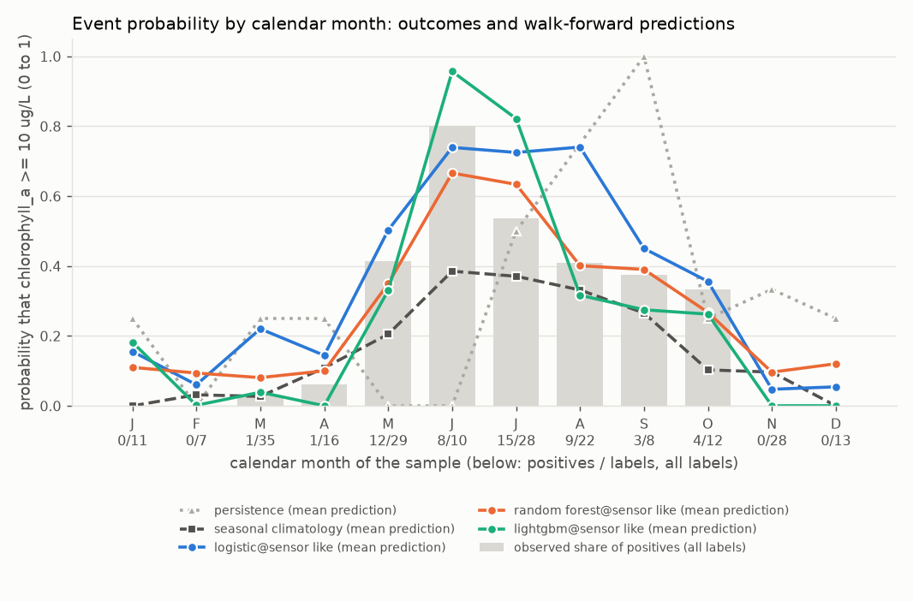
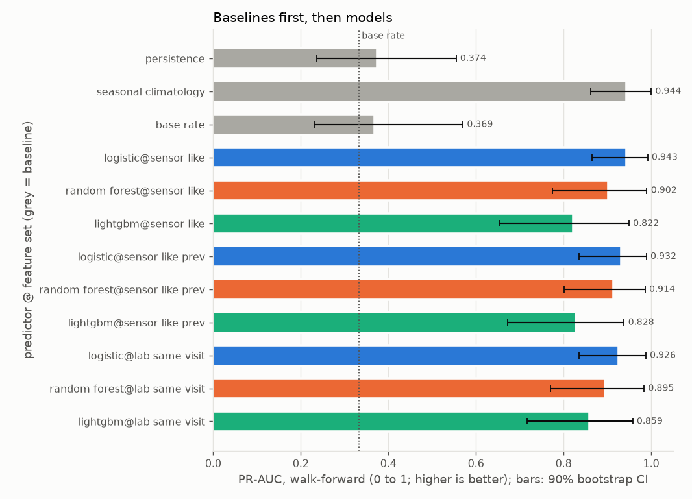
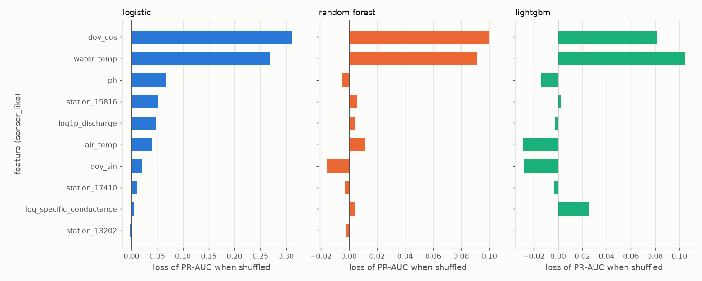
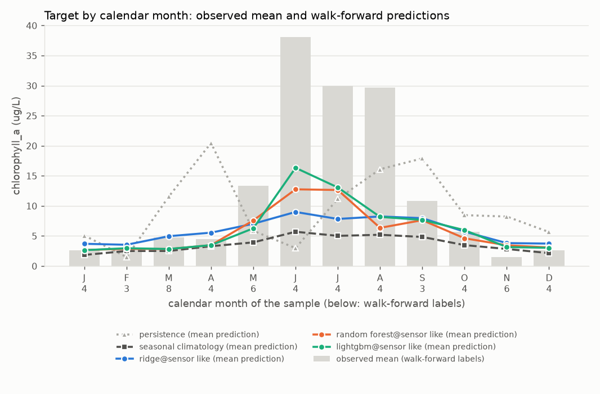
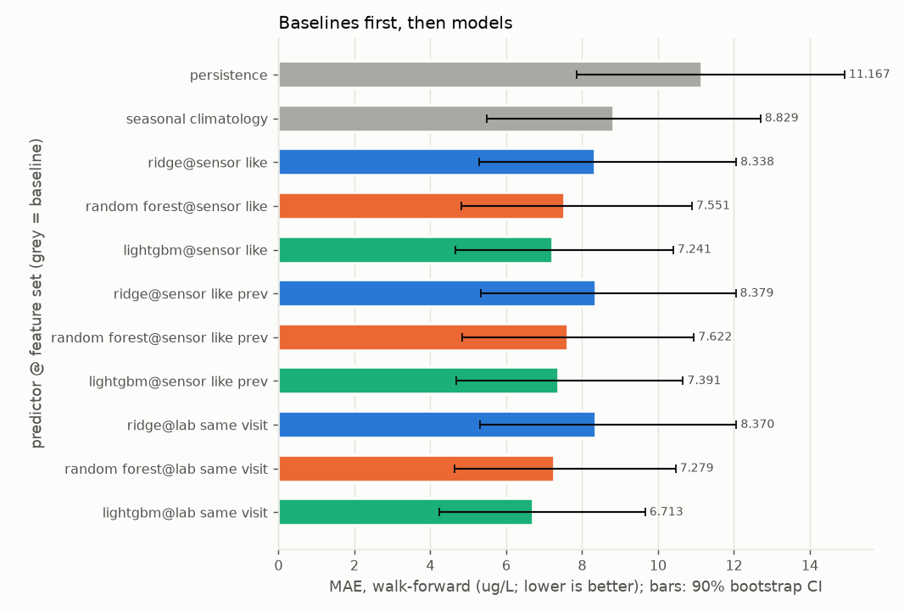
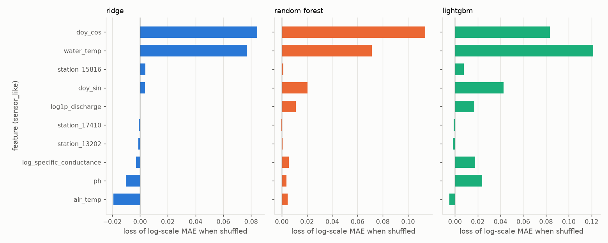

# Report: crp_chla_pooled_allyears

Real grab-sample data, `source=CRP` only, labels from 1995-01-01; `quality='good'` rows only. Input `data/clean/crp_long.csv` (SHA-256 `eef7c00928bcd8ce...`). Stations: 13202, 15816, 17410.

Sensitivity run of crp_chla_pooled with labels from 1995 on. Same stations, targets, features and settings; only the start date differs.

> Note: The era differs: labels before 2014 are mostly below 10 ug/L, so the older training rows describe a different regime from the test years.

> Note: Year is not a feature. No model here can represent that change of era, and seasonal climatology averages over it.

## First lines

### Primary target: event chlorophyll_a >= 10 ug/L

- Labels used: 219 on 148 distinct dates, 53 positives (13202: 83, 15816: 61, 17410: 75).
- Censored labels: 91 left-censored at or below the threshold counted as negatives; 0 left-censored above the threshold dropped (unknown); 0 right-censored dropped.
- Walk-forward: 6 folds (test years 2018 to 2023), n_train from 126 to 178 (training positives 21 to 38), n_test = 54 on 43 dates, 18 positives.
- Final hold-out (evaluated once, last 30 distinct dates, from 2023-07-18): n_train = 180, n_holdout = 39, 14 positives; training positives 39.
- **Persistence** means: the last sample at this station, carried forward (the previous label at the same station on a strictly earlier date; with no earlier label, the training base rate).
- **Seasonal climatology** means: the mean of the training targets within plus or minus 1 calendar month(s) of the test month, pooled over the task's stations (with fewer than 3 training labels in that window, the mean of all training targets).
- **Base rate** means: the share of positives among the training labels.
- Verdicts, walk-forward, headline feature set `sensor_like` (deployable):
  - seasonal climatology beats persistence (PR-AUC difference +0.570, 90% CI [+0.399, +0.711]); Brier difference -0.202 [-0.323, -0.092] (lower is better).
  - logistic on sensor_like (deployable) beats persistence (PR-AUC difference +0.569, 90% CI [+0.387, +0.712]); Brier difference -0.280 [-0.412, -0.158] (lower is better).
  - logistic on sensor_like (deployable) shows no demonstrable difference from seasonal climatology (PR-AUC difference -0.001, 90% CI [-0.058, +0.053]); Brier difference -0.078 [-0.136, -0.025] (lower is better).
  - random_forest on sensor_like (deployable) beats persistence (PR-AUC difference +0.528, 90% CI [+0.357, +0.670]); Brier difference -0.253 [-0.375, -0.140] (lower is better).
  - random_forest on sensor_like (deployable) shows no demonstrable difference from seasonal climatology (PR-AUC difference -0.043, 90% CI [-0.146, +0.038]); Brier difference -0.051 [-0.092, -0.014] (lower is better).
  - lightgbm on sensor_like (deployable) beats persistence (PR-AUC difference +0.448, 90% CI [+0.269, +0.606]); Brier difference -0.225 [-0.364, -0.090] (lower is better).
  - lightgbm on sensor_like (deployable) shows no demonstrable difference from seasonal climatology (PR-AUC difference -0.122, 90% CI [-0.284, +0.005]); Brier difference -0.022 [-0.093, +0.046] (lower is better).
- Verdicts, final hold-out, headline feature set `sensor_like`:
  - seasonal climatology beats persistence (PR-AUC difference +0.397, 90% CI [+0.209, +0.604]); Brier difference -0.227 [-0.354, -0.097] (lower is better).
  - logistic on sensor_like (deployable) beats persistence (PR-AUC difference +0.436, 90% CI [+0.248, +0.626]); Brier difference -0.299 [-0.440, -0.153] (lower is better).
  - logistic on sensor_like (deployable) shows no demonstrable difference from seasonal climatology (PR-AUC difference +0.039, 90% CI [-0.142, +0.229]); Brier difference -0.072 [-0.149, +0.003] (lower is better).
  - random_forest on sensor_like (deployable) beats persistence (PR-AUC difference +0.521, 90% CI [+0.337, +0.673]); Brier difference -0.292 [-0.427, -0.152] (lower is better).
  - random_forest on sensor_like (deployable) shows no demonstrable difference from seasonal climatology (PR-AUC difference +0.125, 90% CI [-0.025, +0.267]); Brier difference -0.065 [-0.119, -0.013] (lower is better).
  - lightgbm on sensor_like (deployable) beats persistence (PR-AUC difference +0.501, 90% CI [+0.316, +0.656]); Brier difference -0.258 [-0.397, -0.107] (lower is better).
  - lightgbm on sensor_like (deployable) shows no demonstrable difference from seasonal climatology (PR-AUC difference +0.104, 90% CI [-0.062, +0.251]); Brier difference -0.030 [-0.113, +0.059] (lower is better).

### Secondary target: regression of chlorophyll_a (ug/L), fitted on the log1p scale

- Labels used: 219 on 148 distinct dates, 91 left-censored (13202: 83, 15816: 61, 17410: 75).
- Censored labels: left-censored values enter at detection limit x 0.5; 0 right-censored dropped.
- Walk-forward: 6 folds (test years 2018 to 2023), n_train from 126 to 178, n_test = 54 on 43 dates.
- Final hold-out (evaluated once, last 30 distinct dates, from 2023-07-18): n_train = 180, n_holdout = 39.
- **Persistence** means: the last sample at this station, carried forward (the previous label at the same station on a strictly earlier date; with no earlier label, the training median).
- **Seasonal climatology** means: the mean of the training targets within plus or minus 1 calendar month(s) of the test month, pooled over the task's stations (with fewer than 3 training labels in that window, the mean of all training targets).
- Verdicts, walk-forward, headline feature set `sensor_like` (deployable):
  - seasonal climatology shows no demonstrable difference from persistence (MAE difference -2.337, 90% CI [-5.255, +0.268]).
  - ridge on sensor_like (deployable) beats persistence (MAE difference -2.828, 90% CI [-5.758, -0.305]).
  - ridge on sensor_like (deployable) shows no demonstrable difference from seasonal climatology (MAE difference -0.491, 90% CI [-1.225, +0.168]).
  - random_forest on sensor_like (deployable) beats persistence (MAE difference -3.616, 90% CI [-6.410, -1.276]).
  - random_forest on sensor_like (deployable) beats seasonal climatology (MAE difference -1.279, 90% CI [-2.224, -0.451]).
  - lightgbm on sensor_like (deployable) beats persistence (MAE difference -3.926, 90% CI [-6.828, -1.573]).
  - lightgbm on sensor_like (deployable) beats seasonal climatology (MAE difference -1.589, 90% CI [-2.733, -0.545]).
- Verdicts, final hold-out, headline feature set `sensor_like`:
  - seasonal climatology beats persistence (MAE difference -3.555, 90% CI [-6.967, -1.003]).
  - ridge on sensor_like (deployable) beats persistence (MAE difference -4.948, 90% CI [-8.352, -2.456]).
  - ridge on sensor_like (deployable) beats seasonal climatology (MAE difference -1.393, 90% CI [-2.424, -0.510]).
  - random_forest on sensor_like (deployable) beats persistence (MAE difference -4.509, 90% CI [-7.964, -1.995]).
  - random_forest on sensor_like (deployable) beats seasonal climatology (MAE difference -0.954, 90% CI [-2.054, -0.054]).
  - lightgbm on sensor_like (deployable) shows no demonstrable difference from persistence (MAE difference -3.005, 90% CI [-6.955, +0.122]).
  - lightgbm on sensor_like (deployable) shows no demonstrable difference from seasonal climatology (MAE difference +0.551, 90% CI [-1.056, +2.229]).

## Warnings

- WARNING [event] walk-forward folds with zero positives: 2020.
- WARNING [event] holdout slices with zero positives (undefined: no positives): oct_mar.
- WARNING [event, regression] feature set sensor_like: only 43% of the 21 labels in 2025 and 2026 have every feature (below 50%); the rest are imputed.
- WARNING [event, regression] feature set sensor_like_prev: only 43% of the 21 labels in 2025 and 2026 have every feature (below 50%); the rest are imputed.
- WARNING [event, regression] feature set lab_same_visit: only 43% of the 21 labels in 2025 and 2026 have every feature (below 50%); the rest are imputed.
- WARNING [event, regression] 15 of 27 station-years in the test windows have fewer than 4 labels (minimum 1).
- WARNING [event] LEAKAGE SUSPECTED: shuffled-label skill for random_forest@sensor_like, lightgbm@sensor_like, random_forest@sensor_like_prev, random_forest@lab_same_visit, lightgbm@lab_same_visit.

## Metrics

### Event target: event chlorophyll_a >= 10 ug/L

Folds:

| fold | n_train | n_test | last train date | first test date | last test date | train positives | test positives |
|---|---|---|---|---|---|---|---|
| 2018 | 126 | 7 | 2017-10-18 | 2018-01-25 | 2018-12-18 | 21 | 1 |
| 2019 | 132 | 16 | 2018-11-20 | 2019-01-29 | 2019-12-18 | 22 | 4 |
| 2020 | 148 | 8 | 2019-11-05 | 2020-01-28 | 2020-12-14 | 26 | 0 (undefined: no positives) |
| 2021 | 157 | 14 | 2020-12-14 | 2021-01-19 | 2021-12-14 | 26 | 8 |
| 2022 | 171 | 7 | 2021-12-14 | 2022-03-16 | 2022-08-30 | 34 | 4 |
| 2023 | 178 | 2 | 2022-08-30 | 2023-04-19 | 2023-06-13 | 38 | 1 |
| holdout | 180 | 39 | 2023-06-13 | 2023-07-18 | 2026-04-28 | 39 | 14 |

#### Walk-forward

n = 54 on 43 dates, 18 positives, base rate 0.333. Baselines first, then models. Brackets: 90% bootstrap CI over distinct dates.

| predictor | deployable | PR-AUC | ROC-AUC | Brier | Brier skill vs base rate |
|---|---|---|---|---|---|
| persistence | baseline | 0.374 [0.236, 0.555] | 0.569 [0.433, 0.706] | 0.370 [0.245, 0.509] | -0.503 [-1.175, -0.017] |
| seasonal_climatology | baseline | 0.944 [0.862, 1.000] | 0.961 [0.906, 1.000] | 0.168 [0.105, 0.236] | 0.317 [0.231, 0.404] |
| base_rate | baseline | 0.369 [0.231, 0.570] | 0.414 [0.244, 0.585] | 0.246 [0.168, 0.330] | 0.000 [0.000, 0.000] |
| logistic@sensor_like | yes | 0.943 [0.865, 0.992] | 0.966 [0.924, 0.995] | 0.091 [0.061, 0.122] | 0.632 [0.461, 0.752] |
| random_forest@sensor_like | yes | 0.902 [0.775, 0.990] | 0.957 [0.902, 0.993] | 0.117 [0.076, 0.161] | 0.525 [0.384, 0.641] |
| lightgbm@sensor_like | yes | 0.822 [0.653, 0.949] | 0.906 [0.821, 0.970] | 0.146 [0.075, 0.226] | 0.408 [0.098, 0.666] |
| logistic@sensor_like_prev | yes | 0.932 [0.835, 0.989] | 0.955 [0.896, 0.994] | 0.091 [0.059, 0.127] | 0.632 [0.424, 0.761] |
| random_forest@sensor_like_prev | yes | 0.914 [0.801, 0.986] | 0.957 [0.906, 0.992] | 0.115 [0.075, 0.157] | 0.535 [0.407, 0.644] |
| lightgbm@sensor_like_prev | yes | 0.828 [0.672, 0.938] | 0.910 [0.834, 0.964] | 0.174 [0.091, 0.263] | 0.295 [0.016, 0.560] |
| logistic@lab_same_visit | NO (diagnostic) | 0.926 [0.836, 0.988] | 0.957 [0.909, 0.992] | 0.094 [0.064, 0.128] | 0.617 [0.459, 0.732] |
| random_forest@lab_same_visit | NO (diagnostic) | 0.895 [0.770, 0.984] | 0.952 [0.895, 0.991] | 0.114 [0.075, 0.157] | 0.536 [0.397, 0.653] |
| lightgbm@lab_same_visit | NO (diagnostic) | 0.859 [0.716, 0.958] | 0.917 [0.837, 0.975] | 0.136 [0.067, 0.221] | 0.447 [0.119, 0.710] |

At p = 0.5:

| predictor | precision | recall | F1 | TP | FP | FN | TN |
|---|---|---|---|---|---|---|---|
| persistence | 0.438 [0.214, 0.688] | 0.389 [0.176, 0.619] | 0.412 [0.200, 0.600] | 7 | 9 | 11 | 27 |
| seasonal_climatology | undefined | 0.000 [0.000, 0.000] | 0.000 [0.000, 0.000] | 0 | 0 | 18 | 36 |
| base_rate | undefined | 0.000 [0.000, 0.000] | 0.000 [0.000, 0.000] | 0 | 0 | 18 | 36 |
| logistic@sensor_like | 0.875 [0.706, 1.000] | 0.778 [0.600, 0.929] | 0.824 [0.686, 0.930] | 14 | 2 | 4 | 34 |
| random_forest@sensor_like | 0.889 [0.667, 1.000] | 0.444 [0.214, 0.667] | 0.593 [0.333, 0.783] | 8 | 1 | 10 | 35 |
| lightgbm@sensor_like | 0.786 [0.571, 0.938] | 0.611 [0.400, 0.800] | 0.688 [0.483, 0.833] | 11 | 3 | 7 | 33 |
| logistic@sensor_like_prev | 0.800 [0.608, 0.960] | 0.889 [0.750, 1.000] | 0.842 [0.700, 0.944] | 16 | 4 | 2 | 32 |
| random_forest@sensor_like_prev | 0.889 [0.667, 1.000] | 0.444 [0.214, 0.667] | 0.593 [0.333, 0.783] | 8 | 1 | 10 | 35 |
| lightgbm@sensor_like_prev | 0.889 [0.667, 1.000] | 0.444 [0.235, 0.667] | 0.593 [0.364, 0.769] | 8 | 1 | 10 | 35 |
| logistic@lab_same_visit | 0.875 [0.706, 1.000] | 0.778 [0.600, 0.929] | 0.824 [0.686, 0.930] | 14 | 2 | 4 | 34 |
| random_forest@lab_same_visit | 0.889 [0.667, 1.000] | 0.444 [0.214, 0.667] | 0.593 [0.333, 0.783] | 8 | 1 | 10 | 35 |
| lightgbm@lab_same_visit | 0.857 [0.667, 1.000] | 0.667 [0.437, 0.867] | 0.750 [0.556, 0.889] | 12 | 2 | 6 | 34 |

At p* = 0.10 (C_FP=1, C_FN=9, PLACEHOLDER):

| predictor | precision | recall | F1 | TP | FP | FN | TN |
|---|---|---|---|---|---|---|---|
| persistence | 0.438 [0.214, 0.688] | 0.389 [0.176, 0.619] | 0.412 [0.200, 0.600] | 7 | 9 | 11 | 27 |
| seasonal_climatology | 0.607 [0.409, 0.778] | 0.944 [0.833, 1.000] | 0.739 [0.564, 0.862] | 17 | 11 | 1 | 25 |
| base_rate | 0.333 [0.214, 0.463] | 1.000 [1.000, 1.000] | 0.500 [0.353, 0.633] | 18 | 36 | 0 | 0 |
| logistic@sensor_like | 0.500 [0.341, 0.658] | 1.000 [1.000, 1.000] | 0.667 [0.509, 0.794] | 18 | 18 | 0 | 18 |
| random_forest@sensor_like | 0.462 [0.314, 0.610] | 1.000 [1.000, 1.000] | 0.632 [0.478, 0.758] | 18 | 21 | 0 | 15 |
| lightgbm@sensor_like | 0.700 [0.500, 0.867] | 0.778 [0.562, 0.952] | 0.737 [0.562, 0.864] | 14 | 6 | 4 | 30 |
| logistic@sensor_like_prev | 0.500 [0.333, 0.657] | 1.000 [1.000, 1.000] | 0.667 [0.500, 0.793] | 18 | 18 | 0 | 18 |
| random_forest@sensor_like_prev | 0.474 [0.324, 0.615] | 1.000 [1.000, 1.000] | 0.643 [0.489, 0.762] | 18 | 20 | 0 | 16 |
| lightgbm@sensor_like_prev | 0.714 [0.470, 0.909] | 0.556 [0.333, 0.750] | 0.625 [0.417, 0.783] | 10 | 4 | 8 | 32 |
| logistic@lab_same_visit | 0.486 [0.324, 0.643] | 1.000 [1.000, 1.000] | 0.655 [0.490, 0.783] | 18 | 19 | 0 | 17 |
| random_forest@lab_same_visit | 0.450 [0.306, 0.600] | 1.000 [1.000, 1.000] | 0.621 [0.468, 0.750] | 18 | 22 | 0 | 14 |
| lightgbm@lab_same_visit | 0.667 [0.471, 0.846] | 0.778 [0.562, 0.952] | 0.718 [0.545, 0.850] | 14 | 7 | 4 | 29 |

Paired differences (higher PR-AUC and lower Brier are better):

| model | baseline | PR-AUC difference (model - baseline) | Brier difference | verdict (by PR-AUC) |
|---|---|---|---|---|
| persistence | seasonal_climatology | -0.570 [-0.711, -0.399] | +0.202 [+0.092, +0.323] | is worse than |
| persistence | base_rate | +0.005 [-0.174, +0.147] | +0.124 [+0.005, +0.254] | no demonstrable difference |
| seasonal_climatology | persistence | +0.570 [+0.399, +0.711] | -0.202 [-0.323, -0.092] | beats |
| seasonal_climatology | base_rate | +0.575 [+0.373, +0.717] | -0.078 [-0.110, -0.050] | beats |
| base_rate | persistence | -0.005 [-0.147, +0.174] | -0.124 [-0.254, -0.005] | no demonstrable difference |
| base_rate | seasonal_climatology | -0.575 [-0.717, -0.373] | +0.078 [+0.050, +0.110] | is worse than |
| logistic@sensor_like | persistence | +0.569 [+0.387, +0.712] | -0.280 [-0.412, -0.158] | beats |
| logistic@sensor_like | seasonal_climatology | -0.001 [-0.058, +0.053] | -0.078 [-0.136, -0.025] | no demonstrable difference |
| logistic@sensor_like | base_rate | +0.574 [+0.364, +0.711] | -0.156 [-0.235, -0.080] | beats |
| random_forest@sensor_like | persistence | +0.528 [+0.357, +0.670] | -0.253 [-0.375, -0.140] | beats |
| random_forest@sensor_like | seasonal_climatology | -0.043 [-0.146, +0.038] | -0.051 [-0.092, -0.014] | no demonstrable difference |
| random_forest@sensor_like | base_rate | +0.533 [+0.315, +0.684] | -0.129 [-0.191, -0.072] | beats |
| lightgbm@sensor_like | persistence | +0.448 [+0.269, +0.606] | -0.225 [-0.364, -0.090] | beats |
| lightgbm@sensor_like | seasonal_climatology | -0.122 [-0.284, +0.005] | -0.022 [-0.093, +0.046] | no demonstrable difference |
| lightgbm@sensor_like | base_rate | +0.453 [+0.214, +0.625] | -0.101 [-0.189, -0.020] | beats |
| logistic@sensor_like_prev | persistence | +0.558 [+0.374, +0.705] | -0.280 [-0.420, -0.148] | beats |
| logistic@sensor_like_prev | seasonal_climatology | -0.012 [-0.088, +0.049] | -0.078 [-0.140, -0.017] | no demonstrable difference |
| logistic@sensor_like_prev | base_rate | +0.563 [+0.353, +0.703] | -0.156 [-0.240, -0.076] | beats |
| random_forest@sensor_like_prev | persistence | +0.540 [+0.365, +0.674] | -0.256 [-0.375, -0.142] | beats |
| random_forest@sensor_like_prev | seasonal_climatology | -0.031 [-0.122, +0.047] | -0.054 [-0.094, -0.017] | no demonstrable difference |
| random_forest@sensor_like_prev | base_rate | +0.545 [+0.331, +0.689] | -0.132 [-0.194, -0.075] | beats |
| lightgbm@sensor_like_prev | persistence | +0.454 [+0.280, +0.604] | -0.197 [-0.334, -0.068] | beats |
| lightgbm@sensor_like_prev | seasonal_climatology | -0.116 [-0.242, -0.014] | +0.005 [-0.051, +0.062] | is worse than |
| lightgbm@sensor_like_prev | base_rate | +0.459 [+0.228, +0.614] | -0.073 [-0.148, -0.003] | beats |
| logistic@lab_same_visit | persistence | +0.553 [+0.365, +0.698] | -0.276 [-0.406, -0.155] | beats |
| logistic@lab_same_visit | seasonal_climatology | -0.018 [-0.081, +0.041] | -0.074 [-0.127, -0.024] | no demonstrable difference |
| logistic@lab_same_visit | base_rate | +0.558 [+0.354, +0.695] | -0.152 [-0.227, -0.082] | beats |
| random_forest@lab_same_visit | persistence | +0.521 [+0.351, +0.662] | -0.256 [-0.377, -0.143] | beats |
| random_forest@lab_same_visit | seasonal_climatology | -0.049 [-0.154, +0.033] | -0.054 [-0.095, -0.015] | no demonstrable difference |
| random_forest@lab_same_visit | base_rate | +0.526 [+0.309, +0.674] | -0.132 [-0.195, -0.074] | beats |
| lightgbm@lab_same_visit | persistence | +0.485 [+0.318, +0.625] | -0.234 [-0.376, -0.104] | beats |
| lightgbm@lab_same_visit | seasonal_climatology | -0.085 [-0.210, +0.015] | -0.032 [-0.106, +0.042] | no demonstrable difference |
| lightgbm@lab_same_visit | base_rate | +0.490 [+0.262, +0.649] | -0.110 [-0.200, -0.026] | beats |

#### Final hold-out (evaluated once)

n = 39 on 30 dates, 14 positives, base rate 0.359. Baselines first, then models. Brackets: 90% bootstrap CI over distinct dates.

| predictor | deployable | PR-AUC | ROC-AUC | Brier | Brier skill vs base rate |
|---|---|---|---|---|---|
| persistence | baseline | 0.423 [0.263, 0.614] | 0.606 [0.455, 0.771] | 0.385 [0.250, 0.525] | -0.536 [-1.368, 0.065] |
| seasonal_climatology | baseline | 0.819 [0.660, 0.993] | 0.937 [0.861, 0.995] | 0.157 [0.095, 0.224] | 0.371 [0.274, 0.475] |
| base_rate | baseline | 0.359 [0.216, 0.500] | 0.500 [0.500, 0.500] | 0.250 [0.169, 0.330] | 0.000 [0.000, 0.000] |
| logistic@sensor_like | yes | 0.858 [0.700, 0.973] | 0.886 [0.785, 0.981] | 0.085 [0.031, 0.158] | 0.659 [0.384, 0.877] |
| random_forest@sensor_like | yes | 0.944 [0.856, 1.000] | 0.969 [0.924, 1.000] | 0.093 [0.052, 0.139] | 0.629 [0.459, 0.761] |
| lightgbm@sensor_like | yes | 0.924 [0.824, 0.985] | 0.951 [0.891, 0.990] | 0.127 [0.056, 0.206] | 0.493 [0.124, 0.762] |
| logistic@sensor_like_prev | yes | 0.858 [0.692, 0.983] | 0.911 [0.824, 0.983] | 0.084 [0.029, 0.155] | 0.666 [0.394, 0.885] |
| random_forest@sensor_like_prev | yes | 0.927 [0.818, 0.992] | 0.957 [0.904, 0.994] | 0.098 [0.055, 0.147] | 0.608 [0.436, 0.753] |
| lightgbm@sensor_like_prev | yes | 0.909 [0.788, 0.989] | 0.931 [0.849, 0.994] | 0.102 [0.037, 0.177] | 0.593 [0.293, 0.847] |
| logistic@lab_same_visit | NO (diagnostic) | 0.858 [0.699, 0.973] | 0.886 [0.785, 0.981] | 0.086 [0.032, 0.159] | 0.657 [0.382, 0.877] |
| random_forest@lab_same_visit | NO (diagnostic) | 0.922 [0.812, 1.000] | 0.960 [0.902, 1.000] | 0.094 [0.054, 0.137] | 0.625 [0.457, 0.755] |
| lightgbm@lab_same_visit | NO (diagnostic) | 0.900 [0.773, 0.982] | 0.940 [0.863, 0.989] | 0.116 [0.047, 0.196] | 0.535 [0.118, 0.800] |

At p = 0.5:

| predictor | precision | recall | F1 | TP | FP | FN | TN |
|---|---|---|---|---|---|---|---|
| persistence | 0.471 [0.263, 0.692] | 0.571 [0.300, 0.846] | 0.516 [0.286, 0.700] | 8 | 9 | 6 | 16 |
| seasonal_climatology | undefined | 0.000 [0.000, 0.000] | 0.000 [0.000, 0.000] | 0 | 0 | 14 | 25 |
| base_rate | undefined | 0.000 [0.000, 0.000] | 0.000 [0.000, 0.000] | 0 | 0 | 14 | 25 |
| logistic@sensor_like | 0.923 [0.769, 1.000] | 0.857 [0.727, 1.000] | 0.889 [0.778, 0.970] | 12 | 1 | 2 | 24 |
| random_forest@sensor_like | 0.846 [0.647, 1.000] | 0.786 [0.625, 0.944] | 0.815 [0.667, 0.929] | 11 | 2 | 3 | 23 |
| lightgbm@sensor_like | 0.769 [0.538, 0.938] | 0.714 [0.533, 0.900] | 0.741 [0.556, 0.870] | 10 | 3 | 4 | 22 |
| logistic@sensor_like_prev | 0.923 [0.769, 1.000] | 0.857 [0.727, 1.000] | 0.889 [0.778, 0.970] | 12 | 1 | 2 | 24 |
| random_forest@sensor_like_prev | 0.917 [0.750, 1.000] | 0.786 [0.625, 0.944] | 0.846 [0.714, 0.957] | 11 | 1 | 3 | 24 |
| lightgbm@sensor_like_prev | 0.846 [0.647, 1.000] | 0.786 [0.625, 0.944] | 0.815 [0.667, 0.929] | 11 | 2 | 3 | 23 |
| logistic@lab_same_visit | 0.923 [0.769, 1.000] | 0.857 [0.727, 1.000] | 0.889 [0.778, 0.970] | 12 | 1 | 2 | 24 |
| random_forest@lab_same_visit | 0.857 [0.667, 1.000] | 0.857 [0.727, 1.000] | 0.857 [0.727, 0.957] | 12 | 2 | 2 | 23 |
| lightgbm@lab_same_visit | 0.800 [0.599, 0.944] | 0.857 [0.727, 1.000] | 0.828 [0.690, 0.929] | 12 | 3 | 2 | 22 |

At p* = 0.10 (C_FP=1, C_FN=9, PLACEHOLDER):

| predictor | precision | recall | F1 | TP | FP | FN | TN |
|---|---|---|---|---|---|---|---|
| persistence | 0.471 [0.263, 0.692] | 0.571 [0.300, 0.846] | 0.516 [0.286, 0.700] | 8 | 9 | 6 | 16 |
| seasonal_climatology | 0.700 [0.500, 0.850] | 1.000 [1.000, 1.000] | 0.824 [0.667, 0.919] | 14 | 6 | 0 | 19 |
| base_rate | 0.359 [0.216, 0.500] | 1.000 [1.000, 1.000] | 0.528 [0.356, 0.667] | 14 | 25 | 0 | 0 |
| logistic@sensor_like | 0.706 [0.500, 0.929] | 0.857 [0.727, 1.000] | 0.774 [0.611, 0.909] | 12 | 5 | 2 | 20 |
| random_forest@sensor_like | 0.560 [0.381, 0.714] | 1.000 [1.000, 1.000] | 0.718 [0.552, 0.833] | 14 | 11 | 0 | 14 |
| lightgbm@sensor_like | 0.812 [0.611, 0.948] | 0.929 [0.818, 1.000] | 0.867 [0.727, 0.966] | 13 | 3 | 1 | 22 |
| logistic@sensor_like_prev | 0.750 [0.538, 0.933] | 0.857 [0.727, 1.000] | 0.800 [0.645, 0.914] | 12 | 4 | 2 | 21 |
| random_forest@sensor_like_prev | 0.583 [0.400, 0.741] | 1.000 [1.000, 1.000] | 0.737 [0.571, 0.851] | 14 | 10 | 0 | 15 |
| lightgbm@sensor_like_prev | 0.800 [0.599, 0.944] | 0.857 [0.727, 1.000] | 0.828 [0.690, 0.929] | 12 | 3 | 2 | 22 |
| logistic@lab_same_visit | 0.706 [0.500, 0.929] | 0.857 [0.727, 1.000] | 0.774 [0.611, 0.909] | 12 | 5 | 2 | 20 |
| random_forest@lab_same_visit | 0.467 [0.308, 0.621] | 1.000 [1.000, 1.000] | 0.636 [0.471, 0.766] | 14 | 16 | 0 | 9 |
| lightgbm@lab_same_visit | 0.765 [0.556, 0.938] | 0.929 [0.818, 1.000] | 0.839 [0.692, 0.944] | 13 | 4 | 1 | 21 |

Paired differences (higher PR-AUC and lower Brier are better):

| model | baseline | PR-AUC difference (model - baseline) | Brier difference | verdict (by PR-AUC) |
|---|---|---|---|---|
| persistence | seasonal_climatology | -0.397 [-0.604, -0.209] | +0.227 [+0.097, +0.354] | is worse than |
| persistence | base_rate | +0.064 [-0.016, +0.205] | +0.134 [-0.017, +0.279] | no demonstrable difference |
| seasonal_climatology | persistence | +0.397 [+0.209, +0.604] | -0.227 [-0.354, -0.097] | beats |
| seasonal_climatology | base_rate | +0.460 [+0.299, +0.677] | -0.093 [-0.124, -0.061] | beats |
| base_rate | persistence | -0.064 [-0.205, +0.016] | -0.134 [-0.279, +0.017] | no demonstrable difference |
| base_rate | seasonal_climatology | -0.460 [-0.677, -0.299] | +0.093 [+0.061, +0.124] | is worse than |
| logistic@sensor_like | persistence | +0.436 [+0.248, +0.626] | -0.299 [-0.440, -0.153] | beats |
| logistic@sensor_like | seasonal_climatology | +0.039 [-0.142, +0.229] | -0.072 [-0.149, +0.003] | no demonstrable difference |
| logistic@sensor_like | base_rate | +0.499 [+0.342, +0.684] | -0.165 [-0.250, -0.080] | beats |
| random_forest@sensor_like | persistence | +0.521 [+0.337, +0.673] | -0.292 [-0.427, -0.152] | beats |
| random_forest@sensor_like | seasonal_climatology | +0.125 [-0.025, +0.267] | -0.065 [-0.119, -0.013] | no demonstrable difference |
| random_forest@sensor_like | base_rate | +0.585 [+0.447, +0.722] | -0.158 [-0.229, -0.091] | beats |
| lightgbm@sensor_like | persistence | +0.501 [+0.316, +0.656] | -0.258 [-0.397, -0.107] | beats |
| lightgbm@sensor_like | seasonal_climatology | +0.104 [-0.062, +0.251] | -0.030 [-0.113, +0.059] | no demonstrable difference |
| lightgbm@sensor_like | base_rate | +0.565 [+0.437, +0.697] | -0.123 [-0.218, -0.025] | beats |
| logistic@sensor_like_prev | persistence | +0.435 [+0.255, +0.624] | -0.301 [-0.441, -0.156] | beats |
| logistic@sensor_like_prev | seasonal_climatology | +0.039 [-0.144, +0.225] | -0.074 [-0.151, -0.000] | no demonstrable difference |
| logistic@sensor_like_prev | base_rate | +0.499 [+0.345, +0.684] | -0.167 [-0.250, -0.082] | beats |
| random_forest@sensor_like_prev | persistence | +0.504 [+0.313, +0.666] | -0.286 [-0.423, -0.144] | beats |
| random_forest@sensor_like_prev | seasonal_climatology | +0.107 [-0.058, +0.277] | -0.059 [-0.114, -0.006] | no demonstrable difference |
| random_forest@sensor_like_prev | base_rate | +0.568 [+0.423, +0.719] | -0.152 [-0.225, -0.088] | beats |
| lightgbm@sensor_like_prev | persistence | +0.486 [+0.286, +0.663] | -0.283 [-0.419, -0.134] | beats |
| lightgbm@sensor_like_prev | seasonal_climatology | +0.090 [-0.094, +0.271] | -0.056 [-0.130, +0.021] | no demonstrable difference |
| lightgbm@sensor_like_prev | base_rate | +0.550 [+0.402, +0.720] | -0.148 [-0.237, -0.064] | beats |
| logistic@lab_same_visit | persistence | +0.436 [+0.248, +0.626] | -0.299 [-0.440, -0.151] | beats |
| logistic@lab_same_visit | seasonal_climatology | +0.039 [-0.142, +0.229] | -0.072 [-0.149, +0.004] | no demonstrable difference |
| logistic@lab_same_visit | base_rate | +0.499 [+0.342, +0.684] | -0.164 [-0.249, -0.079] | beats |
| random_forest@lab_same_visit | persistence | +0.500 [+0.311, +0.654] | -0.291 [-0.432, -0.148] | beats |
| random_forest@lab_same_visit | seasonal_climatology | +0.103 [-0.058, +0.252] | -0.064 [-0.121, -0.008] | no demonstrable difference |
| random_forest@lab_same_visit | base_rate | +0.563 [+0.422, +0.711] | -0.157 [-0.229, -0.088] | beats |
| lightgbm@lab_same_visit | persistence | +0.478 [+0.277, +0.647] | -0.268 [-0.414, -0.119] | beats |
| lightgbm@lab_same_visit | seasonal_climatology | +0.081 [-0.096, +0.238] | -0.041 [-0.131, +0.057] | no demonstrable difference |
| lightgbm@lab_same_visit | base_rate | +0.541 [+0.402, +0.685] | -0.134 [-0.235, -0.024] | beats |

### Regression target: regression of chlorophyll_a (ug/L), fitted on the log1p scale

Folds:

| fold | n_train | n_test | last train date | first test date | last test date |
|---|---|---|---|---|---|
| 2018 | 126 | 7 | 2017-10-18 | 2018-01-25 | 2018-12-18 |
| 2019 | 132 | 16 | 2018-11-20 | 2019-01-29 | 2019-12-18 |
| 2020 | 148 | 8 | 2019-11-05 | 2020-01-28 | 2020-12-14 |
| 2021 | 157 | 14 | 2020-12-14 | 2021-01-19 | 2021-12-14 |
| 2022 | 171 | 7 | 2021-12-14 | 2022-03-16 | 2022-08-30 |
| 2023 | 178 | 2 | 2022-08-30 | 2023-04-19 | 2023-06-13 |
| holdout | 180 | 39 | 2023-06-13 | 2023-07-18 | 2026-04-28 |

#### Walk-forward

All labels: n = 54 on 43 dates (20 left-censored). MAE and RMSE in ug/L. Brackets: 90% bootstrap CI over distinct dates.

| predictor | deployable | MAE | RMSE | R2 | MAE (log scale) | skill vs persistence | skill vs climatology |
|---|---|---|---|---|---|---|---|
| persistence | baseline | 11.167 [7.847, 14.914] | 19.741 [13.050, 26.239] | -0.403 [-1.941, 0.009] | 0.848 [0.677, 1.022] | 0.000 [0.000, 0.000] | -0.265 [-0.771, 0.023] |
| seasonal_climatology | baseline | 8.829 [5.485, 12.698] | 17.667 [9.862, 24.598] | -0.124 [-0.300, -0.029] | 0.769 [0.627, 0.912] | 0.209 [-0.024, 0.435] | 0.000 [0.000, 0.000] |
| ridge@sensor_like | yes | 8.338 [5.277, 12.059] | 16.532 [8.898, 23.260] | 0.016 [-0.151, 0.149] | 0.731 [0.621, 0.845] | 0.253 [0.026, 0.461] | 0.056 [-0.023, 0.126] |
| random_forest@sensor_like | yes | 7.551 [4.810, 10.894] | 15.258 [7.681, 21.360] | 0.162 [-0.083, 0.322] | 0.651 [0.554, 0.751] | 0.324 [0.130, 0.507] | 0.145 [0.065, 0.215] |
| lightgbm@sensor_like | yes | 7.241 [4.654, 10.401] | 14.731 [7.617, 20.585] | 0.219 [-0.098, 0.397] | 0.624 [0.512, 0.737] | 0.352 [0.163, 0.537] | 0.180 [0.083, 0.261] |
| ridge@sensor_like_prev | yes | 8.379 [5.331, 12.046] | 16.531 [8.889, 23.329] | 0.016 [-0.139, 0.137] | 0.732 [0.621, 0.847] | 0.250 [0.027, 0.453] | 0.051 [-0.048, 0.129] |
| random_forest@sensor_like_prev | yes | 7.622 [4.840, 10.948] | 15.379 [7.771, 21.625] | 0.148 [-0.077, 0.303] | 0.654 [0.562, 0.753] | 0.317 [0.123, 0.500] | 0.137 [0.061, 0.204] |
| lightgbm@sensor_like_prev | yes | 7.391 [4.691, 10.658] | 15.057 [7.825, 20.803] | 0.184 [-0.104, 0.359] | 0.640 [0.533, 0.758] | 0.338 [0.142, 0.526] | 0.163 [0.068, 0.254] |
| ridge@lab_same_visit | NO (diagnostic) | 8.370 [5.312, 12.065] | 16.478 [8.914, 23.170] | 0.022 [-0.153, 0.162] | 0.742 [0.634, 0.858] | 0.250 [0.025, 0.459] | 0.052 [-0.031, 0.124] |
| random_forest@lab_same_visit | NO (diagnostic) | 7.279 [4.631, 10.462] | 14.760 [7.350, 20.592] | 0.216 [-0.056, 0.384] | 0.628 [0.531, 0.731] | 0.348 [0.162, 0.526] | 0.176 [0.089, 0.252] |
| lightgbm@lab_same_visit | NO (diagnostic) | 6.713 [4.237, 9.662] | 13.976 [6.919, 19.653] | 0.297 [-0.076, 0.495] | 0.588 [0.472, 0.713] | 0.399 [0.216, 0.573] | 0.240 [0.124, 0.342] |

Numeric-only (uncensored) labels: n = 34 on 28 dates (0 left-censored). MAE and RMSE in ug/L. Brackets: 90% bootstrap CI over distinct dates.

| predictor | deployable | MAE | RMSE | R2 | MAE (log scale) | skill vs persistence | skill vs climatology |
|---|---|---|---|---|---|---|---|
| persistence | baseline | 16.026 [11.026, 21.707] | 24.487 [15.283, 32.952] | -0.725 [-3.520, -0.232] | 1.048 [0.868, 1.245] | 0.000 [0.000, 0.000] | -0.200 [-0.669, 0.069] |
| seasonal_climatology | baseline | 13.349 [8.127, 18.855] | 22.244 [10.955, 30.529] | -0.423 [-1.028, -0.275] | 1.004 [0.813, 1.183] | 0.167 [-0.074, 0.401] | 0.000 [0.000, 0.000] |
| ridge@sensor_like | yes | 11.397 [6.419, 16.787] | 20.656 [8.509, 28.814] | -0.227 [-0.573, -0.063] | 0.704 [0.529, 0.872] | 0.289 [0.069, 0.524] | 0.146 [0.095, 0.227] |
| random_forest@sensor_like | yes | 10.877 [6.318, 15.774] | 19.160 [8.314, 26.482] | -0.056 [-0.472, 0.125] | 0.714 [0.568, 0.868] | 0.321 [0.111, 0.525] | 0.185 [0.112, 0.257] |
| lightgbm@sensor_like | yes | 10.551 [6.173, 15.157] | 18.507 [8.239, 25.532] | 0.015 [-0.499, 0.239] | 0.714 [0.545, 0.886] | 0.342 [0.127, 0.546] | 0.210 [0.108, 0.297] |
| ridge@sensor_like_prev | yes | 11.354 [6.386, 16.805] | 20.620 [8.498, 28.779] | -0.223 [-0.554, -0.068] | 0.694 [0.534, 0.853] | 0.291 [0.071, 0.524] | 0.149 [0.097, 0.230] |
| random_forest@sensor_like_prev | yes | 11.024 [6.473, 15.942] | 19.318 [8.403, 26.772] | -0.073 [-0.468, 0.098] | 0.725 [0.584, 0.868] | 0.312 [0.104, 0.518] | 0.174 [0.107, 0.243] |
| lightgbm@sensor_like_prev | yes | 10.888 [6.457, 15.637] | 18.930 [8.628, 26.071] | -0.031 [-0.526, 0.186] | 0.762 [0.605, 0.924] | 0.321 [0.094, 0.530] | 0.184 [0.084, 0.277] |
| ridge@lab_same_visit | NO (diagnostic) | 11.431 [6.487, 16.800] | 20.586 [8.475, 28.705] | -0.219 [-0.582, -0.044] | 0.718 [0.552, 0.883] | 0.287 [0.062, 0.518] | 0.144 [0.091, 0.223] |
| random_forest@lab_same_visit | NO (diagnostic) | 10.530 [6.162, 15.133] | 18.540 [8.013, 25.657] | 0.011 [-0.428, 0.208] | 0.698 [0.553, 0.844] | 0.343 [0.137, 0.540] | 0.211 [0.128, 0.290] |
| lightgbm@lab_same_visit | NO (diagnostic) | 9.821 [5.757, 14.356] | 17.551 [7.835, 24.382] | 0.114 [-0.453, 0.367] | 0.696 [0.530, 0.879] | 0.387 [0.181, 0.578] | 0.264 [0.140, 0.366] |

Paired differences (lower MAE is better):

| model | baseline | MAE difference (model - baseline) | verdict (by MAE) |
|---|---|---|---|
| persistence | seasonal_climatology | +2.337 [-0.268, +5.255] | no demonstrable difference |
| seasonal_climatology | persistence | -2.337 [-5.255, +0.268] | no demonstrable difference |
| ridge@sensor_like | persistence | -2.828 [-5.758, -0.305] | beats |
| ridge@sensor_like | seasonal_climatology | -0.491 [-1.225, +0.168] | no demonstrable difference |
| random_forest@sensor_like | persistence | -3.616 [-6.410, -1.276] | beats |
| random_forest@sensor_like | seasonal_climatology | -1.279 [-2.224, -0.451] | beats |
| lightgbm@sensor_like | persistence | -3.926 [-6.828, -1.573] | beats |
| lightgbm@sensor_like | seasonal_climatology | -1.589 [-2.733, -0.545] | beats |
| ridge@sensor_like_prev | persistence | -2.788 [-5.692, -0.278] | beats |
| ridge@sensor_like_prev | seasonal_climatology | -0.450 [-1.256, +0.321] | no demonstrable difference |
| random_forest@sensor_like_prev | persistence | -3.545 [-6.304, -1.232] | beats |
| random_forest@sensor_like_prev | seasonal_climatology | -1.207 [-2.096, -0.422] | beats |
| lightgbm@sensor_like_prev | persistence | -3.776 [-6.574, -1.367] | beats |
| lightgbm@sensor_like_prev | seasonal_climatology | -1.439 [-2.502, -0.455] | beats |
| ridge@lab_same_visit | persistence | -2.796 [-5.749, -0.241] | beats |
| ridge@lab_same_visit | seasonal_climatology | -0.459 [-1.229, +0.215] | no demonstrable difference |
| random_forest@lab_same_visit | persistence | -3.888 [-6.644, -1.577] | beats |
| random_forest@lab_same_visit | seasonal_climatology | -1.551 [-2.632, -0.600] | beats |
| lightgbm@lab_same_visit | persistence | -4.453 [-7.317, -2.000] | beats |
| lightgbm@lab_same_visit | seasonal_climatology | -2.116 [-3.571, -0.780] | beats |

#### Final hold-out (evaluated once)

All labels: n = 39 on 30 dates (12 left-censored). MAE and RMSE in ug/L. Brackets: 90% bootstrap CI over distinct dates.

| predictor | deployable | MAE | RMSE | R2 | MAE (log scale) | skill vs persistence | skill vs climatology |
|---|---|---|---|---|---|---|---|
| persistence | baseline | 8.338 [5.673, 12.070] | 14.446 [7.150, 22.503] | -4.211 [-11.264, -0.431] | 0.855 [0.676, 1.032] | 0.000 [0.000, 0.000] | -0.743 [-1.559, -0.198] |
| seasonal_climatology | baseline | 4.783 [3.536, 6.247] | 6.608 [5.025, 8.172] | -0.090 [-0.547, 0.188] | 0.581 [0.479, 0.691] | 0.426 [0.165, 0.609] | 0.000 [0.000, 0.000] |
| ridge@sensor_like | yes | 3.390 [2.575, 4.228] | 4.625 [3.538, 5.604] | 0.466 [0.158, 0.665] | 0.463 [0.375, 0.554] | 0.593 [0.414, 0.719] | 0.291 [0.131, 0.422] |
| random_forest@sensor_like | yes | 3.829 [2.786, 5.031] | 5.578 [4.020, 7.171] | 0.223 [-0.236, 0.561] | 0.486 [0.381, 0.588] | 0.541 [0.327, 0.688] | 0.199 [0.013, 0.373] |
| lightgbm@sensor_like | yes | 5.334 [3.528, 7.367] | 8.733 [5.156, 11.878] | -0.904 [-2.941, 0.309] | 0.540 [0.427, 0.650] | 0.360 [-0.016, 0.618] | -0.115 [-0.523, 0.204] |
| ridge@sensor_like_prev | yes | 3.364 [2.520, 4.267] | 4.625 [3.454, 5.737] | 0.466 [0.133, 0.686] | 0.444 [0.357, 0.529] | 0.597 [0.403, 0.735] | 0.297 [0.100, 0.447] |
| random_forest@sensor_like_prev | yes | 3.728 [2.704, 4.882] | 5.501 [3.973, 7.075] | 0.245 [-0.203, 0.575] | 0.465 [0.359, 0.566] | 0.553 [0.348, 0.699] | 0.221 [0.029, 0.394] |
| lightgbm@sensor_like_prev | yes | 5.206 [3.348, 7.252] | 8.678 [5.508, 11.627] | -0.880 [-2.762, 0.227] | 0.475 [0.378, 0.572] | 0.376 [0.001, 0.634] | -0.088 [-0.493, 0.234] |
| ridge@lab_same_visit | NO (diagnostic) | 3.460 [2.706, 4.258] | 4.541 [3.574, 5.411] | 0.485 [0.190, 0.668] | 0.475 [0.393, 0.563] | 0.585 [0.402, 0.708] | 0.277 [0.093, 0.418] |
| random_forest@lab_same_visit | NO (diagnostic) | 3.775 [2.735, 4.961] | 5.538 [3.989, 6.977] | 0.234 [-0.232, 0.549] | 0.457 [0.366, 0.550] | 0.547 [0.326, 0.697] | 0.211 [0.000, 0.397] |
| lightgbm@lab_same_visit | NO (diagnostic) | 5.455 [3.747, 7.426] | 8.439 [5.942, 10.863] | -0.778 [-2.235, 0.093] | 0.503 [0.413, 0.587] | 0.346 [-0.058, 0.624] | -0.140 [-0.515, 0.152] |

Numeric-only (uncensored) labels: n = 27 on 21 dates (0 left-censored). MAE and RMSE in ug/L. Brackets: 90% bootstrap CI over distinct dates.

| predictor | deployable | MAE | RMSE | R2 | MAE (log scale) | skill vs persistence | skill vs climatology |
|---|---|---|---|---|---|---|---|
| persistence | baseline | 9.857 [6.304, 14.976] | 16.820 [7.533, 26.422] | -9.094 [-24.196, -1.198] | 0.845 [0.634, 1.070] | 0.000 [0.000, 0.000] | -0.530 [-1.243, -0.001] |
| seasonal_climatology | baseline | 6.444 [4.900, 8.190] | 7.909 [6.114, 9.576] | -1.232 [-2.527, -0.601] | 0.682 [0.557, 0.818] | 0.346 [0.001, 0.554] | 0.000 [0.000, 0.000] |
| ridge@sensor_like | yes | 4.327 [3.367, 5.373] | 5.456 [4.276, 6.570] | -0.062 [-0.924, 0.361] | 0.487 [0.376, 0.600] | 0.561 [0.352, 0.704] | 0.329 [0.164, 0.471] |
| random_forest@sensor_like | yes | 5.109 [3.830, 6.509] | 6.658 [4.806, 8.438] | -0.581 [-1.750, 0.150] | 0.561 [0.425, 0.691] | 0.482 [0.230, 0.661] | 0.207 [-0.002, 0.396] |
| lightgbm@sensor_like | yes | 7.341 [5.155, 10.013] | 10.469 [6.280, 14.390] | -2.910 [-8.088, -0.416] | 0.656 [0.530, 0.772] | 0.255 [-0.245, 0.567] | -0.139 [-0.553, 0.203] |
| ridge@sensor_like_prev | yes | 4.296 [3.249, 5.432] | 5.456 [4.076, 6.702] | -0.062 [-0.900, 0.413] | 0.466 [0.352, 0.573] | 0.564 [0.342, 0.722] | 0.333 [0.144, 0.497] |
| random_forest@sensor_like_prev | yes | 4.962 [3.678, 6.365] | 6.563 [4.771, 8.317] | -0.537 [-1.662, 0.189] | 0.532 [0.395, 0.659] | 0.497 [0.254, 0.671] | 0.230 [0.022, 0.424] |
| lightgbm@sensor_like_prev | yes | 7.132 [4.878, 9.783] | 10.399 [6.658, 13.948] | -2.858 [-7.705, -0.581] | 0.558 [0.443, 0.668] | 0.276 [-0.228, 0.584] | -0.107 [-0.539, 0.220] |
| ridge@lab_same_visit | NO (diagnostic) | 4.319 [3.445, 5.293] | 5.307 [4.259, 6.313] | -0.005 [-0.880, 0.401] | 0.481 [0.376, 0.589] | 0.562 [0.353, 0.704] | 0.330 [0.152, 0.474] |
| random_forest@lab_same_visit | NO (diagnostic) | 4.910 [3.490, 6.384] | 6.587 [4.840, 8.209] | -0.548 [-1.718, 0.136] | 0.484 [0.362, 0.600] | 0.502 [0.246, 0.682] | 0.238 [0.012, 0.433] |
| lightgbm@lab_same_visit | NO (diagnostic) | 7.327 [5.105, 10.013] | 10.089 [7.111, 12.934] | -2.631 [-6.635, -0.718] | 0.547 [0.447, 0.645] | 0.257 [-0.275, 0.567] | -0.137 [-0.532, 0.173] |

Paired differences (lower MAE is better):

| model | baseline | MAE difference (model - baseline) | verdict (by MAE) |
|---|---|---|---|
| persistence | seasonal_climatology | +3.555 [+1.003, +6.967] | is worse than |
| seasonal_climatology | persistence | -3.555 [-6.967, -1.003] | beats |
| ridge@sensor_like | persistence | -4.948 [-8.352, -2.456] | beats |
| ridge@sensor_like | seasonal_climatology | -1.393 [-2.424, -0.510] | beats |
| random_forest@sensor_like | persistence | -4.509 [-7.964, -1.995] | beats |
| random_forest@sensor_like | seasonal_climatology | -0.954 [-2.054, -0.054] | beats |
| lightgbm@sensor_like | persistence | -3.005 [-6.955, +0.122] | no demonstrable difference |
| lightgbm@sensor_like | seasonal_climatology | +0.551 [-1.056, +2.229] | no demonstrable difference |
| ridge@sensor_like_prev | persistence | -4.975 [-8.646, -2.412] | beats |
| ridge@sensor_like_prev | seasonal_climatology | -1.420 [-2.526, -0.409] | beats |
| random_forest@sensor_like_prev | persistence | -4.610 [-8.081, -2.085] | beats |
| random_forest@sensor_like_prev | seasonal_climatology | -1.055 [-2.144, -0.117] | beats |
| lightgbm@sensor_like_prev | persistence | -3.132 [-7.006, -0.007] | beats |
| lightgbm@sensor_like_prev | seasonal_climatology | +0.423 [-1.165, +2.130] | no demonstrable difference |
| ridge@lab_same_visit | persistence | -4.879 [-8.284, -2.387] | beats |
| ridge@lab_same_visit | seasonal_climatology | -1.324 [-2.388, -0.405] | beats |
| random_forest@lab_same_visit | persistence | -4.563 [-8.022, -1.961] | beats |
| random_forest@lab_same_visit | seasonal_climatology | -1.008 [-2.174, -0.001] | beats |
| lightgbm@lab_same_visit | persistence | -2.884 [-6.982, +0.321] | no demonstrable difference |
| lightgbm@lab_same_visit | seasonal_climatology | +0.671 [-0.765, +2.221] | no demonstrable difference |

Intervals: split-conformal on absolute walk-forward residuals (transformed scale), level 90%, from 54 residuals, applied to the hold-out predictions.

| model | half-width (transformed scale) | hold-out coverage | median width (ug/L) |
|---|---|---|---|
| ridge@sensor_like | 1.352 | 97% | 17.572 |
| random_forest@sensor_like | 1.124 | 90% | 11.370 |
| lightgbm@sensor_like | 1.243 | 95% | 13.274 |
| ridge@sensor_like_prev | 1.452 | 97% | 21.631 |
| random_forest@sensor_like_prev | 1.101 | 90% | 11.116 |
| lightgbm@sensor_like_prev | 1.277 | 100% | 15.100 |
| ridge@lab_same_visit | 1.296 | 97% | 18.159 |
| random_forest@lab_same_visit | 1.068 | 92% | 11.715 |
| lightgbm@lab_same_visit | 1.084 | 92% | 12.924 |

## Slices

### Event target, walk-forward

**apr_sep**: n = 25, positives = 17

| predictor | PR-AUC | ROC-AUC | Brier | recall at p* |
|---|---|---|---|---|
| persistence | 0.675 [0.494, 0.847] | 0.489 [0.305, 0.675] | 0.560 [0.375, 0.731] | 0.353 [0.143, 0.600] |
| seasonal_climatology | 0.970 [0.906, 1.000] | 0.934 [0.812, 1.000] | 0.326 [0.232, 0.404] | 1.000 [1.000, 1.000] |
| base_rate | 0.650 [0.464, 0.846] | 0.401 [0.214, 0.590] | 0.471 [0.348, 0.568] | 1.000 [1.000, 1.000] |
| logistic@sensor_like | 0.976 [0.924, 1.000] | 0.949 [0.867, 1.000] | 0.122 [0.084, 0.162] | 1.000 [1.000, 1.000] |
| random_forest@sensor_like | 0.909 [0.771, 0.993] | 0.831 [0.628, 0.983] | 0.216 [0.153, 0.280] | 1.000 [1.000, 1.000] |
| lightgbm@sensor_like | 0.890 [0.732, 0.992] | 0.816 [0.601, 0.980] | 0.289 [0.158, 0.441] | 0.765 [0.545, 0.947] |
| logistic@sensor_like_prev | 0.987 [0.953, 1.000] | 0.971 [0.910, 1.000] | 0.106 [0.075, 0.142] | 1.000 [1.000, 1.000] |
| random_forest@sensor_like_prev | 0.930 [0.819, 0.995] | 0.860 [0.694, 0.992] | 0.209 [0.151, 0.269] | 1.000 [1.000, 1.000] |
| lightgbm@sensor_like_prev | 0.895 [0.743, 0.991] | 0.816 [0.607, 0.979] | 0.337 [0.187, 0.486] | 0.588 [0.357, 0.800] |
| logistic@lab_same_visit | 0.968 [0.909, 1.000] | 0.934 [0.836, 1.000] | 0.134 [0.095, 0.174] | 1.000 [1.000, 1.000] |
| random_forest@lab_same_visit | 0.909 [0.771, 0.993] | 0.831 [0.628, 0.983] | 0.209 [0.148, 0.273] | 1.000 [1.000, 1.000] |
| lightgbm@lab_same_visit | 0.912 [0.784, 0.992] | 0.831 [0.636, 0.978] | 0.283 [0.152, 0.439] | 0.765 [0.545, 0.947] |

**oct_mar**: n = 29, positives = 1

| predictor | PR-AUC | ROC-AUC | Brier | recall at p* |
|---|---|---|---|---|
| persistence | 0.143 [0.083, 0.500] | 0.893 [0.801, 0.964] | 0.207 [0.065, 0.375] | 1.000 [1.000, 1.000] |
| seasonal_climatology | 0.100 [0.067, 0.333] | 0.714 [0.536, 0.862] | 0.032 [0.003, 0.093] | 0.000 [0.000, 0.000] |
| base_rate | 0.034 [0.031, 0.111] | 0.089 [0.020, 0.167] | 0.052 [0.029, 0.101] | 1.000 [1.000, 1.000] |
| logistic@sensor_like | 0.143 [0.094, 0.500] | 0.786 [0.622, 0.920] | 0.064 [0.029, 0.108] | 1.000 [1.000, 1.000] |
| random_forest@sensor_like | 1.000 [1.000, 1.000] | 1.000 [1.000, 1.000] | 0.032 [0.014, 0.062] | 1.000 [1.000, 1.000] |
| lightgbm@sensor_like | 1.000 [1.000, 1.000] | 1.000 [1.000, 1.000] | 0.022 [0.002, 0.059] | 1.000 [1.000, 1.000] |
| logistic@sensor_like_prev | 0.100 [0.068, 0.333] | 0.679 [0.500, 0.857] | 0.077 [0.029, 0.137] | 1.000 [1.000, 1.000] |
| random_forest@sensor_like_prev | 1.000 [1.000, 1.000] | 1.000 [1.000, 1.000] | 0.033 [0.015, 0.060] | 1.000 [1.000, 1.000] |
| lightgbm@sensor_like_prev | 0.250 [0.167, 0.800] | 0.893 [0.792, 0.968] | 0.033 [0.000, 0.099] | 0.000 [0.000, 0.000] |
| logistic@lab_same_visit | 0.143 [0.094, 0.500] | 0.786 [0.634, 0.922] | 0.060 [0.025, 0.107] | 1.000 [1.000, 1.000] |
| random_forest@lab_same_visit | 1.000 [1.000, 1.000] | 1.000 [1.000, 1.000] | 0.032 [0.015, 0.059] | 1.000 [1.000, 1.000] |
| lightgbm@lab_same_visit | 1.000 [1.000, 1.000] | 1.000 [1.000, 1.000] | 0.009 [0.001, 0.021] | 1.000 [1.000, 1.000] |

**station 13202**: n = 12, positives = 4

| predictor | PR-AUC | ROC-AUC | Brier | recall at p* |
|---|---|---|---|---|
| persistence | 0.333 [0.167, 0.650] | 0.500 [0.278, 0.750] | 0.417 [0.167, 0.667] | 0.250 [0.000, 0.667] |
| seasonal_climatology | 1.000 [1.000, 1.000] | 1.000 [1.000, 1.000] | 0.174 [0.074, 0.289] | 1.000 [1.000, 1.000] |
| base_rate | 0.347 [0.167, 0.712] | 0.359 [0.050, 0.703] | 0.247 [0.135, 0.401] | 1.000 [1.000, 1.000] |
| logistic@sensor_like | 0.950 [0.816, 1.000] | 0.969 [0.875, 1.000] | 0.089 [0.046, 0.140] | 1.000 [1.000, 1.000] |
| random_forest@sensor_like | 0.804 [0.497, 1.000] | 0.906 [0.719, 1.000] | 0.128 [0.055, 0.211] | 1.000 [1.000, 1.000] |
| lightgbm@sensor_like | 0.729 [0.381, 1.000] | 0.812 [0.556, 1.000] | 0.195 [0.044, 0.364] | 0.750 [0.333, 1.000] |
| logistic@sensor_like_prev | 0.950 [0.829, 1.000] | 0.969 [0.886, 1.000] | 0.103 [0.046, 0.169] | 1.000 [1.000, 1.000] |
| random_forest@sensor_like_prev | 0.887 [0.662, 1.000] | 0.938 [0.793, 1.000] | 0.124 [0.058, 0.199] | 1.000 [1.000, 1.000] |
| lightgbm@sensor_like_prev | 0.747 [0.417, 1.000] | 0.844 [0.621, 1.000] | 0.215 [0.060, 0.402] | 0.750 [0.333, 1.000] |
| logistic@lab_same_visit | 0.950 [0.816, 1.000] | 0.969 [0.875, 1.000] | 0.090 [0.049, 0.140] | 1.000 [1.000, 1.000] |
| random_forest@lab_same_visit | 0.804 [0.497, 1.000] | 0.906 [0.719, 1.000] | 0.125 [0.054, 0.206] | 1.000 [1.000, 1.000] |
| lightgbm@lab_same_visit | 0.747 [0.417, 1.000] | 0.844 [0.621, 1.000] | 0.168 [0.021, 0.329] | 0.750 [0.333, 1.000] |

**station 15816**: n = 29, positives = 10

| predictor | PR-AUC | ROC-AUC | Brier | recall at p* |
|---|---|---|---|---|
| persistence | 0.422 [0.245, 0.633] | 0.618 [0.461, 0.774] | 0.345 [0.207, 0.483] | 0.500 [0.250, 0.778] |
| seasonal_climatology | 0.946 [0.851, 1.000] | 0.953 [0.869, 1.000] | 0.169 [0.103, 0.246] | 0.900 [0.714, 1.000] |
| base_rate | 0.390 [0.219, 0.651] | 0.439 [0.238, 0.648] | 0.253 [0.165, 0.346] | 1.000 [1.000, 1.000] |
| logistic@sensor_like | 0.912 [0.794, 1.000] | 0.942 [0.863, 1.000] | 0.099 [0.060, 0.143] | 1.000 [1.000, 1.000] |
| random_forest@sensor_like | 0.898 [0.756, 1.000] | 0.947 [0.867, 1.000] | 0.126 [0.081, 0.181] | 1.000 [1.000, 1.000] |
| lightgbm@sensor_like | 0.885 [0.745, 0.984] | 0.926 [0.833, 0.989] | 0.145 [0.060, 0.246] | 0.800 [0.556, 1.000] |
| logistic@sensor_like_prev | 0.941 [0.844, 1.000] | 0.953 [0.870, 1.000] | 0.089 [0.053, 0.134] | 1.000 [1.000, 1.000] |
| random_forest@sensor_like_prev | 0.914 [0.780, 1.000] | 0.947 [0.868, 1.000] | 0.124 [0.082, 0.175] | 1.000 [1.000, 1.000] |
| lightgbm@sensor_like_prev | 0.836 [0.675, 0.961] | 0.895 [0.783, 0.974] | 0.164 [0.067, 0.284] | 0.500 [0.222, 0.750] |
| logistic@lab_same_visit | 0.908 [0.783, 1.000] | 0.937 [0.848, 1.000] | 0.103 [0.062, 0.150] | 1.000 [1.000, 1.000] |
| random_forest@lab_same_visit | 0.885 [0.734, 0.993] | 0.937 [0.848, 0.995] | 0.122 [0.079, 0.172] | 1.000 [1.000, 1.000] |
| lightgbm@lab_same_visit | 0.883 [0.745, 0.981] | 0.926 [0.833, 0.989] | 0.143 [0.056, 0.247] | 0.800 [0.556, 1.000] |

**station 17410**: n = 13, positives = 4

| predictor | PR-AUC | ROC-AUC | Brier | recall at p* |
|---|---|---|---|---|
| persistence | 0.314 [0.154, 0.631] | 0.514 [0.312, 0.755] | 0.385 [0.154, 0.615] | 0.250 [0.000, 0.667] |
| seasonal_climatology | 1.000 [1.000, 1.000] | 1.000 [1.000, 1.000] | 0.161 [0.060, 0.273] | 1.000 [1.000, 1.000] |
| base_rate | 0.334 [0.137, 0.709] | 0.403 [0.091, 0.750] | 0.230 [0.083, 0.380] | 1.000 [1.000, 1.000] |
| logistic@sensor_like | 1.000 [1.000, 1.000] | 1.000 [1.000, 1.000] | 0.073 [0.034, 0.116] | 1.000 [1.000, 1.000] |
| random_forest@sensor_like | 1.000 [1.000, 1.000] | 1.000 [1.000, 1.000] | 0.086 [0.024, 0.161] | 1.000 [1.000, 1.000] |
| lightgbm@sensor_like | 0.950 [0.829, 1.000] | 0.972 [0.889, 1.000] | 0.102 [0.012, 0.231] | 0.750 [0.333, 1.000] |
| logistic@sensor_like_prev | 0.950 [0.829, 1.000] | 0.972 [0.889, 1.000] | 0.082 [0.036, 0.136] | 1.000 [1.000, 1.000] |
| random_forest@sensor_like_prev | 1.000 [1.000, 1.000] | 1.000 [1.000, 1.000] | 0.085 [0.023, 0.157] | 1.000 [1.000, 1.000] |
| lightgbm@sensor_like_prev | 1.000 [1.000, 1.000] | 1.000 [1.000, 1.000] | 0.158 [0.020, 0.309] | 0.500 [0.000, 1.000] |
| logistic@lab_same_visit | 1.000 [1.000, 1.000] | 1.000 [1.000, 1.000] | 0.079 [0.037, 0.125] | 1.000 [1.000, 1.000] |
| random_forest@lab_same_visit | 1.000 [1.000, 1.000] | 1.000 [1.000, 1.000] | 0.088 [0.025, 0.161] | 1.000 [1.000, 1.000] |
| lightgbm@lab_same_visit | 0.950 [0.829, 1.000] | 0.972 [0.889, 1.000] | 0.091 [0.004, 0.229] | 0.750 [0.333, 1.000] |

### Event target, final hold-out

**apr_sep**: n = 17, positives = 14

| predictor | PR-AUC | ROC-AUC | Brier | recall at p* |
|---|---|---|---|---|
| persistence | 0.810 [0.649, 0.979] | 0.452 [0.208, 0.765] | 0.471 [0.235, 0.684] | 0.571 [0.332, 0.846] |
| seasonal_climatology | 0.828 [0.687, 1.000] | 0.548 [0.118, 0.962] | 0.355 [0.279, 0.426] | 1.000 [1.000, 1.000] |
| base_rate | 0.824 [0.667, 0.947] | 0.500 [0.500, 0.500] | 0.514 [0.425, 0.584] | 1.000 [1.000, 1.000] |
| logistic@sensor_like | 0.910 [0.780, 1.000] | 0.667 [0.333, 0.933] | 0.187 [0.071, 0.323] | 0.857 [0.727, 1.000] |
| random_forest@sensor_like | 0.965 [0.887, 1.000] | 0.857 [0.615, 1.000] | 0.179 [0.108, 0.250] | 1.000 [1.000, 1.000] |
| lightgbm@sensor_like | 0.972 [0.913, 1.000] | 0.881 [0.672, 1.000] | 0.216 [0.088, 0.349] | 0.929 [0.824, 1.000] |
| logistic@sensor_like_prev | 0.908 [0.749, 1.000] | 0.714 [0.286, 1.000] | 0.185 [0.065, 0.322] | 0.857 [0.727, 1.000] |
| random_forest@sensor_like_prev | 0.949 [0.858, 1.000] | 0.786 [0.467, 1.000] | 0.192 [0.112, 0.272] | 1.000 [1.000, 1.000] |
| lightgbm@sensor_like_prev | 0.949 [0.855, 1.000] | 0.786 [0.466, 1.000] | 0.204 [0.071, 0.342] | 0.857 [0.727, 1.000] |
| logistic@lab_same_visit | 0.910 [0.780, 1.000] | 0.667 [0.333, 0.933] | 0.187 [0.070, 0.324] | 0.857 [0.727, 1.000] |
| random_forest@lab_same_visit | 0.948 [0.842, 1.000] | 0.810 [0.500, 1.000] | 0.171 [0.099, 0.242] | 1.000 [1.000, 1.000] |
| lightgbm@lab_same_visit | 0.953 [0.856, 1.000] | 0.810 [0.533, 1.000] | 0.170 [0.056, 0.301] | 0.929 [0.824, 1.000] |

**oct_mar**: n = 22, positives = 0 (undefined: no positives)

| predictor | PR-AUC | ROC-AUC | Brier | recall at p* |
|---|---|---|---|---|
| persistence | undefined: no positives | undefined: no positives | 0.318 [0.160, 0.500] | undefined: no positives |
| seasonal_climatology | undefined: no positives | undefined: no positives | 0.005 [0.002, 0.007] | undefined: no positives |
| base_rate | undefined: no positives | undefined: no positives | 0.047 [0.047, 0.047] | undefined: no positives |
| logistic@sensor_like | undefined: no positives | undefined: no positives | 0.007 [0.002, 0.014] | undefined: no positives |
| random_forest@sensor_like | undefined: no positives | undefined: no positives | 0.026 [0.008, 0.051] | undefined: no positives |
| lightgbm@sensor_like | undefined: no positives | undefined: no positives | 0.058 [0.000, 0.139] | undefined: no positives |
| logistic@sensor_like_prev | undefined: no positives | undefined: no positives | 0.005 [0.001, 0.011] | undefined: no positives |
| random_forest@sensor_like_prev | undefined: no positives | undefined: no positives | 0.026 [0.010, 0.047] | undefined: no positives |
| lightgbm@sensor_like_prev | undefined: no positives | undefined: no positives | 0.023 [0.000, 0.057] | undefined: no positives |
| logistic@lab_same_visit | undefined: no positives | undefined: no positives | 0.008 [0.002, 0.017] | undefined: no positives |
| random_forest@lab_same_visit | undefined: no positives | undefined: no positives | 0.034 [0.014, 0.063] | undefined: no positives |
| lightgbm@lab_same_visit | undefined: no positives | undefined: no positives | 0.075 [0.002, 0.167] | undefined: no positives |

**station 13202**: n = 9, positives = 3

| predictor | PR-AUC | ROC-AUC | Brier | recall at p* |
|---|---|---|---|---|
| persistence | 0.306 [0.111, 0.635] | 0.417 [0.143, 0.750] | 0.556 [0.333, 0.778] | 0.333 [0.000, 1.000] |
| seasonal_climatology | 0.667 [0.333, 1.000] | 0.861 [0.600, 1.000] | 0.167 [0.059, 0.276] | 1.000 [1.000, 1.000] |
| base_rate | 0.333 [0.111, 0.556] | 0.500 [0.500, 0.500] | 0.236 [0.110, 0.362] | 1.000 [1.000, 1.000] |
| logistic@sensor_like | 0.810 [0.286, 1.000] | 0.778 [0.333, 1.000] | 0.118 [0.005, 0.334] | 0.667 [0.000, 1.000] |
| random_forest@sensor_like | 1.000 [1.000, 1.000] | 1.000 [1.000, 1.000] | 0.090 [0.015, 0.215] | 1.000 [1.000, 1.000] |
| lightgbm@sensor_like | 1.000 [1.000, 1.000] | 1.000 [1.000, 1.000] | 0.090 [0.000, 0.267] | 1.000 [1.000, 1.000] |
| logistic@sensor_like_prev | 0.810 [0.286, 1.000] | 0.778 [0.333, 1.000] | 0.114 [0.003, 0.331] | 0.667 [0.000, 1.000] |
| random_forest@sensor_like_prev | 0.917 [0.667, 1.000] | 0.944 [0.778, 1.000] | 0.106 [0.022, 0.225] | 1.000 [1.000, 1.000] |
| lightgbm@sensor_like_prev | 1.000 [1.000, 1.000] | 1.000 [1.000, 1.000] | 0.094 [0.000, 0.280] | 0.667 [0.000, 1.000] |
| logistic@lab_same_visit | 0.810 [0.286, 1.000] | 0.778 [0.333, 1.000] | 0.119 [0.006, 0.334] | 0.667 [0.000, 1.000] |
| random_forest@lab_same_visit | 1.000 [1.000, 1.000] | 1.000 [1.000, 1.000] | 0.096 [0.019, 0.212] | 1.000 [1.000, 1.000] |
| lightgbm@lab_same_visit | 1.000 [1.000, 1.000] | 1.000 [1.000, 1.000] | 0.075 [0.000, 0.215] | 1.000 [1.000, 1.000] |

**station 15816**: n = 20, positives = 7

| predictor | PR-AUC | ROC-AUC | Brier | recall at p* |
|---|---|---|---|---|
| persistence | 0.546 [0.283, 0.811] | 0.742 [0.550, 0.906] | 0.250 [0.100, 0.400] | 0.714 [0.375, 1.000] |
| seasonal_climatology | 0.900 [0.733, 1.000] | 0.940 [0.833, 1.000] | 0.154 [0.082, 0.233] | 1.000 [1.000, 1.000] |
| base_rate | 0.350 [0.200, 0.500] | 0.500 [0.500, 0.500] | 0.245 [0.160, 0.330] | 1.000 [1.000, 1.000] |
| logistic@sensor_like | 0.938 [0.806, 1.000] | 0.967 [0.893, 1.000] | 0.056 [0.006, 0.146] | 1.000 [1.000, 1.000] |
| random_forest@sensor_like | 0.924 [0.778, 1.000] | 0.956 [0.875, 1.000] | 0.092 [0.048, 0.141] | 1.000 [1.000, 1.000] |
| lightgbm@sensor_like | 0.910 [0.756, 1.000] | 0.934 [0.833, 1.000] | 0.157 [0.054, 0.271] | 1.000 [1.000, 1.000] |
| logistic@sensor_like_prev | 0.909 [0.733, 1.000] | 0.956 [0.868, 1.000] | 0.056 [0.005, 0.148] | 1.000 [1.000, 1.000] |
| random_forest@sensor_like_prev | 0.924 [0.778, 1.000] | 0.956 [0.875, 1.000] | 0.095 [0.050, 0.145] | 1.000 [1.000, 1.000] |
| lightgbm@sensor_like_prev | 0.913 [0.751, 1.000] | 0.945 [0.845, 1.000] | 0.107 [0.026, 0.210] | 1.000 [1.000, 1.000] |
| logistic@lab_same_visit | 0.938 [0.806, 1.000] | 0.967 [0.893, 1.000] | 0.056 [0.005, 0.147] | 1.000 [1.000, 1.000] |
| random_forest@lab_same_visit | 0.909 [0.746, 1.000] | 0.945 [0.854, 1.000] | 0.089 [0.049, 0.136] | 1.000 [1.000, 1.000] |
| lightgbm@lab_same_visit | 0.886 [0.698, 1.000] | 0.923 [0.804, 1.000] | 0.143 [0.047, 0.264] | 1.000 [1.000, 1.000] |

**station 17410**: n = 10, positives = 4

| predictor | PR-AUC | ROC-AUC | Brier | recall at p* |
|---|---|---|---|---|
| persistence | 0.400 [0.200, 0.735] | 0.500 [0.208, 0.792] | 0.500 [0.200, 0.800] | 0.500 [0.000, 1.000] |
| seasonal_climatology | 1.000 [1.000, 1.000] | 1.000 [1.000, 1.000] | 0.155 [0.058, 0.257] | 1.000 [1.000, 1.000] |
| base_rate | 0.400 [0.200, 0.700] | 0.500 [0.500, 0.500] | 0.274 [0.160, 0.444] | 1.000 [1.000, 1.000] |
| logistic@sensor_like | 0.893 [0.667, 1.000] | 0.875 [0.625, 1.000] | 0.116 [0.011, 0.305] | 0.750 [0.333, 1.000] |
| random_forest@sensor_like | 1.000 [1.000, 1.000] | 1.000 [1.000, 1.000] | 0.098 [0.023, 0.203] | 1.000 [1.000, 1.000] |
| lightgbm@sensor_like | 0.950 [0.829, 1.000] | 0.958 [0.828, 1.000] | 0.099 [0.000, 0.296] | 0.750 [0.333, 1.000] |
| logistic@sensor_like_prev | 0.917 [0.700, 1.000] | 0.917 [0.714, 1.000] | 0.112 [0.008, 0.294] | 0.750 [0.333, 1.000] |
| random_forest@sensor_like_prev | 1.000 [1.000, 1.000] | 1.000 [1.000, 1.000] | 0.098 [0.021, 0.207] | 1.000 [1.000, 1.000] |
| lightgbm@sensor_like_prev | 0.893 [0.667, 1.000] | 0.875 [0.625, 1.000] | 0.100 [0.000, 0.299] | 0.750 [0.333, 1.000] |
| logistic@lab_same_visit | 0.893 [0.667, 1.000] | 0.875 [0.625, 1.000] | 0.115 [0.011, 0.305] | 0.750 [0.333, 1.000] |
| random_forest@lab_same_visit | 1.000 [1.000, 1.000] | 1.000 [1.000, 1.000] | 0.100 [0.025, 0.202] | 1.000 [1.000, 1.000] |
| lightgbm@lab_same_visit | 0.950 [0.829, 1.000] | 0.958 [0.828, 1.000] | 0.100 [0.001, 0.295] | 0.750 [0.333, 1.000] |

### Regression target, walk-forward

**apr_sep**: n = 25 (2 left-censored)

| predictor | MAE | MAE (log scale) | skill vs persistence | skill vs climatology |
|---|---|---|---|---|
| persistence | 17.442 [11.166, 24.752] | 1.051 [0.820, 1.318] | 0.000 [0.000, 0.000] | -0.052 [-0.512, 0.160] |
| seasonal_climatology | 16.578 [10.117, 23.694] | 1.105 [0.871, 1.309] | 0.050 [-0.191, 0.338] | 0.000 [0.000, 0.000] |
| ridge@sensor_like | 14.627 [8.549, 21.821] | 0.852 [0.643, 1.055] | 0.161 [-0.063, 0.426] | 0.118 [0.062, 0.195] |
| random_forest@sensor_like | 13.422 [7.777, 19.671] | 0.762 [0.590, 0.947] | 0.230 [-0.001, 0.478] | 0.190 [0.109, 0.268] |
| lightgbm@sensor_like | 13.057 [7.613, 19.001] | 0.775 [0.573, 0.996] | 0.251 [0.019, 0.498] | 0.212 [0.105, 0.308] |
| ridge@sensor_like_prev | 14.620 [8.586, 21.720] | 0.851 [0.645, 1.045] | 0.162 [-0.058, 0.419] | 0.118 [0.057, 0.197] |
| random_forest@sensor_like_prev | 13.625 [7.979, 19.938] | 0.779 [0.615, 0.959] | 0.219 [-0.010, 0.463] | 0.178 [0.100, 0.251] |
| lightgbm@sensor_like_prev | 13.252 [7.782, 19.615] | 0.784 [0.568, 1.011] | 0.240 [-0.008, 0.491] | 0.201 [0.094, 0.311] |
| ridge@lab_same_visit | 14.612 [8.598, 21.805] | 0.854 [0.646, 1.059] | 0.162 [-0.063, 0.424] | 0.119 [0.057, 0.197] |
| random_forest@lab_same_visit | 12.910 [7.501, 18.944] | 0.730 [0.563, 0.911] | 0.260 [0.025, 0.504] | 0.221 [0.129, 0.307] |
| lightgbm@lab_same_visit | 12.134 [7.079, 17.846] | 0.745 [0.545, 0.981] | 0.304 [0.066, 0.541] | 0.268 [0.131, 0.391] |

**oct_mar**: n = 29 (18 left-censored)

| predictor | MAE | MAE (log scale) | skill vs persistence | skill vs climatology |
|---|---|---|---|---|
| persistence | 5.757 [2.546, 9.562] | 0.672 [0.424, 0.936] | 0.000 [0.000, 0.000] | -1.678 [-3.028, -0.391] |
| seasonal_climatology | 2.150 [1.450, 2.905] | 0.479 [0.384, 0.583] | 0.627 [0.281, 0.752] | 0.000 [0.000, 0.000] |
| ridge@sensor_like | 2.917 [2.225, 3.661] | 0.626 [0.510, 0.746] | 0.493 [-0.124, 0.686] | -0.357 [-0.948, -0.004] |
| random_forest@sensor_like | 2.489 [1.861, 3.219] | 0.555 [0.458, 0.659] | 0.568 [0.165, 0.706] | -0.158 [-0.384, -0.004] |
| lightgbm@sensor_like | 2.226 [1.595, 2.870] | 0.493 [0.381, 0.602] | 0.613 [0.275, 0.730] | -0.036 [-0.303, 0.162] |
| ridge@sensor_like_prev | 2.999 [2.255, 3.868] | 0.630 [0.509, 0.761] | 0.479 [-0.197, 0.693] | -0.395 [-1.093, -0.007] |
| random_forest@sensor_like_prev | 2.447 [1.841, 3.163] | 0.545 [0.453, 0.644] | 0.575 [0.176, 0.711] | -0.138 [-0.355, 0.007] |
| lightgbm@sensor_like_prev | 2.338 [1.740, 2.958] | 0.516 [0.423, 0.608] | 0.594 [0.217, 0.718] | -0.088 [-0.344, 0.078] |
| ridge@lab_same_visit | 2.990 [2.330, 3.699] | 0.644 [0.533, 0.761] | 0.481 [-0.161, 0.678] | -0.391 [-0.973, -0.046] |
| random_forest@lab_same_visit | 2.424 [1.789, 3.164] | 0.540 [0.442, 0.640] | 0.579 [0.184, 0.713] | -0.127 [-0.336, 0.017] |
| lightgbm@lab_same_visit | 2.040 [1.312, 2.764] | 0.453 [0.316, 0.584] | 0.646 [0.374, 0.749] | 0.051 [-0.246, 0.302] |

**station 13202**: n = 12 (5 left-censored)

| predictor | MAE | MAE (log scale) | skill vs persistence | skill vs climatology |
|---|---|---|---|---|
| persistence | 11.578 [5.898, 18.550] | 0.849 [0.541, 1.182] | 0.000 [0.000, 0.000] | -0.295 [-1.595, 0.241] |
| seasonal_climatology | 8.943 [4.013, 15.040] | 0.854 [0.628, 1.100] | 0.228 [-0.317, 0.615] | 0.000 [0.000, 0.000] |
| ridge@sensor_like | 8.467 [4.109, 14.513] | 0.809 [0.610, 1.031] | 0.269 [-0.275, 0.624] | 0.053 [-0.130, 0.187] |
| random_forest@sensor_like | 7.506 [3.843, 12.618] | 0.702 [0.575, 0.832] | 0.352 [-0.081, 0.643] | 0.161 [0.032, 0.242] |
| lightgbm@sensor_like | 7.604 [3.796, 12.457] | 0.701 [0.536, 0.870] | 0.343 [-0.090, 0.643] | 0.150 [0.025, 0.215] |
| ridge@sensor_like_prev | 8.554 [4.192, 14.575] | 0.813 [0.609, 1.041] | 0.261 [-0.300, 0.621] | 0.043 [-0.173, 0.196] |
| random_forest@sensor_like_prev | 7.586 [3.859, 12.798] | 0.705 [0.582, 0.830] | 0.345 [-0.089, 0.640] | 0.152 [0.026, 0.227] |
| lightgbm@sensor_like_prev | 7.767 [3.897, 13.033] | 0.727 [0.577, 0.889] | 0.329 [-0.129, 0.636] | 0.132 [-0.008, 0.229] |
| ridge@lab_same_visit | 8.494 [4.104, 14.567] | 0.815 [0.613, 1.041] | 0.266 [-0.281, 0.626] | 0.050 [-0.125, 0.192] |
| random_forest@lab_same_visit | 7.277 [3.775, 12.224] | 0.685 [0.558, 0.823] | 0.372 [-0.043, 0.653] | 0.186 [0.042, 0.278] |
| lightgbm@lab_same_visit | 7.198 [3.633, 11.845] | 0.671 [0.486, 0.865] | 0.378 [-0.011, 0.655] | 0.195 [0.009, 0.300] |

**station 15816**: n = 29 (9 left-censored)

| predictor | MAE | MAE (log scale) | skill vs persistence | skill vs climatology |
|---|---|---|---|---|
| persistence | 12.590 [7.131, 19.585] | 0.901 [0.682, 1.144] | 0.000 [0.000, 0.000] | -0.315 [-1.084, 0.008] |
| seasonal_climatology | 9.572 [4.496, 15.972] | 0.706 [0.532, 0.905] | 0.240 [-0.008, 0.520] | 0.000 [0.000, 0.000] |
| ridge@sensor_like | 8.886 [3.935, 15.036] | 0.647 [0.491, 0.829] | 0.294 [0.035, 0.557] | 0.072 [-0.012, 0.159] |
| random_forest@sensor_like | 8.519 [3.849, 14.327] | 0.616 [0.466, 0.807] | 0.323 [0.051, 0.587] | 0.110 [0.013, 0.195] |
| lightgbm@sensor_like | 7.981 [3.503, 13.684] | 0.575 [0.421, 0.775] | 0.366 [0.103, 0.620] | 0.166 [0.030, 0.294] |
| ridge@sensor_like_prev | 8.881 [3.962, 15.027] | 0.645 [0.493, 0.810] | 0.295 [0.052, 0.557] | 0.072 [-0.014, 0.165] |
| random_forest@sensor_like_prev | 8.593 [3.894, 14.441] | 0.620 [0.476, 0.800] | 0.317 [0.057, 0.576] | 0.102 [0.011, 0.182] |
| lightgbm@sensor_like_prev | 8.011 [3.449, 13.793] | 0.583 [0.434, 0.777] | 0.364 [0.108, 0.628] | 0.163 [0.022, 0.317] |
| ridge@lab_same_visit | 8.912 [4.029, 15.063] | 0.660 [0.514, 0.834] | 0.292 [0.037, 0.550] | 0.069 [-0.018, 0.154] |
| random_forest@lab_same_visit | 8.208 [3.666, 13.842] | 0.588 [0.446, 0.769] | 0.348 [0.086, 0.608] | 0.143 [0.035, 0.239] |
| lightgbm@lab_same_visit | 7.163 [2.883, 12.601] | 0.505 [0.348, 0.727] | 0.431 [0.172, 0.696] | 0.252 [0.092, 0.426] |

**station 17410**: n = 13 (6 left-censored)

| predictor | MAE | MAE (log scale) | skill vs persistence | skill vs climatology |
|---|---|---|---|---|
| persistence | 7.611 [4.632, 11.132] | 0.727 [0.438, 1.051] | 0.000 [0.000, 0.000] | -0.077 [-0.751, 0.303] |
| seasonal_climatology | 7.067 [4.001, 10.557] | 0.829 [0.651, 1.021] | 0.071 [-0.435, 0.429] | 0.000 [0.000, 0.000] |
| ridge@sensor_like | 6.998 [4.746, 9.796] | 0.846 [0.738, 0.968] | 0.081 [-0.457, 0.405] | 0.010 [-0.232, 0.131] |
| random_forest@sensor_like | 5.432 [3.687, 7.352] | 0.682 [0.575, 0.792] | 0.286 [-0.081, 0.515] | 0.231 [0.024, 0.353] |
| lightgbm@sensor_like | 5.255 [3.420, 7.232] | 0.661 [0.518, 0.813] | 0.310 [-0.056, 0.533] | 0.256 [0.010, 0.403] |
| ridge@sensor_like_prev | 7.097 [4.816, 9.873] | 0.853 [0.739, 0.982] | 0.067 [-0.507, 0.405] | -0.004 [-0.289, 0.140] |
| random_forest@sensor_like_prev | 5.488 [3.733, 7.494] | 0.680 [0.582, 0.781] | 0.279 [-0.090, 0.506] | 0.223 [0.026, 0.334] |
| lightgbm@sensor_like_prev | 5.660 [3.553, 7.954] | 0.687 [0.549, 0.842] | 0.256 [-0.127, 0.502] | 0.199 [-0.008, 0.323] |
| ridge@lab_same_visit | 7.047 [4.796, 9.896] | 0.856 [0.749, 0.977] | 0.074 [-0.469, 0.402] | 0.003 [-0.245, 0.127] |
| random_forest@lab_same_visit | 5.208 [3.533, 7.046] | 0.664 [0.547, 0.786] | 0.316 [-0.042, 0.532] | 0.263 [0.040, 0.396] |
| lightgbm@lab_same_visit | 5.263 [3.462, 7.207] | 0.696 [0.518, 0.882] | 0.309 [-0.055, 0.537] | 0.255 [-0.058, 0.466] |

### Regression target, final hold-out

**apr_sep**: n = 17 (0 left-censored)

| predictor | MAE | MAE (log scale) | skill vs persistence | skill vs climatology |
|---|---|---|---|---|
| persistence | 11.834 [6.611, 19.816] | 0.853 [0.562, 1.183] | 0.000 [0.000, 0.000] | -0.444 [-1.364, 0.188] |
| seasonal_climatology | 8.195 [6.296, 10.287] | 0.751 [0.592, 0.913] | 0.308 [-0.232, 0.577] | 0.000 [0.000, 0.000] |
| ridge@sensor_like | 5.056 [3.775, 6.310] | 0.448 [0.330, 0.548] | 0.573 [0.303, 0.742] | 0.383 [0.210, 0.544] |
| random_forest@sensor_like | 6.216 [4.643, 8.176] | 0.544 [0.397, 0.712] | 0.475 [0.122, 0.675] | 0.241 [-0.001, 0.443] |
| lightgbm@sensor_like | 9.538 [6.652, 13.807] | 0.638 [0.491, 0.789] | 0.194 [-0.584, 0.591] | -0.164 [-0.780, 0.220] |
| ridge@sensor_like_prev | 5.004 [3.643, 6.430] | 0.423 [0.301, 0.533] | 0.577 [0.294, 0.766] | 0.389 [0.176, 0.567] |
| random_forest@sensor_like_prev | 6.112 [4.550, 8.049] | 0.540 [0.395, 0.704] | 0.483 [0.141, 0.680] | 0.254 [0.009, 0.465] |
| lightgbm@sensor_like_prev | 9.692 [6.796, 13.780] | 0.604 [0.473, 0.743] | 0.181 [-0.587, 0.564] | -0.183 [-0.793, 0.208] |
| ridge@lab_same_visit | 5.104 [4.003, 6.229] | 0.445 [0.336, 0.536] | 0.569 [0.308, 0.736] | 0.377 [0.186, 0.530] |
| random_forest@lab_same_visit | 6.204 [4.426, 8.441] | 0.497 [0.371, 0.634] | 0.476 [0.094, 0.687] | 0.243 [-0.025, 0.465] |
| lightgbm@lab_same_visit | 10.154 [7.310, 13.711] | 0.607 [0.496, 0.712] | 0.142 [-0.712, 0.557] | -0.239 [-0.757, 0.106] |

**oct_mar**: n = 22 (12 left-censored)

| predictor | MAE | MAE (log scale) | skill vs persistence | skill vs climatology |
|---|---|---|---|---|
| persistence | 5.638 [3.822, 7.315] | 0.857 [0.608, 1.075] | 0.000 [0.000, 0.000] | -1.626 [-3.299, -0.568] |
| seasonal_climatology | 2.147 [1.406, 3.114] | 0.449 [0.355, 0.565] | 0.619 [0.362, 0.767] | 0.000 [0.000, 0.000] |
| ridge@sensor_like | 2.103 [1.410, 2.925] | 0.474 [0.347, 0.617] | 0.627 [0.365, 0.770] | 0.020 [-0.279, 0.227] |
| random_forest@sensor_like | 1.984 [1.235, 2.881] | 0.441 [0.312, 0.581] | 0.648 [0.376, 0.800] | 0.076 [-0.161, 0.282] |
| lightgbm@sensor_like | 2.086 [1.276, 3.002] | 0.465 [0.325, 0.621] | 0.630 [0.369, 0.787] | 0.029 [-0.256, 0.282] |
| ridge@sensor_like_prev | 2.096 [1.421, 2.895] | 0.460 [0.338, 0.588] | 0.628 [0.381, 0.758] | 0.024 [-0.274, 0.232] |
| random_forest@sensor_like_prev | 1.886 [1.146, 2.812] | 0.408 [0.283, 0.544] | 0.665 [0.415, 0.812] | 0.121 [-0.085, 0.318] |
| lightgbm@sensor_like_prev | 1.740 [1.030, 2.616] | 0.376 [0.256, 0.510] | 0.691 [0.466, 0.830] | 0.190 [-0.035, 0.422] |
| ridge@lab_same_visit | 2.189 [1.552, 2.944] | 0.499 [0.368, 0.642] | 0.612 [0.356, 0.752] | -0.020 [-0.397, 0.237] |
| random_forest@lab_same_visit | 1.898 [1.215, 2.709] | 0.426 [0.310, 0.553] | 0.663 [0.416, 0.810] | 0.116 [-0.127, 0.330] |
| lightgbm@lab_same_visit | 1.823 [1.276, 2.489] | 0.423 [0.317, 0.542] | 0.677 [0.440, 0.803] | 0.151 [-0.191, 0.390] |

**station 13202**: n = 9 (2 left-censored)

| predictor | MAE | MAE (log scale) | skill vs persistence | skill vs climatology |
|---|---|---|---|---|
| persistence | 8.028 [6.210, 9.940] | 1.018 [0.747, 1.287] | 0.000 [0.000, 0.000] | -0.779 [-2.498, -0.075] |
| seasonal_climatology | 4.511 [2.376, 6.913] | 0.554 [0.361, 0.760] | 0.438 [0.070, 0.714] | 0.000 [0.000, 0.000] |
| ridge@sensor_like | 3.817 [2.086, 5.824] | 0.526 [0.338, 0.732] | 0.525 [0.262, 0.748] | 0.154 [-0.244, 0.416] |
| random_forest@sensor_like | 4.017 [2.513, 5.706] | 0.540 [0.343, 0.748] | 0.500 [0.238, 0.710] | 0.110 [-0.321, 0.392] |
| lightgbm@sensor_like | 5.165 [3.245, 7.066] | 0.655 [0.455, 0.867] | 0.357 [-0.027, 0.617] | -0.145 [-0.654, 0.172] |
| ridge@sensor_like_prev | 3.707 [2.137, 5.606] | 0.508 [0.326, 0.704] | 0.538 [0.306, 0.735] | 0.178 [-0.225, 0.443] |
| random_forest@sensor_like_prev | 3.963 [2.389, 5.696] | 0.518 [0.310, 0.733] | 0.506 [0.242, 0.719] | 0.122 [-0.296, 0.395] |
| lightgbm@sensor_like_prev | 4.691 [2.759, 6.620] | 0.517 [0.332, 0.710] | 0.416 [0.041, 0.671] | -0.040 [-0.457, 0.245] |
| ridge@lab_same_visit | 3.819 [2.259, 5.704] | 0.529 [0.358, 0.714] | 0.524 [0.284, 0.731] | 0.153 [-0.267, 0.400] |
| random_forest@lab_same_visit | 3.124 [1.628, 4.840] | 0.432 [0.249, 0.618] | 0.611 [0.380, 0.806] | 0.308 [-0.158, 0.647] |
| lightgbm@lab_same_visit | 4.587 [1.815, 7.675] | 0.487 [0.297, 0.679] | 0.429 [0.009, 0.767] | -0.017 [-0.375, 0.395] |

**station 15816**: n = 20 (7 left-censored)

| predictor | MAE | MAE (log scale) | skill vs persistence | skill vs climatology |
|---|---|---|---|---|
| persistence | 9.248 [4.407, 15.536] | 0.736 [0.481, 1.015] | 0.000 [0.000, 0.000] | -0.755 [-1.815, 0.077] |
| seasonal_climatology | 5.269 [3.444, 7.290] | 0.603 [0.483, 0.735] | 0.430 [-0.084, 0.645] | 0.000 [0.000, 0.000] |
| ridge@sensor_like | 3.247 [2.105, 4.442] | 0.392 [0.274, 0.496] | 0.649 [0.365, 0.782] | 0.384 [0.159, 0.568] |
| random_forest@sensor_like | 4.205 [2.533, 5.996] | 0.464 [0.318, 0.613] | 0.545 [0.174, 0.729] | 0.202 [-0.041, 0.416] |
| lightgbm@sensor_like | 6.067 [3.106, 9.841] | 0.497 [0.349, 0.648] | 0.344 [-0.395, 0.697] | -0.152 [-0.869, 0.344] |
| ridge@sensor_like_prev | 3.247 [2.024, 4.574] | 0.377 [0.265, 0.481] | 0.649 [0.313, 0.802] | 0.384 [0.092, 0.595] |
| random_forest@sensor_like_prev | 4.027 [2.354, 5.857] | 0.445 [0.294, 0.590] | 0.565 [0.213, 0.743] | 0.236 [-0.023, 0.471] |
| lightgbm@sensor_like_prev | 6.358 [3.224, 10.125] | 0.481 [0.339, 0.616] | 0.313 [-0.464, 0.670] | -0.207 [-0.946, 0.302] |
| ridge@lab_same_visit | 3.383 [2.327, 4.489] | 0.412 [0.303, 0.517] | 0.634 [0.338, 0.767] | 0.358 [0.086, 0.540] |
| random_forest@lab_same_visit | 4.460 [2.782, 6.259] | 0.463 [0.349, 0.584] | 0.518 [0.107, 0.714] | 0.154 [-0.149, 0.386] |
| lightgbm@lab_same_visit | 6.287 [3.580, 9.402] | 0.497 [0.387, 0.605] | 0.320 [-0.504, 0.662] | -0.193 [-0.863, 0.279] |

**station 17410**: n = 10 (3 left-censored)

| predictor | MAE | MAE (log scale) | skill vs persistence | skill vs climatology |
|---|---|---|---|---|
| persistence | 6.799 [5.159, 8.412] | 0.946 [0.662, 1.238] | 0.000 [0.000, 0.000] | -0.676 [-1.671, -0.142] |
| seasonal_climatology | 4.056 [2.555, 5.661] | 0.561 [0.425, 0.722] | 0.403 [0.124, 0.626] | 0.000 [0.000, 0.000] |
| ridge@sensor_like | 3.292 [1.927, 4.806] | 0.548 [0.331, 0.794] | 0.516 [0.214, 0.723] | 0.188 [-0.166, 0.472] |
| random_forest@sensor_like | 2.908 [1.530, 4.520] | 0.481 [0.258, 0.722] | 0.572 [0.228, 0.801] | 0.283 [-0.160, 0.649] |
| lightgbm@sensor_like | 4.019 [2.328, 5.711] | 0.524 [0.332, 0.740] | 0.409 [0.017, 0.690] | 0.009 [-0.329, 0.310] |
| ridge@sensor_like_prev | 3.288 [2.078, 4.623] | 0.519 [0.331, 0.735] | 0.516 [0.245, 0.703] | 0.189 [-0.120, 0.444] |
| random_forest@sensor_like_prev | 2.921 [1.596, 4.451] | 0.460 [0.265, 0.672] | 0.570 [0.243, 0.788] | 0.280 [-0.160, 0.623] |
| lightgbm@sensor_like_prev | 3.367 [1.834, 5.000] | 0.427 [0.261, 0.616] | 0.505 [0.149, 0.759] | 0.170 [-0.121, 0.488] |
| ridge@lab_same_visit | 3.290 [1.915, 4.767] | 0.554 [0.320, 0.805] | 0.516 [0.215, 0.729] | 0.189 [-0.190, 0.491] |
| random_forest@lab_same_visit | 2.992 [1.578, 4.525] | 0.467 [0.250, 0.696] | 0.560 [0.249, 0.777] | 0.262 [-0.126, 0.600] |
| lightgbm@lab_same_visit | 4.571 [2.611, 6.562] | 0.528 [0.345, 0.747] | 0.328 [-0.090, 0.640] | -0.127 [-0.432, 0.187] |

## Leakage checks

### Event target

(a) Truncation: features rebuilt with every later row removed.

- `sensor_like`: PASS; 148 issue dates, 229 rows compared.
- `sensor_like_prev`: PASS; 148 issue dates, 229 rows compared.
- `lab_same_visit`: PASS; 148 issue dates, 229 rows compared.

(b) Shuffled training labels, 5 repeats (seeds [11, 12, 13, 14, 15]), scored on the 54 real walk-forward labels. PR-AUC; reference = base rate of the out-of-sample labels = 0.333; suspected when the mean exceeds the base rate by more than 0.10 (PLACEHOLDER).

| model | mean | per seed | mean ROC-AUC (no skill = 0.5) | result |
|---|---|---|---|---|
| logistic@sensor_like | 0.394 | 0.471, 0.375, 0.425, 0.320, 0.382 | 0.534 | ok |
| random_forest@sensor_like | 0.507 | 0.573, 0.592, 0.454, 0.531, 0.387 | 0.625 | LEAKAGE SUSPECTED |
| lightgbm@sensor_like | 0.467 | 0.474, 0.685, 0.356, 0.378, 0.442 | 0.590 | LEAKAGE SUSPECTED |
| logistic@sensor_like_prev | 0.382 | 0.457, 0.329, 0.433, 0.320, 0.369 | 0.523 | ok |
| random_forest@sensor_like_prev | 0.467 | 0.502, 0.461, 0.466, 0.480, 0.424 | 0.615 | LEAKAGE SUSPECTED |
| lightgbm@sensor_like_prev | 0.384 | 0.389, 0.440, 0.347, 0.287, 0.455 | 0.515 | ok |
| logistic@lab_same_visit | 0.376 | 0.446, 0.367, 0.356, 0.339, 0.371 | 0.523 | ok |
| random_forest@lab_same_visit | 0.522 | 0.561, 0.629, 0.430, 0.557, 0.434 | 0.651 | LEAKAGE SUSPECTED |
| lightgbm@lab_same_visit | 0.463 | 0.484, 0.554, 0.384, 0.413, 0.481 | 0.596 | LEAKAGE SUSPECTED |

Context for reading a flag (not part of the rule): on these 54 labels a ranking that ignores the labels has an expected PR-AUC of 0.376 (base rate 0.333; PR-AUC is biased upward on small samples), and a shuffled-label model without leakage has a mean ROC-AUC near 0.5.

(c) Leaky-feature guard: assert_no_future_dependence (the truncation guard) raises on a feature built from the next sample's target; asserted by tests/ml/test_drills.py::test_leaky_feature_trips_the_guard.

(d) what a random split would have claimed; NOT a valid estimate. Random 5-fold over the 180 labels before the hold-out, PR-AUC:

| model | random split (NOT valid) | walk-forward (valid) |
|---|---|---|
| logistic@sensor_like | 0.803 | 0.943 |
| random_forest@sensor_like | 0.861 | 0.902 |
| lightgbm@sensor_like | 0.857 | 0.822 |

### Regression target

(a) Truncation: features rebuilt with every later row removed.

- `sensor_like`: PASS; 148 issue dates, 229 rows compared.
- `sensor_like_prev`: PASS; 148 issue dates, 229 rows compared.
- `lab_same_visit`: PASS; 148 issue dates, 229 rows compared.

(b) Shuffled training labels, 5 repeats (seeds [11, 12, 13, 14, 15]), scored on the 54 real walk-forward labels. MAE (transformed scale); reference = MAE of the training-mean predictor (transformed scale) = 0.891; suspected when the mean MAE skill against the training mean exceeds 0.10 (PLACEHOLDER).

| model | mean | per seed | result |
|---|---|---|---|
| ridge@sensor_like | 0.902 | 0.917, 0.862, 0.897, 0.874, 0.962 | ok |
| random_forest@sensor_like | 0.877 | 0.877, 0.815, 0.872, 0.862, 0.960 | ok |
| lightgbm@sensor_like | 0.888 | 0.908, 0.825, 0.882, 0.888, 0.939 | ok |
| ridge@sensor_like_prev | 0.919 | 0.909, 0.892, 0.919, 0.907, 0.967 | ok |
| random_forest@sensor_like_prev | 0.882 | 0.890, 0.823, 0.887, 0.863, 0.946 | ok |
| lightgbm@sensor_like_prev | 0.933 | 0.937, 0.889, 0.963, 0.887, 0.992 | ok |
| ridge@lab_same_visit | 0.909 | 0.925, 0.871, 0.946, 0.852, 0.952 | ok |
| random_forest@lab_same_visit | 0.874 | 0.865, 0.831, 0.889, 0.842, 0.944 | ok |
| lightgbm@lab_same_visit | 0.903 | 0.886, 0.892, 0.926, 0.871, 0.940 | ok |

(c) Leaky-feature guard: assert_no_future_dependence (the truncation guard) raises on a feature built from the next sample's target; asserted by tests/ml/test_drills.py::test_leaky_feature_trips_the_guard.

(d) what a random split would have claimed; NOT a valid estimate. Random 5-fold over the 180 labels before the hold-out, MAE (transformed scale):

| model | random split (NOT valid) | walk-forward (valid) |
|---|---|---|
| ridge@sensor_like | 0.524 | 0.731 |
| random_forest@sensor_like | 0.452 | 0.651 |
| lightgbm@sensor_like | 0.440 | 0.624 |

## Feature availability

### Event target

| feature set | deployable | columns | complete cases, all labels | complete cases, last two calendar years | most-missing features (share missing) |
|---|---|---|---|---|---|
| sensor_like | yes | 10 | 51% of 219 | 43% of 21 (2025 and 2026) | log1p_discharge 38%, ph 12%, air_temp 11%, log_specific_conductance 10% |
| sensor_like_prev | yes | 12 | 51% of 219 | 43% of 21 (2025 and 2026) | log1p_discharge 38%, ph 12%, air_temp 11%, log_specific_conductance 10% |
| lab_same_visit | NO (diagnostic) | 11 | 50% of 219 | 43% of 21 (2025 and 2026) | log1p_discharge 38%, ph 12%, air_temp 11%, log_specific_conductance 10% |

### Regression target

| feature set | deployable | columns | complete cases, all labels | complete cases, last two calendar years | most-missing features (share missing) |
|---|---|---|---|---|---|
| sensor_like | yes | 10 | 51% of 219 | 43% of 21 (2025 and 2026) | log1p_discharge 38%, ph 12%, air_temp 11%, log_specific_conductance 10% |
| sensor_like_prev | yes | 12 | 51% of 219 | 43% of 21 (2025 and 2026) | log1p_discharge 38%, ph 12%, air_temp 11%, log_specific_conductance 10% |
| lab_same_visit | NO (diagnostic) | 11 | 50% of 219 | 43% of 21 (2025 and 2026) | log1p_discharge 38%, ph 12%, air_temp 11%, log_specific_conductance 10% |

Missing values are imputed with the training-fold median inside each fold, with a missing-indicator column. Same-visit measurements are same-date readings (a nowcast).

## Permutation importance

### Event target (`sensor_like`)

permutation importance on the walk-forward test rows: mean drop in PR-AUC when one feature is shuffled within each fold's test rows. Positive = the model relies on the feature. Other feature sets are in metrics.json.

| feature | logistic@sensor_like | random_forest@sensor_like | lightgbm@sensor_like |
|---|---|---|---|
| doy_cos | +0.313 | +0.100 | +0.081 |
| water_temp | +0.269 | +0.091 | +0.105 |
| ph | +0.068 | -0.005 | -0.014 |
| station_15816 | +0.051 | +0.006 | +0.003 |
| log1p_discharge | +0.047 | +0.004 | -0.002 |
| air_temp | +0.039 | +0.011 | -0.029 |
| doy_sin | +0.021 | -0.016 | -0.028 |
| station_17410 | +0.011 | -0.003 | -0.003 |
| log_specific_conductance | +0.004 | +0.005 | +0.025 |
| station_13202 | -0.001 | -0.003 | +0.000 |

### Regression target (`sensor_like`)

permutation importance on the walk-forward test rows: mean drop in negative MAE (transformed scale) when one feature is shuffled within each fold's test rows. Positive = the model relies on the feature. Other feature sets are in metrics.json.

| feature | ridge@sensor_like | random_forest@sensor_like | lightgbm@sensor_like |
|---|---|---|---|
| doy_cos | +0.084 | +0.114 | +0.084 |
| water_temp | +0.077 | +0.071 | +0.121 |
| station_15816 | +0.004 | +0.001 | +0.008 |
| doy_sin | +0.003 | +0.020 | +0.043 |
| log1p_discharge | -0.000 | +0.011 | +0.017 |
| station_17410 | -0.001 | -0.000 | -0.001 |
| station_13202 | -0.001 | +0.001 | -0.002 |
| log_specific_conductance | -0.003 | +0.006 | +0.018 |
| ph | -0.010 | +0.004 | +0.024 |
| air_temp | -0.019 | +0.005 | -0.005 |

## Figures

## What this does and does not show

This shows how each predictor scored on 54 out-of-sample CRP labels (walk-forward, test years 2018 to 2023) when given readings from the same visit: a nowcast of the sample-date value, not a forecast for a later date. A model is said to beat a baseline only where the 90% interval of the paired difference excludes zero; the verdict lines at the top state the outcome for each baseline, and the same sentence form is used for every outcome. Seasonal climatology knows only the calendar month. A model that shows no demonstrable difference from it has not been shown to know more than the season. The final hold-out has 39 labels with 14 positives and was evaluated once; its intervals are wide and it cannot settle a close comparison. It does not show river performance of our own nodes: the inputs are CRP field and lab readings, not sensor data, and many recent rows have no field readings (see Feature availability). Feature sets marked NO (diagnostic) use a lab value from the same visit and say nothing about what a node could do. No hyperparameter was tuned, no result was used to choose a setting, and real and simulated data are not mixed.
