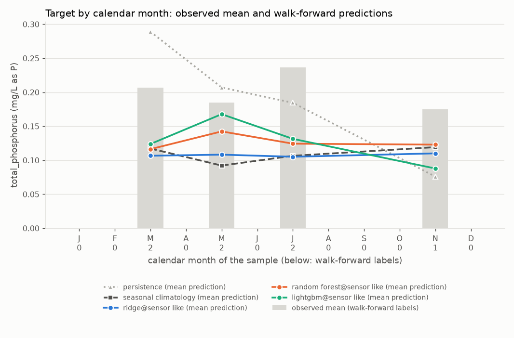
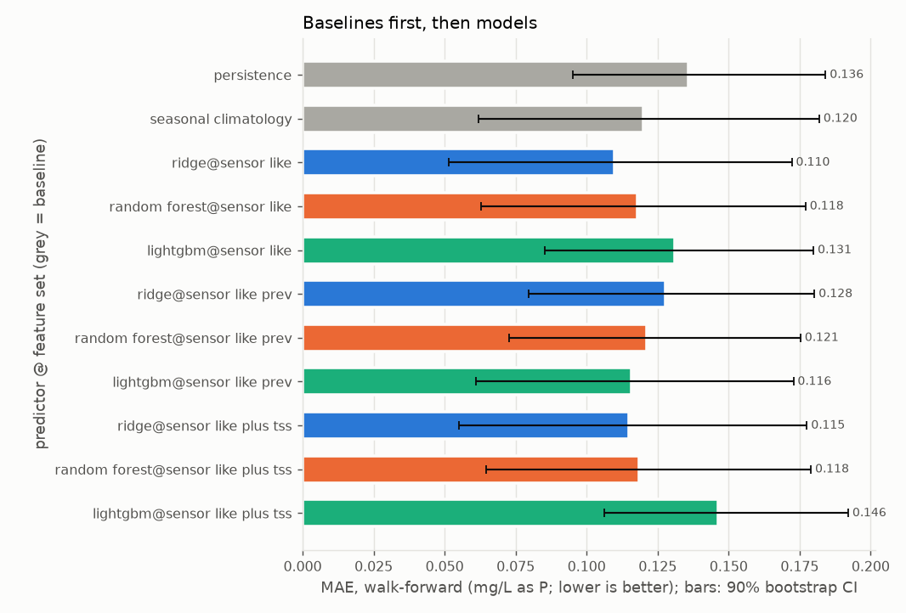
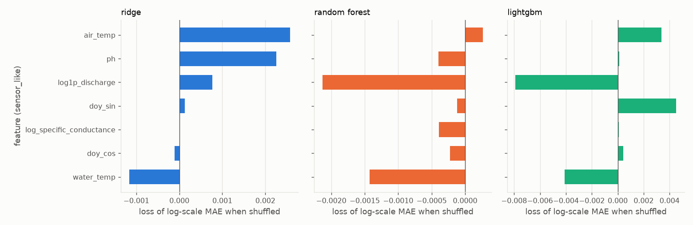

# Report: crp_tp_13202

Real grab-sample data, `source=CRP` only, labels from 2014-01-01; `quality='good'` rows only. Input `data/clean/crp_long.csv` (SHA-256 `eef7c00928bcd8ce...`). Stations: 13202.

Total phosphorus (mg/L as P) at CRP station 13202 only. Regression on the log1p scale. No event target: no threshold is agreed.

## First lines

### Primary target: regression of total_phosphorus (mg/L as P), fitted on the log1p scale

- Labels used: 35 on 35 distinct dates, 4 left-censored (13202: 35).
- Censored labels: left-censored values enter at detection limit x 0.5; 0 right-censored dropped.
- Walk-forward: 3 folds (test years 2021 to 2023), n_train from 21 to 26, n_test = 7 on 7 dates.
- Final hold-out (evaluated once, last 7 distinct dates, from 2024-03-27): n_train = 28, n_holdout = 7.
- **Persistence** means: the last sample at this station, carried forward (the previous label at the same station on a strictly earlier date; with no earlier label, the training median).
- **Seasonal climatology** means: the mean of the training targets within plus or minus 1 calendar month(s) of the test month, pooled over the task's stations (with fewer than 3 training labels in that window, the mean of all training targets).
- Verdicts, walk-forward, headline feature set `sensor_like` (deployable):
  - seasonal climatology shows no demonstrable difference from persistence (MAE difference -0.016, 90% CI [-0.092, +0.050]).
  - ridge on sensor_like (deployable) shows no demonstrable difference from persistence (MAE difference -0.026, 90% CI [-0.103, +0.041]).
  - ridge on sensor_like (deployable) beats seasonal climatology (MAE difference -0.010, 90% CI [-0.018, -0.002]).
  - random_forest on sensor_like (deployable) shows no demonstrable difference from persistence (MAE difference -0.018, 90% CI [-0.094, +0.044]).
  - random_forest on sensor_like (deployable) shows no demonstrable difference from seasonal climatology (MAE difference -0.002, 90% CI [-0.010, +0.006]).
  - lightgbm on sensor_like (deployable) shows no demonstrable difference from persistence (MAE difference -0.005, 90% CI [-0.077, +0.052]).
  - lightgbm on sensor_like (deployable) shows no demonstrable difference from seasonal climatology (MAE difference +0.011, 90% CI [-0.006, +0.026]).
- Verdicts, final hold-out, headline feature set `sensor_like`:
  - seasonal climatology shows no demonstrable difference from persistence (MAE difference +0.005, 90% CI [-0.027, +0.035]).
  - ridge on sensor_like (deployable) is worse than persistence (MAE difference +0.089, 90% CI [+0.031, +0.146]).
  - ridge on sensor_like (deployable) is worse than seasonal climatology (MAE difference +0.084, 90% CI [+0.030, +0.138]).
  - random_forest on sensor_like (deployable) shows no demonstrable difference from persistence (MAE difference +0.009, 90% CI [-0.029, +0.043]).
  - random_forest on sensor_like (deployable) shows no demonstrable difference from seasonal climatology (MAE difference +0.003, 90% CI [-0.010, +0.017]).
  - lightgbm on sensor_like (deployable) shows no demonstrable difference from persistence (MAE difference +0.015, 90% CI [-0.033, +0.062]).
  - lightgbm on sensor_like (deployable) shows no demonstrable difference from seasonal climatology (MAE difference +0.009, 90% CI [-0.021, +0.039]).

## Warnings

- WARNING [regression] fold 2018 skipped: 14 training labels, fewer than min_train_labels=20.
- WARNING [regression] fold 2019 skipped: 15 training labels, fewer than min_train_labels=20.
- WARNING [regression] fold 2020 skipped: 19 training labels, fewer than min_train_labels=20.
- WARNING [regression] n_train below 50 in: 2021 (21), 2022 (24), 2023 (26), holdout (28).
- WARNING [regression] only 7 walk-forward residuals (fewer than 30): the conformal intervals are not meaningful.
- WARNING [regression] feature set sensor_like: only 20% of the 5 labels in 2025 and 2026 have every feature (below 50%); the rest are imputed.
- WARNING [regression] feature set sensor_like_prev: only 20% of the 5 labels in 2025 and 2026 have every feature (below 50%); the rest are imputed.
- WARNING [regression] feature set sensor_like_plus_tss: only 20% of the 5 labels in 2025 and 2026 have every feature (below 50%); the rest are imputed.
- WARNING [regression] 5 of 6 station-years in the test windows have fewer than 4 labels (minimum 1).

## Metrics

### Regression target: regression of total_phosphorus (mg/L as P), fitted on the log1p scale

Folds:

| fold | n_train | n_test | last train date | first test date | last test date |
|---|---|---|---|---|---|
| 2021 | 21 | 3 | 2020-11-30 | 2021-03-31 | 2021-07-26 |
| 2022 | 24 | 2 | 2021-07-26 | 2022-03-16 | 2022-05-18 |
| 2023 | 26 | 2 | 2022-05-18 | 2023-07-18 | 2023-11-29 |
| holdout | 28 | 7 | 2023-11-29 | 2024-03-27 | 2026-03-30 |

#### Walk-forward

All labels: n = 7 on 7 dates (0 left-censored). MAE and RMSE in mg/L as P. Brackets: 90% bootstrap CI over distinct dates.

| predictor | deployable | MAE | RMSE | R2 | MAE (log scale) | skill vs persistence | skill vs climatology |
|---|---|---|---|---|---|---|---|
| persistence | baseline | 0.136 [0.095, 0.184] | 0.155 [0.099, 0.205] | -1.174 [-11.441, -0.020] | 0.111 [0.080, 0.147] | 0.000 [0.000, 0.000] | -0.131 [-1.281, 0.289] |
| seasonal_climatology | baseline | 0.120 [0.062, 0.182] | 0.154 [0.069, 0.214] | -1.161 [-4.094, -0.480] | 0.101 [0.055, 0.151] | 0.116 [-0.406, 0.562] | 0.000 [0.000, 0.000] |
| ridge@sensor_like | yes | 0.110 [0.051, 0.172] | 0.148 [0.066, 0.205] | -0.994 [-3.801, -0.283] | 0.092 [0.044, 0.143] | 0.191 [-0.330, 0.642] | 0.084 [0.015, 0.234] |
| random_forest@sensor_like | yes | 0.118 [0.063, 0.177] | 0.150 [0.071, 0.206] | -1.051 [-3.908, -0.505] | 0.099 [0.054, 0.146] | 0.132 [-0.354, 0.568] | 0.018 [-0.063, 0.081] |
| lightgbm@sensor_like | yes | 0.131 [0.085, 0.180] | 0.152 [0.094, 0.197] | -1.087 [-5.312, -0.496] | 0.110 [0.074, 0.148] | 0.034 [-0.454, 0.449] | -0.093 [-0.372, 0.035] |
| ridge@sensor_like_prev | yes | 0.128 [0.080, 0.180] | 0.153 [0.083, 0.206] | -1.134 [-3.978, -0.653] | 0.108 [0.069, 0.149] | 0.058 [-0.355, 0.420] | -0.066 [-0.341, 0.053] |
| random_forest@sensor_like_prev | yes | 0.121 [0.073, 0.175] | 0.148 [0.076, 0.201] | -0.980 [-3.400, -0.566] | 0.102 [0.063, 0.144] | 0.106 [-0.303, 0.470] | -0.011 [-0.284, 0.121] |
| lightgbm@sensor_like_prev | yes | 0.116 [0.061, 0.173] | 0.148 [0.072, 0.200] | -0.978 [-4.515, -0.006] | 0.098 [0.052, 0.145] | 0.147 [-0.309, 0.519] | 0.034 [-0.452, 0.355] |
| ridge@sensor_like_plus_tss | NO (diagnostic) | 0.115 [0.055, 0.178] | 0.152 [0.071, 0.207] | -1.091 [-4.048, -0.412] | 0.096 [0.047, 0.148] | 0.153 [-0.394, 0.618] | 0.041 [-0.059, 0.183] |
| random_forest@sensor_like_plus_tss | NO (diagnostic) | 0.118 [0.064, 0.179] | 0.150 [0.072, 0.207] | -1.045 [-3.772, -0.475] | 0.099 [0.056, 0.147] | 0.128 [-0.363, 0.562] | 0.013 [-0.057, 0.051] |
| lightgbm@sensor_like_plus_tss | NO (diagnostic) | 0.146 [0.106, 0.192] | 0.163 [0.111, 0.214] | -1.399 [-6.683, -0.752] | 0.123 [0.091, 0.158] | -0.078 [-0.520, 0.265] | -0.220 [-0.792, 0.007] |

Numeric-only (uncensored) labels: n = 7 on 7 dates (0 left-censored). MAE and RMSE in mg/L as P. Brackets: 90% bootstrap CI over distinct dates.

| predictor | deployable | MAE | RMSE | R2 | MAE (log scale) | skill vs persistence | skill vs climatology |
|---|---|---|---|---|---|---|---|
| persistence | baseline | 0.136 [0.095, 0.184] | 0.155 [0.099, 0.205] | -1.174 [-11.441, -0.020] | 0.111 [0.080, 0.147] | 0.000 [0.000, 0.000] | -0.131 [-1.281, 0.289] |
| seasonal_climatology | baseline | 0.120 [0.062, 0.182] | 0.154 [0.069, 0.214] | -1.161 [-4.094, -0.480] | 0.101 [0.055, 0.151] | 0.116 [-0.406, 0.562] | 0.000 [0.000, 0.000] |
| ridge@sensor_like | yes | 0.110 [0.051, 0.172] | 0.148 [0.066, 0.205] | -0.994 [-3.801, -0.283] | 0.092 [0.044, 0.143] | 0.191 [-0.330, 0.642] | 0.084 [0.015, 0.234] |
| random_forest@sensor_like | yes | 0.118 [0.063, 0.177] | 0.150 [0.071, 0.206] | -1.051 [-3.908, -0.505] | 0.099 [0.054, 0.146] | 0.132 [-0.354, 0.568] | 0.018 [-0.063, 0.081] |
| lightgbm@sensor_like | yes | 0.131 [0.085, 0.180] | 0.152 [0.094, 0.197] | -1.087 [-5.312, -0.496] | 0.110 [0.074, 0.148] | 0.034 [-0.454, 0.449] | -0.093 [-0.372, 0.035] |
| ridge@sensor_like_prev | yes | 0.128 [0.080, 0.180] | 0.153 [0.083, 0.206] | -1.134 [-3.978, -0.653] | 0.108 [0.069, 0.149] | 0.058 [-0.355, 0.420] | -0.066 [-0.341, 0.053] |
| random_forest@sensor_like_prev | yes | 0.121 [0.073, 0.175] | 0.148 [0.076, 0.201] | -0.980 [-3.400, -0.566] | 0.102 [0.063, 0.144] | 0.106 [-0.303, 0.470] | -0.011 [-0.284, 0.121] |
| lightgbm@sensor_like_prev | yes | 0.116 [0.061, 0.173] | 0.148 [0.072, 0.200] | -0.978 [-4.515, -0.006] | 0.098 [0.052, 0.145] | 0.147 [-0.309, 0.519] | 0.034 [-0.452, 0.355] |
| ridge@sensor_like_plus_tss | NO (diagnostic) | 0.115 [0.055, 0.178] | 0.152 [0.071, 0.207] | -1.091 [-4.048, -0.412] | 0.096 [0.047, 0.148] | 0.153 [-0.394, 0.618] | 0.041 [-0.059, 0.183] |
| random_forest@sensor_like_plus_tss | NO (diagnostic) | 0.118 [0.064, 0.179] | 0.150 [0.072, 0.207] | -1.045 [-3.772, -0.475] | 0.099 [0.056, 0.147] | 0.128 [-0.363, 0.562] | 0.013 [-0.057, 0.051] |
| lightgbm@sensor_like_plus_tss | NO (diagnostic) | 0.146 [0.106, 0.192] | 0.163 [0.111, 0.214] | -1.399 [-6.683, -0.752] | 0.123 [0.091, 0.158] | -0.078 [-0.520, 0.265] | -0.220 [-0.792, 0.007] |

Paired differences (lower MAE is better):

| model | baseline | MAE difference (model - baseline) | verdict (by MAE) |
|---|---|---|---|
| persistence | seasonal_climatology | +0.016 [-0.050, +0.092] | no demonstrable difference |
| seasonal_climatology | persistence | -0.016 [-0.092, +0.050] | no demonstrable difference |
| ridge@sensor_like | persistence | -0.026 [-0.103, +0.041] | no demonstrable difference |
| ridge@sensor_like | seasonal_climatology | -0.010 [-0.018, -0.002] | beats |
| random_forest@sensor_like | persistence | -0.018 [-0.094, +0.044] | no demonstrable difference |
| random_forest@sensor_like | seasonal_climatology | -0.002 [-0.010, +0.006] | no demonstrable difference |
| lightgbm@sensor_like | persistence | -0.005 [-0.077, +0.052] | no demonstrable difference |
| lightgbm@sensor_like | seasonal_climatology | +0.011 [-0.006, +0.026] | no demonstrable difference |
| ridge@sensor_like_prev | persistence | -0.008 [-0.068, +0.044] | no demonstrable difference |
| ridge@sensor_like_prev | seasonal_climatology | +0.008 [-0.009, +0.026] | no demonstrable difference |
| random_forest@sensor_like_prev | persistence | -0.014 [-0.073, +0.038] | no demonstrable difference |
| random_forest@sensor_like_prev | seasonal_climatology | +0.001 [-0.016, +0.021] | no demonstrable difference |
| lightgbm@sensor_like_prev | persistence | -0.020 [-0.077, +0.037] | no demonstrable difference |
| lightgbm@sensor_like_prev | seasonal_climatology | -0.004 [-0.049, +0.041] | no demonstrable difference |
| ridge@sensor_like_plus_tss | persistence | -0.021 [-0.102, +0.048] | no demonstrable difference |
| ridge@sensor_like_plus_tss | seasonal_climatology | -0.005 [-0.017, +0.006] | no demonstrable difference |
| random_forest@sensor_like_plus_tss | persistence | -0.017 [-0.094, +0.044] | no demonstrable difference |
| random_forest@sensor_like_plus_tss | seasonal_climatology | -0.002 [-0.007, +0.004] | no demonstrable difference |
| lightgbm@sensor_like_plus_tss | persistence | +0.011 [-0.043, +0.060] | no demonstrable difference |
| lightgbm@sensor_like_plus_tss | seasonal_climatology | +0.026 [-0.001, +0.055] | no demonstrable difference |

#### Final hold-out (evaluated once)

All labels: n = 7 on 7 dates (0 left-censored). MAE and RMSE in mg/L as P. Brackets: 90% bootstrap CI over distinct dates.

| predictor | deployable | MAE | RMSE | R2 | MAE (log scale) | skill vs persistence | skill vs climatology |
|---|---|---|---|---|---|---|---|
| persistence | baseline | 0.062 [0.043, 0.080] | 0.069 [0.048, 0.083] | -1.864 [-16.897, -0.980] | 0.052 [0.036, 0.067] | 0.000 [0.000, 0.000] | 0.079 [-0.590, 0.424] |
| seasonal_climatology | baseline | 0.067 [0.043, 0.095] | 0.079 [0.045, 0.104] | -2.833 [-8.233, -1.766] | 0.058 [0.037, 0.080] | -0.086 [-0.737, 0.371] | 0.000 [0.000, 0.000] |
| ridge@sensor_like | yes | 0.151 [0.103, 0.198] | 0.169 [0.123, 0.203] | -16.337 [-117.651, -6.455] | 0.121 [0.084, 0.156] | -1.433 [-3.265, -0.388] | -1.241 [-2.874, -0.382] |
| random_forest@sensor_like | yes | 0.071 [0.041, 0.101] | 0.087 [0.053, 0.112] | -3.594 [-12.136, -1.749] | 0.061 [0.036, 0.087] | -0.142 [-0.896, 0.404] | -0.051 [-0.257, 0.172] |
| lightgbm@sensor_like | yes | 0.077 [0.034, 0.118] | 0.102 [0.053, 0.134] | -5.343 [-22.549, -1.417] | 0.067 [0.029, 0.102] | -0.237 [-1.138, 0.454] | -0.139 [-0.624, 0.351] |
| ridge@sensor_like_prev | yes | 0.147 [0.092, 0.198] | 0.169 [0.118, 0.207] | -16.355 [-119.508, -6.135] | 0.116 [0.075, 0.155] | -1.361 [-3.213, -0.280] | -1.174 [-2.838, -0.286] |
| random_forest@sensor_like_prev | yes | 0.059 [0.033, 0.083] | 0.072 [0.045, 0.091] | -2.128 [-8.050, -1.121] | 0.050 [0.029, 0.070] | 0.052 [-0.551, 0.477] | 0.127 [-0.119, 0.346] |
| lightgbm@sensor_like_prev | yes | 0.070 [0.039, 0.098] | 0.084 [0.055, 0.106] | -3.339 [-25.276, -1.059] | 0.058 [0.033, 0.082] | -0.119 [-0.392, 0.206] | -0.030 [-0.755, 0.426] |
| ridge@sensor_like_plus_tss | NO (diagnostic) | 0.163 [0.108, 0.217] | 0.182 [0.129, 0.222] | -19.265 [-140.377, -7.645] | 0.129 [0.089, 0.168] | -1.621 [-3.639, -0.505] | -1.413 [-3.166, -0.482] |
| random_forest@sensor_like_plus_tss | NO (diagnostic) | 0.077 [0.049, 0.107] | 0.090 [0.059, 0.115] | -3.969 [-14.285, -2.196] | 0.067 [0.042, 0.091] | -0.242 [-1.026, 0.295] | -0.143 [-0.328, 0.024] |
| lightgbm@sensor_like_plus_tss | NO (diagnostic) | 0.067 [0.033, 0.102] | 0.088 [0.047, 0.115] | -3.677 [-12.463, -1.420] | 0.057 [0.028, 0.087] | -0.075 [-0.887, 0.509] | 0.010 [-0.277, 0.368] |

Numeric-only (uncensored) labels: n = 7 on 7 dates (0 left-censored). MAE and RMSE in mg/L as P. Brackets: 90% bootstrap CI over distinct dates.

| predictor | deployable | MAE | RMSE | R2 | MAE (log scale) | skill vs persistence | skill vs climatology |
|---|---|---|---|---|---|---|---|
| persistence | baseline | 0.062 [0.043, 0.080] | 0.069 [0.048, 0.083] | -1.864 [-16.897, -0.980] | 0.052 [0.036, 0.067] | 0.000 [0.000, 0.000] | 0.079 [-0.590, 0.424] |
| seasonal_climatology | baseline | 0.067 [0.043, 0.095] | 0.079 [0.045, 0.104] | -2.833 [-8.233, -1.766] | 0.058 [0.037, 0.080] | -0.086 [-0.737, 0.371] | 0.000 [0.000, 0.000] |
| ridge@sensor_like | yes | 0.151 [0.103, 0.198] | 0.169 [0.123, 0.203] | -16.337 [-117.651, -6.455] | 0.121 [0.084, 0.156] | -1.433 [-3.265, -0.388] | -1.241 [-2.874, -0.382] |
| random_forest@sensor_like | yes | 0.071 [0.041, 0.101] | 0.087 [0.053, 0.112] | -3.594 [-12.136, -1.749] | 0.061 [0.036, 0.087] | -0.142 [-0.896, 0.404] | -0.051 [-0.257, 0.172] |
| lightgbm@sensor_like | yes | 0.077 [0.034, 0.118] | 0.102 [0.053, 0.134] | -5.343 [-22.549, -1.417] | 0.067 [0.029, 0.102] | -0.237 [-1.138, 0.454] | -0.139 [-0.624, 0.351] |
| ridge@sensor_like_prev | yes | 0.147 [0.092, 0.198] | 0.169 [0.118, 0.207] | -16.355 [-119.508, -6.135] | 0.116 [0.075, 0.155] | -1.361 [-3.213, -0.280] | -1.174 [-2.838, -0.286] |
| random_forest@sensor_like_prev | yes | 0.059 [0.033, 0.083] | 0.072 [0.045, 0.091] | -2.128 [-8.050, -1.121] | 0.050 [0.029, 0.070] | 0.052 [-0.551, 0.477] | 0.127 [-0.119, 0.346] |
| lightgbm@sensor_like_prev | yes | 0.070 [0.039, 0.098] | 0.084 [0.055, 0.106] | -3.339 [-25.276, -1.059] | 0.058 [0.033, 0.082] | -0.119 [-0.392, 0.206] | -0.030 [-0.755, 0.426] |
| ridge@sensor_like_plus_tss | NO (diagnostic) | 0.163 [0.108, 0.217] | 0.182 [0.129, 0.222] | -19.265 [-140.377, -7.645] | 0.129 [0.089, 0.168] | -1.621 [-3.639, -0.505] | -1.413 [-3.166, -0.482] |
| random_forest@sensor_like_plus_tss | NO (diagnostic) | 0.077 [0.049, 0.107] | 0.090 [0.059, 0.115] | -3.969 [-14.285, -2.196] | 0.067 [0.042, 0.091] | -0.242 [-1.026, 0.295] | -0.143 [-0.328, 0.024] |
| lightgbm@sensor_like_plus_tss | NO (diagnostic) | 0.067 [0.033, 0.102] | 0.088 [0.047, 0.115] | -3.677 [-12.463, -1.420] | 0.057 [0.028, 0.087] | -0.075 [-0.887, 0.509] | 0.010 [-0.277, 0.368] |

Paired differences (lower MAE is better):

| model | baseline | MAE difference (model - baseline) | verdict (by MAE) |
|---|---|---|---|
| persistence | seasonal_climatology | -0.005 [-0.035, +0.027] | no demonstrable difference |
| seasonal_climatology | persistence | +0.005 [-0.027, +0.035] | no demonstrable difference |
| ridge@sensor_like | persistence | +0.089 [+0.031, +0.146] | is worse than |
| ridge@sensor_like | seasonal_climatology | +0.084 [+0.030, +0.138] | is worse than |
| random_forest@sensor_like | persistence | +0.009 [-0.029, +0.043] | no demonstrable difference |
| random_forest@sensor_like | seasonal_climatology | +0.003 [-0.010, +0.017] | no demonstrable difference |
| lightgbm@sensor_like | persistence | +0.015 [-0.033, +0.062] | no demonstrable difference |
| lightgbm@sensor_like | seasonal_climatology | +0.009 [-0.021, +0.039] | no demonstrable difference |
| ridge@sensor_like_prev | persistence | +0.085 [+0.020, +0.146] | is worse than |
| ridge@sensor_like_prev | seasonal_climatology | +0.079 [+0.022, +0.139] | is worse than |
| random_forest@sensor_like_prev | persistence | -0.003 [-0.035, +0.025] | no demonstrable difference |
| random_forest@sensor_like_prev | seasonal_climatology | -0.009 [-0.023, +0.007] | no demonstrable difference |
| lightgbm@sensor_like_prev | persistence | +0.007 [-0.012, +0.026] | no demonstrable difference |
| lightgbm@sensor_like_prev | seasonal_climatology | +0.002 [-0.034, +0.038] | no demonstrable difference |
| ridge@sensor_like_plus_tss | persistence | +0.101 [+0.038, +0.164] | is worse than |
| ridge@sensor_like_plus_tss | seasonal_climatology | +0.095 [+0.038, +0.153] | is worse than |
| random_forest@sensor_like_plus_tss | persistence | +0.015 [-0.021, +0.048] | no demonstrable difference |
| random_forest@sensor_like_plus_tss | seasonal_climatology | +0.010 [-0.001, +0.020] | no demonstrable difference |
| lightgbm@sensor_like_plus_tss | persistence | +0.005 [-0.038, +0.046] | no demonstrable difference |
| lightgbm@sensor_like_plus_tss | seasonal_climatology | -0.001 [-0.021, +0.019] | no demonstrable difference |

Intervals: split-conformal on absolute walk-forward residuals (transformed scale), level 90%, from 7 residuals, applied to the hold-out predictions.
NOTE: fewer than 30 residuals; these intervals are not meaningful.

| model | half-width (transformed scale) | hold-out coverage | median width (mg/L as P) |
|---|---|---|---|
| ridge@sensor_like | infinite | undefined | undefined |
| random_forest@sensor_like | infinite | undefined | undefined |
| lightgbm@sensor_like | infinite | undefined | undefined |
| ridge@sensor_like_prev | infinite | undefined | undefined |
| random_forest@sensor_like_prev | infinite | undefined | undefined |
| lightgbm@sensor_like_prev | infinite | undefined | undefined |
| ridge@sensor_like_plus_tss | infinite | undefined | undefined |
| random_forest@sensor_like_plus_tss | infinite | undefined | undefined |
| lightgbm@sensor_like_plus_tss | infinite | undefined | undefined |

## Slices

### Regression target, walk-forward

**apr_sep**: n = 4 (0 left-censored)

| predictor | MAE | MAE (log scale) | skill vs persistence | skill vs climatology |
|---|---|---|---|---|
| persistence | 0.108 [0.074, 0.156] | 0.088 [0.064, 0.121] | 0.000 [0.000, 0.000] | 0.220 [-0.237, 0.345] |
| seasonal_climatology | 0.138 [0.058, 0.249] | 0.116 [0.051, 0.203] | -0.282 [-0.527, 0.192] | 0.000 [0.000, 0.000] |
| ridge@sensor_like | 0.121 [0.033, 0.230] | 0.101 [0.030, 0.186] | -0.122 [-0.445, 0.503] | 0.125 [0.070, 0.397] |
| random_forest@sensor_like | 0.133 [0.064, 0.232] | 0.111 [0.057, 0.187] | -0.235 [-0.477, 0.174] | 0.037 [-0.091, 0.118] |
| lightgbm@sensor_like | 0.144 [0.083, 0.217] | 0.120 [0.071, 0.174] | -0.336 [-0.551, -0.070] | -0.042 [-0.389, 0.106] |
| ridge@sensor_like_prev | 0.131 [0.064, 0.234] | 0.110 [0.057, 0.190] | -0.214 [-0.481, 0.179] | 0.053 [-0.016, 0.135] |
| random_forest@sensor_like_prev | 0.129 [0.067, 0.231] | 0.108 [0.059, 0.186] | -0.198 [-0.462, 0.120] | 0.065 [-0.077, 0.134] |
| lightgbm@sensor_like_prev | 0.094 [0.047, 0.169] | 0.077 [0.041, 0.132] | 0.129 [-0.072, 0.445] | 0.321 [0.028, 0.528] |
| ridge@sensor_like_plus_tss | 0.131 [0.052, 0.231] | 0.109 [0.044, 0.187] | -0.219 [-0.567, 0.262] | 0.049 [-0.104, 0.214] |
| random_forest@sensor_like_plus_tss | 0.137 [0.065, 0.238] | 0.114 [0.057, 0.193] | -0.268 [-0.497, 0.154] | 0.011 [-0.094, 0.061] |
| lightgbm@sensor_like_plus_tss | 0.162 [0.102, 0.240] | 0.135 [0.086, 0.195] | -0.504 [-0.832, -0.109] | -0.173 [-0.655, 0.020] |

**oct_mar**: n = 3 (0 left-censored)

| predictor | MAE | MAE (log scale) | skill vs persistence | skill vs climatology |
|---|---|---|---|---|
| persistence | 0.173 [0.109, 0.237] | 0.142 [0.093, 0.191] | 0.000 [0.000, 0.000] | -0.808 [-5.358, 0.239] |
| seasonal_climatology | 0.096 [0.036, 0.156] | 0.081 [0.032, 0.130] | 0.447 [-0.314, 0.843] | 0.000 [0.000, 0.000] |
| ridge@sensor_like | 0.095 [0.028, 0.162] | 0.080 [0.025, 0.136] | 0.451 [-0.369, 0.876] | 0.006 [-0.074, 0.214] |
| random_forest@sensor_like | 0.097 [0.037, 0.158] | 0.082 [0.033, 0.132] | 0.437 [-0.335, 0.837] | -0.019 [-0.050, 0.027] |
| lightgbm@sensor_like | 0.114 [0.059, 0.169] | 0.097 [0.052, 0.143] | 0.341 [-0.431, 0.743] | -0.191 [-0.634, -0.065] |
| ridge@sensor_like_prev | 0.124 [0.079, 0.169] | 0.105 [0.069, 0.142] | 0.283 [-0.354, 0.615] | -0.296 [-1.449, -0.030] |
| random_forest@sensor_like_prev | 0.111 [0.060, 0.162] | 0.094 [0.052, 0.135] | 0.359 [-0.218, 0.660] | -0.158 [-1.164, 0.117] |
| lightgbm@sensor_like_prev | 0.145 [0.058, 0.232] | 0.125 [0.050, 0.200] | 0.161 [-0.670, 0.644] | -0.517 [-1.587, -0.048] |
| ridge@sensor_like_plus_tss | 0.093 [0.024, 0.163] | 0.079 [0.021, 0.136] | 0.461 [-0.374, 0.896] | 0.026 [-0.076, 0.336] |
| random_forest@sensor_like_plus_tss | 0.094 [0.037, 0.150] | 0.079 [0.033, 0.125] | 0.457 [-0.271, 0.836] | 0.018 [-0.044, 0.037] |
| lightgbm@sensor_like_plus_tss | 0.125 [0.098, 0.153] | 0.106 [0.085, 0.127] | 0.276 [-0.183, 0.514] | -0.310 [-2.090, 0.100] |

### Regression target, final hold-out

**apr_sep**: n = 3 (0 left-censored)

| predictor | MAE | MAE (log scale) | skill vs persistence | skill vs climatology |
|---|---|---|---|---|
| persistence | 0.091 [0.083, 0.100] | 0.076 [0.068, 0.084] | 0.000 [0.000, 0.000] | -0.292 [-2.292, 0.256] |
| seasonal_climatology | 0.071 [0.030, 0.111] | 0.061 [0.027, 0.094] | 0.226 [-0.343, 0.696] | 0.000 [0.000, 0.000] |
| ridge@sensor_like | 0.126 [0.058, 0.194] | 0.098 [0.046, 0.151] | -0.376 [-1.144, 0.375] | -0.778 [-3.663, 0.140] |
| random_forest@sensor_like | 0.063 [0.025, 0.101] | 0.054 [0.022, 0.085] | 0.310 [-0.223, 0.750] | 0.108 [0.080, 0.177] |
| lightgbm@sensor_like | 0.050 [0.011, 0.089] | 0.042 [0.010, 0.074] | 0.453 [-0.071, 0.887] | 0.293 [0.197, 0.626] |
| ridge@sensor_like_prev | 0.126 [0.048, 0.203] | 0.097 [0.037, 0.158] | -0.375 [-1.248, 0.480] | -0.776 [-3.751, 0.283] |
| random_forest@sensor_like_prev | 0.054 [0.019, 0.089] | 0.045 [0.016, 0.074] | 0.412 [-0.061, 0.812] | 0.241 [-0.167, 0.506] |
| lightgbm@sensor_like_prev | 0.096 [0.072, 0.120] | 0.079 [0.060, 0.099] | -0.054 [-0.328, 0.214] | -0.362 [-2.521, 0.325] |
| ridge@sensor_like_plus_tss | 0.139 [0.067, 0.211] | 0.109 [0.053, 0.164] | -0.523 [-1.337, 0.273] | -0.967 [-4.115, 0.034] |
| random_forest@sensor_like_plus_tss | 0.069 [0.028, 0.111] | 0.059 [0.025, 0.094] | 0.239 [-0.337, 0.716] | 0.018 [-0.128, 0.113] |
| lightgbm@sensor_like_plus_tss | 0.048 [0.006, 0.090] | 0.040 [0.005, 0.076] | 0.475 [-0.074, 0.939] | 0.322 [0.162, 0.822] |

**oct_mar**: n = 4 (0 left-censored)

| predictor | MAE | MAE (log scale) | skill vs persistence | skill vs climatology |
|---|---|---|---|---|
| persistence | 0.040 [0.026, 0.053] | 0.034 [0.023, 0.044] | 0.000 [0.000, 0.000] | 0.381 [0.210, 0.464] |
| seasonal_climatology | 0.065 [0.045, 0.085] | 0.056 [0.039, 0.073] | -0.617 [-0.865, -0.266] | 0.000 [0.000, 0.000] |
| ridge@sensor_like | 0.170 [0.122, 0.226] | 0.137 [0.101, 0.175] | -3.232 [-7.520, -1.903] | -1.618 [-3.835, -0.622] |
| random_forest@sensor_like | 0.077 [0.034, 0.112] | 0.067 [0.029, 0.097] | -0.910 [-1.223, -0.308] | -0.182 [-0.472, 0.174] |
| lightgbm@sensor_like | 0.097 [0.038, 0.149] | 0.085 [0.034, 0.133] | -1.411 [-1.890, -0.262] | -0.491 [-1.193, 0.305] |
| ridge@sensor_like_prev | 0.163 [0.109, 0.225] | 0.130 [0.090, 0.174] | -3.039 [-7.491, -1.612] | -1.498 [-3.858, -0.472] |
| random_forest@sensor_like_prev | 0.063 [0.031, 0.089] | 0.054 [0.026, 0.076] | -0.560 [-0.835, -0.167] | 0.035 [-0.165, 0.353] |
| lightgbm@sensor_like_prev | 0.049 [0.007, 0.087] | 0.042 [0.006, 0.074] | -0.229 [-0.643, 0.719] | 0.240 [-0.114, 0.824] |
| ridge@sensor_like_plus_tss | 0.181 [0.126, 0.250] | 0.145 [0.104, 0.192] | -3.489 [-8.452, -2.025] | -1.777 [-4.246, -0.687] |
| random_forest@sensor_like_plus_tss | 0.083 [0.048, 0.115] | 0.072 [0.042, 0.099] | -1.060 [-1.281, -0.728] | -0.274 [-0.519, -0.060] |
| lightgbm@sensor_like_plus_tss | 0.081 [0.037, 0.124] | 0.070 [0.032, 0.107] | -1.011 [-1.408, -0.435] | -0.244 [-0.621, 0.209] |

## Leakage checks

### Regression target

(a) Truncation: features rebuilt with every later row removed.

- `sensor_like`: PASS; 35 issue dates, 35 rows compared.
- `sensor_like_prev`: PASS; 35 issue dates, 35 rows compared.
- `sensor_like_plus_tss`: PASS; 35 issue dates, 35 rows compared.

(b) Shuffled training labels, 5 repeats (seeds [11, 12, 13, 14, 15]), scored on the 7 real walk-forward labels. MAE (transformed scale); reference = MAE of the training-mean predictor (transformed scale) = 0.091; suspected when the mean MAE skill against the training mean exceeds 0.10 (PLACEHOLDER).

| model | mean | per seed | result |
|---|---|---|---|
| ridge@sensor_like | 0.087 | 0.090, 0.077, 0.087, 0.103, 0.076 | ok |
| random_forest@sensor_like | 0.088 | 0.085, 0.088, 0.083, 0.097, 0.087 | ok |
| lightgbm@sensor_like | 0.096 | 0.102, 0.091, 0.085, 0.103, 0.098 | ok |
| ridge@sensor_like_prev | 0.096 | 0.105, 0.097, 0.089, 0.118, 0.072 | ok |
| random_forest@sensor_like_prev | 0.091 | 0.091, 0.094, 0.086, 0.101, 0.084 | ok |
| lightgbm@sensor_like_prev | 0.095 | 0.097, 0.103, 0.085, 0.098, 0.094 | ok |
| ridge@sensor_like_plus_tss | 0.091 | 0.098, 0.081, 0.088, 0.100, 0.088 | ok |
| random_forest@sensor_like_plus_tss | 0.091 | 0.099, 0.089, 0.089, 0.089, 0.086 | ok |
| lightgbm@sensor_like_plus_tss | 0.091 | 0.106, 0.095, 0.085, 0.083, 0.083 | ok |

(c) Leaky-feature guard: assert_no_future_dependence (the truncation guard) raises on a feature built from the next sample's target; asserted by tests/ml/test_drills.py::test_leaky_feature_trips_the_guard.

(d) what a random split would have claimed; NOT a valid estimate. Random 5-fold over the 28 labels before the hold-out, MAE (transformed scale):

| model | random split (NOT valid) | walk-forward (valid) |
|---|---|---|
| ridge@sensor_like | 0.068 | 0.092 |
| random_forest@sensor_like | 0.065 | 0.099 |
| lightgbm@sensor_like | 0.073 | 0.110 |

## Feature availability

### Regression target

| feature set | deployable | columns | complete cases, all labels | complete cases, last two calendar years | most-missing features (share missing) |
|---|---|---|---|---|---|
| sensor_like | yes | 7 | 74% of 35 | 20% of 5 (2025 and 2026) | ph 20%, log_specific_conductance 14%, log1p_discharge 14%, water_temp 11% |
| sensor_like_prev | yes | 9 | 71% of 35 | 20% of 5 (2025 and 2026) | ph 20%, log_specific_conductance 14%, log1p_discharge 14%, water_temp 11% |
| sensor_like_plus_tss | NO (diagnostic) | 8 | 69% of 35 | 20% of 5 (2025 and 2026) | ph 20%, log_specific_conductance 14%, log1p_discharge 14%, water_temp 11% |

Missing values are imputed with the training-fold median inside each fold, with a missing-indicator column. Same-visit measurements are same-date readings (a nowcast).

## Permutation importance

### Regression target (`sensor_like`)

permutation importance on the walk-forward test rows: mean drop in negative MAE (transformed scale) when one feature is shuffled within each fold's test rows. Positive = the model relies on the feature. Other feature sets are in metrics.json.

| feature | ridge@sensor_like | random_forest@sensor_like | lightgbm@sensor_like |
|---|---|---|---|
| air_temp | +0.003 | +0.000 | +0.003 |
| ph | +0.002 | -0.000 | +0.000 |
| log1p_discharge | +0.001 | -0.002 | -0.008 |
| doy_sin | +0.000 | -0.000 | +0.005 |
| log_specific_conductance | -0.000 | -0.000 | +0.000 |
| doy_cos | -0.000 | -0.000 | +0.000 |
| water_temp | -0.001 | -0.001 | -0.004 |

## Figures

## What this does and does not show

This shows how each predictor scored on 7 out-of-sample CRP labels (walk-forward, test years 2021 to 2023) when given readings from the same visit: a nowcast of the sample-date value, not a forecast for a later date. A model is said to beat a baseline only where the 90% interval of the paired difference excludes zero; the verdict lines at the top state the outcome for each baseline, and the same sentence form is used for every outcome. Seasonal climatology knows only the calendar month. A model that shows no demonstrable difference from it has not been shown to know more than the season. The final hold-out has 7 labels and was evaluated once; its intervals are wide and it cannot settle a close comparison. It does not show river performance of our own nodes: the inputs are CRP field and lab readings, not sensor data, and many recent rows have no field readings (see Feature availability). Feature sets marked NO (diagnostic) use a lab value from the same visit and say nothing about what a node could do. No hyperparameter was tuned, no result was used to choose a setting, and real and simulated data are not mixed.
