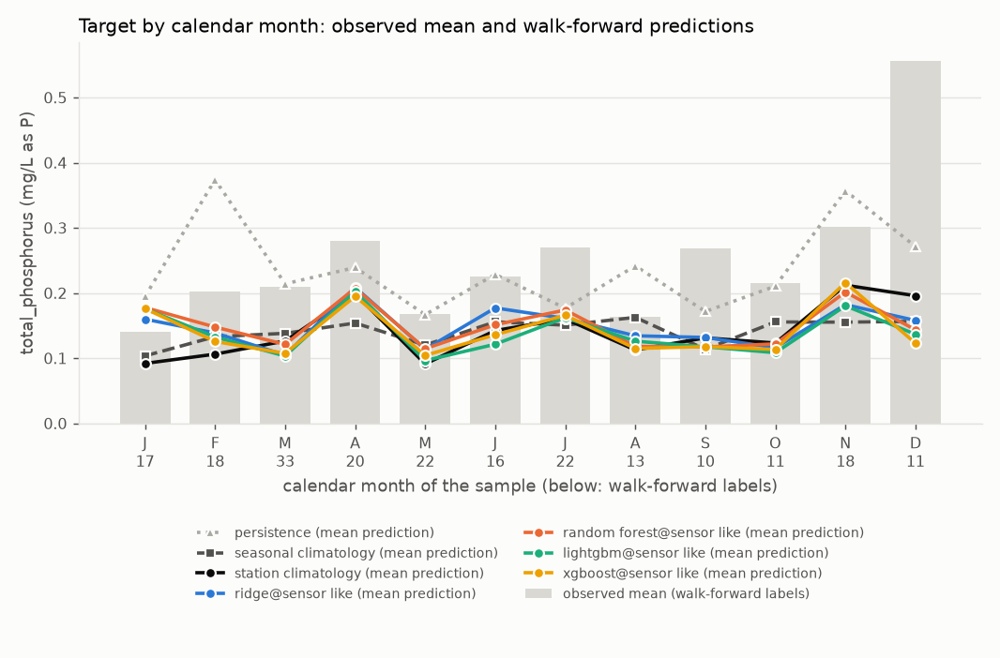
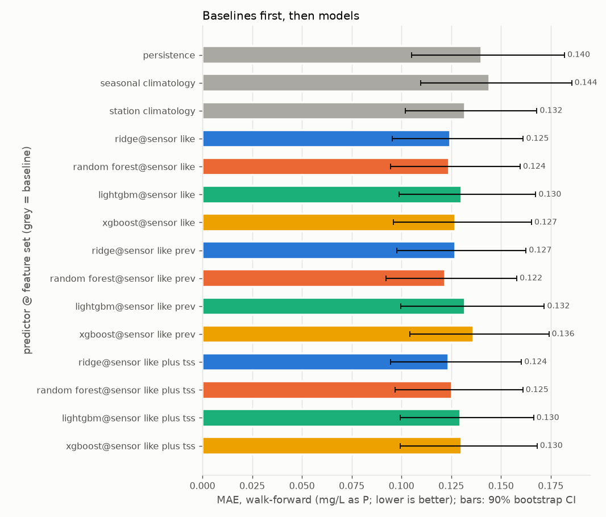
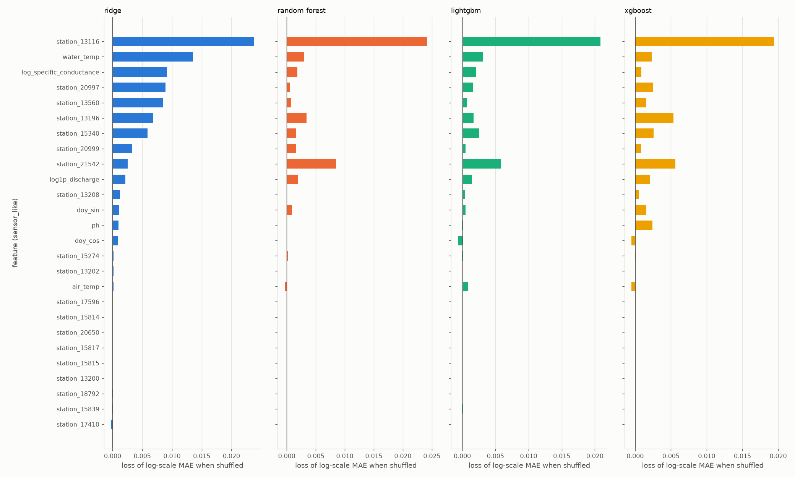

# Report: crp_tp_pooled

Real grab-sample data, `source=CRP` only, labels from 2014-01-01; `quality='good'` rows only. Input `data/clean/crp_long.csv` (SHA-256 `967f08554c419770...`). Stations: 13116, 13196, 13200, 13202, 13208, 13560, 15274, 15340, 15814, 15815, 15817, 15839, 17410, 17596, 18792, 20650, 20997, 20999, 21542.

Total phosphorus (mg/L as P) at 19 CRP stations of segment 2304 (as given by the owner), pooled. Regression on the log1p scale. No event target: no threshold is agreed. Features are same-visit readings (a nowcast), not a forecast.

## First lines

### Primary target: regression of total_phosphorus (mg/L as P), fitted on the log1p scale

- Labels used: 607 on 285 distinct dates, 110 left-censored (13116: 25, 13196: 27, 13200: 11, 13202: 35, 13208: 20, 13560: 60, 15274: 24, 15340: 21, 15814: 33, 15815: 10, 15817: 41, 15839: 22, 17410: 35, 17596: 16, 18792: 9, 20650: 13, 20997: 45, 20999: 98, 21542: 62).
- Censored labels: left-censored values enter at detection limit x 0.5; 0 right-censored dropped.
- Walk-forward: 6 folds (test years 2018 to 2023), n_train from 244 to 443, n_test = 211 on 99 dates.
- Final hold-out (evaluated once, last 57 distinct dates, from 2023-07-18): n_train = 454, n_holdout = 150.
- **Persistence** means: the last sample at this station, carried forward (the previous label at the same station on a strictly earlier date; with no earlier label, the training median).
- **Seasonal climatology** means: the mean of the training targets within plus or minus 1 calendar month(s) of the test month, pooled over the task's stations (with fewer than 3 training labels in that window, the mean of all training targets).
- **Station climatology** means: the mean of the training targets at the same station within plus or minus 1 calendar month(s) of the test month (with fewer than 3 such labels, the pooled seasonal climatology value).
- Verdicts, walk-forward, headline feature set `sensor_like` (deployable):
  - seasonal climatology shows no demonstrable difference from persistence (MAE difference +0.004, 90% CI [-0.032, +0.037]).
  - station climatology shows no demonstrable difference from seasonal climatology (MAE difference -0.012, 90% CI [-0.033, +0.006]).
  - ridge on sensor_like (deployable) shows no demonstrable difference from persistence (MAE difference -0.016, 90% CI [-0.050, +0.014]).
  - ridge on sensor_like (deployable) beats seasonal climatology (MAE difference -0.020, 90% CI [-0.038, -0.004]).
  - ridge on sensor_like (deployable) shows no demonstrable difference from station climatology (MAE difference -0.007, 90% CI [-0.017, +0.001]).
  - random_forest on sensor_like (deployable) shows no demonstrable difference from persistence (MAE difference -0.016, 90% CI [-0.052, +0.013]).
  - random_forest on sensor_like (deployable) beats seasonal climatology (MAE difference -0.020, 90% CI [-0.039, -0.004]).
  - random_forest on sensor_like (deployable) beats station climatology (MAE difference -0.008, 90% CI [-0.017, -0.000]).
  - lightgbm on sensor_like (deployable) shows no demonstrable difference from persistence (MAE difference -0.010, 90% CI [-0.046, +0.022]).
  - lightgbm on sensor_like (deployable) shows no demonstrable difference from seasonal climatology (MAE difference -0.014, 90% CI [-0.034, +0.003]).
  - lightgbm on sensor_like (deployable) shows no demonstrable difference from station climatology (MAE difference -0.002, 90% CI [-0.012, +0.008]).
  - xgboost on sensor_like (deployable) shows no demonstrable difference from persistence (MAE difference -0.013, 90% CI [-0.051, +0.018]).
  - xgboost on sensor_like (deployable) beats seasonal climatology (MAE difference -0.017, 90% CI [-0.034, -0.002]).
  - xgboost on sensor_like (deployable) shows no demonstrable difference from station climatology (MAE difference -0.005, 90% CI [-0.017, +0.006]).
- Verdicts, final hold-out, headline feature set `sensor_like`:
  - seasonal climatology is worse than persistence (MAE difference +0.040, 90% CI [+0.010, +0.075]).
  - station climatology beats seasonal climatology (MAE difference -0.024, 90% CI [-0.045, -0.008]).
  - ridge on sensor_like (deployable) shows no demonstrable difference from persistence (MAE difference -0.000, 90% CI [-0.019, +0.018]).
  - ridge on sensor_like (deployable) beats seasonal climatology (MAE difference -0.040, 90% CI [-0.064, -0.021]).
  - ridge on sensor_like (deployable) beats station climatology (MAE difference -0.016, 90% CI [-0.030, -0.004]).
  - random_forest on sensor_like (deployable) shows no demonstrable difference from persistence (MAE difference +0.015, 90% CI [-0.006, +0.038]).
  - random_forest on sensor_like (deployable) beats seasonal climatology (MAE difference -0.024, 90% CI [-0.042, -0.009]).
  - random_forest on sensor_like (deployable) shows no demonstrable difference from station climatology (MAE difference -0.000, 90% CI [-0.013, +0.012]).
  - lightgbm on sensor_like (deployable) shows no demonstrable difference from persistence (MAE difference +0.017, 90% CI [-0.003, +0.038]).
  - lightgbm on sensor_like (deployable) beats seasonal climatology (MAE difference -0.023, 90% CI [-0.041, -0.008]).
  - lightgbm on sensor_like (deployable) shows no demonstrable difference from station climatology (MAE difference +0.001, 90% CI [-0.012, +0.013]).
  - xgboost on sensor_like (deployable) shows no demonstrable difference from persistence (MAE difference +0.010, 90% CI [-0.012, +0.035]).
  - xgboost on sensor_like (deployable) beats seasonal climatology (MAE difference -0.030, 90% CI [-0.048, -0.015]).
  - xgboost on sensor_like (deployable) shows no demonstrable difference from station climatology (MAE difference -0.005, 90% CI [-0.018, +0.007]).

## Warnings

- WARNING [regression] 74 of 115 station-years in the test windows have fewer than 4 labels (minimum 1).

## Metrics

### Regression target: regression of total_phosphorus (mg/L as P), fitted on the log1p scale

Folds:

| fold | n_train | n_test | last train date | first test date | last test date |
|---|---|---|---|---|---|
| 2018 | 244 | 32 | 2017-12-04 | 2018-01-23 | 2018-12-18 |
| 2019 | 276 | 58 | 2018-11-27 | 2019-01-14 | 2019-12-18 |
| 2020 | 334 | 29 | 2019-11-05 | 2020-01-28 | 2020-12-14 |
| 2021 | 365 | 43 | 2020-12-14 | 2021-01-19 | 2021-12-14 |
| 2022 | 408 | 35 | 2021-12-14 | 2022-01-24 | 2022-08-30 |
| 2023 | 443 | 14 | 2022-08-30 | 2023-04-10 | 2023-07-17 |
| holdout | 454 | 150 | 2023-06-13 | 2023-07-18 | 2026-05-18 |

#### Walk-forward

All labels: n = 211 on 99 dates (18 left-censored). MAE and RMSE in mg/L as P. Brackets: 90% bootstrap CI over distinct dates.

| predictor | deployable | MAE | RMSE | R2 | MAE (log scale) | skill vs persistence | skill vs climatology |
|---|---|---|---|---|---|---|---|
| persistence | baseline | 0.140 [0.105, 0.182] | 0.376 [0.179, 0.523] | -0.153 [-1.800, 0.546] | 0.094 [0.078, 0.112] | 0.000 [0.000, 0.000] | 0.027 [-0.229, 0.227] |
| seasonal_climatology | baseline | 0.144 [0.110, 0.186] | 0.364 [0.209, 0.501] | -0.079 [-0.134, -0.052] | 0.103 [0.086, 0.123] | -0.028 [-0.294, 0.186] | 0.000 [0.000, 0.000] |
| station_climatology | baseline | 0.132 [0.102, 0.168] | 0.314 [0.169, 0.456] | 0.199 [-0.078, 0.535] | 0.094 [0.078, 0.113] | 0.059 [-0.187, 0.256] | 0.084 [-0.050, 0.207] |
| ridge@sensor_like | yes | 0.125 [0.095, 0.161] | 0.313 [0.158, 0.464] | 0.204 [-0.040, 0.560] | 0.088 [0.073, 0.106] | 0.112 [-0.112, 0.303] | 0.136 [0.028, 0.242] |
| random_forest@sensor_like | yes | 0.124 [0.094, 0.160] | 0.309 [0.161, 0.458] | 0.221 [-0.019, 0.565] | 0.087 [0.072, 0.104] | 0.116 [-0.110, 0.312] | 0.140 [0.031, 0.244] |
| lightgbm@sensor_like | yes | 0.130 [0.099, 0.167] | 0.326 [0.160, 0.472] | 0.134 [-0.066, 0.470] | 0.093 [0.077, 0.111] | 0.071 [-0.185, 0.285] | 0.096 [-0.019, 0.215] |
| xgboost@sensor_like | yes | 0.127 [0.096, 0.165] | 0.323 [0.162, 0.472] | 0.149 [-0.059, 0.476] | 0.089 [0.074, 0.108] | 0.094 [-0.147, 0.295] | 0.118 [0.016, 0.222] |
| ridge@sensor_like_prev | yes | 0.127 [0.098, 0.163] | 0.315 [0.162, 0.466] | 0.191 [-0.043, 0.530] | 0.090 [0.075, 0.107] | 0.094 [-0.127, 0.285] | 0.119 [0.016, 0.220] |
| random_forest@sensor_like_prev | yes | 0.122 [0.092, 0.158] | 0.309 [0.160, 0.455] | 0.221 [-0.003, 0.546] | 0.085 [0.070, 0.101] | 0.129 [-0.083, 0.314] | 0.153 [0.045, 0.256] |
| lightgbm@sensor_like_prev | yes | 0.132 [0.100, 0.172] | 0.336 [0.181, 0.477] | 0.082 [-0.125, 0.367] | 0.092 [0.076, 0.110] | 0.059 [-0.185, 0.268] | 0.085 [-0.036, 0.191] |
| xgboost@sensor_like_prev | yes | 0.136 [0.104, 0.174] | 0.327 [0.180, 0.471] | 0.128 [-0.133, 0.456] | 0.094 [0.078, 0.114] | 0.029 [-0.240, 0.256] | 0.055 [-0.102, 0.187] |
| ridge@sensor_like_plus_tss | NO (diagnostic) | 0.124 [0.094, 0.160] | 0.313 [0.158, 0.464] | 0.204 [-0.041, 0.563] | 0.087 [0.072, 0.105] | 0.118 [-0.104, 0.307] | 0.142 [0.033, 0.247] |
| random_forest@sensor_like_plus_tss | NO (diagnostic) | 0.125 [0.097, 0.161] | 0.308 [0.162, 0.456] | 0.229 [-0.013, 0.568] | 0.088 [0.074, 0.105] | 0.106 [-0.109, 0.293] | 0.130 [0.026, 0.234] |
| lightgbm@sensor_like_plus_tss | NO (diagnostic) | 0.130 [0.099, 0.166] | 0.320 [0.159, 0.464] | 0.167 [-0.028, 0.478] | 0.093 [0.077, 0.110] | 0.076 [-0.158, 0.273] | 0.101 [0.002, 0.203] |
| xgboost@sensor_like_plus_tss | NO (diagnostic) | 0.130 [0.099, 0.168] | 0.321 [0.163, 0.471] | 0.160 [-0.047, 0.473] | 0.092 [0.077, 0.110] | 0.072 [-0.169, 0.275] | 0.097 [-0.003, 0.196] |

Numeric-only (uncensored) labels: n = 193 on 92 dates (0 left-censored). MAE and RMSE in mg/L as P. Brackets: 90% bootstrap CI over distinct dates.

| predictor | deployable | MAE | RMSE | R2 | MAE (log scale) | skill vs persistence | skill vs climatology |
|---|---|---|---|---|---|---|---|
| persistence | baseline | 0.149 [0.111, 0.195] | 0.393 [0.180, 0.546] | -0.189 [-2.220, 0.561] | 0.098 [0.081, 0.117] | 0.000 [0.000, 0.000] | -0.016 [-0.329, 0.198] |
| seasonal_climatology | baseline | 0.147 [0.109, 0.193] | 0.379 [0.216, 0.523] | -0.106 [-0.182, -0.076] | 0.102 [0.082, 0.125] | 0.015 [-0.246, 0.247] | 0.000 [0.000, 0.000] |
| station_climatology | baseline | 0.140 [0.107, 0.182] | 0.327 [0.175, 0.479] | 0.176 [-0.103, 0.518] | 0.099 [0.083, 0.120] | 0.057 [-0.198, 0.272] | 0.042 [-0.104, 0.170] |
| ridge@sensor_like | yes | 0.133 [0.100, 0.175] | 0.327 [0.165, 0.486] | 0.178 [-0.090, 0.542] | 0.093 [0.077, 0.113] | 0.105 [-0.128, 0.316] | 0.091 [-0.026, 0.210] |
| random_forest@sensor_like | yes | 0.130 [0.098, 0.172] | 0.323 [0.167, 0.479] | 0.198 [-0.068, 0.552] | 0.091 [0.074, 0.110] | 0.124 [-0.099, 0.330] | 0.110 [-0.006, 0.226] |
| lightgbm@sensor_like | yes | 0.139 [0.104, 0.180] | 0.341 [0.171, 0.492] | 0.106 [-0.106, 0.461] | 0.098 [0.081, 0.118] | 0.069 [-0.189, 0.298] | 0.055 [-0.073, 0.187] |
| xgboost@sensor_like | yes | 0.135 [0.102, 0.178] | 0.338 [0.171, 0.489] | 0.122 [-0.101, 0.465] | 0.094 [0.077, 0.114] | 0.091 [-0.154, 0.314] | 0.077 [-0.032, 0.194] |
| ridge@sensor_like_prev | yes | 0.136 [0.103, 0.179] | 0.329 [0.168, 0.488] | 0.165 [-0.090, 0.512] | 0.095 [0.079, 0.115] | 0.088 [-0.144, 0.301] | 0.073 [-0.040, 0.186] |
| random_forest@sensor_like_prev | yes | 0.129 [0.096, 0.171] | 0.323 [0.167, 0.478] | 0.196 [-0.048, 0.523] | 0.088 [0.071, 0.107] | 0.134 [-0.081, 0.346] | 0.121 [0.005, 0.231] |
| lightgbm@sensor_like_prev | yes | 0.139 [0.104, 0.183] | 0.351 [0.188, 0.501] | 0.054 [-0.174, 0.343] | 0.096 [0.079, 0.115] | 0.065 [-0.183, 0.294] | 0.051 [-0.067, 0.174] |
| xgboost@sensor_like_prev | yes | 0.144 [0.108, 0.187] | 0.341 [0.184, 0.490] | 0.102 [-0.178, 0.436] | 0.098 [0.080, 0.118] | 0.036 [-0.241, 0.268] | 0.021 [-0.139, 0.166] |
| ridge@sensor_like_plus_tss | NO (diagnostic) | 0.132 [0.100, 0.174] | 0.327 [0.165, 0.486] | 0.179 [-0.091, 0.544] | 0.092 [0.076, 0.112] | 0.111 [-0.122, 0.320] | 0.097 [-0.020, 0.216] |
| random_forest@sensor_like_plus_tss | NO (diagnostic) | 0.133 [0.102, 0.175] | 0.321 [0.167, 0.477] | 0.205 [-0.060, 0.554] | 0.093 [0.077, 0.112] | 0.108 [-0.115, 0.309] | 0.094 [-0.019, 0.208] |
| lightgbm@sensor_like_plus_tss | NO (diagnostic) | 0.137 [0.105, 0.180] | 0.334 [0.168, 0.483] | 0.142 [-0.064, 0.470] | 0.097 [0.081, 0.116] | 0.078 [-0.166, 0.296] | 0.064 [-0.045, 0.177] |
| xgboost@sensor_like_plus_tss | NO (diagnostic) | 0.138 [0.105, 0.182] | 0.335 [0.170, 0.485] | 0.134 [-0.088, 0.470] | 0.097 [0.081, 0.116] | 0.074 [-0.170, 0.297] | 0.060 [-0.049, 0.175] |

Paired differences (lower MAE is better):

| model | baseline | MAE difference (model - baseline) | verdict (by MAE) |
|---|---|---|---|
| persistence | seasonal_climatology | -0.004 [-0.037, +0.032] | no demonstrable difference |
| persistence | station_climatology | +0.008 [-0.022, +0.043] | no demonstrable difference |
| seasonal_climatology | persistence | +0.004 [-0.032, +0.037] | no demonstrable difference |
| seasonal_climatology | station_climatology | +0.012 [-0.006, +0.033] | no demonstrable difference |
| station_climatology | persistence | -0.008 [-0.043, +0.022] | no demonstrable difference |
| station_climatology | seasonal_climatology | -0.012 [-0.033, +0.006] | no demonstrable difference |
| ridge@sensor_like | persistence | -0.016 [-0.050, +0.014] | no demonstrable difference |
| ridge@sensor_like | seasonal_climatology | -0.020 [-0.038, -0.004] | beats |
| ridge@sensor_like | station_climatology | -0.007 [-0.017, +0.001] | no demonstrable difference |
| random_forest@sensor_like | persistence | -0.016 [-0.052, +0.013] | no demonstrable difference |
| random_forest@sensor_like | seasonal_climatology | -0.020 [-0.039, -0.004] | beats |
| random_forest@sensor_like | station_climatology | -0.008 [-0.017, -0.000] | beats |
| lightgbm@sensor_like | persistence | -0.010 [-0.046, +0.022] | no demonstrable difference |
| lightgbm@sensor_like | seasonal_climatology | -0.014 [-0.034, +0.003] | no demonstrable difference |
| lightgbm@sensor_like | station_climatology | -0.002 [-0.012, +0.008] | no demonstrable difference |
| xgboost@sensor_like | persistence | -0.013 [-0.051, +0.018] | no demonstrable difference |
| xgboost@sensor_like | seasonal_climatology | -0.017 [-0.034, -0.002] | beats |
| xgboost@sensor_like | station_climatology | -0.005 [-0.017, +0.006] | no demonstrable difference |
| ridge@sensor_like_prev | persistence | -0.013 [-0.048, +0.016] | no demonstrable difference |
| ridge@sensor_like_prev | seasonal_climatology | -0.017 [-0.034, -0.002] | beats |
| ridge@sensor_like_prev | station_climatology | -0.005 [-0.015, +0.004] | no demonstrable difference |
| random_forest@sensor_like_prev | persistence | -0.018 [-0.051, +0.010] | no demonstrable difference |
| random_forest@sensor_like_prev | seasonal_climatology | -0.022 [-0.041, -0.006] | beats |
| random_forest@sensor_like_prev | station_climatology | -0.010 [-0.020, -0.000] | beats |
| lightgbm@sensor_like_prev | persistence | -0.008 [-0.043, +0.023] | no demonstrable difference |
| lightgbm@sensor_like_prev | seasonal_climatology | -0.012 [-0.030, +0.005] | no demonstrable difference |
| lightgbm@sensor_like_prev | station_climatology | -0.000 [-0.014, +0.014] | no demonstrable difference |
| xgboost@sensor_like_prev | persistence | -0.004 [-0.042, +0.029] | no demonstrable difference |
| xgboost@sensor_like_prev | seasonal_climatology | -0.008 [-0.030, +0.013] | no demonstrable difference |
| xgboost@sensor_like_prev | station_climatology | +0.004 [-0.011, +0.021] | no demonstrable difference |
| ridge@sensor_like_plus_tss | persistence | -0.017 [-0.050, +0.013] | no demonstrable difference |
| ridge@sensor_like_plus_tss | seasonal_climatology | -0.020 [-0.040, -0.004] | beats |
| ridge@sensor_like_plus_tss | station_climatology | -0.008 [-0.018, +0.000] | no demonstrable difference |
| random_forest@sensor_like_plus_tss | persistence | -0.015 [-0.050, +0.013] | no demonstrable difference |
| random_forest@sensor_like_plus_tss | seasonal_climatology | -0.019 [-0.037, -0.003] | beats |
| random_forest@sensor_like_plus_tss | station_climatology | -0.007 [-0.015, +0.001] | no demonstrable difference |
| lightgbm@sensor_like_plus_tss | persistence | -0.011 [-0.045, +0.019] | no demonstrable difference |
| lightgbm@sensor_like_plus_tss | seasonal_climatology | -0.015 [-0.033, -0.000] | beats |
| lightgbm@sensor_like_plus_tss | station_climatology | -0.002 [-0.013, +0.007] | no demonstrable difference |
| xgboost@sensor_like_plus_tss | persistence | -0.010 [-0.047, +0.021] | no demonstrable difference |
| xgboost@sensor_like_plus_tss | seasonal_climatology | -0.014 [-0.031, +0.000] | no demonstrable difference |
| xgboost@sensor_like_plus_tss | station_climatology | -0.002 [-0.014, +0.009] | no demonstrable difference |

#### Final hold-out (evaluated once)

All labels: n = 150 on 57 dates (10 left-censored). MAE and RMSE in mg/L as P. Brackets: 90% bootstrap CI over distinct dates.

| predictor | deployable | MAE | RMSE | R2 | MAE (log scale) | skill vs persistence | skill vs climatology |
|---|---|---|---|---|---|---|---|
| persistence | baseline | 0.117 [0.099, 0.137] | 0.189 [0.152, 0.226] | 0.556 [0.168, 0.733] | 0.084 [0.073, 0.096] | 0.000 [0.000, 0.000] | 0.253 [0.084, 0.381] |
| seasonal_climatology | baseline | 0.156 [0.122, 0.202] | 0.305 [0.211, 0.401] | -0.151 [-0.249, -0.089] | 0.114 [0.093, 0.140] | -0.339 [-0.616, -0.091] | 0.000 [0.000, 0.000] |
| station_climatology | baseline | 0.132 [0.106, 0.165] | 0.228 [0.175, 0.283] | 0.357 [-0.067, 0.558] | 0.096 [0.080, 0.116] | -0.130 [-0.337, 0.058] | 0.156 [0.058, 0.246] |
| ridge@sensor_like | yes | 0.116 [0.097, 0.142] | 0.192 [0.150, 0.238] | 0.544 [0.308, 0.650] | 0.084 [0.072, 0.097] | 0.004 [-0.163, 0.152] | 0.256 [0.173, 0.329] |
| random_forest@sensor_like | yes | 0.132 [0.105, 0.166] | 0.227 [0.167, 0.292] | 0.363 [0.127, 0.496] | 0.096 [0.080, 0.115] | -0.129 [-0.317, 0.054] | 0.156 [0.069, 0.230] |
| lightgbm@sensor_like | yes | 0.134 [0.110, 0.165] | 0.224 [0.168, 0.288] | 0.381 [0.162, 0.504] | 0.097 [0.083, 0.114] | -0.143 [-0.325, 0.030] | 0.146 [0.063, 0.218] |
| xgboost@sensor_like | yes | 0.127 [0.099, 0.162] | 0.228 [0.167, 0.291] | 0.359 [0.076, 0.523] | 0.090 [0.074, 0.109] | -0.085 [-0.294, 0.107] | 0.190 [0.111, 0.264] |
| ridge@sensor_like_prev | yes | 0.115 [0.096, 0.138] | 0.182 [0.145, 0.224] | 0.588 [0.363, 0.689] | 0.083 [0.072, 0.095] | 0.014 [-0.133, 0.151] | 0.263 [0.160, 0.350] |
| random_forest@sensor_like_prev | yes | 0.114 [0.093, 0.141] | 0.200 [0.144, 0.261] | 0.507 [0.352, 0.611] | 0.082 [0.070, 0.096] | 0.022 [-0.132, 0.154] | 0.270 [0.185, 0.338] |
| lightgbm@sensor_like_prev | yes | 0.123 [0.103, 0.149] | 0.200 [0.149, 0.258] | 0.506 [0.287, 0.650] | 0.089 [0.078, 0.102] | -0.054 [-0.225, 0.084] | 0.213 [0.094, 0.303] |
| xgboost@sensor_like_prev | yes | 0.116 [0.095, 0.143] | 0.203 [0.142, 0.271] | 0.490 [0.304, 0.652] | 0.083 [0.072, 0.097] | 0.006 [-0.156, 0.144] | 0.258 [0.159, 0.338] |
| ridge@sensor_like_plus_tss | NO (diagnostic) | 0.115 [0.095, 0.140] | 0.191 [0.149, 0.237] | 0.549 [0.336, 0.649] | 0.082 [0.071, 0.095] | 0.016 [-0.146, 0.163] | 0.265 [0.183, 0.334] |
| random_forest@sensor_like_plus_tss | NO (diagnostic) | 0.118 [0.094, 0.150] | 0.216 [0.152, 0.285] | 0.422 [0.249, 0.549] | 0.085 [0.071, 0.101] | -0.013 [-0.188, 0.145] | 0.243 [0.175, 0.307] |
| lightgbm@sensor_like_plus_tss | NO (diagnostic) | 0.125 [0.102, 0.153] | 0.216 [0.159, 0.278] | 0.422 [0.239, 0.530] | 0.090 [0.077, 0.105] | -0.067 [-0.223, 0.080] | 0.203 [0.122, 0.271] |
| xgboost@sensor_like_plus_tss | NO (diagnostic) | 0.122 [0.096, 0.155] | 0.225 [0.160, 0.297] | 0.376 [0.157, 0.536] | 0.086 [0.071, 0.104] | -0.042 [-0.233, 0.134] | 0.222 [0.156, 0.282] |

Numeric-only (uncensored) labels: n = 140 on 57 dates (0 left-censored). MAE and RMSE in mg/L as P. Brackets: 90% bootstrap CI over distinct dates.

| predictor | deployable | MAE | RMSE | R2 | MAE (log scale) | skill vs persistence | skill vs climatology |
|---|---|---|---|---|---|---|---|
| persistence | baseline | 0.121 [0.102, 0.143] | 0.195 [0.156, 0.233] | 0.535 [0.081, 0.724] | 0.087 [0.075, 0.099] | 0.000 [0.000, 0.000] | 0.230 [0.045, 0.369] |
| seasonal_climatology | baseline | 0.158 [0.121, 0.207] | 0.314 [0.214, 0.415] | -0.202 [-0.329, -0.132] | 0.113 [0.090, 0.142] | -0.299 [-0.584, -0.048] | 0.000 [0.000, 0.000] |
| station_climatology | baseline | 0.139 [0.110, 0.174] | 0.236 [0.181, 0.292] | 0.322 [-0.169, 0.539] | 0.100 [0.083, 0.121] | -0.144 [-0.355, 0.051] | 0.120 [0.013, 0.213] |
| ridge@sensor_like | yes | 0.121 [0.099, 0.148] | 0.198 [0.154, 0.246] | 0.521 [0.244, 0.638] | 0.086 [0.074, 0.100] | 0.003 [-0.170, 0.158] | 0.233 [0.141, 0.313] |
| random_forest@sensor_like | yes | 0.135 [0.106, 0.171] | 0.233 [0.170, 0.303] | 0.335 [0.058, 0.480] | 0.097 [0.079, 0.118] | -0.112 [-0.304, 0.074] | 0.144 [0.047, 0.227] |
| lightgbm@sensor_like | yes | 0.138 [0.112, 0.171] | 0.230 [0.172, 0.297] | 0.351 [0.092, 0.486] | 0.099 [0.083, 0.117] | -0.134 [-0.319, 0.046] | 0.127 [0.037, 0.208] |
| xgboost@sensor_like | yes | 0.131 [0.101, 0.167] | 0.235 [0.171, 0.302] | 0.328 [-0.000, 0.509] | 0.092 [0.074, 0.113] | -0.077 [-0.287, 0.121] | 0.171 [0.084, 0.249] |
| ridge@sensor_like_prev | yes | 0.119 [0.099, 0.144] | 0.188 [0.149, 0.233] | 0.569 [0.304, 0.678] | 0.085 [0.073, 0.098] | 0.016 [-0.136, 0.157] | 0.242 [0.131, 0.332] |
| random_forest@sensor_like_prev | yes | 0.116 [0.095, 0.145] | 0.205 [0.147, 0.270] | 0.486 [0.306, 0.595] | 0.082 [0.070, 0.096] | 0.042 [-0.119, 0.178] | 0.262 [0.173, 0.336] |
| lightgbm@sensor_like_prev | yes | 0.126 [0.104, 0.154] | 0.206 [0.152, 0.266] | 0.484 [0.232, 0.640] | 0.090 [0.078, 0.104] | -0.040 [-0.205, 0.100] | 0.200 [0.064, 0.297] |
| xgboost@sensor_like_prev | yes | 0.118 [0.096, 0.148] | 0.209 [0.144, 0.279] | 0.468 [0.263, 0.638] | 0.084 [0.072, 0.098] | 0.024 [-0.139, 0.161] | 0.249 [0.146, 0.331] |
| ridge@sensor_like_plus_tss | NO (diagnostic) | 0.120 [0.099, 0.145] | 0.197 [0.154, 0.246] | 0.527 [0.263, 0.636] | 0.085 [0.073, 0.098] | 0.014 [-0.155, 0.164] | 0.241 [0.151, 0.317] |
| random_forest@sensor_like_plus_tss | NO (diagnostic) | 0.122 [0.096, 0.156] | 0.223 [0.157, 0.296] | 0.392 [0.180, 0.527] | 0.086 [0.072, 0.104] | -0.006 [-0.186, 0.157] | 0.225 [0.150, 0.295] |
| lightgbm@sensor_like_plus_tss | NO (diagnostic) | 0.129 [0.105, 0.160] | 0.223 [0.164, 0.290] | 0.391 [0.173, 0.510] | 0.092 [0.079, 0.109] | -0.067 [-0.225, 0.084] | 0.179 [0.084, 0.255] |
| xgboost@sensor_like_plus_tss | NO (diagnostic) | 0.126 [0.098, 0.162] | 0.231 [0.164, 0.306] | 0.345 [0.092, 0.517] | 0.088 [0.071, 0.107] | -0.035 [-0.229, 0.147] | 0.204 [0.131, 0.269] |

Paired differences (lower MAE is better):

| model | baseline | MAE difference (model - baseline) | verdict (by MAE) |
|---|---|---|---|
| persistence | seasonal_climatology | -0.040 [-0.075, -0.010] | beats |
| persistence | station_climatology | -0.015 [-0.039, +0.007] | no demonstrable difference |
| seasonal_climatology | persistence | +0.040 [+0.010, +0.075] | is worse than |
| seasonal_climatology | station_climatology | +0.024 [+0.008, +0.045] | is worse than |
| station_climatology | persistence | +0.015 [-0.007, +0.039] | no demonstrable difference |
| station_climatology | seasonal_climatology | -0.024 [-0.045, -0.008] | beats |
| ridge@sensor_like | persistence | -0.000 [-0.019, +0.018] | no demonstrable difference |
| ridge@sensor_like | seasonal_climatology | -0.040 [-0.064, -0.021] | beats |
| ridge@sensor_like | station_climatology | -0.016 [-0.030, -0.004] | beats |
| random_forest@sensor_like | persistence | +0.015 [-0.006, +0.038] | no demonstrable difference |
| random_forest@sensor_like | seasonal_climatology | -0.024 [-0.042, -0.009] | beats |
| random_forest@sensor_like | station_climatology | -0.000 [-0.013, +0.012] | no demonstrable difference |
| lightgbm@sensor_like | persistence | +0.017 [-0.003, +0.038] | no demonstrable difference |
| lightgbm@sensor_like | seasonal_climatology | -0.023 [-0.041, -0.008] | beats |
| lightgbm@sensor_like | station_climatology | +0.001 [-0.012, +0.013] | no demonstrable difference |
| xgboost@sensor_like | persistence | +0.010 [-0.012, +0.035] | no demonstrable difference |
| xgboost@sensor_like | seasonal_climatology | -0.030 [-0.048, -0.015] | beats |
| xgboost@sensor_like | station_climatology | -0.005 [-0.018, +0.007] | no demonstrable difference |
| ridge@sensor_like_prev | persistence | -0.002 [-0.018, +0.014] | no demonstrable difference |
| ridge@sensor_like_prev | seasonal_climatology | -0.041 [-0.068, -0.020] | beats |
| ridge@sensor_like_prev | station_climatology | -0.017 [-0.034, -0.002] | beats |
| random_forest@sensor_like_prev | persistence | -0.003 [-0.019, +0.015] | no demonstrable difference |
| random_forest@sensor_like_prev | seasonal_climatology | -0.042 [-0.064, -0.024] | beats |
| random_forest@sensor_like_prev | station_climatology | -0.018 [-0.035, -0.003] | beats |
| lightgbm@sensor_like_prev | persistence | +0.006 [-0.011, +0.024] | no demonstrable difference |
| lightgbm@sensor_like_prev | seasonal_climatology | -0.033 [-0.059, -0.012] | beats |
| lightgbm@sensor_like_prev | station_climatology | -0.009 [-0.027, +0.008] | no demonstrable difference |
| xgboost@sensor_like_prev | persistence | -0.001 [-0.017, +0.017] | no demonstrable difference |
| xgboost@sensor_like_prev | seasonal_climatology | -0.040 [-0.064, -0.021] | beats |
| xgboost@sensor_like_prev | station_climatology | -0.016 [-0.033, +0.000] | no demonstrable difference |
| ridge@sensor_like_plus_tss | persistence | -0.002 [-0.020, +0.016] | no demonstrable difference |
| ridge@sensor_like_plus_tss | seasonal_climatology | -0.041 [-0.065, -0.023] | beats |
| ridge@sensor_like_plus_tss | station_climatology | -0.017 [-0.032, -0.005] | beats |
| random_forest@sensor_like_plus_tss | persistence | +0.002 [-0.017, +0.022] | no demonstrable difference |
| random_forest@sensor_like_plus_tss | seasonal_climatology | -0.038 [-0.055, -0.023] | beats |
| random_forest@sensor_like_plus_tss | station_climatology | -0.014 [-0.028, -0.001] | beats |
| lightgbm@sensor_like_plus_tss | persistence | +0.008 [-0.010, +0.026] | no demonstrable difference |
| lightgbm@sensor_like_plus_tss | seasonal_climatology | -0.032 [-0.051, -0.015] | beats |
| lightgbm@sensor_like_plus_tss | station_climatology | -0.007 [-0.023, +0.007] | no demonstrable difference |
| xgboost@sensor_like_plus_tss | persistence | +0.005 [-0.016, +0.028] | no demonstrable difference |
| xgboost@sensor_like_plus_tss | seasonal_climatology | -0.035 [-0.051, -0.021] | beats |
| xgboost@sensor_like_plus_tss | station_climatology | -0.010 [-0.023, +0.002] | no demonstrable difference |

Intervals: split-conformal on absolute walk-forward residuals (transformed scale), level 90%, from 211 residuals, applied to the hold-out predictions.

| model | half-width (transformed scale) | hold-out coverage | median width (mg/L as P) |
|---|---|---|---|
| ridge@sensor_like | 0.207 | 91% | 0.465 |
| random_forest@sensor_like | 0.198 | 87% | 0.403 |
| lightgbm@sensor_like | 0.198 | 89% | 0.416 |
| xgboost@sensor_like | 0.195 | 87% | 0.405 |
| ridge@sensor_like_prev | 0.203 | 91% | 0.468 |
| random_forest@sensor_like_prev | 0.171 | 89% | 0.415 |
| lightgbm@sensor_like_prev | 0.174 | 88% | 0.419 |
| xgboost@sensor_like_prev | 0.198 | 93% | 0.475 |
| ridge@sensor_like_plus_tss | 0.207 | 91% | 0.467 |
| random_forest@sensor_like_plus_tss | 0.193 | 90% | 0.420 |
| lightgbm@sensor_like_plus_tss | 0.200 | 89% | 0.424 |
| xgboost@sensor_like_plus_tss | 0.200 | 89% | 0.433 |

## Slices

### Regression target, walk-forward

**apr_sep**: n = 103 (7 left-censored)

| predictor | MAE | MAE (log scale) | skill vs persistence | skill vs climatology |
|---|---|---|---|---|
| persistence | 0.129 [0.100, 0.162] | 0.098 [0.079, 0.117] | 0.000 [0.000, 0.000] | 0.016 [-0.143, 0.159] |
| seasonal_climatology | 0.131 [0.100, 0.171] | 0.103 [0.081, 0.128] | -0.017 [-0.189, 0.125] | 0.000 [0.000, 0.000] |
| station_climatology | 0.132 [0.096, 0.171] | 0.101 [0.076, 0.127] | -0.020 [-0.252, 0.180] | -0.003 [-0.222, 0.182] |
| ridge@sensor_like | 0.114 [0.086, 0.146] | 0.088 [0.069, 0.109] | 0.117 [-0.059, 0.275] | 0.131 [-0.033, 0.279] |
| random_forest@sensor_like | 0.119 [0.089, 0.150] | 0.092 [0.072, 0.113] | 0.079 [-0.115, 0.250] | 0.094 [-0.054, 0.230] |
| lightgbm@sensor_like | 0.119 [0.090, 0.148] | 0.094 [0.074, 0.114] | 0.083 [-0.141, 0.281] | 0.098 [-0.089, 0.278] |
| xgboost@sensor_like | 0.112 [0.085, 0.139] | 0.088 [0.069, 0.108] | 0.137 [-0.076, 0.324] | 0.151 [-0.010, 0.312] |
| ridge@sensor_like_prev | 0.117 [0.089, 0.148] | 0.090 [0.071, 0.111] | 0.098 [-0.055, 0.243] | 0.112 [-0.049, 0.252] |
| random_forest@sensor_like_prev | 0.119 [0.091, 0.151] | 0.091 [0.073, 0.111] | 0.079 [-0.083, 0.218] | 0.094 [-0.076, 0.222] |
| lightgbm@sensor_like_prev | 0.122 [0.093, 0.155] | 0.094 [0.076, 0.114] | 0.057 [-0.118, 0.195] | 0.072 [-0.112, 0.205] |
| xgboost@sensor_like_prev | 0.133 [0.100, 0.166] | 0.101 [0.079, 0.124] | -0.026 [-0.267, 0.204] | -0.009 [-0.279, 0.219] |
| ridge@sensor_like_plus_tss | 0.113 [0.086, 0.145] | 0.087 [0.069, 0.108] | 0.123 [-0.051, 0.280] | 0.137 [-0.031, 0.287] |
| random_forest@sensor_like_plus_tss | 0.121 [0.092, 0.153] | 0.094 [0.074, 0.115] | 0.060 [-0.121, 0.219] | 0.076 [-0.074, 0.209] |
| lightgbm@sensor_like_plus_tss | 0.122 [0.093, 0.153] | 0.096 [0.076, 0.118] | 0.055 [-0.149, 0.244] | 0.070 [-0.087, 0.223] |
| xgboost@sensor_like_plus_tss | 0.116 [0.090, 0.142] | 0.092 [0.073, 0.111] | 0.105 [-0.117, 0.293] | 0.120 [-0.044, 0.285] |

**oct_mar**: n = 108 (11 left-censored)

| predictor | MAE | MAE (log scale) | skill vs persistence | skill vs climatology |
|---|---|---|---|---|
| persistence | 0.151 [0.087, 0.234] | 0.090 [0.064, 0.123] | 0.000 [0.000, 0.000] | 0.035 [-0.503, 0.365] |
| seasonal_climatology | 0.156 [0.101, 0.236] | 0.102 [0.076, 0.140] | -0.037 [-0.574, 0.335] | 0.000 [0.000, 0.000] |
| station_climatology | 0.132 [0.085, 0.194] | 0.088 [0.066, 0.115] | 0.123 [-0.307, 0.432] | 0.154 [0.002, 0.303] |
| ridge@sensor_like | 0.134 [0.086, 0.203] | 0.087 [0.066, 0.116] | 0.109 [-0.308, 0.423] | 0.140 [-0.009, 0.285] |
| random_forest@sensor_like | 0.129 [0.081, 0.193] | 0.083 [0.061, 0.112] | 0.147 [-0.259, 0.453] | 0.177 [0.021, 0.335] |
| lightgbm@sensor_like | 0.141 [0.089, 0.214] | 0.092 [0.067, 0.123] | 0.062 [-0.427, 0.395] | 0.095 [-0.054, 0.251] |
| xgboost@sensor_like | 0.142 [0.089, 0.215] | 0.090 [0.066, 0.121] | 0.058 [-0.413, 0.387] | 0.092 [-0.043, 0.218] |
| ridge@sensor_like_prev | 0.137 [0.088, 0.204] | 0.090 [0.067, 0.119] | 0.092 [-0.345, 0.410] | 0.124 [-0.019, 0.269] |
| random_forest@sensor_like_prev | 0.125 [0.077, 0.192] | 0.079 [0.058, 0.108] | 0.170 [-0.231, 0.472] | 0.200 [0.048, 0.359] |
| lightgbm@sensor_like_prev | 0.141 [0.087, 0.214] | 0.090 [0.066, 0.122] | 0.061 [-0.412, 0.400] | 0.095 [-0.080, 0.269] |
| xgboost@sensor_like_prev | 0.140 [0.087, 0.211] | 0.088 [0.064, 0.118] | 0.074 [-0.393, 0.407] | 0.107 [-0.052, 0.255] |
| ridge@sensor_like_plus_tss | 0.133 [0.085, 0.201] | 0.086 [0.064, 0.116] | 0.114 [-0.305, 0.424] | 0.146 [-0.000, 0.296] |
| random_forest@sensor_like_plus_tss | 0.129 [0.082, 0.194] | 0.083 [0.062, 0.112] | 0.143 [-0.251, 0.439] | 0.173 [0.015, 0.320] |
| lightgbm@sensor_like_plus_tss | 0.137 [0.087, 0.208] | 0.089 [0.066, 0.118] | 0.093 [-0.353, 0.411] | 0.125 [-0.006, 0.265] |
| xgboost@sensor_like_plus_tss | 0.144 [0.093, 0.216] | 0.092 [0.069, 0.122] | 0.045 [-0.430, 0.369] | 0.079 [-0.053, 0.197] |

**station 13116**: n = 7 (0 left-censored)

| predictor | MAE | MAE (log scale) | skill vs persistence | skill vs climatology |
|---|---|---|---|---|
| persistence | 0.635 [0.360, 0.936] | 0.301 [0.163, 0.453] | 0.000 [0.000, 0.000] | 0.411 [-0.092, 0.684] |
| seasonal_climatology | 1.079 [0.597, 1.600] | 0.599 [0.354, 0.831] | -0.698 [-2.165, 0.084] | 0.000 [0.000, 0.000] |
| station_climatology | 0.722 [0.454, 1.010] | 0.350 [0.227, 0.485] | -0.136 [-1.443, 0.439] | 0.331 [-0.196, 0.580] |
| ridge@sensor_like | 0.740 [0.513, 0.982] | 0.352 [0.252, 0.450] | -0.165 [-1.395, 0.414] | 0.314 [-0.186, 0.524] |
| random_forest@sensor_like | 0.726 [0.511, 0.964] | 0.343 [0.246, 0.440] | -0.143 [-1.386, 0.415] | 0.327 [-0.212, 0.534] |
| lightgbm@sensor_like | 0.732 [0.374, 1.141] | 0.355 [0.189, 0.533] | -0.152 [-1.684, 0.560] | 0.321 [-0.218, 0.614] |
| xgboost@sensor_like | 0.747 [0.426, 1.111] | 0.349 [0.211, 0.496] | -0.175 [-1.692, 0.497] | 0.308 [-0.135, 0.550] |
| ridge@sensor_like_prev | 0.765 [0.527, 1.032] | 0.366 [0.264, 0.461] | -0.204 [-1.434, 0.372] | 0.291 [-0.166, 0.490] |
| random_forest@sensor_like_prev | 0.779 [0.535, 1.033] | 0.371 [0.265, 0.469] | -0.225 [-1.447, 0.331] | 0.278 [-0.250, 0.505] |
| lightgbm@sensor_like_prev | 0.908 [0.549, 1.281] | 0.437 [0.275, 0.592] | -0.429 [-2.072, 0.303] | 0.158 [-0.447, 0.453] |
| xgboost@sensor_like_prev | 0.789 [0.469, 1.116] | 0.368 [0.229, 0.504] | -0.242 [-1.752, 0.433] | 0.269 [-0.267, 0.527] |
| ridge@sensor_like_plus_tss | 0.749 [0.518, 0.991] | 0.357 [0.256, 0.455] | -0.179 [-1.435, 0.403] | 0.305 [-0.219, 0.521] |
| random_forest@sensor_like_plus_tss | 0.728 [0.516, 0.949] | 0.344 [0.249, 0.439] | -0.146 [-1.347, 0.388] | 0.325 [-0.198, 0.526] |
| lightgbm@sensor_like_plus_tss | 0.712 [0.395, 1.088] | 0.339 [0.204, 0.493] | -0.120 [-1.417, 0.504] | 0.340 [-0.059, 0.562] |
| xgboost@sensor_like_plus_tss | 0.740 [0.435, 1.087] | 0.346 [0.217, 0.485] | -0.165 [-1.612, 0.489] | 0.314 [-0.124, 0.546] |

**station 13196**: n = 16 (1 left-censored)

| predictor | MAE | MAE (log scale) | skill vs persistence | skill vs climatology |
|---|---|---|---|---|
| persistence | 0.535 [0.134, 0.958] | 0.252 [0.099, 0.422] | 0.000 [0.000, 0.000] | -0.341 [-2.458, 0.317] |
| seasonal_climatology | 0.399 [0.152, 0.797] | 0.231 [0.121, 0.382] | 0.254 [-0.464, 0.711] | 0.000 [0.000, 0.000] |
| station_climatology | 0.389 [0.145, 0.788] | 0.220 [0.113, 0.373] | 0.273 [-0.406, 0.728] | 0.024 [-0.003, 0.097] |
| ridge@sensor_like | 0.359 [0.120, 0.776] | 0.201 [0.095, 0.373] | 0.329 [-0.184, 0.763] | 0.100 [-0.028, 0.364] |
| random_forest@sensor_like | 0.376 [0.130, 0.785] | 0.213 [0.102, 0.376] | 0.297 [-0.296, 0.743] | 0.057 [-0.007, 0.241] |
| lightgbm@sensor_like | 0.395 [0.140, 0.804] | 0.229 [0.113, 0.390] | 0.262 [-0.413, 0.729] | 0.010 [-0.051, 0.133] |
| xgboost@sensor_like | 0.395 [0.145, 0.808] | 0.229 [0.117, 0.396] | 0.261 [-0.371, 0.718] | 0.009 [-0.053, 0.132] |
| ridge@sensor_like_prev | 0.361 [0.122, 0.779] | 0.204 [0.098, 0.375] | 0.325 [-0.203, 0.754] | 0.094 [-0.044, 0.365] |
| random_forest@sensor_like_prev | 0.356 [0.117, 0.766] | 0.196 [0.091, 0.358] | 0.334 [-0.202, 0.775] | 0.107 [0.026, 0.318] |
| lightgbm@sensor_like_prev | 0.379 [0.132, 0.793] | 0.218 [0.106, 0.382] | 0.291 [-0.298, 0.731] | 0.049 [-0.076, 0.269] |
| xgboost@sensor_like_prev | 0.370 [0.126, 0.780] | 0.208 [0.099, 0.372] | 0.309 [-0.286, 0.766] | 0.073 [0.002, 0.257] |
| ridge@sensor_like_plus_tss | 0.359 [0.121, 0.778] | 0.202 [0.095, 0.374] | 0.328 [-0.184, 0.760] | 0.099 [-0.032, 0.364] |
| random_forest@sensor_like_plus_tss | 0.369 [0.126, 0.777] | 0.207 [0.099, 0.369] | 0.311 [-0.251, 0.749] | 0.075 [0.003, 0.268] |
| lightgbm@sensor_like_plus_tss | 0.387 [0.134, 0.795] | 0.223 [0.108, 0.385] | 0.277 [-0.356, 0.732] | 0.030 [-0.044, 0.191] |
| xgboost@sensor_like_plus_tss | 0.397 [0.150, 0.808] | 0.232 [0.120, 0.396] | 0.257 [-0.382, 0.707] | 0.004 [-0.081, 0.130] |

**station 13200**: n = 1 (0 left-censored)

| predictor | MAE | MAE (log scale) | skill vs persistence | skill vs climatology |
|---|---|---|---|---|
| persistence | 0.070 [0.070, 0.070] | 0.061 [0.061, 0.061] | 0.000 [0.000, 0.000] | -1.380 [-1.380, -1.380] |
| seasonal_climatology | 0.029 [0.029, 0.029] | 0.025 [0.025, 0.025] | 0.580 [0.580, 0.580] | 0.000 [0.000, 0.000] |
| station_climatology | 0.029 [0.029, 0.029] | 0.025 [0.025, 0.025] | 0.580 [0.580, 0.580] | 0.000 [0.000, 0.000] |
| ridge@sensor_like | 0.073 [0.073, 0.073] | 0.063 [0.063, 0.063] | -0.040 [-0.040, -0.040] | -1.477 [-1.477, -1.477] |
| random_forest@sensor_like | 0.113 [0.113, 0.113] | 0.100 [0.100, 0.100] | -0.619 [-0.619, -0.619] | -2.855 [-2.855, -2.855] |
| lightgbm@sensor_like | 0.109 [0.109, 0.109] | 0.096 [0.096, 0.096] | -0.554 [-0.554, -0.554] | -2.698 [-2.698, -2.698] |
| xgboost@sensor_like | 0.114 [0.114, 0.114] | 0.101 [0.101, 0.101] | -0.628 [-0.628, -0.628] | -2.875 [-2.875, -2.875] |
| ridge@sensor_like_prev | 0.115 [0.115, 0.115] | 0.102 [0.102, 0.102] | -0.649 [-0.649, -0.649] | -2.925 [-2.925, -2.925] |
| random_forest@sensor_like_prev | 0.135 [0.135, 0.135] | 0.121 [0.121, 0.121] | -0.934 [-0.934, -0.934] | -3.604 [-3.604, -3.604] |
| lightgbm@sensor_like_prev | 0.148 [0.148, 0.148] | 0.133 [0.133, 0.133] | -1.114 [-1.114, -1.114] | -4.031 [-4.031, -4.031] |
| xgboost@sensor_like_prev | 0.154 [0.154, 0.154] | 0.139 [0.139, 0.139] | -1.201 [-1.201, -1.201] | -4.238 [-4.238, -4.238] |
| ridge@sensor_like_plus_tss | 0.064 [0.064, 0.064] | 0.055 [0.055, 0.055] | 0.084 [0.084, 0.084] | -1.180 [-1.180, -1.180] |
| random_forest@sensor_like_plus_tss | 0.118 [0.118, 0.118] | 0.105 [0.105, 0.105] | -0.690 [-0.690, -0.690] | -3.022 [-3.022, -3.022] |
| lightgbm@sensor_like_plus_tss | 0.125 [0.125, 0.125] | 0.111 [0.111, 0.111] | -0.790 [-0.790, -0.790] | -3.260 [-3.260, -3.260] |
| xgboost@sensor_like_plus_tss | 0.116 [0.116, 0.116] | 0.103 [0.103, 0.103] | -0.658 [-0.658, -0.658] | -2.946 [-2.946, -2.946] |

**station 13202**: n = 12 (0 left-censored)

| predictor | MAE | MAE (log scale) | skill vs persistence | skill vs climatology |
|---|---|---|---|---|
| persistence | 0.103 [0.069, 0.141] | 0.086 [0.059, 0.116] | 0.000 [0.000, 0.000] | -0.621 [-1.900, -0.091] |
| seasonal_climatology | 0.064 [0.031, 0.097] | 0.053 [0.027, 0.080] | 0.383 [0.083, 0.655] | 0.000 [0.000, 0.000] |
| station_climatology | 0.093 [0.055, 0.131] | 0.079 [0.049, 0.110] | 0.101 [-0.296, 0.459] | -0.457 [-1.068, -0.168] |
| ridge@sensor_like | 0.094 [0.052, 0.140] | 0.081 [0.046, 0.118] | 0.092 [-0.358, 0.509] | -0.472 [-1.005, -0.131] |
| random_forest@sensor_like | 0.085 [0.048, 0.124] | 0.072 [0.043, 0.104] | 0.177 [-0.224, 0.523] | -0.334 [-0.972, 0.006] |
| lightgbm@sensor_like | 0.097 [0.060, 0.137] | 0.083 [0.053, 0.116] | 0.058 [-0.389, 0.432] | -0.527 [-1.380, -0.145] |
| xgboost@sensor_like | 0.084 [0.050, 0.119] | 0.071 [0.044, 0.100] | 0.189 [-0.193, 0.527] | -0.314 [-0.965, 0.018] |
| ridge@sensor_like_prev | 0.097 [0.055, 0.142] | 0.084 [0.048, 0.121] | 0.060 [-0.374, 0.469] | -0.524 [-1.124, -0.154] |
| random_forest@sensor_like_prev | 0.076 [0.044, 0.108] | 0.064 [0.039, 0.090] | 0.265 [-0.038, 0.561] | -0.192 [-0.866, 0.129] |
| lightgbm@sensor_like_prev | 0.082 [0.052, 0.112] | 0.070 [0.047, 0.094] | 0.201 [-0.113, 0.494] | -0.295 [-1.147, 0.063] |
| xgboost@sensor_like_prev | 0.118 [0.065, 0.184] | 0.092 [0.055, 0.135] | -0.143 [-0.903, 0.367] | -0.852 [-2.203, -0.157] |
| ridge@sensor_like_plus_tss | 0.095 [0.053, 0.141] | 0.082 [0.047, 0.119] | 0.075 [-0.383, 0.499] | -0.500 [-1.083, -0.134] |
| random_forest@sensor_like_plus_tss | 0.080 [0.045, 0.118] | 0.068 [0.040, 0.099] | 0.222 [-0.166, 0.570] | -0.261 [-0.800, 0.058] |
| lightgbm@sensor_like_plus_tss | 0.090 [0.054, 0.129] | 0.077 [0.047, 0.108] | 0.130 [-0.284, 0.482] | -0.410 [-1.108, -0.059] |
| xgboost@sensor_like_plus_tss | 0.081 [0.047, 0.117] | 0.069 [0.042, 0.098] | 0.213 [-0.148, 0.542] | -0.275 [-0.896, 0.058] |

**station 13208**: n = 1 (1 left-censored)

| predictor | MAE | MAE (log scale) | skill vs persistence | skill vs climatology |
|---|---|---|---|---|
| persistence | 0.005 [0.005, 0.005] | 0.005 [0.005, 0.005] | 0.000 [0.000, 0.000] | 0.966 [0.966, 0.966] |
| seasonal_climatology | 0.146 [0.146, 0.146] | 0.132 [0.132, 0.132] | -28.176 [-28.176, -28.176] | 0.000 [0.000, 0.000] |
| station_climatology | 0.007 [0.007, 0.007] | 0.007 [0.007, 0.007] | -0.463 [-0.463, -0.463] | 0.950 [0.950, 0.950] |
| ridge@sensor_like | 0.022 [0.022, 0.022] | 0.021 [0.021, 0.021] | -3.449 [-3.449, -3.449] | 0.848 [0.848, 0.848] |
| random_forest@sensor_like | 0.134 [0.134, 0.134] | 0.122 [0.122, 0.122] | -25.823 [-25.823, -25.823] | 0.081 [0.081, 0.081] |
| lightgbm@sensor_like | 0.062 [0.062, 0.062] | 0.059 [0.059, 0.059] | -11.427 [-11.427, -11.427] | 0.574 [0.574, 0.574] |
| xgboost@sensor_like | 0.057 [0.057, 0.057] | 0.054 [0.054, 0.054] | -10.321 [-10.321, -10.321] | 0.612 [0.612, 0.612] |
| ridge@sensor_like_prev | 0.030 [0.030, 0.030] | 0.030 [0.030, 0.030] | -5.000 [-5.000, -5.000] | 0.794 [0.794, 0.794] |
| random_forest@sensor_like_prev | 0.067 [0.067, 0.067] | 0.063 [0.063, 0.063] | -12.368 [-12.368, -12.368] | 0.542 [0.542, 0.542] |
| lightgbm@sensor_like_prev | 0.125 [0.125, 0.125] | 0.115 [0.115, 0.115] | -24.080 [-24.080, -24.080] | 0.140 [0.140, 0.140] |
| xgboost@sensor_like_prev | 0.146 [0.146, 0.146] | 0.132 [0.132, 0.132] | -28.115 [-28.115, -28.115] | 0.002 [0.002, 0.002] |
| ridge@sensor_like_plus_tss | 0.018 [0.018, 0.018] | 0.018 [0.018, 0.018] | -2.638 [-2.638, -2.638] | 0.875 [0.875, 0.875] |
| random_forest@sensor_like_plus_tss | 0.041 [0.041, 0.041] | 0.039 [0.039, 0.039] | -7.124 [-7.124, -7.124] | 0.722 [0.722, 0.722] |
| lightgbm@sensor_like_plus_tss | 0.047 [0.047, 0.047] | 0.045 [0.045, 0.045] | -8.404 [-8.404, -8.404] | 0.678 [0.678, 0.678] |
| xgboost@sensor_like_plus_tss | 0.085 [0.085, 0.085] | 0.079 [0.079, 0.079] | -16.044 [-16.044, -16.044] | 0.416 [0.416, 0.416] |

**station 13560**: n = 20 (2 left-censored)

| predictor | MAE | MAE (log scale) | skill vs persistence | skill vs climatology |
|---|---|---|---|---|
| persistence | 0.042 [0.030, 0.056] | 0.038 [0.028, 0.051] | 0.000 [0.000, 0.000] | 0.216 [-0.125, 0.470] |
| seasonal_climatology | 0.053 [0.042, 0.067] | 0.048 [0.037, 0.060] | -0.276 [-0.888, 0.111] | 0.000 [0.000, 0.000] |
| station_climatology | 0.050 [0.036, 0.064] | 0.046 [0.034, 0.058] | -0.194 [-0.731, 0.167] | 0.065 [-0.431, 0.417] |
| ridge@sensor_like | 0.040 [0.029, 0.054] | 0.037 [0.027, 0.049] | 0.037 [-0.319, 0.309] | 0.245 [-0.143, 0.524] |
| random_forest@sensor_like | 0.027 [0.017, 0.038] | 0.024 [0.016, 0.035] | 0.364 [0.120, 0.574] | 0.501 [0.228, 0.700] |
| lightgbm@sensor_like | 0.030 [0.021, 0.041] | 0.028 [0.019, 0.037] | 0.280 [0.018, 0.499] | 0.436 [0.132, 0.642] |
| xgboost@sensor_like | 0.031 [0.021, 0.044] | 0.029 [0.019, 0.040] | 0.250 [0.015, 0.466] | 0.412 [0.069, 0.653] |
| ridge@sensor_like_prev | 0.040 [0.028, 0.054] | 0.037 [0.026, 0.050] | 0.057 [-0.289, 0.317] | 0.261 [-0.132, 0.540] |
| random_forest@sensor_like_prev | 0.037 [0.025, 0.051] | 0.034 [0.023, 0.045] | 0.113 [-0.161, 0.327] | 0.305 [-0.006, 0.552] |
| lightgbm@sensor_like_prev | 0.037 [0.026, 0.048] | 0.033 [0.024, 0.043] | 0.123 [-0.168, 0.358] | 0.313 [0.020, 0.518] |
| xgboost@sensor_like_prev | 0.036 [0.025, 0.048] | 0.033 [0.023, 0.044] | 0.143 [-0.079, 0.331] | 0.328 [0.031, 0.549] |
| ridge@sensor_like_plus_tss | 0.042 [0.031, 0.054] | 0.039 [0.029, 0.050] | -0.001 [-0.384, 0.279] | 0.215 [-0.161, 0.493] |
| random_forest@sensor_like_plus_tss | 0.042 [0.030, 0.053] | 0.038 [0.028, 0.048] | 0.005 [-0.454, 0.307] | 0.220 [-0.149, 0.505] |
| lightgbm@sensor_like_plus_tss | 0.032 [0.022, 0.044] | 0.030 [0.021, 0.040] | 0.224 [-0.146, 0.483] | 0.392 [0.108, 0.618] |
| xgboost@sensor_like_plus_tss | 0.039 [0.028, 0.052] | 0.036 [0.026, 0.048] | 0.063 [-0.303, 0.348] | 0.266 [-0.099, 0.544] |

**station 15274**: n = 9 (0 left-censored)

| predictor | MAE | MAE (log scale) | skill vs persistence | skill vs climatology |
|---|---|---|---|---|
| persistence | 0.089 [0.052, 0.126] | 0.075 [0.044, 0.106] | 0.000 [0.000, 0.000] | -0.785 [-2.302, -0.166] |
| seasonal_climatology | 0.050 [0.024, 0.079] | 0.042 [0.021, 0.066] | 0.440 [0.142, 0.697] | 0.000 [0.000, 0.000] |
| station_climatology | 0.065 [0.036, 0.098] | 0.056 [0.031, 0.083] | 0.266 [-0.233, 0.627] | -0.311 [-0.676, -0.085] |
| ridge@sensor_like | 0.067 [0.035, 0.100] | 0.057 [0.031, 0.085] | 0.249 [-0.148, 0.568] | -0.341 [-0.839, -0.067] |
| random_forest@sensor_like | 0.066 [0.036, 0.100] | 0.057 [0.032, 0.085] | 0.254 [-0.218, 0.604] | -0.332 [-0.764, -0.098] |
| lightgbm@sensor_like | 0.075 [0.046, 0.109] | 0.065 [0.041, 0.094] | 0.153 [-0.355, 0.499] | -0.512 [-1.237, -0.173] |
| xgboost@sensor_like | 0.079 [0.050, 0.112] | 0.067 [0.043, 0.095] | 0.114 [-0.589, 0.500] | -0.581 [-1.654, -0.151] |
| ridge@sensor_like_prev | 0.069 [0.040, 0.102] | 0.059 [0.034, 0.087] | 0.219 [-0.169, 0.529] | -0.394 [-0.866, -0.191] |
| random_forest@sensor_like_prev | 0.062 [0.035, 0.092] | 0.053 [0.030, 0.078] | 0.302 [-0.070, 0.590] | -0.247 [-0.660, -0.019] |
| lightgbm@sensor_like_prev | 0.068 [0.038, 0.103] | 0.059 [0.034, 0.088] | 0.231 [-0.161, 0.515] | -0.372 [-0.880, -0.087] |
| xgboost@sensor_like_prev | 0.070 [0.045, 0.101] | 0.060 [0.039, 0.086] | 0.216 [-0.271, 0.535] | -0.400 [-1.115, -0.049] |
| ridge@sensor_like_plus_tss | 0.067 [0.036, 0.100] | 0.057 [0.031, 0.085] | 0.245 [-0.129, 0.557] | -0.349 [-0.787, -0.120] |
| random_forest@sensor_like_plus_tss | 0.076 [0.048, 0.106] | 0.066 [0.042, 0.091] | 0.148 [-0.418, 0.504] | -0.521 [-1.151, -0.255] |
| lightgbm@sensor_like_plus_tss | 0.082 [0.058, 0.112] | 0.071 [0.052, 0.096] | 0.076 [-0.454, 0.382] | -0.650 [-1.516, -0.309] |
| xgboost@sensor_like_plus_tss | 0.085 [0.058, 0.116] | 0.073 [0.050, 0.098] | 0.038 [-0.803, 0.481] | -0.718 [-1.927, -0.247] |

**station 15340**: n = 7 (6 left-censored)

| predictor | MAE | MAE (log scale) | skill vs persistence | skill vs climatology |
|---|---|---|---|---|
| persistence | 0.006 [0.000, 0.013] | 0.006 [0.000, 0.013] | 0.000 [0.000, 0.000] | 0.955 [0.879, 1.000] |
| seasonal_climatology | 0.127 [0.107, 0.144] | 0.117 [0.100, 0.133] | -21.139 [-96.002, -7.096] | 0.000 [0.000, 0.000] |
| station_climatology | 0.015 [0.001, 0.032] | 0.014 [0.001, 0.031] | -1.612 [-2.532, -1.306] | 0.882 [0.704, 0.991] |
| ridge@sensor_like | 0.011 [0.008, 0.014] | 0.011 [0.008, 0.013] | -0.861 [-6.444, 0.227] | 0.916 [0.884, 0.939] |
| random_forest@sensor_like | 0.024 [0.020, 0.029] | 0.024 [0.019, 0.029] | -3.255 [-16.947, -0.686] | 0.808 [0.765, 0.842] |
| lightgbm@sensor_like | 0.018 [0.011, 0.026] | 0.018 [0.011, 0.026] | -2.212 [-12.375, -0.376] | 0.855 [0.785, 0.916] |
| xgboost@sensor_like | 0.017 [0.009, 0.024] | 0.016 [0.009, 0.023] | -1.897 [-12.661, 0.065] | 0.869 [0.819, 0.925] |
| ridge@sensor_like_prev | 0.013 [0.008, 0.019] | 0.013 [0.008, 0.019] | -1.263 [-8.658, 0.236] | 0.898 [0.841, 0.929] |
| random_forest@sensor_like_prev | 0.021 [0.012, 0.032] | 0.021 [0.012, 0.031] | -2.762 [-11.282, -1.094] | 0.830 [0.713, 0.910] |
| lightgbm@sensor_like_prev | 0.027 [0.013, 0.043] | 0.026 [0.012, 0.041] | -3.769 [-13.298, -1.846] | 0.785 [0.616, 0.903] |
| xgboost@sensor_like_prev | 0.022 [0.009, 0.036] | 0.021 [0.009, 0.034] | -2.771 [-14.533, -0.516] | 0.830 [0.720, 0.931] |
| ridge@sensor_like_plus_tss | 0.010 [0.006, 0.015] | 0.010 [0.006, 0.015] | -0.784 [-6.225, 0.287] | 0.919 [0.874, 0.953] |
| random_forest@sensor_like_plus_tss | 0.018 [0.010, 0.028] | 0.017 [0.010, 0.027] | -2.112 [-15.471, -0.094] | 0.859 [0.777, 0.920] |
| lightgbm@sensor_like_plus_tss | 0.025 [0.014, 0.041] | 0.024 [0.013, 0.039] | -3.380 [-22.528, -0.379] | 0.802 [0.676, 0.897] |
| xgboost@sensor_like_plus_tss | 0.024 [0.013, 0.037] | 0.023 [0.013, 0.036] | -3.170 [-20.292, -0.417] | 0.812 [0.699, 0.897] |

**station 15814**: n = 11 (0 left-censored)

| predictor | MAE | MAE (log scale) | skill vs persistence | skill vs climatology |
|---|---|---|---|---|
| persistence | 0.108 [0.082, 0.136] | 0.092 [0.069, 0.115] | 0.000 [0.000, 0.000] | -0.271 [-1.081, 0.129] |
| seasonal_climatology | 0.085 [0.053, 0.117] | 0.071 [0.045, 0.097] | 0.213 [-0.148, 0.520] | 0.000 [0.000, 0.000] |
| station_climatology | 0.107 [0.067, 0.145] | 0.091 [0.058, 0.122] | 0.013 [-0.435, 0.408] | -0.255 [-0.502, -0.080] |
| ridge@sensor_like | 0.109 [0.073, 0.145] | 0.093 [0.063, 0.123] | -0.006 [-0.432, 0.359] | -0.278 [-0.624, -0.030] |
| random_forest@sensor_like | 0.102 [0.070, 0.134] | 0.087 [0.060, 0.112] | 0.060 [-0.314, 0.375] | -0.195 [-0.604, 0.058] |
| lightgbm@sensor_like | 0.120 [0.082, 0.155] | 0.102 [0.071, 0.131] | -0.103 [-0.478, 0.222] | -0.402 [-0.875, -0.118] |
| xgboost@sensor_like | 0.099 [0.064, 0.132] | 0.084 [0.055, 0.110] | 0.088 [-0.228, 0.405] | -0.158 [-0.564, 0.102] |
| ridge@sensor_like_prev | 0.102 [0.062, 0.140] | 0.086 [0.054, 0.117] | 0.062 [-0.373, 0.432] | -0.191 [-0.485, 0.029] |
| random_forest@sensor_like_prev | 0.090 [0.058, 0.124] | 0.076 [0.049, 0.104] | 0.167 [-0.076, 0.406] | -0.059 [-0.500, 0.244] |
| lightgbm@sensor_like_prev | 0.091 [0.056, 0.127] | 0.078 [0.048, 0.108] | 0.162 [-0.042, 0.399] | -0.064 [-0.641, 0.348] |
| xgboost@sensor_like_prev | 0.156 [0.096, 0.219] | 0.120 [0.079, 0.162] | -0.439 [-1.375, 0.180] | -0.829 [-1.410, -0.343] |
| ridge@sensor_like_plus_tss | 0.109 [0.071, 0.145] | 0.092 [0.061, 0.122] | -0.001 [-0.434, 0.370] | -0.272 [-0.644, -0.012] |
| random_forest@sensor_like_plus_tss | 0.098 [0.067, 0.130] | 0.083 [0.057, 0.109] | 0.098 [-0.253, 0.399] | -0.147 [-0.509, 0.080] |
| lightgbm@sensor_like_plus_tss | 0.113 [0.077, 0.148] | 0.096 [0.067, 0.125] | -0.042 [-0.401, 0.287] | -0.324 [-0.769, -0.070] |
| xgboost@sensor_like_plus_tss | 0.098 [0.065, 0.130] | 0.083 [0.056, 0.109] | 0.097 [-0.211, 0.394] | -0.147 [-0.519, 0.089] |

**station 15815**: n = 1 (0 left-censored)

| predictor | MAE | MAE (log scale) | skill vs persistence | skill vs climatology |
|---|---|---|---|---|
| persistence | 0.051 [0.051, 0.051] | 0.045 [0.045, 0.045] | 0.000 [0.000, 0.000] | -3.900 [-3.900, -3.900] |
| seasonal_climatology | 0.010 [0.010, 0.010] | 0.009 [0.009, 0.009] | 0.796 [0.796, 0.796] | 0.000 [0.000, 0.000] |
| station_climatology | 0.010 [0.010, 0.010] | 0.009 [0.009, 0.009] | 0.796 [0.796, 0.796] | 0.000 [0.000, 0.000] |
| ridge@sensor_like | 0.059 [0.059, 0.059] | 0.052 [0.052, 0.052] | -0.156 [-0.156, -0.156] | -4.662 [-4.662, -4.662] |
| random_forest@sensor_like | 0.053 [0.053, 0.053] | 0.046 [0.046, 0.046] | -0.042 [-0.042, -0.042] | -4.108 [-4.108, -4.108] |
| lightgbm@sensor_like | 0.084 [0.084, 0.084] | 0.075 [0.075, 0.075] | -0.656 [-0.656, -0.656] | -7.116 [-7.116, -7.116] |
| xgboost@sensor_like | 0.086 [0.086, 0.086] | 0.076 [0.076, 0.076] | -0.690 [-0.690, -0.690] | -7.279 [-7.279, -7.279] |
| ridge@sensor_like_prev | 0.101 [0.101, 0.101] | 0.090 [0.090, 0.090] | -0.982 [-0.982, -0.982] | -8.709 [-8.709, -8.709] |
| random_forest@sensor_like_prev | 0.090 [0.090, 0.090] | 0.080 [0.080, 0.080] | -0.762 [-0.762, -0.762] | -7.635 [-7.635, -7.635] |
| lightgbm@sensor_like_prev | 0.133 [0.133, 0.133] | 0.121 [0.121, 0.121] | -1.613 [-1.613, -1.613] | -11.805 [-11.805, -11.805] |
| xgboost@sensor_like_prev | 0.130 [0.130, 0.130] | 0.118 [0.118, 0.118] | -1.554 [-1.554, -1.554] | -11.514 [-11.514, -11.514] |
| ridge@sensor_like_plus_tss | 0.052 [0.052, 0.052] | 0.045 [0.045, 0.045] | -0.014 [-0.014, -0.014] | -3.970 [-3.970, -3.970] |
| random_forest@sensor_like_plus_tss | 0.078 [0.078, 0.078] | 0.069 [0.069, 0.069] | -0.528 [-0.528, -0.528] | -6.488 [-6.488, -6.488] |
| lightgbm@sensor_like_plus_tss | 0.102 [0.102, 0.102] | 0.091 [0.091, 0.091] | -0.993 [-0.993, -0.993] | -8.766 [-8.766, -8.766] |
| xgboost@sensor_like_plus_tss | 0.093 [0.093, 0.093] | 0.083 [0.083, 0.083] | -0.830 [-0.830, -0.830] | -7.969 [-7.969, -7.969] |

**station 15839**: n = 12 (0 left-censored)

| predictor | MAE | MAE (log scale) | skill vs persistence | skill vs climatology |
|---|---|---|---|---|
| persistence | 0.125 [0.078, 0.177] | 0.102 [0.065, 0.142] | 0.000 [0.000, 0.000] | -0.648 [-1.980, -0.101] |
| seasonal_climatology | 0.076 [0.037, 0.116] | 0.063 [0.033, 0.094] | 0.393 [0.092, 0.664] | 0.000 [0.000, 0.000] |
| station_climatology | 0.079 [0.041, 0.121] | 0.066 [0.036, 0.098] | 0.364 [0.088, 0.614] | -0.048 [-0.175, 0.000] |
| ridge@sensor_like | 0.071 [0.032, 0.112] | 0.058 [0.028, 0.091] | 0.436 [0.115, 0.714] | 0.070 [-0.126, 0.263] |
| random_forest@sensor_like | 0.094 [0.054, 0.138] | 0.079 [0.048, 0.114] | 0.248 [-0.186, 0.583] | -0.238 [-0.691, 0.001] |
| lightgbm@sensor_like | 0.093 [0.056, 0.136] | 0.078 [0.049, 0.112] | 0.253 [-0.157, 0.562] | -0.231 [-0.708, -0.001] |
| xgboost@sensor_like | 0.090 [0.050, 0.132] | 0.076 [0.044, 0.109] | 0.278 [-0.152, 0.611] | -0.189 [-0.593, 0.035] |
| ridge@sensor_like_prev | 0.076 [0.042, 0.116] | 0.063 [0.036, 0.095] | 0.391 [0.100, 0.635] | -0.003 [-0.248, 0.157] |
| random_forest@sensor_like_prev | 0.085 [0.055, 0.119] | 0.071 [0.048, 0.096] | 0.317 [0.040, 0.547] | -0.125 [-0.572, 0.073] |
| lightgbm@sensor_like_prev | 0.093 [0.066, 0.126] | 0.078 [0.057, 0.103] | 0.256 [-0.103, 0.486] | -0.225 [-0.929, 0.098] |
| xgboost@sensor_like_prev | 0.138 [0.077, 0.209] | 0.111 [0.067, 0.161] | -0.104 [-0.469, 0.241] | -0.818 [-2.393, -0.160] |
| ridge@sensor_like_plus_tss | 0.069 [0.033, 0.109] | 0.057 [0.029, 0.087] | 0.446 [0.157, 0.704] | 0.087 [-0.080, 0.256] |
| random_forest@sensor_like_plus_tss | 0.093 [0.055, 0.136] | 0.078 [0.048, 0.111] | 0.252 [-0.159, 0.572] | -0.232 [-0.638, -0.047] |
| lightgbm@sensor_like_plus_tss | 0.093 [0.054, 0.137] | 0.078 [0.047, 0.114] | 0.255 [-0.162, 0.580] | -0.227 [-0.653, -0.038] |
| xgboost@sensor_like_plus_tss | 0.096 [0.057, 0.137] | 0.081 [0.050, 0.113] | 0.232 [-0.196, 0.554] | -0.265 [-0.734, -0.078] |

**station 17410**: n = 13 (0 left-censored)

| predictor | MAE | MAE (log scale) | skill vs persistence | skill vs climatology |
|---|---|---|---|---|
| persistence | 0.120 [0.075, 0.170] | 0.095 [0.062, 0.134] | 0.000 [0.000, 0.000] | -0.251 [-1.078, 0.154] |
| seasonal_climatology | 0.096 [0.053, 0.144] | 0.078 [0.046, 0.115] | 0.201 [-0.182, 0.519] | 0.000 [0.000, 0.000] |
| station_climatology | 0.121 [0.073, 0.175] | 0.101 [0.063, 0.142] | -0.008 [-0.514, 0.382] | -0.261 [-0.659, -0.065] |
| ridge@sensor_like | 0.116 [0.068, 0.173] | 0.097 [0.059, 0.141] | 0.030 [-0.503, 0.439] | -0.213 [-0.463, -0.034] |
| random_forest@sensor_like | 0.113 [0.064, 0.170] | 0.094 [0.056, 0.138] | 0.051 [-0.500, 0.467] | -0.187 [-0.543, 0.050] |
| lightgbm@sensor_like | 0.124 [0.079, 0.175] | 0.104 [0.068, 0.144] | -0.038 [-0.540, 0.344] | -0.299 [-0.714, -0.074] |
| xgboost@sensor_like | 0.110 [0.062, 0.165] | 0.091 [0.053, 0.134] | 0.082 [-0.428, 0.493] | -0.148 [-0.455, 0.077] |
| ridge@sensor_like_prev | 0.120 [0.073, 0.174] | 0.100 [0.064, 0.142] | 0.001 [-0.531, 0.402] | -0.250 [-0.548, -0.085] |
| random_forest@sensor_like_prev | 0.098 [0.057, 0.146] | 0.081 [0.049, 0.117] | 0.181 [-0.244, 0.524] | -0.025 [-0.320, 0.192] |
| lightgbm@sensor_like_prev | 0.101 [0.067, 0.146] | 0.084 [0.058, 0.119] | 0.158 [-0.309, 0.477] | -0.054 [-0.530, 0.223] |
| xgboost@sensor_like_prev | 0.136 [0.083, 0.200] | 0.107 [0.070, 0.151] | -0.140 [-0.521, 0.228] | -0.426 [-1.230, -0.020] |
| ridge@sensor_like_plus_tss | 0.116 [0.068, 0.173] | 0.096 [0.059, 0.141] | 0.032 [-0.491, 0.439] | -0.211 [-0.458, -0.031] |
| random_forest@sensor_like_plus_tss | 0.113 [0.064, 0.168] | 0.094 [0.055, 0.137] | 0.056 [-0.449, 0.465] | -0.181 [-0.496, 0.042] |
| lightgbm@sensor_like_plus_tss | 0.122 [0.077, 0.174] | 0.102 [0.067, 0.141] | -0.016 [-0.560, 0.380] | -0.272 [-0.652, -0.057] |
| xgboost@sensor_like_plus_tss | 0.115 [0.068, 0.170] | 0.096 [0.059, 0.139] | 0.041 [-0.476, 0.445] | -0.201 [-0.531, 0.002] |

**station 17596**: n = 8 (0 left-censored)

| predictor | MAE | MAE (log scale) | skill vs persistence | skill vs climatology |
|---|---|---|---|---|
| persistence | 0.045 [0.031, 0.061] | 0.040 [0.027, 0.054] | 0.000 [0.000, 0.000] | -1.203 [-3.753, -0.125] |
| seasonal_climatology | 0.020 [0.012, 0.030] | 0.018 [0.010, 0.026] | 0.546 [0.111, 0.790] | 0.000 [0.000, 0.000] |
| station_climatology | 0.044 [0.027, 0.063] | 0.040 [0.024, 0.056] | 0.019 [-0.424, 0.399] | -1.162 [-3.393, -0.172] |
| ridge@sensor_like | 0.061 [0.042, 0.080] | 0.055 [0.039, 0.074] | -0.350 [-0.910, 0.057] | -1.975 [-4.870, -0.816] |
| random_forest@sensor_like | 0.043 [0.029, 0.057] | 0.039 [0.026, 0.052] | 0.046 [-0.508, 0.407] | -1.101 [-2.688, -0.386] |
| lightgbm@sensor_like | 0.049 [0.037, 0.061] | 0.044 [0.034, 0.055] | -0.091 [-0.624, 0.273] | -1.403 [-3.199, -0.601] |
| xgboost@sensor_like | 0.046 [0.034, 0.058] | 0.041 [0.031, 0.052] | -0.021 [-0.518, 0.278] | -1.249 [-2.932, -0.491] |
| ridge@sensor_like_prev | 0.067 [0.049, 0.087] | 0.061 [0.045, 0.080] | -0.490 [-1.168, -0.031] | -2.283 [-5.284, -1.037] |
| random_forest@sensor_like_prev | 0.035 [0.024, 0.047] | 0.031 [0.021, 0.042] | 0.220 [-0.105, 0.492] | -0.718 [-2.625, 0.123] |
| lightgbm@sensor_like_prev | 0.040 [0.030, 0.051] | 0.036 [0.027, 0.046] | 0.103 [-0.262, 0.388] | -0.976 [-2.690, -0.222] |
| xgboost@sensor_like_prev | 0.033 [0.021, 0.045] | 0.029 [0.018, 0.041] | 0.273 [-0.131, 0.585] | -0.602 [-2.233, 0.144] |
| ridge@sensor_like_plus_tss | 0.061 [0.043, 0.079] | 0.055 [0.039, 0.073] | -0.347 [-0.904, 0.065] | -1.968 [-4.639, -0.859] |
| random_forest@sensor_like_plus_tss | 0.043 [0.029, 0.056] | 0.039 [0.026, 0.050] | 0.039 [-0.587, 0.455] | -1.118 [-2.228, -0.550] |
| lightgbm@sensor_like_plus_tss | 0.053 [0.039, 0.066] | 0.048 [0.035, 0.059] | -0.171 [-0.823, 0.243] | -1.581 [-3.042, -0.840] |
| xgboost@sensor_like_plus_tss | 0.051 [0.037, 0.063] | 0.046 [0.034, 0.057] | -0.136 [-0.747, 0.227] | -1.504 [-3.111, -0.790] |

**station 18792**: n = 1 (0 left-censored)

| predictor | MAE | MAE (log scale) | skill vs persistence | skill vs climatology |
|---|---|---|---|---|
| persistence | 0.020 [0.020, 0.020] | 0.017 [0.017, 0.017] | 0.000 [0.000, 0.000] | -0.690 [-0.690, -0.690] |
| seasonal_climatology | 0.012 [0.012, 0.012] | 0.010 [0.010, 0.010] | 0.408 [0.408, 0.408] | 0.000 [0.000, 0.000] |
| station_climatology | 0.012 [0.012, 0.012] | 0.010 [0.010, 0.010] | 0.408 [0.408, 0.408] | 0.000 [0.000, 0.000] |
| ridge@sensor_like | 0.018 [0.018, 0.018] | 0.015 [0.015, 0.015] | 0.116 [0.116, 0.116] | -0.494 [-0.494, -0.494] |
| random_forest@sensor_like | 0.047 [0.047, 0.047] | 0.041 [0.041, 0.041] | -1.354 [-1.354, -1.354] | -2.979 [-2.979, -2.979] |
| lightgbm@sensor_like | 0.014 [0.014, 0.014] | 0.012 [0.012, 0.012] | 0.309 [0.309, 0.309] | -0.167 [-0.167, -0.167] |
| xgboost@sensor_like | 0.027 [0.027, 0.027] | 0.023 [0.023, 0.023] | -0.341 [-0.341, -0.341] | -1.267 [-1.267, -1.267] |
| ridge@sensor_like_prev | 0.095 [0.095, 0.095] | 0.079 [0.079, 0.079] | -3.737 [-3.737, -3.737] | -7.006 [-7.006, -7.006] |
| random_forest@sensor_like_prev | 0.018 [0.018, 0.018] | 0.015 [0.015, 0.015] | 0.097 [0.097, 0.097] | -0.527 [-0.527, -0.527] |
| lightgbm@sensor_like_prev | 0.028 [0.028, 0.028] | 0.024 [0.024, 0.024] | -0.412 [-0.412, -0.412] | -1.387 [-1.387, -1.387] |
| xgboost@sensor_like_prev | 0.015 [0.015, 0.015] | 0.013 [0.013, 0.013] | 0.225 [0.225, 0.225] | -0.309 [-0.309, -0.309] |
| ridge@sensor_like_plus_tss | 0.008 [0.008, 0.008] | 0.007 [0.007, 0.007] | 0.615 [0.615, 0.615] | 0.349 [0.349, 0.349] |
| random_forest@sensor_like_plus_tss | 0.043 [0.043, 0.043] | 0.037 [0.037, 0.037] | -1.131 [-1.131, -1.131] | -2.603 [-2.603, -2.603] |
| lightgbm@sensor_like_plus_tss | 0.020 [0.020, 0.020] | 0.017 [0.017, 0.017] | 0.019 [0.019, 0.019] | -0.657 [-0.657, -0.657] |
| xgboost@sensor_like_plus_tss | 0.021 [0.021, 0.021] | 0.018 [0.018, 0.018] | -0.062 [-0.062, -0.062] | -0.796 [-0.796, -0.796] |

**station 20650**: n = 1 (0 left-censored)

| predictor | MAE | MAE (log scale) | skill vs persistence | skill vs climatology |
|---|---|---|---|---|
| persistence | 0.124 [0.124, 0.124] | 0.105 [0.105, 0.105] | 0.000 [0.000, 0.000] | -0.487 [-0.487, -0.487] |
| seasonal_climatology | 0.083 [0.083, 0.083] | 0.069 [0.069, 0.069] | 0.327 [0.327, 0.327] | 0.000 [0.000, 0.000] |
| station_climatology | 0.083 [0.083, 0.083] | 0.069 [0.069, 0.069] | 0.327 [0.327, 0.327] | 0.000 [0.000, 0.000] |
| ridge@sensor_like | 0.134 [0.134, 0.134] | 0.114 [0.114, 0.114] | -0.079 [-0.079, -0.079] | -0.604 [-0.604, -0.604] |
| random_forest@sensor_like | 0.178 [0.178, 0.178] | 0.155 [0.155, 0.155] | -0.437 [-0.437, -0.437] | -1.136 [-1.136, -1.136] |
| lightgbm@sensor_like | 0.170 [0.170, 0.170] | 0.147 [0.147, 0.147] | -0.369 [-0.369, -0.369] | -1.036 [-1.036, -1.036] |
| xgboost@sensor_like | 0.169 [0.169, 0.169] | 0.146 [0.146, 0.146] | -0.360 [-0.360, -0.360] | -1.021 [-1.021, -1.021] |
| ridge@sensor_like_prev | 0.175 [0.175, 0.175] | 0.151 [0.151, 0.151] | -0.410 [-0.410, -0.410] | -1.097 [-1.097, -1.097] |
| random_forest@sensor_like_prev | 0.182 [0.182, 0.182] | 0.158 [0.158, 0.158] | -0.468 [-0.468, -0.468] | -1.182 [-1.182, -1.182] |
| lightgbm@sensor_like_prev | 0.204 [0.204, 0.204] | 0.179 [0.179, 0.179] | -0.644 [-0.644, -0.644] | -1.445 [-1.445, -1.445] |
| xgboost@sensor_like_prev | 0.211 [0.211, 0.211] | 0.186 [0.186, 0.186] | -0.703 [-0.703, -0.703] | -1.532 [-1.532, -1.532] |
| ridge@sensor_like_plus_tss | 0.121 [0.121, 0.121] | 0.102 [0.102, 0.102] | 0.028 [0.028, 0.028] | -0.445 [-0.445, -0.445] |
| random_forest@sensor_like_plus_tss | 0.180 [0.180, 0.180] | 0.156 [0.156, 0.156] | -0.451 [-0.451, -0.451] | -1.158 [-1.158, -1.158] |
| lightgbm@sensor_like_plus_tss | 0.179 [0.179, 0.179] | 0.156 [0.156, 0.156] | -0.446 [-0.446, -0.446] | -1.149 [-1.149, -1.149] |
| xgboost@sensor_like_plus_tss | 0.170 [0.170, 0.170] | 0.147 [0.147, 0.147] | -0.371 [-0.371, -0.371] | -1.039 [-1.039, -1.039] |

**station 20997**: n = 20 (6 left-censored)

| predictor | MAE | MAE (log scale) | skill vs persistence | skill vs climatology |
|---|---|---|---|---|
| persistence | 0.076 [0.051, 0.104] | 0.067 [0.045, 0.089] | 0.000 [0.000, 0.000] | 0.029 [-0.342, 0.380] |
| seasonal_climatology | 0.078 [0.065, 0.093] | 0.070 [0.058, 0.082] | -0.030 [-0.612, 0.255] | 0.000 [0.000, 0.000] |
| station_climatology | 0.068 [0.044, 0.096] | 0.061 [0.040, 0.084] | 0.102 [-0.330, 0.412] | 0.128 [-0.209, 0.440] |
| ridge@sensor_like | 0.051 [0.036, 0.070] | 0.046 [0.033, 0.061] | 0.325 [-0.019, 0.543] | 0.344 [0.119, 0.540] |
| random_forest@sensor_like | 0.053 [0.037, 0.072] | 0.047 [0.033, 0.063] | 0.300 [-0.048, 0.538] | 0.320 [0.126, 0.500] |
| lightgbm@sensor_like | 0.049 [0.030, 0.069] | 0.043 [0.028, 0.061] | 0.359 [0.032, 0.601] | 0.378 [0.140, 0.600] |
| xgboost@sensor_like | 0.043 [0.025, 0.063] | 0.037 [0.022, 0.055] | 0.441 [0.096, 0.680] | 0.457 [0.235, 0.673] |
| ridge@sensor_like_prev | 0.055 [0.041, 0.073] | 0.049 [0.037, 0.064] | 0.276 [-0.050, 0.483] | 0.297 [0.090, 0.480] |
| random_forest@sensor_like_prev | 0.066 [0.048, 0.086] | 0.058 [0.043, 0.075] | 0.128 [-0.039, 0.232] | 0.153 [-0.093, 0.382] |
| lightgbm@sensor_like_prev | 0.056 [0.037, 0.076] | 0.049 [0.033, 0.066] | 0.270 [0.050, 0.456] | 0.291 [0.060, 0.511] |
| xgboost@sensor_like_prev | 0.055 [0.041, 0.073] | 0.049 [0.037, 0.064] | 0.274 [0.027, 0.431] | 0.295 [0.091, 0.466] |
| ridge@sensor_like_plus_tss | 0.048 [0.032, 0.066] | 0.042 [0.029, 0.058] | 0.371 [0.066, 0.586] | 0.389 [0.177, 0.574] |
| random_forest@sensor_like_plus_tss | 0.054 [0.037, 0.074] | 0.048 [0.033, 0.065] | 0.289 [-0.034, 0.510] | 0.310 [0.092, 0.505] |
| lightgbm@sensor_like_plus_tss | 0.054 [0.034, 0.076] | 0.048 [0.031, 0.066] | 0.289 [-0.052, 0.546] | 0.310 [0.057, 0.543] |
| xgboost@sensor_like_plus_tss | 0.048 [0.032, 0.069] | 0.043 [0.029, 0.060] | 0.367 [-0.003, 0.600] | 0.386 [0.160, 0.585] |

**station 20999**: n = 41 (1 left-censored)

| predictor | MAE | MAE (log scale) | skill vs persistence | skill vs climatology |
|---|---|---|---|---|
| persistence | 0.106 [0.084, 0.130] | 0.085 [0.068, 0.104] | 0.000 [0.000, 0.000] | -0.158 [-0.473, 0.051] |
| seasonal_climatology | 0.092 [0.067, 0.119] | 0.075 [0.056, 0.095] | 0.136 [-0.054, 0.321] | 0.000 [0.000, 0.000] |
| station_climatology | 0.106 [0.079, 0.134] | 0.088 [0.068, 0.109] | -0.004 [-0.229, 0.203] | -0.162 [-0.300, -0.044] |
| ridge@sensor_like | 0.087 [0.063, 0.112] | 0.071 [0.053, 0.090] | 0.177 [-0.036, 0.379] | 0.047 [-0.096, 0.174] |
| random_forest@sensor_like | 0.089 [0.063, 0.115] | 0.073 [0.053, 0.093] | 0.160 [-0.052, 0.365] | 0.028 [-0.115, 0.165] |
| lightgbm@sensor_like | 0.096 [0.070, 0.122] | 0.079 [0.060, 0.099] | 0.094 [-0.107, 0.295] | -0.048 [-0.195, 0.082] |
| xgboost@sensor_like | 0.090 [0.064, 0.116] | 0.073 [0.054, 0.094] | 0.155 [-0.052, 0.360] | 0.021 [-0.112, 0.150] |
| ridge@sensor_like_prev | 0.087 [0.063, 0.111] | 0.071 [0.053, 0.089] | 0.182 [-0.016, 0.367] | 0.053 [-0.105, 0.181] |
| random_forest@sensor_like_prev | 0.080 [0.060, 0.101] | 0.065 [0.050, 0.081] | 0.244 [0.090, 0.380] | 0.125 [-0.025, 0.239] |
| lightgbm@sensor_like_prev | 0.084 [0.062, 0.107] | 0.068 [0.051, 0.085] | 0.210 [0.058, 0.355] | 0.086 [-0.085, 0.227] |
| xgboost@sensor_like_prev | 0.075 [0.054, 0.097] | 0.061 [0.045, 0.077] | 0.295 [0.165, 0.432] | 0.184 [0.031, 0.314] |
| ridge@sensor_like_plus_tss | 0.085 [0.062, 0.109] | 0.069 [0.052, 0.087] | 0.200 [-0.009, 0.392] | 0.074 [-0.075, 0.200] |
| random_forest@sensor_like_plus_tss | 0.089 [0.063, 0.115] | 0.073 [0.053, 0.092] | 0.161 [-0.048, 0.368] | 0.028 [-0.105, 0.150] |
| lightgbm@sensor_like_plus_tss | 0.096 [0.071, 0.120] | 0.079 [0.059, 0.098] | 0.097 [-0.093, 0.287] | -0.045 [-0.208, 0.093] |
| xgboost@sensor_like_plus_tss | 0.090 [0.065, 0.116] | 0.074 [0.054, 0.095] | 0.150 [-0.056, 0.355] | 0.016 [-0.135, 0.155] |

**station 21542**: n = 30 (1 left-censored)

| predictor | MAE | MAE (log scale) | skill vs persistence | skill vs climatology |
|---|---|---|---|---|
| persistence | 0.098 [0.074, 0.123] | 0.075 [0.058, 0.094] | 0.000 [0.000, 0.000] | 0.343 [0.121, 0.509] |
| seasonal_climatology | 0.148 [0.118, 0.182] | 0.119 [0.096, 0.143] | -0.523 [-1.038, -0.138] | 0.000 [0.000, 0.000] |
| station_climatology | 0.128 [0.099, 0.162] | 0.101 [0.079, 0.126] | -0.316 [-0.737, 0.009] | 0.136 [0.045, 0.225] |
| ridge@sensor_like | 0.126 [0.101, 0.156] | 0.100 [0.082, 0.122] | -0.296 [-0.685, -0.002] | 0.149 [0.025, 0.251] |
| random_forest@sensor_like | 0.114 [0.090, 0.142] | 0.090 [0.071, 0.111] | -0.168 [-0.527, 0.118] | 0.233 [0.148, 0.317] |
| lightgbm@sensor_like | 0.122 [0.096, 0.150] | 0.097 [0.078, 0.118] | -0.256 [-0.655, 0.049] | 0.175 [0.093, 0.253] |
| xgboost@sensor_like | 0.129 [0.102, 0.158] | 0.102 [0.082, 0.124] | -0.324 [-0.724, -0.010] | 0.131 [0.051, 0.204] |
| ridge@sensor_like_prev | 0.123 [0.098, 0.153] | 0.098 [0.079, 0.119] | -0.265 [-0.638, 0.027] | 0.169 [0.042, 0.272] |
| random_forest@sensor_like_prev | 0.119 [0.094, 0.149] | 0.095 [0.075, 0.117] | -0.223 [-0.590, 0.048] | 0.197 [0.061, 0.315] |
| lightgbm@sensor_like_prev | 0.132 [0.104, 0.163] | 0.105 [0.085, 0.128] | -0.352 [-0.780, -0.024] | 0.112 [-0.052, 0.272] |
| xgboost@sensor_like_prev | 0.139 [0.115, 0.166] | 0.109 [0.091, 0.129] | -0.421 [-0.827, -0.146] | 0.067 [-0.084, 0.180] |
| ridge@sensor_like_plus_tss | 0.124 [0.099, 0.154] | 0.099 [0.080, 0.120] | -0.274 [-0.644, 0.014] | 0.164 [0.032, 0.271] |
| random_forest@sensor_like_plus_tss | 0.122 [0.097, 0.150] | 0.097 [0.078, 0.118] | -0.252 [-0.647, 0.061] | 0.178 [0.080, 0.266] |
| lightgbm@sensor_like_plus_tss | 0.123 [0.096, 0.151] | 0.098 [0.077, 0.119] | -0.263 [-0.672, 0.054] | 0.171 [0.070, 0.260] |
| xgboost@sensor_like_plus_tss | 0.132 [0.106, 0.161] | 0.105 [0.086, 0.126] | -0.352 [-0.755, -0.024] | 0.112 [0.026, 0.188] |

### Regression target, final hold-out

**apr_sep**: n = 69 (4 left-censored)

| predictor | MAE | MAE (log scale) | skill vs persistence | skill vs climatology |
|---|---|---|---|---|
| persistence | 0.136 [0.107, 0.168] | 0.097 [0.080, 0.114] | 0.000 [0.000, 0.000] | 0.227 [0.017, 0.380] |
| seasonal_climatology | 0.176 [0.123, 0.244] | 0.126 [0.096, 0.164] | -0.294 [-0.613, -0.017] | 0.000 [0.000, 0.000] |
| station_climatology | 0.145 [0.101, 0.197] | 0.103 [0.076, 0.133] | -0.068 [-0.284, 0.134] | 0.175 [0.064, 0.280] |
| ridge@sensor_like | 0.135 [0.099, 0.177] | 0.095 [0.074, 0.117] | 0.006 [-0.181, 0.177] | 0.232 [0.123, 0.320] |
| random_forest@sensor_like | 0.151 [0.105, 0.207] | 0.107 [0.081, 0.137] | -0.106 [-0.338, 0.123] | 0.145 [0.072, 0.223] |
| lightgbm@sensor_like | 0.152 [0.109, 0.200] | 0.107 [0.084, 0.133] | -0.114 [-0.323, 0.095] | 0.139 [0.060, 0.206] |
| xgboost@sensor_like | 0.154 [0.105, 0.213] | 0.106 [0.078, 0.138] | -0.128 [-0.439, 0.133] | 0.128 [0.035, 0.217] |
| ridge@sensor_like_prev | 0.132 [0.099, 0.170] | 0.092 [0.074, 0.112] | 0.033 [-0.140, 0.189] | 0.252 [0.124, 0.350] |
| random_forest@sensor_like_prev | 0.142 [0.106, 0.188] | 0.101 [0.081, 0.122] | -0.046 [-0.213, 0.117] | 0.191 [0.084, 0.278] |
| lightgbm@sensor_like_prev | 0.147 [0.111, 0.192] | 0.103 [0.084, 0.125] | -0.077 [-0.260, 0.080] | 0.168 [0.020, 0.273] |
| xgboost@sensor_like_prev | 0.141 [0.104, 0.190] | 0.099 [0.079, 0.122] | -0.035 [-0.217, 0.139] | 0.200 [0.093, 0.288] |
| ridge@sensor_like_plus_tss | 0.132 [0.097, 0.172] | 0.092 [0.072, 0.113] | 0.030 [-0.154, 0.194] | 0.251 [0.141, 0.333] |
| random_forest@sensor_like_plus_tss | 0.137 [0.096, 0.189] | 0.095 [0.073, 0.121] | -0.008 [-0.217, 0.199] | 0.221 [0.168, 0.277] |
| lightgbm@sensor_like_plus_tss | 0.139 [0.100, 0.187] | 0.096 [0.076, 0.119] | -0.020 [-0.213, 0.149] | 0.211 [0.130, 0.270] |
| xgboost@sensor_like_plus_tss | 0.145 [0.099, 0.202] | 0.099 [0.074, 0.128] | -0.066 [-0.341, 0.174] | 0.176 [0.107, 0.243] |

**oct_mar**: n = 81 (6 left-censored)

| predictor | MAE | MAE (log scale) | skill vs persistence | skill vs climatology |
|---|---|---|---|---|
| persistence | 0.100 [0.078, 0.128] | 0.073 [0.059, 0.090] | 0.000 [0.000, 0.000] | 0.281 [-0.005, 0.459] |
| seasonal_climatology | 0.140 [0.095, 0.195] | 0.103 [0.074, 0.136] | -0.391 [-0.850, 0.005] | 0.000 [0.000, 0.000] |
| station_climatology | 0.121 [0.088, 0.160] | 0.090 [0.069, 0.115] | -0.203 [-0.567, 0.098] | 0.135 [-0.046, 0.277] |
| ridge@sensor_like | 0.100 [0.078, 0.124] | 0.074 [0.061, 0.087] | 0.000 [-0.277, 0.219] | 0.281 [0.121, 0.384] |
| random_forest@sensor_like | 0.116 [0.088, 0.148] | 0.087 [0.070, 0.106] | -0.156 [-0.461, 0.100] | 0.169 [-0.015, 0.293] |
| lightgbm@sensor_like | 0.118 [0.091, 0.148] | 0.089 [0.072, 0.107] | -0.177 [-0.495, 0.078] | 0.154 [-0.016, 0.275] |
| xgboost@sensor_like | 0.104 [0.077, 0.133] | 0.077 [0.060, 0.095] | -0.034 [-0.303, 0.189] | 0.257 [0.108, 0.357] |
| ridge@sensor_like_prev | 0.101 [0.080, 0.123] | 0.075 [0.061, 0.088] | -0.008 [-0.263, 0.209] | 0.275 [0.097, 0.401] |
| random_forest@sensor_like_prev | 0.090 [0.070, 0.116] | 0.066 [0.054, 0.079] | 0.101 [-0.143, 0.287] | 0.354 [0.223, 0.435] |
| lightgbm@sensor_like_prev | 0.103 [0.083, 0.125] | 0.078 [0.064, 0.091] | -0.028 [-0.299, 0.182] | 0.261 [0.063, 0.401] |
| xgboost@sensor_like_prev | 0.095 [0.076, 0.116] | 0.070 [0.059, 0.082] | 0.054 [-0.200, 0.239] | 0.320 [0.117, 0.439] |
| ridge@sensor_like_plus_tss | 0.100 [0.078, 0.124] | 0.074 [0.061, 0.087] | -0.000 [-0.283, 0.220] | 0.281 [0.126, 0.383] |
| random_forest@sensor_like_plus_tss | 0.102 [0.077, 0.132] | 0.076 [0.061, 0.094] | -0.019 [-0.302, 0.212] | 0.267 [0.120, 0.366] |
| lightgbm@sensor_like_plus_tss | 0.113 [0.085, 0.141] | 0.084 [0.067, 0.101] | -0.121 [-0.423, 0.113] | 0.194 [0.025, 0.313] |
| xgboost@sensor_like_plus_tss | 0.102 [0.076, 0.133] | 0.075 [0.059, 0.093] | -0.014 [-0.272, 0.209] | 0.271 [0.145, 0.356] |

**station 13116**: n = 3 (0 left-censored)

| predictor | MAE | MAE (log scale) | skill vs persistence | skill vs climatology |
|---|---|---|---|---|
| persistence | 0.490 [0.293, 0.687] | 0.181 [0.110, 0.252] | 0.000 [0.000, 0.000] | 0.701 [0.607, 0.809] |
| seasonal_climatology | 1.639 [1.381, 1.896] | 0.872 [0.781, 0.962] | -2.345 [-4.224, -1.541] | 0.000 [0.000, 0.000] |
| station_climatology | 0.979 [0.770, 1.188] | 0.464 [0.300, 0.628] | -0.997 [-1.770, -0.578] | 0.403 [0.202, 0.570] |
| ridge@sensor_like | 0.754 [0.579, 0.930] | 0.309 [0.258, 0.360] | -0.540 [-1.168, -0.195] | 0.540 [0.500, 0.585] |
| random_forest@sensor_like | 0.966 [0.655, 1.276] | 0.417 [0.295, 0.539] | -0.971 [-1.749, -0.442] | 0.411 [0.327, 0.526] |
| lightgbm@sensor_like | 0.946 [0.640, 1.252] | 0.406 [0.287, 0.525] | -0.930 [-1.722, -0.391] | 0.423 [0.340, 0.537] |
| xgboost@sensor_like | 0.934 [0.690, 1.178] | 0.404 [0.304, 0.503] | -0.906 [-1.396, -0.579] | 0.430 [0.332, 0.541] |
| ridge@sensor_like_prev | 0.677 [0.488, 0.865] | 0.271 [0.212, 0.330] | -0.381 [-0.876, -0.053] | 0.587 [0.540, 0.647] |
| random_forest@sensor_like_prev | 0.851 [0.533, 1.168] | 0.355 [0.232, 0.479] | -0.736 [-1.554, -0.180] | 0.481 [0.384, 0.614] |
| lightgbm@sensor_like_prev | 0.737 [0.393, 1.081] | 0.303 [0.166, 0.440] | -0.504 [-1.034, -0.017] | 0.550 [0.421, 0.715] |
| xgboost@sensor_like_prev | 0.847 [0.484, 1.209] | 0.360 [0.210, 0.510] | -0.728 [-1.315, -0.253] | 0.483 [0.348, 0.649] |
| ridge@sensor_like_plus_tss | 0.762 [0.583, 0.941] | 0.313 [0.260, 0.365] | -0.555 [-1.180, -0.210] | 0.535 [0.493, 0.583] |
| random_forest@sensor_like_plus_tss | 0.944 [0.590, 1.299] | 0.406 [0.260, 0.552] | -0.927 [-1.812, -0.325] | 0.424 [0.315, 0.573] |
| lightgbm@sensor_like_plus_tss | 0.920 [0.590, 1.250] | 0.392 [0.261, 0.523] | -0.878 [-1.769, -0.272] | 0.438 [0.341, 0.573] |
| xgboost@sensor_like_plus_tss | 0.982 [0.690, 1.274] | 0.430 [0.312, 0.548] | -1.004 [-1.559, -0.627] | 0.401 [0.289, 0.528] |

**station 13196**: n = 9 (0 left-censored)

| predictor | MAE | MAE (log scale) | skill vs persistence | skill vs climatology |
|---|---|---|---|---|
| persistence | 0.093 [0.052, 0.136] | 0.068 [0.039, 0.098] | 0.000 [0.000, 0.000] | 0.573 [0.268, 0.779] |
| seasonal_climatology | 0.218 [0.143, 0.293] | 0.166 [0.113, 0.219] | -1.342 [-3.515, -0.367] | 0.000 [0.000, 0.000] |
| station_climatology | 0.162 [0.095, 0.229] | 0.114 [0.068, 0.161] | -0.741 [-2.894, 0.171] | 0.257 [-0.189, 0.529] |
| ridge@sensor_like | 0.134 [0.093, 0.175] | 0.097 [0.068, 0.126] | -0.441 [-2.017, 0.200] | 0.385 [0.153, 0.554] |
| random_forest@sensor_like | 0.126 [0.097, 0.151] | 0.092 [0.072, 0.111] | -0.355 [-1.616, 0.163] | 0.422 [0.129, 0.574] |
| lightgbm@sensor_like | 0.139 [0.108, 0.170] | 0.101 [0.081, 0.121] | -0.488 [-2.070, 0.105] | 0.365 [0.177, 0.463] |
| xgboost@sensor_like | 0.169 [0.057, 0.306] | 0.103 [0.042, 0.173] | -0.814 [-3.763, 0.460] | 0.226 [-0.208, 0.624] |
| ridge@sensor_like_prev | 0.128 [0.089, 0.167] | 0.092 [0.065, 0.119] | -0.375 [-1.834, 0.214] | 0.413 [0.189, 0.570] |
| random_forest@sensor_like_prev | 0.096 [0.060, 0.129] | 0.069 [0.044, 0.092] | -0.032 [-1.310, 0.484] | 0.559 [0.379, 0.696] |
| lightgbm@sensor_like_prev | 0.169 [0.110, 0.223] | 0.119 [0.077, 0.158] | -0.815 [-2.953, 0.088] | 0.225 [-0.217, 0.484] |
| xgboost@sensor_like_prev | 0.080 [0.047, 0.113] | 0.057 [0.036, 0.079] | 0.141 [-0.572, 0.488] | 0.633 [0.498, 0.754] |
| ridge@sensor_like_plus_tss | 0.132 [0.092, 0.173] | 0.095 [0.067, 0.124] | -0.418 [-1.972, 0.218] | 0.395 [0.146, 0.566] |
| random_forest@sensor_like_plus_tss | 0.114 [0.091, 0.135] | 0.083 [0.067, 0.096] | -0.228 [-1.278, 0.202] | 0.476 [0.315, 0.567] |
| lightgbm@sensor_like_plus_tss | 0.127 [0.087, 0.166] | 0.092 [0.064, 0.117] | -0.365 [-1.550, 0.178] | 0.417 [0.190, 0.554] |
| xgboost@sensor_like_plus_tss | 0.165 [0.084, 0.262] | 0.108 [0.062, 0.159] | -0.776 [-2.980, 0.224] | 0.242 [-0.015, 0.457] |

**station 13200**: n = 10 (0 left-censored)

| predictor | MAE | MAE (log scale) | skill vs persistence | skill vs climatology |
|---|---|---|---|---|
| persistence | 0.212 [0.057, 0.376] | 0.138 [0.046, 0.236] | 0.000 [0.000, 0.000] | -0.402 [-2.300, 0.179] |
| seasonal_climatology | 0.152 [0.052, 0.315] | 0.106 [0.043, 0.204] | 0.287 [-0.218, 0.697] | 0.000 [0.000, 0.000] |
| station_climatology | 0.152 [0.052, 0.315] | 0.106 [0.043, 0.204] | 0.287 [-0.218, 0.697] | 0.000 [0.000, 0.000] |
| ridge@sensor_like | 0.117 [0.038, 0.261] | 0.078 [0.030, 0.161] | 0.449 [0.027, 0.822] | 0.227 [0.058, 0.501] |
| random_forest@sensor_like | 0.187 [0.089, 0.351] | 0.138 [0.076, 0.235] | 0.120 [-0.649, 0.532] | -0.234 [-0.763, -0.108] |
| lightgbm@sensor_like | 0.168 [0.076, 0.320] | 0.121 [0.064, 0.209] | 0.208 [-0.488, 0.588] | -0.110 [-0.542, -0.008] |
| xgboost@sensor_like | 0.164 [0.067, 0.329] | 0.118 [0.057, 0.216] | 0.226 [-0.348, 0.623] | -0.085 [-0.381, -0.018] |
| ridge@sensor_like_prev | 0.161 [0.088, 0.278] | 0.111 [0.069, 0.174] | 0.244 [-0.763, 0.574] | -0.060 [-0.980, 0.139] |
| random_forest@sensor_like_prev | 0.113 [0.024, 0.263] | 0.074 [0.020, 0.162] | 0.470 [0.070, 0.871] | 0.257 [0.128, 0.626] |
| lightgbm@sensor_like_prev | 0.128 [0.037, 0.274] | 0.086 [0.030, 0.171] | 0.398 [-0.107, 0.814] | 0.156 [-0.021, 0.421] |
| xgboost@sensor_like_prev | 0.119 [0.032, 0.275] | 0.080 [0.026, 0.171] | 0.438 [0.052, 0.835] | 0.213 [0.067, 0.551] |
| ridge@sensor_like_plus_tss | 0.121 [0.043, 0.265] | 0.081 [0.034, 0.163] | 0.431 [-0.004, 0.801] | 0.202 [0.033, 0.424] |
| random_forest@sensor_like_plus_tss | 0.136 [0.042, 0.291] | 0.094 [0.035, 0.185] | 0.361 [-0.013, 0.711] | 0.103 [-0.096, 0.362] |
| lightgbm@sensor_like_plus_tss | 0.143 [0.052, 0.289] | 0.100 [0.043, 0.183] | 0.328 [-0.105, 0.654] | 0.058 [-0.273, 0.199] |
| xgboost@sensor_like_plus_tss | 0.142 [0.047, 0.304] | 0.098 [0.039, 0.195] | 0.333 [-0.074, 0.706] | 0.065 [-0.089, 0.270] |

**station 13202**: n = 9 (0 left-censored)

| predictor | MAE | MAE (log scale) | skill vs persistence | skill vs climatology |
|---|---|---|---|---|
| persistence | 0.069 [0.053, 0.085] | 0.059 [0.045, 0.073] | 0.000 [0.000, 0.000] | -0.782 [-2.586, -0.156] |
| seasonal_climatology | 0.039 [0.019, 0.060] | 0.033 [0.016, 0.051] | 0.439 [0.135, 0.721] | 0.000 [0.000, 0.000] |
| station_climatology | 0.065 [0.045, 0.086] | 0.056 [0.040, 0.074] | 0.060 [-0.394, 0.398] | -0.676 [-1.858, -0.151] |
| ridge@sensor_like | 0.048 [0.029, 0.066] | 0.041 [0.025, 0.057] | 0.307 [-0.025, 0.602] | -0.235 [-0.949, 0.089] |
| random_forest@sensor_like | 0.071 [0.050, 0.091] | 0.061 [0.043, 0.078] | -0.032 [-0.376, 0.263] | -0.838 [-2.013, -0.370] |
| lightgbm@sensor_like | 0.064 [0.041, 0.090] | 0.054 [0.035, 0.076] | 0.070 [-0.298, 0.423] | -0.657 [-2.275, -0.047] |
| xgboost@sensor_like | 0.061 [0.040, 0.083] | 0.052 [0.035, 0.070] | 0.108 [-0.165, 0.417] | -0.589 [-1.762, -0.157] |
| ridge@sensor_like_prev | 0.049 [0.033, 0.066] | 0.042 [0.029, 0.056] | 0.286 [0.002, 0.535] | -0.272 [-1.129, 0.063] |
| random_forest@sensor_like_prev | 0.068 [0.048, 0.088] | 0.058 [0.041, 0.075] | 0.015 [-0.173, 0.223] | -0.755 [-2.338, -0.194] |
| lightgbm@sensor_like_prev | 0.067 [0.035, 0.104] | 0.056 [0.030, 0.086] | 0.028 [-0.418, 0.479] | -0.732 [-2.675, 0.132] |
| xgboost@sensor_like_prev | 0.073 [0.046, 0.103] | 0.062 [0.039, 0.087] | -0.062 [-0.383, 0.291] | -0.893 [-2.934, -0.069] |
| ridge@sensor_like_plus_tss | 0.047 [0.027, 0.068] | 0.041 [0.024, 0.057] | 0.311 [-0.024, 0.601] | -0.228 [-0.943, 0.116] |
| random_forest@sensor_like_plus_tss | 0.060 [0.039, 0.081] | 0.051 [0.033, 0.070] | 0.134 [-0.181, 0.430] | -0.543 [-1.407, -0.201] |
| lightgbm@sensor_like_plus_tss | 0.064 [0.039, 0.093] | 0.054 [0.033, 0.077] | 0.067 [-0.272, 0.407] | -0.663 [-2.520, 0.043] |
| xgboost@sensor_like_plus_tss | 0.060 [0.037, 0.086] | 0.051 [0.031, 0.072] | 0.127 [-0.199, 0.464] | -0.555 [-1.777, -0.087] |

**station 13208**: n = 5 (4 left-censored)

| predictor | MAE | MAE (log scale) | skill vs persistence | skill vs climatology |
|---|---|---|---|---|
| persistence | 0.025 [0.000, 0.074] | 0.023 [0.000, 0.068] | 0.000 [0.000, 0.000] | 0.772 [-0.206, 1.000] |
| seasonal_climatology | 0.108 [0.061, 0.142] | 0.098 [0.055, 0.129] | -3.377 [-3.607, 0.247] | 0.000 [0.000, 0.000] |
| station_climatology | 0.029 [0.003, 0.076] | 0.027 [0.003, 0.070] | -0.175 [-0.216, -0.045] | 0.732 [-0.276, 0.974] |
| ridge@sensor_like | 0.036 [0.012, 0.077] | 0.034 [0.012, 0.071] | -0.461 [-0.587, -0.082] | 0.666 [-0.321, 0.905] |
| random_forest@sensor_like | 0.087 [0.051, 0.130] | 0.079 [0.047, 0.118] | -2.527 [-3.875, 0.083] | 0.194 [-0.279, 0.492] |
| lightgbm@sensor_like | 0.064 [0.034, 0.094] | 0.059 [0.032, 0.086] | -1.595 [-2.552, 0.132] | 0.407 [-0.071, 0.708] |
| xgboost@sensor_like | 0.048 [0.024, 0.077] | 0.045 [0.023, 0.070] | -0.962 [-1.681, 0.163] | 0.552 [-0.060, 0.818] |
| ridge@sensor_like_prev | 0.034 [0.010, 0.072] | 0.031 [0.009, 0.066] | -0.373 [-0.561, -0.005] | 0.686 [-0.280, 0.923] |
| random_forest@sensor_like_prev | 0.062 [0.050, 0.073] | 0.058 [0.047, 0.068] | -1.518 [-1.782, 0.031] | 0.425 [-0.245, 0.600] |
| lightgbm@sensor_like_prev | 0.076 [0.037, 0.112] | 0.070 [0.035, 0.103] | -2.081 [-3.144, -0.037] | 0.296 [-0.301, 0.683] |
| xgboost@sensor_like_prev | 0.061 [0.030, 0.097] | 0.056 [0.028, 0.089] | -1.488 [-2.510, 0.131] | 0.432 [-0.132, 0.750] |
| ridge@sensor_like_plus_tss | 0.028 [0.002, 0.078] | 0.026 [0.002, 0.072] | -0.131 [-0.147, -0.065] | 0.742 [-0.287, 0.984] |
| random_forest@sensor_like_plus_tss | 0.053 [0.044, 0.064] | 0.050 [0.042, 0.059] | -1.155 [-1.280, 0.114] | 0.508 [-0.068, 0.680] |
| lightgbm@sensor_like_plus_tss | 0.051 [0.027, 0.079] | 0.048 [0.025, 0.073] | -1.081 [-1.467, -0.099] | 0.525 [-0.461, 0.795] |
| xgboost@sensor_like_plus_tss | 0.045 [0.027, 0.061] | 0.042 [0.025, 0.056] | -0.837 [-1.329, 0.308] | 0.580 [0.096, 0.764] |

**station 13560**: n = 12 (3 left-censored)

| predictor | MAE | MAE (log scale) | skill vs persistence | skill vs climatology |
|---|---|---|---|---|
| persistence | 0.065 [0.041, 0.090] | 0.059 [0.038, 0.081] | 0.000 [0.000, 0.000] | 0.222 [-0.160, 0.488] |
| seasonal_climatology | 0.083 [0.063, 0.106] | 0.074 [0.056, 0.095] | -0.286 [-0.954, 0.138] | 0.000 [0.000, 0.000] |
| station_climatology | 0.056 [0.037, 0.076] | 0.050 [0.034, 0.069] | 0.139 [-0.320, 0.440] | 0.331 [-0.118, 0.627] |
| ridge@sensor_like | 0.049 [0.028, 0.072] | 0.044 [0.026, 0.065] | 0.244 [-0.108, 0.520] | 0.413 [0.028, 0.682] |
| random_forest@sensor_like | 0.045 [0.028, 0.063] | 0.041 [0.025, 0.056] | 0.298 [0.061, 0.493] | 0.454 [0.188, 0.654] |
| lightgbm@sensor_like | 0.047 [0.027, 0.068] | 0.043 [0.024, 0.061] | 0.272 [0.042, 0.492] | 0.434 [0.113, 0.667] |
| xgboost@sensor_like | 0.046 [0.026, 0.067] | 0.042 [0.023, 0.061] | 0.289 [-0.041, 0.545] | 0.447 [0.115, 0.691] |
| ridge@sensor_like_prev | 0.047 [0.027, 0.070] | 0.043 [0.024, 0.063] | 0.269 [-0.010, 0.509] | 0.431 [0.081, 0.686] |
| random_forest@sensor_like_prev | 0.076 [0.051, 0.099] | 0.067 [0.045, 0.087] | -0.176 [-0.632, 0.123] | 0.085 [-0.375, 0.423] |
| lightgbm@sensor_like_prev | 0.083 [0.054, 0.110] | 0.073 [0.047, 0.096] | -0.287 [-0.879, 0.086] | -0.001 [-0.567, 0.399] |
| xgboost@sensor_like_prev | 0.076 [0.053, 0.098] | 0.067 [0.047, 0.087] | -0.176 [-0.563, 0.068] | 0.085 [-0.310, 0.378] |
| ridge@sensor_like_plus_tss | 0.051 [0.031, 0.074] | 0.046 [0.028, 0.066] | 0.215 [-0.110, 0.465] | 0.390 [0.006, 0.647] |
| random_forest@sensor_like_plus_tss | 0.044 [0.028, 0.061] | 0.040 [0.026, 0.054] | 0.321 [-0.006, 0.535] | 0.472 [0.189, 0.671] |
| lightgbm@sensor_like_plus_tss | 0.049 [0.030, 0.068] | 0.044 [0.027, 0.061] | 0.247 [-0.072, 0.472] | 0.414 [0.082, 0.649] |
| xgboost@sensor_like_plus_tss | 0.043 [0.025, 0.059] | 0.038 [0.023, 0.053] | 0.342 [0.119, 0.537] | 0.488 [0.220, 0.690] |

**station 15814**: n = 10 (0 left-censored)

| predictor | MAE | MAE (log scale) | skill vs persistence | skill vs climatology |
|---|---|---|---|---|
| persistence | 0.050 [0.030, 0.079] | 0.042 [0.025, 0.066] | 0.000 [0.000, 0.000] | -0.242 [-0.897, 0.239] |
| seasonal_climatology | 0.041 [0.025, 0.057] | 0.034 [0.021, 0.048] | 0.195 [-0.313, 0.473] | 0.000 [0.000, 0.000] |
| station_climatology | 0.066 [0.050, 0.081] | 0.057 [0.044, 0.069] | -0.316 [-1.512, 0.251] | -0.634 [-1.501, -0.196] |
| ridge@sensor_like | 0.042 [0.031, 0.054] | 0.036 [0.026, 0.045] | 0.164 [-0.493, 0.477] | -0.038 [-0.688, 0.241] |
| random_forest@sensor_like | 0.052 [0.032, 0.071] | 0.045 [0.027, 0.061] | -0.038 [-0.833, 0.361] | -0.289 [-0.868, 0.136] |
| lightgbm@sensor_like | 0.078 [0.052, 0.115] | 0.064 [0.044, 0.091] | -0.550 [-2.017, 0.144] | -0.924 [-2.367, -0.169] |
| xgboost@sensor_like | 0.048 [0.031, 0.065] | 0.041 [0.026, 0.055] | 0.052 [-0.652, 0.400] | -0.177 [-0.577, 0.127] |
| ridge@sensor_like_prev | 0.036 [0.023, 0.051] | 0.031 [0.019, 0.043] | 0.276 [-0.313, 0.551] | 0.101 [-0.552, 0.436] |
| random_forest@sensor_like_prev | 0.053 [0.031, 0.079] | 0.044 [0.026, 0.066] | -0.054 [-0.486, 0.207] | -0.309 [-1.084, 0.251] |
| lightgbm@sensor_like_prev | 0.081 [0.039, 0.144] | 0.063 [0.032, 0.107] | -0.603 [-2.468, 0.240] | -0.990 [-3.042, 0.098] |
| xgboost@sensor_like_prev | 0.056 [0.037, 0.077] | 0.047 [0.031, 0.064] | -0.107 [-0.624, 0.137] | -0.375 [-1.137, 0.099] |
| ridge@sensor_like_plus_tss | 0.038 [0.026, 0.051] | 0.032 [0.022, 0.043] | 0.247 [-0.370, 0.532] | 0.065 [-0.589, 0.353] |
| random_forest@sensor_like_plus_tss | 0.038 [0.022, 0.057] | 0.032 [0.019, 0.049] | 0.252 [-0.043, 0.435] | 0.071 [-0.485, 0.478] |
| lightgbm@sensor_like_plus_tss | 0.069 [0.032, 0.116] | 0.055 [0.027, 0.089] | -0.363 [-1.959, 0.401] | -0.692 [-2.365, 0.229] |
| xgboost@sensor_like_plus_tss | 0.040 [0.021, 0.057] | 0.033 [0.017, 0.047] | 0.214 [-0.311, 0.528] | 0.023 [-0.582, 0.460] |

**station 15815**: n = 9 (0 left-censored)

| predictor | MAE | MAE (log scale) | skill vs persistence | skill vs climatology |
|---|---|---|---|---|
| persistence | 0.131 [0.106, 0.158] | 0.098 [0.078, 0.120] | 0.000 [0.000, 0.000] | 0.268 [0.010, 0.453] |
| seasonal_climatology | 0.179 [0.136, 0.219] | 0.140 [0.108, 0.170] | -0.366 [-0.828, -0.010] | 0.000 [0.000, 0.000] |
| station_climatology | 0.179 [0.136, 0.219] | 0.140 [0.108, 0.170] | -0.366 [-0.828, -0.010] | 0.000 [0.000, 0.000] |
| ridge@sensor_like | 0.099 [0.064, 0.132] | 0.075 [0.049, 0.099] | 0.244 [-0.025, 0.496] | 0.447 [0.349, 0.571] |
| random_forest@sensor_like | 0.208 [0.167, 0.250] | 0.166 [0.135, 0.197] | -0.588 [-1.054, -0.239] | -0.163 [-0.250, -0.105] |
| lightgbm@sensor_like | 0.180 [0.128, 0.230] | 0.142 [0.102, 0.181] | -0.376 [-0.796, -0.031] | -0.007 [-0.128, 0.130] |
| xgboost@sensor_like | 0.174 [0.125, 0.222] | 0.137 [0.099, 0.174] | -0.328 [-0.747, 0.020] | 0.028 [-0.070, 0.151] |
| ridge@sensor_like_prev | 0.076 [0.054, 0.098] | 0.057 [0.041, 0.074] | 0.417 [0.295, 0.540] | 0.573 [0.391, 0.710] |
| random_forest@sensor_like_prev | 0.121 [0.074, 0.167] | 0.093 [0.057, 0.129] | 0.078 [-0.285, 0.421] | 0.325 [0.198, 0.496] |
| lightgbm@sensor_like_prev | 0.136 [0.094, 0.180] | 0.106 [0.074, 0.139] | -0.043 [-0.405, 0.250] | 0.236 [0.124, 0.358] |
| xgboost@sensor_like_prev | 0.123 [0.079, 0.168] | 0.094 [0.061, 0.129] | 0.059 [-0.301, 0.371] | 0.311 [0.201, 0.445] |
| ridge@sensor_like_plus_tss | 0.091 [0.056, 0.125] | 0.068 [0.043, 0.093] | 0.306 [0.037, 0.559] | 0.492 [0.392, 0.620] |
| random_forest@sensor_like_plus_tss | 0.149 [0.108, 0.194] | 0.117 [0.085, 0.151] | -0.143 [-0.520, 0.166] | 0.163 [0.023, 0.324] |
| lightgbm@sensor_like_plus_tss | 0.142 [0.085, 0.196] | 0.111 [0.068, 0.154] | -0.085 [-0.525, 0.324] | 0.206 [0.027, 0.433] |
| xgboost@sensor_like_plus_tss | 0.146 [0.095, 0.195] | 0.113 [0.075, 0.152] | -0.113 [-0.508, 0.236] | 0.185 [0.055, 0.352] |

**station 15839**: n = 10 (1 left-censored)

| predictor | MAE | MAE (log scale) | skill vs persistence | skill vs climatology |
|---|---|---|---|---|
| persistence | 0.107 [0.057, 0.164] | 0.087 [0.048, 0.130] | 0.000 [0.000, 0.000] | -0.489 [-2.456, 0.114] |
| seasonal_climatology | 0.072 [0.030, 0.123] | 0.059 [0.026, 0.098] | 0.329 [-0.128, 0.711] | 0.000 [0.000, 0.000] |
| station_climatology | 0.072 [0.030, 0.121] | 0.059 [0.026, 0.097] | 0.328 [-0.115, 0.679] | -0.001 [-0.255, 0.184] |
| ridge@sensor_like | 0.105 [0.069, 0.141] | 0.086 [0.057, 0.115] | 0.022 [-0.699, 0.367] | -0.456 [-1.722, -0.021] |
| random_forest@sensor_like | 0.089 [0.042, 0.143] | 0.074 [0.037, 0.117] | 0.171 [-0.320, 0.574] | -0.235 [-0.714, -0.007] |
| lightgbm@sensor_like | 0.077 [0.037, 0.121] | 0.064 [0.032, 0.097] | 0.281 [-0.117, 0.621] | -0.070 [-0.522, 0.118] |
| xgboost@sensor_like | 0.082 [0.032, 0.139] | 0.068 [0.028, 0.115] | 0.229 [-0.255, 0.677] | -0.149 [-0.438, 0.109] |
| ridge@sensor_like_prev | 0.103 [0.066, 0.139] | 0.085 [0.054, 0.113] | 0.034 [-0.671, 0.356] | -0.439 [-1.798, 0.032] |
| random_forest@sensor_like_prev | 0.102 [0.066, 0.141] | 0.085 [0.056, 0.116] | 0.045 [-0.351, 0.286] | -0.422 [-1.554, -0.053] |
| lightgbm@sensor_like_prev | 0.091 [0.064, 0.122] | 0.076 [0.053, 0.101] | 0.147 [-0.326, 0.351] | -0.270 [-2.099, 0.320] |
| xgboost@sensor_like_prev | 0.101 [0.069, 0.133] | 0.084 [0.059, 0.109] | 0.056 [-0.397, 0.287] | -0.406 [-1.737, 0.021] |
| ridge@sensor_like_plus_tss | 0.101 [0.068, 0.134] | 0.083 [0.057, 0.109] | 0.051 [-0.669, 0.373] | -0.413 [-1.788, 0.057] |
| random_forest@sensor_like_plus_tss | 0.086 [0.054, 0.121] | 0.072 [0.046, 0.099] | 0.193 [-0.150, 0.425] | -0.203 [-1.018, 0.074] |
| lightgbm@sensor_like_plus_tss | 0.071 [0.038, 0.105] | 0.059 [0.033, 0.085] | 0.339 [0.016, 0.584] | 0.016 [-0.630, 0.256] |
| xgboost@sensor_like_plus_tss | 0.080 [0.041, 0.123] | 0.066 [0.035, 0.099] | 0.253 [-0.180, 0.591] | -0.112 [-0.621, 0.121] |

**station 17410**: n = 10 (0 left-censored)

| predictor | MAE | MAE (log scale) | skill vs persistence | skill vs climatology |
|---|---|---|---|---|
| persistence | 0.068 [0.041, 0.097] | 0.058 [0.035, 0.082] | 0.000 [0.000, 0.000] | -0.313 [-1.043, 0.164] |
| seasonal_climatology | 0.051 [0.036, 0.068] | 0.044 [0.031, 0.058] | 0.238 [-0.196, 0.511] | 0.000 [0.000, 0.000] |
| station_climatology | 0.049 [0.025, 0.083] | 0.042 [0.022, 0.070] | 0.279 [-0.082, 0.590] | 0.053 [-0.356, 0.426] |
| ridge@sensor_like | 0.059 [0.036, 0.083] | 0.050 [0.031, 0.070] | 0.129 [-0.555, 0.494] | -0.143 [-0.549, 0.183] |
| random_forest@sensor_like | 0.052 [0.029, 0.078] | 0.045 [0.025, 0.066] | 0.229 [-0.172, 0.536] | -0.012 [-0.462, 0.391] |
| lightgbm@sensor_like | 0.067 [0.046, 0.092] | 0.058 [0.039, 0.078] | 0.009 [-0.613, 0.382] | -0.301 [-0.575, -0.038] |
| xgboost@sensor_like | 0.049 [0.027, 0.072] | 0.042 [0.024, 0.061] | 0.277 [-0.101, 0.557] | 0.051 [-0.302, 0.400] |
| ridge@sensor_like_prev | 0.060 [0.038, 0.084] | 0.051 [0.033, 0.071] | 0.109 [-0.560, 0.446] | -0.169 [-0.594, 0.170] |
| random_forest@sensor_like_prev | 0.057 [0.036, 0.081] | 0.049 [0.031, 0.069] | 0.153 [-0.225, 0.455] | -0.112 [-0.520, 0.259] |
| lightgbm@sensor_like_prev | 0.054 [0.035, 0.077] | 0.047 [0.031, 0.065] | 0.195 [-0.117, 0.396] | -0.057 [-0.452, 0.250] |
| xgboost@sensor_like_prev | 0.058 [0.033, 0.085] | 0.049 [0.028, 0.071] | 0.143 [-0.086, 0.357] | -0.125 [-0.618, 0.309] |
| ridge@sensor_like_plus_tss | 0.061 [0.037, 0.086] | 0.051 [0.032, 0.072] | 0.104 [-0.552, 0.459] | -0.176 [-0.581, 0.163] |
| random_forest@sensor_like_plus_tss | 0.051 [0.027, 0.079] | 0.044 [0.024, 0.067] | 0.246 [-0.153, 0.553] | 0.010 [-0.356, 0.375] |
| lightgbm@sensor_like_plus_tss | 0.055 [0.032, 0.085] | 0.048 [0.027, 0.072] | 0.180 [-0.280, 0.527] | -0.077 [-0.365, 0.228] |
| xgboost@sensor_like_plus_tss | 0.051 [0.030, 0.075] | 0.044 [0.026, 0.064] | 0.238 [-0.078, 0.484] | 0.000 [-0.312, 0.340] |

**station 20650**: n = 12 (0 left-censored)

| predictor | MAE | MAE (log scale) | skill vs persistence | skill vs climatology |
|---|---|---|---|---|
| persistence | 0.162 [0.066, 0.278] | 0.116 [0.052, 0.193] | 0.000 [0.000, 0.000] | -0.493 [-2.565, 0.113] |
| seasonal_climatology | 0.109 [0.040, 0.195] | 0.081 [0.034, 0.139] | 0.330 [-0.127, 0.720] | 0.000 [0.000, 0.000] |
| station_climatology | 0.109 [0.040, 0.195] | 0.081 [0.034, 0.139] | 0.330 [-0.127, 0.720] | 0.000 [0.000, 0.000] |
| ridge@sensor_like | 0.157 [0.103, 0.220] | 0.118 [0.082, 0.158] | 0.034 [-0.948, 0.425] | -0.442 [-2.340, 0.036] |
| random_forest@sensor_like | 0.130 [0.058, 0.210] | 0.099 [0.050, 0.152] | 0.201 [-0.459, 0.617] | -0.193 [-0.665, -0.045] |
| lightgbm@sensor_like | 0.135 [0.059, 0.224] | 0.102 [0.049, 0.163] | 0.169 [-0.545, 0.626] | -0.241 [-0.788, -0.038] |
| xgboost@sensor_like | 0.117 [0.050, 0.205] | 0.088 [0.042, 0.148] | 0.276 [-0.247, 0.679] | -0.080 [-0.348, 0.026] |
| ridge@sensor_like_prev | 0.206 [0.158, 0.259] | 0.155 [0.120, 0.189] | -0.272 [-1.669, 0.195] | -0.899 [-3.950, -0.163] |
| random_forest@sensor_like_prev | 0.114 [0.053, 0.199] | 0.085 [0.044, 0.139] | 0.296 [-0.147, 0.628] | -0.051 [-0.444, 0.071] |
| lightgbm@sensor_like_prev | 0.117 [0.054, 0.202] | 0.087 [0.044, 0.143] | 0.280 [-0.159, 0.615] | -0.075 [-0.473, 0.077] |
| xgboost@sensor_like_prev | 0.108 [0.051, 0.181] | 0.080 [0.042, 0.127] | 0.333 [-0.023, 0.605] | 0.004 [-0.525, 0.153] |
| ridge@sensor_like_plus_tss | 0.153 [0.099, 0.218] | 0.116 [0.079, 0.156] | 0.054 [-0.908, 0.443] | -0.412 [-2.195, 0.052] |
| random_forest@sensor_like_plus_tss | 0.109 [0.044, 0.194] | 0.081 [0.036, 0.137] | 0.328 [-0.189, 0.712] | -0.004 [-0.274, 0.153] |
| lightgbm@sensor_like_plus_tss | 0.130 [0.049, 0.216] | 0.097 [0.040, 0.156] | 0.201 [-0.573, 0.690] | -0.194 [-0.951, 0.129] |
| xgboost@sensor_like_plus_tss | 0.105 [0.040, 0.194] | 0.078 [0.033, 0.136] | 0.351 [-0.107, 0.733] | 0.031 [-0.119, 0.180] |

**station 20997**: n = 10 (2 left-censored)

| predictor | MAE | MAE (log scale) | skill vs persistence | skill vs climatology |
|---|---|---|---|---|
| persistence | 0.080 [0.063, 0.098] | 0.073 [0.058, 0.089] | 0.000 [0.000, 0.000] | -0.172 [-0.952, 0.213] |
| seasonal_climatology | 0.068 [0.043, 0.093] | 0.061 [0.039, 0.083] | 0.147 [-0.271, 0.488] | 0.000 [0.000, 0.000] |
| station_climatology | 0.057 [0.035, 0.080] | 0.052 [0.032, 0.072] | 0.287 [-0.014, 0.549] | 0.165 [-0.694, 0.577] |
| ridge@sensor_like | 0.051 [0.037, 0.066] | 0.046 [0.035, 0.059] | 0.361 [0.131, 0.533] | 0.251 [-0.355, 0.552] |
| random_forest@sensor_like | 0.067 [0.045, 0.091] | 0.060 [0.041, 0.081] | 0.158 [-0.181, 0.435] | 0.014 [-0.579, 0.349] |
| lightgbm@sensor_like | 0.079 [0.060, 0.105] | 0.071 [0.054, 0.093] | 0.004 [-0.323, 0.273] | -0.167 [-0.848, 0.224] |
| xgboost@sensor_like | 0.058 [0.042, 0.078] | 0.053 [0.038, 0.070] | 0.266 [0.001, 0.473] | 0.140 [-0.444, 0.437] |
| ridge@sensor_like_prev | 0.054 [0.042, 0.067] | 0.049 [0.038, 0.061] | 0.326 [0.123, 0.468] | 0.210 [-0.309, 0.463] |
| random_forest@sensor_like_prev | 0.090 [0.059, 0.126] | 0.079 [0.053, 0.109] | -0.130 [-0.540, 0.219] | -0.325 [-1.006, 0.094] |
| lightgbm@sensor_like_prev | 0.095 [0.057, 0.140] | 0.084 [0.053, 0.122] | -0.195 [-0.686, 0.219] | -0.400 [-1.220, 0.136] |
| xgboost@sensor_like_prev | 0.084 [0.057, 0.116] | 0.074 [0.051, 0.101] | -0.052 [-0.399, 0.237] | -0.233 [-0.925, 0.190] |
| ridge@sensor_like_plus_tss | 0.049 [0.036, 0.063] | 0.044 [0.033, 0.057] | 0.386 [0.178, 0.557] | 0.280 [-0.304, 0.568] |
| random_forest@sensor_like_plus_tss | 0.051 [0.036, 0.069] | 0.046 [0.033, 0.062] | 0.356 [0.008, 0.610] | 0.245 [-0.188, 0.492] |
| lightgbm@sensor_like_plus_tss | 0.055 [0.039, 0.072] | 0.050 [0.036, 0.066] | 0.312 [0.082, 0.485] | 0.194 [-0.300, 0.450] |
| xgboost@sensor_like_plus_tss | 0.048 [0.034, 0.064] | 0.044 [0.031, 0.058] | 0.396 [0.148, 0.583] | 0.292 [-0.121, 0.501] |

**station 20999**: n = 21 (0 left-censored)

| predictor | MAE | MAE (log scale) | skill vs persistence | skill vs climatology |
|---|---|---|---|---|
| persistence | 0.103 [0.076, 0.132] | 0.082 [0.061, 0.104] | 0.000 [0.000, 0.000] | -0.128 [-0.449, 0.117] |
| seasonal_climatology | 0.092 [0.067, 0.123] | 0.074 [0.055, 0.098] | 0.114 [-0.132, 0.310] | 0.000 [0.000, 0.000] |
| station_climatology | 0.117 [0.087, 0.151] | 0.097 [0.073, 0.123] | -0.133 [-0.448, 0.112] | -0.278 [-0.431, -0.142] |
| ridge@sensor_like | 0.102 [0.075, 0.134] | 0.082 [0.062, 0.107] | 0.017 [-0.299, 0.258] | -0.109 [-0.286, -0.004] |
| random_forest@sensor_like | 0.093 [0.066, 0.123] | 0.076 [0.055, 0.098] | 0.101 [-0.230, 0.359] | -0.014 [-0.207, 0.160] |
| lightgbm@sensor_like | 0.093 [0.067, 0.124] | 0.076 [0.055, 0.099] | 0.097 [-0.200, 0.334] | -0.019 [-0.170, 0.130] |
| xgboost@sensor_like | 0.097 [0.070, 0.130] | 0.079 [0.058, 0.103] | 0.058 [-0.257, 0.314] | -0.062 [-0.193, 0.064] |
| ridge@sensor_like_prev | 0.089 [0.063, 0.121] | 0.071 [0.051, 0.095] | 0.143 [-0.157, 0.379] | 0.033 [-0.152, 0.160] |
| random_forest@sensor_like_prev | 0.072 [0.049, 0.099] | 0.058 [0.040, 0.078] | 0.300 [0.129, 0.474] | 0.211 [-0.040, 0.405] |
| lightgbm@sensor_like_prev | 0.101 [0.078, 0.126] | 0.081 [0.063, 0.100] | 0.027 [-0.255, 0.230] | -0.098 [-0.442, 0.111] |
| xgboost@sensor_like_prev | 0.103 [0.071, 0.141] | 0.080 [0.057, 0.106] | 0.002 [-0.527, 0.311] | -0.126 [-0.599, 0.196] |
| ridge@sensor_like_plus_tss | 0.101 [0.075, 0.134] | 0.082 [0.062, 0.107] | 0.020 [-0.293, 0.260] | -0.106 [-0.279, -0.000] |
| random_forest@sensor_like_plus_tss | 0.098 [0.076, 0.123] | 0.080 [0.063, 0.099] | 0.055 [-0.320, 0.300] | -0.067 [-0.296, 0.101] |
| lightgbm@sensor_like_plus_tss | 0.105 [0.079, 0.133] | 0.086 [0.066, 0.108] | -0.013 [-0.348, 0.237] | -0.143 [-0.359, 0.032] |
| xgboost@sensor_like_plus_tss | 0.097 [0.072, 0.125] | 0.079 [0.060, 0.100] | 0.064 [-0.238, 0.300] | -0.057 [-0.231, 0.082] |

**station 21542**: n = 20 (0 left-censored)

| predictor | MAE | MAE (log scale) | skill vs persistence | skill vs climatology |
|---|---|---|---|---|
| persistence | 0.161 [0.113, 0.213] | 0.109 [0.075, 0.143] | 0.000 [0.000, 0.000] | 0.464 [0.252, 0.627] |
| seasonal_climatology | 0.301 [0.237, 0.366] | 0.222 [0.178, 0.264] | -0.867 [-1.678, -0.336] | 0.000 [0.000, 0.000] |
| station_climatology | 0.235 [0.173, 0.295] | 0.166 [0.124, 0.205] | -0.453 [-1.123, 0.010] | 0.222 [0.181, 0.279] |
| ridge@sensor_like | 0.208 [0.146, 0.272] | 0.144 [0.103, 0.186] | -0.286 [-0.910, 0.170] | 0.311 [0.256, 0.391] |
| random_forest@sensor_like | 0.215 [0.152, 0.281] | 0.151 [0.108, 0.194] | -0.329 [-0.969, 0.117] | 0.288 [0.219, 0.374] |
| lightgbm@sensor_like | 0.229 [0.174, 0.286] | 0.162 [0.126, 0.198] | -0.422 [-1.083, 0.046] | 0.239 [0.191, 0.291] |
| xgboost@sensor_like | 0.215 [0.156, 0.275] | 0.151 [0.111, 0.190] | -0.332 [-0.970, 0.138] | 0.287 [0.233, 0.360] |
| ridge@sensor_like_prev | 0.188 [0.130, 0.250] | 0.129 [0.090, 0.168] | -0.163 [-0.724, 0.250] | 0.377 [0.319, 0.457] |
| random_forest@sensor_like_prev | 0.188 [0.138, 0.241] | 0.129 [0.097, 0.164] | -0.165 [-0.713, 0.205] | 0.376 [0.321, 0.439] |
| lightgbm@sensor_like_prev | 0.176 [0.131, 0.225] | 0.122 [0.093, 0.156] | -0.091 [-0.589, 0.251] | 0.416 [0.329, 0.494] |
| xgboost@sensor_like_prev | 0.176 [0.128, 0.227] | 0.121 [0.090, 0.154] | -0.092 [-0.587, 0.248] | 0.415 [0.345, 0.495] |
| ridge@sensor_like_plus_tss | 0.205 [0.146, 0.266] | 0.143 [0.103, 0.181] | -0.271 [-0.860, 0.168] | 0.319 [0.267, 0.395] |
| random_forest@sensor_like_plus_tss | 0.212 [0.149, 0.277] | 0.148 [0.106, 0.191] | -0.311 [-0.936, 0.135] | 0.298 [0.234, 0.379] |
| lightgbm@sensor_like_plus_tss | 0.221 [0.168, 0.274] | 0.156 [0.121, 0.189] | -0.369 [-0.954, 0.062] | 0.267 [0.215, 0.324] |
| xgboost@sensor_like_plus_tss | 0.217 [0.159, 0.277] | 0.152 [0.113, 0.190] | -0.342 [-0.979, 0.111] | 0.281 [0.236, 0.343] |

## Leakage checks

### Regression target

(a) Truncation: features rebuilt with every later row removed.

- `sensor_like`: PASS; 285 issue dates, 712 rows compared.
- `sensor_like_prev`: PASS; 285 issue dates, 712 rows compared.
- `sensor_like_plus_tss`: PASS; 285 issue dates, 712 rows compared.

(b) Shuffled training labels, 5 repeats (seeds [11, 12, 13, 14, 15]), scored on the 211 real walk-forward labels. MAE (transformed scale); reference = MAE of the training-mean predictor (transformed scale) = 0.101; suspected when the mean MAE skill against the training mean exceeds 0.10 (PLACEHOLDER).

| model | mean | per seed | result |
|---|---|---|---|
| ridge@sensor_like | 0.116 | 0.115, 0.114, 0.116, 0.121, 0.113 | ok |
| random_forest@sensor_like | 0.114 | 0.115, 0.113, 0.114, 0.116, 0.110 | ok |
| lightgbm@sensor_like | 0.130 | 0.129, 0.122, 0.128, 0.135, 0.134 | ok |
| xgboost@sensor_like | 0.121 | 0.121, 0.118, 0.116, 0.122, 0.125 | ok |
| ridge@sensor_like_prev | 0.118 | 0.118, 0.113, 0.120, 0.125, 0.116 | ok |
| random_forest@sensor_like_prev | 0.111 | 0.114, 0.110, 0.110, 0.114, 0.107 | ok |
| lightgbm@sensor_like_prev | 0.127 | 0.132, 0.121, 0.126, 0.128, 0.127 | ok |
| xgboost@sensor_like_prev | 0.119 | 0.119, 0.119, 0.114, 0.119, 0.124 | ok |
| ridge@sensor_like_plus_tss | 0.117 | 0.115, 0.115, 0.116, 0.123, 0.116 | ok |
| random_forest@sensor_like_plus_tss | 0.112 | 0.116, 0.112, 0.110, 0.114, 0.107 | ok |
| lightgbm@sensor_like_plus_tss | 0.128 | 0.135, 0.120, 0.123, 0.133, 0.128 | ok |
| xgboost@sensor_like_plus_tss | 0.119 | 0.121, 0.122, 0.116, 0.118, 0.119 | ok |

(c) Leaky-feature guard: assert_no_future_dependence (the truncation guard) raises on a feature built from the next sample's target; asserted by tests/ml/test_drills.py::test_leaky_feature_trips_the_guard.

(d) what a random split would have claimed; NOT a valid estimate. Random 5-fold over the 457 labels before the hold-out, MAE (transformed scale):

| model | random split (NOT valid) | walk-forward (valid) |
|---|---|---|
| ridge@sensor_like | 0.068 | 0.088 |
| random_forest@sensor_like | 0.068 | 0.087 |
| lightgbm@sensor_like | 0.072 | 0.093 |
| xgboost@sensor_like | 0.073 | 0.089 |

## Feature availability

### Regression target

| feature set | deployable | columns | complete cases, all labels | complete cases, last two calendar years | most-missing features (share missing) |
|---|---|---|---|---|---|
| sensor_like | yes | 26 | 59% of 607 | 64% of 77 (2025 and 2026) | air_temp 23%, ph 19%, log_specific_conductance 14%, water_temp 12% |
| sensor_like_prev | yes | 28 | 57% of 607 | 64% of 77 (2025 and 2026) | air_temp 23%, ph 19%, log_specific_conductance 14%, water_temp 12% |
| sensor_like_plus_tss | NO (diagnostic) | 27 | 58% of 607 | 62% of 77 (2025 and 2026) | air_temp 23%, ph 19%, log_specific_conductance 14%, water_temp 12% |

Missing values are imputed with the training-fold median inside each fold, with a missing-indicator column. Same-visit measurements are same-date readings (a nowcast).

## Permutation importance

### Regression target (`sensor_like`)

permutation importance on the walk-forward test rows: mean drop in negative MAE (transformed scale) when one feature is shuffled within each fold's test rows. Positive = the model relies on the feature. Other feature sets are in metrics.json.

| feature | ridge@sensor_like | random_forest@sensor_like | lightgbm@sensor_like | xgboost@sensor_like |
|---|---|---|---|---|
| station_13116 | +0.024 | +0.024 | +0.021 | +0.019 |
| water_temp | +0.014 | +0.003 | +0.003 | +0.002 |
| log_specific_conductance | +0.009 | +0.002 | +0.002 | +0.001 |
| station_20997 | +0.009 | +0.001 | +0.002 | +0.003 |
| station_13560 | +0.008 | +0.001 | +0.001 | +0.002 |
| station_13196 | +0.007 | +0.003 | +0.002 | +0.005 |
| station_15340 | +0.006 | +0.002 | +0.003 | +0.003 |
| station_20999 | +0.003 | +0.002 | +0.000 | +0.001 |
| station_21542 | +0.003 | +0.008 | +0.006 | +0.006 |
| log1p_discharge | +0.002 | +0.002 | +0.001 | +0.002 |
| station_13208 | +0.001 | +0.000 | +0.000 | +0.001 |
| doy_sin | +0.001 | +0.001 | +0.000 | +0.002 |
| ph | +0.001 | -0.000 | -0.000 | +0.002 |
| doy_cos | +0.001 | +0.000 | -0.001 | -0.000 |
| station_15274 | +0.000 | +0.000 | -0.000 | +0.000 |
| station_13202 | +0.000 | +0.000 | +0.000 | +0.000 |
| air_temp | +0.000 | -0.000 | +0.001 | -0.001 |
| station_17596 | +0.000 | +0.000 | -0.000 | +0.000 |
| station_15814 | +0.000 | +0.000 | +0.000 | +0.000 |
| station_13200 | +0.000 | +0.000 | +0.000 | +0.000 |
| station_15815 | +0.000 | +0.000 | +0.000 | +0.000 |
| station_15817 | +0.000 | +0.000 | +0.000 | +0.000 |
| station_20650 | +0.000 | +0.000 | +0.000 | +0.000 |
| station_18792 | -0.000 | +0.000 | +0.000 | -0.000 |
| station_15839 | -0.000 | -0.000 | -0.000 | -0.000 |
| station_17410 | -0.000 | +0.000 | +0.000 | -0.000 |

## Figures

## What this does and does not show

This shows how each predictor scored on 211 out-of-sample CRP labels (walk-forward, test years 2018 to 2023) when given readings from the same visit: a nowcast of the sample-date value, not a forecast for a later date. A model is said to beat a baseline only where the 90% interval of the paired difference excludes zero; the verdict lines at the top state the outcome for each baseline, and the same sentence form is used for every outcome. Seasonal climatology knows only the calendar month. A model that shows no demonstrable difference from it has not been shown to know more than the season. The final hold-out has 150 labels and was evaluated once; its intervals are wide and it cannot settle a close comparison. It does not show river performance of our own nodes: the inputs are CRP field and lab readings, not sensor data, and many recent rows have no field readings (see Feature availability). Feature sets marked NO (diagnostic) use a lab value from the same visit and say nothing about what a node could do. No hyperparameter was tuned, no result was used to choose a setting, and real and simulated data are not mixed.
