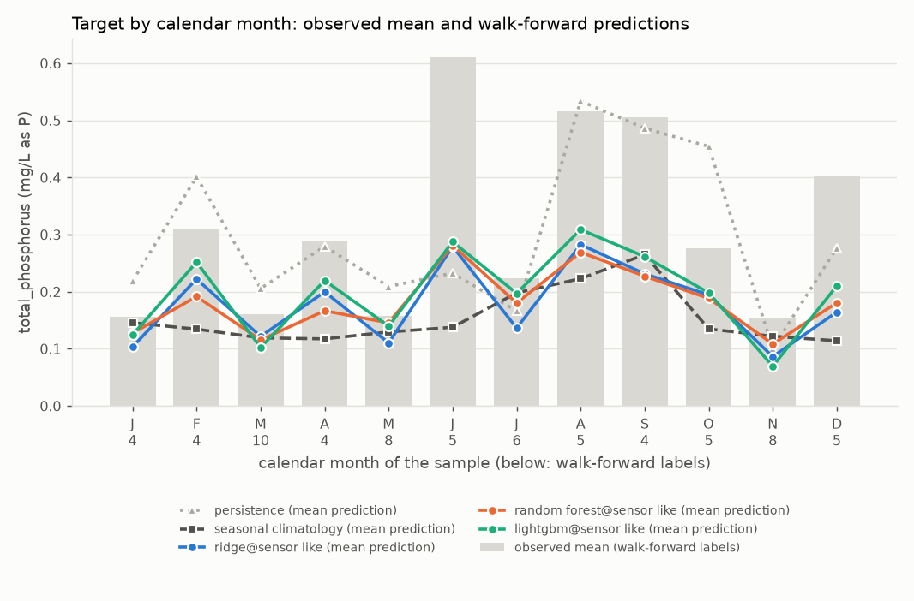
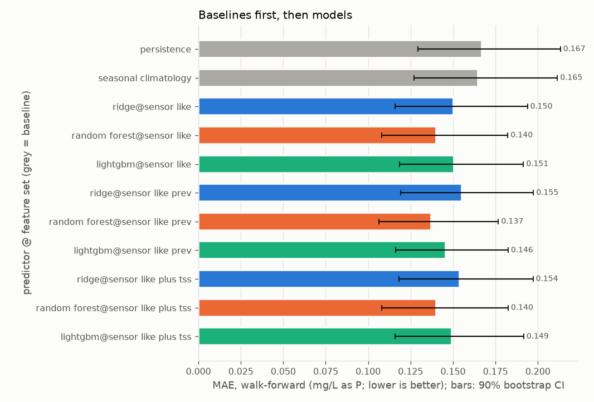
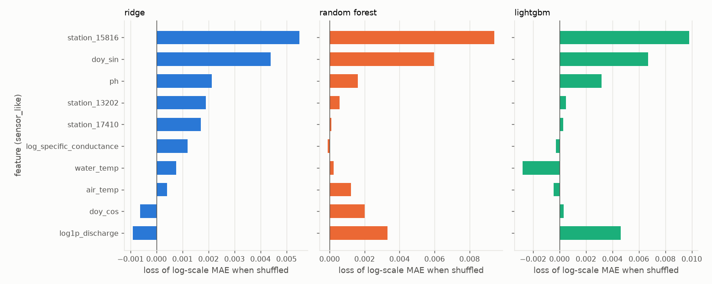

# Report: crp_tp_pooled

Real grab-sample data, `source=CRP` only, labels from 2014-01-01; `quality='good'` rows only. Input `data/clean/crp_long.csv` (SHA-256 `eef7c00928bcd8ce...`). Stations: 13202, 15816, 17410.

Total phosphorus (mg/L as P) at CRP stations 13202, 15816 and 17410, pooled. Regression on the log1p scale. No event target: no threshold is agreed. Features are same-visit readings (a nowcast), not a forecast.

## First lines

### Primary target: regression of total_phosphorus (mg/L as P), fitted on the log1p scale

- Labels used: 131 on 100 distinct dates, 11 left-censored (13202: 35, 15816: 61, 17410: 35).
- Censored labels: left-censored values enter at detection limit x 0.5; 0 right-censored dropped.
- Walk-forward: 7 folds (test years 2018 to 2024), n_train from 38 to 98, n_test = 68 on 53 dates.
- Final hold-out (evaluated once, last 20 distinct dates, from 2024-09-24): n_train = 106, n_holdout = 25.
- **Persistence** means: the last sample at this station, carried forward (the previous label at the same station on a strictly earlier date; with no earlier label, the training median).
- **Seasonal climatology** means: the mean of the training targets within plus or minus 1 calendar month(s) of the test month, pooled over the task's stations (with fewer than 3 training labels in that window, the mean of all training targets).
- Verdicts, walk-forward, headline feature set `sensor_like` (deployable):
  - seasonal climatology shows no demonstrable difference from persistence (MAE difference -0.002, 90% CI [-0.032, +0.026]).
  - ridge on sensor_like (deployable) shows no demonstrable difference from persistence (MAE difference -0.017, 90% CI [-0.046, +0.010]).
  - ridge on sensor_like (deployable) beats seasonal climatology (MAE difference -0.015, 90% CI [-0.031, -0.000]).
  - random_forest on sensor_like (deployable) beats persistence (MAE difference -0.027, 90% CI [-0.056, -0.000]).
  - random_forest on sensor_like (deployable) beats seasonal climatology (MAE difference -0.025, 90% CI [-0.038, -0.013]).
  - lightgbm on sensor_like (deployable) shows no demonstrable difference from persistence (MAE difference -0.016, 90% CI [-0.046, +0.009]).
  - lightgbm on sensor_like (deployable) shows no demonstrable difference from seasonal climatology (MAE difference -0.014, 90% CI [-0.032, +0.003]).
- Verdicts, final hold-out, headline feature set `sensor_like`:
  - seasonal climatology is worse than persistence (MAE difference +0.100, 90% CI [+0.027, +0.184]).
  - ridge on sensor_like (deployable) is worse than persistence (MAE difference +0.097, 90% CI [+0.040, +0.164]).
  - ridge on sensor_like (deployable) shows no demonstrable difference from seasonal climatology (MAE difference -0.004, 90% CI [-0.047, +0.032]).
  - random_forest on sensor_like (deployable) shows no demonstrable difference from persistence (MAE difference +0.057, 90% CI [-0.001, +0.125]).
  - random_forest on sensor_like (deployable) beats seasonal climatology (MAE difference -0.043, 90% CI [-0.087, -0.005]).
  - lightgbm on sensor_like (deployable) shows no demonstrable difference from persistence (MAE difference +0.056, 90% CI [-0.003, +0.127]).
  - lightgbm on sensor_like (deployable) shows no demonstrable difference from seasonal climatology (MAE difference -0.044, 90% CI [-0.101, +0.007]).

## Warnings

- WARNING [regression] n_train below 50 in: 2018 (38), 2019 (44).
- WARNING [regression] feature set sensor_like: only 43% of the 21 labels in 2025 and 2026 have every feature (below 50%); the rest are imputed.
- WARNING [regression] feature set sensor_like_prev: only 43% of the 21 labels in 2025 and 2026 have every feature (below 50%); the rest are imputed.
- WARNING [regression] feature set sensor_like_plus_tss: only 43% of the 21 labels in 2025 and 2026 have every feature (below 50%); the rest are imputed.
- WARNING [regression] 14 of 27 station-years in the test windows have fewer than 4 labels (minimum 1).

## Metrics

### Regression target: regression of total_phosphorus (mg/L as P), fitted on the log1p scale

Folds:

| fold | n_train | n_test | last train date | first test date | last test date |
|---|---|---|---|---|---|
| 2018 | 38 | 7 | 2017-10-18 | 2018-01-25 | 2018-12-18 |
| 2019 | 44 | 15 | 2018-11-20 | 2019-01-29 | 2019-12-18 |
| 2020 | 59 | 8 | 2019-11-05 | 2020-01-28 | 2020-12-14 |
| 2021 | 68 | 14 | 2020-12-14 | 2021-01-19 | 2021-12-14 |
| 2022 | 82 | 8 | 2021-12-14 | 2022-02-23 | 2022-08-30 |
| 2023 | 90 | 9 | 2022-08-30 | 2023-04-19 | 2023-12-19 |
| 2024 | 98 | 7 | 2023-11-29 | 2024-02-27 | 2024-08-28 |
| holdout | 106 | 25 | 2024-08-28 | 2024-09-24 | 2026-04-28 |

#### Walk-forward

All labels: n = 68 on 53 dates (1 left-censored). MAE and RMSE in mg/L as P. Brackets: 90% bootstrap CI over distinct dates.

| predictor | deployable | MAE | RMSE | R2 | MAE (log scale) | skill vs persistence | skill vs climatology |
|---|---|---|---|---|---|---|---|
| persistence | baseline | 0.167 [0.129, 0.213] | 0.257 [0.189, 0.329] | -0.290 [-0.781, -0.011] | 0.120 [0.097, 0.149] | 0.000 [0.000, 0.000] | -0.013 [-0.218, 0.144] |
| seasonal_climatology | baseline | 0.165 [0.127, 0.211] | 0.257 [0.187, 0.330] | -0.284 [-0.530, -0.138] | 0.125 [0.101, 0.156] | 0.013 [-0.169, 0.179] | 0.000 [0.000, 0.000] |
| ridge@sensor_like | yes | 0.150 [0.116, 0.194] | 0.239 [0.171, 0.308] | -0.114 [-0.376, 0.064] | 0.113 [0.090, 0.141] | 0.100 [-0.067, 0.259] | 0.088 [0.001, 0.180] |
| random_forest@sensor_like | yes | 0.140 [0.108, 0.182] | 0.224 [0.162, 0.285] | 0.027 [-0.232, 0.185] | 0.105 [0.083, 0.132] | 0.160 [0.001, 0.314] | 0.149 [0.085, 0.217] |
| lightgbm@sensor_like | yes | 0.151 [0.118, 0.191] | 0.230 [0.165, 0.291] | -0.028 [-0.365, 0.180] | 0.114 [0.093, 0.140] | 0.097 [-0.063, 0.249] | 0.085 [-0.022, 0.178] |
| ridge@sensor_like_prev | yes | 0.155 [0.119, 0.197] | 0.241 [0.173, 0.309] | -0.131 [-0.496, 0.113] | 0.117 [0.093, 0.144] | 0.069 [-0.078, 0.209] | 0.057 [-0.073, 0.172] |
| random_forest@sensor_like_prev | yes | 0.137 [0.106, 0.177] | 0.221 [0.155, 0.285] | 0.051 [-0.162, 0.209] | 0.102 [0.082, 0.127] | 0.178 [0.042, 0.320] | 0.167 [0.087, 0.248] |
| lightgbm@sensor_like_prev | yes | 0.146 [0.116, 0.182] | 0.217 [0.154, 0.276] | 0.086 [-0.198, 0.264] | 0.110 [0.091, 0.132] | 0.126 [-0.032, 0.264] | 0.115 [0.010, 0.206] |
| ridge@sensor_like_plus_tss | NO (diagnostic) | 0.154 [0.118, 0.197] | 0.240 [0.170, 0.310] | -0.123 [-0.368, 0.047] | 0.116 [0.093, 0.143] | 0.078 [-0.085, 0.233] | 0.067 [-0.022, 0.153] |
| random_forest@sensor_like_plus_tss | NO (diagnostic) | 0.140 [0.108, 0.182] | 0.225 [0.162, 0.287] | 0.018 [-0.239, 0.180] | 0.105 [0.083, 0.133] | 0.160 [-0.000, 0.316] | 0.149 [0.084, 0.217] |
| lightgbm@sensor_like_plus_tss | NO (diagnostic) | 0.149 [0.116, 0.192] | 0.232 [0.165, 0.297] | -0.048 [-0.340, 0.150] | 0.112 [0.090, 0.140] | 0.106 [-0.058, 0.263] | 0.095 [0.004, 0.176] |

Numeric-only (uncensored) labels: n = 67 on 52 dates (0 left-censored). MAE and RMSE in mg/L as P. Brackets: 90% bootstrap CI over distinct dates.

| predictor | deployable | MAE | RMSE | R2 | MAE (log scale) | skill vs persistence | skill vs climatology |
|---|---|---|---|---|---|---|---|
| persistence | baseline | 0.169 [0.132, 0.213] | 0.259 [0.193, 0.326] | -0.316 [-0.827, -0.046] | 0.121 [0.098, 0.149] | 0.000 [0.000, 0.000] | -0.020 [-0.230, 0.136] |
| seasonal_climatology | baseline | 0.166 [0.128, 0.207] | 0.258 [0.188, 0.329] | -0.306 [-0.567, -0.156] | 0.125 [0.100, 0.152] | 0.020 [-0.157, 0.187] | 0.000 [0.000, 0.000] |
| ridge@sensor_like | yes | 0.152 [0.115, 0.192] | 0.241 [0.171, 0.310] | -0.137 [-0.413, 0.045] | 0.114 [0.090, 0.139] | 0.100 [-0.057, 0.265] | 0.081 [-0.010, 0.172] |
| random_forest@sensor_like | yes | 0.141 [0.106, 0.179] | 0.225 [0.161, 0.287] | 0.008 [-0.258, 0.182] | 0.105 [0.083, 0.129] | 0.164 [0.017, 0.319] | 0.147 [0.080, 0.216] |
| lightgbm@sensor_like | yes | 0.152 [0.118, 0.189] | 0.231 [0.163, 0.293] | -0.048 [-0.386, 0.176] | 0.115 [0.093, 0.138] | 0.100 [-0.052, 0.252] | 0.081 [-0.024, 0.174] |
| ridge@sensor_like_prev | yes | 0.157 [0.121, 0.196] | 0.243 [0.173, 0.310] | -0.153 [-0.516, 0.100] | 0.118 [0.095, 0.143] | 0.070 [-0.072, 0.222] | 0.051 [-0.083, 0.167] |
| random_forest@sensor_like_prev | yes | 0.138 [0.104, 0.176] | 0.222 [0.155, 0.286] | 0.033 [-0.179, 0.193] | 0.102 [0.080, 0.125] | 0.181 [0.053, 0.321] | 0.164 [0.082, 0.242] |
| lightgbm@sensor_like_prev | yes | 0.148 [0.118, 0.181] | 0.218 [0.155, 0.278] | 0.068 [-0.215, 0.250] | 0.111 [0.092, 0.131] | 0.126 [-0.022, 0.272] | 0.108 [0.002, 0.200] |
| ridge@sensor_like_plus_tss | NO (diagnostic) | 0.155 [0.119, 0.195] | 0.242 [0.169, 0.313] | -0.145 [-0.395, 0.035] | 0.117 [0.093, 0.143] | 0.080 [-0.078, 0.245] | 0.061 [-0.027, 0.149] |
| random_forest@sensor_like_plus_tss | NO (diagnostic) | 0.141 [0.106, 0.179] | 0.226 [0.162, 0.289] | 0.000 [-0.257, 0.173] | 0.105 [0.082, 0.130] | 0.164 [0.013, 0.318] | 0.147 [0.078, 0.217] |
| lightgbm@sensor_like_plus_tss | NO (diagnostic) | 0.150 [0.115, 0.189] | 0.234 [0.164, 0.301] | -0.068 [-0.363, 0.146] | 0.113 [0.090, 0.138] | 0.110 [-0.044, 0.265] | 0.092 [0.005, 0.176] |

Paired differences (lower MAE is better):

| model | baseline | MAE difference (model - baseline) | verdict (by MAE) |
|---|---|---|---|
| persistence | seasonal_climatology | +0.002 [-0.026, +0.032] | no demonstrable difference |
| seasonal_climatology | persistence | -0.002 [-0.032, +0.026] | no demonstrable difference |
| ridge@sensor_like | persistence | -0.017 [-0.046, +0.010] | no demonstrable difference |
| ridge@sensor_like | seasonal_climatology | -0.015 [-0.031, -0.000] | beats |
| random_forest@sensor_like | persistence | -0.027 [-0.056, -0.000] | beats |
| random_forest@sensor_like | seasonal_climatology | -0.025 [-0.038, -0.013] | beats |
| lightgbm@sensor_like | persistence | -0.016 [-0.046, +0.009] | no demonstrable difference |
| lightgbm@sensor_like | seasonal_climatology | -0.014 [-0.032, +0.003] | no demonstrable difference |
| ridge@sensor_like_prev | persistence | -0.012 [-0.038, +0.012] | no demonstrable difference |
| ridge@sensor_like_prev | seasonal_climatology | -0.009 [-0.031, +0.011] | no demonstrable difference |
| random_forest@sensor_like_prev | persistence | -0.030 [-0.057, -0.006] | beats |
| random_forest@sensor_like_prev | seasonal_climatology | -0.028 [-0.043, -0.013] | beats |
| lightgbm@sensor_like_prev | persistence | -0.021 [-0.051, +0.005] | no demonstrable difference |
| lightgbm@sensor_like_prev | seasonal_climatology | -0.019 [-0.038, -0.002] | beats |
| ridge@sensor_like_plus_tss | persistence | -0.013 [-0.044, +0.013] | no demonstrable difference |
| ridge@sensor_like_plus_tss | seasonal_climatology | -0.011 [-0.027, +0.003] | no demonstrable difference |
| random_forest@sensor_like_plus_tss | persistence | -0.027 [-0.056, +0.000] | no demonstrable difference |
| random_forest@sensor_like_plus_tss | seasonal_climatology | -0.025 [-0.038, -0.013] | beats |
| lightgbm@sensor_like_plus_tss | persistence | -0.018 [-0.047, +0.009] | no demonstrable difference |
| lightgbm@sensor_like_plus_tss | seasonal_climatology | -0.016 [-0.031, -0.001] | beats |

#### Final hold-out (evaluated once)

All labels: n = 25 on 20 dates (0 left-censored). MAE and RMSE in mg/L as P. Brackets: 90% bootstrap CI over distinct dates.

| predictor | deployable | MAE | RMSE | R2 | MAE (log scale) | skill vs persistence | skill vs climatology |
|---|---|---|---|---|---|---|---|
| persistence | baseline | 0.134 [0.099, 0.178] | 0.177 [0.128, 0.225] | 0.421 [-0.140, 0.705] | 0.090 [0.068, 0.116] | 0.000 [0.000, 0.000] | 0.427 [0.156, 0.606] |
| seasonal_climatology | baseline | 0.234 [0.162, 0.325] | 0.312 [0.239, 0.388] | -0.788 [-1.968, -0.299] | 0.169 [0.120, 0.230] | -0.746 [-1.536, -0.185] | 0.000 [0.000, 0.000] |
| ridge@sensor_like | yes | 0.231 [0.180, 0.298] | 0.279 [0.219, 0.346] | -0.433 [-1.328, -0.070] | 0.170 [0.138, 0.213] | -0.720 [-1.452, -0.243] | 0.015 [-0.188, 0.159] |
| random_forest@sensor_like | yes | 0.191 [0.140, 0.258] | 0.248 [0.188, 0.316] | -0.133 [-0.857, 0.208] | 0.136 [0.102, 0.178] | -0.424 [-1.061, 0.005] | 0.184 [0.022, 0.310] |
| lightgbm@sensor_like | yes | 0.190 [0.135, 0.258] | 0.251 [0.186, 0.318] | -0.161 [-0.963, 0.247] | 0.137 [0.100, 0.184] | -0.416 [-1.082, 0.017] | 0.189 [-0.034, 0.365] |
| ridge@sensor_like_prev | yes | 0.211 [0.167, 0.270] | 0.250 [0.198, 0.309] | -0.153 [-0.865, 0.128] | 0.153 [0.126, 0.189] | -0.569 [-1.172, -0.193] | 0.102 [-0.106, 0.250] |
| random_forest@sensor_like_prev | yes | 0.176 [0.129, 0.237] | 0.227 [0.171, 0.288] | 0.052 [-0.608, 0.334] | 0.124 [0.095, 0.161] | -0.311 [-0.847, 0.052] | 0.249 [0.115, 0.372] |
| lightgbm@sensor_like_prev | yes | 0.187 [0.140, 0.248] | 0.236 [0.176, 0.298] | -0.025 [-0.765, 0.330] | 0.133 [0.103, 0.171] | -0.392 [-0.910, -0.025] | 0.203 [-0.025, 0.378] |
| ridge@sensor_like_plus_tss | NO (diagnostic) | 0.231 [0.181, 0.298] | 0.279 [0.219, 0.347] | -0.437 [-1.293, -0.074] | 0.171 [0.139, 0.212] | -0.722 [-1.462, -0.241] | 0.014 [-0.189, 0.160] |
| random_forest@sensor_like_plus_tss | NO (diagnostic) | 0.187 [0.135, 0.254] | 0.244 [0.181, 0.315] | -0.100 [-0.818, 0.239] | 0.133 [0.099, 0.175] | -0.390 [-1.012, 0.034] | 0.204 [0.053, 0.332] |
| lightgbm@sensor_like_plus_tss | NO (diagnostic) | 0.187 [0.136, 0.251] | 0.240 [0.175, 0.305] | -0.060 [-0.824, 0.337] | 0.134 [0.100, 0.177] | -0.390 [-0.961, 0.006] | 0.204 [-0.014, 0.369] |

Numeric-only (uncensored) labels: n = 25 on 20 dates (0 left-censored). MAE and RMSE in mg/L as P. Brackets: 90% bootstrap CI over distinct dates.

| predictor | deployable | MAE | RMSE | R2 | MAE (log scale) | skill vs persistence | skill vs climatology |
|---|---|---|---|---|---|---|---|
| persistence | baseline | 0.134 [0.099, 0.178] | 0.177 [0.128, 0.225] | 0.421 [-0.140, 0.705] | 0.090 [0.068, 0.116] | 0.000 [0.000, 0.000] | 0.427 [0.156, 0.606] |
| seasonal_climatology | baseline | 0.234 [0.162, 0.325] | 0.312 [0.239, 0.388] | -0.788 [-1.968, -0.299] | 0.169 [0.120, 0.230] | -0.746 [-1.536, -0.185] | 0.000 [0.000, 0.000] |
| ridge@sensor_like | yes | 0.231 [0.180, 0.298] | 0.279 [0.219, 0.346] | -0.433 [-1.328, -0.070] | 0.170 [0.138, 0.213] | -0.720 [-1.452, -0.243] | 0.015 [-0.188, 0.159] |
| random_forest@sensor_like | yes | 0.191 [0.140, 0.258] | 0.248 [0.188, 0.316] | -0.133 [-0.857, 0.208] | 0.136 [0.102, 0.178] | -0.424 [-1.061, 0.005] | 0.184 [0.022, 0.310] |
| lightgbm@sensor_like | yes | 0.190 [0.135, 0.258] | 0.251 [0.186, 0.318] | -0.161 [-0.963, 0.247] | 0.137 [0.100, 0.184] | -0.416 [-1.082, 0.017] | 0.189 [-0.034, 0.365] |
| ridge@sensor_like_prev | yes | 0.211 [0.167, 0.270] | 0.250 [0.198, 0.309] | -0.153 [-0.865, 0.128] | 0.153 [0.126, 0.189] | -0.569 [-1.172, -0.193] | 0.102 [-0.106, 0.250] |
| random_forest@sensor_like_prev | yes | 0.176 [0.129, 0.237] | 0.227 [0.171, 0.288] | 0.052 [-0.608, 0.334] | 0.124 [0.095, 0.161] | -0.311 [-0.847, 0.052] | 0.249 [0.115, 0.372] |
| lightgbm@sensor_like_prev | yes | 0.187 [0.140, 0.248] | 0.236 [0.176, 0.298] | -0.025 [-0.765, 0.330] | 0.133 [0.103, 0.171] | -0.392 [-0.910, -0.025] | 0.203 [-0.025, 0.378] |
| ridge@sensor_like_plus_tss | NO (diagnostic) | 0.231 [0.181, 0.298] | 0.279 [0.219, 0.347] | -0.437 [-1.293, -0.074] | 0.171 [0.139, 0.212] | -0.722 [-1.462, -0.241] | 0.014 [-0.189, 0.160] |
| random_forest@sensor_like_plus_tss | NO (diagnostic) | 0.187 [0.135, 0.254] | 0.244 [0.181, 0.315] | -0.100 [-0.818, 0.239] | 0.133 [0.099, 0.175] | -0.390 [-1.012, 0.034] | 0.204 [0.053, 0.332] |
| lightgbm@sensor_like_plus_tss | NO (diagnostic) | 0.187 [0.136, 0.251] | 0.240 [0.175, 0.305] | -0.060 [-0.824, 0.337] | 0.134 [0.100, 0.177] | -0.390 [-0.961, 0.006] | 0.204 [-0.014, 0.369] |

Paired differences (lower MAE is better):

| model | baseline | MAE difference (model - baseline) | verdict (by MAE) |
|---|---|---|---|
| persistence | seasonal_climatology | -0.100 [-0.184, -0.027] | beats |
| seasonal_climatology | persistence | +0.100 [+0.027, +0.184] | is worse than |
| ridge@sensor_like | persistence | +0.097 [+0.040, +0.164] | is worse than |
| ridge@sensor_like | seasonal_climatology | -0.004 [-0.047, +0.032] | no demonstrable difference |
| random_forest@sensor_like | persistence | +0.057 [-0.001, +0.125] | no demonstrable difference |
| random_forest@sensor_like | seasonal_climatology | -0.043 [-0.087, -0.005] | beats |
| lightgbm@sensor_like | persistence | +0.056 [-0.003, +0.127] | no demonstrable difference |
| lightgbm@sensor_like | seasonal_climatology | -0.044 [-0.101, +0.007] | no demonstrable difference |
| ridge@sensor_like_prev | persistence | +0.076 [+0.029, +0.134] | is worse than |
| ridge@sensor_like_prev | seasonal_climatology | -0.024 [-0.076, +0.018] | no demonstrable difference |
| random_forest@sensor_like_prev | persistence | +0.042 [-0.008, +0.102] | no demonstrable difference |
| random_forest@sensor_like_prev | seasonal_climatology | -0.058 [-0.105, -0.021] | beats |
| lightgbm@sensor_like_prev | persistence | +0.053 [+0.004, +0.111] | is worse than |
| lightgbm@sensor_like_prev | seasonal_climatology | -0.048 [-0.107, +0.005] | no demonstrable difference |
| ridge@sensor_like_plus_tss | persistence | +0.097 [+0.037, +0.165] | is worse than |
| ridge@sensor_like_plus_tss | seasonal_climatology | -0.003 [-0.048, +0.033] | no demonstrable difference |
| random_forest@sensor_like_plus_tss | persistence | +0.052 [-0.005, +0.121] | no demonstrable difference |
| random_forest@sensor_like_plus_tss | seasonal_climatology | -0.048 [-0.091, -0.010] | beats |
| lightgbm@sensor_like_plus_tss | persistence | +0.052 [-0.001, +0.114] | no demonstrable difference |
| lightgbm@sensor_like_plus_tss | seasonal_climatology | -0.048 [-0.104, +0.003] | no demonstrable difference |

Intervals: split-conformal on absolute walk-forward residuals (transformed scale), level 90%, from 68 residuals, applied to the hold-out predictions.

| model | half-width (transformed scale) | hold-out coverage | median width (mg/L as P) |
|---|---|---|---|
| ridge@sensor_like | 0.292 | 92% | 0.565 |
| random_forest@sensor_like | 0.253 | 84% | 0.530 |
| lightgbm@sensor_like | 0.264 | 88% | 0.540 |
| ridge@sensor_like_prev | 0.296 | 96% | 0.618 |
| random_forest@sensor_like_prev | 0.253 | 88% | 0.627 |
| lightgbm@sensor_like_prev | 0.221 | 80% | 0.554 |
| ridge@sensor_like_plus_tss | 0.281 | 88% | 0.558 |
| random_forest@sensor_like_plus_tss | 0.252 | 88% | 0.543 |
| lightgbm@sensor_like_plus_tss | 0.232 | 84% | 0.550 |

## Slices

### Regression target, walk-forward

**apr_sep**: n = 32 (0 left-censored)

| predictor | MAE | MAE (log scale) | skill vs persistence | skill vs climatology |
|---|---|---|---|---|
| persistence | 0.219 [0.150, 0.301] | 0.151 [0.111, 0.199] | 0.000 [0.000, 0.000] | 0.003 [-0.194, 0.152] |
| seasonal_climatology | 0.219 [0.147, 0.298] | 0.159 [0.113, 0.208] | -0.003 [-0.179, 0.162] | 0.000 [0.000, 0.000] |
| ridge@sensor_like | 0.200 [0.126, 0.280] | 0.143 [0.095, 0.193] | 0.085 [-0.049, 0.239] | 0.088 [-0.039, 0.231] |
| random_forest@sensor_like | 0.192 [0.123, 0.266] | 0.136 [0.092, 0.180] | 0.124 [-0.021, 0.278] | 0.127 [0.040, 0.218] |
| lightgbm@sensor_like | 0.205 [0.135, 0.282] | 0.147 [0.101, 0.194] | 0.063 [-0.096, 0.211] | 0.065 [-0.067, 0.171] |
| ridge@sensor_like_prev | 0.205 [0.130, 0.281] | 0.146 [0.099, 0.195] | 0.065 [-0.082, 0.219] | 0.068 [-0.133, 0.241] |
| random_forest@sensor_like_prev | 0.191 [0.124, 0.265] | 0.135 [0.093, 0.180] | 0.127 [-0.030, 0.285] | 0.129 [0.041, 0.230] |
| lightgbm@sensor_like_prev | 0.196 [0.135, 0.265] | 0.140 [0.102, 0.180] | 0.105 [-0.062, 0.252] | 0.108 [-0.031, 0.231] |
| ridge@sensor_like_plus_tss | 0.209 [0.137, 0.286] | 0.150 [0.105, 0.198] | 0.045 [-0.097, 0.194] | 0.048 [-0.076, 0.173] |
| random_forest@sensor_like_plus_tss | 0.193 [0.124, 0.269] | 0.138 [0.093, 0.182] | 0.117 [-0.033, 0.278] | 0.119 [0.030, 0.212] |
| lightgbm@sensor_like_plus_tss | 0.204 [0.133, 0.284] | 0.146 [0.100, 0.194] | 0.067 [-0.101, 0.235] | 0.069 [-0.031, 0.169] |

**oct_mar**: n = 36 (1 left-censored)

| predictor | MAE | MAE (log scale) | skill vs persistence | skill vs climatology |
|---|---|---|---|---|
| persistence | 0.121 [0.085, 0.164] | 0.092 [0.067, 0.122] | 0.000 [0.000, 0.000] | -0.039 [-0.490, 0.289] |
| seasonal_climatology | 0.116 [0.087, 0.155] | 0.095 [0.072, 0.124] | 0.037 [-0.407, 0.329] | 0.000 [0.000, 0.000] |
| ridge@sensor_like | 0.106 [0.083, 0.137] | 0.087 [0.069, 0.109] | 0.122 [-0.305, 0.409] | 0.088 [-0.050, 0.204] |
| random_forest@sensor_like | 0.095 [0.073, 0.122] | 0.077 [0.060, 0.097] | 0.217 [-0.176, 0.472] | 0.186 [0.075, 0.274] |
| lightgbm@sensor_like | 0.103 [0.084, 0.122] | 0.085 [0.070, 0.099] | 0.152 [-0.246, 0.418] | 0.119 [-0.092, 0.280] |
| ridge@sensor_like_prev | 0.112 [0.089, 0.141] | 0.091 [0.074, 0.113] | 0.076 [-0.312, 0.331] | 0.040 [-0.124, 0.172] |
| random_forest@sensor_like_prev | 0.089 [0.070, 0.113] | 0.072 [0.057, 0.088] | 0.260 [-0.020, 0.460] | 0.231 [0.080, 0.352] |
| lightgbm@sensor_like_prev | 0.101 [0.084, 0.121] | 0.083 [0.070, 0.096] | 0.161 [-0.184, 0.395] | 0.128 [-0.054, 0.268] |
| ridge@sensor_like_plus_tss | 0.105 [0.084, 0.133] | 0.086 [0.069, 0.106] | 0.132 [-0.279, 0.410] | 0.099 [-0.048, 0.219] |
| random_forest@sensor_like_plus_tss | 0.093 [0.072, 0.120] | 0.076 [0.059, 0.095] | 0.229 [-0.157, 0.478] | 0.199 [0.089, 0.287] |
| lightgbm@sensor_like_plus_tss | 0.100 [0.082, 0.122] | 0.082 [0.068, 0.098] | 0.170 [-0.212, 0.417] | 0.138 [-0.045, 0.275] |

**station 13202**: n = 16 (0 left-censored)

| predictor | MAE | MAE (log scale) | skill vs persistence | skill vs climatology |
|---|---|---|---|---|
| persistence | 0.099 [0.075, 0.127] | 0.083 [0.064, 0.105] | 0.000 [0.000, 0.000] | -0.342 [-1.043, 0.033] |
| seasonal_climatology | 0.074 [0.048, 0.101] | 0.063 [0.041, 0.085] | 0.255 [-0.034, 0.511] | 0.000 [0.000, 0.000] |
| ridge@sensor_like | 0.084 [0.060, 0.107] | 0.072 [0.052, 0.091] | 0.150 [-0.155, 0.436] | -0.141 [-0.477, 0.067] |
| random_forest@sensor_like | 0.083 [0.059, 0.106] | 0.071 [0.051, 0.089] | 0.163 [-0.105, 0.424] | -0.123 [-0.450, 0.072] |
| lightgbm@sensor_like | 0.097 [0.076, 0.118] | 0.083 [0.066, 0.100] | 0.024 [-0.323, 0.331] | -0.310 [-0.840, -0.037] |
| ridge@sensor_like_prev | 0.087 [0.064, 0.111] | 0.075 [0.055, 0.094] | 0.120 [-0.140, 0.355] | -0.180 [-0.500, 0.018] |
| random_forest@sensor_like_prev | 0.092 [0.067, 0.118] | 0.078 [0.057, 0.098] | 0.066 [-0.186, 0.284] | -0.253 [-0.742, 0.031] |
| lightgbm@sensor_like_prev | 0.103 [0.082, 0.124] | 0.088 [0.071, 0.105] | -0.044 [-0.391, 0.214] | -0.400 [-1.023, -0.082] |
| ridge@sensor_like_plus_tss | 0.091 [0.064, 0.116] | 0.078 [0.056, 0.099] | 0.081 [-0.241, 0.392] | -0.233 [-0.607, 0.016] |
| random_forest@sensor_like_plus_tss | 0.085 [0.061, 0.108] | 0.072 [0.053, 0.091] | 0.142 [-0.129, 0.405] | -0.151 [-0.483, 0.041] |
| lightgbm@sensor_like_plus_tss | 0.089 [0.064, 0.111] | 0.076 [0.056, 0.094] | 0.106 [-0.235, 0.406] | -0.200 [-0.718, 0.072] |

**station 15816**: n = 35 (1 left-censored)

| predictor | MAE | MAE (log scale) | skill vs persistence | skill vs climatology |
|---|---|---|---|---|
| persistence | 0.228 [0.163, 0.293] | 0.154 [0.114, 0.196] | 0.000 [0.000, 0.000] | 0.052 [-0.187, 0.234] |
| seasonal_climatology | 0.240 [0.178, 0.307] | 0.176 [0.137, 0.218] | -0.055 [-0.306, 0.158] | 0.000 [0.000, 0.000] |
| ridge@sensor_like | 0.209 [0.150, 0.273] | 0.150 [0.112, 0.189] | 0.081 [-0.126, 0.275] | 0.129 [0.030, 0.233] |
| random_forest@sensor_like | 0.193 [0.138, 0.252] | 0.137 [0.103, 0.173] | 0.154 [-0.044, 0.334] | 0.198 [0.126, 0.271] |
| lightgbm@sensor_like | 0.199 [0.142, 0.260] | 0.141 [0.105, 0.179] | 0.128 [-0.067, 0.303] | 0.173 [0.063, 0.283] |
| ridge@sensor_like_prev | 0.213 [0.155, 0.278] | 0.152 [0.115, 0.191] | 0.065 [-0.136, 0.239] | 0.114 [-0.035, 0.250] |
| random_forest@sensor_like_prev | 0.182 [0.124, 0.244] | 0.127 [0.091, 0.163] | 0.200 [0.037, 0.373] | 0.241 [0.169, 0.332] |
| lightgbm@sensor_like_prev | 0.187 [0.135, 0.245] | 0.132 [0.099, 0.166] | 0.178 [0.002, 0.340] | 0.220 [0.123, 0.320] |
| ridge@sensor_like_plus_tss | 0.210 [0.151, 0.273] | 0.150 [0.113, 0.189] | 0.077 [-0.126, 0.267] | 0.125 [0.035, 0.223] |
| random_forest@sensor_like_plus_tss | 0.191 [0.137, 0.252] | 0.135 [0.101, 0.173] | 0.161 [-0.039, 0.344] | 0.204 [0.129, 0.282] |
| lightgbm@sensor_like_plus_tss | 0.202 [0.144, 0.265] | 0.144 [0.108, 0.181] | 0.114 [-0.081, 0.290] | 0.160 [0.060, 0.261] |

**station 17410**: n = 17 (0 left-censored)

| predictor | MAE | MAE (log scale) | skill vs persistence | skill vs climatology |
|---|---|---|---|---|
| persistence | 0.106 [0.070, 0.146] | 0.085 [0.059, 0.116] | 0.000 [0.000, 0.000] | -0.109 [-0.727, 0.212] |
| seasonal_climatology | 0.095 [0.058, 0.136] | 0.079 [0.050, 0.110] | 0.098 [-0.269, 0.421] | 0.000 [0.000, 0.000] |
| ridge@sensor_like | 0.091 [0.050, 0.134] | 0.076 [0.043, 0.109] | 0.139 [-0.222, 0.488] | 0.045 [-0.214, 0.296] |
| random_forest@sensor_like | 0.086 [0.046, 0.131] | 0.072 [0.040, 0.106] | 0.181 [-0.154, 0.511] | 0.091 [-0.064, 0.289] |
| lightgbm@sensor_like | 0.103 [0.066, 0.142] | 0.087 [0.058, 0.116] | 0.024 [-0.379, 0.348] | -0.082 [-0.355, 0.081] |
| ridge@sensor_like_prev | 0.101 [0.061, 0.144] | 0.085 [0.053, 0.118] | 0.042 [-0.281, 0.339] | -0.062 [-0.340, 0.160] |
| random_forest@sensor_like_prev | 0.087 [0.054, 0.121] | 0.072 [0.047, 0.098] | 0.180 [-0.139, 0.424] | 0.090 [-0.202, 0.285] |
| lightgbm@sensor_like_prev | 0.100 [0.070, 0.134] | 0.084 [0.061, 0.109] | 0.049 [-0.371, 0.353] | -0.055 [-0.386, 0.132] |
| ridge@sensor_like_plus_tss | 0.097 [0.056, 0.140] | 0.081 [0.049, 0.115] | 0.082 [-0.286, 0.413] | -0.019 [-0.273, 0.193] |
| random_forest@sensor_like_plus_tss | 0.087 [0.047, 0.133] | 0.072 [0.040, 0.107] | 0.172 [-0.178, 0.500] | 0.081 [-0.061, 0.270] |
| lightgbm@sensor_like_plus_tss | 0.098 [0.059, 0.140] | 0.082 [0.052, 0.114] | 0.071 [-0.325, 0.425] | -0.030 [-0.258, 0.137] |

### Regression target, final hold-out

**apr_sep**: n = 10 (0 left-censored)

| predictor | MAE | MAE (log scale) | skill vs persistence | skill vs climatology |
|---|---|---|---|---|
| persistence | 0.158 [0.082, 0.251] | 0.105 [0.058, 0.164] | 0.000 [0.000, 0.000] | 0.262 [-0.450, 0.653] |
| seasonal_climatology | 0.213 [0.125, 0.338] | 0.156 [0.094, 0.242] | -0.355 [-1.879, 0.310] | 0.000 [0.000, 0.000] |
| ridge@sensor_like | 0.183 [0.134, 0.259] | 0.133 [0.102, 0.180] | -0.163 [-1.457, 0.327] | 0.142 [-0.198, 0.308] |
| random_forest@sensor_like | 0.169 [0.112, 0.250] | 0.122 [0.084, 0.174] | -0.073 [-1.268, 0.403] | 0.209 [-0.158, 0.427] |
| lightgbm@sensor_like | 0.203 [0.129, 0.303] | 0.149 [0.096, 0.218] | -0.289 [-1.582, 0.245] | 0.049 [-0.417, 0.350] |
| ridge@sensor_like_prev | 0.178 [0.134, 0.244] | 0.128 [0.103, 0.165] | -0.132 [-1.184, 0.262] | 0.165 [-0.225, 0.351] |
| random_forest@sensor_like_prev | 0.167 [0.105, 0.258] | 0.118 [0.078, 0.175] | -0.062 [-0.984, 0.376] | 0.216 [-0.080, 0.406] |
| lightgbm@sensor_like_prev | 0.207 [0.134, 0.305] | 0.147 [0.100, 0.213] | -0.314 [-1.315, 0.174] | 0.030 [-0.514, 0.328] |
| ridge@sensor_like_plus_tss | 0.179 [0.124, 0.264] | 0.130 [0.096, 0.181] | -0.139 [-1.445, 0.359] | 0.159 [-0.139, 0.313] |
| random_forest@sensor_like_plus_tss | 0.165 [0.107, 0.247] | 0.119 [0.080, 0.170] | -0.046 [-1.183, 0.422] | 0.229 [-0.122, 0.437] |
| lightgbm@sensor_like_plus_tss | 0.207 [0.131, 0.317] | 0.150 [0.100, 0.226] | -0.311 [-1.371, 0.188] | 0.033 [-0.455, 0.331] |

**oct_mar**: n = 15 (0 left-censored)

| predictor | MAE | MAE (log scale) | skill vs persistence | skill vs climatology |
|---|---|---|---|---|
| persistence | 0.119 [0.092, 0.152] | 0.080 [0.065, 0.097] | 0.000 [0.000, 0.000] | 0.522 [0.351, 0.631] |
| seasonal_climatology | 0.248 [0.158, 0.368] | 0.178 [0.116, 0.262] | -1.092 [-1.710, -0.540] | 0.000 [0.000, 0.000] |
| ridge@sensor_like | 0.263 [0.192, 0.351] | 0.195 [0.149, 0.252] | -1.212 [-1.804, -0.739] | -0.057 [-0.322, 0.131] |
| random_forest@sensor_like | 0.206 [0.133, 0.296] | 0.146 [0.097, 0.205] | -0.736 [-1.325, -0.234] | 0.170 [0.002, 0.322] |
| lightgbm@sensor_like | 0.181 [0.113, 0.264] | 0.129 [0.082, 0.182] | -0.528 [-1.187, -0.009] | 0.270 [0.052, 0.455] |
| ridge@sensor_like_prev | 0.232 [0.168, 0.311] | 0.170 [0.128, 0.216] | -0.955 [-1.497, -0.530] | 0.066 [-0.200, 0.254] |
| random_forest@sensor_like_prev | 0.182 [0.122, 0.257] | 0.127 [0.090, 0.174] | -0.531 [-1.026, -0.124] | 0.268 [0.109, 0.413] |
| lightgbm@sensor_like_prev | 0.173 [0.122, 0.239] | 0.124 [0.091, 0.163] | -0.462 [-0.982, -0.008] | 0.301 [0.068, 0.488] |
| ridge@sensor_like_plus_tss | 0.265 [0.198, 0.350] | 0.198 [0.155, 0.251] | -1.237 [-1.844, -0.767] | -0.069 [-0.359, 0.131] |
| random_forest@sensor_like_plus_tss | 0.201 [0.129, 0.290] | 0.142 [0.095, 0.201] | -0.695 [-1.294, -0.207] | 0.190 [0.034, 0.340] |
| lightgbm@sensor_like_plus_tss | 0.173 [0.118, 0.241] | 0.123 [0.086, 0.164] | -0.460 [-1.017, -0.032] | 0.302 [0.102, 0.466] |

**station 13202**: n = 5 (0 left-censored)

| predictor | MAE | MAE (log scale) | skill vs persistence | skill vs climatology |
|---|---|---|---|---|
| persistence | 0.054 [0.035, 0.074] | 0.045 [0.030, 0.061] | 0.000 [0.000, 0.000] | -0.391 [-2.896, -0.022] |
| seasonal_climatology | 0.039 [0.010, 0.078] | 0.032 [0.008, 0.064] | 0.281 [0.022, 0.743] | 0.000 [0.000, 0.000] |
| ridge@sensor_like | 0.140 [0.104, 0.181] | 0.126 [0.093, 0.161] | -1.590 [-3.318, -0.647] | -2.602 [-13.688, -0.749] |
| random_forest@sensor_like | 0.072 [0.043, 0.110] | 0.062 [0.037, 0.094] | -0.325 [-0.968, 0.175] | -0.843 [-5.339, 0.181] |
| lightgbm@sensor_like | 0.063 [0.018, 0.108] | 0.054 [0.016, 0.093] | -0.156 [-0.903, 0.638] | -0.608 [-4.416, 0.526] |
| ridge@sensor_like_prev | 0.129 [0.089, 0.170] | 0.115 [0.080, 0.150] | -1.378 [-3.149, -0.419] | -2.307 [-12.920, -0.522] |
| random_forest@sensor_like_prev | 0.069 [0.050, 0.089] | 0.058 [0.043, 0.074] | -0.279 [-0.625, -0.129] | -0.779 [-4.722, -0.167] |
| lightgbm@sensor_like_prev | 0.082 [0.067, 0.097] | 0.070 [0.057, 0.083] | -0.515 [-1.347, -0.088] | -1.107 [-8.037, -0.174] |
| ridge@sensor_like_plus_tss | 0.149 [0.117, 0.182] | 0.134 [0.105, 0.164] | -1.747 [-3.814, -0.830] | -2.820 [-14.882, -0.898] |
| random_forest@sensor_like_plus_tss | 0.071 [0.043, 0.108] | 0.061 [0.037, 0.092] | -0.302 [-0.941, 0.204] | -0.812 [-5.209, 0.185] |
| lightgbm@sensor_like_plus_tss | 0.090 [0.065, 0.111] | 0.079 [0.057, 0.097] | -0.661 [-1.591, -0.136] | -1.310 [-8.135, -0.105] |

**station 15816**: n = 14 (0 left-censored)

| predictor | MAE | MAE (log scale) | skill vs persistence | skill vs climatology |
|---|---|---|---|---|
| persistence | 0.189 [0.138, 0.244] | 0.118 [0.084, 0.154] | 0.000 [0.000, 0.000] | 0.497 [0.237, 0.680] |
| seasonal_climatology | 0.376 [0.298, 0.449] | 0.267 [0.213, 0.315] | -0.989 [-2.124, -0.311] | 0.000 [0.000, 0.000] |
| ridge@sensor_like | 0.321 [0.258, 0.388] | 0.223 [0.181, 0.268] | -0.697 [-1.621, -0.137] | 0.147 [0.035, 0.245] |
| random_forest@sensor_like | 0.287 [0.225, 0.356] | 0.197 [0.157, 0.241] | -0.516 [-1.362, -0.004] | 0.238 [0.121, 0.348] |
| lightgbm@sensor_like | 0.285 [0.221, 0.361] | 0.197 [0.153, 0.248] | -0.508 [-1.365, 0.015] | 0.242 [0.070, 0.407] |
| ridge@sensor_like_prev | 0.289 [0.240, 0.344] | 0.196 [0.164, 0.232] | -0.527 [-1.278, -0.079] | 0.232 [0.110, 0.341] |
| random_forest@sensor_like_prev | 0.260 [0.202, 0.322] | 0.175 [0.138, 0.216] | -0.373 [-1.101, 0.074] | 0.310 [0.189, 0.422] |
| lightgbm@sensor_like_prev | 0.263 [0.200, 0.331] | 0.177 [0.135, 0.222] | -0.389 [-1.097, 0.035] | 0.302 [0.109, 0.463] |
| ridge@sensor_like_plus_tss | 0.319 [0.253, 0.389] | 0.221 [0.177, 0.267] | -0.686 [-1.609, -0.109] | 0.152 [0.043, 0.247] |
| random_forest@sensor_like_plus_tss | 0.281 [0.218, 0.351] | 0.192 [0.151, 0.238] | -0.486 [-1.295, 0.019] | 0.253 [0.142, 0.362] |
| lightgbm@sensor_like_plus_tss | 0.271 [0.209, 0.342] | 0.184 [0.142, 0.234] | -0.434 [-1.201, 0.030] | 0.279 [0.113, 0.428] |

**station 17410**: n = 6 (0 left-censored)

| predictor | MAE | MAE (log scale) | skill vs persistence | skill vs climatology |
|---|---|---|---|---|
| persistence | 0.073 [0.031, 0.117] | 0.061 [0.027, 0.097] | 0.000 [0.000, 0.000] | -0.096 [-1.265, 0.518] |
| seasonal_climatology | 0.066 [0.034, 0.099] | 0.055 [0.029, 0.082] | 0.088 [-1.074, 0.558] | 0.000 [0.000, 0.000] |
| ridge@sensor_like | 0.096 [0.050, 0.154] | 0.085 [0.045, 0.133] | -0.318 [-1.502, 0.250] | -0.444 [-1.345, 0.276] |
| random_forest@sensor_like | 0.068 [0.035, 0.107] | 0.058 [0.031, 0.089] | 0.071 [-0.901, 0.520] | -0.018 [-1.002, 0.544] |
| lightgbm@sensor_like | 0.074 [0.038, 0.112] | 0.064 [0.033, 0.097] | -0.017 [-1.417, 0.510] | -0.115 [-1.512, 0.512] |
| ridge@sensor_like_prev | 0.096 [0.049, 0.158] | 0.085 [0.043, 0.136] | -0.317 [-1.581, 0.311] | -0.444 [-1.298, 0.268] |
| random_forest@sensor_like_prev | 0.070 [0.040, 0.110] | 0.059 [0.034, 0.092] | 0.045 [-0.568, 0.375] | -0.047 [-0.966, 0.462] |
| lightgbm@sensor_like_prev | 0.097 [0.066, 0.132] | 0.083 [0.056, 0.112] | -0.337 [-1.524, 0.110] | -0.466 [-1.713, 0.107] |
| ridge@sensor_like_plus_tss | 0.095 [0.050, 0.144] | 0.084 [0.046, 0.127] | -0.301 [-1.392, 0.181] | -0.426 [-1.532, 0.289] |
| random_forest@sensor_like_plus_tss | 0.063 [0.033, 0.102] | 0.054 [0.029, 0.085] | 0.135 [-0.736, 0.540] | 0.052 [-0.889, 0.569] |
| lightgbm@sensor_like_plus_tss | 0.070 [0.028, 0.112] | 0.061 [0.025, 0.098] | 0.044 [-1.526, 0.649] | -0.048 [-1.633, 0.624] |

## Leakage checks

### Regression target

(a) Truncation: features rebuilt with every later row removed.

- `sensor_like`: PASS; 100 issue dates, 137 rows compared.
- `sensor_like_prev`: PASS; 100 issue dates, 137 rows compared.
- `sensor_like_plus_tss`: PASS; 100 issue dates, 137 rows compared.

(b) Shuffled training labels, 5 repeats (seeds [11, 12, 13, 14, 15]), scored on the 68 real walk-forward labels. MAE (transformed scale); reference = MAE of the training-mean predictor (transformed scale) = 0.124; suspected when the mean MAE skill against the training mean exceeds 0.10 (PLACEHOLDER).

| model | mean | per seed | result |
|---|---|---|---|
| ridge@sensor_like | 0.129 | 0.130, 0.124, 0.137, 0.119, 0.137 | ok |
| random_forest@sensor_like | 0.127 | 0.126, 0.122, 0.134, 0.123, 0.127 | ok |
| lightgbm@sensor_like | 0.134 | 0.134, 0.133, 0.134, 0.134, 0.136 | ok |
| ridge@sensor_like_prev | 0.130 | 0.138, 0.125, 0.132, 0.122, 0.132 | ok |
| random_forest@sensor_like_prev | 0.123 | 0.126, 0.117, 0.127, 0.124, 0.121 | ok |
| lightgbm@sensor_like_prev | 0.135 | 0.135, 0.134, 0.125, 0.146, 0.132 | ok |
| ridge@sensor_like_plus_tss | 0.130 | 0.130, 0.124, 0.138, 0.123, 0.136 | ok |
| random_forest@sensor_like_plus_tss | 0.127 | 0.125, 0.123, 0.135, 0.121, 0.129 | ok |
| lightgbm@sensor_like_plus_tss | 0.134 | 0.136, 0.132, 0.140, 0.125, 0.134 | ok |

(c) Leaky-feature guard: assert_no_future_dependence (the truncation guard) raises on a feature built from the next sample's target; asserted by tests/ml/test_drills.py::test_leaky_feature_trips_the_guard.

(d) what a random split would have claimed; NOT a valid estimate. Random 5-fold over the 106 labels before the hold-out, MAE (transformed scale):

| model | random split (NOT valid) | walk-forward (valid) |
|---|---|---|
| ridge@sensor_like | 0.098 | 0.113 |
| random_forest@sensor_like | 0.088 | 0.105 |
| lightgbm@sensor_like | 0.097 | 0.114 |

## Feature availability

### Regression target

| feature set | deployable | columns | complete cases, all labels | complete cases, last two calendar years | most-missing features (share missing) |
|---|---|---|---|---|---|
| sensor_like | yes | 10 | 75% of 131 | 43% of 21 (2025 and 2026) | ph 20%, log_specific_conductance 15%, water_temp 13%, log1p_discharge 12% |
| sensor_like_prev | yes | 12 | 73% of 131 | 43% of 21 (2025 and 2026) | ph 20%, log_specific_conductance 15%, water_temp 13%, log1p_discharge 12% |
| sensor_like_plus_tss | NO (diagnostic) | 11 | 73% of 131 | 43% of 21 (2025 and 2026) | ph 20%, log_specific_conductance 15%, water_temp 13%, log1p_discharge 12% |

Missing values are imputed with the training-fold median inside each fold, with a missing-indicator column. Same-visit measurements are same-date readings (a nowcast).

## Permutation importance

### Regression target (`sensor_like`)

permutation importance on the walk-forward test rows: mean drop in negative MAE (transformed scale) when one feature is shuffled within each fold's test rows. Positive = the model relies on the feature. Other feature sets are in metrics.json.

| feature | ridge@sensor_like | random_forest@sensor_like | lightgbm@sensor_like |
|---|---|---|---|
| station_15816 | +0.005 | +0.009 | +0.010 |
| doy_sin | +0.004 | +0.006 | +0.007 |
| ph | +0.002 | +0.002 | +0.003 |
| station_13202 | +0.002 | +0.001 | +0.000 |
| station_17410 | +0.002 | +0.000 | +0.000 |
| log_specific_conductance | +0.001 | -0.000 | -0.000 |
| water_temp | +0.001 | +0.000 | -0.003 |
| air_temp | +0.000 | +0.001 | -0.000 |
| doy_cos | -0.001 | +0.002 | +0.000 |
| log1p_discharge | -0.001 | +0.003 | +0.005 |

## Figures

## What this does and does not show

This shows how each predictor scored on 68 out-of-sample CRP labels (walk-forward, test years 2018 to 2024) when given readings from the same visit: a nowcast of the sample-date value, not a forecast for a later date. A model is said to beat a baseline only where the 90% interval of the paired difference excludes zero; the verdict lines at the top state the outcome for each baseline, and the same sentence form is used for every outcome. Seasonal climatology knows only the calendar month. A model that shows no demonstrable difference from it has not been shown to know more than the season. The final hold-out has 25 labels and was evaluated once; its intervals are wide and it cannot settle a close comparison. It does not show river performance of our own nodes: the inputs are CRP field and lab readings, not sensor data, and many recent rows have no field readings (see Feature availability). Feature sets marked NO (diagnostic) use a lab value from the same visit and say nothing about what a node could do. No hyperparameter was tuned, no result was used to choose a setting, and real and simulated data are not mixed.
